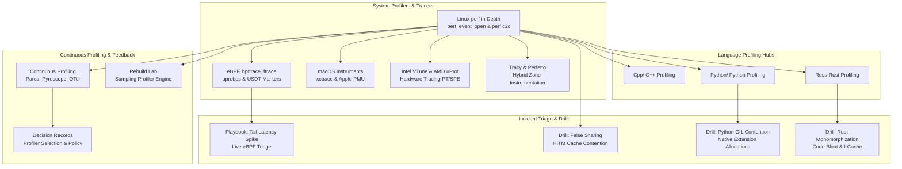

# Profiling

This folder provides a complete curriculum on system profiling, application performance diagnosis, and runtime telemetry across C++, Python, and Rust.
It covers operating system profilers including Linux perf, eBPF tracing with bpftrace, macOS Instruments, and hardware instruction tracing.
It details language-specific runtime diagnostics, including Clang compile-time tracing, Python PEP 799 Tachyon sampling, and Rust Criterion benchmarks.
Finally, it establishes fleet-wide continuous profiling infrastructure, automated compiler feedback pipelines via PGO and BOLT, and incident triage playbooks.

### Learning order

1. [[Linux-perf-in-Depth-and-perf-c2c]]
2. [[eBPF-bpftrace-ftrace-uprobes-and-USDT]]
3. [[macOS-Instruments-xctrace-and-DTrace]]
4. [[Intel-VTune-AMD-uProf-and-Hardware-Tracing-PT-SPE]]
5. [[Tracy-and-Perfetto-Hybrid-Profilers]]
6. [[Continuous-Profiling-GWP-Parca-Pyroscope-and-OTel-Profiles]]
7. [[Profiling-Decision-Records]]
8. [[Rebuild-Lab-Sampling-Profiler-to-Folded-Stacks]]
9. [[Cpp/README|Cpp/README]]
10. [[Python/README|Python/README]]
11. [[Rust/README|Rust/README]]
12. [[Playbook-Diagnose-a-Production-Tail-Latency-Spike-with-eBPF-and-perf]]
13. [[Drill-Profiling-False-Sharing-Cache-Contention]]
14. [[Drill-Profiling-Python-C-Extension-GIL-and-Allocation-Bottleneck]]
15. [[Drill-Profiling-Rust-Monomorphization-and-Inlining-Regression]]

Related books: For foundational profiling guides and CPU architecture demonstrations, see [[12-Performance-Engineering/02-Profiling/profiling_guide|Profiling Guide]] and [[12-Performance-Engineering/01-Cpu-Architecture/false_sharing.cpp|False Sharing Lab]]. For Linux tracing mechanisms and incident response one-liners, see [[15-Technical-Whitepapers/01-Systems-Performance-and-Tracing/Linux-Tracing-and-Instrumentation|Linux Tracing]] and [[19-Shell-and-Unix-Engineering/20-Observability-and-Incident-Response/bpftrace-One-Liners|bpftrace One-Liners]].

<!-- moc:start (generated by tools/build_mocs.py; edits inside are overwritten) -->
## Also in this folder

**Notes**

- [Profiling Skill Ladder](Profiling-Skill-Ladder.md)
- [Profiling Topic Inventory](Profiling-Topic-Inventory.md)

<!-- moc:end -->
