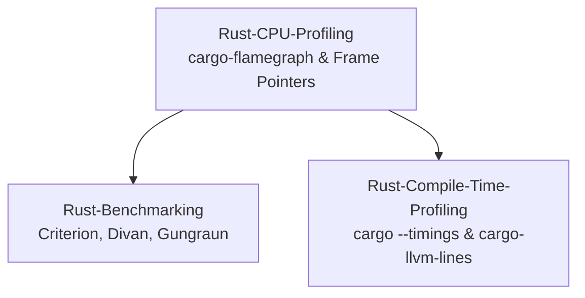

# Rust Profiling

This subfolder owns the Rust performance profiling curriculum, covering native CPU flame graphs, statistical benchmarking, deterministic CI instruction counting, and monomorphization analysis.
It details the operation of cargo-flamegraph and samply, evaluating standard library frame pointer configurations.
It covers statistical benchmarking with Criterion.rs and Divan, alongside deterministic Valgrind-based instruction and cache simulation with Gungraun.
Engineers learn to identify compile-time bottlenecks and binary weight inflation using cargo build --timings, cargo-bloat, and cargo-llvm-lines.

### Learning order

1. [[Rust-CPU-Profiling-cargo-flamegraph-samply-and-Frame-Pointers]]
2. [[Rust-Benchmarking-Criterion-Divan-Gungraun-and-dhat]]
3. [[Rust-Compile-Time-and-Binary-Size-Profiling]]

Related books: For low-latency critical path optimization and cache-conscious data layout, consult [[14-Low-Latency-Systems/11 - Participant-Side Systems/Tick-to-Trade Critical Path Optimization|Tick-to-Trade Critical Path Optimization]].
