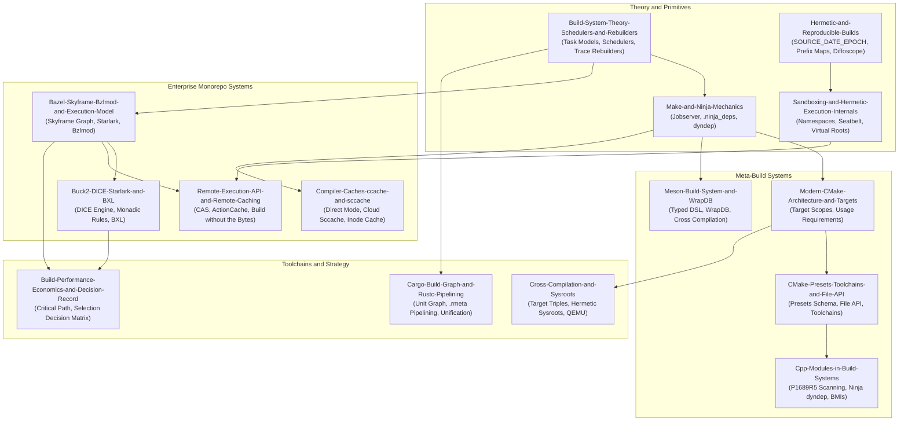

# Build Systems and Compilation Architecture

This pillar covers the complete engineering principles, formal theory, execution mechanics, and distributed scaling of software build systems.
It develops the depth ladder from target-centric CMake configuration and low-level Ninja execution internals up through reproducible hermetic builds, distributed Remote Execution API caching, and multi-language monorepo orchestrators.
It establishes strict ownership over task dependency scheduling, constructive trace caching, OS-level sandboxing, C++20 module compilation graphs, and build economics.
The material prepares software engineers and platform architects to diagnose subtle cache invalidations, break serialized critical-path compilation bottlenecks, and design enterprise build infrastructure.

## Learning order

1. [[Build-System-Theory-Schedulers-and-Rebuilders]]
2. [[Hermetic-and-Reproducible-Builds]]
3. [[Sandboxing-and-Hermetic-Execution-Internals]]
4. [[Make-and-Ninja-Mechanics]]
5. [[Modern-CMake-Architecture-and-Targets]]
6. [[CMake-Presets-Toolchains-and-File-API]]
7. [[Meson-Build-System-and-WrapDB]]
8. [[Cpp-Modules-in-Build-Systems]]
9. [[Bazel-Skyframe-Bzlmod-and-Execution-Model]]
10. [[Buck2-DICE-Starlark-and-BXL]]
11. [[Remote-Execution-API-and-Remote-Caching]]
12. [[Compiler-Caches-ccache-and-sccache]]
13. [[Cross-Compilation-and-Sysroots]]
14. [[Cargo-Build-Graph-and-Rustc-Pipelining]]
15. [[Build-Performance-Economics-and-Decision-Record]]
16. [[Diagnose-Bazel-and-Buck2-Cache-Misses]]
17. [[Migrate-a-Polyglot-Codebase-to-Hermetic-Builds]]
18. [[Rebuild-Content-Hashed-Build-System-Lab]]
19. [[Drill-Build-Systems-Hunt-Non-Determinism-with-Diffoscope]]
20. [[Drill-Build-Systems-Fix-Broken-Incremental-Depfile]]
21. [[Drill-Build-Systems-Break-a-Dependency-Bottleneck]]

Related books: [[19-Shell-and-Unix-Engineering/18-Build-Packaging-and-Bootstrap/README.md|19-Shell-and-Unix-Engineering (Build, Packaging, and Bootstrap)]] covers low-level Makefile shell execution, autotools, and package build scripts; [[02-Programming-Languages/C++/CPP_Zero_to_Godhood/Volume_09_Specialized_Mastery/Chapter_110_Build_Systems_and_Tooling/Chapter_110_Build_Systems_Dependency_Management_and_Tooling.md|C++ Chapter 110]] grounds foundational build mechanics.

<!-- moc:start (generated by tools/build_mocs.py; edits inside are overwritten) -->
## Also in this folder

**Notes**

- [Build Systems Skill Ladder](Build-Systems-Skill-Ladder.md)
- [Build Systems Topic Inventory](Build-Systems-Topic-Inventory.md)

<!-- moc:end -->
