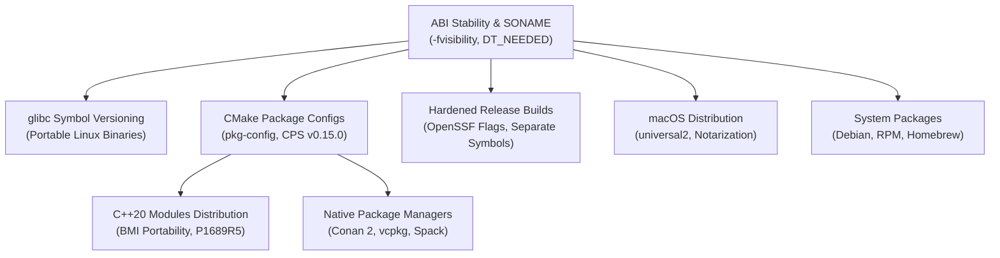

# C++ Packaging and Release Engineering

C and C++ packaging addresses the challenges of binary interface stability, dynamic loader mechanics, and native dependency distribution.
This section details the Itanium C++ ABI, symbol visibility controls, glibc symbol versioning for portable Linux binaries, and modern package discovery via CMake configs and the Common Package Specification.
It covers native package management with Conan 2, vcpkg, and Spack, hardened compiler flags, and platform-specific code signing and notarization on macOS.

## Learning order

1. [[Cpp-ABI-Stability-Symbol-Visibility-and-SONAME]]
2. [[Cpp-Glibc-Symbol-Versioning-and-Portable-Linux-Binaries]]
3. [[Cpp-CMake-Package-Configs-pkg-config-and-CPS]]
4. [[Cpp-Distributing-Cxx20-Modules]]
5. [[Cpp-Conan-2-Architecture-and-Binary-Model]]
6. [[Cpp-vcpkg-Manifests-Registries-and-Binary-Caching]]
7. [[Cpp-Spack-and-Nix-for-Native-Dependencies]]
8. [[Cpp-System-Packaging-Deb-RPM-and-Homebrew]]
9. [[Cpp-Hardened-Release-Builds-and-Separate-Debug-Symbols]]
10. [[Cpp-macOS-Universal-Binaries-Code-Signing-and-Notarization]]

Related books: [[02-Programming-Languages/C++/CPP_Zero_to_Godhood/Volume_08_Advanced_Systems/Chapter_102_Linking_Loading_ABI/Chapter_102_Linking_Loading_ABI_and_WPO.md|C++ Zero to Godhood (Linking and Loading)]] and [[19-Shell-and-Unix-Engineering/18-Build-Packaging-and-Bootstrap/Debian-Maintainer-Scripts.md|19-Shell-and-Unix-Engineering (Debian Packaging)]].
