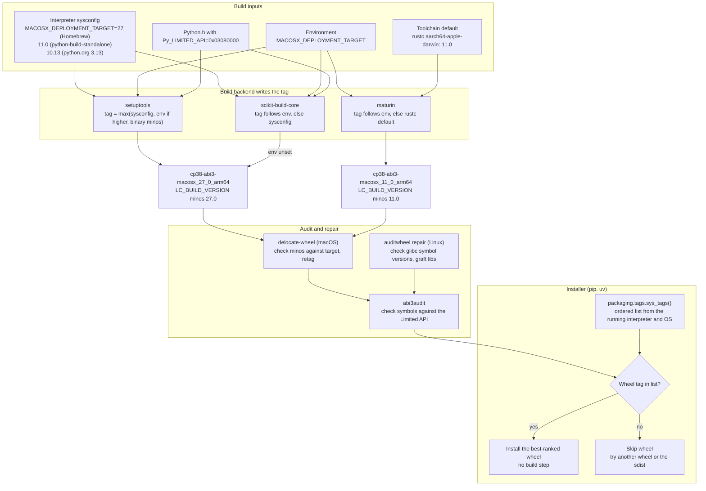

# Python Wheels: Platform Tags, manylinux Baselines, and the abi3 Stable API

> [!summary] Claim:
> A wheel's filename tag `{python}-{abi}-{platform}` is a promise written by the build backend, and installers trust it without inspecting the binary.
> The `abi3` tag promises that the extension uses only the Limited API, so one build loads on every later CPython that uses the GIL.
> The platform tag promises a minimum OS: a glibc or musl version on Linux, or a minimum macOS version on macOS.
> Each backend derives that promise from different inputs: the interpreter's `sysconfig`, `MACOSX_DEPLOYMENT_TARGET`, or a toolchain default.
> An expert checks the binary against the tag with `auditwheel`, `delocate`, `abi3audit`, and an import test on the oldest Python the tag claims.



## The Mechanism

### The wheel archive (PEP 427)

A wheel is a ZIP archive with a fixed filename grammar: `{distribution}-{version}(-{build tag})?-{python tag}-{abi tag}-{platform tag}.whl`.
The optional build tag must start with a digit and only breaks ties between otherwise identical filenames.
The `.dist-info/` directory must contain at least `METADATA`, `WHEEL`, and `RECORD`; `entry_points.txt` and `top_level.txt` are optional.
`WHEEL` carries `Wheel-Version: 1.0`, `Generator`, `Root-Is-Purelib`, and one `Tag:` line per supported tag triple.
`Root-Is-Purelib: false` sends the archive root to `platlib`, which is what every native extension wheel declares.
`RECORD` is a CSV of `path,hash,size`, where the hash is `sha256=` followed by the URL-safe base64 digest with `=` padding stripped.
`RECORD` lists itself with empty hash and size, because a file cannot contain its own hash.
The spec requires the hash to be sha256 or stronger and says installation fails if a file is missing from `RECORD` or hashes differently.
Installing a wheel runs no project code: the installer unpacks files, writes `RECORD` and `INSTALLER`, generates console-script launchers, and optionally byte-compiles.
PEP 491 proposed Wheel 1.9 in 2015 and is Deferred, so every wheel built today still says `Wheel-Version: 1.0` (as of 2026-10).

### The tag triple and how installers rank it (PEP 425, packaging.tags)

The python tag names the implementation and version, such as `cp312` or `py3`.
The ABI tag names the binary contract: `cp312` for the version-specific ABI, `abi3` for the stable ABI, `cp314t` for a free-threaded build, and `none` for no extension modules.
The platform tag is `sysconfig.get_platform()` with `-` and `.` replaced by `_`, such as `macosx_11_0_arm64` or `win_amd64`, unless a repair tool rewrites it.
In `cp38-abi3`, the python tag means "CPython 3.8 or newer"; in `cp312-cp312`, it means exactly CPython 3.12.
Any of the three fields can be a sorted, `.`-separated set, such as `manylinux_2_17_x86_64.manylinux2014_x86_64`, which the spec asks producers to use sparingly.

An installer never inspects the binary.
It computes `packaging.tags.sys_tags()` for the running interpreter and keeps only wheels whose tag appears in that list.
pip and uv first choose the project version, then prefer the wheel whose tag appears earliest in the list.
On the lab host (CPython 3.15.1, macOS 27.2 arm64, packaging 26.3, as of 2026-10), `sys_tags()` yields 1569 tags in this order:
1. `cp315-cp315-` with each of 47 platform tags, from `macosx_27_0_arm64` and `macosx_27_0_universal2` down through `macosx_11_0_*`, then `macosx_10_16_universal2` down to `macosx_10_4_universal2`.
2. `cp315-abi3-` and then `cp315-none-` with the same 47 platforms.
3. `cp314-abi3-` down to `cp32-abi3-`, each with all 47 platforms, so `cp38-abi3-macosx_27_0_arm64` is entry 423 and `cp38-abi3-macosx_11_0_arm64` is entry 455.
4. `py315-none-`, `py3-none-`, and `py314-none-` down to `py30-none-` with all platforms.
5. The `any` tags: `cp315-none-any`, `py315-none-any`, `py3-none-any`, then older `pyXY-none-any`.

The macOS list starts at the running OS version from `platform.mac_ver()`, not at the interpreter's deployment target.
That is why a `macosx_27_0` wheel is in the list on macOS 27 and absent on macOS 15.
When an interpreter built against an old SDK reports `10.16`, packaging re-runs it with `SYSTEM_VERSION_COMPAT=0` to read the real version.
On arm64 only `macosx_11_0` and newer arm64 tags exist, but `universal2` tags go back to 10.4, because the x86_64 slice of a universal2 binary can target older releases.
On Linux, packaging 26.3 ranks native `linux_*` tags before `manylinux` and `musllinux` tags (changed in 26.3, as of 2026-10).

### How a macOS platform tag is produced, and the lab's finding

The macOS tag is meant to equal the binary's minimum OS, which the linker records in the Mach-O `LC_BUILD_VERSION` load command as `minos`.
The minimum OS comes from `MACOSX_DEPLOYMENT_TARGET` or `-mmacosx-version-min`; it is separate from the SDK version used to compile.
The backends differ in where they read it:
- setuptools 84.2.1 runs every compiler and linker subprocess with `MACOSX_DEPLOYMENT_TARGET` injected into its environment: the environment value if set, otherwise the interpreter's `sysconfig` value (`_distutils/compilers/platform/macos.py`, `inject_ver`).
- The interpreter's `sysconfig` `CFLAGS` and `LDSHARED` are also pasted into the command line, so a `-mmacosx-version-min` baked in there wins over the environment variable.
- setuptools then computes the tag as the larger of the `sysconfig` version and the highest `minos` among the wheel's `.so` and `.dylib` files.
- The environment variable can raise the setuptools tag, but a lower value prints `[WARNING] MACOSX_DEPLOYMENT_TARGET is set to a lower value (11.0) than the version on which the Python interpreter was compiled (27.0), and will be ignored.`
- scikit-build-core 1.1.1 used `MACOSX_DEPLOYMENT_TARGET` for both tag and `minos` when set, and the `sysconfig` value when unset.
- maturin uses `MACOSX_DEPLOYMENT_TARGET` or `macos-deployment-target`, falling back to rustc's default, which `rustc --print deployment-target` reports as 11.0 for `aarch64-apple-darwin` and 10.12 for `x86_64-apple-darwin`.

The two CPython 3.15 builds on the lab host carry their targets differently (as of 2026-10):
- Homebrew's formula configures CPython with `MACOSX_DEPLOYMENT_TARGET=#{MacOS.version}`, so Homebrew's 3.15.1 on macOS 27 reports a `sysconfig` target of `27` and platform `macosx-27.0-arm64`.
- Its `CFLAGS` and `LDFLAGS` contain no `-mmacosx-version-min`, and `LDSHARED` is `clang -bundle -undefined dynamic_lookup`, so the injected environment variable is the only thing that tells clang the target.
- uv's managed python-build-standalone 3.15.0b3 reports `11.0` and bakes `-arch arm64 -mmacosx-version-min=11.0` into `CFLAGS`, `LDFLAGS`, and `LDSHARED`.

In the lab, the managed build therefore compiled and linked for 11.0, wrote `minos 11.0`, and produced `cp38-abi3-macosx_11_0_arm64`.
The Homebrew build compiled with a target of 27, the linker wrote `minos 27.0`, and the wheel came out `cp38-abi3-macosx_27_0_arm64`.
That tag is honest about the binary, but it targets only one OS release.
On any macOS older than 27, `sys_tags()` has no `macosx_27_0` entry, so pip and uv skip the wheel and fall back to the sdist or fail.
A renamed copy would reach `dlopen`, where dyld compares `minos` with the running OS; the exact refusal text on older releases is UNVERIFIED here.
maturin ignores `sysconfig`, logged `Using MACOSX_DEPLOYMENT_TARGET=11.0 for aarch64-apple-darwin by default`, and produced `cp38-abi3-macosx_11_0_arm64` with `minos 11.0` from the Homebrew interpreter.

The lab's third build, Homebrew plus `MACOSX_DEPLOYMENT_TARGET=11.0` in a fresh copy of the project, splits the tag from the binary.
setuptools passes the variable to clang, so the binary gets `minos 11.0`, but it keeps the tag at the `sysconfig` floor, `macosx_27_0_arm64`, and prints the warning above.
That wheel is correct but under-advertised: it would load on macOS 11, yet no installer on macOS 11 through 26 will select it.
`delocate-wheel --require-target-macos-version 11.0` accepts it and writes `cp38-abi3-macosx_11_0_arm64`, because delocate 0.13.0 retags a wheel to its binaries' real `minos`.

The same command in a tree that was already built is a trap:
1. `uv build --wheel` on a project directory builds in place, so setuptools writes `build/temp.macosx-27.0-arm64-cpython-315/` and `build/lib.macosx-27.0-arm64-cpython-315/` inside the project.
2. Those names come from `sysconfig.get_platform()`, which ignores the environment variable, so a second Homebrew build in the same tree maps to the same directories.
3. `build_ext` skips an extension whose output is newer than its sources (`newer_group(sources + depends, ext_path)`), logging `skipping ... (up-to-date)` only at debug level.
4. The rebuild's verbose log has the setuptools warning but no `clang` line, and it copies the stale 27.0 `.so` into the new wheel, which delocate then rejects.
An earlier version of this lab shared one project copy between its C builds and recorded exactly that false result; `run.sh` now gives every build its own copy (verified on the lab host, 2026-10-26).

The fix has three parts:
1. Build on an interpreter whose `sysconfig` target is the floor you want: python-build-standalone (`uv python install`, 11.0 on arm64), a python.org installer (3.13.7 reports 10.13 and builds `macosx_10_13_universal2`), or cibuildwheel, which installs python.org builds and sets the target itself.
2. If you must build on Homebrew Python, set `MACOSX_DEPLOYMENT_TARGET` and build from a clean tree (a fresh copy, an sdist, or `rm -rf build/`), because an env var alone neither lowers the setuptools tag nor invalidates stale objects.
3. Gate with delocate: `delocate-wheel --require-target-macos-version 11.0 -w fixed/ dist/*.whl` fails if any binary needs a newer macOS, and delocate 0.13.0 rewrites the tag to the binaries' real `minos`.

### The Limited API and the abi3 contract (PEP 384)

The version-specific C API exposes struct layouts, and compiled code bakes in their field offsets.
CPython guards against mixing versions by filename: an extension built for 3.11 is named `*.cpython-311-darwin.so`, which the 3.12 importer does not even look for.
PEP 384 (Python 3.2) defined the Limited API, a subset of the C API, and the Stable ABI, its binary form, tagged `abi3`.
An extension opts in by defining `Py_LIMITED_API` before including `Python.h`, set to the `PY_VERSION_HEX` of the oldest supported Python:

```c
#define Py_LIMITED_API 0x03080000  /* CPython 3.8 or newer */
#include <Python.h>
```

With the macro defined, `Python.h` omits the `cpython/` headers, so `PyListObject` and `PyTypeObject` are opaque and macros like `PyList_GET_ITEM` do not exist.
Code must call exported functions such as `PyList_GetItem`, which return a borrowed reference and read the list through the running interpreter's own layout.
`PyObject` itself is not opaque under `abi3`: `ob_refcnt` and `ob_type` are part of the stable ABI.
Raising the target changes code generation: with `Py_LIMITED_API >= 0x030c0000`, `Py_INCREF` becomes a call to `_Py_IncRef` instead of an inline increment.
Functions are gated by version, so `PyUnicode_AsUTF8AndSize` is visible only when the target is at least `0x030A0000`.

Linking follows the platform's rules, not the abi3 tag:
- On Linux, extensions do not link `libpython` at all; auditwheel 6.8.2 removes such a dependency and warns that "Linking with libpython is forbidden for manylinux/musllinux wheels."
- On macOS, the module is linked with `-undefined dynamic_lookup`, so `nm -u` shows `_PyModule_Create2` and similar symbols left for the loader to resolve.
- On Windows, abi3 modules link `python3.lib`, the import library for `python3.dll`, and keep the plain `.pyd` suffix.

The `abi3` tag promises a range of interpreters, but the importer looks for a filename suffix.
`importlib.machinery.EXTENSION_SUFFIXES` on the lab host (as of 2026-10, macOS):
- Homebrew CPython 3.15.1: `['.cpython-315-darwin.so', '.abi3-darwin.so', '.abi3.so', '.abi3t-darwin.so', '.abi3t.so', '.so']`.
- Homebrew CPython 3.14.9: `['.cpython-314-darwin.so', '.abi3.so', '.so']`, and python.org 3.13.7 lists the 3.13 equivalent.
- uv-managed CPython 3.15.0b3: `['.cpython-315-darwin.so', '.abi3.so', '.abi3t.so', '.so']`.

The platform-tagged stable-ABI suffix is CPython gh-122931, first released in 3.15.0rc1, whose changelog says it allows "importing stable ABI C extensions that include a multiarch tuple in their filename".
The 3.15 backport, GH-154772, merged on 2026-07-29; it puts `.abi3-{platform}.so` before `.abi3.so` and stores the platform in a new `SOABI_PLATFORM` config variable (`darwin` on Homebrew 3.15.1, absent on 3.15.0b3 and 3.14.9).
setuptools 84.2.0 and later build the abi3 suffix from `sysconfig` as `.abi3-{SOABI_PLATFORM}.so` when that variable is set; 84.1.0 took the first `.abi3` entry in `EXTENSION_SUFFIXES`, which gives the same answer on 3.15.1.
CMake's `Python_SOSABI` also named the scikit-build-core module `*.abi3-darwin.so` on 3.15.1.
The 3.14 importer only tries the three suffixes it lists, so it never looks for `c_abi3_example.abi3-darwin.so`, and the installed `cp38-abi3` wheel fails with `ModuleNotFoundError: No module named 'c_abi3_example'`.
The managed 3.15.0b3 build predates rc1, so setuptools named the module `c_abi3_example.abi3.so`, which imported on both 3.14 and 3.15.
maturin named its module `rust_abi3_example.abi3.so` on Homebrew 3.15.1, which also imported on both.

### Free-threaded CPython and abi3t (PEP 703, PEP 779, PEP 803)

PEP 703 made the GIL optional; CPython 3.13 shipped the free-threaded build as experimental, and PEP 779 made it officially supported but not the default in 3.14.
The free-threaded `PyObject` replaces `ob_refcnt` with `ob_tid`, `ob_flags`, a per-object `ob_mutex`, `ob_gc_bits`, `ob_ref_local`, and an atomic `ob_ref_shared`.
Because `abi3` fixes the old header layout, the 3.14 headers stop the build: `#error "The limited API is not currently supported in the free-threaded build"` (gh-111506).
Free-threaded interpreters report ABI tags such as `cp314t`, and packaging 26.3 gives a 3.14t interpreter the ABIs `cp314t`, `abi3t`, and `none`, never `abi3`.
PEP 803 (Final, Python 3.15) adds `abi3t`, which also makes `PyObject`, `PyVarObject`, and `PyModuleDef` opaque and is selected with `Py_TARGET_ABI3T`.
The 3.15 headers reject `Py_TARGET_ABI3T` below `0x030f0000`, and PEP 803 recommends the compressed tag `cp315-abi3.abi3t` for one wheel that serves both builds.
[[Python-Free-Threaded-Wheels-and-Wheel-Variants]] owns the free-threaded build matrix.

### Linux: glibc baselines (PEP 600, PEP 656)

glibc versions its symbols, so a binary records requirements such as `strlcpy@GLIBC_2.38`, and an older glibc refuses to load it.
Old binaries run on newer glibc, but not the reverse; [[Cpp-Glibc-Symbol-Versioning-and-Portable-Linux-Binaries]] owns that mechanism.
PEP 600 replaced dated tags with `manylinux_{glibc major}_{glibc minor}_{arch}`, a promise that the wheel works on any mainstream glibc distribution at that version or newer.
The old names are aliases: `manylinux1` is `manylinux_2_5`, `manylinux2010` is `manylinux_2_12`, and `manylinux2014` is `manylinux_2_17`.
Installers compare the system glibc `(major, minor)` with the tag, and a `_manylinux` module can override the answer through `manylinux_compatible()`.
PEP 656 defines `musllinux_{musl major}_{musl minor}_{arch}`, and installers detect the musl version by running the interpreter's musl loader and parsing its output.

### Repair tools: auditwheel, delocate, delvewheel

A wheel built on a developer machine depends on libraries that end users may not have.
`auditwheel repair` (6.8.2, Linux) does the following:
1. It reads every ELF file with pyelftools and compares symbol versions and `DT_NEEDED` entries with a policy such as `manylinux_2_28`.
2. With the default `--plat auto`, it picks the most compatible policy the binary satisfies; it cannot make a binary built against a newer glibc work on an older one.
3. It copies libraries outside the policy's whitelist into `{distribution}.libs/` at the wheel root.
4. It renames each copied library with an 8-character content hash, as in `libfoo-1a2b3c4d.so.1`, and rewrites `DT_NEEDED` to match.
5. It sets the run path to `$ORIGIN` plus the relative path to the `.libs` directory, so a top-level module gets `$ORIGIN/c_abi3_example.libs`.
The `manylinux_2_28` policy whitelists `libc.so.6`, `libm.so.6`, `libgcc_s.so.1`, `libstdc++.so.6`, and others, capped at `GLIBC_2.28`, `GLIBCXX_3.4.24`, and `CXXABI_1.3.11` on x86_64.
auditwheel cannot see libraries loaded with `dlopen`, `ctypes`, or `cffi`.

`delocate-wheel` (0.13.0, macOS) copies non-system dylibs into a `.dylibs` subdirectory, rewrites install names to `@loader_path`, and honors `MACOSX_DEPLOYMENT_TARGET`.
`delvewheel` does the Windows equivalent: it vendors DLLs into a `.libs` directory and patches the package's `__init__.py` so they are found at import time.

## Commands and Numbers to Know

| Item | Value | Platform | Notes |
|---|---|---|---|
| `Py_LIMITED_API` | `0x03080000` for 3.8 (as of 2026-10) | Both | `PY_VERSION_HEX` of the oldest supported CPython. |
| `Py_TARGET_ABI3T` | at least `0x030f0000` (as of 2026-10) | Both | Selects `abi3t` on 3.15 and later, per PEP 803. |
| Limited API refcount | `Py_INCREF` calls `_Py_IncRef` when target is 3.12 or newer (as of 2026-10) | Both | Visible in `refcount.h` of CPython 3.15.1. |
| `sys_tags()` on lab host | 1569 tags, 47 macOS platform tags, abi3 back to `cp32` (as of 2026-10) | macOS | CPython 3.15.1, macOS 27.2 arm64, packaging 26.3. |
| Homebrew `MACOSX_DEPLOYMENT_TARGET` | host macOS major, `27` on this host (as of 2026-10) | macOS | The formula passes `MACOSX_DEPLOYMENT_TARGET=#{MacOS.version}` to configure. |
| python.org 3.13.7 target | `10.13`, platform `macosx-10.13-universal2` (as of 2026-10) | macOS | Read from `sysconfig` on this host. |
| uv-managed CPython target | `11.0` on arm64 for 3.12.13, 3.14.6t, and 3.15.0b3 (as of 2026-10) | macOS | Read from `sysconfig` on this host; 3.15.0b3 also has `-mmacosx-version-min=11.0` in `CFLAGS` and `LDFLAGS`. |
| rustc default target | `11.0` aarch64, `10.12` x86_64 (as of 2026-10) | macOS | `rustc --print deployment-target`, rustc 1.99.0; maturin 1.15 uses it when the variable is unset. |
| cibuildwheel macOS default | arm64 `11.0`; x86_64 `10.9`, `10.13` for 3.12, `10.15` for 3.14 and later (as of 2026-10) | macOS | cibuildwheel 4.3.4 also raises a lower user value to this floor. |
| setuptools macOS tag | larger of `sysconfig` target and highest binary `minos` (as of 2026-10) | macOS | setuptools 84.2.1 ignores a lower `MACOSX_DEPLOYMENT_TARGET` for the tag. |
| `vtool -show-build mod.so` | prints `minos` and `sdk` (as of 2026-10) | macOS | The ground truth the macOS tag should match. |
| `delocate-wheel --require-target-macos-version 11.0 -w out/ x.whl` | fails if any binary needs a newer macOS (as of 2026-10) | macOS | delocate 0.13.0 also retags the wheel to the real `minos`. |
| abi3 extension suffix | `.abi3-darwin.so` first on 3.15.0rc1 and later, `.abi3.so` on 3.14 and earlier (as of 2026-10) | macOS | CPython gh-122931; `EXTENSION_SUFFIXES` and `SOABI_PLATFORM` on this host. |
| setuptools stale build | `build_ext` skips an extension whose output is newer than its sources (as of 2026-10) | Both | setuptools 84.2.1; the `build/` subdirectory is keyed on `sysconfig.get_platform()`, not the env var. |
| cibuildwheel Linux images | `manylinux_2_28` and `musllinux_1_2` (as of 2026-10) | Linux | cibuildwheel 4.3.4 `defaults.toml`. |
| cibuildwheel audit step | `abi3audit --strict --report {abi3_wheel}` (as of 2026-10) | Both | Runs only for abi3 wheels. |
| `auditwheel repair` | `--plat auto`, `-L .libs` (as of 2026-10) | Linux | auditwheel 6.8.2 knows policies up to `manylinux_2_41`. |
| `manylinux_2_28` symbol caps | `GLIBC_2.28`, `GLIBCXX_3.4.24`, `CXXABI_1.3.11` on x86_64 (as of 2026-10) | Linux | glibc 2.28 is the RHEL 8 and Debian 10 baseline. |
| Legacy manylinux aliases | `manylinux1` 2.5, `manylinux2010` 2.12, `manylinux2014` 2.17 (as of 2026-10) | Linux | PEP 600 alias table. |
| maturin `--compatibility` | lowest compatible manylinux tag, else `linux` (as of 2026-10) | Linux | maturin 1.15 runs its own auditwheel reimplementation. |
| `readelf -V mod.so` | lists `.gnu.version_r` requirements such as `GLIBC_2.38` (as of 2026-10) | Linux | Shows why auditwheel picked a policy. |
| `RECORD` hash | `sha256=` plus URL-safe base64 without padding (as of 2026-10) | Both | md5 and sha1 are not permitted. |

## Multi-Language Comparison: How Each Extension Gets Its Tags

| Concern | C++ extension (scikit-build-core, or setuptools) | C-API extension in C (setuptools, the lab) | Rust extension (PyO3 and maturin, the lab) |
|---|---|---|---|
| Requesting abi3 | `[tool.scikit-build] wheel.py-api = "cp38"` | `py_limited_api=True` plus `bdist_wheel` option `py_limited_api = "cp38"` | PyO3 feature `abi3-py38` in `Cargo.toml` |
| Who defines `Py_LIMITED_API` | CMake `Python_add_library(... USE_SABI 3.8)` defines it | You do, in `define_macros` or the source | PyO3's build configuration, no C headers involved |
| Python tag and ABI tag | `cp38-abi3` | `cp38-abi3` | `cp38-abi3` |
| Module filename on CPython 3.15.1 macOS | `*.abi3-darwin.so` via `Python_SOSABI` (observed) | `*.abi3-darwin.so` via `SOABI_PLATFORM`, setuptools 84.2.1 (observed) | `*.abi3.so` (observed) |
| macOS tag source | env variable, else `sysconfig` | `sysconfig`, raised by env or binary `minos` | env variable, else rustc default |
| Lab result on Homebrew 3.15.1 | `macosx_27_0_arm64` unset, `macosx_11_0_arm64` with 11.0 (reviewer run) | `macosx_27_0_arm64`, also with 11.0; `macosx_11_0_arm64` on managed 3.15 | `macosx_11_0_arm64` |
| Linking on Linux and macOS | No libpython; macOS uses `-undefined dynamic_lookup` | No libpython; macOS uses `-undefined dynamic_lookup` | No libpython; Python symbols left undefined |
| Linking on Windows | `python3.lib` via `Python::SABIModule` | `python3.lib` | `python3.lib` |
| Linux platform tag | `auditwheel repair` in a manylinux image | `auditwheel repair` in a manylinux image | maturin's built-in audit, or `--zig` for a chosen glibc |
| Free-threaded | `wheel.py-api = "cp315t"` gives `cp315-abi3t`; `"cp315.cp315t"` gives `cp315-abi3.abi3t` | Limited API is a compile error on 3.13t and 3.14t; 3.15t backend tagging UNVERIFIED | PyO3 ignores `abi3` features on free-threaded builds, so each release needs a `cp3XYt` wheel |
| Typical defect | C++ runtime symbols above the policy cap, such as a too-new `GLIBCXX` | One translation unit compiled without `Py_LIMITED_API` | Vendored C library such as OpenSSL needing its own repair |

## Worked Lab Example

The lab lives at `code/07-Packaging-and-Release/wheel_tags/`; `run.sh` is tagged `# requires: macos, network`, because it reads Mach-O load commands with `otool` and downloads build dependencies, delocate, and possibly a managed Python.
It contains two `cp38-abi3` projects:
1. `c_extension/` is a setuptools C-API module with `py_limited_api=True` and `Py_LIMITED_API=0x03080000` in both `define_macros` and the source.
2. `rust_extension/` is a PyO3 0.22 module built by maturin with the `abi3-py38` and `extension-module` features.

`run.sh` does the following:
1. It selects three CPython builds through uv: a managed python-build-standalone 3.15 (`uv python find --managed-python 3.15`, installing it if missing), a non-managed system 3.15 (`--no-managed-python`, Homebrew on the lab host), and a non-managed system 3.14 used only for import tests.
2. It prints each interpreter's version and `sysconfig` `MACOSX_DEPLOYMENT_TARGET`.
3. It runs `uv build --wheel` four times: the C project with the managed 3.15 (`c_managed`), with the system 3.15 (`c_system`), with the system 3.15 plus `MACOSX_DEPLOYMENT_TARGET=11.0` (`c_system_target11`), and the Rust project with the system 3.15 (`rust_system`).
4. Every build runs in its own fresh copy of the project, because setuptools would otherwise reuse the previous build's `build/` directory and skip the compiler.
5. For each wheel, `inspect_wheel.py` (run with `packaging==25.0` on the system 3.15) prints the sorted filename tags, the sorted `Tag:` lines from `.dist-info/WHEEL`, the extension module filename, and whether any tag is in that interpreter's `packaging.tags.sys_tags()`.
6. It prints the extension's `LC_BUILD_VERSION` `minos` from `otool -l`.
7. It runs `delocate-wheel --require-target-macos-version 11.0` from delocate 0.13.0 and prints `rejected`, or `accepted` with the filename of the wheel delocate wrote.
8. It installs the wheel into fresh uv virtual environments on the system 3.15 and 3.14 and prints `ok` or the last line of the import error, with quoted names replaced by `'...'`.

### Verified output

Recorded by `make record` on darwin-arm64 on 2026-10-26 and re-checked by `make verify`; the file is `code/07-Packaging-and-Release/wheel_tags/expected/darwin-arm64.txt`.

```text
managed (python-build-standalone) CPython: 3.15, sysconfig MACOSX_DEPLOYMENT_TARGET=11.0
system (non-managed) CPython:              3.15, sysconfig MACOSX_DEPLOYMENT_TARGET=27
older system CPython for import tests:     3.14, sysconfig MACOSX_DEPLOYMENT_TARGET=27

=== c_managed ===
Filename tags: cp38-abi3-macosx_11_0_arm64
WHEEL Tag lines: cp38-abi3-macosx_11_0_arm64
Extension module file: c_abi3_example.abi3.so
Accepted by this interpreter's sys_tags(): yes
Binary minimum macOS (LC_BUILD_VERSION minos): 11.0
delocate --require-target-macos-version 11.0: accepted, wrote c_abi3_example-0.1.0-cp38-abi3-macosx_11_0_arm64.whl
Import on 3.15: ok
Import on 3.14: ok

=== c_system ===
Filename tags: cp38-abi3-macosx_27_0_arm64
WHEEL Tag lines: cp38-abi3-macosx_27_0_arm64
Extension module file: c_abi3_example.abi3-darwin.so
Accepted by this interpreter's sys_tags(): yes
Binary minimum macOS (LC_BUILD_VERSION minos): 27.0
delocate --require-target-macos-version 11.0: rejected
Import on 3.15: ok
Import on 3.14: ModuleNotFoundError: No module named '...'

=== c_system_target11 ===
Filename tags: cp38-abi3-macosx_27_0_arm64
WHEEL Tag lines: cp38-abi3-macosx_27_0_arm64
Extension module file: c_abi3_example.abi3-darwin.so
Accepted by this interpreter's sys_tags(): yes
Binary minimum macOS (LC_BUILD_VERSION minos): 11.0
delocate --require-target-macos-version 11.0: accepted, wrote c_abi3_example-0.1.0-cp38-abi3-macosx_11_0_arm64.whl
Import on 3.15: ok
Import on 3.14: ModuleNotFoundError: No module named '...'

=== rust_system ===
Filename tags: cp38-abi3-macosx_11_0_arm64
WHEEL Tag lines: cp38-abi3-macosx_11_0_arm64
Extension module file: rust_abi3_example.abi3.so
Accepted by this interpreter's sys_tags(): yes
Binary minimum macOS (LC_BUILD_VERSION minos): 11.0
delocate --require-target-macos-version 11.0: accepted, wrote rust_abi3_example-0.1.0-cp38-abi3-macosx_11_0_arm64.whl
Import on 3.15: ok
Import on 3.14: ok

```

### Reading the output

The same C source gave two different wheels depending only on the build interpreter.
The managed 3.15 is python-build-standalone with a target of 11.0, so its wheel is `macosx_11_0_arm64`, its binary says `minos 11.0`, delocate accepts it, and it imports on both 3.15 and 3.14.
The system 3.15 is Homebrew's, with a target of 27, so its wheel is `macosx_27_0_arm64` with `minos 27.0`, and delocate rejects it against an 11.0 floor.
The Homebrew build also named the module `c_abi3_example.abi3-darwin.so`, which 3.15.1 imports and 3.14 cannot find, so the `cp38-abi3` promise fails on the next-older Python.
`c_system_target11` shows that the variable reached clang (`minos 11.0`) but not the tag, which stays `macosx_27_0_arm64`; delocate accepts the binary and writes a `macosx_11_0_arm64` wheel.
The variable fixes neither the suffix nor the 3.14 import, because the suffix comes from the interpreter, not the deployment target.
maturin used rustc's default of 11.0 and the plain `.abi3.so` suffix, so the Rust wheel from the same Homebrew interpreter passes every check.
`Accepted by this interpreter's sys_tags(): yes` on every row only shows that the build host accepts its own wheels; delocate and the 3.14 import are the checks that separate them.

### Extending the lab by hand

The reviewer ran these commands on the same host on 2026-10-25 and 2026-10-26; they are not part of the golden file:

```sh
/opt/homebrew/bin/python3.15 -c "import sysconfig; print(sysconfig.get_config_var('CFLAGS'), sysconfig.get_config_var('LDFLAGS'), sysconfig.get_config_var('MACOSX_DEPLOYMENT_TARGET'))"
# no -mmacosx-version-min in CFLAGS, empty LDFLAGS, 27
"$(uv python find --managed-python 3.15)" -c "import sysconfig; print(sysconfig.get_config_var('LDFLAGS'))"   # -arch arm64 -mmacosx-version-min=11.0 -Wl,-headerpad,40
/opt/homebrew/bin/python3.14 -c "import importlib.machinery as m; print(m.EXTENSION_SUFFIXES)"   # ['.cpython-314-darwin.so', '.abi3.so', '.so']
/opt/homebrew/bin/python3.15 -c "import importlib.machinery as m; print(m.EXTENSION_SUFFIXES)"   # .abi3-darwin.so listed before .abi3.so
# c1/ and c2/ are fresh copies of c_extension/.
MACOSX_DEPLOYMENT_TARGET=11.0 uv build -v --python /opt/homebrew/bin/python3.15 --wheel -o d11 c1/   # WARNING, tag macosx_27_0, minos 11.0
uvx --from delocate==0.13.0 delocate-wheel --require-target-macos-version 11.0 -w fixed11 d11/*.whl   # accepted, retagged macosx_11_0_arm64
uv build -v --python /opt/homebrew/bin/python3.15 --wheel -o e27 c2/   # two clang lines, minos 27.0
MACOSX_DEPLOYMENT_TARGET=11.0 uv build -v --python /opt/homebrew/bin/python3.15 --wheel -o e11 c2/   # WARNING, no clang line, minos 27.0
uv build --python /usr/local/bin/python3.13 --wheel -o dorg c3/   # python.org: cp38-abi3-macosx_10_13_universal2, .abi3.so
```

The rejection of the stale `e11` wheel said `has a minimum target of 27.0` and suggested `MACOSX_DEPLOYMENT_TARGET=27.0`.
The python.org 3.13.7 build produced a universal2 `c_abi3_example.abi3.so` with `minos 11.0` on the arm64 slice and `version 10.13` on the x86_64 slice.
It imported on Homebrew 3.15.1 and 3.14.9, and delocate with an 11.0 floor accepted it and retagged it `macosx_11_0_universal2`.
`abi3audit --strict` 0.0.26 passed the setuptools and maturin wheels, which shows that symbol audits catch neither a wrong macOS target nor a wrong module suffix.

## Pitfalls

> [!warning] Pitfall 1: The build interpreter decides the macOS tag
> Homebrew builds Python with `MACOSX_DEPLOYMENT_TARGET` set to the host's macOS version, and setuptools inherits it from `sysconfig`.
> A wheel built on such a machine targets only that release and newer, as the lab's `cp38-abi3-macosx_27_0_arm64` shows.
> The same source built on uv's python-build-standalone 3.15 came out `macosx_11_0_arm64` with `minos 11.0`.
> Build release wheels in cibuildwheel, on python.org interpreters, or on python-build-standalone, and check `otool -l` or `vtool -show-build` before upload.

> [!warning] Pitfall 2: MACOSX_DEPLOYMENT_TARGET does not lower the setuptools tag and does not invalidate build/
> On an interpreter built for 27, `MACOSX_DEPLOYMENT_TARGET=11.0` in a clean tree gives `minos 11.0` but keeps the `macosx_27_0` tag, with only a warning.
> In a tree that was already built, `build_ext` sees an up-to-date `.so` in the same `build/lib.macosx-27.0-arm64-cpython-315/` directory, skips clang, and ships the old `minos 27.0` binary.
> Build from a clean tree or an sdist, and run `delocate-wheel --require-target-macos-version 11.0`, which rejects the stale binary and retags a correct one, as it does for the lab's `c_system_target11`.

> [!warning] Pitfall 3: An abi3 wheel built on the newest Python may not import on older ones
> setuptools 84.2 on CPython 3.15.0rc1 or later names the module `*.abi3-darwin.so` from `sysconfig` `SOABI_PLATFORM`, a suffix that CPython 3.14 and earlier do not search.
> The `cp38-abi3` wheel installs on 3.14 and then raises `ModuleNotFoundError`, while the same source built on the pre-rc1 managed 3.15.0b3 imports on both.
> Build abi3 wheels on the oldest Python the tag claims, as cibuildwheel 4.3.4 does by building the abi3 wheel on the first, oldest selected CPython and reusing it for the rest, and import-test on that Python.

> [!warning] Pitfall 4: The abi3 tag does not police the code
> A translation unit compiled without `Py_LIMITED_API` can call version-specific APIs, and the wheel still gets the `abi3` tag.
> A call to `PyUnicode_AsUTF8AndSize` in a `cp38-abi3` wheel fails to import on 3.8 and 3.9, because the function joined the Limited API in 3.10.
> Run `abi3audit --strict`, which cibuildwheel 4.3.4 runs by default for abi3 wheels.

> [!warning] Pitfall 5: Building Linux wheels on a current distribution
> A wheel compiled against glibc 2.38 can require symbols such as `strlcpy@GLIBC_2.38`, which no `manylinux_2_28` policy allows.
> `auditwheel repair --plat manylinux_2_28_x86_64` cannot fix that binary, and `--plat auto` labels it with the newer baseline it needs.
> Build inside the `manylinux_2_28` image, as cibuildwheel does by default.

> [!warning] Pitfall 6: Expecting abi3 wheels to serve free-threaded Python
> Free-threaded 3.13 and 3.14 have no `abi3` in `sys_tags()`, and their headers reject `Py_LIMITED_API`.
> An `abi3`-only project falls back to building from source on `python3.14t`.
> Ship `cp313t` and `cp314t` wheels, or `abi3.abi3t` wheels for 3.15 and later.

> [!warning] Pitfall 7: Two wheels vendoring the same runtime
> auditwheel gives each copied library a hashed name, so two wheels that both vendor `libgomp.so.1` load two independent OpenMP runtimes into one process.
> Each runtime keeps its own thread pool and state, which oversubscribes cores and makes cross-library handoffs unsafe.
> Share one runtime through a common dependency or environment manager, and use hidden visibility and static C++ runtimes for code you own.

## At Scale

For one developer, `uv build` on a laptop is fine for local use and wrong for distribution, because the laptop's interpreter and OS leak into the tag.
For a team, the paved road is cibuildwheel in CI: python.org interpreters on macOS, `manylinux_2_28` and `musllinux_1_2` images on Linux, and repair and audit steps by default.
For 1,000 to 50,000 engineers, the cost is the build matrix and the failure mode is a wrong promise in a tag that thousands of hosts trust.

Matrix arithmetic shows why `abi3` matters.
Five CPython versions on three platforms need 15 version-specific wheels per release, and one abi3 build per platform needs 3.
For 50 packages releasing 20 times a year, that is 15,000 build jobs against 3,000, before free-threaded wheels add one more build per version and platform.
The abi3 saving is also a startup saving: a new CPython release works on day one without a rebuild.

The cost is speed in code that is dominated by object access, because Limited API code calls functions where version-specific code uses macros.
Measure it per package; this note has no benchmark that would justify a fleet-wide number.

Decision rules:
1. Default to `abi3` for bindings, clients, and I/O libraries, with the oldest supported CPython as the target.
2. Ship version-specific wheels only where a benchmark shows that Limited API calls matter; `sys_tags()` ranks `cp3XY-cp3XY` above `abi3`, so both can be published together.
3. Build every published wheel in a pinned cibuildwheel or manylinux image, never on a laptop or a self-updating runner image.
4. Gate uploads on four checks: `auditwheel` or `delocate` with an explicit target, `abi3audit --strict`, `vtool` or `readelf` evidence, and an import test on the oldest claimed Python.
5. Raise the Linux baseline only after telemetry shows no production hosts below the new glibc version.
6. Treat free-threaded wheels as a separate product line until `abi3.abi3t` covers every supported version.

> [!tip] Practice Drill: Make the lab's C wheel honest and portable
> On macOS, build `c_extension/` with Homebrew Python and confirm `minos 27.0` with `otool -l` or `vtool -show-build`.
> Rebuild in the same tree with `MACOSX_DEPLOYMENT_TARGET=11.0` and `uv build -v`, and show from the missing `clang` line why `minos` stays 27.0.
> Rebuild in a clean copy, observe the setuptools warning and `minos 11.0`, and fix the tag with `delocate-wheel --require-target-macos-version 11.0`.
> Install the Homebrew wheel on Python 3.14 and explain the `ModuleNotFoundError` from `EXTENSION_SUFFIXES`, then rebuild on python-build-standalone or python.org 3.13 and show that it imports.
> Then do the Linux half in [[Drill-Packaging-Manylinux-GLIBC-Symbol-Leak]].

## Interview Questions

> [!question] L5: What is inside a wheel, and why does installing one run no project code?
> > [!success]- Answer
> > A wheel is a ZIP file whose name encodes distribution, version, optional build tag, and the tag triple.
> > Its `.dist-info/` must contain `METADATA`, `WHEEL`, and `RECORD`.
> > `RECORD` lists every file with a sha256 hash in URL-safe base64 without padding, except its own entry, which has no hash.
> > The installer unpacks files to `purelib` or `platlib`, verifies hashes, and writes launchers, without running `setup.py` or a build backend.

> [!question] L5: How does pip or uv pick between several wheels for one release?
> > [!success]- Answer
> > It computes `packaging.tags.sys_tags()` for the running interpreter and drops wheels whose tags are absent.
> > Among the rest it takes the wheel whose tag appears earliest in that ordered list.
> > On CPython 3.15, `cp315-cp315` tags come first, then `cp315-abi3`, then older `cp3X-abi3` down to `cp32`, then pure-Python tags.
> > The macOS part of the list starts at the running OS version, which is why a `macosx_27_0` wheel is invisible on macOS 15.

> [!question] L6: A setuptools abi3 wheel built on a Mac is tagged `macosx_27_0_arm64`, while a maturin wheel from the same interpreter is `macosx_11_0_arm64`. Explain and fix it.
> > [!success]- Answer
> > Homebrew built that Python with `MACOSX_DEPLOYMENT_TARGET=27`, and setuptools injects the `sysconfig` value into the compiler's environment and uses it as the tag floor.
> > maturin ignores `sysconfig` and falls back to rustc's default deployment target, 11.0 for `aarch64-apple-darwin`.
> > Setting `MACOSX_DEPLOYMENT_TARGET=11.0` in a clean tree fixes the binary's `minos`, but setuptools still writes `macosx_27_0` because it never lowers the tag below `sysconfig`.
> > In an already-built tree the variable fixes nothing, because `build_ext` reuses the up-to-date 27.0 `.so` from `build/` without running clang.
> > Build on python-build-standalone, a python.org interpreter, or in cibuildwheel, and gate with `delocate-wheel --require-target-macos-version 11.0`, which rejects a 27.0 binary and retags an 11.0 one.

> [!question] L6: What does `Py_LIMITED_API` change in the compiled code, and what does it not change?
> > [!success]- Answer
> > It hides the `cpython/` headers, so object internals such as `PyListObject` are opaque and access goes through exported functions like `PyList_GetItem`.
> > It gates each function by version, and from a 3.12 target onward `Py_INCREF` becomes a call to `_Py_IncRef`.
> > It does not make `PyObject` opaque, which is why the free-threaded layout needed `abi3t`.
> > It also does not set the platform tag, choose the module suffix, or stop another translation unit from using non-limited APIs.

> [!question] L6: Walk through `auditwheel repair` and name what it cannot fix.
> > [!success]- Answer
> > It reads `DT_NEEDED` and symbol-version requirements and matches them against a manylinux or musllinux policy, picking one automatically by default.
> > It copies non-whitelisted libraries into `{distribution}.libs/`, renames them with a content hash, rewrites `DT_NEEDED`, and sets an `$ORIGIN`-relative run path.
> > It removes any `libpython` dependency, because manylinux wheels must not link it.
> > It cannot lower glibc or `GLIBCXX` requirements already in the binary, and it cannot see libraries loaded with `dlopen`.

> [!question] L7: A `cp38-abi3` wheel installs on Python 3.14 but `import` fails with `ModuleNotFoundError`. How do you diagnose it?
> > [!success]- Answer
> > Installation proves only that the tag matched; import depends on the filename suffix in `importlib.machinery.EXTENSION_SUFFIXES`.
> > Listing the wheel shows `mod.abi3-darwin.so`, a suffix that CPython 3.15.0rc1 and later list (gh-122931) but 3.14 does not.
> > The wheel was built on 3.15 by setuptools 84.2, which builds the abi3 suffix from `sysconfig` `SOABI_PLATFORM`, so the file only imports on 3.15 and later.
> > Rebuild on the oldest supported Python, add an import test on that Python to CI, and do not rely on `abi3audit`, which passes this wheel.

> [!question] L7: Why can a free-threaded interpreter not load abi3 wheels, and what replaces them?
> > [!success]- Answer
> > The stable ABI fixes the old `PyObject` header, with `ob_refcnt` and `ob_type` at known offsets, and inlined refcounting in older targets writes to it directly.
> > The free-threaded header adds `ob_tid`, a per-object mutex, GC bits, and split local and shared counts, so those writes would corrupt objects.
> > CPython 3.13 and 3.14 reject `Py_LIMITED_API` with `Py_GIL_DISABLED` at compile time, and their `sys_tags()` omit `abi3`.
> > PEP 803 adds `abi3t` in 3.15, with opaque `PyObject`, and recommends `abi3.abi3t` wheels that serve both builds.

> [!question] L7: Design the release checks that would have caught both lab defects before upload.
> > [!success]- Answer
> > First, compare each Mach-O `minos` from `vtool -show-build` with the wheel's macOS tag and the organization's floor, which `delocate-wheel --require-target-macos-version 11.0` does.
> > Second, run `abi3audit --strict` for symbols outside the claimed Limited API version.
> > Third, install and import every wheel on the oldest Python and OS it claims, which is the only check that caught the `.abi3-darwin.so` suffix.
> > Run these in cibuildwheel so the build interpreter is a python.org build rather than whatever is on the runner.

> [!question] L8+: You own native packaging for 200 extensions across 5,000 engineers. What do you standardize?
> > [!success]- Answer
> > One build system: cibuildwheel with pinned versions and images, python.org interpreters on macOS, `manylinux_2_28` and `musllinux_1_2` on Linux.
> > One policy: `abi3` at the oldest supported CPython by default, version-specific wheels only with a benchmark, and separate free-threaded wheels.
> > One gate: repair with an explicit target, `abi3audit`, binary evidence of glibc and `minos`, and import tests on the oldest claimed Python and OS.
> > One registry rule: reject `linux_*` tags and wheels whose tag disagrees with the binary, and record the build image digest with each artifact.

> [!question] L8+: Plan a fleet move from `manylinux2014` to `manylinux_2_28` without breaking hosts.
> > [!success]- Answer
> > Inventory glibc versions on every host and base image, because a host below 2.28 will skip the new wheels and try to build the sdist.
> > Publish both tags during the transition; hosts at 2.28 or newer prefer `manylinux_2_28`, since installers prefer the highest compatible glibc.
> > Move base images to glibc 2.28 or newer, and give Alpine workloads `musllinux_1_2` wheels.
> > Stop publishing `manylinux2014` only when telemetry shows no installs from older glibc, and keep the old wheels on the index for rollbacks.

## Further Reading

- PEP 427, The Wheel Binary Package Format 1.0: the archive layout, `WHEEL`, and `RECORD` rules this note relies on.
- PEP 425, Compatibility Tags for Built Distributions: defines the tag triple and compressed tag sets.
- PEP 491, Wheel 1.9: explains why the wheel format is still at version 1.0.
- PEP 384, Defining a Stable ABI: the origin of the Limited API and `abi3`.
- C API Stability in the Python documentation: the current list of Limited API functions and their versions.
- PEP 600 and PEP 656: the perennial manylinux and musllinux tag schemes and how installers check them.
- PEP 703, PEP 779, and PEP 803: free-threaded CPython, its supported status, and the `abi3t` stable ABI.
- PyPA platform compatibility tags specification: the living spec, including macOS and multi-architecture tags.
- packaging.tags documentation and source: the exact `sys_tags()` order that pip and uv use.
- auditwheel, delocate, and cibuildwheel documentation: the defaults this note quotes, which change between releases.
- maturin distribution guide and PyO3 free-threading guide: how Rust extensions choose deployment targets and handle free-threaded builds.

## Related

- Prerequisites: [[Python-Packaging-History-and-pyproject-toml]]
- Next: [[Python-Free-Threaded-Wheels-and-Wheel-Variants]]
- See also: [[Python-Cross-Platform-Wheel-Pipelines-with-cibuildwheel]], [[Python-Native-Build-Backends-scikit-build-core-meson-python-and-maturin]], [[Rust-PyO3-and-Maturin-Internals]], [[Cpp-Glibc-Symbol-Versioning-and-Portable-Linux-Binaries]], [[Cpp-macOS-Universal-Binaries-Code-Signing-and-Notarization]], [[Python-Dependency-Resolution-pip-uv-and-PEP-751-Lockfiles]], [[Ship-a-Rust-Extension-in-a-Python-Wheel]], [[02-Programming-Languages/Python/Python_Zero_to_Godhood/Chapter_57_The_Python_Packaging_Ecosystem_PEP_517_to_Wheels|Chapter_57_The_Python_Packaging_Ecosystem_PEP_517_to_Wheels]], [[02-Programming-Languages/Python/Python_Zero_to_Godhood/Chapter_24_C_Extensions__Python_C-API_Interoperability|Chapter_24_C_Extensions__Python_C API_Interoperability]]
- Lab: `code/07-Packaging-and-Release/wheel_tags/` (requires: macos, network)
