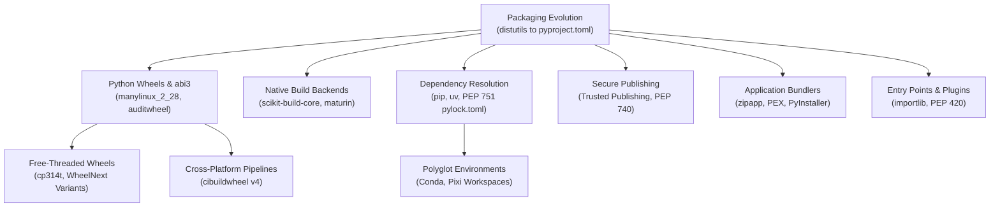

# Python Packaging and Release Engineering

Python packaging has evolved from imperative setup scripts to standardized declarative metadata and hermetic binary wheels.
This section covers PEP 517, 518, 621, and 660 standards, the anatomy of wheels, manylinux baselines, the CPython abi3 Limited API, and free-threaded Python builds.
It explores multi-platform compilation pipelines with cibuildwheel, native build backends including scikit-build-core and maturin, rapid dependency resolution via uv and PEP 751 lockfiles, and application bundling.

## Learning order

1. [[Python-Packaging-History-and-pyproject-toml]]
2. [[Python-Wheels-Platform-Tags-Manylinux-and-ABI3]]
3. [[Python-Free-Threaded-Wheels-and-Wheel-Variants]]
4. [[Python-Cross-Platform-Wheel-Pipelines-with-cibuildwheel]]
5. [[Python-Native-Build-Backends-scikit-build-core-meson-python-and-maturin]]
6. [[Python-Dependency-Resolution-pip-uv-and-PEP-751-Lockfiles]]
7. [[Python-Conda-and-Pixi-for-Polyglot-Environments]]
8. [[Python-Trusted-Publishing-and-PEP-740-Attestations]]
9. [[Python-Shipping-Applications-Zipapp-PEX-and-Bundlers]]
10. [[Python-Entry-Points-Plugins-and-Namespace-Packages]]

Related books: [[02-Programming-Languages/Python/Python_Zero_to_Godhood/Chapter_57_The_Python_Packaging_Ecosystem_PEP_517_to_Wheels.md|Python Zero to Godhood (Packaging Ecosystem)]] and [[02-Programming-Languages/Python/Python-Backend-Interview-Prep/02-Python-Core.md|Python Backend Interview Prep (Core Dependencies)]].
