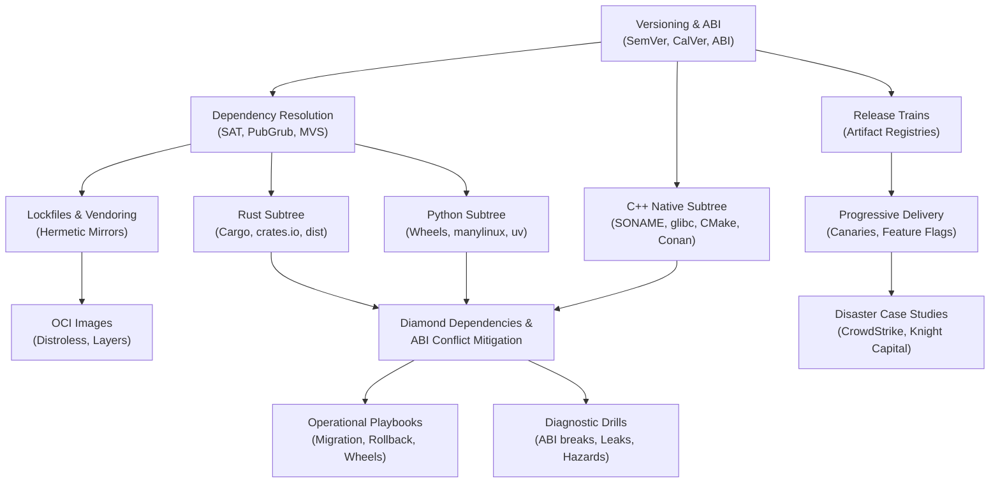

# Packaging and Release Engineering

Packaging and release engineering governs how software transitions from source code into portable, reproducible, and verifiable binary distributions.
This pillar spans low-level binary layout stability, dependency resolution algorithms, language-specific packaging standards, and progressive deployment architectures.
Mastering this domain enables engineers to eliminate silent ABI memory corruption, resolve diamond dependency conflicts, and build resilient release pipelines at scale.

## Learning order

1. [[Versioning-SemVer-CalVer-and-ABI]]
2. [[Dependency-Resolution-SAT-PubGrub-and-MVS]]
3. [[Lockfiles-Vendoring-and-Offline-Mirrors]]
4. [[Release-Trains-Backports-and-Artifact-Registries]]
5. [[OCI-Images-Layers-Multi-Stage-and-Distroless]]
6. [[Progressive-Delivery-Rollbacks-and-Feature-Flags]]
7. [[Diamond-Dependency-and-Incompatible-ABI-Mitigation]]
8. [[Packaging-Decision-Records]]
9. [[07-Packaging-and-Release/Cpp/README|C++ Packaging Hub]]
10. [[07-Packaging-and-Release/Python/README|Python Packaging Hub]]
11. [[07-Packaging-and-Release/Rust/README|Rust Packaging Hub]]
12. [[Ship-a-Rust-Extension-in-a-Python-Wheel]]
13. [[Execute-Zero-Downtime-Shared-Library-SONAME-Migration]]
14. [[Contain-and-Roll-Back-a-Bad-Production-Release]]
15. [[Drill-Packaging-Manylinux-GLIBC-Symbol-Leak]]
16. [[Drill-Packaging-Cpp-Silent-ABI-Break-Across-Shared-Libraries]]
17. [[Drill-Packaging-Cargo-Feature-Unification-Hazard]]
18. [[Drill-Packaging-PubGrub-Conflict-Diagnosis]]
19. [[Case-Study-CrowdStrike-Falcon-Channel-File-291]]
20. [[Case-Study-Knight-Capital-Deployment-Failure]]
21. [[Case-Study-Left-Pad-and-Registry-Immutability]]

Related books: [[19-Shell-and-Unix-Engineering/18-Build-Packaging-and-Bootstrap/README.md|19-Shell-and-Unix-Engineering (Build, Packaging, and Bootstrap)]] and [[17-Cloud-AI-Engineering/Volume_06_Infrastructure_as_Code_and_Delivery/Chapter_06_Progressive_Delivery_and_Deployment_Pipelines.md|17-Cloud-AI-Engineering (Progressive Delivery)]].

<!-- moc:start (generated by tools/build_mocs.py; edits inside are overwritten) -->
## Also in this folder

**Notes**

- [Packaging and Release Engineering Skill Ladder](Packaging-Skill-Ladder.md)
- [Packaging Topic Inventory](Packaging-Topic-Inventory.md)

<!-- moc:end -->
