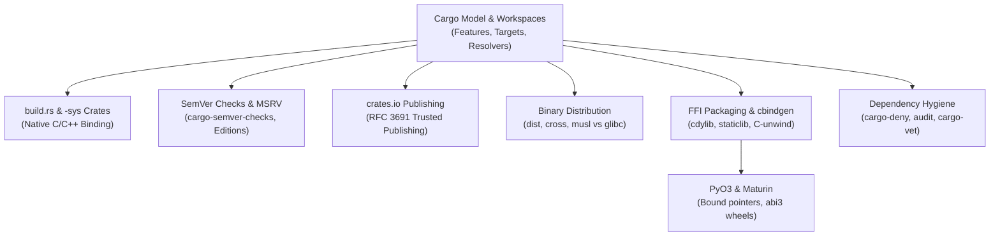

# Rust Packaging and Release Engineering

Rust provides first-class packaging through Cargo, combining strong compile-time guarantees with automated workspace dependency management.
This section explores the Cargo package model, feature unification semantics under Resolver v2 and v3, build.rs scripts, and native -sys crates.
It details automated SemVer verification using cargo-semver-checks, secure publishing on crates.io via RFC 3691 Trusted Publishing, multi-platform binary compilation with dist and cross, and foreign function interface distribution.

## Learning order

1. [[Rust-Cargo-Model-Packages-Targets-Features-and-Workspaces]]
2. [[Rust-Build-Scripts-and-Sys-Crates]]
3. [[Rust-SemVer-Checks-MSRV-and-Editions]]
4. [[Rust-Publishing-Crates-io-Trusted-Publishing-and-Private-Registries]]
5. [[Rust-Binary-Distribution-with-dist-and-Cross-Compilation]]
6. [[Rust-FFI-Packaging-cdylib-staticlib-and-cbindgen]]
7. [[Rust-PyO3-and-Maturin-Internals]]
8. [[Rust-Dependency-Hygiene-cargo-deny-cargo-audit-and-cargo-vet]]

Related books: [[02-Programming-Languages/C++/CPP_Zero_to_Godhood/Volume_09_Specialized_Mastery/Chapter_111_Interoperability/Chapter_111_Interoperability_and_the_Stable_C_ABI.md|C++ Zero to Godhood (Stable C ABI)]] and [[02-Programming-Languages/Python/Python_Zero_to_Godhood/Chapter_24_C_Extensions__Python_C-API_Interoperability.md|Python Zero to Godhood (C-API Extensions)]].
