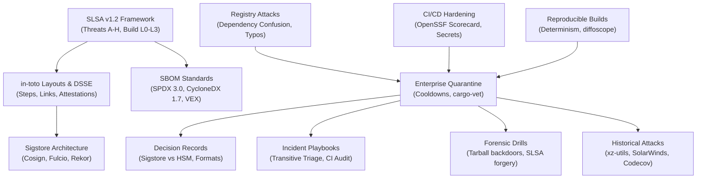

# Software Supply Chain Security

Software supply chain security provides the cryptographic, architectural, and operational mechanisms required to verify artifact integrity and protect build pipelines.
This pillar spans the entire software lifecycle from source contribution and continuous integration build environments to registry distribution and downstream consumption.
It grounds engineers in modern standards including the SLSA framework, in-toto attestation layouts, Sigstore keyless signing, and machine-readable SBOM formats.
Through rigorous incident response runbooks, forensic drills, and deep case studies, engineers learn to build zero-trust ingestion perimeters resilient against modern attacks.

## Learning order

1. [[SLSA-Framework-Build-and-Source-Tracks]]
2. [[In-Toto-Layouts-Link-Metadata-and-DSSE-Attestations]]
3. [[Sigstore-Keyless-Signing-Cosign-Fulcio-and-Rekor]]
4. [[SBOM-Standards-SPDX-CycloneDX-and-VEX]]
5. [[Dependency-Confusion-Typosquatting-and-Registry-Attacks]]
6. [[OpenSSF-Scorecard-and-CI-CD-Pipeline-Hardening]]
7. [[Reproducible-Builds-as-a-Security-Control]]
8. [[Enterprise-Third-Party-Code-Ingestion-and-Quarantine-Architecture]]
9. [[Supply-Chain-Decision-Records]]
10. [[Respond-to-a-Compromised-Transitive-Dependency]]
11. [[Audit-and-Harden-a-GitHub-Actions-Release-Pipeline]]
12. [[Drill-Supply-Chain-Detect-Tarball-vs-Git-Tag-Backdoor]]
13. [[Drill-Supply-Chain-Exploit-and-Fix-Dependency-Confusion]]
14. [[Drill-Supply-Chain-Verify-and-Reject-Forged-SLSA-Provenance]]
15. [[Case-Study-XZ-Utils-Backdoor-CVE-2024-3094]]
16. [[Case-Study-SolarWinds-Orion-SUNBURST]]
17. [[Case-Study-Event-Stream-and-Maintainer-Handoff]]
18. [[Case-Study-Codecov-Bash-Uploader-and-TJ-Actions]]
19. [[Case-Study-PyTorch-torchtriton-and-Dependency-Confusion]]
20. [[Case-Study-Shai-Hulud-and-Self-Replicating-Registry-Worms]]

Related books: [[17-Cloud-AI-Engineering/Volume_08_Security_Identity_and_the_Data_Perimeter/Chapter_05_Software_Supply_Chain_Security_SLSA_and_Sigstore.md|17-Cloud-AI-Engineering (Supply Chain Security)]] and [[19-Shell-and-Unix-Engineering/17-Security/Supply-Chain-Pinning-and-Verification.md|19-Shell-and-Unix-Engineering (Supply Chain Pinning)]].

<!-- moc:start (generated by tools/build_mocs.py; edits inside are overwritten) -->
## Also in this folder

**Notes**

- [Software Supply Chain Skill Ladder](Supply-Chain-Skill-Ladder.md)
- [Software Supply Chain Topic Inventory](Supply-Chain-Topic-Inventory.md)

<!-- moc:end -->
