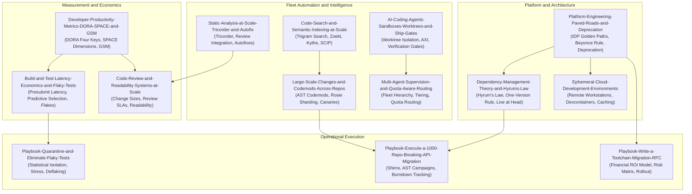

# Engineering Systems at Scale

This pillar covers the socio-technical systems, measurement frameworks, platform engineering architectures, and fleet-wide automation that govern software engineering across organizations of 1,000 to 100,000 engineers.
It develops the depth ladder from developer productivity measurement (DORA, SPACE, GSM) and hermetic presubmit testing up through semantic code indexing, large-scale automated codemod campaigns, and multi-agent AI fleet supervision.
It establishes strict ownership over developer velocity economics, flaky test quarantine protocols, the One-Version Rule, Hyrum's Law mitigation, and toolchain migration RFCs.
The material prepares engineering leaders, principal engineers, and platform architects to build resilient developer platforms, eliminate systemic productivity bottlenecks, and lead enterprise toolchain transformations.

## Learning order

1. [[Developer-Productivity-Metrics-DORA-SPACE-and-GSM]]
2. [[Build-and-Test-Latency-Economics-and-Flaky-Tests]]
3. [[Platform-Engineering-Paved-Roads-and-Deprecation]]
4. [[Dependency-Management-Theory-and-Hyrums-Law]]
5. [[Large-Scale-Changes-and-Codemods-Across-Repos]]
6. [[Code-Search-and-Semantic-Indexing-at-Scale]]
7. [[Static-Analysis-at-Scale-Tricorder-and-Autofix]]
8. [[Code-Review-and-Readability-Systems-at-Scale]]
9. [[Ephemeral-Cloud-Development-Environments]]
10. [[AI-Coding-Agents-Sandboxes-Worktrees-and-Ship-Gates]]
11. [[Multi-Agent-Supervision-and-Quota-Aware-Routing]]
12. [[Playbook-Quarantine-and-Eliminate-Flaky-Tests]]
13. [[Playbook-Execute-a-1000-Repo-Breaking-API-Migration]]
14. [[Playbook-Write-a-Toolchain-Migration-RFC]]
15. [[Drill-Engineering-Systems-Diagnose-CI-Merge-Queue-Collapse]]
16. [[Drill-Engineering-Systems-Audit-a-Gamed-Productivity-Dashboard]]

Related books: [[17-Cloud-AI-Engineering/Volume_05_Kubernetes_and_Platform_Engineering/Chapter_06_Internal_Developer_Platforms_and_Backstage.md|Cloud AI Volume 05 Chapter 06]] covers Internal Developer Platforms, [[19-Shell-and-Unix-Engineering/23-Shell-at-Organizational-Scale/README.md|19-Shell-and-Unix-Engineering]] covers organizational automation governance, and [[13-Agentic-AI/README.md|13-Agentic-AI]] details AI coding agent architectures.

<!-- moc:start (generated by tools/build_mocs.py; edits inside are overwritten) -->
## Also in this folder

**Notes**

- [Engineering Systems at Scale Skill Ladder](Engineering-Systems-Skill-Ladder.md)
- [Engineering Systems at Scale Topic Inventory](Engineering-Systems-Topic-Inventory.md)

<!-- moc:end -->
