# The Developer Toolchain Papers Canon

This pillar curates, analyzes, and contextualizes the foundational computer science papers and canonical technical specifications that define the developer toolchain discipline.
It spans four decades of systems research, from Ken Thompson's 1984 Turing Award lecture on compiler trust up through modern breakthroughs in deterministic record-and-replay debugging, causal profiling, scalable link-time optimization, and formal build system taxonomy.
Every paper note dissects the core problem, foundational insight, mathematical or architectural mechanism, empirical evaluation limits, and real-world deployment legacy.
The canon directly grounds the mechanism concepts, rebuild labs, and decision records across all toolchain pillars, providing software engineers with deep intellectual lineage and first-principles mastery.

```mermaid
flowchart TD
    subgraph P1["Foundations and Correctness"]
        TRUST["Paper-Reflections-on-Trusting-Trust<br/>(Thompson 1984: Compiler Trojans, DDC)"]
        DELTA["Paper-Zeller-Delta-Debugging<br/>(Zeller 2002: ddmin Test Reduction)"]
        VALGRIND["Paper-Valgrind-Dynamic-Binary-Instrumentation<br/>(Nethercote 2007: VEX DBI Engine)"]
        ASAN["Paper-AddressSanitizer<br/>(Serebryany 2012: Direct Shadow Memory)"]
        TSAN["Paper-ThreadSanitizer<br/>(Serebryany 2009: Hybrid Race Detection)"]
        MSAN["Paper-MemorySanitizer<br/>(Stepanov 2015: Bit-Exact Shadow Bits)"]
        RR["Paper-rr-Record-and-Replay<br/>(O'Callahan 2017: Deterministic RBC Replay)"]
    end
    subgraph P2["Measurement and Profiling"]
        BIAS["Paper-Producing-Wrong-Data-Measurement-Bias<br/>(Mytkowicz 2009: Layout & Environment Bias)"]
        GWP["Paper-Google-Wide-Profiling<br/>(Ren 2010: Fleet Continuous PMU Profiling)"]
        DAPPER["Paper-Dapper-Distributed-Systems-Tracing<br/>(Sigelman 2010: Span Trees, Sampling)"]
        COZ["Paper-Coz-Causal-Profiling<br/>(Curtsinger 2015: Virtual Speedups)"]
        FLAME["Paper-The-Flame-Graph-Gregg<br/>(Gregg 2016: Stack Population Aggregation)"]
    end
    subgraph P3["Compilers and Build Systems"]
        AUTOFDO["Paper-AutoFDO-Warehouse-Scale-Optimization<br/>(Chen 2016: LBR Sample Profile Inlining)"]
        THINLTO["Paper-ThinLTO-Scalable-Incremental-LTO<br/>(Johnson 2017: Distributed Thin Links)"]
        BOLT["Paper-BOLT-Binary-Optimizer<br/>(Panchenko 2019: Post-Link CFG Layout)"]
        BUILD["Paper-Build-Systems-a-la-Carte<br/>(Mokhov 2018: Schedulers & Rebuilders)"]
        PUBGRUB["Paper-PubGrub-and-Minimal-Version-Selection<br/>(Weizenbaum & Cox 2018: CDCL vs MVS)"]
    end
    subgraph P4["Scale and Supply Chain"]
        MONO["Paper-Google-Monorepo-Piper-and-CitC<br/>(Potvin 2016: Piper, CitC, Trunk-Based)"]
        TRICORDER["Paper-Tricorder-Program-Analysis-Ecosystem<br/>(Sadowski 2015: Review Static Analysis)"]
        STATIC_LESSONS["Paper-Lessons-From-Static-Analysis-at-Google<br/>(Sadowski 2018: The 10% False Positive Bar)"]
        MCR["Paper-Modern-Code-Review-at-Google<br/>(Sadowski 2018: 9M Review Study)"]
        INTOTO["Paper-in-toto-Supply-Chain-Guarantees<br/>(Torres-Arias 2019: Cryptographic Layouts)"]
        REPRO["Paper-Reproducible-Builds-Lamb-Zacchiroli<br/>(Lamb 2022: Bit-for-Bit Determinism)"]
    end
    TRUST --> REPRO
    VALGRIND --> ASAN --> MSAN
    VALGRIND --> TSAN
    DELTA --> RR
    BIAS --> COZ
    GWP --> AUTOFDO --> BOLT
    THINLTO --> BOLT
    BUILD --> PUBGRUB
    TRICORDER --> STATIC_LESSONS
    MONO --> MCR
    INTOTO --> REPRO
```

## Learning order

1. [[Paper-Reflections-on-Trusting-Trust]]
2. [[Paper-Zeller-Delta-Debugging]]
3. [[Paper-Valgrind-Dynamic-Binary-Instrumentation]]
4. [[Paper-Producing-Wrong-Data-Measurement-Bias]]
5. [[Paper-ThreadSanitizer]]
6. [[Paper-Google-Wide-Profiling]]
7. [[Paper-Dapper-Distributed-Systems-Tracing]]
8. [[Paper-AddressSanitizer]]
9. [[Paper-MemorySanitizer]]
10. [[Paper-Tricorder-Program-Analysis-Ecosystem]]
11. [[Paper-Coz-Causal-Profiling]]
12. [[Paper-AutoFDO-Warehouse-Scale-Optimization]]
13. [[Paper-The-Flame-Graph-Gregg]]
14. [[Paper-Google-Monorepo-Piper-and-CitC]]
15. [[Paper-ThinLTO-Scalable-Incremental-LTO]]
16. [[Paper-rr-Record-and-Replay]]
17. [[Paper-Lessons-From-Static-Analysis-at-Google]]
18. [[Paper-Modern-Code-Review-at-Google]]
19. [[Paper-Build-Systems-a-la-Carte]]
20. [[Paper-PubGrub-and-Minimal-Version-Selection]]
21. [[Paper-BOLT-Binary-Optimizer]]
22. [[Paper-in-toto-Supply-Chain-Guarantees]]
23. [[Paper-Reproducible-Builds-Lamb-Zacchiroli]]

Related books: [[15-Technical-Whitepapers/README.md|15-Technical-Whitepapers]] covers foundational computer science whitepapers, systems performance, and operating system internals.

<!-- moc:start (generated by tools/build_mocs.py; edits inside are overwritten) -->
## Also in this folder

**Notes**

- [Developer Toolchain Papers Canon Skill Ladder](Papers-Skill-Ladder.md)
- [Developer Toolchain Papers Canon Topic Inventory](Papers-Topic-Inventory.md)

<!-- moc:end -->
