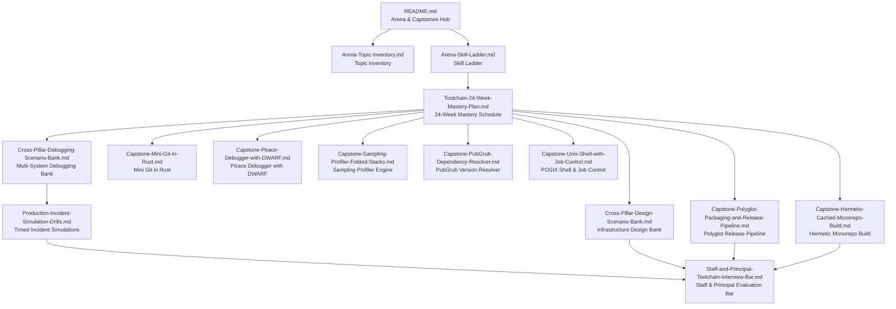

# 11. Arena and Capstones

This folder contains the capstone synthesis layer of the developer toolchain curriculum, integrating concepts across program execution, version control, debugging, profiling, build systems, release engineering, and software supply chain security.
It provides production-scale scenario banks, timed diagnostic drills, comprehensive end-to-end rebuild projects, and a structured 24-week mastery schedule.
Engineers use this pillar to prove end-to-end systems competence, bridging low-level system call mechanics with high-level organizational architecture and staff-plus interview standards.

## Learning order

1. [[Arena-Topic-Inventory|Arena-Topic-Inventory.md]]: coverage map, depth rungs, and integration boundaries across all toolchain pillars.
2. [[Arena-Skill-Ladder|Arena-Skill-Ladder.md]]: observable, testable engineering behaviors spanning L4 through L8+.
3. [[Toolchain-24-Week-Mastery-Plan|Toolchain-24-Week-Mastery-Plan.md]]: weekly curriculum, lab milestones, and diagnostic checkpoints.
4. [[Staff-and-Principal-Toolchain-Interview-Bar|Staff-and-Principal-Toolchain-Interview-Bar.md]]: staff and principal interview evaluation rubrics and system design depth.
5. [[Cross-Pillar-Debugging-Scenario-Bank|Cross-Pillar-Debugging-Scenario-Bank.md]]: multi-system production crash and failure scenarios with tiered solutions.
6. [[Cross-Pillar-Design-Scenario-Bank|Cross-Pillar-Design-Scenario-Bank.md]]: developer platform and release engineering system design scenarios at enterprise scale.
7. [[Production-Incident-Simulation-Drills|Production-Incident-Simulation-Drills.md]]: timed simulation drills for high-severity toolchain incidents.
8. [[Capstone-Mini-Git-in-Rust|Capstone-Mini-Git-in-Rust.md]]: functional Git plumbing and porcelain in Rust interoperating with real repositories.
9. [[Capstone-Ptrace-Debugger-with-DWARF|Capstone-Ptrace-Debugger-with-DWARF.md]]: Linux process debugger with software breakpoints and DWARF line lookup.
10. [[Capstone-Sampling-Profiler-Folded-Stacks|Capstone-Sampling-Profiler-Folded-Stacks.md]]: statistical sampling profiler generating folded stacks for flame graph visualization.
11. [[Capstone-Polyglot-Packaging-and-Release-Pipeline|Capstone-Polyglot-Packaging-and-Release-Pipeline.md]]: multi-language release pipeline with SLSA provenance, SBOMs, and cryptographic signing.
12. [[Capstone-Hermetic-Cached-Monorepo-Build|Capstone-Hermetic-Cached-Monorepo-Build.md]]: reproducible build system with sandboxing and remote execution caching.
13. [[Capstone-PubGrub-Dependency-Resolver|Capstone-PubGrub-Dependency-Resolver.md]]: dependency constraint solver with conflict-driven clause learning.
14. [[Capstone-Unix-Shell-with-Job-Control|Capstone-Unix-Shell-with-Job-Control.md]]: POSIX-compliant shell with pipelines, redirections, and terminal job control.

## Related books

Related vault sections: [[19-Shell-and-Unix-Engineering/README|19-Shell-and-Unix-Engineering]], [[08-Distinguished-Engineering/README|08-Distinguished-Engineering]], [[16-Interview-Command-Center/00-Dashboard|16-Interview-Command-Center]], [[14-Low-Latency-Systems/00 Home|14-Low-Latency-Systems]], and [[17-Cloud-AI-Engineering/README|17-Cloud-AI-Engineering]].
