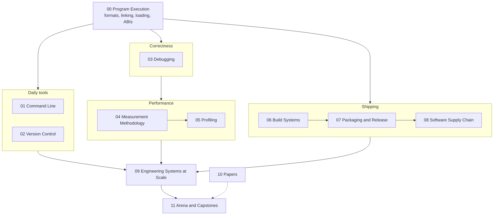

# Developer Toolchain

This knowledge base provides an atomic, mechanism-first curriculum covering the complete software engineering developer toolchain across C++, Python, and Rust.
It spans twelve pillar folders around five themes - the command line, version control, debugging, profiling, and build and release - grounded in low-level operating system foundations and scaled to enterprise developer infrastructure.
Every concept reaches rigorous depth rungs from daily expert usage and kernel mechanics up to minimal system rebuilds and staff-plus organizational decision records verified by automated test suites.

## Structure of the Curriculum

| Pillar | Focus |
| :--- | :--- |
| [00-Program-Execution](00-Program-Execution/README.md) | Process lifecycle, file descriptors, ELF/Mach-O/PE formats, static and dynamic linking, runtime relocations, calling conventions, stack unwinding, and DWARF debug info. |
| [01-Command-Line](01-Command-Line/README.md) | Shell parsing grammar, pipelines, stream buffering, text processing with sed/awk/ripgrep, regex automata, SSH key management, multiplexers, and agent interfaces. |
| [02-Version-Control](02-Version-Control/README.md) | Git directed acyclic graph object models, reftable, packfile delta compression, merge engines (ORT), rebase mechanics, git archaeology, and monorepo scaling. |
| [03-Debugging](03-Debugging/README.md) | Scientific debugging methodology, ptrace mechanics, core dumps, remote protocol, sanitizers (ASan, TSan, MSan, UBSan), and language runtimes across C++, Python, and Rust. |
| [04-Measurement-Methodology](04-Measurement-Methodology/README.md) | Sampling bias, skid, benchmark noise isolation, coordinated omission, HDR histograms, top-down microarchitectural analysis, and performance regression gates in CI. |
| [05-Profiling](05-Profiling/README.md) | Linux perf subsystem, eBPF/bpftrace instrumentation, macOS Instruments, continuous profiling, flame graphs, and language-specific profilers. |
| [06-Build-Systems](06-Build-Systems/README.md) | Build theory, DAG scheduling, hermetic sandboxing, Make, Ninja, modern CMake, Meson, Bazel, Buck2, remote caching, and compiler caches. |
| [07-Packaging-and-Release](07-Packaging-and-Release/README.md) | Versioning models, PubGrub resolution, OCI images, Conan 2, Python wheels with cibuildwheel, Cargo crates, release trains, and progressive delivery. |
| [08-Software-Supply-Chain](08-Software-Supply-Chain/README.md) | SLSA framework, in-toto attestations, Sigstore keyless signing, SPDX/CycloneDX SBOMs, dependency confusion mitigation, and pipeline hardening. |
| [09-Engineering-Systems-at-Scale](09-Engineering-Systems-at-Scale/README.md) | Developer productivity frameworks (DORA, SPACE), flaky test eradication, internal developer platforms, large-scale migrations, and autonomous coding agent harnesses. |
| [10-Papers](10-Papers/README.md) | Seminal academic papers and industry technical reports covering build theory, dynamic binary instrumentation, continuous profiling, and supply-chain verification. |
| [11-Arena-and-Capstones](11-Arena-and-Capstones/README.md) | Multi-system cross-pillar debugging and design scenario banks, timed outage drills, a 24-week curriculum, and seven end-to-end toolchain rebuild capstones. |

## Paths by Track

The curriculum supports four specialized career tracks.
Each track follows a targeted reading order through the pillars to build role-specific mastery:

- **Software Development Engineer (SDE):**
  Focuses on foundational execution, CLI fluency, daily debugging workflows, reliable build configurations, and packaging essentials.
  Path: `00-Program-Execution` -> `01-Command-Line` -> `02-Version-Control` -> `03-Debugging` -> `06-Build-Systems` -> `07-Packaging-and-Release` -> `11-Arena-and-Capstones`.
- **Low-Latency and Quantitative Developer (low-latency, quant-dev):**
  Emphasizes cycle-accurate system execution, assembly inspection, cache hierarchy profiling, noise-free benchmarking, and hardware performance counters.
  Path: `00-Program-Execution` -> `03-Debugging/Cpp` -> `04-Measurement-Methodology` -> `05-Profiling` -> `06-Build-Systems` -> `11-Arena-and-Capstones` (focusing on hardware PMU counters, perf c2c, and memory allocators).
- **AI Engineering (ai-eng):**
  Focuses on containerized environments, Python runtime internals (`sys.monitoring`, free-threaded wheels, C-API extensions), GPU build workflows, and AI coding agent harnesses.
  Path: `01-Command-Line` (CLI/AXI) -> `03-Debugging/Python` -> `05-Profiling/Python` -> `07-Packaging-and-Release/Python` -> `09-Engineering-Systems-at-Scale` (agent worktrees and gates) -> `11-Arena-and-Capstones`.
- **Distinguished and Staff-Plus Engineering (distinguished):**
  Targeted at principal engineers, systems architects, and developer platform leaders driving multi-thousand-engineer developer productivity and organizational tooling strategy.
  Path: Full curriculum from `00` through `11`, prioritizing the Rebuild and Decide at Scale depth rungs, seminal papers in `10-Papers`, and the staff-plus interview rubrics in `11-Arena-and-Capstones`.

## Verification and Lab Harness

Every code sample, debugging transcript, and benchmark output presented in these notes is verified by an automated test harness located in `code/`.
The harness enforces reproducible accuracy and prevents documentation drift:

- **Isolated Labs:**
  Each runnable lab lives under `code/<pillar>/<lab_name>/` and provides a self-contained execution recipe.
- **Automated Verification:**
  Running `make verify` re-executes all lab scripts and asserts that raw CLI and program outputs match the golden expected outputs recorded in `expected/<platform>.txt`, where platform is `<os>-<arch>` (for example `darwin-arm64` or `linux-aarch64`).
- **Platform Gating:**
  Labs declare environmental prerequisites using header comments:
  - `# requires: linux`: runs only on a Linux host; on macOS the harness skips it, so run `make verify` inside a Linux VM or container to exercise it.
  - `# requires: macos`: runs only on a macOS host (Instruments, xctrace, codesign); on Linux the harness skips it.
  - `# requires: docker`: the lab itself drives Docker (for example building manylinux wheels), so it needs a working Docker daemon.
  - `# requires: pmu`: requires hardware performance counters (bare metal or a PMU-virtualized hypervisor) and runs only when `TOOLCHAIN_LABS_PMU=1` is set.
  - `# requires: nightly`: requires compiler nightly toolchains (e.g., Rust nightly for Miri or sanitizer flags).
  - `# requires: network`: permits external registry or network access during verification, only when `TOOLCHAIN_LABS_NETWORK=1` is set.

## Related Books

This curriculum operates as an integrated knowledge base within the broader study vault.
It connects to several sibling books and specialized volumes:

- [[19-Shell-and-Unix-Engineering/README|19-Shell-and-Unix-Engineering]]: A deep sister volume dedicated exclusively to the Unix shell and userland utilities. Pillar 18 maintains self-contained CLI and process notes, linking to Pillar 19 under See Also for extended POSIX exploration.
- [[17-Cloud-AI-Engineering/README|17-Cloud-AI-Engineering]]: Covers cloud hypervisors, Kubernetes internal control loops, progressive delivery, and cloud infrastructure security that complement local build and release pipelines.
- [[12-Performance-Engineering/README|12-Performance-Engineering]]: Provides deeper microarchitectural analysis, memory subsystem benchmarks, and CPU execution engine mechanics.
- [[02-Programming-Languages/C++/README|02-Programming-Languages/C++]]: The C++ Zero to Godhood curriculum providing exhaustive language and template metaprogramming foundations.
- [[02-Programming-Languages/Python/README|02-Programming-Languages/Python]]: The Python Zero to Godhood curriculum detailing core interpreter execution and runtime features.

<!-- moc:start (generated by tools/build_mocs.py; edits inside are overwritten) -->
## Also in this folder

**Sections**

- [code](code/README.md)

**Notes**

- [Developer Toolchain Style Guide and Authoring Contract](STYLE.md)

<!-- moc:end -->
