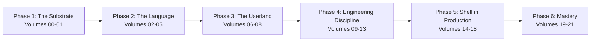
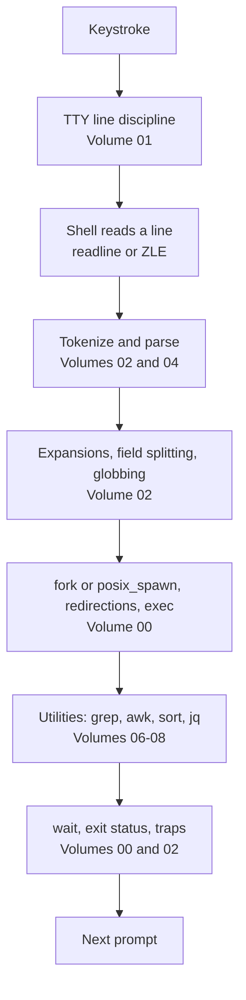

# Shell and Unix Engineering: Zero to Godhood

A first-principles, mechanism-first curriculum for the shell, the Unix process model beneath it, the userland around it, and every production context it runs in.
The goal is the level of an engineer who could maintain a shell, review any script that runs in production, and teach the Unix process model from the system call up.
By the end, you can explain exactly what the terminal, the parser, every expansion stage, and the kernel do for any command line, predict its behavior under bash, zsh, dash, ksh, and BusyBox on GNU and BSD userlands, and defend that answer in a principal-level interview.

## How this track is organized

Twenty-two volumes in six phases, followed by ten reference [appendices](Appendices/README.md).

The first diagram is the study order.
The second is the path of one command line; every volume deconstructs one or more of its boxes.

| Volume | Title | Core focus |
|---|---|---|
| 00 | [The Unix Process Model Under the Shell](Volume_00_The_Unix_Process_Model/README.md) | fork, exec, wait, posix_spawn, descriptors, pipes, signals, sessions, filesystem semantics |
| 01 | [Terminals, TTYs, and Job Control](Volume_01_Terminals_TTYs_and_Job_Control/README.md) | Line discipline, termios, ptys, escape sequences, job control, readline and ZLE |
| 02 | [The POSIX Shell Command Language](Volume_02_The_POSIX_Shell_Command_Language/README.md) | POSIX.1-2024 XCU chapter 2: grammar, quoting, expansion order, redirection, errexit, traps |
| 03 | [Bash in Depth](Volume_03_Bash_in_Depth/README.md) | Arrays, transformations, namerefs, shopt, process substitution, error handling, versions |
| 04 | [Inside the Bash Source](Volume_04_Inside_the_Bash_Source/README.md) | The parser, the expansion engine, command execution, jobs and traps, debugging bash |
| 05 | [Zsh, Ksh, Dash, BusyBox, and the Shell Landscape](Volume_05_Zsh_Ksh_Dash_BusyBox_and_the_Shell_Landscape/README.md) | What runs where, zsh, dash, ksh93 and mksh, BusyBox ash, structured-data shells |
| 06 | [Regular Expressions and Text Processing](Volume_06_Regular_Expressions_and_Text_Processing/README.md) | Regex flavors and engines, grep and ripgrep, sed, awk, locale and Unicode |
| 07 | [Coreutils, Findutils, and the Userland Zoo](Volume_07_Coreutils_Findutils_and_the_Userland_Zoo/README.md) | GNU, BSD, BusyBox, and uutils, find, xargs, sort, stdio buffering |
| 08 | [Structured Data at the Command Line](Volume_08_Structured_Data_at_the_Command_Line/README.md) | jq, YAML and CSV tools, sqlite3 and DuckDB, curl |
| 09 | [Robust and Defensive Scripting](Volume_09_Robust_and_Defensive_Scripting/README.md) | Strict mode critique, cleanup, idempotency, atomic writes, locking, retries, CLI design |
| 10 | [Testing, Static Analysis, and Tooling](Volume_10_Testing_Static_Analysis_and_Tooling/README.md) | ShellCheck, shfmt, bats-core, mocking, coverage, CI matrices, staff-level review |
| 11 | [Concurrency and Parallelism in Shell](Volume_11_Concurrency_and_Parallelism_in_Shell/README.md) | Background jobs, bounded parallelism, GNU parallel, races, supervision, scheduling |
| 12 | [Performance of Shell Programs](Volume_12_Performance_of_Shell_Programs/README.md) | A measured cost model, pipelines at scale, shell versus Python versus compiled tools |
| 13 | [Shell Security](Volume_13_Shell_Security/README.md) | Injection, hostile filenames, environment attacks, Shellshock, privilege, secrets, xz-utils |
| 14 | [Build Systems and Packaging](Volume_14_Build_Systems_and_Packaging/README.md) | Make recipes, autoconf, Nix builders, package hooks, installer design |
| 15 | [Containers, CI, and Cloud](Volume_15_Containers_CI_and_Cloud/README.md) | Dockerfile forms, PID 1, entrypoints, Kubernetes, CI shells, cloud CLIs, SSH, cloud-init |
| 16 | [Observability and Incident Response from the Shell](Volume_16_Observability_and_Incident_Response/README.md) | The 60-second analysis, /proc, lsof and ss, tracing, logs, macOS tools, runbooks |
| 17 | [The Interactive Environment and Dotfiles](Volume_17_The_Interactive_Environment_and_Dotfiles/README.md) | Startup files, PATH, prompts, completions, history, fzf and direnv, dotfiles |
| 18 | [Shell and AI Agents](Volume_18_Shell_and_AI_Agents/README.md) | How agents run shell, quoting across tool boundaries, guards, sandboxes, agent-friendly commands |
| 19 | [History, Papers, and Primary Sources](Volume_19_History_Papers_and_Primary_Sources/README.md) | Thompson, Bourne, csh, ksh, POSIX, rc, the Unix philosophy papers, modern shell design |
| 20 | [Interview Arena](Volume_20_Interview_Arena/README.md) | What happens on Enter, predict-the-output, debug-this-script, design drills, the staff bar |
| 21 | [Capstones](Volume_21_Capstones/README.md) | A POSIX-subset shell in C, a production CLI, a legacy rescue, a data pipeline, an upstream contribution |

## Learning path

Phase 1 - The Substrate (Volumes 00-01).
Learn the system calls and terminal machinery first, so every later behavior has a mechanism to point at.

Phase 2 - The Language (Volumes 02-05).
Read the POSIX shell language as a specification, then bash as an implementation and in source, then the other shells you will meet in production.

Phase 3 - The Userland (Volumes 06-08).
Master the text languages (regular expressions, sed, awk), the core utilities and their portability traps, and the structured-data tools that replace line-oriented ones.

Phase 4 - Engineering Discipline (Volumes 09-13).
Write scripts that fail loudly, clean up, rerun safely, are tested and statically analyzed, run concurrently without races, are fast enough, and are secure against hostile input.

Phase 5 - Shell in Production (Volumes 14-18).
Follow shell into build systems, containers, CI, cloud, incident response, the interactive desktop, and AI agent harnesses.

Phase 6 - Mastery (Volumes 19-21).
Read the primary sources, drill interview performance, and prove mastery with five capstones.

## How to study by track

- SDE (L4-L6): Volumes 00, 02, 03, 06, 07, 09, 10, 13, 15, then the Interview Arena.
- Low-latency and quant developer: add Volumes 01, 11, 12, and 16, and treat the performance labs as mandatory.
- Cloud and platform engineering: Volumes 00, 02, 09, 11, 13, 14, 15, and 16, alongside [Cloud AI Engineering](../17-Cloud-AI-Engineering/README.md).
- AI engineering: Volumes 02, 09, 13, and 18, alongside the [Agentic Harness](../13-Agentic-AI/Agentic-Harness/README.md).
- Distinguished and principal: everything, including the bash source (Volume 04), the primary sources (Volume 19), and at least two capstones.

[Appendix J](Appendices/Appendix_J_16_Week_Mastery_Study_Plan.md) turns this into a week-by-week plan.

## Claims are executed, not asserted

Shell behavior is checkable on any machine, so this curriculum checks it.
Every worked example is a lab under [labs/](labs/README.md) with a bats test, ShellCheck and shfmt clean.
Portability claims are proven by running the lab under every shell in the matrix: the shells on the host (macOS bash 3.2, current bash, zsh, dash, ksh93) and two container images that add bash 3.2, 4.4, 5.1, 5.2, and 5.3, BusyBox ash, mksh, yash, posh, and ksh93u+m on Alpine and Debian.
`python3 tools/check_shell_labs.py` gates the labs in CI on every change.

## Ground rules

Mechanism over recipe.
Explain the system call, the specification section, or the source code that causes a behavior, not just the incantation that avoids it.
Portability is a fact, not an opinion.
State which shells and userlands a construct works on, and prove it in the lab matrix.
Numbers are measured or sourced.
Every limit is cited and dated; every cost is measured with the command and machine shown.
Failure first.
Every chapter shows how the construct fails in production, with real incidents where they exist.
Know when to stop.
Every engineering chapter says when the right answer is a different language.

## Conventions

Chapters use Markdown with exactly one sentence per line.
Shell syntax in prose is always in backticks, because Obsidian renders text between two dollar signs as math.
Tables write wikilink aliases as `[[Note\|Alias]]`.
See [SUMMARY.md](SUMMARY.md) for the complete chapter index, [STYLE.md](STYLE.md) for the chapter contract, and [labs/README.md](labs/README.md) for the lab harness.

## Related in this vault

- [Operating Systems](../01-CS-Foundations/Operating-Systems/README.md) for the kernel theory under Volume 00.
- [Performance Engineering](../12-Performance-Engineering/README.md) for the profiling under Volumes 12 and 16.
- [Security and Cryptography](../11-Security-And-Cryptography/README.md) for the broader context of Volume 13.
- [Low-Latency Systems](../14-Low-Latency-Systems/00%20Home.md) for the CPU isolation and jitter work behind Volume 16.

