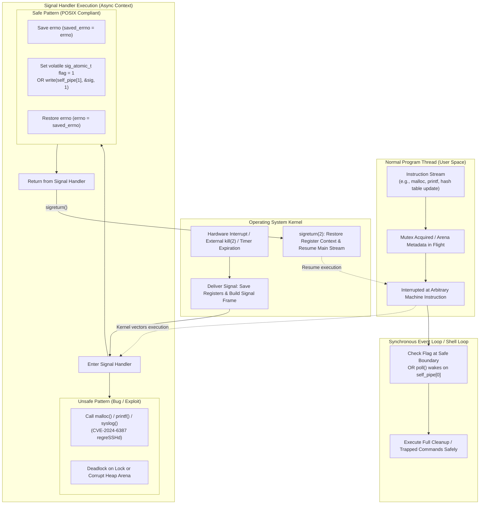

# Async Signal Safety

> [!summary] Claim
> An asynchronous signal handler interrupts program execution at an arbitrary machine instruction, making any function that acquires non-recursive mutexes, allocates heap memory, manipulates global state, or clobbers unpreserved `errno` unsafe to execute within handler context.

## TL;DR

- Mechanism: The kernel suspends instruction retirement on the target thread, builds a signal frame on the stack, and transfers execution to the signal handler, which runs concurrently with any interrupted, half-completed operation.
- Rule: Execute only functions explicitly enumerated in the async-signal-safe table of POSIX.1-2024 XSH 2.4.3 (231 entries), save and restore `errno` across any system call, and communicate state to the main program using `volatile sig_atomic_t` or the self-pipe trick.
- Trap: Invoking `malloc()`, `free()`, `printf()`, or `syslog()` from a signal handler deadlocks on internal runtime locks or corrupts heap metadata, as demonstrated by the OpenSSH remote code execution flaw CVE-2024-6387.
- Portability fact: Standard POSIX shells defer `trap` commands until foreground utilities terminate or `wait` is interrupted; bash, dash, ksh93, mksh, yash, posh, and BusyBox ash keep one pending flag per signal and run the trap once, while zsh queues every delivered signal in `trap_queue[]` and can run the trap more than once.
- When not to use it: Never execute application business logic, cleanup pipelines, or complex I/O in signal handlers; route signals to synchronous event loops via `signalfd(2)` on Linux or the self-pipe trick on BSD and macOS.

## Mental model



When an asynchronous signal arrives, the kernel interrupts user-space execution at an unpredictable point, freezing active CPU registers and pushing a signal frame onto the stack.
If the interrupted code was in the middle of modifying heap chunk pointers or holding a standard I/O stream lock, calling a non-reentrant function from the signal handler re-enters that exact critical section.
The unsafe path causes an immediate deadlock on non-recursive mutexes or scrambles allocator free lists, creating remote code execution vulnerabilities like regreSSHd.
The safe path restricts handler operations to atomic flag updates, async-signal-safe system calls like `write()`, and strict preservation of `errno`.
Execution then returns through `sigreturn(2)` to the main thread, where a synchronous event loop or shell command boundary evaluates the pending signal safely.

## How it works

Async-signal-safety is governed at the kernel-user boundary by POSIX.1-2024 Section 2.4.3 (Signal Actions) under System Interfaces (XSH).
The specification defines an async-signal-safe function as one that may be invoked without restriction from signal-catching functions.
When a signal is delivered to a process thread, the Linux kernel on x86 executes `handle_signal()` and `setup_rt_frame()` (`arch/x86/kernel/signal.c`), saving the hardware register context into a `ucontext_t` structure allocated on the thread's user-space stack.
The kernel updates the instruction pointer to the signal handler registered via `sigaction(2)` and sets the return address to a trampoline function that invokes `sigreturn(2)` upon completion.

Because signal delivery is asynchronous, the interrupted thread could be executing any instruction in user space or returning from a restartable system call (`SA_RESTART`).
If the interrupted function is non-reentrant, it maintains internal state across invocations.
Reentrancy fails under three primary conditions:
- Static or global variables: functions like `strtok()`, `getpwnam()`, or `asctime()` store state in shared static buffers; concurrent execution from a handler corrupts this data.
- Dynamic memory allocation: `malloc()`, `calloc()`, `realloc()`, and `free()` update global arena heaps and boundary tags; glibc and jemalloc protect arenas with mutexes, so re-entering the allocator from a signal handler while the thread holds an arena lock deadlocks instantaneously.
- Standard I/O streams: functions such as `printf()`, `fopen()`, and `fclose()` operate on `FILE *` handles protected by the recursive lock behind `flockfile()`; invoking `printf()` inside a signal handler when the thread was interrupted while logging to standard error re-acquires the lock the interrupted code already holds and tears or duplicates the half-updated output buffer, and any allocation inside the formatter brings in the allocator deadlock above.

POSIX.1-2024 Section 2.4.3 formalizes the complete whitelist of async-signal-safe functions in an unnumbered table of 231 entries (counted from the published page; POSIX.1-2017 lists 191).
Historically, this list was restricted to raw system call wrappers (`read()`, `write()`, `open()`, `close()`, `kill()`, `_exit()`).
POSIX.1-2008 Technical Corrigendum 2 (2016) expanded this table to include pure string and memory inspection routines that do not allocate memory or inspect locale globals: `memcpy()`, `memmove()`, `memset()`, `memchr()`, `memcmp()`, `strlen()`, `strnlen()`, `strcpy()`, `strncpy()`, `strchr()`, `strrchr()`, `strcmp()`, `strncmp()`, `strstr()`, `strtok_r()`, `htonl()`, `htons()`, `ntohl()`, and `ntohs()` ([signal-safety(7)](https://man7.org/linux/man-pages/man7/signal-safety.7.html)).
POSIX.1-2024 Issue 8 then added 45 entries, among them `_Fork()`, `strlcpy()`, `strlcat()`, `ppoll()`, `pipe2()`, `dup3()`, `accept4()`, `readv()`, `writev()`, `pread()`, `pwrite()`, `killpg()`, `sig2str()`, `quick_exit()`, and the `va_start()` family, and removed `fork()`, `sigpause()`, `sigset()`, `utime()`, and `posix_trace_event()` (diff of the 2017 and 2024 tables).

Even when invoking functions from the POSIX safe table, a signal handler can corrupt the interrupted program if it modifies `errno`.
Under POSIX and C standards, `errno` is a thread-local lvalue.
If the interrupted program was executing a loop such as `if (read(fd, buf, sz) < 0 && errno == EINTR)`, and a signal arrives right after `read()` sets `errno = EINTR`, an async-signal-safe call like `close(-1)` inside the handler will set `errno = EBADF`.
When the handler returns, the main loop inspects `errno`, observes `EBADF` instead of `EINTR`, and aborts unexpectedly.
POSIX.1-2024 Section 2.4.3 states that operations which obtain or assign `errno` are async-signal-safe only "provided that the signal-catching function saves the value of errno upon entry and restores it before it returns":
```c
void safe_handler(int sig) {
    int saved_errno = errno;
    /* Async-signal-safe operations */
    write(STDERR_FILENO, "signal caught\n", 14);
    errno = saved_errno;
}
```

For inter-context communication, POSIX and C99/C11 define the integer type `sig_atomic_t`.
Objects of type `volatile sig_atomic_t` can be accessed and modified as atomic entities even in the presence of asynchronous signals.
However, `sig_atomic_t` guarantees atomicity only for single reads and single writes; compound operations like `flag++` (read-modify-write) are not atomic and suffer from race conditions under signal delivery.
Modern C11 and C23 systems provide lock-free atomics (`atomic_flag` and `atomic_signal_fence()`) to establish memory ordering across signal boundaries.

In Unix shell architectures, signal handling follows a deferred execution model governed by POSIX.1-2024 XCU 2.12 (Signals and Error Handling) and XCU 2.15 (`trap`).
A shell interpreter is a complex program: evaluating commands requires parsing tokens, allocating Abstract Syntax Tree (AST) nodes, creating subshells, and mutating variable hash tables.
None of these interpreter routines are async-signal-safe.
If a shell attempted to evaluate a user-defined trap script (such as `trap 'rm -f "$tmp"; exit 1' INT`) directly inside the kernel-dispatched C signal handler, the interpreter would immediately deadlock or crash.

Every Unix shell in the matrix keeps trap evaluation out of the C signal handler, at least while it is in a critical section:
- In GNU Bash (`sig.c`, `trap.c`), `trap_handler()` is registered as the C signal handler via `sigaction(2)`.
  When a signal arrives, `trap_handler()` does not parse or execute shell code; through `set_trap_state()` it increments `pending_traps[sig]`, sets `catch_flag = 1`, and records `trapped_signal_received = sig` (bash 5.3 `trap.c`).
  The shell checks `catch_flag` at well-defined synchronous evaluation checkpoints and calls `run_pending_traps()` in `trap.c`, such as between pipeline commands or after a foreground job exits; that function runs each pending trap once and zeroes its counter (its own comment notes it "could be made into a counter" but is not).
- In `dash` (`src/trap.c`), the C handler `onsig()` sets `gotsig[signo - 1] = 1` and `pending_sig = signo` (dash 0.5.12).
  The main interpreter loop calls `dotrap()`, which loops through `gotsig`, resets the pending flags, and runs each trap string through `evalstring(p, 0)`.
- In `zsh` (`Src/signals.c`), `zhandler()` records `last_signal = sig`; while `queueing_enabled` is set (by `queue_signals()` around non-reentrant code) it appends the signal to `signal_queue[]` and returns.
  Otherwise `handletrap()` either appends the signal to `trap_queue[]`, which `queue_traps()` enables while a foreground job is being waited for (unless the `TRAPSASYNC` option is set) and `unqueue_traps()` drains afterwards, or calls `dotrap()` directly from the handler, which is what happens inside the `wait` builtin (zsh 5.9 `signals.c`).
  `sigtrapped[sig]` holds per-signal flags (`ZSIG_TRAPPED`, `ZSIG_IGNORED`, `ZSIG_FUNC`), not a counter.
- In AT&T `ksh93` (`src/cmd/ksh93/sh/fault.c`), `sh_fault()` intercepts the signal, sets `SH_SIGTRAP` in `sh.sigflag[sig]` and `sh.trapnote` (`shp->sigflag[sig]` and `shp->trapnote` in 93u+ 2012), and returns; `sh_chktrap()` later runs the pending trap commands.

POSIX.1-2024 XCU 2.12 codifies two timing invariants for shell trap execution, and the `trap` built-in adds a third rule:
- Foreground command deferral: when a signal for which a trap has been set is received while the shell is waiting for the completion of a foreground utility, the trap action shall not be executed until after the foreground utility has completed.
- Built-in `wait` interruption: if the shell built-in `wait` is waiting for asynchronous commands and receives a signal for which a trap is set, `wait` shall "return immediately with an exit status >128, immediately after which the trap associated with that signal shall be taken" (128 + N in most shells, 384 + N in yash).
  AT&T `ksh93` returns 1 instead: `job_wait()` in `sh/jobs.c` sets the exit status to 1 whenever the `wait` builtin is interrupted with a trap pending, in both ksh93u+ 2012 and ksh93u+m 1.0.10, and that code path does not depend on a terminal; the AT&T RELEASE entry `10-11-29` records the change ("When wait is interrupted by a signal that is caught, it now exits with a non-zero exit status") (as of 2026-10).
  zsh 5.9 does not guarantee the early return: `waitforpid()` and `zwaitjob()` in `Src/jobs.c` test only `last_signal` after each `signal_suspend()`, so when a `SIGCHLD` (another child exiting, including a command substitution inside the trap itself) is handled in the same wake-up, the interruption is lost and `wait` resumes until the child exits with its real status.
  The integrator saw this as `wait_status:0` in 5 of 10 runs of the original lab under `zsh --emulate sh` on Alpine, where the signal sender exited right after its `kill`.
- Exit status restoration: the `trap` special built-in (XCU 2.15) adds that "the value of "$?" after the trap action completes shall be the value it had before the trap action was executed".

To bridge asynchronous signals cleanly into synchronous event loops without signal handlers, systems engineers use two patterns:
- The Self-Pipe Trick (Daniel J. Bernstein, who dates it to around 1990 and first described it on comp.unix.questions on 1991-06-16):
  A pipe is created with `O_NONBLOCK` and `FD_CLOEXEC`.
  The signal handler executes only `write(pipefd[1], &sig, 1)`.
  The main thread includes `pipefd[0]` in its `select()`, `poll()`, or `epoll` multiplexer, reading the byte and handling the event synchronously.
- Linux `signalfd(2)` (Linux 2.6.22, glibc 2.8, per signalfd(2) STANDARDS):
  All desired signals are blocked with `sigprocmask(2)`.
  A descriptor is created via `signalfd(-1, &mask, SFD_NONBLOCK | SFD_CLOEXEC)`.
  The event loop reads `struct signalfd_siginfo` directly from the descriptor, completely eliminating user-space signal handlers and async-signal-safety concerns.

## Numbers and limits

| Property / Parameter | Value | Scope / Standard | Source / Verification |
|---|---|---|---|
| POSIX async-signal-safe table entries | 231 functions and macros | POSIX System Interfaces | POSIX.1-2024 XSH 2.4.3, counted from the published table `(as of 2026-10)` |
| Historical POSIX async-signal-safe count | 118 (POSIX.1-2001, 2004 edition) / 191 (POSIX.1-2017) | Historical IEEE Std 1003.1 | Counted from the 2004 and 2017 editions of XSH 2.4.3 |
| `sig_atomic_t` minimum required range | -127 to 127 (or 0 to 255) | C99/C11 `SIG_ATOMIC_MIN`/`SIG_ATOMIC_MAX` in `<stdint.h>` | ISO C99 7.18.3 |
| `sig_atomic_t` native size (Linux glibc and musl arm64, macOS arm64) | 4 bytes (signed 32-bit `int`) | Host platform ABI | Measured with `sizeof(sig_atomic_t)` on Debian 13, Alpine 3.22, and macOS `(as of 2026-10)` |
| Standard unqueued signal range | Signals 1 to 31 | Linux (`NSIG` 65) and macOS (`NSIG` 32); POSIX fixes no numbers | Measured `NSIG` on Debian 13, Alpine 3.22, and macOS `(as of 2026-10)` |
| Realtime queued signal range (Linux) | Kernel 32 to 64; `SIGRTMIN` is 34 under glibc and 35 under musl, which reserve the lowest ones; macOS has none | POSIX realtime extensions | Measured `SIGRTMIN`/`SIGRTMAX` on Debian 13 and Alpine 3.22 `(as of 2026-10)` |
| Guaranteed realtime queue depth | 32 signals (`_POSIX_SIGQUEUE_MAX`) | Minimum per-process queue | [POSIX.1-2024 `<limits.h>`](https://pubs.opengroup.org/onlinepubs/9799919799/basedefs/limits.h.html), value 32 also in glibc `bits/posix1_lim.h` |
| Linux queued signals limit | `RLIMIT_SIGPENDING` (`ulimit -i`), RAM-scaled default: 64279 on a 16 GB container | Per real user ID since Linux 2.6.8; `/proc/sys/kernel/rtsig-max` existed only up to 2.6.7 | [getrlimit(2)](https://man7.org/linux/man-pages/man2/getrlimit.2.html), measured `(as of 2026-10)` |
| `PIPE_BUF` atomic write limit (self-pipe) | 4096 bytes (Linux) / 512 bytes (Darwin) | Pipe write atomicity | Measured; Darwin `<sys/syslimits.h>` |
| Default kernel pipe buffer capacity | 65,536 bytes (Linux) / 16,384 bytes (Darwin, growing to 64 KiB) | Kernel pipe ring buffer | `F_GETPIPE_SZ` measured on Alpine; Darwin `<sys/pipe.h>` `PIPE_SIZE` and `BIG_PIPE_SIZE` |
| OpenSSH `LoginGraceTime` default | 120 seconds (600 in old OpenSSH versions) | OpenSSH daemon timeout | Qualys CVE-2024-6387 advisory |
| Standard shell exit status on signal | 128 + N (where N is signal number) | Standard POSIX convention | Verified by lab under [lab](../labs/01-async-signal-safety/) |
| AT&T ksh93 exit status on signal | 256 + N (where N is signal number) | AT&T ksh93 convention | Verified by lab under [lab](../labs/01-async-signal-safety/) |
| AT&T ksh93 interrupted `wait` exit status | 1 (ksh93u+ 2012 and ksh93u+m 1.0.10) | `job_wait()` in `sh/jobs.c`; AT&T RELEASE `10-11-29` | Verified by lab under [lab](../labs/01-async-signal-safety/) `(as of 2026-10)` |
| Yash exit status on signal | 384 + N (where N is signal number) | Yash shell convention | Verified by lab under [lab](../labs/01-async-signal-safety/) |

## Portability

| Shell / Environment | Trap Deferral During Utility | Trap on Interrupted `wait` | Ignored Trap in Subshell `( )` | Signal Coalescing During Foreground Utility | Internal Signal Architecture |
|---|---|---|---|---|---|
| POSIX.1-2024 sh | Deferred until utility exit | Returns immediately (> 128), then the trap runs | Preserved as ignored | Unspecified; one pending bit per standard signal in the kernel | Deferred execution required (XCU 2.12). |
| macOS bash 3.2.57 (also `/bin/sh`) | Deferred until utility exit | Returns immediately (128 + N) | Preserved as ignored | Coalesced to 1 trap execution | `trap_handler()` and `run_pending_traps()`. |
| GNU bash 4.4 to 5.3 | Deferred until utility exit | Returns immediately (128 + N) | Preserved as ignored | Coalesced to 1 trap execution | `pending_traps[]` and `catch_flag`. |
| zsh 5.9 (native) | Deferred until utility exit | 128 + N, but lost if a `SIGCHLD` is handled in the same wake-up | Reset to `SIG_DFL` in async jobs | 1 to 5 runs for 5 signals: each delivery is queued in `trap_queue[]` | `zhandler()` queues; `dotrap()` evaluates. |
| zsh 5.9 (`--emulate sh`) | Deferred until utility exit | 128 + N, but lost if a `SIGCHLD` is handled in the same wake-up | Preserved as ignored | Same `trap_queue[]` as native zsh; lab asserts at least 1 | Conforms to POSIX subshell trap rules. |
| dash 0.5.12 | Deferred until utility exit | Returns immediately (128 + N) | Preserved as ignored | Coalesced to 1 trap execution | `onsig()` sets `gotsig[]`; `dotrap()` runs. |
| AT&T ksh93 (93u+ 2012 / 93u+m 1.0.10) | Deferred until utility exit | Returns immediately with status 1 | Preserved as ignored | Coalesced to 1 trap execution | `sh_fault()` sets `sigflag[]`; `sh_chktrap()` runs `(as of 2026-10)`. |
| mksh R59 (2020/10/31, 2025/04/26) | Deferred until utility exit | Returns immediately (128 + N) | Preserved as ignored | Coalesced to 1 trap execution | Successor of pdksh (Debian package description). |
| yash 2.58.1 | Deferred until utility exit | Returns immediately (384 + N) | Preserved as ignored | Coalesced to 1 trap execution | POSIX strict compliance; status base 384. |
| posh 0.14.1 | Deferred until utility exit | Returns immediately (128 + N) | Preserved as ignored | Coalesced to 1 trap execution | Stripped-down pdksh aiming at Debian policy compliance (Debian package description). |
| BusyBox ash 1.37.0 | Deferred until utility exit | Returns immediately (128 + N) | Preserved as ignored | Coalesced to 1 trap execution | Derived from dash, itself ported from NetBSD ash; `gotsig[]` table. |

## Worked example

The companion lab under [lab](../labs/01-async-signal-safety/) validates trap deferral, `wait` interruption, `errno` preservation, and the self-pipe trick.

The script `deferred_trap.sh` proves that incoming signals do not interrupt foreground external commands midway: the foreground utility prints `utility_done` as its last act, so a trap run while it was still running would print `trap_executed` first (as native zsh does with `setopt TRAPSASYNC`):

```sh
#!/bin/sh
# deferred_trap.sh - demonstrate deferred trap execution around foreground utilities
set -eu

target="$$"
trap 'printf "trap_executed\n"' USR1

(
  /bin/sleep 0.1
  kill -USR1 "${target}"
) &
sender_pid="$!"

printf "before_cmd\n"
# The utility prints its own marker last, so a trap run while it is still running shows up
# before utility_done; a deferred trap shows up after it.
/bin/sh -c '/bin/sleep 0.5; printf "utility_done\n"'
printf "after_cmd\n"

wait "${sender_pid}" 2>/dev/null || true
```

The C probe `probe_errno.c` verifies that system calls within a signal handler clobber `errno` unless saved and restored:

```c
#include <errno.h>
#include <signal.h>
#include <stdio.h>
#include <string.h>
#include <unistd.h>

static volatile sig_atomic_t g_mode = 0;

static void handler(int sig) {
  (void)sig;
  if (g_mode == 1) {
    int saved = errno;
    close(-1);
    errno = saved;
  } else {
    close(-1);
  }
}

int main(int argc, char *argv[]) {
  if (argc < 2) {
    fprintf(stderr, "Usage: %s <safe|unsafe>\n", argv[0]);
    return 1;
  }
  struct sigaction sa;
  memset(&sa, 0, sizeof(sa));
  sa.sa_handler = handler;
  sigemptyset(&sa.sa_mask);
  if (sigaction(SIGUSR1, &sa, NULL) < 0) {
    perror("sigaction");
    return 1;
  }

  if (strcmp(argv[1], "safe") == 0) {
    g_mode = 1;
  } else if (strcmp(argv[1], "unsafe") == 0) {
    g_mode = 0;
  } else {
    fprintf(stderr, "Unknown mode: %s\n", argv[1]);
    return 1;
  }

  errno = ENOENT;
  raise(SIGUSR1);
  if (errno == ENOENT) {
    printf("preserved\n");
  } else {
    printf("clobbered\n");
  }
  return 0;
}
```

The C probe `self_pipe.c` demonstrates the canonical self-pipe pattern for asynchronous signal delivery:

```c
#include <errno.h>
#include <fcntl.h>
#include <poll.h>
#include <signal.h>
#include <stdio.h>
#include <string.h>
#include <unistd.h>

static int s_pipe[2];

static void handler(int sig) {
  int saved_errno = errno;
  char b = (char)sig;
  (void)write(s_pipe[1], &b, 1);
  errno = saved_errno;
}

int main(void) {
  if (pipe(s_pipe) < 0) {
    perror("pipe");
    return 1;
  }
  for (int i = 0; i < 2; i++) {
    int flags = fcntl(s_pipe[i], F_GETFL, 0);
    if (flags >= 0) {
      fcntl(s_pipe[i], F_SETFL, flags | O_NONBLOCK);
    }
    fcntl(s_pipe[i], F_SETFD, FD_CLOEXEC);
  }

  struct sigaction sa;
  memset(&sa, 0, sizeof(sa));
  sa.sa_handler = handler;
  sigemptyset(&sa.sa_mask);
  if (sigaction(SIGUSR1, &sa, NULL) < 0) {
    perror("sigaction");
    return 1;
  }

  raise(SIGUSR1);

  struct pollfd pfd;
  pfd.fd = s_pipe[0];
  pfd.events = POLLIN;
  pfd.revents = 0;

  int ret = poll(&pfd, 1, 1000);
  if (ret > 0 && (pfd.revents & POLLIN)) {
    char buf[16];
    ssize_t n = read(s_pipe[0], buf, sizeof(buf));
    if (n > 0) {
      printf("self_pipe_success\n");
    }
  } else {
    printf("poll_timeout\n");
  }

  close(s_pipe[0]);
  close(s_pipe[1]);
  return 0;
}
```

The test harness `async_signal_safety.bats` validates these invariants across the shell matrix:

```bash
#!/usr/bin/env bats
# Tests for async-signal-safety, trap deferral, and signal handling across shells.

setup() {
  load ../lib/lab
  DEFERRED="$BATS_TEST_DIRNAME/deferred_trap.sh"
  PROBE_ERRNO="$BATS_TEST_TMPDIR/probe_errno"
  SELF_PIPE="$BATS_TEST_TMPDIR/self_pipe"
  "${CC:-cc}" -O2 -Wall -Wextra -Werror -o "$PROBE_ERRNO" "$BATS_TEST_DIRNAME/probe_errno.c"
  "${CC:-cc}" -O2 -Wall -Wextra -Werror -o "$SELF_PIPE" "$BATS_TEST_DIRNAME/self_pipe.c"
}

@test "trap execution is deferred until foreground utility completion" {
  run_lab "$DEFERRED"
  [ "$status" -eq 0 ]
  [ "${lines[0]}" = "before_cmd" ]
  [ "${lines[1]}" = "utility_done" ]
  [ "${lines[2]}" = "trap_executed" ]
  [ "${lines[3]}" = "after_cmd" ]
}

@test "wait is interrupted immediately by trapped signal returning exit status > 128" {
  # The sender sleeps after its kill so that its exit (a SIGCHLD to the shell) lands a second
  # after the USR1: zsh 5.9 waitforpid() and zwaitjob() test only last_signal after each
  # signal_suspend(), so a SIGCHLD handled in the same wake-up hides the USR1 and wait resumes.
  # shellcheck disable=SC2016 # expansions belong to the shell under test
  run_lab_c '
    trap "echo trap_fired" USR1
    /bin/sleep 2 &
    child=$!
    target=$$
    ( /bin/sleep 0.1; kill -USR1 "$target"; /bin/sleep 1 ) &
    sender=$!
    wait "$child"
    rc=$?
    if kill -0 "$child" 2>/dev/null; then echo child_running; else echo child_gone; fi
    wait "$child" 2>/dev/null || true
    wait "$sender" 2>/dev/null || true
    echo "wait_status:$rc"
  '
  [ "$status" -eq 0 ]
  [ "${lines[0]}" = "trap_fired" ]
  [ "${lines[1]}" = "child_running" ]
  status_val="${lines[2]#wait_status:}"
  case $(lab_shell_family) in
    ksh93)
      # ksh93 job_wait() (sh/jobs.c) sets the exit status to 1 when the wait builtin is
      # interrupted with a trap pending (AT&T RELEASE 10-11-29), not the > 128 POSIX requires.
      [ "$status_val" -eq 1 ]
      ;;
    yash)
      [ "$status_val" -gt 384 ]
      ;;
    bash | zsh | zsh-sh | dash | busybox | mksh | posh)
      [ "$status_val" -gt 128 ]
      [ "$status_val" -lt 256 ]
      ;;
    *)
      false
      ;;
  esac
}

@test "exit status is preserved across trap handler execution" {
  # shellcheck disable=SC2016 # expansions belong to the shell under test
  run_lab_c '
    trap "false; echo in_trap" USR1
    target=$$
    ( /bin/sleep 0.05; kill -USR1 "$target" ) &
    sender=$!
    sh -c "sleep 1; exit 42"
    echo "saved_status:$?"
    wait "$sender" 2>/dev/null || true
  '
  [ "$status" -eq 0 ]
  [ "${lines[0]}" = "in_trap" ]
  [ "${lines[1]}" = "saved_status:42" ]
}

@test "rapid standard signals coalesce during foreground utility execution" {
  # shellcheck disable=SC2016 # expansions belong to the shell under test
  run_lab_c '
    count=0
    target=$$
    trap "count=\$((count + 1))" USR1
    (
      /bin/sleep 0.05
      kill -USR1 "$target"
      kill -USR1 "$target"
      kill -USR1 "$target"
      kill -USR1 "$target"
      kill -USR1 "$target"
    ) &
    sender=$!
    /bin/sleep 1
    wait "$sender" 2>/dev/null || true
    echo "$count"
  '
  [ "$status" -eq 0 ]
  case $(lab_shell_family) in
    zsh | zsh-sh)
      [ "$output" -ge 1 ]
      ;;
    bash | dash | ksh93 | yash | busybox | mksh | posh)
      [ "$output" -eq 1 ]
      ;;
    *)
      false
      ;;
  esac
}

@test "ignored signals remain ignored in subshells" {
  # shellcheck disable=SC2016 # expansions belong to the shell under test
  run_lab_c '
    trap "" USR1
    (
      /bin/sleep 0.5
      echo "survived"
    ) &
    child=$!
    /bin/sleep 0.1
    kill -USR1 "$child" 2>/dev/null
    wait "$child" 2>/dev/null
    echo "child_exit:$?"
  '
  case $(lab_shell_family) in
    zsh)
      [ "$status" -eq 0 ]
      status_val="${lines[0]#child_exit:}"
      [ "$status_val" -gt 128 ]
      ;;
    bash | zsh-sh | dash | ksh93 | yash | busybox | mksh | posh)
      [ "$status" -eq 0 ]
      [ "${lines[0]}" = "survived" ]
      [ "${lines[1]}" = "child_exit:0" ]
      ;;
    *)
      false
      ;;
  esac
}

@test "non-ignored traps reset to default action upon subshell entry" {
  # shellcheck disable=SC2016 # expansions belong to the shell under test
  run_lab_c '
    trap "echo trap_fired" USR1
    (
      /bin/sleep 0.5
      echo "subshell_survived"
    ) &
    child=$!
    /bin/sleep 0.1
    kill -USR1 "$child" 2>/dev/null
    wait "$child" 2>/dev/null
    rc=$?
    echo "subshell_exit:$rc"
  '
  [ "$status" -eq 0 ]
  case $(lab_shell_family) in
    ksh93)
      status_val="${lines[0]#subshell_exit:}"
      [ "$status_val" -gt 256 ]
      ;;
    yash)
      status_val="${lines[0]#subshell_exit:}"
      [ "$status_val" -gt 384 ]
      ;;
    bash | zsh | zsh-sh | dash | busybox | mksh | posh)
      status_val="${lines[0]#subshell_exit:}"
      [ "$status_val" -gt 128 ]
      [ "$status_val" -lt 256 ]
      ;;
    *)
      false
      ;;
  esac
}

@test "errno is clobbered when unpreserved and preserved when restored in signal handler" {
  # shellcheck disable=SC2016 # expansions belong to the shell under test
  run_lab_c '"$1" unsafe' inline "$PROBE_ERRNO"
  [ "$status" -eq 0 ]
  [ "$output" = "clobbered" ]

  # shellcheck disable=SC2016 # expansions belong to the shell under test
  run_lab_c '"$1" safe' inline "$PROBE_ERRNO"
  [ "$status" -eq 0 ]
  [ "$output" = "preserved" ]
}

@test "self-pipe trick safely transfers asynchronous signal to synchronous event loop" {
  # shellcheck disable=SC2016 # expansions belong to the shell under test
  run_lab_c '"$1"' inline "$SELF_PIPE"
  [ "$status" -eq 0 ]
  [ "$output" = "self_pipe_success" ]
}
```

Expected output when running bats across the suite:

```
1..8
ok 1 trap execution is deferred until foreground utility completion
ok 2 wait is interrupted immediately by trapped signal returning exit status > 128
ok 3 exit status is preserved across trap handler execution
ok 4 rapid standard signals coalesce during foreground utility execution
ok 5 ignored signals remain ignored in subshells
ok 6 non-ignored traps reset to default action upon subshell entry
ok 7 errno is clobbered when unpreserved and preserved when restored in signal handler
ok 8 self-pipe trick safely transfers asynchronous signal to synchronous event loop
```

## Pitfalls

> [!warning] Remote Code Execution via Async-Signal-Unsafe Logging (CVE-2024-6387 regreSSHd)
> Trigger: Calling `syslog()` or functions that invoke `malloc()` from an asynchronous `SIGALRM` handler when authentication times out.
> Symptom: Unauthenticated remote attackers exploit heap corruption to gain unauthorized root access on the host.
> Incident: In July 2024, Qualys disclosed CVE-2024-6387 in OpenSSH `sshd` on glibc-based Linux systems; the `SIGALRM` timer handler invoked `sigdie()`, which called `syslog()`, which internally called `malloc()` and `free()`, corrupting glibc heap arenas if it interrupted a `malloc()` or `free()` inside sshd's public-key parsing code; the regression came from OpenSSH 8.5p1 (October 2020) dropping an `#ifdef DO_LOG_SAFE_IN_SIGHAND` from `sigdie()`.
> Fix: Never call logging routines or heap allocators inside signal handlers; write raw bytes to a pre-allocated descriptor with `write(2)` or set an atomic flag and exit with `_exit(2)`.

> [!warning] Deadlock on Allocator and Runtime Mutexes via Reentrant `malloc()`
> Trigger: Invoking `malloc()`, `calloc()`, or `free()` inside a signal handler while the main thread is executing memory management routines.
> Symptom: Process hangs completely with threads blocked on non-recursive arena locks; CPU drops to zero and the process stops responding to health checks.
> Incident: Common bug in C and C++ crash loggers that attempt to format stack traces or generate JSON payloads inside `SIGSEGV` or `SIGTERM` handlers.
> Fix: Eliminate all dynamic memory allocation from signal handlers; pre-allocate fixed static buffers during process initialization, or dump raw core dumps via `abort(3)`.

> [!warning] Stdio Buffer Corruption and Mutex Deadlock via `printf()`
> Trigger: Calling `printf()`, `fprintf()`, or `puts()` inside a signal handler to emit diagnostic messages.
> Symptom: The application re-enters the `FILE *` buffer while the interrupted call is mid-update (the `flockfile()` lock is recursive, so the same thread passes straight through it) and interleaves or duplicates bytes, or deadlocks on an allocator lock when the formatter allocates.
> Incident: Frequent failure mode in container entrypoint scripts and daemon wrappers that catch `SIGINT` to log shutdown notices.
> Fix: Replace standard I/O calls in signal handlers with the async-signal-safe system call `write(STDERR_FILENO, msg, len)`.

> [!warning] Clobbering `errno` Across Interrupted System Calls
> Trigger: Executing async-signal-safe system calls (such as `write()`, `close()`, or `waitpid()`) within a signal handler without saving and restoring `errno`.
> Symptom: Interrupted system calls in the main application loop fail with inexplicable errors (such as `EBADF` instead of `EINTR`), leading to unhandled loop terminations.
> Incident: POSIX.1-2024 Section 2.4.3 makes reading and assigning `errno` async-signal-safe only provided that the signal-catching function saves `errno` on entry and restores it before it returns.
> Fix: Always capture `int saved_errno = errno;` upon entering the handler and execute `errno = saved_errno;` before returning.

> [!warning] Arena and Lock Leaks Caused by `siglongjmp()` out of Signal Handlers
> Trigger: Using `setjmp()` and `longjmp()` or `siglongjmp()` to jump out of a signal handler back to a main command loop.
> Symptom: Memory leaks, orphaned thread mutexes, and deadlocks on subsequent operations because interrupted runtime state is abandoned halfway through execution.
> Incident: Historical versions of GNU Bash used `interrupt_immediately` and `throw_to_top_level()` to abort operations on `SIGINT` from the signal handler; the bash-4.2-alpha CHANGES entry "Fixed several bugs caused by executing unsafe functions from a signal handler" and the bash-4.3-alpha entry "Bash doesn't try to run things in a signal handler context when it gets a signal (SIGINT/SIGHUP/etc) while reading input using readline" record the cleanup.
> Fix: Avoid non-local gotos out of asynchronous signal handlers; record the interruption in a `volatile sig_atomic_t` flag and let the normal instruction stream return to top-level loops.

> [!warning] Lost Signal Wakeup Race Between Flag Check and Sleep
> Trigger: Testing a signal flag in user space and calling `select()` or `pause()` without atomic signal unmasking.
> Symptom: A signal arriving after the flag check but before the blocking system call is missed; the program blocks indefinitely until another external event occurs.
> Incident: The classic POSIX signal race condition that led to the creation of `sigsuspend(2)`, `pselect(2)`, `ppoll(2)`, and Linux `signalfd(2)`.
> Fix: Use `sigsuspend()` or `pselect()` with an atomic signal mask, or eliminate the check-and-block sequence using the self-pipe trick.

> [!warning] Interrupted `wait` Exit Status Collapsing to 1 in AT&T `ksh93`
> Trigger: Running a `wait` loop under AT&T `ksh93` or `ksh93u+m` in a daemon, CI pipeline, or batch script and catching a signal via `trap`.
> Symptom: When interrupted by a trapped signal, `wait` returns exit status 1 instead of an exit status greater than 128 (such as 128 + N or 256 + N), breaking scripts that distinguish signal interruptions from utility errors via `[ "$?" -gt 128 ]`.
> Incident: The AT&T RELEASE entry `10-11-29` reads "When wait is interrupted by a signal that is caught, it now exits with a non-zero exit status"; `job_wait()` in `sh/jobs.c` implements it as `exitval = 1` in ksh93u+ 2012 and ksh93u+m 1.0.10 alike, against the > 128 that POSIX.1-2024 XCU 2.12 requires (as of 2026-10).
> Fix: Do not rely solely on `[ "$?" -gt 128 ]` to detect signal interruption under `ksh93`; inspect a state variable explicitly set within the `trap` action itself to distinguish caught signal interruptions from utility failures.

## Security and robustness

From a security perspective, asynchronous signal handlers are execution hijackers.
They interrupt thread control flow at instruction-level granularity, bypassing normal function invariants, control flow graphs, and data encapsulation boundaries.
Attackers exploit async-signal-unsafe handlers by generating precise timing pressure to force signal delivery during vulnerable memory windows.

In heap exploitation (as demonstrated in CVE-2024-6387 regreSSHd and CVE-2006-5051), an attacker sends network packets that force the daemon into intensive `malloc()` and `free()` loops.
By timing the arrival of `SIGALRM` to coincide with the split second where glibc updates chunk pointers in unsorted bins, the signal handler re-enters `malloc()` via `syslog()`.
The re-entered allocator operates on half-unlinked chunk pointers, giving the attacker a heap corruption primitive; against 32-bit Debian 12.5 Qualys needed about 10,000 tries to win the race, guessed glibc's ASLR-randomized address correctly half of the time, and reached a root shell in about 6 to 8 hours, while amd64 remained unexploited in the advisory.

Robust production architectures adhere to three defensive tenets:
- Complete signal isolation: in multi-threaded applications, block all signals in worker threads using `pthread_sigmask(SIG_BLOCK, &mask, NULL)` during startup before spawning any pthreads.
- Dedicated signal monitor: dedicate a single thread to synchronous signal processing via `sigwaitinfo(2)`, `sigtimedwait(2)`, or `signalfd(2)`.
Because this dedicated thread receives signals synchronously, it does not run in asynchronous interrupt context and can safely call any library function, including `malloc()`, logging frameworks, and thread pool synchronizers.
- Clean process termination: when a process receives a fatal signal (`SIGTERM`, `SIGINT`, `SIGHUP`), the handler should only record the request or execute `_exit(status)` / `_Exit(status)`.
Never invoke standard library `exit(3)` from a signal handler, as `exit()` flushes stdio streams and executes registered `atexit()` handlers, none of which are async-signal-safe.

## The principal's view

At staff-plus level, asynchronous signal handlers are considered technical debt and architectural hazards.
Only the functions listed by POSIX and `signal-safety(7)` are async-signal-safe, and common ones such as `malloc(3)` and `printf(3)` are not among them.

The architectural decision for production services is definitive:
- Ban business logic in signal handlers: treat signal handlers strictly as edge triggers that do nothing more than flip a single `volatile sig_atomic_t` flag or write one byte into a non-blocking pipe.
- Prefer synchronous kernel primitives: on Linux, use `signalfd(2)` integrated into `epoll(7)`.
On BSD and macOS, use `kqueue(2)` with `EVFILT_SIGNAL` or the self-pipe trick.
These primitives turn asynchronous kernel signals into standard file descriptor readability events, completely eliminating signal frames, stack switching, reentrancy bugs, and async-signal-safety hazards.
- Shell script reliability: in shell pipelines, recognize that traps execute between commands, not during atomic execution of an external binary.
Furthermore, do not rely on standard exit code thresholds like `[ "$?" -gt 128 ]` when orchestrating processes under AT&T `ksh93`, because interrupted `wait` collapses to exit status 1, nor on an early return from `wait` under zsh 5.9, which loses the interruption when a `SIGCHLD` arrives in the same wake-up (as of 2026-10).
If a script requires microsecond-level signal response, atomic state rollback, or high-throughput signal dispatching, abandon shell scripting and rewrite the component in Go, Rust, or modern C using dedicated signal-handling threads.

## Interview questions

> [!question] L5: What defines an async-signal-safe function under POSIX, and why are ubiquitous standard C library functions like `printf()` and `malloc()` excluded from the safe table?
>
> > [!success]- Answer
> > An async-signal-safe function is one guaranteed to complete without data corruption or deadlocks when invoked from an asynchronous signal handler interrupting any other function.
> > `malloc()` is not async-signal-safe because it manipulates global heap bin structures and relies on internal allocator mutexes that deadlock if interrupted while held.
> > `printf()` is not async-signal-safe because it manipulates buffered I/O streams whose recursive `flockfile()` lock lets the handler walk straight into a half-updated buffer, and because it may allocate while formatting.
> > The table in POSIX.1-2024 Section 2.4.3 (231 entries) formalizes the exhaustive list of functions guaranteed to be reentrant or atomic with respect to signals.
> >
> > Follow-up: Is `write(2)` async-signal-safe, and what critical variable must you save and restore when invoking it inside a signal handler?

> [!question] L5: Predict the output and behavior of this script when executed under modern GNU Bash versus AT&T ksh93:
> ```sh
> trap 'echo trapped' USR1
> ( sleep 0.1; kill -USR1 $$ ) &
> sleep 0.3
> echo after
> ```
>
> > [!success]- Answer
> > Under GNU Bash, the script prints `trapped` followed by `after`.
> > Under AT&T ksh93, the script prints `trapped` followed by `after`, but for a different reason.
> > POSIX.1-2024 XCU 2.12 mandates that when a signal arrives while the shell is waiting for a foreground utility, trap execution is deferred until the utility completes.
> > In Bash `sleep` is an external utility: the background subshell delivers `SIGUSR1` while `sleep 0.3` is running, but the trap is not evaluated until `sleep 0.3` terminates, so `after` prints at about 0.3 seconds.
> > In ksh93 (93u+ 2012 and 93u+m 1.0.10) `sleep` is a shell builtin, so there is no foreground utility to wait for: the trap runs at about 0.1 seconds and the builtin `sleep` returns early, so `after` also prints at about 0.1 seconds (measured with `typeset -F3 SECONDS`).
> > Unlike foreground utilities, the built-in `wait` command is interrupted immediately when a trapped signal arrives.
> > In Bash, dash, mksh, posh, and BusyBox ash `wait` returns `128 + N`; zsh 5.9 also returns `128 + N` unless a `SIGCHLD` is handled in the same wake-up, in which case it keeps waiting; AT&T `ksh93` returns 1 (`job_wait()`, RELEASE `10-11-29`) (as of 2026-10).
> >
> > Follow-up: What would happen if the foreground command was the shell built-in `wait` instead of `/bin/sleep 0.3`?

> [!question] L6: Debug this script: an engineer attempts to record how many `SIGUSR1` signals a long-running batch job receives using `count=0; trap 'count=$((count + 1))' USR1; /bin/batch_worker; echo "$count"`, but finds that sending 10 rapid signals reports a count of 1; what is the root cause?
>
> > [!success]- Answer
> > Standard Unix signals (signals 1 through 31 on Linux and macOS) are implemented as single bit flags within the process pending signal set in the kernel, so identical signals sent before the shell's handler runs merge into one pending bit.
> > The shell coalesces the rest: while `batch_worker` runs, the shell's C handler runs on every delivery but only marks the signal pending (bash increments `pending_traps[SIGUSR1]`, dash sets `gotsig[]`, ksh93 sets `sigflag[]`).
> > When `batch_worker` terminates, the deferred trap runs exactly once per pending signal number; bash's `run_pending_traps()` runs the trap once and zeroes the counter.
> > zsh is the exception: it queues each delivery in `trap_queue[]`, so it can report more than 1 (1 to 5 for 5 signals in the lab's measurements).
> > To count discrete events without coalescing, the sender must use POSIX realtime signals (`sigqueue(2)` with `SIGRTMIN`) or transmit messages over a Unix domain socket or FIFO.
> >
> > Follow-up: Do realtime signals queue indefinitely, or is there an operating system limit?

> [!question] L6: Why must any signal handler that calls async-signal-safe system calls explicitly save and restore `errno`, and what specific failure mode occurs if it does not?
>
> > [!success]- Answer
> > `errno` is a thread-local variable that stores the error code of the most recently failed system call or library function.
> > If normal program execution is interrupted immediately after a system call fails (e.g., `read()` returning -1 and setting `errno = EINTR`), but before the application checks `errno`, a signal handler executes.
> > If the signal handler calls an async-signal-safe function that fails or internally modifies `errno` (such as `close(-1)` setting `EBADF`), `errno` is overwritten.
> > When the signal handler returns, the main loop reads `errno`, finds `EBADF` instead of `EINTR`, and erroneously terminates rather than retrying the read.
> > POSIX.1-2024 Section 2.4.3 makes reading and assigning `errno` async-signal-safe only provided that the handler saves its value on entry and restores it before returning.
> >
> > Follow-up: Write the C idiom to guarantee `errno` preservation across a signal handler.

> [!question] L6: Explain the mechanism behind the Qualys OpenSSH remote code execution vulnerability (CVE-2024-6387 regreSSHd) and how an async-signal-safety violation enabled full root compromise.
>
> > [!success]- Answer
> > OpenSSH `sshd` configures a `SIGALRM` timer based on `LoginGraceTime` (default 120 seconds) to terminate unauthenticated client connections.
> > When `SIGALRM` expired, the asynchronous signal handler invoked `sigdie()`, which called `syslog()`.
> > In glibc-based Linux systems, `syslog()` internally performs dynamic memory allocation using `malloc()` and `free()`.
> > If `SIGALRM` arrived while `sshd` was actively executing `malloc()` or `free()` inside its public-key parsing code, the signal handler re-entered the heap allocator while arena chunk pointers were in an inconsistent state.
> > Qualys demonstrated that by grooming the heap over repeated connection attempts, an attacker could exploit this allocator reentrancy race condition to gain arbitrary memory overwrite and execute remote code as root, on 32-bit glibc systems in about 6 to 8 hours; the amd64 exploit was still unfinished when the advisory was published.
> >
> > Follow-up: Why was OpenBSD immune to CVE-2024-6387 despite running OpenSSH?

> [!question] L6: How does the "self-pipe trick" solve the dual problem of async-signal-safety and race conditions in event-driven Unix network servers?
>
> > [!success]- Answer
> > The self-pipe trick creates a non-blocking pipe whose write descriptor is kept for the signal handler and whose read descriptor is registered in `poll()`, `select()`, or `epoll`.
> > When a signal arrives, the handler performs only a single async-signal-safe `write()` of 1 byte into the pipe and returns immediately.
> > The kernel marks the read end of the pipe readable, waking up the event loop in `poll()` without entering any signal handler reentrancy context.
> > The application drains the byte from the pipe and executes the real signal handling logic synchronously alongside ordinary socket I/O.
> > This eliminates race conditions where signals arrive between checking an atomic flag and entering a blocking multiplexer.
> >
> > Follow-up: Why must the write end of the self-pipe be set to `O_NONBLOCK`?

> [!question] L7+: Why did historical versions of GNU Bash experience intermittent deadlocks when using `siglongjmp()` inside `sigint_sighandler`, and how was this re-architected in modern versions?
>
> > [!success]- Answer
> > Historically, Bash used an `interrupt_immediately` flag; when non-zero, `SIGINT` caused `sigint_sighandler` to call `throw_to_top_level()`, executing `siglongjmp()` directly out of the signal frame.
> > If `SIGINT` interrupted the shell while glibc's `malloc()`, `free()`, or history expansion held internal mutexes or arena locks, jumping out of the handler bypassed normal lock release and cleanup sequences.
> > The next command execution that attempted to allocate memory deadlocked permanently on the unreleased allocator mutex.
> > Chet Ramey re-architected Bash signal handling in bash-4.2 and bash-4.3 (per their CHANGES entries) by removing most paths that ran code from the handler and routing signals to `pending_traps[]` and `catch_flag`; the `interrupt_immediately` variable and its `throw_to_top_level()` branch in `sigint_sighandler()` still exist in bash 5.3 `sig.c`.
> > Modern Bash evaluates trapped signals only at safe, synchronous checkpoints via `run_pending_traps()`, guaranteeing that runtime locks and parser state are fully consistent.
> >
> > Follow-up: How does POSIX define the behavior of `longjmp()` and `siglongjmp()` when called from a signal handler?

> [!question] L7+: Contrast Linux `signalfd(2)` with POSIX `pselect(2)` and dedicated `sigwaitinfo(2)` threads for handling signals in low-latency trading infrastructure; which pattern achieves deterministic latency, and why?
>
> > [!success]- Answer
> > `pselect()` atomically unmasks signals during blocking, but still vectors delivery through asynchronous signal frames and stack manipulation if a signal fires while user code runs.
> > `signalfd()` translates blocked signals into file descriptor readability events, enabling integration into `epoll`.
> > A dedicated `sigwaitinfo()` thread with the signals blocked in all other threads receives them synchronously, so no handler runs on the worker threads and async-signal-safety does not constrain them.
> > The dedicated signal thread blocks synchronously in `sigwaitinfo()` and communicates events to trading engines via lock-free ring buffers or atomic memory barriers.
> >
> > Follow-up: Why must `pthread_sigmask()` be invoked before `pthread_create()` when implementing dedicated signal threads?

## Related

Prerequisites: [[Signals-Dispositions-Masks-and-Delivery]]

Next: [[Sessions-Process-Groups-and-Controlling-Terminals]]

See also: [[Processes-fork-exec-and-wait]], [[Pipes-and-FIFOs]], [[Exit-Status-and-Wait-Status]], [[File-Descriptors-and-Open-File-Descriptions]], [[Resource-Limits-and-ulimit]], [[Signals-Process-Groups-Sessions-and-Job-Control]]

## Further reading

- [POSIX.1-2024 Section 2.4.3 Signal Actions](https://pubs.opengroup.org/onlinepubs/9799919799/functions/V2_chap02.html) - Authoritative specification of async-signal-safe functions and `errno` restoration rules.
- [POSIX.1-2024 XCU 2.12 Signals and Error Handling](https://pubs.opengroup.org/onlinepubs/9799919799/utilities/V3_chap02.html) - Specifies shell trap execution timing, foreground command deferral, and `$?` exit status preservation.
- [POSIX.1-2024 wait utility](https://pubs.opengroup.org/onlinepubs/9799919799/utilities/wait.html) - Specifies the exit status of `wait`, including greater than 128 for an operand killed by a signal; the interrupted-`wait` rule itself is in XCU 2.12.
- [AT&T ksh93 RELEASE Changelog](https://github.com/att/ast/blob/master/src/cmd/ksh93/RELEASE) - Documents the 10-11-29 change where `wait` interrupted by a caught signal exits with a non-zero status, implemented as status 1 in `job_wait()`.
- [Linux man-pages signal-safety(7)](https://man7.org/linux/man-pages/man7/signal-safety.7.html) - Linux-specific rationale and comprehensive listing of async-signal-safe system calls and library routines.
- [Qualys Security Advisory for CVE-2024-6387 (regreSSHd)](https://www.qualys.com/2024/07/01/cve-2024-6387/regresshion.txt) - In-depth technical postmortem detailing exploitation of an async-signal-unsafe `syslog()` call inside an OpenSSH `SIGALRM` handler.
- [The Self-Pipe Trick by Daniel J. Bernstein](https://cr.yp.to/docs/selfpipe.html) - Bernstein's short note on the pattern, which he dates to around 1990 and first posted to Usenet in 1991, for bridging asynchronous signals into synchronous multiplexers.
- [GNU Bash Source Code (trap.c and sig.c)](https://git.savannah.gnu.org/cgit/bash.git/tree/trap.c) - Reference implementation demonstrating deferred trap execution via `pending_traps`, `catch_flag`, and `run_pending_traps()`.
- [Linux man-pages signalfd(2)](https://man7.org/linux/man-pages/man2/signalfd.2.html) - Linux system call documentation for receiving signals synchronously via file descriptor semantics.
