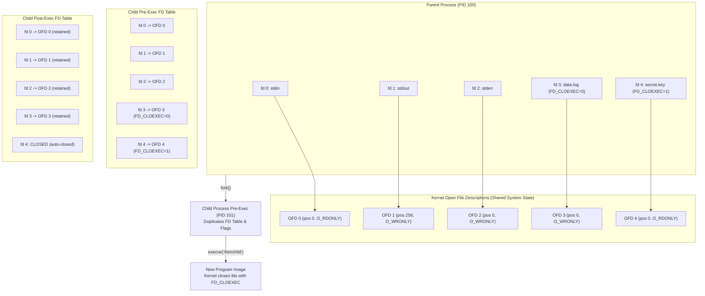

# Close-on-Exec and Descriptor Inheritance

> [!summary] Claim
> File descriptors survive `fork()` and `execve()` by default, sharing underlying open file descriptions with the parent process, unless atomically suppressed with the `FD_CLOEXEC` descriptor flag or platform isolation boundaries.

## TL;DR

- Mechanism: `fork()` duplicates the process descriptor table along with all descriptor flags, while `execve()` automatically closes every descriptor whose `FD_CLOEXEC` flag bit is set.
- Rule: Always set `O_CLOEXEC` or `FD_CLOEXEC` at creation time on internal descriptors, sockets, and pipes to guarantee that secrets and resources never leak across execution boundaries.
- Trap: Closing standard streams 0, 1, or 2 leaves holes that subsequent `open()` calls reuse under the lowest-available-descriptor rule, causing standard library routines to silently clobber private files.
- Portability fact: Descriptors opened via `exec 3>file` remain open across external command execution in bash, dash, and zsh, but are closed on exec by ksh93 and mksh (outside their `posix` modes) unless explicitly redirected on the command line.
- When not to use it: Never set `FD_CLOEXEC` on descriptors intended for child inter-process communication, pipeline plumbing, or process substitution arguments passed via `/dev/fd/N`.

## Mental model



When a process calls `fork()`, the kernel allocates a new process descriptor table and copies every descriptor entry and descriptor flag bitmask from the parent process.
Both parent and child file descriptors point to the exact same underlying open file descriptions in kernel space, sharing file offsets, file status flags, and socket states.
When the child invokes `execve()`, the kernel clears the old user-space address space and scans the process descriptor table.
Any descriptor that has the `FD_CLOEXEC` flag bit set is immediately closed via `do_close_on_exec()` (the Linux name through v7.2; mainline master renames it `close_cloexec_files()` (as of 2026-10), per `fs/exec.c` and `fs/file.c`), which decrements the reference count on the corresponding open file description and releases POSIX record locks.
Any descriptor without `FD_CLOEXEC` survives process replacement, remaining accessible to the newly executed binary at its original numeric file descriptor index.

## How it works

The Unix I/O model separates the per-process file descriptor table from the system-wide open file description table.
A file descriptor is simply a non-negative integer serving as an index into the process table `struct files_struct`.
Each entry in that table contains a pointer to a kernel `struct file` (the open file description) and a small set of descriptor-specific flags.
POSIX.1-2024 defines two descriptor flags in `<fcntl.h>`: `FD_CLOEXEC` (close-on-exec) and `FD_CLOFORK` (close-on-fork).
Crucially, file status flags such as `O_APPEND`, `O_NONBLOCK`, and the current file position offset live in the open file description, while `FD_CLOEXEC` lives strictly inside the per-process descriptor table entry.

During `fork()`, the Linux kernel function `copy_process()` invokes `copy_files()`.
Unless `CLONE_FILES` was specified (as with multi-threaded pthread creation), `dup_fd()` creates an independent copy of `struct files_struct`.
The copy duplicates every `struct file *` pointer and increments its reference count `f_count`.
Because `dup_fd()` copies the bitmap `close_on_exec` directly into the child, descriptor flags are preserved across `fork()`.
Therefore, immediately after `fork()`, a descriptor marked `FD_CLOEXEC` remains open in the child process.

During `execve()`, the kernel transitions the process to a new binary via `do_execveat_common()`.
Inside `begin_new_exec()` (named `flush_old_exec()` through Linux 5.7, per `fs/exec.c` at tags v5.7 and v5.8), the kernel calls `do_close_on_exec()`, defined in `fs/file.c` (renamed `close_cloexec_files()` on mainline master after v7.2, as of 2026-10).
This function iterates through the `fdt->close_on_exec` bitmask.
For every bit set, the kernel clears the descriptor slot, unlocks any POSIX process-owned file locks held on that descriptor, and calls `filp_close()`.
If the open file description reference count falls to zero, the underlying inode `release` method is invoked.
Descriptors whose `FD_CLOEXEC` bit is zero remain open and unchanged in the new program image (POSIX.1-2024 XSH `exec`, DESCRIPTION).

POSIX.1-2024 Issue 8 formalized `FD_CLOFORK`, `O_CLOFORK`, and `F_DUPFD_CLOFORK` (Austin Group Defect 1318 adds `FD_CLOFORK` and `O_CLOFORK`, Defect 1351 adds `F_DUPFD_CLOFORK`, per the XBD `<fcntl.h>` CHANGE HISTORY).
When `FD_CLOFORK` is set on a file descriptor, child processes created via `fork()` or `_Fork()` do not inherit the descriptor at all; the kernel closes it during child creation before user-space code executes.
Kernel support is uneven: the macOS SDK `<sys/fcntl.h>` defines `FD_CLOFORK`, `O_CLOFORK`, and `F_DUPFD_CLOFORK`, FreeBSD 15.0 added `CLOSE_RANGE_CLOFORK` (FreeBSD `close_range(2)`), and Linux mainline `fs/file.c` has no close-on-fork flag (as of 2026-10).
This eliminates the window where multi-threaded processes that fork without immediately calling exec would leak internal descriptors to worker processes.

The historical two-step idiom `fd = open(path, O_RDONLY); fcntl(fd, F_SETFD, FD_CLOEXEC);` suffered from an inherent concurrency race condition.
If Thread A opened a descriptor while Thread B concurrently executed `fork()` and `execve()`, the child process created by Thread B inherited `fd` before Thread A could set `FD_CLOEXEC`.
POSIX.1-2008 and Linux eliminated this race condition by introducing atomic creation flags:
- `open()` and `openat()` accept `O_CLOEXEC` (Linux 2.6.23, POSIX.1-2008).
- `fcntl()` supports `F_DUPFD_CLOEXEC` (Linux 2.6.24, POSIX.1-2008).
- `pipe2()` creates connected descriptors with `O_CLOEXEC` atomically (Linux 2.6.27, glibc 2.9; standardized in POSIX.1-2024, per pipe(2)).
- `socket()` and `socketpair()` accept `SOCK_CLOEXEC` (Linux 2.6.27, glibc 2.9).
- `accept4()` accepts `SOCK_CLOEXEC` (Linux 2.6.28, glibc 2.10; standardized in POSIX.1-2024, per accept(2)).
- `dup3()` duplicates descriptors with `O_CLOEXEC` (Linux 2.6.27, glibc 2.9; standardized in POSIX.1-2024, per dup(2)).

For process spawning and bulk cleanup, operating systems provide specialized interfaces:
- `close_range(first, last, flags)` (Linux 5.9, FreeBSD 12.2, glibc 2.34) closes all descriptors between `first` and `last`.
  With `CLOSE_RANGE_CLOEXEC` (Linux 5.11), it sets `FD_CLOEXEC` across the range without closing them immediately, so the descriptors can be marked before a `seccomp(2)` profile is installed and are then closed by `execve()` itself (close_range(2) NOTES).
  With `CLOSE_RANGE_UNSHARE`, it unshares the descriptor table before closing, avoiding races with other threads sharing the table (close_range(2)).
- `posix_spawn()` on macOS supports `POSIX_SPAWN_CLOEXEC_DEFAULT` (`0x4000` in `<sys/spawn.h>`), closing all descriptors by default except those explicitly marked for inheritance with `posix_spawn_file_actions_addinherit_np()`.
- Glibc 2.34 (glibc 2.34 NEWS), Solaris (Oracle `posix_spawn_file_actions_addclosefrom_np(3C)`), and FreeBSD 13.1 (FreeBSD `posix_spawn_file_actions_addopen(3)` HISTORY) provide `posix_spawn_file_actions_addclosefrom_np()`.

In shell execution environments, descriptor inheritance follows strict rules governed by POSIX XCU 2.7 (Redirection) and 2.15 (Special Built-In Utilities, `exec`).
POSIX requires implementations to support at least descriptors 0 through 9 for user redirections.
POSIX XCU 2.15 states that if descriptors greater than 2 are opened by `exec` redirections (such as `exec 3>file`), it is unspecified whether those descriptors remain open when the shell invokes another utility.
In GNU Bash, internal descriptors (such as saved undo-redirections and script input files) are protected with `#define SET_CLOSE_ON_EXEC(fd) (fcntl ((fd), F_SETFD, FD_CLOEXEC))`, defined in `include/filecntl.h` and applied in `redir.c` (`add_undo_redirect()`) and `shell.c` (`open_shell_script()`) (bash 5.2 source).
User-opened descriptors (`exec 3>file`) do not have `FD_CLOEXEC` set in bash, dash, zsh, yash, busybox ash, and posh, so child processes inherit them.
In contrast, Korn-derived shells like AT&T ksh93 and mksh set `FD_CLOEXEC` on descriptors greater than 2 opened via `exec`, closing them automatically when external commands are executed unless explicitly passed via `cmd 3<&3` (ksh(1) `exec`: "any file descriptor numbers greater than 2 that are opened with this mechanism are closed when invoking another program"; mksh(1) `exec`).
Both relax this in their POSIX modes: ksh93u+m `set -o posix` (on automatically when invoked as `sh`) opens `exec` descriptors above 2 without close-on-exec, and mksh `set -o posix` makes redirection descriptors inherited by child processes; ksh93u+ 2012 has no `posix` option (all three reproduced, and documented in ksh93u+m `sh.1` and mksh(1) POSIX mode).

POSIX XSH `open` and XSH 2.6 (File Descriptor Allocation) mandate the lowest-numbered available file descriptor rule: when opening a new file, the kernel must return the lowest non-negative integer not currently open in the calling process.
If a shell or program closes standard input (`exec 0<&-`), standard output (`exec 1>&-`), or standard error (`exec 2>&-`), the very next `open()`, `socket()`, or `pipe()` system call will allocate descriptor 0, 1, or 2.
POSIX.1-2024 XSH `exec` (DESCRIPTION) explicitly warns that executing a conforming utility with descriptor 0 not open for reading or 1 or 2 not open for writing renders the execution environment non-conforming.

## Numbers and limits

| Property / Limit | Value | Scope / Standard | Source / Verification |
|---|---|---|---|
| `FD_CLOEXEC` constant value | `1` | POSIX file descriptor flag (POSIX names it but fixes no value) | Linux, Darwin `<sys/fcntl.h>` (macOS SDK, checked 2026-10) |
| `FD_CLOFORK` constant value | `2` | POSIX.1-2024 file descriptor flag (POSIX fixes no value) | Darwin `<sys/fcntl.h>` (macOS SDK, checked 2026-10); absent from Linux |
| `O_CLOEXEC` octal value (Linux x86_64/arm64) | `02000000` (`0x80000`) | Linux open creation flag | `(1 << 19)` in `include/uapi/asm-generic/fcntl.h`; added in Linux 2.6.23 |
| `O_CLOEXEC` hex value (macOS Darwin) | `0x01000000` | Darwin open creation flag | macOS SDK `<sys/fcntl.h>` |
| `F_DUPFD_CLOEXEC` command value | `1030` (Linux), `67` (Darwin) | fcntl duplication command | Linux `F_LINUX_SPECIFIC_BASE + 6` in `<linux/fcntl.h>` (base `1024`) / Darwin `<sys/fcntl.h>` |
| `CLOSE_RANGE_CLOEXEC` flag value | `4` (`1U << 2`) | close_range syscall flag | Linux 5.11 `<linux/close_range.h>` |
| `CLOSE_RANGE_UNSHARE` flag value | `2` (`1U << 1`) | close_range syscall flag | Linux 5.9 `<linux/close_range.h>` |
| `POSIX_SPAWN_CLOEXEC_DEFAULT` flag | `0x4000` | Darwin posix_spawn flag | macOS SDK `<sys/spawn.h>` |
| POSIX minimum guaranteed shell fds | `0` to `9` (10 descriptors) | Shell redirection syntax | POSIX.1-2024 XCU 2.7 |
| POSIX `{_POSIX_OPEN_MAX}` | `20` descriptors | Minimum per-process fds | POSIX.1-2024 XBD `<limits.h>` |
| Linux default soft `RLIMIT_NOFILE` | `1024` descriptors (hard `4096`) | Process resource limit | `INR_OPEN_CUR` / `INR_OPEN_MAX` in `include/uapi/linux/fs.h` `(as of 2026-10)`; init systems often raise the hard limit |
| Linux per-process `RLIMIT_NOFILE` ceiling | `1048576` descriptors | `fs.nr_open` sysctl | `sysctl_nr_open = 1024*1024` in `fs/file.c` `(as of 2026-10)` |
| macOS Darwin default soft `RLIMIT_NOFILE` | `256` (launchd soft default) | Process resource limit | `launchctl limit maxfiles` on macOS 27.2 `(as of 2026-10)`; the `kern.maxfilesperproc` ceiling is hardware-dependent (`138240` on the test host) |
| `exec 3>file` child inheritance (bash/dash/zsh/yash/busybox/posh) | `3:open` | External utility execution | Verified by lab under [lab](../labs/01-close-on-exec-and-descriptor-inheritance/) |
| `exec 3>file` child inheritance (ksh93/mksh) | `3:closed` | External utility execution | Verified by lab under [lab](../labs/01-close-on-exec-and-descriptor-inheritance/) |
| Subshell `( )` fd 3 inheritance (all shells) | `open` | Subshell without execve | Verified by lab under [lab](../labs/01-close-on-exec-and-descriptor-inheritance/) |

## Portability

| Shell / Tool | `exec 3>file` Passed to Child | `{var}>file` Support | Internal Script FD Closed on Exec | POSIX Conformance & Mechanism |
|---|---|---|---|---|
| POSIX.1-2024 sh | Unspecified (implementation-defined) | Optionally supported (`IO_LOCATION` token, XCU 2.10) | Unspecified | Mandates fds 0..9; allows shells to close or preserve fds > 2 on utility exec (XCU 2.15). |
| macOS bash 3.2.57 | Yes (`3:open`) | No (`{v}` is run as a command: `not found`) | Yes | Keeps user fds open; internal fds and saved redirects use `FD_CLOEXEC`. |
| GNU bash 4.4, 5.2, 5.3 (tested 4.4.23 to 5.3.20) | Yes (`3:open`) | Yes (allocates fd >= 10, no cloexec) | Yes | User fds lack `FD_CLOEXEC`; internal fds use close-on-exec. |
| zsh (native, tested 5.9 and 5.9.2) | Yes (`3:open`) | Yes (allocates fd >= 10, no cloexec) | Yes | User fds inherited across forks and execs; internal descriptors marked with cloexec. |
| zsh (`--emulate sh`, tested 5.9) | Yes (`3:open`) | No (`{v}` is run as a command: `command not found`) | Yes | Same `exec 3>file` inheritance as native zsh, but `{var}` redirection is not recognized in sh emulation. |
| dash (tested 0.5.12) | Yes (`3:open`) | No (`{v}` is run as a command: `not found`) | Yes | Preserves user descriptors across external utility execs. |
| AT&T ksh93 (tested 93u+ 2012-08-01 and 93u+m/1.0.10) | No (`3:closed`); `open` under 93u+m `set -o posix` or when invoked as `sh` | Yes (allocates fd >= 10); 93u+m marks it cloexec, 93u+ 2012 passes it to children | Yes | Sets `FD_CLOEXEC` on user fds > 2 opened via `exec` (ksh(1) `exec`); requires `cmd 3<&3` to pass down outside POSIX mode. |
| mksh (tested R59 2020/10/31 and R59 2025/04/26) | No (`3:closed`); `open` under `set -o posix` | No (`{v}: inaccessible or not found`) | Yes | pdksh lineage; does not pass fds > 2 opened via `exec` to executed commands (mksh(1) `exec`) unless POSIX mode is on (mksh(1) POSIX mode). |
| yash (tested 2.58.1) | Yes (`3:open`) | No (`no such command '{v}'`) | Yes | Leaves user fds open across execve. |
| posh (tested 0.14.1) | Yes (`3:open`) | No (`{v}: not found`) | Yes | Debian Policy compliance shell; leaves user fds open across execve. |
| BusyBox ash (tested 1.37.0) | Yes (`3:open`) | No (`{v}: not found`) | Yes | Derived from dash/NetBSD sh; preserves user descriptors 3..9 across exec. |

## Worked example

The companion lab under [lab](../labs/01-close-on-exec-and-descriptor-inheritance/) verifies file descriptor inheritance, close-on-exec behavior, and lowest-available-descriptor allocation across POSIX shells.

The lab provides the probe utility `probe_fds.sh`:

```sh
#!/bin/sh
# probe_fds.sh - report open/closed status of specified file descriptors.
# Usage: ./probe_fds.sh [fd...]
# If no arguments are given, probes fds 0 through 4.

set -eu

if [ "$#" -eq 0 ]; then
  set -- 0 1 2 3 4
fi

probe_single_fd() {
  fd="$1"
  if [ "$fd" -eq 9 ]; then
    (: 8<&9) 2>/dev/null
  else
    eval "(: 9<&\$fd) 2>/dev/null"
  fi
}

out=""
for target_fd in "$@"; do
  if probe_single_fd "$target_fd"; then
    state="open"
  else
    state="closed"
  fi
  if [ -z "$out" ]; then
    out="${target_fd}:${state}"
  else
    out="${out} ${target_fd}:${state}"
  fi
done

printf '%s\n' "$out"
```

The test runner `descriptor_inheritance.bats` validates these mechanics:

```bash
#!/usr/bin/env bats
# Tests for descriptor inheritance and close-on-exec behavior across shells.

setup() {
  load ../lib/lab
  PROBE="$BATS_TEST_DIRNAME/probe_fds.sh"
}

@test "standard descriptors 0, 1, and 2 are inherited across process execution" {
  run_lab "$PROBE" 0 1 2
  [ "$status" -eq 0 ]
  [ "$output" = "0:open 1:open 2:open" ]
}

@test "descriptor 3 opened via exec is inherited in most shells but closed in ksh93 and mksh" {
  # shellcheck disable=SC2016 # expansions belong to the shell under test
  run_lab_c 'exec 3>/dev/null; "$1" 0 1 2 3' inline "$PROBE"
  [ "$status" -eq 0 ]
  case $(lab_shell_family) in
    ksh93 | mksh)
      [ "$output" = "0:open 1:open 2:open 3:closed" ]
      ;;
    bash | zsh | zsh-sh | dash | yash | busybox | posh)
      [ "$output" = "0:open 1:open 2:open 3:open" ]
      ;;
    *)
      false
      ;;
  esac
}

@test "descriptor 3 is passed to child across all shells with explicit command redirection" {
  # shellcheck disable=SC2016 # expansions belong to the shell under test
  run_lab_c 'exec 3>/dev/null; "$1" 3<&3 0 1 2 3' inline "$PROBE"
  [ "$status" -eq 0 ]
  [ "$output" = "0:open 1:open 2:open 3:open" ]
}

@test "explicit descriptor closure with exec 3>&- closes descriptor in shell and child" {
  # shellcheck disable=SC2016 # expansions belong to the shell under test
  run_lab_c 'exec 3>/dev/null; exec 3>&-; "$1" 0 1 2 3' inline "$PROBE"
  [ "$status" -eq 0 ]
  [ "$output" = "0:open 1:open 2:open 3:closed" ]
}

@test "subshell preserves open descriptor without execve across all shells" {
  # shellcheck disable=SC2016 # expansions belong to the shell under test
  run_lab_c 'exec 3>/dev/null; ( if (: 9<&3) 2>/dev/null; then echo open; else echo closed; fi )'
  [ "$status" -eq 0 ]
  [ "$output" = "open" ]
}

@test "closing stdin frees descriptor 0, which the child's next open reuses" {
  # ls opens the /dev/fd directory without naming a descriptor, so the kernel hands it the lowest free one.
  # With stdin closed the listing loses one entry (stdin) yet still starts at 0 (the directory itself).
  # Both listings go straight to stdout: a pipe or command substitution opened after the close could take fd 0 itself.
  run_lab_c 'ls /dev/fd/; echo --; exec 0<&-; ls /dev/fd/'
  [ "$status" -eq 0 ]
  local sep=-1 i
  for i in "${!lines[@]}"; do
    if [ "${lines[$i]}" = "--" ]; then sep=$i; fi
  done
  [ "$sep" -gt 0 ]
  [ "$((${#lines[@]} - sep - 1))" -eq "$((sep - 1))" ]
  [ "${lines[$((sep + 1))]}" = "0" ]
}

@test "pipe writer closure allows reader to detect EOF while the writer still runs" {
  # cat returns only at EOF; the writer is still alive afterwards, so the EOF came from the close, not its exit.
  # shellcheck disable=SC2016 # expansions belong to the shell under test
  run_lab_c '
    fifo="$1/fifo"
    mkfifo "$fifo"
    (
      exec 3>"$fifo"
      printf "data\n" >&3
      exec 3>&-
      exec /bin/sleep 30 >/dev/null 2>&1
    ) &
    writer=$!
    line=$(cat <"$fifo")
    if kill -0 "$writer" 2>/dev/null; then state=writer_alive; else state=writer_gone; fi
    kill -9 "$writer" 2>/dev/null
    wait "$writer" 2>/dev/null
    rm -f "$fifo"
    printf "%s %s\n" "$line" "$state"
  ' inline "$BATS_TEST_TMPDIR"
  [ "$status" -eq 0 ]
  [ "$output" = "data writer_alive" ]
}
```

Expected output when running bats:

```
1..7
ok 1 standard descriptors 0, 1, and 2 are inherited across process execution
ok 2 descriptor 3 opened via exec is inherited in most shells but closed in ksh93 and mksh
ok 3 descriptor 3 is passed to child across all shells with explicit command redirection
ok 4 explicit descriptor closure with exec 3>&- closes descriptor in shell and child
ok 5 subshell preserves open descriptor without execve across all shells
ok 6 closing stdin frees descriptor 0, which the child's next open reuses
ok 7 pipe writer closure allows reader to detect EOF while the writer still runs
```

## Pitfalls

> [!warning] Leaking Host Descriptors to Sandboxes and Containers (CVE-2024-21626)
> Trigger: Leaving internal directory or configuration file descriptors without `O_CLOEXEC` when invoking `execve()` during container initialization.
> Symptom: A containerized or unprivileged process inspects `/proc/self/fd/` and uses leaked descriptors to escape its `chroot` root or modify host filesystems.
> Incident: On 2024-01-31, CVE-2024-21626 ("Leaky Vessels") in `runc` v1.0.0-rc93 through 1.1.11 (fixed in 1.1.12) leaked an internal handle to the host's `/sys/fs/cgroup` (often `/proc/self/fd/7`) into the container process, so a working directory set to that path placed the process in the host filesystem, enabling container breakout (GHSA-xr7r-f8xq-vfvv).
> Fix: Always set `O_CLOEXEC` atomically on all opened descriptors, and invoke `close_range(3, ~0U, 0)` or `POSIX_SPAWN_CLOEXEC_DEFAULT` prior to calling `execve()`.

> [!warning] The Multi-Threaded Fork-Exec Race Condition (PEP 446)
> Trigger: Calling `open()` or `socket()` without atomic creation flags and subsequently setting `FD_CLOEXEC` via `fcntl(fd, F_SETFD, FD_CLOEXEC)` in a multi-threaded application.
> Symptom: A concurrent thread calls `fork()` and `execve()` during the timing window between `open()` and `fcntl()`, causing the child process to silently inherit sensitive descriptors, hold ports open (`EADDRINUSE`), or prevent filesystem unmounting.
> Incident: Python PEP 446 (Victor Stinner, Python 3.4) overhauled Python runtime descriptor management because multi-threaded applications routinely leaked sockets and file handles across subprocess spawns.
> Fix: Use atomic creation flags exclusively: `open(..., O_CLOEXEC)`, `socket(..., SOCK_CLOEXEC)`, `pipe2(..., O_CLOEXEC)`, `dup3(..., O_CLOEXEC)`, and `fcntl(fd, F_DUPFD_CLOEXEC, minfd)`.

> [!warning] Silent Clobbering of Private Files from Closed Descriptors 0, 1, or 2
> Trigger: Closing standard input (`exec 0<&-`), standard output (`exec 1>&-`), or standard error (`exec 2>&-`) before executing an external command or library routine.
> Symptom: The kernel assigns descriptor 0, 1, or 2 to the next opened file under the lowest-available-descriptor rule; standard library logging, `printf()`, or diagnostic messages then overwrite confidential files or corrupt database tables.
> Incident: POSIX.1-2024 XSH `exec` (DESCRIPTION) explicitly classifies executing any standard utility with descriptors 0, 1, or 2 closed as creating a non-conforming execution environment.
> Fix: Never close descriptors 0, 1, or 2; redirect unneeded streams to `/dev/null` (`exec 0</dev/null 1>/dev/null 2>/dev/null`).

> [!warning] Pipeline Reader Deadlock Caused by Leaked Pipe Write Descriptors
> Trigger: A shell script or orchestrator creates a pipe or FIFO, spawns a consumer and producer, but leaves the write end of the pipe open in the parent or an unrelated background process.
> Symptom: The consumer process hangs indefinitely waiting for input on `read()`, never receiving `0` (EOF), because the kernel maintains an active writer reference in the leaked descriptor.
> Incident: Production ETL workflows routinely deadlock when background monitoring subshells inherit descriptor 3 or pipe write descriptors.
> Fix: Explicitly close write descriptors in every non-producing process immediately (`exec 3>&-`), or set `O_CLOEXEC` on pipe creation.

> [!warning] Korn Shell (ksh93 and mksh) Silent Descriptor Drop in Multi-Command Scripts
> Trigger: Porting a script using `exec 3>file` from Bash to AT&T ksh93 or mksh without appending `3<&3` to external command invocations.
> Symptom: External commands executed within the script fail with `Bad file descriptor` when attempting to write to descriptor 3 (`>&3`).
> Incident: POSIX XCU 2.15 leaves descriptor persistence greater than 2 unspecified; ksh93 and mksh deliberately keep user descriptors opened via `exec` private to the shell (documented in `ksh(1)` and `mksh(1)` under `exec`).
> Fix: Pass descriptors explicitly on command invocations in ksh93 and mksh (`cmd 3<&3` or `cmd 3>&3`), scope redirections inside compound blocks (`{ cmd; } 3>file`), or turn on `set -o posix` (ksh93u+m and mksh only).

> [!warning] Sudo Privilege Boundary Descriptor Leaks (sudoers `closefrom`)
> Trigger: Transitioning privileges via setuid binaries or `sudo` without closing non-standard descriptors inherited from an untrusted calling process.
> Symptom: Unprivileged users pass open write descriptors pointing to sensitive files or pseudo-terminals into elevated execution contexts.
> Incident: `sudo` closes every descriptor from 3 upward before running a command by default (sudoers(5) `closefrom`, default `3`), and lets a user override the starting point with `-C` only when `closefrom_override` is set (off by default); `closefrom()` dates to FreeBSD 8.0 and `close_range()` to FreeBSD 12.2 and Linux 5.9.
> Fix: Call `close_range(3, ~0U, 0)` or `closefrom(3)` before executing binaries across security or identity domains.

## Security and robustness

File descriptors are capabilities: possessing an open file descriptor grants read, write, or control operations on the underlying kernel object regardless of filesystem permissions or subsequent directory renames.
Security boundaries that rely solely on `chroot()` or Linux mount namespaces fail completely if a single directory or file descriptor pointing outside the jail leaks across `execve()`.
Once a rogue or compromised child process inherits a directory descriptor, it can call `fchdir(fd)` or open paths relative to `/proc/self/fd/N` to traverse the host filesystem and completely bypass namespace isolation.

Operating system kernels do not automatically scrub file descriptor tables across setuid or capability transitions during `execve()`.
When an unprivileged process executes a setuid-root binary, only user credentials and process capability sets change; descriptors without `FD_CLOEXEC` remain open.
If the setuid binary trusts descriptors 0, 1, or 2, or fails to sanitize higher descriptors, an attacker can pass open descriptors to `/etc/shadow` or raw block devices.
POSIX.1-2024 XSH `exec` only permits, and does not require, implementations to open an unspecified file for descriptor 0, 1, or 2 when it would otherwise be closed after exec, so a setuid program must not assume that mitigation exists.

Robust multi-process architectures implement defense-in-depth descriptor hygiene:
1. Every library and subsystem must open files, pipes, and sockets with atomic `O_CLOEXEC` or `SOCK_CLOEXEC` flags.
2. Supervisors spawning child processes must explicitly sanitize descriptor tables using `close_range(3, ~0U, CLOSE_RANGE_UNSHARE)` on Linux or `POSIX_SPAWN_CLOEXEC_DEFAULT` on macOS Darwin.
3. Modern sandboxing primitives like OpenBSD `pledge()` restrict which syscall classes a process may use at all, but they do not revoke descriptors already open: Linux Landlock states that "files or directories opened before the sandboxing are not subject to these restrictions", so a leaked descriptor keeps its access and descriptor hygiene remains the first line of defense.

## The principal's view

At staff-plus level, descriptor inheritance is an architectural contract, not an accidental side effect of process creation.
Defaulting to open descriptor inheritance across `fork()` and `execve()` was one of Unix's earliest design decisions, enabling simple shell pipelines like `ls | grep`.
However, in modern concurrent, multi-threaded, and containerized architectures, universal inheritance is an anti-pattern that violates the principle of least privilege and introduces insidious timing bugs.

The architectural decision is clear: enforce non-inheritable descriptors by default across your entire software stack.
Modern programming languages (Rust, Go, and Python 3.4+ under PEP 446) have established this as the default runtime standard.
Every socket, database handle, telemetry pipe, and file must be opened with atomic close-on-exec flags.
When designing process supervisors or container runtimes, never iterate over `RLIMIT_NOFILE` with a userspace `for (fd = 3; fd < max_fd; fd++) close(fd);` loop; that pattern wastes thousands of CPU cycles on sparse tables and degrades startup latency.
Instead, leverage kernel bulk-cleanup interfaces: `close_range()` on Linux and `POSIX_SPAWN_CLOEXEC_DEFAULT` on macOS Darwin.

When shell scripts grow beyond simple linear pipelines to require complex descriptor multiplexing, background daemon management, or granular privilege separation, stop writing shell scripts.
Shell redirection syntax lacks atomic creation flags and exhibits subtle portability divergences (such as ksh93 and mksh closing descriptors greater than 2 on exec outside their `posix` modes).
Migrate the workflow to a systems programming language with explicit `posix_spawn()` file actions or container isolation tooling.

## Interview questions

> [!question] L5: What does the command `exec 3>/dev/null; /bin/sh -c '(: <&3) 2>/dev/null && echo open \|\| echo closed'` output under bash versus AT&T ksh93 and mksh, and what mechanism causes the divergence?
>
> > [!success]- Answer
> > Under bash (as well as dash, zsh, yash, busybox ash, and posh), the command prints `open`.
> > Under AT&T ksh93 and mksh, the command prints `closed` (reproduced on ksh93u+ 2012, ksh93u+m/1.0.10, and mksh R59; under `set -o posix` in ksh93u+m or mksh it prints `open`).
> > POSIX.1-2024 XCU 2.15 leaves descriptor persistence greater than 2 across utility execution unspecified.
> > Bash leaves `FD_CLOEXEC` clear on user-redirected descriptors, allowing the external `/bin/sh` process to inherit descriptor 3.
> > In contrast, ksh93 and mksh set `FD_CLOEXEC` on descriptors greater than 2 opened via `exec` (documented in `mksh(1)`), so the kernel closes descriptor 3 during `execve()`.
> >
> > Follow-up: How can you modify the command in ksh93 or mksh so that `/bin/sh` inherits descriptor 3?

> [!question] L6: How do you debug and resolve an incident where worker processes hang and exhaust `RLIMIT_NOFILE` after an orchestrator opens a log pipe with `exec 3>"$LOG_PIPE"` and repeatedly spawns background jobs without closing descriptor 3?
>
> > [!success]- Answer
> > The parent orchestrator opened `$LOG_PIPE` on descriptor 3 without setting `FD_CLOEXEC`.
> > Every background worker spawned in the loop inherited an open write descriptor to the log pipe.
> > Because workers and background jobs retain write references to `$LOG_PIPE`, the pipe never delivers EOF to the log consumer, and descriptor counts grow until hitting `RLIMIT_NOFILE`.
> > To fix this, close descriptor 3 before launching each background worker (`exec 3>&-` in the child subshell), or explicitly scope the redirection to the logger command rather than the global shell environment.
> >
> > Follow-up: Why does an open write descriptor in an unrelated process prevent a reader process from detecting EOF on a pipe?

> [!question] L5: What is the architectural difference between a File Descriptor and an Open File Description?
>
> > [!success]- Answer
> > A file descriptor is an integer index private to a single process file descriptor table.
> > An open file description is a shared kernel object representing an active file instance.
> > The open file description stores the current file offset, access modes, file status flags like `O_NONBLOCK`, and reference counts.
> > Calling `fork()` creates a new file descriptor in the child pointing to the same open file description, sharing the file offset.
> > The `FD_CLOEXEC` flag is stored in the per-process descriptor table entry, not in the shared open file description.
> >
> > Follow-up: If process A and process B both open `/tmp/data` with separate `open()` calls, do they share file offsets?

> [!question] L6: What concurrency race condition made `fcntl(fd, F_SETFD, FD_CLOEXEC)` unsafe in multi-threaded programs and necessitated the introduction of `O_CLOEXEC` in POSIX.1-2008?
>
> > [!success]- Answer
> > The two-step sequence of calling `open()` followed by `fcntl()` is not atomic.
> > In multi-threaded applications, Thread 1 can open a file on descriptor 7 while Thread 2 calls `fork()` and `execve()`.
> > If the fork occurs after Thread 1 calls `open()` but before it calls `fcntl()`, the child process inherits descriptor 7 without `FD_CLOEXEC`.
> > The leaked descriptor can expose confidential keys or keep network ports locked in the child process.
> > `O_CLOEXEC` instructs the kernel to set `FD_CLOEXEC` atomically inside `open()` before returning the descriptor to userspace.
> >
> > Follow-up: Name three other system calls that were given atomic close-on-exec variants in Linux and POSIX.

> [!question] L6: What sequence of failures occurs when a daemon closes file descriptors 0, 1, and 2 instead of redirecting them to `/dev/null` before opening private files or network sockets?
>
> > [!success]- Answer
> > When descriptors 0, 1, and 2 are closed, the lowest three descriptor slots in the process table become free.
> > The next time the daemon opens a file, database connection, or socket, the kernel assigns descriptor 0 under the lowest-available-descriptor rule.
> > Subsequent opens will occupy descriptor 1 and descriptor 2.
> > If a third-party library or runtime routine writes error messages or debug logs to standard output or standard error, it writes directly to the application database or socket.
> > This silently corrupts application data files or sends junk data across network sockets.
> >
> > Follow-up: How does POSIX.1-2024 XSH `exec` categorize the execution environment of a utility launched with descriptor 0 closed?

> [!question] L7+: Why is iterating from descriptor 3 up to `sysconf(_SC_OPEN_MAX)` to close descriptors an anti-pattern during high-throughput process spawning, and how do `close_range()` and `POSIX_SPAWN_CLOEXEC_DEFAULT` eliminate the overhead?
>
> > [!success]- Answer
> > Looping from 3 to `sysconf(_SC_OPEN_MAX)` issues thousands of redundant `close()` system calls on sparse descriptor tables.
> > On systems where `RLIMIT_NOFILE` is 1,048,576, this loop burns significant CPU time and degrades process spawn latency.
> > Furthermore, between `fork()` and `execve()` in a multi-threaded parent only async-signal-safe calls are allowed, and while `close()` qualifies, the loop lengthens the window in which the child runs with a copied address space before `execve()`.
> > On Linux, `close_range(3, ~0U, 0)` closes all open descriptors in a single system call that walks the descriptor bitmap in the kernel, so its cost tracks the table size rather than costing one syscall per possible descriptor (close_range(2) cites "significant performance benefits").
> > On macOS Darwin, `POSIX_SPAWN_CLOEXEC_DEFAULT` with `posix_spawn()` directs the kernel to close all non-inherited descriptors during spawn.
> >
> > Follow-up: What does `CLOSE_RANGE_UNSHARE` accomplish in `close_range()`, and when is it required?

> [!question] L7+: How did an unclosed host file descriptor in `runc` enable container breakout in CVE-2024-21626, and why did setting `O_CLOEXEC` fail to protect against an attacker-controlled working directory referencing `/proc/self/fd/N`?
>
> > [!success]- Answer
> > During container startup, `runc` opened host directory descriptors to setup cgroups and container namespaces.
> > In `runc` v1.0.0-rc93 through 1.1.11, a handle to the host's `/sys/fs/cgroup` was opened without `O_CLOEXEC` and stayed open in `runc init` (GHSA-xr7r-f8xq-vfvv).
> > An attacker could configure a container image with a working directory pointing to `/proc/self/fd/N` (commonly `/proc/self/fd/7`).
> > When `runc` entered the container environment and executed `chdir()`, the process stepped through the leaked host descriptor into the host filesystem.
> > This escaped the container's `pivot_root(2)` filesystem view and granted the container process access to read and overwrite host binaries.
> > Because `runc init` performs that `chdir()` before its own `execve()`, close-on-exec alone cannot help there, so 1.1.12 also closes all internal fds just before `execve()`, marks non-stdio files `O_CLOEXEC`, and verifies the working directory is inside the container.
> >
> > Follow-up: Why was setting `O_CLOEXEC` on the descriptor insufficient to prevent this specific vulnerability?

> [!question] L6: What problem does `FD_CLOFORK` in POSIX.1-2024 solve that `FD_CLOEXEC` could not address?
>
> > [!success]- Answer
> > `FD_CLOEXEC` only closes file descriptors during an `execve()` system call.
> > If a multi-threaded application calls `fork()` to create a child process that does not call `execve()` (such as an in-memory worker or daemon child), `FD_CLOEXEC` does not take effect.
> > All open descriptors from the parent process remain open in the child process.
> > `pthread_atfork()` handlers designed to close descriptors are error-prone and can race with concurrent thread allocations.
> > `FD_CLOFORK` instructs the kernel to close the descriptor automatically during `fork()` and `_Fork()`, ensuring child processes never receive the descriptor.
> >
> > Follow-up: Which POSIX.1-2024 functions support setting `FD_CLOFORK` atomically at descriptor creation?

## Related

Prerequisites: [[File-Descriptors-and-Open-File-Descriptions]]

Next: [[Pipes-and-FIFOs]]

See also: [[Processes-fork-exec-and-wait]], [[Posix-Spawn-and-Vfork]], [[Program-Startup-argv-envp-and-ARG_MAX]], [[PIPE_BUF-and-Write-Atomicity]], [[SIGPIPE-and-EPIPE]], [[Exit-Status-and-Wait-Status]], [[Signals-Dispositions-Masks-and-Delivery]], [[Async-Signal-Safety]], [[Sessions-Process-Groups-and-Controlling-Terminals]], [[Daemonization]], [[Zombies-and-Orphans]], [[The-proc-Filesystem]], [[dev-fd-and-dev-stdin]], [[Environment-Variables-and-Inheritance]], [[Resource-Limits-and-ulimit]], [[Processes-Fork-Exec-and-File-Descriptors]]

## Further reading

- IEEE Std 1003.1-2024 (POSIX.1-2024) XSH `exec` (and XSH 2.6 File Descriptor Allocation): Defines file descriptor inheritance, `FD_CLOEXEC` closure semantics, and the requirement for standard streams 0, 1, and 2.
- IEEE Std 1003.1-2024 (POSIX.1-2024) XCU Section 2.7 (Redirection) and Section 2.15 (Special Built-In Utilities, `exec`): Specifies standard shell descriptor redirection, dynamic variable allocations, and unspecified persistence for descriptors greater than 2.
- Linux Programmer's Manual `fcntl(2)` and `F_GETFD(2const)`: Documents file descriptor flags, atomic duplication commands, and record lock release behavior on close.
- Linux Programmer's Manual `close_range(2)`: Details kernel range closure, `CLOSE_RANGE_CLOEXEC`, and `CLOSE_RANGE_UNSHARE` semantics.
- Python PEP 446 ("Make newly created file descriptors non-inheritable"): Explains the concurrency rationale and implementation strategy for non-inheritable descriptors by default.
- Open Container Initiative `runc` Advisory GHSA-xr7r-f8xq-vfvv (CVE-2024-21626): The technical postmortem detailing container escape mechanics via leaked host file descriptors.
- MirBSD mksh Manual Page (`mksh(1)`): Documents Korn shell descriptor handling and the explicit closing of descriptors greater than 2 opened via `exec` across external command executions, plus the POSIX-mode exception.
