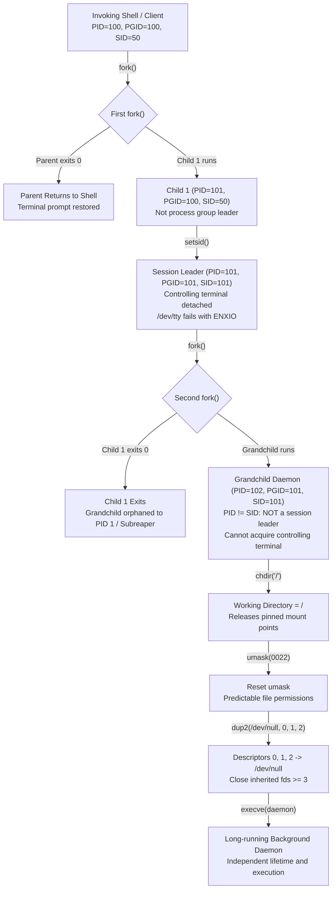

# Daemonization

> [!summary] Claim
> Classical Unix daemonization detaches a background process from terminal sessions and ancestor lifetimes through a double-fork and session creation sequence, whereas modern production infrastructure delegates execution lifecycle, descriptor isolation, and cgroups tracking to foreground service managers.

Part of [The Unix Process Model](README.md) in [Shell and Unix Engineering](../README.md).

## TL;DR

- Mechanism: A child forks from the invoking process, invokes `setsid(2)` to create an isolated session and sever controlling terminal ties, forks a second time so the running grandchild is not a session leader, and redirects standard streams (0, 1, 2) to `/dev/null` (`(POSIX.1-2024 XSH setsid, XCU 2.9.3.1)`).
- Rule: Always redirect standard descriptors 0, 1, and 2 to `/dev/null` rather than closing them, preventing the kernel from reallocating descriptors 0, 1, or 2 to newly opened sockets or files and corrupting data through unintended standard library writes.
- Trap: Omitting `chdir("/")` locks the inherited mount point in the kernel vnode table with `EBUSY`, preventing filesystem unmounting and cleanly draining cloud storage volumes.
- Portability fact: Shell builtins and background semantics diverge across implementations: `disown` is absent from `dash`, `mksh`, `posh`, and BusyBox `ash` (lab test 10), while `zsh` diverges from POSIX by failing to redirect standard input to `/dev/null` for asynchronous lists (`&`) when job control is disabled (`(POSIX.1-2024 XCU 2.9.3.1)`, lab test 7).
- When not to use it: Never use classical double-fork daemonization for services managed by systemd, launchd, or container runtimes; modern supervisors expect foreground execution (`Type=exec` or `Type=notify`) to track process exit status, manage cgroups v2 resource accounting, and collect structured logs (systemd keeps `Type=forking` only for legacy daemons, `(systemd daemon(7))`).

## Mental model



The daemonizing program calls `fork(2)` to create Child 1 and the original process immediately exits, which lets the invoking shell (waiting on that original process) return the interactive prompt to the user and guarantees that Child 1 is not a process group leader.
Child 1 calls `setsid(2)`, creating a brand new session and process group with itself as leader, which unconditionally detaches any controlling terminal.
Child 1 then calls `fork(2)` a second time and terminates, leaving the grandchild process as an orphan that is reparented to `init` (PID 1) or the nearest `PR_SET_CHILD_SUBREAPER` ancestor.
Because the grandchild's process ID differs from its inherited session ID, it is permanently barred under System V and Linux semantics from inadvertently acquiring a controlling terminal when opening terminal device files without `O_NOCTTY`.
Finally, the grandchild changes its working directory to the root directory `/` to avoid pinning mounts, resets its `umask`, redirects file descriptors 0, 1, and 2 to `/dev/null`, and closes any leaked file descriptors above 2 before starting its main event loop.

## How it works

### 1. The classical 15-step SysV daemonization sequence

The classical Unix daemon sequence, enumerated as 15 steps for "SysV daemons" in systemd's daemon(7) and taught by W. Richard Stevens in Advanced Programming in the UNIX Environment, isolates a process through precise kernel interfaces (`(systemd daemon(7))`):

```
+-----------------------------------------------------------------------------------+
| Classical SysV Daemonization Sequence                                             |
|                                                                                   |
|  1. fork() & exit parent     -> Return prompt; ensure child is not PGID leader    |
|  2. setsid()                 -> Create new session & process group; drop ctty     |
|  3. fork() & exit child 1    -> Grandchild has PID != SID; cannot reacquire ctty  |
|  4. Reparent to init         -> Orphan reparented to PID 1 or subreaper           |
|  5. chdir("/")               -> Prevent pinning mounted filesystem (EBUSY)        |
|  6. umask(0022)              -> Clear inherited restrictive or unsafe masks       |
|  7. dup2(/dev/null, 0,1,2)   -> Prevent descriptor reallocation hijacking         |
|  8. close_range(3, ~0U, 0)   -> Prevent secret / socket leakage into daemon       |
|  9. Reset signal handlers    -> Restore SIG_DFL across all signal numbers         |
| 10. Reset signal mask        -> sigprocmask(SIG_SETMASK, &empty, NULL)            |
| 11. Sanitize environment     -> Scrub LD_PRELOAD, IFS, temporary paths            |
| 12. Write PID file & lock    -> Atomic open with O_CREAT|O_EXCL, flock(LOCK_EX)   |
| 13. Drop privileges          -> setgroups(), setgid(), setuid() in sequence       |
| 14. Notify startup pipe      -> Signal ready to parent before parent exit         |
| 15. Run daemon event loop    -> Process requests in independent process state     |
+-----------------------------------------------------------------------------------+
```

The box groups the steps by purpose; daemon(7) orders them differently.
There, descriptor closing, signal-handler and signal-mask resets, and environment sanitizing come before the first `fork()`, the umask is reset to 0 rather than 0022, and the original process exits only at step 15, after the daemon reports successful initialization through a pipe created before the first `fork()` (`(systemd daemon(7))`).

### 2. Session isolation via `setsid`

Under `(POSIX.1-2024 XSH setsid)`, the `setsid()` system call creates a new session only if the calling process is not already a process group leader and no other process has a process group ID equal to the caller's process ID:
- If `getpid() == getpgrp()`, `setsid()` fails immediately, returning `-1` with `errno` set to `EPERM` (lab test 1).
- When invoked by a child process whose PID differs from its inherited parent process group ID, `setsid()` succeeds.
- The calling process becomes both the session leader of the new session and the process group leader of the new process group.
- The process group ID and session ID of the caller are set equal to its process ID (`PGID = SID = PID`).
- The process has no controlling terminal; `/dev/tty` is a synonym for the controlling terminal "if any" (`(POSIX.1-2024 XBD 10.1)`), and POSIX does not name the error, but on Linux and macOS a subsequent `open("/dev/tty", O_RDWR)` fails with `ENXIO` (lab tests 2 and 3).

Inside the Linux kernel (`(Linux kernel/sys.c, ksys_setsid)`), the transition is executed under `tasklist_lock` (excerpt of the mainline source as of 2026-10):
```c
int ksys_setsid(void)
{
	struct task_struct *group_leader = current->group_leader;
	struct pid *sid = task_pid(group_leader);
	struct pid *pids[PIDTYPE_MAX] = { 0 };
	pid_t session = pid_vnr(sid);
	int err = -EPERM;

	write_lock_irq(&tasklist_lock);
	if (group_leader->signal->leader)
		goto out;
	if (pid_task(sid, PIDTYPE_PGID))
		goto out;

	group_leader->signal->leader = 1;
	set_special_pids(pids, sid);
	proc_clear_tty(group_leader);
	err = session;
out:
	write_unlock_irq(&tasklist_lock);
	free_pids(pids);
	...
	return err;
}
```

### 3. The rationale for the second fork

A common point of confusion is why a daemon must fork twice:
1. The first `fork()` ensures that Child 1 is not a process group leader, fulfilling the precondition for `setsid()`.
2. After `setsid()`, Child 1 is a session leader (`PID == SID`).
3. Under System V and Linux semantics, if a session leader opens a terminal device (such as `/dev/ttyS0`, `/dev/console`, or a USB serial adapter) without passing the `O_NOCTTY` flag, the kernel automatically allocates that device as the controlling terminal of the session (`(Linux man-pages daemon(3) BUGS)`).
4. If that terminal device subsequently closes or disconnects, the kernel line discipline broadcasts `SIGHUP` to the session leader and all members of its foreground process group, terminating the daemon.
5. By executing a second `fork()` and exiting Child 1, the surviving Grandchild inherits the session and process group, but its PID does not equal the session ID (`PID != SID`).
6. Because only a session leader is permitted by the kernel to acquire a controlling terminal, the grandchild can never acquire a controlling terminal, even if it or a third-party library calls `open()` on a terminal device without `O_NOCTTY`.

On 4.4BSD-derived kernels such as FreeBSD, terminal allocation is not automatic on `open()` unless `ioctl(fd, TIOCSCTTY, 0)` is explicitly invoked (FreeBSD `tty(4)`: "The current system does not allocate a controlling terminal to a process on an open() call: there is a specific ioctl called TIOCSCTTY"; `sys/kern/tty.c` `ttydev_open` has no acquisition path and `ttydev_ioctl_sctty` is the only place that connects a session to a terminal).
macOS does not follow them here: on a macOS 27.2 host, a session leader that opened a pseudo-terminal slave without `O_NOCTTY` could then open `/dev/tty`, while its non-leader child got `ENXIO`, exactly as on Linux (measured with a `fork`, `setsid`, `posix_openpt` probe on the host and in the Debian and Alpine matrix images).
The BSD C library `daemon(3)` implementation (`4.4BSD`) historically performed only a single `fork()` followed by `setsid()`, and glibc copied it (`(Linux man-pages daemon(3) BUGS)`).
Portable code targeting Linux, macOS, Solaris, and System V derivatives therefore requires the double-fork pattern for guaranteed terminal immunity.

### 4. File descriptor redirection and the fd 0/1/2 trap

When a process executes in the background, its standard descriptors (0, 1, 2) must never remain attached to the invoking terminal or SSH session.
Leaving them open keeps SSH sessions hanging on exit waiting for channel End-Of-File (`(OpenSSH FAQ 3.10 and 3.11, archived 2016)`).

Closing standard file descriptors directly creates an even more severe vulnerability:
```c
/* FATAL DEFECT: Closing standard file descriptors */
close(0);
close(1);
close(2);
int sock = socket(AF_INET, SOCK_STREAM, 0); /* Allocates lowest unused fd: 0! */
```

Unix systems allocate the lowest available integer file descriptor on every `open()`, `socket()`, or `accept()` system call (`(POSIX.1-2024 XSH open, XSH 2.6 File Descriptor Allocation)`, lab test 4).
If descriptor 0, 1, or 2 is closed:
1. The next file or socket created is assigned descriptor 0, 1, or 2.
2. If any subsequent code or third-party library routine calls `printf()`, `puts()`, or `fprintf(stderr, ...)`, the formatted text is written directly into that newly opened descriptor.
3. If descriptor 1 happens to be a network database socket, debug log output corrupts the database protocol stream, triggering client disconnection or data loss.

The correct, production-grade implementation redirects all three standard descriptors to `/dev/null`:
```c
int devnull = open("/dev/null", O_RDWR);
if (devnull < 0) {
  _exit(1);
}
dup2(devnull, STDIN_FILENO);
dup2(devnull, STDOUT_FILENO);
dup2(devnull, STDERR_FILENO);
if (devnull > STDERR_FILENO) {
  close(devnull);
}
```

### 5. Cleaning up inherited file descriptors

Every file descriptor open in the parent is copied into the child by `fork()` unless its `FD_CLOFORK` flag (new in POSIX.1-2024) is set, and every descriptor without `FD_CLOEXEC` then also survives `execve()` (`(POSIX.1-2024 XSH fork)`).
A daemonizing process that does not sanitize its descriptor table leaks parent sockets, database connections, pipe write-ends, and sensitive file handles.

Historically, daemons iterated from descriptor 3 up to the soft limit returned by `sysconf(_SC_OPEN_MAX)` or `getrlimit(RLIMIT_NOFILE, ...)`:
```c
/* Legacy slow fallback: loops over potentially 1,048,576 integers */
long maxfd = sysconf(_SC_OPEN_MAX);
for (int fd = 3; fd < maxfd; fd++) {
  close(fd);
}
```

The Linux kernel default soft `RLIMIT_NOFILE` is only 1024 (hard 4096), and systemd 240+ raises the hard limit to 524288 while keeping the soft limit at 1024 (`(systemd NEWS, version 240)`), but containers and tuned services often run with a soft limit of 1,048,576.
There, executing 1,048,573 sequential `close()` system calls took about 110 ms per run (measured in the Debian matrix image on an arm64 Linux 7.2 VM with `ulimit -Sn 1048576`, as of 2026-10).
Modern operating systems provide high-performance mechanisms:
- Linux 5.9+ and glibc 2.34+ (`(Linux man-pages close_range(2))`): `close_range(3, ~0U, 0)` closes all open descriptors in a single system call whose cost scales with the process's allocated descriptor table rather than with `RLIMIT_NOFILE` (a few microseconds in the same measurement).
- FreeBSD 12.2+: supports `close_range(3, ~0U, 0)` (`(FreeBSD close_range(2) HISTORY)`).
- Linux fallback: directory scan of `/proc/self/fd` to close only currently allocated descriptors.
- POSIX rationale: the standard developers rejected a proposal to add `closefrom()`, because the standard permits implementations to use inherited descriptors to provide a conforming environment for the child, so an interface that closes arbitrary descriptors above a value cannot guarantee one (`(POSIX.1-2024 XSH close, RATIONALE)`).

### 6. Shell backgrounding primitives: `&`, `nohup`, and `disown`

Shell scripts provide built-in mechanisms that approximate facets of daemonization, but each has strict boundaries:

1. Asynchronous list `cmd &` (`(POSIX.1-2024 XCU 2.9.3.1)`):
   - The shell executes the command asynchronously in a child subshell environment without waiting for completion.
   - If job control is disabled (the default in non-interactive scripts where `$-` lacks `m`), standard input is required to be assigned to a file with the same properties as `/dev/null` before explicit redirections.
   - Conforming implementations (`bash`, `dash`, `mksh`, `posh`, `ksh93`, `yash`, and BusyBox `ash`) redirect `stdin` to `/dev/null` and supply an immediate EOF (lab test 7, with a data-bearing stdin).
   - Native `zsh` 5.9 and `zsh --emulate sh` diverge from POSIX by leaving standard input connected to the inherited stream, reading live input unless explicitly redirected with `cmd </dev/null &` (lab test 7).
   - In `posh`, the optional User Portability job control option `-m` is unsupported (`posh: set: -m: unknown option`), so running `set +m` aborts the shell because `set` is a special built-in utility and a special built-in utility error exits a non-interactive shell (`(POSIX.1-2024 XCU 2.8.1, 2.15)`; measured in the shell matrix with posh 0.14.1).
   - Signals `SIGINT` and `SIGQUIT` are inherited as `SIG_IGN` when job control is disabled (`(POSIX.1-2024 XCU 2.12)`); measured in the shell matrix, posh 0.14.1 and Alpine's mksh R59 2020/10/31 leave both at their default disposition instead.
   - However, the command remains in the caller's session and process group; it does not invoke `setsid()`.

2. `nohup cmd &` (`(POSIX.1-2024 XCU nohup)`):
   - Sets signal disposition of `SIGHUP` to `SIG_IGN` (`(coreutils src/nohup.c, main)`).
   - If `stdout` is a terminal, redirects output to append to `nohup.out` (or `$HOME/nohup.out`), creating the file with mode `0600` (`S_IRUSR | S_IWUSR`).
   - If `stderr` is a terminal, redirects it to `stdout`; if `stderr` is a pipe (as under `ssh host cmd` without `-t`), it is left alone.
   - Does NOT detach the process into a new session or process group.

3. `disown [-h] [jobspec]` (`(bash-5.3 builtins/jobs.def, disown_builtin)`, checked against the bash-5.3 release tarball from ftp.gnu.org, where `$BUILTIN disown` is followed by `$FUNCTION disown_builtin`):
   - Bash, Zsh, Ksh93, and Yash builtin (lab test 10).
   - Without flags, removes the specified job from the shell's active job table array `jobs[]`.
   - When an interactive login shell with `shopt -s huponexit` exits (`(bash-5.3 shell.c, exit_shell)`), internal routine `hangup_all_jobs()` (`(bash-5.3 jobs.c, hangup_all_jobs)`) iterates only over known job slots; disowned jobs are skipped and do not receive `SIGHUP`.
   - Flag `-h` leaves the job in the table but sets flag `J_NOHUP` (`(bash-5.3 jobs.c, nohup_job)`), which `hangup_all_jobs()` checks before sending `SIGHUP`.
   - Does NOT alter session ID, process group ID, or open file descriptors.

4. The subshell double-fork idiom:
   ```sh
   (
     (
       exec /usr/local/bin/worker </dev/null >/var/log/worker.log 2>&1 &
     ) &
   )
   ```
   - The outer subshell forks an intermediate subshell.
   - The intermediate subshell forks the background worker with `&` and exits immediately.
   - The worker is orphaned and reparented to `init` (PID 1) or a subreaper.
   - The outer subshell completes immediately, releasing the parent shell.
   - The worker still belongs to the original session unless wrapped with an external utility like `setsid(1)`.
   - The `exec` matters: without it, yash 2.58.1 runs the command from a waiting subshell that keeps saved copies of the caller's stdout and stderr open, so a command substitution or SSH session that ran the idiom waits until the worker exits (measured in the Alpine matrix image; the lab's `daemonize.sh` uses `exec` for this reason).

### 7. Modern service architecture: New-Style Daemons

Modern Linux distributions manage services via systemd (`(systemd daemon(7))`).
Systemd renders classical double-fork daemonization obsolete:

| SysV Classical Daemon | Modern systemd Service | Rationale |
|:---|:---|:---|
| Double `fork()` | Run in foreground (`Type=exec` / `Type=simple`) | Enables direct process exit code tracking via `waitid(2)`. |
| `setsid()` | Executed by systemd before `execve()` | Guarantees clean session isolation without application code. |
| Redirect stdio to `/dev/null` | Connect `stdout`/`stderr` to `systemd-journald` | Centralizes structured log ingestion and timestamps. |
| PID file creation (`/run/app.pid`) | Kernel cgroups v2 hierarchy | Prevents PID spoofing, TOCTOU races, and orphaned child leaks. |
| Asynchronous init race | Synchronous `sd_notify("READY=1")` | Guarantees dependent services wait until sockets are bound. |

## Numbers and limits

The following table provides verified operational limits, kernel parameters, and exit statuses governing daemon execution (as of 2026-10):

| Property / Limit | Value | System / Source | Operational Significance |
|:---|:---|:---|:---|
| `pid_max` kernel default | `32768` | Linux `PID_MAX_DEFAULT` in `include/linux/threads.h` | Maximum PID value before wraparound; the kernel raises it to 1024 per CPU on large machines, and systemd 243+ sets `4194304` on 64-bit systems (`(systemd NEWS, version 243)`). |
| `pid_max` maximum (64-bit) | `4194304` (`2^22`) | Linux kernel `PID_MAX_LIMIT` in `include/linux/threads.h` | System-wide process identifier ceiling on 64-bit architectures; also the value measured in both matrix images. |
| macOS process limit | `9000` (`kern.maxprocperuid` `6000`) | macOS `sysctl kern.maxproc`, measured on a macOS 27.2 host (as of 2026-10) | Maximum process count ceiling on Darwin hosts; the value scales with installed memory, so other Macs differ. |
| Default `RLIMIT_NOFILE` | `1024` soft, `4096` hard | Linux `INR_OPEN_CUR` and `INR_OPEN_MAX` in `include/uapi/linux/fs.h` | Soft limit for open file descriptors per process before hitting `EMFILE`. |
| systemd `RLIMIT_NOFILE` passed to services | `1024` soft, `524288` hard | `(systemd NEWS, version 240)` | The soft limit stays at 1024 for `select()` compatibility; a service that raises its soft limit to the hard limit makes `sysconf(_SC_OPEN_MAX)` loops slow. |
| Max open files (`nr_open`) | `1048576` kernel default; `1073741816` measured in both matrix images | Linux `sysctl_nr_open` in `fs/file.c`; systemd 240+ bumps `fs.nr_open` to its maximum (`(systemd NEWS, version 240)`) | Ceiling for `RLIMIT_NOFILE` adjustments. |
| `setsid()` failure `errno` | `EPERM` (`1` on Linux and macOS) | `(POSIX.1-2024 XSH setsid)`, lab test 1 | Returned when calling process is already a process group leader. |
| Non-controlling tty `errno` | `ENXIO` (`6` on Linux and macOS) | Linux and macOS behavior, lab tests 2 and 3 (POSIX does not name this error) | Returned on `open("/dev/tty", O_RDWR)` after successful `setsid()`. |
| Sequential `close()` loop to 1,048,576 | about `110` ms | Measured in the Debian matrix image, arm64 Linux 7.2 VM (as of 2026-10) | Startup cost that `close_range(2)` (microseconds in the same run) removes. |
| `nohup` failure exit code | `127` | `(POSIX.1-2024 XCU nohup)` | Exit code returned when `nohup` fails internally or utility not found. |
| `nohup` invoke failure exit code | `126` | `(POSIX.1-2024 XCU nohup)` | Exit code returned when utility is found but cannot be invoked. |
| `systemd` `TimeoutStartSec` | `90s` | `DefaultTimeoutStartSec=` default in `systemd-system.conf(5)` (as of 2026-10) | Time limit for `Type=forking` parent exit before service is killed. |
| Standard descriptors redirected | `3` (`0, 1, 2`) | Lab tests 4 and 8 | Descriptors required to point to `/dev/null` for safe stream isolation. |
| Required `fork()` count | `2` | systemd daemon(7) / Stevens, lab test 3 | Guarantees grandchild has `PID != SID`, preventing terminal re-acquisition. |
| Async `&` stdin without job control | `/dev/null` (7 families), inherited (`zsh`) | Shell matrix, lab test 7 (as of 2026-10) | POSIX.1-2024 XCU 2.9.3.1 requires `/dev/null`; native Zsh and `zsh --emulate sh` leak stdin. |
| `posh` job control options | `0` (`-m` rejected) | Debian `posh` 0.14.1, measured in the shell matrix (as of 2026-10) | `set -m` and `set +m` fail with exit status 1 as an unknown option. |

## Portability

Process management builtins and daemon utilities vary significantly across shells and Unix platforms (as of 2026-10):

| Feature / Platform | POSIX.1-2024 | macOS Bash 3.2 | GNU Bash 5.3 | native Zsh 5.9 | Zsh (`--emulate sh`) | Dash 0.5.12 | AT&T ksh93u+m | MirBSD mksh R59 | Yash 2.58 | Posh 0.14.1 | BusyBox Ash 1.37 |
|:---|:---|:---|:---|:---|:---|:---|:---|:---|:---|:---|:---|
| `disown` builtin | Absent | Supported | Supported | Supported | Supported | Absent | Supported | Absent | Supported | Absent | Absent |
| `&` redirects stdin without job control | Required (`/dev/null`) | Yes | Yes | No (inherits stdin) | No (inherits stdin) | Yes | Yes | Yes | Yes | Yes | Yes |
| `set -m` / `set +m` (job control) | Optional (`[UP]`) | Supported | Supported | Supported | Supported | Supported | Supported | Supported | Supported | Absent (unknown option) | Supported |
| `nohup(1)` utility | Standard utility | Supported | Supported | Supported | Supported | Supported | Supported | Supported | Supported | Supported | Supported |
| `setsid(1)` CLI tool | Absent | Absent by default | util-linux | util-linux | util-linux | util-linux | util-linux | util-linux | util-linux | util-linux | BusyBox applet |
| `close_range(2)` syscall | Absent | Absent (not in the macOS 27.2 SDK) | Linux 5.9+ | Linux 5.9+ | Linux 5.9+ | Linux 5.9+ | Linux 5.9+ | Linux 5.9+ | Linux 5.9+ | Linux 5.9+ | Linux 5.9+ |
| `daemon(3)` libc function | Absent | BSD `daemon(3)`, deprecated since macOS 10.5 | glibc `daemon(3)` | glibc `daemon(3)` | glibc `daemon(3)` | glibc/musl | glibc/musl | glibc/musl | glibc/musl | glibc/musl | musl/uClibc |
| Running job killed when an interactive shell exits | Unspecified | Only a login shell with `huponexit` | Only a login shell with `huponexit` | Yes (`HUP` option on) | No (`HUP` off in sh emulation) | No | Login shell only | No | No | Yes | No |

The last row was measured in the Debian matrix image by starting each shell with `-i` and with `-i -l` on a pseudo-terminal (`script`), running `/bin/sleep 300 &`, exiting, and checking whether the job survived; bash cells follow `exit_shell()` in bash 5.3 `shell.c` and bash 5.2 in the image, posh has no job control, so its job stays in the shell's own process group (the terminal's foreground group) and dies with the session, and yash was measured in a throwaway `alpine:3.22` container with `yash` and util-linux `script` installed: with `-i` and with `-i -l` the `sleep` survived the shell's exit, while a bash `-i -l` control with `huponexit` killed it, and yash 2.58.1 has no `hup-on-exit` option (`set -o hup-on-exit` is rejected as not a valid option).
The `disown`, `&` stdin, and `set -m` rows come from lab tests 10 and 7 and from `set +m` runs in the shell matrix; the remaining rows are platform facts cited above.

## Worked example

The companion test lab is located at [lab](../labs/01-daemonization/).
It implements the C probe `daemon_probe.c` and shell test helper `daemonize.sh`, asserting session creation, controlling terminal detachment, file descriptor reuse, and subshell double-fork behavior.

### 1. C daemonization probe (simplified excerpt of daemon_probe.c)

```c
#define _GNU_SOURCE
#include <errno.h>
#include <fcntl.h>
#include <stdio.h>
#include <stdlib.h>
#include <string.h>
#include <sys/stat.h>
#include <sys/types.h>
#include <sys/wait.h>
#include <unistd.h>

static int mode_setsid_leader(void) {
  if (setpgid(0, 0) < 0) {
    perror("setpgid");
    return 1;
  }
  pid_t s = setsid();
  if (s == (pid_t)-1 && errno == EPERM) {
    printf("setsid_leader: EPERM\n");
    fflush(stdout);
    return 0;
  }
  return 1;
}

static int mode_setsid_child(void) {
  pid_t pid = fork();
  if (pid < 0) return 1;
  if (pid == 0) {
    pid_t sid = setsid();
    if (sid < 0) _exit(1);
    int fd = open("/dev/tty", O_RDWR);
    if (fd >= 0) {
      close(fd);
      _exit(3);
    }
    if (errno != ENXIO) _exit(4);
    printf("setsid_child: ok\n");
    fflush(stdout);
    _exit(0);
  }
  int status = 0;
  waitpid(pid, &status, 0);
  return (WIFEXITED(status) && WEXITSTATUS(status) == 0) ? 0 : 1;
}

static int mode_double_fork(const char *outfile) {
  int pipefd[2];
  if (pipe(pipefd) < 0) return 1;
  pid_t pid1 = fork();
  if (pid1 < 0) return 1;

  if (pid1 == 0) {
    close(pipefd[0]);
    if (setsid() < 0) _exit(1);
    pid_t pid2 = fork();
    if (pid2 < 0) _exit(2);
    if (pid2 == 0) {
      pid_t g_pid = getpid();
      pid_t g_sid = getsid(0);
      int is_leader = (g_pid == g_sid) ? 1 : 0;
      int tty_fd = open("/dev/tty", O_RDWR);
      int tty_err = (tty_fd >= 0) ? 0 : errno;
      if (tty_fd >= 0) close(tty_fd);

      FILE *f = fopen(outfile, "w");
      if (f) {
        fprintf(f, "pid=%ld sid=%ld is_leader=%d tty_err=%d\n",
                (long)g_pid, (long)g_sid, is_leader, tty_err);
        fclose(f);
      }
      char notify = 'K';
      if (write(pipefd[1], &notify, 1) != 1) {}
      close(pipefd[1]);
      _exit(0);
    }
    _exit(0);
  }

  close(pipefd[1]);
  int status1 = 0;
  waitpid(pid1, &status1, 0);
  char buf = 0;
  if (read(pipefd[0], &buf, 1) != 1 || buf != 'K') return 1;
  close(pipefd[0]);
  printf("double_fork: completed\n");
  fflush(stdout);
  return 0;
}
```

### 2. Shell execution script (`daemonize.sh`)

```sh
#!/bin/sh
# Helper script demonstrating shell backgrounding, descriptor redirection,
# and subshell double-fork execution patterns.

set -eu

mode="${1:-}"
if [ -z "$mode" ]; then
  echo "Usage: $0 <double-fork|bg-redirect|is-stdin-eof> [args...]" >&2
  exit 1
fi
shift

case "$mode" in
  double-fork)
    if [ "$#" -lt 2 ]; then
      echo "Usage: $0 double-fork <pid_file> <cmd> [args...]" >&2
      exit 1
    fi
    pid_file="$1"
    shift
    # The worker's PID goes to pid_file and the intermediate subshell's PID to
    # pid_file.parent, so a caller can check that the worker outlives its parent.
    # exec makes the background subshell become the worker: without it, yash
    # keeps a saved copy of the caller's stdout open in a waiting subshell.
    (
      (
        exec "$@" </dev/null >/dev/null 2>&1 &
        echo "$!" >"$pid_file"
      ) &
      echo "$!" >"$pid_file.parent"
    )
    exit 0
    ;;
  bg-redirect)
    if [ "$#" -lt 3 ]; then
      echo "Usage: $0 bg-redirect <pid_file> <outfile> <cmd> [args...]" >&2
      exit 1
    fi
    pid_file="$1"
    outfile="$2"
    shift 2
    "$@" </dev/null >"$outfile" 2>&1 &
    echo "$!" >"$pid_file"
    exit 0
    ;;
  is-stdin-eof)
    if read -r _; then
      echo "stdin: data"
      exit 1
    else
      echo "stdin: eof"
      exit 0
    fi
    ;;
  *)
    echo "Unknown mode: $mode" >&2
    exit 1
    ;;
esac
```

### 3. Captured lab execution output

Running the test suite via `bats labs/01-daemonization/daemonization.bats` asserts all ten core invariants:

```text
1..10
ok 1 setsid fails with EPERM when called by a process group leader
ok 2 setsid succeeds in a non-leader child and detaches controlling terminal
ok 3 classical double fork creates a new session where grandchild is not session leader
ok 4 closing fd 0 reuses fd 0 on subsequent open whereas dev null redirection preserves low fds
ok 5 probe print-attrs reports the forking shell as parent and the detached session as process group
ok 6 probe check-ctty reports no controlling terminal in the detached lab session
ok 7 asynchronous list & without job control automatically redirects stdin from dev null
ok 8 background execution with descriptor redirection captures output safely
ok 9 subshell double fork runs asynchronously and orphans grandchild
ok 10 disown builtin availability across shell families
```

## Pitfalls

> [!warning] Standard file descriptor closure and silent socket corruption
> - Trigger: Invoking `close(0)`, `close(1)`, or `close(2)` in a daemonizing process instead of redirecting standard streams to `/dev/null`.
> - Symptom: The next system call allocating a file descriptor (`open`, `socket`, `accept`) returns 0, 1, or 2; subsequent calls to `printf()` or `fprintf(stderr)` silently write diagnostic messages into the open network socket or database file, corrupting data streams.
> - Fix: Open `/dev/null` with `O_RDWR` and overwrite descriptors 0, 1, and 2 using `dup2()`.

> [!warning] Pinned filesystem mounts blocking volume unmounting
> - Trigger: Failing to execute `chdir("/")` after detaching from the terminal session.
> - Symptom: The daemon process keeps an open directory vnode reference to the directory from which it was launched; subsequent attempts by system administrators to run `umount` fail with `EBUSY` ("Device or resource busy"), blocking maintenance and storage detachment.
> - Fix: Unconditionally call `chdir("/")` immediately after session creation.

> [!warning] Remote SSH sessions hanging on script completion
> - Trigger: Launching a background job over an SSH session (e.g. `ssh host 'nohup ./service &'`) without redirecting standard streams away from the terminal.
> - Symptom: The remote shell finishes execution, but the local SSH client hangs indefinitely; the OpenSSH server (`sshd`) refuses to close the connection channel until all descriptors referencing the stdout/stderr pipe reach End-Of-File (`(OpenSSH FAQ 3.10 and 3.11, archived 2016)`), and `nohup` does not help because it redirects only streams that are terminals, while `ssh host cmd` gives the command pipes (`(POSIX.1-2024 XCU nohup)`).
> - Fix: Redirect all three streams explicitly: `./service </dev/null >/dev/null 2>&1 &`.

> [!warning] Insecure PID and log file handling and local privilege escalation
> - Trigger: Writing PID or log files from a privileged daemon or its startup wrapper into directories that a less-privileged account can write (shared paths such as `/tmp`, or a log directory owned by the service user) without `O_NOFOLLOW` and `O_EXCL`, or trusting unverified PID files during process restart.
> - Symptom: A local attacker with that account replaces the file path with a symlink to a sensitive file such as `/etc/ld.so.preload`; when the privileged process starts or restarts, it creates or writes the target file, enabling local root escalation; real cases are symlink attacks on log files, not PID files: the nginx error log in Debian and Ubuntu packages (`(NVD CVE-2016-1247)`) and the `mysqld_safe` error log in MySQL, MariaDB, and Percona Server (`(NVD CVE-2016-6664)`).
> - Fix: Place PID and log files strictly in root-owned runtime paths (`/run` or `/var/run`) or open them with `O_NOFOLLOW`, apply advisory locking via `flock(fd, LOCK_EX | LOCK_NB)`, or run services under modern supervisors without PID files.

> [!warning] Controlling terminal re-acquisition under System V semantics
> - Trigger: Daemonizing via a single `fork()` and `setsid()` without executing the second `fork()`, followed by opening a terminal device without `O_NOCTTY`.
> - Symptom: Because the process is a session leader, opening a terminal device automatically makes it the controlling terminal under Linux and System V rules, and on macOS as well (measured with a pseudo-terminal probe on a macOS 27.2 host); subsequent modem or serial disconnects broadcast `SIGHUP` to the daemon, causing unexpected crashes (`(Linux man-pages daemon(3) BUGS)`).
> - Fix: Execute the second `fork()` so that the active daemon process has `PID != SID`, permanently disqualifying it from acquiring a controlling terminal.

> [!warning] Zsh asynchronous background commands inheriting standard input
> - Trigger: Launching an asynchronous background command (`cmd &`) under `zsh` or `zsh --emulate sh` without explicit input redirection when job control is disabled.
> - Symptom: Unlike POSIX-compliant shells that automatically redirect standard input from `/dev/null` (`(POSIX.1-2024 XCU 2.9.3.1)`), Zsh allows the background child to inherit the parent's standard input stream; the background process consumes data intended for subsequent foreground commands or blocks with `SIGTTIN` when attempting to read from a controlling terminal.
> - Fix: Always specify explicit standard input redirection `cmd </dev/null &` rather than assuming implicit shell redirection.

> [!warning] Job control option toggles aborting execution in minimal shells
> - Trigger: Invoking `set +m` or `set -m` in non-interactive scripts intended to run under Debian `posh` or minimal policy-compliant shells.
> - Symptom: Because `posh` omits the optional User Portability job control feature, `set +m` produces `posh: set: -m: unknown option`; because `set` is a special built-in utility (`(POSIX.1-2024 XCU 2.15)`) and a special built-in utility error exits a non-interactive shell (`(POSIX.1-2024 XCU 2.8.1)`), this failure immediately aborts script execution, and `2>/dev/null` does not prevent it (measured in the shell matrix with posh 0.14.1).
> - Fix: Guard job control option changes with `case $- in *m*) set +m ;; esac` or eliminate `set +/-m` commands from non-interactive scripts.

## Security and robustness

A secure daemon execution environment requires strict defense-in-depth measures:

1. Privilege dropping:
   If a daemon starts as `root` to bind low-numbered ports (`< 1024`), it must drop privileges immediately after socket binding:
   ```c
   /* Drop supplemental groups first */
   if (setgroups(0, NULL) < 0) {
     perror("setgroups");
     exit(1);
   }
   /* Set group ID before user ID */
   if (setgid(target_gid) < 0) {
     perror("setgid");
     exit(1);
   }
   if (setuid(target_uid) < 0) {
     perror("setuid");
     exit(1);
   }
   /* Verify privileges cannot be regained */
   if (setuid(0) != -1) {
     fprintf(stderr, "FATAL: failed to permanently drop root privileges\n");
     exit(1);
   }
   ```

2. File creation mask (`umask`):
   Never inherit an arbitrary `umask` from the user shell.
   Set an explicit, restrictive mask during initialization:
   - `umask(0022)` for services creating world-readable files and logs.
   - `umask(0027)` or `umask(0077)` for security-sensitive daemons managing private keys or session tokens.

3. File descriptor hygiene:
   Close all inherited file descriptors above descriptor 2:
   ```c
   #if defined(__linux__) && defined(SYS_close_range)
   /* raw syscall: the glibc close_range() wrapper needs glibc 2.34+ */
   syscall(SYS_close_range, 3U, ~0U, 0U);
   #else
   /* fallback via /proc/self/fd (procfs is Linux-specific, not POSIX) */
   DIR *dir = opendir("/proc/self/fd");
   if (dir) {
     int dfd = dirfd(dir);
     struct dirent *de;
     while ((de = readdir(dir)) != NULL) {
       int fd = atoi(de->d_name);
       if (fd > 2 && fd != dfd) {
         close(fd);
       }
     }
     closedir(dir);
   }
   #endif
   ```

4. Environment sanitization:
   Remove variables that alter dynamic loader resolution or command execution paths:
   - Scrub `LD_PRELOAD`, `LD_LIBRARY_PATH`, `DYLD_INSERT_LIBRARIES`, and `IFS`.
   - Reset `PATH` to a trusted system default: `PATH=/usr/bin:/bin:/usr/sbin:/sbin`.

5. Signal disposition hygiene:
   Reset all caught signals to `SIG_DFL` and reset the signal mask:
   ```c
   sigset_t mask;
   sigemptyset(&mask);
   sigprocmask(SIG_SETMASK, &mask, NULL);
   for (int sig = 1; sig < NSIG; sig++) {
     signal(sig, SIG_DFL);
   }
   ```

## The principal's view

At staff-plus and principal level, classical double-fork daemonization should be categorized as legacy technical debt for newly authored services.
In modern distributed systems, self-daemonization creates significant operational friction:

1. Supervision blindness:
   When a process double-forks, it breaks the direct parent-child relationship with its supervisor.
   Process supervisors cannot observe crash exit codes via `waitpid()`, cannot enforce restart backoff curves reliably, and cannot distinguish an intentional shutdown from an unhandled `SIGSEGV`.

2. Resource isolation failure:
   Under Linux cgroups v2, a process that double-forks may escape its intended slice or scope if the supervisor is not configured with delegation, undermining CPU and memory limits.

3. Telemetry fragmentation:
   Redirecting standard output and standard error to `/dev/null` discards early runtime panics and standard library assertion failures before custom logging frameworks initialize.
   Running in the foreground allows `systemd-journald`, container runtimes (containerd, CRI-O), and Kubernetes logging agents to capture unbuffered `stderr` and timestamp each line on receipt (journald records microsecond realtime and monotonic timestamps, `(systemd.journal-fields(7))`).

4. Architecture decision matrix:
   - Containerized workloads (Kubernetes, ECS): Run strictly in the foreground as PID 1 (or under a lightweight init like `tini`).
   - Linux host services: Write systemd unit files using `Type=exec` or `Type=notify`, integrating with `sd_notify("READY=1")` over `NOTIFY_SOCKET` to eliminate startup race conditions.
   - User CLI utilities (background sync agents, local sidecars): If backgrounding is mandatory, use an unnamed synchronization pipe where the parent blocks reading 1 byte from the child; the child writes the confirmation byte only after sockets and files are bound, preventing CLI caller races.

5. Defensive shell backgrounding:
   A principal engineer never relies on implicit shell environment defaults for background jobs.
   While POSIX mandates standard input redirection to `/dev/null` for asynchronous lists (`&`) without job control, implementation divergences like Zsh inheriting live input streams or Posh aborting on `set +m` create subtle production outages.
   Production shell scripts must explicitly redirect all three standard file descriptors (`</dev/null >/dev/null 2>&1 &`) and avoid non-portable builtins like `disown`.

## Interview questions

> [!question] L5: Explain the complete sequence of classical Unix daemonization, identifying the precise reason for each step.
>
> > [!success]- Answer
> > The process first calls `fork()` and terminates the parent so the child is guaranteed not to be a process group leader.
> > The child calls `setsid()` to create a new session and process group, becoming the leader and severing any controlling terminal.
> > The child calls `fork()` a second time and terminates, ensuring the grandchild has `PID != SID` and cannot re-acquire a controlling terminal.
> > The grandchild calls `chdir("/")` so it does not keep mounted filesystems busy with `EBUSY`.
> > The grandchild resets its file creation mask via `umask()` to guarantee predictable file permissions.
> > The grandchild redirects file descriptors 0, 1, and 2 to `/dev/null` via `dup2()` and closes all inherited descriptors above 2.
> >
> > Follow-up: Why must file descriptors 0, 1, and 2 be redirected to `/dev/null` rather than simply closed?

> [!question] L5: Predict the output: What file descriptor number does this program allocate, and why?
> ```c
> #include <fcntl.h>
> #include <stdio.h>
> #include <unistd.h>
> 
> int main(void) {
>   close(0);
>   int fd = open("/dev/null", O_RDONLY);
>   printf("Allocated descriptor: %d\n", fd);
>   return 0;
> }
> ```
>
> > [!success]- Answer
> > The program outputs `Allocated descriptor: 0`.
> > Under POSIX specification requirements for `open()`, the operating system must allocate the lowest-numbered unused file descriptor.
> > Because file descriptor 0 (`stdin`) was closed, slot 0 is the lowest available slot in the process descriptor table.
> > This behavior demonstrates why closing standard streams creates stream confusion bugs in daemons.
> >
> > Follow-up: What happens if `printf()` is executed when file descriptor 1 has been closed and reallocated to a TCP socket?

> [!question] L6: Debug this deployment script where the remote SSH session hangs indefinitely upon starting a background service:
> ```sh
> #!/bin/sh
> ssh deploy@prod-01 "nohup /opt/app/bin/server > /opt/app/logs/server.log &"
> echo "Deployment finished"
> ```
>
> > [!success]- Answer
> > The command leaves standard error connected to the SSH session's pipe: `ssh host cmd` without `-t` allocates no pseudo-terminal, and `nohup` redirects standard error only when it is a terminal (`(POSIX.1-2024 XCU nohup)`).
> > Standard input is less of a problem when the remote login shell conforms to POSIX, since an asynchronous list without job control reads `/dev/null` (`(POSIX.1-2024 XCU 2.9.3.1)`), but a `zsh` login shell leaves it connected too (lab test 7).
> > The OpenSSH server (`sshd`) refuses to close the network session until all open file descriptors referencing stdout and stderr reach End-Of-File (`(OpenSSH FAQ 3.11, archived 2016)`).
> > Because the background `/opt/app/bin/server` process inherits the open pipe descriptors, `sshd` waits indefinitely.
> > The fix requires redirecting all three standard streams: `nohup /opt/app/bin/server </dev/null >/opt/app/logs/server.log 2>&1 &`.
> >
> > Follow-up: How does using a terminal multiplexer like `tmux` or a systemd service unit avoid this SSH hang?

> [!question] L6: Why did classical System V Unix require a second `fork()` during daemonization, whereas 4.4BSD historically omitted it?
>
> > [!success]- Answer
> > System V semantics dictate that if a session leader opens a terminal device without `O_NOCTTY`, that device automatically becomes the session controlling terminal.
> > The first child is the session leader after calling `setsid()`, meaning any subsequent `open()` of a terminal device re-attaches a terminal.
> > By executing a second `fork()`, the grandchild process inherits the session but is not the session leader (`PID != SID`).
> > Because non-session leaders are prohibited by the kernel from acquiring controlling terminals, the grandchild is permanently immune.
> > 4.4BSD-derived kernels require an explicit `ioctl(fd, TIOCSCTTY, 0)` call to acquire a terminal, making the second fork redundant there (FreeBSD `tty(4)`: "The current system does not allocate a controlling terminal to a process on an open() call: there is a specific ioctl called TIOCSCTTY"; in `sys/kern/tty.c` the open path `ttydev_open` has no acquisition and only `ttydev_ioctl_sctty` connects a session to a terminal); macOS, despite its BSD heritage, acquires one on a plain `open()` by a session leader, as measured on a macOS 27.2 host, so the second fork matters there too.
> >
> > Follow-up: Does modern Linux follow System V or BSD controlling terminal allocation semantics?

> [!question] L6: Compare `nohup cmd &`, `(cmd &)`, and `disown` in GNU Bash, identifying which system calls are executed, which process tables are modified, and how standard input is handled.
>
> > [!success]- Answer
> > `nohup cmd &` runs the external `nohup` binary, which sets `SIGHUP` to `SIG_IGN`, redirects stdout/stderr if they are ttys, and executes the target utility.
> > `(cmd &)` creates a subshell via `fork()`, launches the command in the background, and leaves the process in the shell's session and process group, but outside the parent shell's job table because the subshell that started it exits.
> > Under POSIX.1-2024 XCU 2.9.3.1, `cmd &` in a non-interactive shell without job control automatically redirects standard input to `/dev/null` across conforming shells such as Bash, Dash, Ksh93, Mksh, Yash, Posh, and BusyBox Ash.
> > However, native Zsh and `zsh --emulate sh` diverge from the POSIX specification by leaving standard input connected to the inherited stream.
> > `disown` is a shell builtin that modifies Bash's internal `jobs[]` table, either unlinking the job entry or setting the `J_NOHUP` bit.
> > None of these three mechanisms invoke `setsid()` or create a new session; the background process remains in the parent's session.
> >
> > Follow-up: Why does running `set +m; cmd &` fail in scripts written for `posh`, and why does `disown` fail on `dash`?

> [!question] L7+: How does systemd's "New-Style Daemon" architecture eliminate classical daemonization, and what kernel primitives does it employ to replace PID files and double-forking?
>
> > [!success]- Answer
> > Systemd mandates that services execute in the foreground, allowing the supervisor to monitor state directly via `waitid(2)`.
> > It executes `setsid()` and descriptor plumbing in the service manager process before invoking `execve(2)`.
> > Systemd tracks process groups using Linux cgroups v2 hierarchies rather than text PID files, eliminating PID recycling attacks and symlink vulnerabilities.
> > It replaces asynchronous polling with synchronous socket activation (`LISTEN_FDS`) and Unix datagram notifications (`sd_notify` over `NOTIFY_SOCKET`).
> > This architecture guarantees that dependent services only start after the daemon has successfully bound and configured its listening sockets.
> >
> > Follow-up: What failure mode occurs if a developer configures `Type=simple` for a service that internally executes a double-fork daemonization sequence?

> [!question] L7+: Explain how Linux 3.4+ `prctl(PR_SET_CHILD_SUBREAPER)` modifies orphan process reparenting, and explain why container entrypoint tools like `tini` are necessary when running legacy daemons in Docker.
>
> > [!success]- Answer
> > When a process terminates, its orphaned children are reparented to the nearest ancestor with the `child_subreaper` flag set, rather than PID 1.
> > In a Linux container without an init wrapper, the application entrypoint is PID 1 inside the container PID namespace.
> > If a legacy daemon inside the container double-forks, the intermediate parent exits, reparenting the daemon process to PID 1.
> > If the entrypoint binary is not programmed to handle `SIGCHLD` and reap child processes via `waitpid(-1, &status, WNOHANG)`, terminated children become permanent zombies.
> > Init wrappers like `tini` or `dumb-init` set `PR_SET_CHILD_SUBREAPER` or run as PID 1 to reap zombies and forward signals like `SIGTERM` across the process group.
> >
> > Follow-up: What happens to child processes inside a PID namespace when PID 1 of that namespace exits?

> [!question] L7+: When an engineer closes inherited descriptors in a daemon by looping from 3 to `sysconf(_SC_OPEN_MAX)`, explain why this causes latency spikes on modern Linux servers with `RLIMIT_NOFILE` set to 1,048,576, and contrast the performance of `close_range(2)` with `/proc/self/fd` iteration.
>
> > [!success]- Answer
> > With `RLIMIT_NOFILE` at 1,048,576, a sequential loop executes over one million individual `close()` system calls.
> > Each system call involves user-to-kernel context switching, privilege boundary crossing, and locking the file descriptor table, stalling process startup for about 110 ms (measured in the Debian matrix image on an arm64 Linux 7.2 VM, as of 2026-10).
> > The `close_range(3, ~0U, 0)` system call introduced in Linux 5.9 performs the range erasure in a single system call within the kernel descriptor bitmap, and took microseconds in the same measurement.
> > Scanning `/proc/self/fd` reads only currently allocated file descriptors, making it proportional to active handles rather than the theoretical limit.
> >
> > Follow-up: Why did the POSIX standard developers reject the inclusion of the BSD `closefrom()` interface in the official standard?

## Related

Prerequisites: [[Sessions-Process-Groups-and-Controlling-Terminals]]

Next: [[Zombies-and-Orphans]]

See also: [[Processes-fork-exec-and-wait]], [[Close-on-Exec-and-Descriptor-Inheritance]], [[File-Descriptors-and-Open-File-Descriptions]], [[Signals-Dispositions-Masks-and-Delivery]], [[Resource-Limits-and-ulimit]], [[The-proc-Filesystem]]

## Further reading

- [POSIX.1-2024 Base Specifications: setsid](https://pubs.opengroup.org/onlinepubs/9799919799/functions/setsid.html): The authoritative standard defining session creation, process group leader restrictions, and controlling terminal release.
- [POSIX.1-2024 Base Specifications: Shell Execution Environment and Asynchronous Lists](https://pubs.opengroup.org/onlinepubs/9799919799/utilities/V3_chap02.html): Official standard governing asynchronous background command execution (`&`) and stdin redirection.
- [POSIX.1-2024 Base Specifications: set](https://pubs.opengroup.org/onlinepubs/9799919799/utilities/set.html): Specification of shell option controls and special built-in error handling requirements.
- [POSIX.1-2024 Base Specifications: nohup](https://pubs.opengroup.org/onlinepubs/9799919799/utilities/nohup.html): Specification of hangup signal immunity and standard stream redirection rules.
- [Linux man-pages: daemon(3)](https://man7.org/linux/man-pages/man3/daemon.3.html): Detailed documentation of the C library `daemon` wrapper and its single-fork limitation under System V semantics.
- [systemd documentation: daemon(7)](https://man7.org/linux/man-pages/man7/daemon.7.html): In-depth comparison of classical SysV daemonization versus modern systemd service architecture.
- [Linux man-pages: close_range(2)](https://man7.org/linux/man-pages/man2/close_range.2.html): Kernel interface for atomic, constant-time batch descriptor closure.
- [Linux man-pages: prctl(2) and PR_SET_CHILD_SUBREAPER](https://man7.org/linux/man-pages/man2/prctl.2.html): Documentation of subreaper process attributes and descendant orphan reparenting mechanics.
- [GNU Bash Source Code: jobs.c](https://git.savannah.gnu.org/cgit/bash.git/tree/jobs.c?h=bash-5.3): Real-world implementation of shell job control, job tables, and `hangup_all_jobs()`.
- [GNU Coreutils Source Code: nohup.c](https://git.savannah.gnu.org/cgit/coreutils.git/tree/src/nohup.c): Reference implementation of stream redirection and SIGHUP disposition management.
- [Linux Kernel Source: kernel/sys.c](https://git.kernel.org/pub/scm/linux/kernel/git/torvalds/linux.git/tree/kernel/sys.c): Implementation of `ksys_setsid()` and kernel session data structures.
- [OpenSSH FAQ: Hangs When Exiting SSH (archived 2016)](https://web.archive.org/web/20160204201527/http://www.openssh.com/faq.html): Entries 3.10 and 3.11 explain the hang caused by background processes holding the session's descriptors; the live FAQ URL returns 404 (as of 2026-10).
- [NVD CVE-2016-1247: Nginx Local Privilege Escalation](https://nvd.nist.gov/vuln/detail/CVE-2016-1247): Case study of insecure PID and log file permissions leading to root compromise.
- [NVD CVE-2016-6664: MySQL mysqld_safe Privilege Escalation](https://nvd.nist.gov/vuln/detail/CVE-2016-6664): Technical analysis of root escalation via symlink exploitation in daemon startup wrappers.
