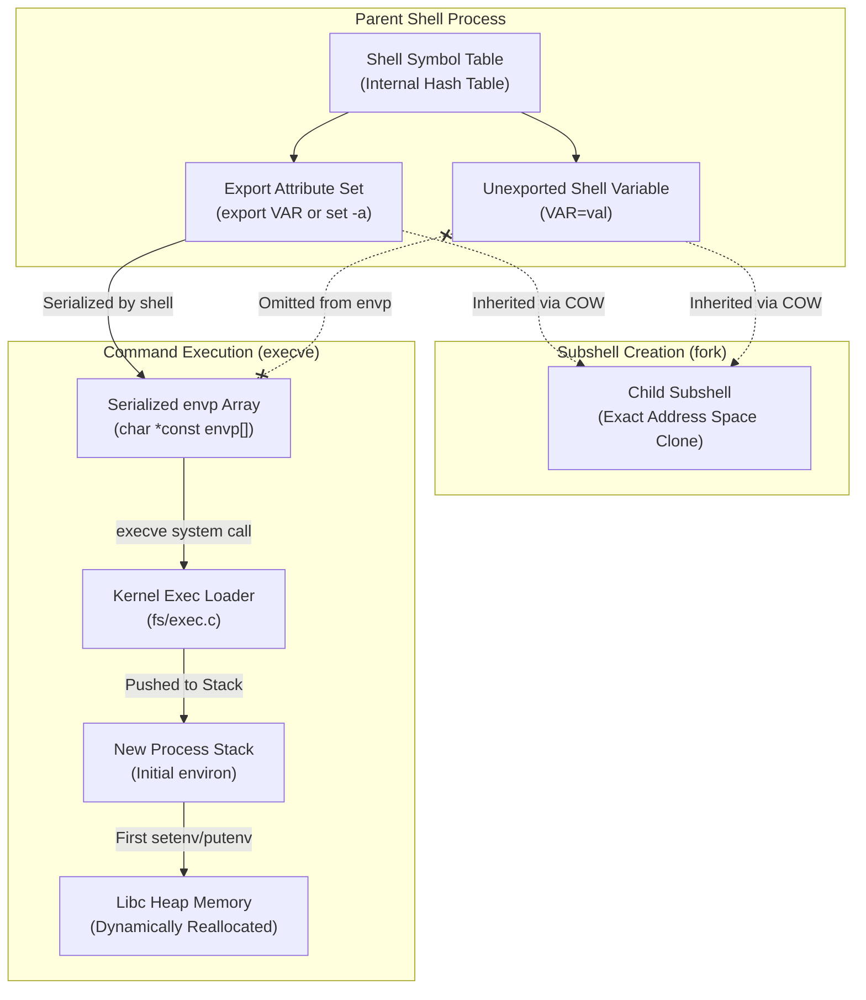

# Environment Variables and Inheritance

> [!summary] Claim
> Process environments are top-down byte-string arrays instantiated on the stack during `execve`, populated from shell symbol tables via the export attribute, and isolated such that no child process can alter a parent environment.

Part of [The Unix Process Model](README.md) in [Shell and Unix Engineering](../README.md).

## TL;DR

Mechanism: `execve(2)` places a null-terminated array of `KEY=value` pointers onto the initial user stack, which libc binds to `environ` and relocates to the heap upon dynamic modification.
Rule: Shell variables remain private to the process unless marked with the export attribute via `export` or `set -a`, ensuring child processes inherit only explicitly exposed bindings.
Trap: Command-prefix assignments preceding special built-ins persist in POSIX shells and bash under `--posix`, while default non-POSIX bash and zsh revert them after command completion.
Portability: Duplicate environment names cause libc `getenv()` to take the first entry, whereas bash and dash import the last entry and handle invalid names differently: dash and Debian BusyBox ash drop them, while bash and Alpine BusyBox ash preserve them.
When not to use it: Never use environment variables for inter-process communication back to parents or for high-cardinality secrets that leak across `fork` boundaries into `/proc/self/environ`.

## Mental model



The parent shell maintains variable definitions in an internal symbol table where individual entries carry metadata flags such as the export attribute.
When a subshell is created via `fork(2)`, the entire virtual address space is duplicated via copy-on-write, granting the subshell full visibility into both exported and unexported shell variables.
When invoking an external utility via `execve(2)`, the shell walks its symbol table, skips unexported variables, and constructs a contiguous array of `KEY=value` string pointers terminated by a null pointer.
The kernel copies this array onto the new process stack alongside `argv` and the auxiliary vector, initializing the dynamic linker and C runtime `environ` pointer.
The child process begins execution reading this writable stack array in place until a runtime call to `setenv(3)` or `putenv(3)` that adds a variable forces libc to allocate a new pointer vector on the heap (measured by lab test 9 on macOS, glibc, and musl).

## How it works

At the kernel boundary, a process environment is not a key-value dictionary.
It is an untyped, null-terminated array of pointers to null-terminated byte strings passed as the third argument to the `execve(2)` system call: `int execve(const char *pathname, char *const argv[], char *const envp[])` (POSIX.1-2024 XSH exec).
The kernel binary loader (`fs/exec.c` in Linux, `xnu/bsd/kern/kern_exec.c` in Darwin) validates total memory limits against `ARG_MAX` and copies the string data directly to the highest addresses of the new process user stack.
Below the strings, the kernel lays out, from the stack pointer upward, `argc`, the null-terminated `argv` pointer table, the null-terminated `envp` pointer table, and the ELF auxiliary vector `auxv` (Linux `create_elf_tables()` in `fs/binfmt_elf.c`; POSIX specifies no stack layout).
When control transfers to the C runtime startup code (`_start`), the global variable `extern char **environ;` is initialized to point directly to this stack array (POSIX.1-2024 XSH environ).

Inside a POSIX-compliant shell, variables live in an internal symbol table (`vartab` in dash, `global_variables` in bash) rather than in libc's `environ` array.
Environment strings have the form `name=value` (POSIX.1-2024 XBD 8.1), and a shell variable name consists solely of underscores, digits, and alphabetics from the portable character set, beginning with a non-digit character (POSIX.1-2024 XBD 3.216 Name).
XBD 8.1 lets an implementation permit other characters in environment names and requires applications to tolerate such names, which is why shells disagree about what to do with them.
By default, variables assigned in a shell script are private shell variables.
They receive no export attribute and are invisible to `execve(2)` (POSIX.1-2024 XCU 2.5.3).
Only when a variable is declared with the `export` special built-in utility or when the `set -a` (allexport) option is active does the shell mark the symbol table entry with an export attribute (`VEXPORT` in dash, `att_exported` in bash).

When the shell launches an external command, it serializes its exported variables into a freshly allocated `char **` vector.
In dash, `shellexec()` in `src/exec.c` calls `environment()`, a macro in `src/var.h` that expands to `listvars(VEXPORT, VUNSET, 0)` in `src/var.c`, to filter the symbol table and construct the contiguous pointer array passed directly to `tryexec()` and `execve(2)` (dash src/var.h, src/var.c, listvars).
In bash, `maybe_make_export_env()` in `variables.c` checks `array_needs_making` and calls `make_var_export_array()`, which calls `make_env_array_from_var_list()` to generate the array passed to `execve(2)` (bash-5.3 variables.c, make_env_array_from_var_list).

At shell startup, the reverse transformation occurs.
The shell reads the inherited `environ` vector from libc and imports entries into its internal symbol table (POSIX.1-2024 XCU 2.5.3).
In dash, `INIT` in `src/var.c` iterates over `environ`, calls `endofname(*envp)`, and if valid, calls `setvareq(*envp, VEXPORT|VTEXTFIXED)`.
If an inherited string contains characters invalid in a POSIX shell identifier (such as a hyphen `foo-bar=123`), dash discards it immediately.
In bash, `initialize_shell_variables()` in `variables.c` checks `valid_identifier(name)`.
If the identifier is invalid, bash stores it with `bind_invalid_envvar()` in a separate `invalid_env` table and assigns the flags `att_exported | att_imported | att_invisible`, which hides the variable from shell expansions like `$foo-bar` but keeps the byte string so `maybe_make_export_env()` passes it to subsequent child commands intact (bash-5.3 variables.c, initialize_shell_variables, bind_invalid_envvar).
BusyBox ash identifier handling diverges across distribution builds of the same 1.37.0 release: the Alpine Linux build (the one that sets `BB_ASH_VERSION`) imports and retains invalid identifier strings in its exported environment, whereas the Debian build drops them at startup (measured in the shell matrix, as of 2026-10).
Upstream `shell/ash.c` imports every inherited string that contains `=`, with a comment explaining that the older `endofname()` check broke passing such names to children, so the Alpine behavior matches upstream; Debian's source package `busybox` 1:1.37.0-6 reverts that upstream change with `debian/patches/revert-9c143ce52da11ec3d21a3491c3749841d3dc10f0.patch` so that `temp-deb-installer-hack.patch` applies, and that second patch keeps the `endofname()` filter unless `CONFIG_FEATURE_DI_ENV_HACK` is set; Debian's `deb` flavour has it unset and only the `udeb` flavour (debian-installer) sets it to `y`, which is why the Debian build drops invalid names (Debian `busybox` 1:1.37.0-6 patches and `debian/config/pkg/deb` and `udeb`).

Simple command execution introduces temporary environment export (POSIX.1-2024 XCU 2.9.1.2).
When variable assignments precede a command name (for example, `FOO=bar cmd`), the assignment is exported strictly for the execution environment of `cmd` and does not alter the caller shell environment once `cmd` completes.
However, POSIX specifies a critical divergence: if the command name is a special built-in utility (such as `:`, `.`, `eval`, `exec`, `export`, `readonly`, `set`, `shift`, `times`, `trap`, or `unset`), the variable assignment modifies the current shell execution environment and persists after the built-in finishes (POSIX.1-2024 XCU 2.9.1.2).
While POSIX shells such as dash, mksh, and ksh93 enforce this persistence, default native bash and native zsh diverge by clearing the assignment when the built-in completes.
When bash executes in POSIX mode (`bash --posix`, invoked as `sh`, or with `set -o posix`), it conforms to POSIX.1-2024 XCU 2.9.1.2 and retains the assignment in the caller environment (Bash Reference Manual Section 6.11, Bash and POSIX).
If the command name is a shell function, POSIX leaves it unspecified whether prefix assignments persist after the function returns (POSIX.1-2024 XCU 2.9.1.2).
In ksh93, `zsh --emulate sh`, and older bash releases (bash <= 5.0, including macOS `/bin/sh`) in POSIX mode, prefix assignments preceding a function call persist in the caller.
In modern bash (bash >= 5.1 in both default and POSIX modes), dash, posh, mksh, BusyBox ash, yash, and native zsh, prefix assignments preceding a function call revert upon return.
Both behaviors conform: Austin Group Defect 654 replaced the Issue 7 TC1 wording that made such assignments affect the current environment with the current unspecified wording, and bash-5.1-alpha changed its POSIX mode to match its default mode, citing "POSIX interp 654" (bash CHANGES, bash-5.1-alpha item o).

In user space C runtimes, mutating the environment involves memory reallocation.
Because the initial `environ` array resides on the stack, libc cannot expand it in place.
Upon the first call to `setenv(3)` or `putenv(3)` that adds a new variable, libc allocates a new pointer vector on the heap, copies the existing stack pointers, appends the new entry, and updates `environ` to point to heap memory (lab test 9 shows the move on macOS, glibc, and musl; POSIX leaves the mechanism to the implementation).
Older glibc grew that vector with `realloc(3)`; current glibc (`stdlib/setenv.c`, `__environ_new_array`, as of 2026-10) instead `calloc`s a larger array with spare capacity and keeps every superseded array on `__environ_array_list`, so a concurrent `getenv(3)` never walks freed memory; `__environ_array_list` is absent from `stdlib/setenv.c` at tags glibc-2.38, 2.39, and 2.40 and present at glibc-2.41, so 2.41 is the first release with this design (glibc git tags, `stdlib/setenv.c`).
Crucially, `setenv(3)` allocates heap storage for the `name=value` string and copies the bytes, so the caller may reuse its buffers (glibc `stdlib/setenv.c`, `__add_to_environ`); POSIX.1-2024 XSH putenv says `setenv()` is preferred over `putenv()`.
In contrast, `putenv(3)` takes ownership of the exact string pointer passed to it without copying: mutating the caller's character buffer subsequently mutates the process environment in place, and passing a stack-allocated buffer creates a dangling pointer when the enclosing function returns (POSIX.1-2024 XSH putenv).

Neither POSIX nor Unix kernels provide any environment interface through which a child process can modify the environment of its parent; only debugging access such as `ptrace(2)` or `/proc/<pid>/mem`, which writes the parent's memory directly, could do so (POSIX.1-2024 XCU 2.13).
Virtual memory isolation ensures that changes made by `setenv(3)`, `putenv(3)`, or shell variable assignments modify only the private address space or heap of the calling process.
Propagating environment mutations back to a parent requires out-of-band communication, such as writing `export` commands to stdout and executing them in the parent via `eval "$(/path/to/child)"`.

## Numbers and limits

| Metric / Parameter | Value / Limit | Scope / Kernel | Source |
|---|---|---|---|
| Minimum `_POSIX_ARG_MAX` | 4,096 bytes | Standard minimum `argv` + `envp` | POSIX.1-2024 `<limits.h>` |
| Total `ARG_MAX` limit (Linux) | 2,097,152 bytes (2 MiB) with the default 8 MiB `RLIMIT_STACK` | Combined `argv` + `envp` strings and pointers: 1/4 of `RLIMIT_STACK`, capped at 3/4 of `_STK_LIM` (6 MiB) | Linux kernel `fs/exec.c`, `bprm_stack_limits()`; `getconf ARG_MAX` on Debian 13 (as of 2026-10) |
| Single variable limit `MAX_ARG_STRLEN` (Linux) | 131,072 bytes (128 KiB) including the terminating NUL, with 4 KiB pages | `PAGE_SIZE * 32`, so it scales with the page size (512 KiB with 16 KiB pages) | Linux kernel `<linux/binfmts.h>`; a 131,072-byte string passes and a 131,073-byte one fails on Debian 13 (as of 2026-10) |
| Total `kern.argmax` (macOS Darwin) | 1,048,576 bytes (1 MiB) | Combined `argv` + `envp` + pointers | `getconf ARG_MAX` on the macOS host (as of 2026-10) |
| Single variable limit (macOS Darwin) | No `MAX_ARG_STRLEN` ceiling | Bounded only by `kern.argmax`: a 600,003-byte string passes | Measured on the macOS host, not by the lab (as of 2026-10) |
| Initial `environ` stack offset | 132 to 1,748 bytes | Distance between `environ` and a local in `main`; the lab only asserts it is under 64 KiB | Measured with a standalone probe on the macOS host and both matrix images, not by the [[#Worked example\|lab]] (as of 2026-10) |
| Post-`setenv` heap relocation distance | Hundreds of MiB to about 2 GiB (musl, macOS) to about 85 TiB (glibc) | Virtual address jump from stack to heap, varies with ASLR | Measured with a standalone probe on the macOS host (about 1.7 GiB), Alpine (427 MiB to 1.1 GiB), and Debian (about 85 TiB), not by the lab (as of 2026-10) |
| Minimum environment string overhead | 8-byte pointer plus 1-byte NUL (LP64) | Pointer table entry in `envp` and string terminator | POSIX.1-2024 XSH exec leaves it implementation-defined whether pointers and terminators count against `ARG_MAX`; Linux counts both (`fs/exec.c`) |
| Linux `PAGE_SIZE` baseline | 4,096 bytes (x86_64; arm64 kernels choose 4, 16, or 64 KiB at build time) | Base allocation page | `getconf PAGESIZE` reports 4,096 in both matrix images on the arm64 OrbStack kernel and 16,384 on the macOS host (as of 2026-10) |
| BusyBox identifier retention divergence | Preserved (Alpine build), dropped (Debian build) | BusyBox 1.37.0 ash startup parsing | Measured in [[#Worked example\|lab]] (as of 2026-10) |

## Portability

| Implementation / Shell | Variable Inheritance (`( ... )` vs `exec`) | Prefix on Special Built-in (`VAR=val :`) | Prefix on Function (`VAR=val fn`) | Invalid Name in `envp` (`foo-bar=1`) | Duplicate Key in `envp` Import | `export -p` Quoting and Format |
|---|---|---|---|---|---|---|
| POSIX.1-2024 Standard | `( ... )` inherits; `exec` requires export attribute | Persists in caller shell (XCU 2.9.1.2) | Unspecified persistence (XCU 2.9.1.2) | Not imported as shell variables (XCU 2.5.3); unspecified whether passed to children (XCU 2.9.1.6) | Undefined consequences (XBD 8.1) | `export name=value`, quoted for reinput (XCU export) |
| macOS bash 3.2 | `( ... )` inherits; `exec` requires export | Reverts (default), persists under `--posix` | Reverts (default), persists under `--posix` | Preserved and exported | Last occurrence wins (`second`) | `declare -x VAR="value"`; `export VAR="value"` under `--posix` |
| Current bash (5.3) | `( ... )` inherits; `exec` requires export | Reverts (default), persists under `--posix` | Reverts in caller (both default and `--posix`) | Preserved in `invalid_env` with `att_invisible` | Last occurrence wins (`second`) | `declare -x VAR="value"`; `export VAR="value"` under `--posix` |
| zsh (native) | `( ... )` inherits; `exec` requires export | Reverts in caller | Reverts in caller | Preserved and exported (macOS and Linux) | First occurrence wins (`first`) | `export VAR=value`, single-quoted only when needed |
| zsh (`--emulate sh`) | `( ... )` inherits; `exec` requires export | Persists in caller | Persists in caller | Preserved and exported (macOS and Linux) | First occurrence wins (`first`) | `export VAR=value`, single-quoted only when needed |
| dash (0.5.12) | `( ... )` inherits; `exec` requires export | Persists in caller | Reverts in caller | Dropped at startup (`endofname`) | Last occurrence wins (`second`) | `export VAR='value'` |
| ksh93 (ksh93u+ 2012) | `( ... )` inherits; `exec` requires export | Persists in caller | Persists in caller | Preserved and exported | First occurrence wins (`first`) | `export VAR=value`, `$'...'` only when needed |
| ksh93 (ksh93u+m 1.0.10) | `( ... )` inherits; `exec` requires export | Persists in caller | Persists in caller | Preserved and exported | Last occurrence wins (`second`) | `export VAR=value`, `$'...'` only when needed |
| mksh (R59) | `( ... )` inherits; `exec` requires export | Persists in caller | Reverts in caller | Dropped at startup | First (Debian R59 2025/04/26), last (Alpine R59 2020/10/31) | `export VAR='value'` |
| yash (2.58.1) | `( ... )` inherits; `exec` requires export | Persists in caller | Reverts in caller | Preserved and exported | Last occurrence wins (`second`) | `export VAR='value'` |
| posh (0.14.1) | `( ... )` inherits; `exec` requires export | Persists in caller | Reverts in caller | Dropped at startup | Last occurrence wins (`second`) | Broken: omits quotes, splits on spaces |
| BusyBox ash (1.37.0) | `( ... )` inherits; `exec` requires export | Persists in caller | Reverts in caller | Preserved (Alpine build), dropped (Debian build) | Last occurrence wins (`second`) | `export VAR='value'` |
| GNU coreutils `env` | N/A (utility) | N/A | N/A | Preserved in `execve` | Passes both through; `NAME=value` replaces only the first, `-u` removes both | Supports `-i`, `-u`, `-0` (null-delimited) |
| BSD / macOS `env` | N/A (utility) | N/A | N/A | Preserved in `execve` | Passes both through; `NAME=value` replaces only the first, `-u` removes both | Supports `-0`, `-i`, `-u`, `-v`, `-C`, `-P` (alternate path), `-S` |
| BusyBox `env` | N/A (utility) | N/A | N/A | Preserved in `execve` | Passes both through; `NAME=value` replaces only the first, `-u` removes both | Supports `-i`, `-u`, `-0` |
| uutils `env` | N/A (utility) | N/A | N/A | Preserved in `execve` | Passes both through; `NAME=value` replaces only the first, `-u` removes both | Supports `-i`, `-u`, `-0`, `-C`, `-f`, `-v`, `-S`, `-a` (measured on uutils-coreutils 0.11.0, Alpine package) |

## Worked example

The test suite in [lab](../labs/01-environment-variables-and-inheritance/) exercises process environment inheritance, prefix assignment persistence, dynamic stack-to-heap relocation, duplicate key deduplication, and round-trip export formatting.

Here is the helper probe implementation from `labs/01-environment-variables-and-inheritance/env_probe.sh`:

```sh
#!/bin/sh
# env_probe.sh: probe shell variables vs exported environment variables.
# Usage:
#   env_probe.sh dump <varname>
#   env_probe.sh prefix <varname>
#   env_probe.sh child_mutate <varname> <newval>

set -eu

mode="${1:-}"

case "${mode}" in
  dump)
    varname="${2:-}"
    if [ -z "${varname}" ]; then
      printf 'error: missing variable name\n' >&2
      exit 1
    fi
    shell_val="UNSET"
    # Read shell variable value portably across POSIX shells
    # shellcheck disable=SC2154 # assigned dynamically via eval
    eval "shell_val=\${${varname}-UNSET}"
    # Read exported environment value directly from the env utility
    env_out=$(
      export PATH="${PATH:-/usr/bin:/bin}"
      env
    )
    env_val=$(printf '%s\n' "${env_out}" | awk -F= -v k="${varname}" '
      $1 == k {
        sub(/^[^=]*=/, "")
        print
        found = 1
        exit
      }
      END {
        if (!found) print "UNSET"
      }
    ')
    printf 'shell: %s\n' "${shell_val}"
    printf 'env: %s\n' "${env_val}"
    ;;

  prefix)
    varname="${2:-}"
    if [ -z "${varname}" ]; then
      printf 'error: missing variable name\n' >&2
      exit 1
    fi
    val="UNSET"
    # shellcheck disable=SC2154 # assigned dynamically via eval
    eval "val=\${${varname}-UNSET}"
    printf 'prefix_val: %s\n' "${val}"
    ;;

  child_mutate)
    varname="${2:-}"
    newval="${3:-}"
    if [ -z "${varname}" ]; then
      printf 'error: missing variable name\n' >&2
      exit 1
    fi
    # shellcheck disable=SC2034 # referenced in subsequent eval
    mutate_target="${newval}"
    eval "${varname}=\${mutate_target}"
    # shellcheck disable=SC2163 # intentional indirect export of variable named in varname
    export "${varname}"
    val="UNSET"
    # shellcheck disable=SC2154 # assigned dynamically via eval
    eval "val=\${${varname}}"
    printf 'child_set: %s\n' "${val}"
    ;;

  *)
    printf 'usage: env_probe.sh {dump|prefix|child_mutate} [args...]\n' >&2
    exit 1
    ;;
esac
```

Here is a simplified excerpt of the C companion probe from `labs/01-environment-variables-and-inheritance/env_helper.c` exercising memory stack-to-heap relocation and duplicate key retrieval:

```c
#include <stdio.h>
#include <stdlib.h>
#include <string.h>
#include <stdint.h>
#include <unistd.h>
#include <sys/wait.h>

extern char **environ;

static int is_near_stack(void *ptr, void *stack_ref) {
  intptr_t diff = (intptr_t)((uintptr_t)ptr - (uintptr_t)stack_ref);
  if (diff < 0) diff = -diff;
  return diff < 65536;
}

int main(int argc, char **argv) {
  if (argc < 2) return 1;
  const char *mode = argv[1];

  if (strcmp(mode, "mem") == 0) {
    int dummy = 0;
    int init_stack = is_near_stack((void *)environ, (void *)&dummy);
    printf("initial: %s\n", init_stack ? "stack" : "other");
    if (setenv("LAB_PROBE_HEAP_VAR", "allocated", 1) != 0) return 1;
    int post_stack = is_near_stack((void *)environ, (void *)&dummy);
    printf("post-setenv: %s\n", post_stack ? "stack" : "heap");
    return 0;
  }

  if (strcmp(mode, "getenv_dup") == 0) {
    char *custom_envp[] = {"KEY=first", "KEY=second", NULL};
    char *child_argv[] = {argv[0], (char *)"getenv", argv[2], NULL};
    pid_t pid = fork();
    if (pid == 0) {
      execve(argv[0], child_argv, custom_envp);
      _exit(127);
    }
    int status;
    waitpid(pid, &status, 0);
    return WIFEXITED(status) ? WEXITSTATUS(status) : 1;
  }

  if (strcmp(mode, "getenv") == 0) {
    const char *val = getenv(argv[2]);
    printf("getenv: %s\n", val ? val : "UNSET");
    return 0;
  }
  return 0;
}
```

Running the Bats test suite demonstrates the execution invariants across the shell matrix:

```
$ bats labs/01-environment-variables-and-inheritance/test_environment.bats
1..13
ok 1 unexported shell variables are inherited by subshells but not external commands
ok 2 export attribute marks variable for external command inheritance
ok 3 unset clears both variable value and export attribute
ok 4 child process environment modification cannot mutate parent environment
ok 5 command prefix assignment exports variable temporarily for simple command
ok 6 command prefix assignment preceding special builtin persists per POSIX XCU 2.9.1.2
ok 7 command prefix assignment preceding shell function persistence divergence
ok 8 set -a automatically exports subsequent assignments
ok 9 initial environ array starts on stack and relocates to heap upon modification
ok 10 libc getenv retrieves first match of duplicate keys in envp
ok 11 shell import of duplicate keys resolves deterministically
ok 12 invalid variable identifier names in envp are handled per implementation
ok 13 export -p round-trips variable values including spaces and quotes
```

## Pitfalls

> [!warning] Subshell Pipeline Isolation Trap
> Trigger: Assigning a variable inside a loop that forms part of a pipeline, such as `cat config.txt | while read line; do TARGET="$line"; done`.
> Symptom: The variable `$TARGET` remains empty or retains its previous value after the pipeline finishes execution.
> Fix: Avoid upstream or downstream pipelines when mutating state; use process substitution `while read line; do TARGET="$line"; done < <(cat config.txt)` in bash/zsh, or use a redirection block in POSIX `sh`.

> [!warning] Command-Prefix Persistence on Special Built-ins
> Trigger: Prefixing a special built-in utility (such as `:`, `eval`, `export`, or `.`) with a variable assignment intended to be temporary (for example, `DEBUG=1 :`).
> Symptom: In standard POSIX shells like dash, mksh, and ksh93, as well as bash running in POSIX mode (such as `/bin/sh` on macOS or under `--posix`), `DEBUG` remains set to `1` in the caller shell, whereas default native bash reverts it, causing environment divergence between development and production.
> Fix: Use explicit subshells `( DEBUG=1; command )` or explicitly unset the variable after the special built-in invocation completes (POSIX.1-2024 XCU 2.9.1.2).

> [!warning] Silent Configuration Loss via Non-POSIX Environment Identifiers
> Trigger: Passing environment variables containing dots or hyphens (such as `service.port=8080` or `app-name=service`) into scripts or containers running under dash, posh, mksh, or Debian BusyBox ash.
> Symptom: The shell silently discards the invalid variable identifier during startup without an error, whereas bash (via `att_invisible`) and Alpine BusyBox ash preserve the variable in child `execve` calls, resulting in hard-to-debug missing configuration.
> Fix: Strictly sanitize environment variable keys to conform to POSIX identifier rules (`[a-zA-Z_][a-zA-Z0-9_]*`) or extract them directly from `/proc/self/environ` before shell initialization (POSIX.1-2024 XBD 8.1).

> [!warning] Shellshock Function Import Remote Code Execution (CVE-2014-6271)
> Trigger: Exporting shell functions across process boundaries in vulnerable versions of GNU Bash (through 4.3 before patch bash43-025, and the matching patches for older release branches, per NVD) by encoding them into environment variables starting with `() {`.
> Symptom: Attackers passing untrusted HTTP headers (such as `User-Agent`) to CGI scripts or OpenSSH forced commands execute arbitrary shell commands appended after the closing brace during shell startup.
> Fix: Upgrade bash to modern versions that enforce strict function parsing via `SEVAL_FUNCDEF` without executing trailing input (added by bash43-025, whose fix was incomplete: CVE-2014-7169) and that only import functions from variables named `BASH_FUNC_<name>%%` (added by bash43-027) (NVD CVE-2014-6271).

> [!warning] Dangling Pointer Corruption via putenv(3)
> Trigger: Passing a pointer to an automatic stack variable or temporary buffer to `putenv(3)` in a C extension or daemon.
> Symptom: Subsequent calls to `getenv(3)` return corrupted strings, or the process crashes with a memory segmentation fault once the stack frame is overwritten.
> Fix: Use `setenv(3)` instead of `putenv(3)` because `setenv(3)` allocates heap storage and copies both the key and value (POSIX.1-2024 XSH setenv).

> [!warning] Multi-threaded Data Races in getenv(3) and setenv(3)
> Trigger: Invoking `setenv(3)`, `unsetenv(3)`, or `putenv(3)` in one thread while concurrent worker threads read the environment using `getenv(3)`.
> Symptom: Intermittent heap use-after-free, reading partially reallocated `environ` pointers, or memory corruption resulting in undefined process aborts.
> Fix: Treat the process environment as strictly read-only after initial program startup before worker threads spawn; pass configuration to threads via struct pointers rather than ambient environment variables (POSIX.1-2024 XSH getenv).

> [!warning] Privileged Process Escalation via Out-of-Bounds Memory (CVE-2021-4034 PwnKit)
> Trigger: Calling `execve(2)` with an empty argument vector (`argc == 0`), so `argv[0]` is the terminating null pointer and the out-of-bounds `argv[1]` is the same slot as `envp[0]`.
> Symptom: In vulnerable utilities like Polkit `pkexec`, unvalidated out-of-bounds array reads and writes re-interpreted environment variables as command-line arguments, allowing unprivileged local users to load arbitrary shared libraries via unscrubbed variables.
> Fix: Since Linux 5.18 the kernel forces a single empty string into an empty `argv` so the new program sees `argc == 1` (commit dcd46d897adb, "exec: Force single empty string when argv is empty"; rejecting `argc == 0` outright broke existing programs), and defensive programs verify `argc > 0` before indexing `argv` (NVD CVE-2021-4034).

> [!warning] Security Filter Evasion via Duplicate Environment Names
> Trigger: Constructing an `envp` array containing duplicate keys (for example, `PATH=/safe/bin` followed by `PATH=/malicious/bin`) and passing it to a security wrapper or authorization daemon.
> Symptom: A C-based security wrapper calling `getenv("PATH")` reads the first occurrence and validates it as safe, while a downstream bash or dash interpreter imports the last occurrence into its hash table, executing unauthorized binaries.
> Fix: Explicitly deduplicate and scrub `envp` before executing untrusted targets; never assume `getenv()` and child interpreters agree on precedence when duplicate keys exist, since POSIX.1-2024 XBD 8.1 makes the consequences of duplicate names undefined (lab tests 10 and 11).

## Security and robustness

Environment variables cross boundary layers with minimal validation.
Unlike typed system call interfaces, the kernel treats `envp` as an arbitrary sequence of bytes terminated by null characters.
This design places the burden of security sanitization entirely on user space utilities and dynamic linkers.

When executing set-user-ID or set-group-ID binaries, operating systems activate privilege boundary protections.
Under Linux, the kernel evaluates process credentials during `execve(2)` and sets the `AT_SECURE` auxiliary vector entry to `1` when real and effective UIDs or GIDs differ or when capabilities are gained.
The GNU C Library dynamic linker (`ld.so`) inspects `AT_SECURE` (via `__libc_enable_secure`) and purges dangerous environment variables enumerated in `sysdeps/generic/unsecvars.h`.
Variables including `LD_PRELOAD`, `LD_LIBRARY_PATH`, `LD_AUDIT`, `LD_DEBUG`, `LD_PROFILE`, `GCONV_PATH`, and `GLIBC_TUNABLES` are discarded before transferring control to the executable entry point (glibc `sysdeps/generic/unsecvars.h`, as of 2026-10).
Similarly, the macOS dynamic linker (`dyld`) purges `DYLD_INSERT_LIBRARIES`, `DYLD_LIBRARY_PATH`, and `DYLD_FRAMEWORK_PATH` for restricted processes.

POSIX.1-2024 standardized `secure_getenv(3)` to extend these protections into application logic (POSIX.1-2024 XSH getenv).
Unlike standard `getenv(3)`, `secure_getenv(3)` returns a null pointer unless the real and effective user IDs, and the real and effective group IDs, were equal at program startup and any additional implementation-defined criteria hold (POSIX.1-2024 XSH getenv); glibc also returns null when `AT_SECURE` was set, which covers gained capabilities.
Production daemons and library initializers must use `secure_getenv(3)` whenever fetching paths, debug hooks, or configuration overrides that could compromise process integrity.

A critical operational vulnerability in production infrastructure is environment leakage through process listing interfaces.
On Linux, the pseudofile `/proc/<pid>/environ` contains the null-delimited initial environment strings passed to `execve(2)` (see [[The-proc-Filesystem]]).
Access is governed by a `ptrace(2)` `PTRACE_MODE_READ_FSCREDS` check, so in practice any process running under the same user ID can read it unless the target is non-dumpable (`proc_pid_environ(5)`).
On BSD systems and macOS, running `ps -E` or `ps eww` displays the full environment of processes owned by the user.
Storing database credentials, API tokens, or cryptographic keys in exported environment variables exposes them to all co-located processes, logging agents, core dumps, and crash reporting facilities.
Defensive deployments must isolate credentials using dedicated file descriptors (such as pipes or `/dev/fd/` handles; see [[dev-fd-and-dev-stdin]]) or execute processes under a stripped environment via `env -i`.

## The principal's view

At staff-plus and principal engineering levels, environment variables must be evaluated as ambient global state.
They represent an implicit, untyped, process-wide dependency injection mechanism that couples independent components across `fork` and `exec` boundaries.

The architectural decision is choosing between ambient configuration and explicit parameter passing:
1. Use environment variables for platform-wide runtime semantics: `PATH` for executable discovery, `LANG` and `LC_ALL` for character collation, `TZ` for time zone offset, and standard operational flags like `NO_COLOR`.
2. Prohibit environment variables for high-entropy secrets and credentials in multi-tenant or multi-tier architectures.
   Storing tokens in `AWS_SECRET_ACCESS_KEY` or `DATABASE_URL` turns every child subprocess, metrics scraper, and diagnostic utility into an accidental exfiltration vector.
3. Migrate critical service configuration to dedicated configuration files mapped into tmpfs memory, passed via sealed file descriptors (see [[File-Descriptors-and-Open-File-Descriptions]]), or injected via UNIX domain sockets.
4. Enforce strict POSIX identifier naming (`[a-zA-Z_][a-zA-Z0-9_]*`) for all environment keys across container orchestrators, because while bash tolerates non-standard keys like dots and dashes, minimal Linux userlands (dash, mksh, Debian BusyBox ash) silently drop them at startup.

When environment inheritance cannot be avoided, adopt the principle of least privilege through explicit environment stripping.
Production process supervisors (such as systemd, Kubernetes container runtimes, or custom wrapper scripts) should execute child daemons using `exec env -i PATH=/usr/bin:/bin ...` rather than passing the ambient supervisor environment downward.
In high-throughput multi-threaded software, enforce a strict ban on `setenv(3)` and `putenv(3)` after thread pool instantiation: environment mutations must occur during single-threaded startup or be replaced with local configuration context structs.

## Interview questions

> [!question] L5: What is the mechanical difference between a shell variable and an environment variable during command execution?
>
> > [!success]- Answer
> > A shell variable exists only in the shell's internal symbol table and is not serialized into the `envp` array passed to `execve(2)`.
> > An environment variable possesses the export attribute, which instructs the shell to serialize the variable into the null-terminated `envp` pointer table on the child process stack.
> > When creating a subshell via `fork(2)`, both shell variables and exported variables are visible because the entire address space is copied.
> > When launching an external binary via `execve(2)`, only exported variables survive.
> >
> > Follow-up: Why does `( FOO=1; echo $FOO )` print `1` even when `FOO` is not exported?

> [!question] L5: Predict the output of this script across POSIX sh and explain the mechanism:
> ```sh
> TARGET="parent"
> sh -c 'TARGET="child"'
> echo "$TARGET"
> ```
>
> > [!success]- Answer
> > The script prints `parent`.
> > The command `sh -c 'TARGET="child"'` executes a child shell process in a distinct virtual address space via `fork(2)` and `execve(2)`.
> > Memory isolation enforced by hardware page tables guarantees that modifications made by a child process cannot write to parent memory.
> > The child process modifies only its own symbol table and terminates without affecting the parent.
> >
> > Follow-up: How would you structure this command if the parent shell genuinely needed the value computed by the child?

> [!question] L6: Predict the output of this script under dash versus native bash, and cite the governing POSIX rule:
> ```sh
> unset VAR
> VAR="active" :
> echo "VAR=${VAR:-empty}"
> ```
>
> > [!success]- Answer
> > Under dash, the script outputs `VAR=active`.
> > Under native non-POSIX bash, the script outputs `VAR=empty`.
> > The colon `:` is a special built-in utility.
> > POSIX.1-2024 XCU 2.9.1.2 mandates that variable assignments preceding a special built-in utility modify the current shell execution environment and remain in effect after the command completes.
> > Native bash treats `:` like a regular command and restores the previous environment unless running in POSIX mode (`bash --posix` or when invoked as `sh`), where it outputs `VAR=active`.
> >
> > Follow-up: What happens if `:` is replaced by `true` in dash, and how does macOS `/bin/sh` behave?

> [!question] L6: Predict the output of this script across shell families and explain how POSIX defect reports changed the specification:
> ```sh
> dummy_fn() { :; }
> unset FN_VAR
> FN_VAR="temp" dummy_fn
> echo "${FN_VAR:-empty}"
> ```
>
> > [!success]- Answer
> > In ksh93, `zsh --emulate sh`, and older bash releases (bash <= 5.0, such as macOS `/bin/sh`) under POSIX mode, the script outputs `temp`.
> > In dash, posh, mksh, BusyBox ash, yash, native zsh, and modern bash (bash >= 5.1 in both default and POSIX modes), the script outputs `empty`.
> > The function case of the list in POSIX.1-2024 XCU 2.9.1.2 specifies that whether variable assignments preceding a shell function remain in effect after the function completes is unspecified.
> > Austin Group Defect 654 amended the POSIX standard so that function prefix assignments are not required to persist in the caller shell; Issue 7 TC1 had said they affect the current execution environment.
> > Bash maintainers adopted this interpretation in bash-5.1-alpha to eliminate the previous divergence between default mode and POSIX mode (bash CHANGES, "POSIX interp 654").
> >
> > Follow-up: How do you guarantee a temporary variable assignment is visible only inside a function without polluting the caller?

> [!question] L6: Debug this pipeline script: why does the counter report zero at the end?
> ```sh
> count=0
> cat /etc/hosts | while read line; do
>   count=$((count + 1))
> done
> echo "Total hosts: $count"
> ```
>
> > [!success]- Answer
> > In standard shells like dash and bash, each stage of a pipeline executes in a separate subshell environment instantiated via `fork(2)`.
> > The `while` loop runs inside a child process with a private copy of `$count`.
> > While the child increments its local variable, the parent shell waits for the pipeline stages to complete without receiving variable mutations.
> > When the pipeline finishes, the parent shell prints its own unmodified variable `count=0`.
> >
> > Follow-up: Rewrite the loop without process substitution so that it functions identically on pure POSIX sh.

> [!question] L6: How does libc manage memory allocation when `setenv(3)` or `putenv(3)` is called for the first time?
>
> > [!success]- Answer
> > At program entry, `environ` points directly to an array placed on the initial user stack by the kernel's `execve(2)` loader.
> > Because stack frames have fixed bounds that cannot be reallocated in place, libc cannot resize the initial pointer array.
> > On the first call to `setenv(3)` that inserts a variable, libc allocates a new pointer array on the heap, copies the stack pointers over, and points `environ` to the heap (lab test 9).
> > Subsequent additions grow the heap-based pointer array: older glibc used `realloc(3)`, while current glibc allocates a larger array with spare capacity and keeps the superseded arrays alive for concurrent readers (glibc `stdlib/setenv.c`, `__environ_new_array`).
> >
> > Follow-up: Why is passing a string on the local stack to `putenv(3)` a critical defect?

> [!question] L7+: When an attacker controls an `execve(2)` invocation and injects duplicate environment variables (`PATH=/usr/bin` followed by `PATH=/tmp/evil`), what happens when a C daemon inspects the environment versus when it delegates to a bash script?
>
> > [!success]- Answer
> > When the C daemon calls `getenv("PATH")`, glibc and Darwin libSystem perform a forward linear search starting at `environ[0]` and return the first match: `/usr/bin`.
> > The daemon verifies that `PATH` is benign and proceeds to launch a bash script.
> > During initialization, bash's `initialize_shell_variables()` iterates sequentially through `envp` and inserts each entry into its hash table using `bind_variable()`.
> > The subsequent entry `PATH=/tmp/evil` overwrites the earlier entry in the symbol table.
> > When bash executes external commands, it resolves binaries from `/tmp/evil`, resulting in privilege escalation.
> >
> > Follow-up: How should an authentication proxy or setuid wrapper sanitize duplicate environment variables?

> [!question] L7+: Why does POSIX.1-2024 require `getenv(3)` to be thread-safe, yet simultaneous execution with `setenv(3)` results in undefined behavior?
>
> > [!success]- Answer
> > POSIX.1-2024 no longer allows `getenv(3)` to return a value in an internal buffer, as the ISO C standard does, because the data is already available through `environ[]`, so `getenv(3)` returns a pointer to the actual data (POSIX.1-2024 XSH getenv RATIONALE, Austin Group Defects 188 and 1394).
> > Concurrent calls to `getenv(3)` across multiple threads are therefore safe because reading memory that no thread writes carries no race conditions.
> > The thread-safety requirement explicitly excludes the case where another thread modifies the environment: `setenv(3)` is not thread-safe, because it mutates pointers inside `environ` and may move the entire pointer array to a new heap address.
> > If a concurrent thread reads `environ` while `setenv(3)` frees or reallocates the pointer vector, the reader encounters a use-after-free or reads a dangling pointer; current glibc narrows this window by never freeing superseded arrays, but portable code cannot rely on that.
> >
> > Follow-up: How do modern systems like Go or Rust handle environment mutations in multi-threaded runtimes?

> [!question] L7+: Explain the exact mechanism of the Shellshock vulnerability (CVE-2014-6271) down to the bash source function, and how the fix altered environment parsing.
>
> > [!success]- Answer
> > In vulnerable versions of bash, `initialize_shell_variables()` imported functions from environment variables whose values began with `() {`.
> > Bash constructed an internal command string and passed it to `parse_and_execute()` with flags enabling immediate execution.
> > The parser did not stop after compiling the closing brace of the function definition, executing any trailing shell syntax present in the string.
> > Attackers supplied environment variables such as `VAR=() { :; }; /bin/cat /etc/passwd` to CGI scripts, achieving immediate arbitrary code execution during shell initialization.
> > The first patch, bash43-025, restricted evaluation strictly to a single function definition via `SEVAL_FUNCDEF` and `SEVAL_ONECMD`; it proved incomplete (CVE-2014-7169), and bash43-027 then moved exported functions to the `BASH_FUNC_<name>%%` variable naming scheme so ordinary variables are never parsed as functions.
> >
> > Follow-up: Why did the original bash design attempt to export functions through environment variables rather than dedicated IPC?

## Related

Prerequisites: [[dev-fd-and-dev-stdin]]

Next: [[Resource-Limits-and-ulimit]]

See also: [[Program-Startup-C-Runtime-Init-and-Auxiliary-Vectors]], [[Processes-fork-exec-and-wait]], [[Posix-Spawn-and-Vfork]], [[Program-Startup-argv-envp-and-ARG_MAX]], [[File-Descriptors-and-Open-File-Descriptions]], [[Close-on-Exec-and-Descriptor-Inheritance]], [[The-proc-Filesystem]]

## Further reading

- IEEE Std 1003.1-2024 Base Definitions, Chapter 8: Defines the standard structure of environment strings, identifier rules, and portable character constraints.
- IEEE Std 1003.1-2024 Shell and Utilities, Section 2.9.1.2: Specifies variable assignment processing order, simple command prefix export, and special built-in persistence.
- IEEE Std 1003.1-2024 System Interfaces, `exec`: Documents process image replacement, stack layout construction, and `environ` initialization.
- IEEE Std 1003.1-2024 System Interfaces, `getenv`: Details environment retrieval, MT-safety semantics, and `secure_getenv` privilege checks.
- Austin Group Defect 654: Clarified that variable assignments preceding shell functions are not required to persist in the calling shell execution environment.
- GNU Bash Reference Manual, Section 6.11 (Bash and POSIX): Details deviations from default bash execution, including prefix assignments on special built-in utilities.
- GNU Bash `variables.c` (`initialize_shell_variables`, `make_env_array_from_var_list`): The primary implementation reference for variable table importation, invisible identifier flags, and environment serialization.
- Dash `src/var.c` (the `INIT` block, `initvar`, `listvars`): The reference implementation for minimal POSIX environment importing, identifier validation via `endofname`, and export array construction on dash's own stack allocator.
- BusyBox `shell/ash.c`: Documents identifier validation and environment table importing differences across distribution builds.
- National Vulnerability Database CVE-2014-6271 (Shellshock): The vulnerability record detailing environment function parsing abuse and remote code execution in GNU Bash.
- National Vulnerability Database CVE-2021-4034 (PwnKit): The NVD record for the Qualys-discovered `argc == 0` environment pointer manipulation in Polkit `pkexec`.
- National Vulnerability Database CVE-2021-3156 (Baron Samedit): The NVD record for the off-by-one heap overflow in sudo before 1.9.5p2, reached via `sudoedit -s` and an argument ending in a single backslash.
