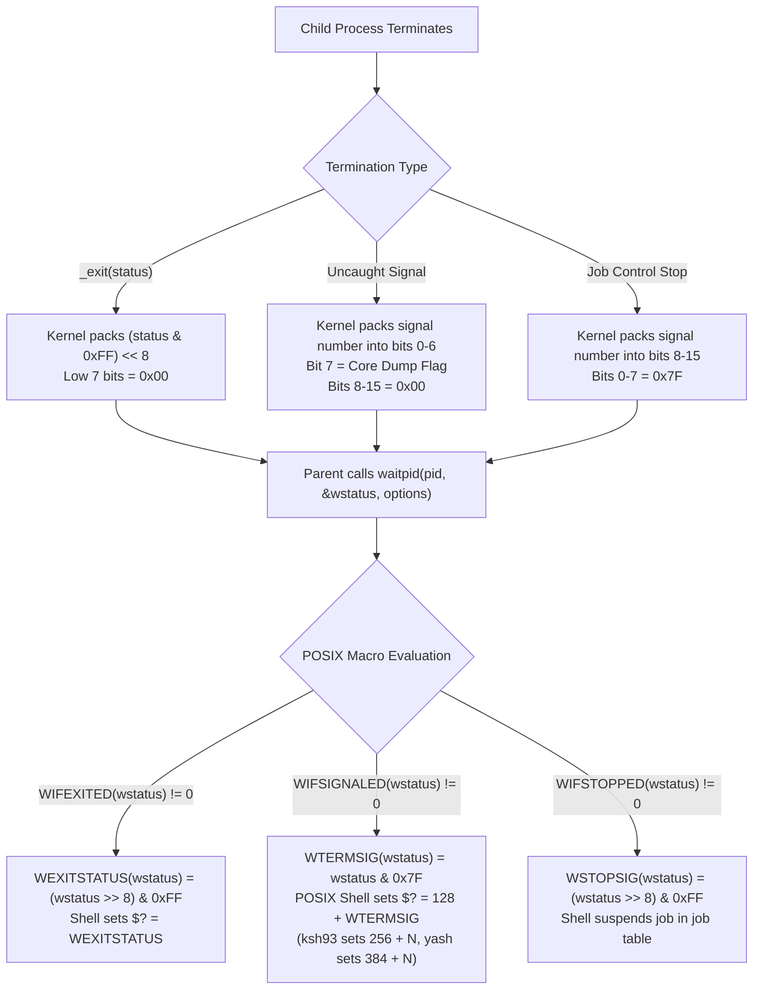

# Exit Status and Wait Status

> [!summary] Claim
> Unix isolates child termination into a 16-bit kernel wait status bitfield, truncating normal exit codes to 8 bits modulo 256 and encoding signal terminations separately, which POSIX shells translate into the single synthetic variable `$?`.

Part of [The Unix Process Model](README.md) in [Shell and Unix Engineering](../README.md).

## TL;DR

The kernel packs termination metadata into a 16-bit integer where `_exit(status)` preserves only the lowest 8 bits shifted into bits 8-15, while fatal signals occupy bits 0-6.
Systems software must always interrogate wait status using the standard POSIX macros `WIFEXITED`, `WEXITSTATUS`, `WIFSIGNALED`, and `WTERMSIG` rather than testing raw integer values directly.
Combining declaration builtins like `local` or `export` with command substitution masks command failures because the declaration builtin itself returns status 0.
POSIX shells report signal terminations as an offset greater than 128 (`128 + signo`), but ksh93 uses `256 + signo` internally and yash uses `384 + signo`.
Do not transmit raw 8-bit exit codes across remote boundaries or security gates without structured status envelopes, as code 256 wraps silently to status 0.

## Mental model



The diagram traces child process termination through the kernel process table down to the shell parameter `$?`.
When a process invokes `_exit()`, the kernel strips all but the lowest 8 bits and shifts them into the second byte of the exit code (on Linux, the `exit_code` field of `task_struct`).
If an unhandled signal strikes the process, the kernel leaves the high byte zero and stores the signal number in the lowest 7 bits, toggling bit 7 if memory was dumped to a core file.
When a parent process executes `waitpid()`, the kernel delivers this combined 16-bit status integer into the memory location pointed to by `stat_loc`.
The caller uses `<sys/wait.h>` macros to identify whether the process exited normally or was killed by a signal.
Finally, the shell maps this wait status into its own `$?` scalar, retaining 0-255 for normal exits and synthesizing synthetic numbers greater than 128 for signal deaths.

## How it works

### Kernel termination and bitfield encoding

Every process termination on Unix converges on the kernel internal function `do_exit()` (or `do_group_exit()` for multi-threaded processes).
In Linux, the system calls `exit(error_code)` and `exit_group(error_code)` take a full `int`, but `SYSCALL_DEFINE1(exit_group, ...)` immediately passes `(error_code & 0xff) << 8` to `do_group_exit()`, which stores it in `sig->group_exit_code` before `do_exit()` assigns `tsk->exit_code` `(Linux kernel/exit.c, SYSCALL_DEFINE1(exit_group), checked 2026-10)`.
The operating system reserves the lowest byte of the 16-bit wait status for signal tracking and process stop conditions.

```c
/* Simplified sketch modeled on BSD and Darwin <sys/wait.h>; POSIX specifies the macros, not this encoding */
#define _WSTATUS(x)    ((x) & 0177)
#define _WSTOPPED      0177
#define WIFEXITED(x)   (_WSTATUS(x) == 0)
#define WEXITSTATUS(x) (((x) >> 8) & 0377)
#define WIFSIGNALED(x) (_WSTATUS(x) != _WSTOPPED && _WSTATUS(x) != 0)
#define WTERMSIG(x)    (_WSTATUS(x))
#define WCOREDUMP(x)   ((x) & 0200)
#define WIFSTOPPED(x)  (((x) & 0xff) == _WSTOPPED)
#define WSTOPSIG(x)    (((x) >> 8) & 0377)
```

When a process calls `_exit(42)`, the status integer recorded in the kernel is `0x2a00`.
Macro `WIFEXITED(0x2a00)` evaluates to true because the low 7 bits are zero.
Macro `WEXITSTATUS(0x2a00)` shifts right by 8 bits and masks with `0xff`, yielding `42`.
When a process calls `_exit(256)`, the low 8 bits of 256 are `0x00`, so the kernel records `0x0000`.
`WIFEXITED(0x0000)` evaluates to true, and `WEXITSTATUS(0x0000)` yields `0`.
When a process is terminated by signal 15 (`SIGTERM`), the kernel sets the signal number in the lowest 7 bits, producing `0x000f`.
`WIFEXITED(0x000f)` evaluates to false, while `WIFSIGNALED(0x000f)` evaluates to true and `WTERMSIG(0x000f)` yields `15`.
If the child process is suspended via `SIGSTOP`, the kernel sets the low byte to `0x7f` and the high byte to the signal number.
Signal numbers are platform-dependent: `SIGSTOP` is signal 17 (`0x11`) on Darwin and BSD, producing raw status `0x117f`, while on Linux `SIGSTOP` is signal 19 (`0x13`), producing raw status `0x137f` `(as of 2026-10)`.
In both cases, `WIFSTOPPED(status)` evaluates to true and `WSTOPSIG(status)` extracts the respective signal number.
Darwin's `<sys/wait.h>` reuses `0x137f` for `WIFCONTINUED` (its `SIGCONT` is 19), so its `WIFSTOPPED` excludes that value: the same raw integer means stopped on Linux and continued on macOS (macOS SDK `sys/wait.h`, checked 2026-10).

The newer POSIX interface `waitid()` avoids packed 16-bit bitfields altogether by returning a populated `siginfo_t` structure `(POSIX.1-2024 XSH waitid)`.
Under `waitid(P_PID, pid, &info, WEXITED)`, the field `info.si_code` is set to `CLD_EXITED` for normal termination or `CLD_KILLED` / `CLD_DUMPED` for fatal signals.
The field `info.si_status` delivers the clean exit status or signal number without requiring manual bit shifts.

### Shell translation and special parameter `$?`

The shell execution environment maintains the special parameter `?`, expanding to the decimal exit status of the most recent pipeline executed in the current shell environment `(POSIX.1-2024 XCU 2.5.2)`.
POSIX specifies how the shell determines a command's exit status, in this order `(POSIX.1-2024 XCU 2.8.2)`:
1. Command not found: the exit status shall be `127`.
2. Command found but not executable: the exit status shall be `126`.
3. Command terminated by a signal: the shell shall assign an exit status greater than `128`.
4. Otherwise: the value of `WEXITSTATUS` applied to the `wait()` status, which for a C program is the value passed to `_exit()` modulo 256.

POSIX leaves the exact signal mapping to the implementation:
"The exit status shall identify, in an implementation-defined manner, which signal terminated the command."
"Note that shell implementations are permitted to assign an exit status greater than 255 if a command terminates due to a signal." `(POSIX.1-2024 XCU 2.8.2)`.
In practice, mainstream POSIX shells (bash, dash, zsh, BusyBox ash, mksh, posh) use `128 + signo`.
Termination by `SIGINT` (signal 2) yields status `130`.
Termination by `SIGKILL` (signal 9) yields status `137`.
Termination by `SIGTERM` (signal 15) yields status `143`.
KornShell 93 (`ksh93`) diverges by using `256 + signo` (its `SH_EXITSIG` bit is `0400` in `src/cmd/ksh93/include/shell.h`) so that regular exit codes 0-255 never collide with signals `(as of 2026-10)`.
Yash uses `384 + signo` (`256 + 128 + signo`) internally `(yash 2.58.1 job.h, TERMSIGOFFSET; as of 2026-10)`.

```c
/* GNU bash implementation in jobs.c */
static int
process_exit_status (WAIT status)
{
  if (WIFSIGNALED (status))
    return (128 + WTERMSIG (status));
  else if (WIFSTOPPED (status) == 0)
    return (WEXITSTATUS (status));
  else
    return (EXECUTION_SUCCESS);
}
```

In GNU bash, `process_exit_status()` extracts `WTERMSIG(status) + 128` when signaled `(bash-5.3 jobs.c, process_exit_status, read from the bash-5.3 release tarball)`.
In the Debian Almquist Shell (`dash`), `getstatus()` inspects the job's process status table and sets `retval = WTERMSIG(status)` and then `retval += 128` `(dash src/jobs.c, getstatus, checked on master 2026-10)`.

POSIX does not require modulo 256 truncation of the `exit` operand: it defines `exit n` for 0-255 and, since Austin Group Defect 51, for a value above 256 that equals the status the shell assigns to a signal death, which must make the shell terminate by that signal; `exit 256` and every other value above 255 leave the wait status unspecified `(POSIX.1-2024 XCU 2.15 exit)`.
Every shell in the matrix nonetheless reduces such values modulo 256 (`exit 256` gives 0, `exit 300` gives 44), with one exception.
In AT&T `ksh93u+ 2012-08-01`, `exit 257` sets the internal flag `SH_EXITSIG` (`0400`, that is `0x100`) plus 1, so on exit the shell resets `SIGHUP` to its default and kills itself with signal 1; the parent sees `WIFSIGNALED` with `WTERMSIG` 1, which bash reports as 129 (measured on macOS `/bin/ksh`: Python `subprocess` reports return code -1) `(as of 2026-10)`.
Because ksh93 reports signal deaths as `256 + signo`, that is the behavior POSIX.1-2024 now requires of it for `exit 257`.
`ksh93u+m 1.0.10` instead masks the operand with `SH_EXITMASK` in `b_return()` (`src/cmd/ksh93/bltins/cflow.c`) and exits 1, re-raising a signal in `sh_done()` (`src/cmd/ksh93/sh/fault.c`) only when the status came from a child that really died of that signal, so it does not implement the Defect 51 rule `(as of 2026-10)`.

POSIX leaves the wait status unspecified when the operand of the `exit` special built-in is not an unsigned decimal integer `(POSIX.1-2024 XCU 2.15 exit)`.
When passed a negative argument such as `exit -1`, shell implementations diverge sharply.
Permissive shells (bash, zsh, ksh93, and mksh) implement an extension that parses signed numbers and converts them via 8-bit two's complement modulo 256 to `255`.
Strict POSIX shells reject negative numbers as illegal numeric syntax or invalid option flags.
`dash` (`dash: 1: exit: Illegal number: -1`) and BusyBox `ash` (`ash: exit: line 0: Illegal number: -1`) terminate with exit status `2`.
`yash` treats the leading dash as an option introducer, prints `` exit: `-1' is not a valid option ``, and terminates with status `2` `(as of 2026-10)`.
`posh` parses the `exit` operand with libc `getopt()` in `posh_builtin_exitreturn()`, diagnosing `exit: invalid option -- '1'` and returning status `1` `(posh 0.14.1 src/builtins.c; message and status measured as of 2026-10)`.

### Pipeline exit status and `pipefail`

By default, POSIX dictates that the exit status of a pipeline is the exit status of the last command specified in the pipeline `(POSIX.1-2024 XCU 2.9.2)`.
In a pipeline such as `failing_cmd | succeeding_cmd`, `$?` is `0`, silently concealing the failure of `failing_cmd`.
POSIX.1-2024 standardized the option `set -o pipefail` `(POSIX.1-2024 XCU 2.9.2, 2.15 set)`:
When `pipefail` is enabled, the pipeline exit status is the exit status of the rightmost command that exited with a non-zero status, or zero if all commands exited with zero.
In dash `src/jobs.c`, `getstatus()` scans backward through the pipeline process list when `pipefail` is active until it encounters the first non-zero member (`while (status == 0 && --ps >= job->ps)`), added by the upstream commit "jobs: Implement pipefail option" of 2024-04-05 and first released in dash 0.5.13 (tagged 2025-09-21) `(dash git log and tags)`.
Support across `/bin/sh` implementations remains fragmented `(as of 2026-10)`.
Debian backports that upstream patch into `dash` 0.5.12-7 (2024-05-17, closing Debian bug #1071238), so Debian 13's `dash` 0.5.12-12 reports the rightmost failure status `(Debian dash changelog)`.
`dash` 0.5.12 on Alpine 3.22 and macOS `/bin/dash` reject `set -o pipefail` with `set: Illegal option -o pipefail` and exit status 2 (measured).
BusyBox `ash` compiles `pipefail` in through `BASH_PIPEFAIL`, which follows `CONFIG_ASH_BASH_COMPAT` (default `y`, and enabled in both the Alpine and Debian builds) `(BusyBox shell/ash.c)`, and `posh` 0.14.1 rejects it with `posh: set: pipefail: bad option` and exit status 1 (measured).
Bash provides the array `PIPESTATUS`, where each index corresponds to the exit status of the respective command in the last pipeline; mksh provides the same `PIPESTATUS` array (measured in mksh R59 on Alpine and Debian).
Zsh provides the identical diagnostic array under the lowercase name `pipestatus`, but only in native mode: zsh started as `zsh --emulate sh` leaves it unset, while `emulate sh` run later inside a native zsh keeps it (measured in zsh 5.9).

### Asynchronous child tracking and the `wait` builtin

The `wait` utility, which POSIX.1-2024 requires to be intrinsic (a built-in, but not a special built-in), pauses execution until child processes terminate `(POSIX.1-2024 XCU wait)`.
Invoking `wait` with no operands waits for all background processes known to the shell and exits with status 0.
Invoking `wait $pid` waits for the specific process and returns that process's exit status.
If the operand refers to an unknown process ID, POSIX mandates that `wait` shall treat it as a known process that exited with exit status `127` `(POSIX.1-2024 XCU wait)`.
A shell need not retain more than the `{CHILD_MAX}` most recent entries in its list of known process IDs `(POSIX.1-2024 XCU 2.9.3.1)`.
POSIX also requires the shell to forget a process ID once it has been waited for:
"Once a process ID that is known in the current shell execution environment ... has been successfully waited for, it shall be removed from the list of process IDs that are known in the current shell execution environment." `(POSIX.1-2024 XCU wait)`.
Conforming implementations (`zsh`, `ksh93`, `yash`, `mksh`, `posh`, and bash in POSIX mode via `--posix` or macOS `/bin/sh`) drop reaped child processes, so a second `wait $pid` returns `127` (lab test 9) `(as of 2026-10)`.
Conversely, `dash`, BusyBox `ash`, and GNU bash in default native mode (3.2 through 5.3) retain reaped statuses in an internal table, returning the cached exit status (such as `42`) on repeated `wait` calls, contrary to that requirement (lab test 9) `(as of 2026-10)`.

## Numbers and limits

| Parameter / Metric | Value | Constraint / Scope | Source / Verification |
|---|---|---|---|
| Process exit code size | 8 bits (0-255) | Kernel-to-parent interface via `waitpid` | `POSIX.1-2024 XSH wait`, confirmed by lab |
| Exit code wrapping modulus | 256 | `error_code & 0xFF` | `(Linux kernel/exit.c, SYSCALL_DEFINE1(exit_group))`, `(POSIX.1-2024 XCU 2.8.2)` |
| Command not found code | 127 | Reserved shell exit status | `(POSIX.1-2024 XCU 2.8.2)`, confirmed by lab |
| Command not executable code | 126 | Reserved shell exit status | `(POSIX.1-2024 XCU 2.8.2)`, confirmed by lab |
| Shell read error code | 128 | Unrecoverable read error while reading commands | `(POSIX.1-2024 XCU 2.15 exit, APPLICATION USAGE, Austin Group Defect 1629)` |
| Standard shell signal base | 128 | Shell exit status for signal termination | Convention; `POSIX.1-2024 XCU 2.8.2` requires only `> 128`, confirmed by lab |
| ksh93 internal signal base | 256 | ksh93 internal exit status | `SH_EXITSIG` in ksh93 `include/shell.h`, confirmed by lab (as of 2026-10) |
| yash internal signal base | 384 | yash internal exit status | yash source, confirmed by matrix (as of 2026-10) |
| Default SIGINT status | 130 (`128 + 2`) | Terminal interrupt termination | Arithmetic from the 128 convention and POSIX `kill` signal number 2; not exercised by the lab |
| Default SIGKILL status | 137 (`128 + 9`) | Uncatchable termination | Arithmetic from the 128 convention and POSIX `kill` signal number 9; not exercised by the lab |
| Default SIGTERM status | 143 (`128 + 15`) | Standard graceful termination | POSIX signal 15, confirmed by lab |
| Minimum `_POSIX_CHILD_MAX` | 25 | Minimum acceptable `{CHILD_MAX}` (simultaneous processes per real user ID), which also bounds the known-pid list a shell must keep | `POSIX.1-2024 <limits.h>`, `XCU 2.9.3.1` |
| Raw wait status `exit 42` | `0x2a00` | High byte = 42, Low byte = 0 | Produced by lab C probe (as of 2026-10) |
| Raw wait status `exit 256` | `0x0000` | High byte = 0, Low byte = 0 | Produced by lab C probe (as of 2026-10) |
| Raw wait status `kill -TERM` | `0x000f` | High byte = 0, Low byte = 15 | Produced by lab C probe (as of 2026-10) |
| Raw wait status `kill -STOP` (Darwin) | `0x117f` | High byte = 17 (`SIGSTOP`), Low byte = 127 | Produced by lab C probe (as of 2026-10) |
| Raw wait status `kill -STOP` (Linux) | `0x137f` | High byte = 19 (`SIGSTOP`), Low byte = 127 | Produced by lab C probe (as of 2026-10) |
| `exit 257` status | 1 / signal 1 | 1 in every other matrix shell, including ksh93u+m; death by signal 1 (reported 129 by bash) in AT&T ksh93u+ 2012 | Produced by lab probe (as of 2026-10); unspecified by POSIX except the Defect 51 signal case |
| `exit -1` status | 255 / 2 / 1 | 255 in bash/zsh/ksh93/mksh; 2 in dash/busybox/yash; 1 in posh | Produced by lab probe (as of 2026-10) |

## Portability

The table below contrasts exit status handling, signal offsets, and builtin behaviors across shell implementations.
Every entry represents behavior asserted by the lab or confirmed by the matrix `(as of 2026-10)`, except the Pipeline Status Array column, which the lab does not test and the verifier measured in the matrix images on 2026-10-26.

| Shell / Environment | Signal Exit Code (`SIGTERM`) | `exit 257` Status | `exit -1` Status | Repeated `wait $pid` | `pipefail` Supported | Pipeline Status Array |
|---|---|---|---|---|---|---|
| POSIX.1-2024 standard | `> 128` | Unspecified (signal death where 257 is the shell's status for signal 1) | Unspecified (not an unsigned integer) | 127 (pid removed after the first wait) | Yes (`set -o pipefail`) | None |
| macOS bash 3.2 (POSIX mode) | 143 | 1 | 255 | 127 | Yes | `PIPESTATUS` |
| Current bash (native 5.3; also native 3.2 to 5.2) | 143 | 1 | 255 | 42 (cached) | Yes | `PIPESTATUS` |
| zsh (native) | 143 | 1 | 255 | 127 | Yes | `pipestatus` |
| zsh (`--emulate sh`) | 143 | 1 | 255 | 127 | Yes | None (`pipestatus` unset) |
| dash (0.5.12) | 143 | 1 | 2 (Illegal number) | 42 (cached) | Debian: Yes (0.5.12-7+); Alpine 0.5.12 and macOS: No; upstream from 0.5.13 | None |
| ksh93 (93u+ / 93u+m) | 271 (`256 + 15`) | 93u+: dies by signal 1 (129 from bash); 93u+m: 1 | 255 | 127 | Yes | None |
| mksh (R59) | 143 | 1 | 255 | 127 | Yes | `PIPESTATUS` |
| yash (2.58.1) | 399 (`384 + 15`) | 1 | 2 (Invalid option) | 127 | Yes | None |
| posh (0.14.1) | 143 | 1 | 1 (Invalid option) | 127 | No | None |
| BusyBox ash (1.37.0) | 143 | 1 | 2 (Illegal number) | 42 (cached) | Yes (`CONFIG_ASH_BASH_COMPAT`, default on; Alpine and Debian) | None |

## Worked example

The test suite in [lab](../labs/01-exit-status-and-wait-status/) verifies bitfield encoding, signal translations, and divergence behaviors.
The listings below are simplified excerpts: the real `status_probe.sh` polls `/proc/PID/comm` before falling back to `ps`, also reports the `local` or `typeset` result, and carries ShellCheck directives, and the real `inspect_wstatus.c` checks every call and has modes for signals, stops, and `waitid()`.

```sh
#!/bin/sh
# labs/01-exit-status-and-wait-status/status_probe.sh (simplified excerpt)
set -u
mode="${1:-}"

case "${mode}" in
  direct_exit)
    target="${2:-0}"
    exit "${target}"
    ;;
  declaration_mask_trap)
    target="${2:-42}"
    export masked_exp="$(exit "${target}")"
    s_masked_exp="$?"
    unmasked_exp="$(exit "${target}")"
    s_unmasked_exp="$?"
    export unmasked_exp
    echo "export_masked:${s_masked_exp} export_unmasked:${s_unmasked_exp}"
    ;;
  signal_child)
    /bin/sleep 30 &
    child_pid="$!"
    # Ensure process execve'd before signaling to prevent mksh signal swallow
    waited=0
    while [ "${waited}" -lt 20 ]; do
      comm=$(ps -o comm= -p "${child_pid}" 2>/dev/null || true)
      case "${comm}" in *sleep*) break ;; *) ;; esac
      sleep 0.1 2>/dev/null || /bin/sleep 1 2>/dev/null || true
      waited=$((waited + 1))
    done
    kill -TERM "${child_pid}" 2>/dev/null || true
    wait "${child_pid}" 2>/dev/null
    echo "$?"
    ;;
  repeat_wait)
    target="${2:-42}"
    (exit "${target}") &
    child_pid="$!"
    wait "${child_pid}"
    ret1="$?"
    wait "${child_pid}" 2>/dev/null
    ret2="$?"
    echo "${ret1} ${ret2}"
    ;;
  *)
    exit 2
    ;;
esac
```

Below is the C probe that reads raw wait status integers directly from the kernel interface:

```c
/* labs/01-exit-status-and-wait-status/inspect_wstatus.c (simplified excerpt) */
#include <stdio.h>
#include <stdlib.h>
#include <sys/wait.h>
#include <unistd.h>

int main(int argc, char **argv) {
  int val = atoi(argv[2]);
  pid_t pid = fork();
  if (pid == 0) {
    _exit(val);
  }
  int status = 0;
  waitpid(pid, &status, 0);
  printf("raw=0x%04x WIFEXITED=%d WEXITSTATUS=%d\n",
         status, WIFEXITED(status), WEXITSTATUS(status));
  return 0;
}
```

Running the Bats suite executes all 13 test cases across the system shells:

```
$ bats labs/01-exit-status-and-wait-status/exit_wait.bats
1..13
ok 1 normal exit status 0 and 42 are propagated
ok 2 exit status is truncated modulo 256
ok 3 exit 257 produces 1 except in ksh93u+ 2012 which dies by signal 1
ok 4 negative exit argument is rejected by strict POSIX shells and wrapped by others
ok 5 command not found produces exit status 127
ok 6 command found but not executable produces exit status 126
ok 7 child killed by SIGTERM produces 128+signo, 256+signo in ksh93, 384+signo in yash
ok 8 wait on unknown PID produces exit status 127
ok 9 repeated wait on reaped child retains status or reports 127
ok 10 pipeline exit status defaults to rightmost command
ok 11 pipeline exit status under pipefail reports rightmost failure where supported
ok 12 local declaration masks command substitution failure status
ok 13 C probe verifies kernel wait status bitfield layout and waitid siginfo
```

## Pitfalls

> [!warning] Declaration command masking (ShellCheck SC2155)
> **Trigger:** Initializing a `local`, `export`, `typeset`, or `readonly` variable directly from a command substitution, such as `local result=$(failing_command)`.
> **Symptom:** The compound statement succeeds with exit code 0 even when `failing_command` terminates with a severe error, neutralizing `set -e` guards.
> **Fix:** Separate variable declaration from assignment: declare the variable first, assign the command substitution on a subsequent line, and evaluate `$?` immediately `(ShellCheck SC2155)`.

> [!warning] Modulo 256 exit status truncation
> **Trigger:** Passing an exit code greater than 255 or an error count directly to `exit`, such as `exit $count` where `count=256`.
> **Symptom:** The kernel applies `status & 0xFF`, converting 256 to 0, which reporting systems and CI/CD pipelines interpret as unconditional success.
> **Incident:** `CVE-2025-25204` shows the same consequence through a logic bug rather than truncation: `gh attestation verify` in GitHub CLI 2.49.0 up to (not including) 2.67.0 returned exit status 0 when no attestations were present, so deployment gates keyed on its exit code could accept unverified artifacts; it was fixed in 2.67.0 `(NVD CVE-2025-25204, published 2025-02-14)`.
> **Fix:** Clamp exit codes to the portable range 1-255 before calling exit: `[ "$code" -gt 255 ] && code=255; exit "$code"`.

> [!warning] Unchecked `WEXITSTATUS` macro invocation
> **Trigger:** In C process supervisors, calling `WEXITSTATUS(status)` without first checking `WIFEXITED(status)`.
> **Symptom:** If a helper process crashes with `SIGSEGV` or is terminated with `SIGKILL`, the high byte of `status` is 0; `WEXITSTATUS` extracts `0`, causing the supervisor to assume successful execution.
> **Fix:** Always guard extraction behind `if (WIFEXITED(status) && WEXITSTATUS(status) == 0)`.

> [!warning] Signal collision with application return codes
> **Trigger:** An application deliberately terminates with an exit status such as 130, 137, or 143.
> **Symptom:** Parent shell scripts cannot distinguish whether the process exited cleanly via `exit(143)` or was terminated by `SIGTERM` (signal 15).
> **Fix:** In C/Rust systems, use `waitid()` to inspect `si_code` (`CLD_EXITED` versus `CLD_KILLED`); in shell scripts, avoid application exit codes above 125 (126 and 127 are reserved, 128 marks an unrecoverable read error, and `128 + N` reaches 192 with Linux realtime signal 64).

> [!warning] Hidden pipeline failures without `pipefail`
> **Trigger:** Running pipelines like `tar -czf - /data | ssh remote "cat > backup.tar.gz"` without `set -o pipefail`.
> **Symptom:** If `tar` fails due to permission errors or disk corruption, `ssh` still exits with 0 upon writing the stream, recording a successful backup.
> **Fix:** Enable `set -o pipefail` in modern shells, or inspect pipeline arrays (`PIPESTATUS` in bash, `pipestatus` in zsh).

> [!warning] Inconsistent pipefail support across /bin/sh implementations
> **Trigger:** Executing `set -o pipefail` inside scripts declaring a `#!/bin/sh` shebang.
> **Symptom:** Pipelines on Debian 13 (dash 0.5.12-7+) and under BusyBox ash (Alpine's `/bin/sh`) recognize `pipefail` conforming to POSIX.1-2024, but under Alpine's `dash` 0.5.12 and macOS `/bin/dash` the script terminates abruptly with `set: Illegal option -o pipefail` (exit status 2), and under `posh` with `posh: set: pipefail: bad option` (exit status 1).
> **Fix:** Feature-test `pipefail` in a subshell via `(set -o pipefail 2>/dev/null) && set -o pipefail`, or mandate `#!/bin/bash` when pipeline safety is non-negotiable.

> [!warning] Negative exit arguments break under strict POSIX shells
> **Trigger:** Passing a negative integer to `exit`, such as `exit -1` for generic failure signaling.
> **Symptom:** Permissive shells (bash, zsh, ksh93, mksh) wrap `-1` modulo 256 to status 255 via 8-bit two's complement, but strict POSIX shells reject it: `dash` and BusyBox `ash` abort with exit status 2 (`Illegal number: -1`), `yash` aborts with exit status 2 (`` exit: `-1' is not a valid option ``), and `posh` exits with status 1 (`exit: invalid option -- '1'`).
> **Fix:** Strictly constrain exit arguments to unsigned decimal integers in the range 0-255: `exit 1` or `exit 255`.

> [!warning] Repeated `wait` status invalidation
> **Trigger:** Calling `wait $pid` multiple times to poll or re-query child status in portable scripts.
> **Symptom:** The second `wait` call fails with exit code 127 in zsh, ksh93, yash, mksh, posh, and POSIX-mode bash because the child was reaped from the tracking table upon the first wait.
> **Fix:** Cache `$?` immediately into a variable upon the initial `wait $pid` call and query the variable thereafter.

## Security and robustness

Exit status validation is the primary authorization boundary in automated Unix pipelines.
Robust shell and systems programming requires treating exit codes as defensive assertions:

1. Fail-closed pipeline execution:
   Every non-interactive script must configure `set -eu` and, where supported, `set -o pipefail`.
   Any intermediate command failure in a pipeline must abort execution before corrupted streams enter subsequent stages.
2. Proper signal propagation (the resignaling idiom):
   When a shell script or C supervisor catches `SIGINT` or `SIGTERM`, it must not simply exit with `exit 130`.
   A process that catches a signal should reset the signal disposition to `SIG_DFL`, unmask the signal, and send the signal to itself via `kill(getpid(), signo)` `(Cracauer, Proper handling of SIGINT/SIGQUIT)`.
   This ensures the parent process detects `WIFSIGNALED` rather than `WIFEXITED`, allowing the calling shell to stop a loop on Ctrl-C instead of running the next iteration.
3. Auditing subprocess execution in compiled languages:
   In languages like Go, Rust, and C, never compare raw process wait integers directly to 0.
   In Go, `cmd.Run()` returns an `*exec.ExitError` whose `ExitCode()` returns -1 if the process was terminated by a signal `(pkg.go.dev/os, ProcessState.ExitCode)`.
   In Rust, `ExitStatus::code()` returns `Option<i32>`, evaluating to `None` if the process was terminated by a signal, requiring explicit inspection via `ExitStatusExt::signal()` `(doc.rust-lang.org/std/process, ExitStatus and ExitStatusExt)`.

## The principal's view

The Unix process model imposes an extreme information constraint: a terminating process has exactly 8 bits of exit code to explain its fate to its parent.
Staff-plus engineers recognize that squeezing complex domain failures into 8 bits is an architectural antipattern.
Exit codes are appropriate for process orchestration, job scheduling, and basic Unix command pipelines.
However, they are wholly insufficient for distributed workflows, RPC boundaries, or data transformation engines where failures require actionable diagnostics.

When designing production systems:
1. Reserve exit codes for execution status (0 = success, 1 = domain error, 2 = usage error, 126 = unexecutable, 127 = missing binary).
2. Never pass negative exit arguments across shell scripts: strict POSIX shells abort with status 2 or 1, breaking portable CI pipelines.
3. Write structured failure payloads (JSON-LD or Protobuf envelopes) to standard error or a dedicated diagnostic file descriptor when debugging context is required.
4. Move away from shell scripts to Go or Rust when a workflow requires managing concurrent child processes, inspecting distinct process group signals, or avoiding 8-bit integer truncation bugs.
5. In systems software, never inspect raw wait status integers directly: signal numbers are platform-dependent (for example `SIGSTOP` wait status is `0x117f` on Darwin versus `0x137f` on Linux), making standard `<sys/wait.h>` macros or `waitid()` mandatory.
6. When writing security-sensitive admission controllers or CI/CD gates, treat exit code 0 as necessary but not sufficient: always verify that expected cryptographic artifacts or output manifests actually exist on disk before granting authorization.

## Interview questions

> [!question] L5: What happens when a command exits with `exit 256`, and why does `$?` report 0?
>
> > [!success]- Answer
> > The Unix kernel allocates only an 8-bit unsigned integer for normal process termination in the wait status bitfield.
> > When `_exit(256)` is invoked, the kernel performs `(256 & 0xFF) << 8`, which evaluates to zero in the upper byte.
> > The parent process evaluates `WEXITSTATUS(wstatus)`, extracting `(0x0000 >> 8) & 0xFF`, yielding decimal 0.
> > The shell observes status 0 and sets `$?` to 0, mistaking the exit for success.
> >
> > Follow-up: How do you prevent a loop counter or error count from wrapping to 0 when exiting?

> [!question] L5: Why does the shell script statement `local res=$(cmd)` fail to abort under `set -e` when `cmd` fails?
>
> > [!success]- Answer
> > `local` is itself a shell builtin command that executes after the command substitution finishes.
> > While `cmd` terminates with a non-zero exit status, `local` successfully declares the variable and returns status 0.
> > `set -e` inspects the exit status of the simple command, which is the status of `local`.
> > Because `local` succeeded, `$?` is set to 0 and `set -e` does not trigger.
> >
> > Follow-up: How should the declaration and command substitution be structured to guarantee failure detection?

> [!question] L6: Predict the output: What does the following script print across bash, dash, and ksh93?
> ```sh
> sh -c 'kill -TERM $$'
> echo "Status: $?"
> ```
>
> > [!success]- Answer
> > In bash and dash, the subshell is terminated by signal 15 (`SIGTERM`), and the parent shell sets `$?` to `128 + 15 = 143`, printing `Status: 143`.
> > In ksh93, the shell records signal deaths with offset 256, setting `$?` to `256 + 15 = 271`, printing `Status: 271`.
> > In yash, the shell uses offset 384, setting `$?` to `384 + 15 = 399`.
> >
> > Follow-up: How does `exit 257` behave in AT&T ksh93u+ 2012 versus modern ksh93u+m 1.0.10, and why?

> [!question] L6: Predict the output: What does `bash -c 'exit -1'; echo "Exit: $?"` print, and what changes when `bash` is replaced by `dash`, `yash`, or `posh`?
>
> > [!success]- Answer
> > In bash, the negative integer is converted via 8-bit two's complement modulo 256 to 255, printing `Exit: 255`.
> > In dash, the shell accepts only an unsigned decimal integer and prints `dash: 1: exit: Illegal number: -1` to stderr, terminating with status 2 and printing `Exit: 2`.
> > In yash, `-1` is parsed as an invalid command option, printing `` exit: `-1' is not a valid option `` and exiting with status 2, printing `Exit: 2`.
> > In posh, the option parser diagnoses `exit: invalid option -- '1'`, exiting with status 1 and printing `Exit: 1`.
> >
> > Follow-up: Why does POSIX leave the result of a non-unsigned `exit` operand unspecified instead of defining it?

> [!question] L6: Debug this script: Why does this background job supervisor report exit code 127 on the second wait check?
> ```sh
> worker &
> pid=$!
> wait "$pid"
> first_status=$?
> # ... later in script ...
> wait "$pid"
> second_status=$?
> echo "First: $first_status, Second: $second_status"
> ```
>
> > [!success]- Answer
> > In strictly conforming shells (zsh, ksh93, yash, mksh, posh, and bash in POSIX mode), the first `wait "$pid"` reaps the child process and removes its entry from the active job table.
> > When the second `wait "$pid"` runs, the PID is no longer known to the shell execution environment.
> > POSIX requires the first successful wait to remove the PID from the known list, and mandates that `wait` called with an unknown PID must treat the process as exiting with status 127 `(POSIX.1-2024 XCU wait)`.
> > In contrast, `dash`, BusyBox `ash`, and native non-POSIX bash cache reaped child statuses in an internal history table, contrary to POSIX, returning the original exit status twice.
> > To fix this portably, cache `first_status` into a shell variable immediately upon the first wait and never call `wait` on an already reaped process ID.
> >
> > Follow-up: Why does relying on cached child statuses introduce concurrency bugs in long-running supervisors?

> [!question] L6: How does the kernel distinguish between a process that called `exit(15)` and one killed by signal 15 (`SIGTERM`)?
>
> > [!success]- Answer
> > The kernel packs the termination reason into different bit positions within the 16-bit wait status integer.
> > For `exit(15)`, the kernel sets bits 8-15 to 15 and bits 0-7 to 0, producing raw status `0x0f00`.
> > For `SIGTERM`, the kernel sets bits 8-15 to 0 and bits 0-6 to 15, producing raw status `0x000f`.
> > Macro `WIFEXITED(0x0f00)` evaluates to true and `WEXITSTATUS` returns 15, while `WIFSIGNALED(0x000f)` evaluates to true and `WTERMSIG` returns 15.
> >
> > Follow-up: Can a parent shell script inspecting only `$?` distinguish between these two conditions portably?

> [!question] L7: In C, why is checking `if (WEXITSTATUS(status) == 0)` on a child process wait status a critical security vulnerability?
>
> > [!success]- Answer
> > `WEXITSTATUS(status)` is defined as `((status >> 8) & 0xFF)`.
> > If a malicious user causes the child helper process to terminate via an unhandled signal (such as `SIGSEGV` or `SIGKILL`), `status` will have bits 8-15 set to zero.
> > `WEXITSTATUS(status)` evaluates directly to zero even though the child crashed or was forcefully aborted.
> > If an authorization helper or privilege checking binary crashes, the parent assumes the check succeeded with exit code 0 and grants unauthorized access.
> >
> > Follow-up: Write the complete, defensively sound C conditional statement required to verify that a child process succeeded.

> [!question] L7: Explain how `set -o pipefail` is implemented internally in a shell's process management engine.
>
> > [!success]- Answer
> > A shell pipeline consists of a `struct job` containing an allocated array of process status structures (`ps` or `procstat`).
> > The shell registers each child PID in the job and launches them with pipes connecting their descriptors.
> > As the kernel reaps terminated children via `SIGCHLD` and `waitpid()`, the shell updates the respective process status entries in the job.
> > When the pipeline completes, standard mode returns `WEXITSTATUS(job->ps[nprocs - 1].status)` (dash `getstatus()` in `src/jobs.c`).
> > Under `pipefail`, the shell scans backward from the last process (`job->ps + nprocs - 1`) to the first, returning the status of the rightmost process whose status is non-zero, or 0 if all succeeded.
> >
> > Follow-up: What happens under `pipefail` if the first command dies of `SIGPIPE` and the second command exits with code 1?

> [!question] L7: What is the "resignaling idiom" in Unix process design, and what failure mode occurs if a utility ignores it?
>
> > [!success]- Answer
> > When a process catches `SIGINT` or `SIGQUIT` to perform cleanup, it should not terminate with `exit(130)`.
> > Instead, it should restore the default signal disposition using `signal(SIGINT, SIG_DFL)`, unblock the signal, and send the signal to itself via `kill(getpid(), SIGINT)`.
> > This ensures the process terminates via `WIFSIGNALED` with signal 2 rather than `WIFEXITED`.
> > If the utility terminates via normal `exit(130)`, the parent shell's job control loop cannot determine whether the user intended to break the entire shell loop or just that individual command, causing loops like `while true; do util; done` to ignore `Ctrl+C`.
> >
> > Follow-up: How does Cracauer's "wait and cooperative exit" (WCE) rule decide whether the calling shell should also stop?

## Related

Prerequisites: [[SIGPIPE-and-EPIPE]]

Next: [[Signals-Dispositions-Masks-and-Delivery]]

See also:
- [[Processes-fork-exec-and-wait]]
- [[Posix-Spawn-and-Vfork]]
- [[Zombies-and-Orphans]]
- [[Async-Signal-Safety]]
- [[Sessions-Process-Groups-and-Controlling-Terminals]]

## Further reading

- [POSIX.1-2024 Shell Command Language (XCU 2.8.2 Exit Status for Commands)](https://pubs.opengroup.org/onlinepubs/9799919799/utilities/V3_chap02.html): The authoritative specification defining standard exit codes 126, 127, and signal exit behavior.
- [POSIX.1-2024 System Interfaces (wait, waitpid)](https://pubs.opengroup.org/onlinepubs/9799919799/functions/wait.html): The specification of process waiting, error codes, and `stat_loc` macros.
- [GNU Bash Source Code (jobs.c)](https://git.savannah.gnu.org/cgit/bash.git/tree/jobs.c): Canonical implementation of `process_exit_status()` showing signal-to-integer translation and `PIPESTATUS` tracking.
- [Debian Almquist Shell Source Code (jobs.c)](https://git.kernel.org/pub/scm/utils/dash/dash.git/tree/src/jobs.c): Clean implementation of backward pipeline scanning for `pipefail` and status decoding in `getstatus()`.
- [Linux Kernel Process Termination (kernel/exit.c)](https://git.kernel.org/pub/scm/linux/kernel/git/torvalds/linux.git/tree/kernel/exit.c): The ground truth for `SYSCALL_DEFINE1(exit_group)`, `do_group_exit()`, and the `(error_code & 0xff) << 8` bit shift.
- [WCE: Proper Handling of SIGINT / SIGQUIT](https://www.cons.org/cracauer/sigint.html): Brent Cracauer's classic treatise on why processes must re-signal themselves on abort rather than calling exit.
- [National Vulnerability Database (CVE-2025-25204)](https://nvd.nist.gov/vuln/detail/CVE-2025-25204): Case study of security gate bypasses caused by failing to signal non-zero exit codes on missing verifications.
- [ShellCheck SC2155 Documentation](https://www.shellcheck.net/wiki/SC2155): Static analysis rationale explaining exit code masking in declaration commands.
