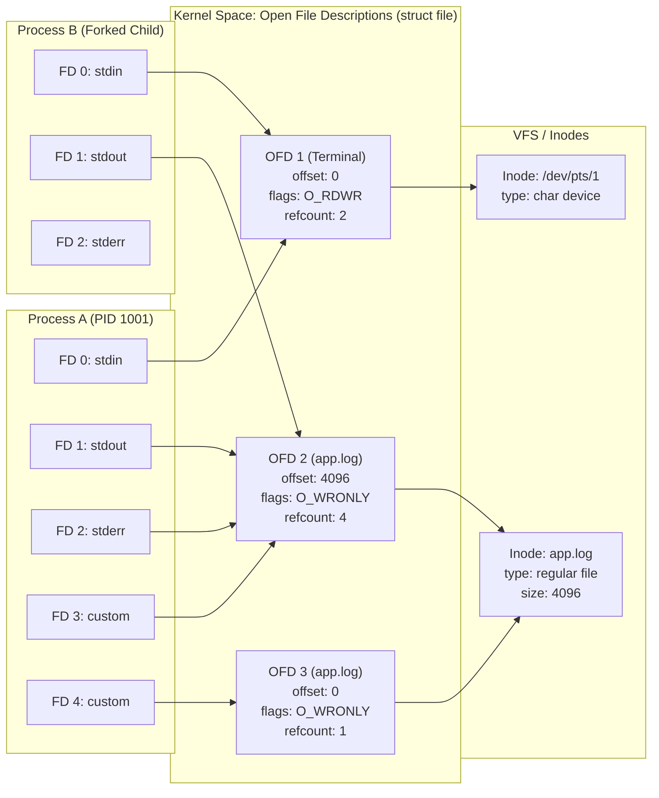

# File Descriptors and Open File Descriptions

> [!summary] Claim
> A Unix file descriptor is merely a process-private integer index into a kernel table of pointers, while the file offset, status flags, and access mode live inside a system-wide open file description that can be shared across descriptors and processes.

Part of [The Unix Process Model](README.md) in [Shell and Unix Engineering](../README.md).

## TL;DR

- Mechanism: A file descriptor indexes a per-process pointer array; each pointer references an open file description holding offset and status flags, which in turn points to an underlying filesystem inode.
- Rule: Duplicating a descriptor with `dup2()` or `>&` aliases the existing open file description, sharing offset and flags, whereas calling `open()` allocates an entirely new open file description with its own offset starting at zero.
- Trap: Writing `cmd 1> file 2> file` opens the file twice independently at offset zero, causing standard error to clobber standard output in place; the correct pattern is `cmd > file 2>&1`.
- Portability fact: Portable POSIX shell scripts must confine numeric descriptor literals to single digits 0 through 9; multi-digit prefixes such as `10> file` are parsed as descriptors in Bash, BusyBox ash, and Yash, but in Dash, Ksh93, Mksh, Posh, and Zsh the `10` is an ordinary word (a command argument, or a syntax error after a compound command); POSIX.1-2024 XCU 2.7 guarantees only 0 to 9 and leaves larger numbers implementation-defined.
- When not to use it: Use high-level language file handles with automatic RAII reclamation when managing non-trivial descriptor lifecycles, complex locking schemes, or non-blocking event loops across threads.

## Mental model



In this three-tier architecture, file descriptors are private integer slots inside a process table (`A_FD` and `B_FD`), each containing descriptor flags such as `FD_CLOEXEC` and a pointer to an Open File Description (`struct file` in Linux).
Multiple descriptors within the same process (`A_FD1` and `A_FD2` created via `2>&1`), as well as descriptors inherited across `fork()` (`B_FD1`), point to the exact same Open File Description (`OFD_LOG1`).
Because the read-write offset (`f_pos`) and file status flags (`f_flags`) reside inside `OFD_LOG1`, writes via `A_FD1`, `A_FD2`, and `B_FD1` advance the identical offset sequentially without overwriting each other.
Conversely, when a process calls `open()` a second time on the same path, the kernel allocates an independent Open File Description (`OFD_LOG2`) with its own separate offset starting at zero, even though both descriptions resolve to the same underlying disk inode (`INODE_LOG`).

## How it works

The Unix I/O model splits file identity and access state into three distinct architectural layers:

1. The Per-Process File Descriptor Table:
In the Linux kernel, every `task_struct` contains a pointer to `struct files_struct` (`include/linux/fdtable.h`).
This structure maintains an array of pointers to `struct file`, indexed by the integer file descriptor number.
The descriptor table entry stores only two things: the pointer to the Open File Description and the per-descriptor flags (in Linux the close-on-exec flag lives in a parallel `close_on_exec` bitmap inside `struct fdtable`, and `task_struct` reaches the table through its `files` member).
Under POSIX.1-2024 Base Definitions (XBD 3.141), a newly-created file descriptor is a non-negative integer from 0 to `{OPEN_MAX}-1`.
The only file descriptor flags defined by POSIX are `FD_CLOEXEC` and `FD_CLOFORK` (POSIX.1-2024 `<fcntl.h>`).
Per-descriptor flags are private to that single slot in that specific process table; duplicating a descriptor does not copy `FD_CLOEXEC` unless explicitly requested via `dup3(..., O_CLOEXEC)` or `fcntl(F_DUPFD_CLOEXEC)`.

2. The System-Wide Open File Description (OFD):
Represented in Linux as `struct file` (`include/linux/fs.h`), an Open File Description represents an active file session.
POSIX.1-2024 Base Definitions (XBD 3.241) specifies that the file offset, file status flags, and file access modes are attributes of the open file description, not the file descriptor.
The OFD contains:
- `f_pos`: The byte offset where the next I/O operation begins (POSIX.1-2024 XBD 3.148).
- `f_flags`: File status flags including `O_APPEND`, `O_NONBLOCK`, `O_ASYNC`, and `O_SYNC` (`O_APPEND`, `O_NONBLOCK`, and `O_SYNC` are in POSIX.1-2024 `<fcntl.h>`; `O_ASYNC` is a Linux and BSD extension that POSIX does not define).
- `f_mode`: File access mode (`FMODE_READ`, `FMODE_WRITE`, `FMODE_LSEEK`).
- `f_ref`: A reference counter (`file_ref_t`, read through `file_count()`) tracking how many descriptor slots across all processes, plus in-kernel users, reference this description; older kernels named it `f_count` and typed it `atomic_long_t` (current mainline `include/linux/fs.h`, as of 2026-10).
- `f_op`: The dispatch vector of file operations (`read`, `write`, `poll`, `llseek`).
- OFD Record Locks: POSIX.1-2024 standardized Open File Description locks (`F_OFD_SETLK`, `F_OFD_SETLKW`, `F_OFD_GETLK`, XBD 3.237), which associate advisory locks with the OFD itself rather than the process PID.

3. The Underlying Filesystem Inode:
Represented in Linux as `struct inode` (`include/linux/fs.h`).
The inode tracks persistent file metadata: file type (regular file, directory, socket, FIFO), permissions mode (`i_mode`), size in bytes (`i_size`), link count (`i_nlink`), disk block pointers, and traditional process-owned record locks (reached through `i_flctx`, a `struct file_lock_context`, in current kernels; the older `i_flock` list is gone).

### System Calls and State Transitions

- `open(const char *path, int flags, ...)`:
The kernel allocates an unused file descriptor slot in the process table using the lowest-available-integer rule (`alloc_fd()` in Linux `fs/file.c`, reached through `get_unused_fd_flags()` and bounded by `RLIMIT_NOFILE`).
It then allocates a new Open File Description (`alloc_empty_file()` in Linux `fs/file_table.c`), sets `f_pos = 0`, sets `f_flags = flags`, takes a reference on the opened path (dentry and mount) that pins the inode, and links the descriptor entry to the new description.
Opening the same file path five times produces five independent Open File Descriptions, each starting with its own offset at zero.

- `dup(int oldfd)` and `dup2(int oldfd, int newfd)`:
The kernel looks up the Open File Description referenced by `oldfd`.
If `oldfd` is invalid, the call fails with `EBADF` (POSIX.1-2024 XSH `dup`).
If `oldfd == newfd` and `oldfd` is valid, `dup2()` returns `newfd` immediately without closing it.
Otherwise, `dup2()` closes `newfd` if it was already open, points `newfd` in the descriptor table to the identical `struct file` as `oldfd`, increments the description's reference counter (`get_file()`), and clears `FD_CLOEXEC` on `newfd`.
Both descriptors now share the identical file offset and status flags.

- `fork()`:
During process duplication (`copy_process()` in Linux `kernel/fork.c`), the child process receives a copy of the parent's descriptor table (`dup_fd()`).
Descriptors marked with `FD_CLOFORK` are closed during the fork (POSIX.1-2024 XSH `fork`); Linux mainline does not implement `FD_CLOFORK` (no such flag in `fs/file.c` or `include/linux/fdtable.h`, as of 2026-10), so on Linux every descriptor is inherited.
For all remaining descriptors, the child's descriptor array entries are initialized with the parent's `struct file` pointers (`copy_files()` calling `dup_fd()`), and each description's reference count (`f_ref`) is incremented.
Consequently, parent and child share file offsets: data written by the parent advances the offset seen by the child, and vice-versa.

- `close(int fd)`:
The kernel clears the slot `fd` in the calling process's descriptor table, making that integer available for subsequent allocations.
It then decrements the reference count (`f_ref`) on the referenced Open File Description (`fput()` in Linux `fs/file_table.c`).
Only when the count drops to zero does the kernel invoke `__fput()`, which removes the description's OFD, `flock()`, and lease locks (`locks_remove_file()` in `fs/locks.c`), invokes the driver `->release` method, and frees the description structure (Linux `fs/file_table.c`).
The driver `->flush` method is not part of `__fput()`: `close()` calls it on every descriptor close, together with POSIX record-lock removal, through `filp_flush()` before dropping the reference (Linux `fs/open.c`).

- `lseek(int fd, off_t offset, int whence)`:
Modifies the `f_pos` field inside the referenced Open File Description.
Because `f_pos` is stored in the OFD, seeking on `fd` instantly moves the read-write head for all descriptors sharing that OFD across all threads and processes.

- `O_APPEND` and Write Atomicity:
When `O_APPEND` is set on an Open File Description, the kernel modifies the write path.
In Linux, `vfs_write()` dispatches to the filesystem's `write_iter` method; there (for example `generic_file_write_iter()` in `mm/filemap.c`), before executing the write, the kernel acquires the inode lock (`inode_lock(inode)`, the `i_rwsem` semaphore) and `generic_write_checks()` sets the write position to the current inode size (`i_size_read(inode)`) when `IOCB_APPEND` is set (`fs/read_write.c`).
This ensures that writes through different Open File Descriptions append atomically to the actual end of the file rather than overwriting each other.

### Shell Implementation of Redirection

In Unix shells, redirections are evaluated strictly from left to right (POSIX.1-2024 XCU 2.7).
In GNU Bash, the redirection pipeline is implemented in `redir.c` through `do_redirections()` and `do_redirection_internal()` (GNU Bash 5.3 `redir.c`).
When Bash encounters `> file 2>&1`:
1. It opens `file` via `open("file", O_WRONLY | O_CREAT | O_TRUNC, 0666)`.
2. It assigns that descriptor to file descriptor 1 via `dup2()`.
3. It encounters `2>&1`, parsed as instruction `r_duplicating_output` (`command.h`).
4. It calls `dup2(1, 2)`, duplicating descriptor 1 onto descriptor 2.
Descriptor 1 and descriptor 2 now point to the same Open File Description.

In Dash (`src/redir.c`), when built-in commands or block redirections require saving standard descriptors, Dash calls `savefd()` (Debian Dash `src/redir.c`).
`savefd()` duplicates the active descriptor to an unused index $\ge 10$ using `fcntl(from, F_DUPFD_CLOEXEC, 10)` where available, or `fcntl(from, F_DUPFD, 10)` followed by `fcntl(newfd, F_SETFD, FD_CLOEXEC)` otherwise, to prevent descriptor leakage into child commands.
Once the command completes, Dash restores the original descriptors using `dup2()` and closes the temporary high descriptors via `popredir()`.

Kernel inspection of Open File Descriptions is available on Linux through `/proc/[pid]/fdinfo/[fd]` (`fs/proc/fd.c`, man 5 proc).
Reading `/proc/$$/fdinfo/1` exposes the live Open File Description state:
- `pos`: Current decimal file offset.
- `flags`: Octal representation of `f_flags` (such as `0100002` for `O_RDWR | O_LARGEFILE` on x86-64; arm64 encodes `O_LARGEFILE` as `0400000`, so the same open shows `0400002`, observed in the Debian aarch64 container, 2026-10).
- `mnt_id`: VFS mount identifier.
- `ino`: Inode number on the underlying storage filesystem.

## Numbers and limits

| Limit / Metric | Value | Scope | Source / Verification |
|---|---|---|---|
| `_POSIX_OPEN_MAX` | 20 | POSIX minimum per-process limit (one more than the largest descriptor the system may assign) | POSIX.1-2024 XBD `<limits.h>` |
| Standard stream integers | 0 (`stdin`), 1 (`stdout`), 2 (`stderr`) | Process table convention | POSIX.1-2024 XBD 3.141 |
| Portable shell redirection range | 0 to 9 | Shell syntax parsing; larger numbers are implementation-defined | POSIX.1-2024 XCU 2.7 (background in XRAT C.2.7) |
| Multi-digit descriptor redirection (`10>`) | Supported | Bash (3.2 to 5.3), BusyBox ash 1.37.0, Yash 2.58.1 | Lab and direct `docker run` checks across shell matrix (as of 2026-10) |
| Multi-digit descriptor rejection (`10>`) | `10` is a word (syntax error after a compound command) | Dash, Ksh93, Mksh, Posh, Zsh | Lab and direct `docker run` checks across shell matrix (as of 2026-10) |
| Combined redirection shorthand (`&>`) | Supported | Bash, Mksh, Zsh (also in sh emulation), Ksh93u+m 1.0+ (except under `-o posix`), BusyBox ash with `CONFIG_ASH_BASH_COMPAT` | `ksh93u+m` NEWS (2020-09-01 entry), BusyBox `shell/ash.c` `BASH_REDIR_OUTPUT`, lab verified (as of 2026-10) |
| Combined redirection background trap (`&>`) | Background `&` fork | Dash, Posh, Yash, AT&T Ksh93u+ 2012-08-01 | Lab verified across shell matrix (as of 2026-10) |
| Default `RLIMIT_NOFILE` limits | 1024 soft, 4096 hard | Kernel initial per-process ceiling | Linux `include/uapi/linux/fs.h` `INR_OPEN_CUR` and `INR_OPEN_MAX` (as of 2026-10) |
| Systemd service descriptor limit | 1024 soft, 524288 hard (`DefaultLimitNOFILE=1024:524288`) | Default service environment | `systemd-system.conf(5)` and `systemd.exec(5)` (as of 2026-10) |
| Modern Linux `nr_open` ceiling | 1048576 (kernel default; hosts may raise it, 1073741816 observed in the OrbStack Linux VM) | Per-process hard limit ceiling | Linux `fs/file.c` `sysctl_nr_open = 1024*1024`, `/proc/sys/fs/nr_open` (as of 2026-10) |
| Linux initial descriptor array | `NR_OPEN_DEFAULT` = `BITS_PER_LONG` (64 on 64-bit, 32 on 32-bit) | Static `fd_array` in `files_struct` | Linux `include/linux/fdtable.h` (as of 2026-10) |
| System-wide descriptor maximum | About one file per 10 KiB of RAM (kernel budgets about 1 KiB per file and at most 10% of memory); often raised to `LONG_MAX` by userspace | Global kernel limit | Linux `fs/file_table.c` `files_maxfiles_init()`, `/proc/sys/fs/file-max` (as of 2026-10) |
| macOS `kern.maxfiles` | 276480 | macOS system-wide ceiling | `sysctl kern.maxfiles` (tested on host, Darwin 27.2.0, 2026-10) |
| macOS `kern.maxfilesperproc` | 138240 | macOS per-process ceiling | `sysctl kern.maxfilesperproc` (tested on host, Darwin 27.2.0, 2026-10) |
| Bash internal redirection base | 10 | Shell descriptor reservation | GNU Bash `redir.c` `SHELL_FD_BASE` / verified by lab |
| Ksh93 dynamic descriptor base | 10 (Zsh: 11 observed) | Variable-assigned descriptors | `exec {v}>file` printed 10 in ksh93u+ 2012-08-01 and 93u+m 1.0.10, 11 in Zsh 5.9 (direct check, 2026-10) |

## Portability

| Shell / Environment | Multi-digit redirection (`10> file`) | Dynamic allocation (`{var}> file`) | Combined redirection (`&> file`) | Descriptor closing (`n>&-`) | In-place read/write (`3<> file`) | OFD Inspection Tool |
|---|---|---|---|---|---|---|
| POSIX.1-2024 sh | Implementation-defined above 9 (XCU 2.7 requires 0 to 9) | Optional, implementation-defined (`{location}>`, XCU 2.7) | Non-standard | Supported (XCU 2.7.6) | Supported (XCU 2.7.7) | Unspecified (`fstat`/`lsof`) |
| macOS Bash 3.2 | Supported | Not supported (added in 4.1, bash NEWS) | Supported | Supported | Supported | `lsof -p <pid>` |
| Current Bash (5.3) | Supported | Supported (allocates $\ge 10$) | Supported | Supported | Supported | `/proc/<pid>/fdinfo/` |
| Zsh (native) | Not parsed (`10` is a word; parse error after a compound command) | Supported (allocates $\ge 10$) | Supported | Supported | Supported | `/proc/<pid>/fdinfo/` or `lsof` |
| Zsh (`--emulate sh`) | Not parsed (`10` is a word; parse error after a compound command) | Not supported (disabled in sh emulation; `{v}` is a command word) | Supported | Supported | Supported | `/proc/<pid>/fdinfo/` or `lsof` |
| Dash | Not parsed (`10` is a word; syntax error after a compound command) | Not supported (`{v}` is a command word) | Background trap (parses `&`) | Supported | Supported | `/proc/<pid>/fdinfo/` |
| Ksh93 | Not parsed (`10` is a word; syntax error after a compound command) | Supported (allocates $\ge 10$) | Version-dependent (`&` trap in 93u+ outside profile scripts; supported in 93u+m 1.0+ except under `-o posix`) | Supported | Supported | `/proc/<pid>/fdinfo/` |
| Mksh | Not parsed (`10` is a word; syntax error after a compound command) | Not supported (`{v}` is a command word) | Supported | Supported | Supported | `/proc/<pid>/fdinfo/` |
| Yash | Supported | Not supported (`{v}` is a command word) | Background trap (parses `&`) | Supported | Supported | `/proc/<pid>/fdinfo/` |
| Posh | Not parsed (`10` is a word; syntax error after a compound command) | Not supported (`{v}` is a command word) | Background trap (parses `&`) | Supported | Supported | `/proc/<pid>/fdinfo/` |
| BusyBox ash | Supported | Not supported (`{v}` is a command word) | Config-dependent (`CONFIG_ASH_BASH_COMPAT`, enabled in the Alpine and Debian 1.37.0 builds) | Supported | Supported | BusyBox `lsof` or `/proc` |

## Worked example

The test suite in the accompanying [lab](../labs/01-file-descriptors-and-open-file-descriptions/) demonstrates the fundamental difference between duplicated descriptors sharing an Open File Description and independent opens on the same file.

Here is an excerpt of `labs/01-file-descriptors-and-open-file-descriptions/fd_experiments.sh` (the full script also has the `order-stdout-stderr`, `order-stderr-stdout`, and `subshell-sharing` actions):

```sh
#!/bin/sh
set -eu

action=$1
target=$2

case "$action" in
  shared-dup)
    # Duplicating an fd creates a new descriptor pointing to the same OFD.
    # Writes to fd 3 and fd 4 advance the same offset sequentially.
    exec 3>"$target"
    exec 4>&3
    printf 'AAAAA' >&3
    printf 'BB' >&4
    exec 3>&-
    exec 4>&-
    ;;

  independent-open)
    # Two separate opens allocate two distinct Open File Descriptions.
    # Each starts with an independent file offset of 0.
    exec 3>"$target"
    exec 4>"$target"
    printf 'AAAAA' >&3
    printf 'BB' >&4
    exec 3>&-
    exec 4>&-
    ;;

  append-open)
    # Two separate opens, but with O_APPEND (>>).
    # The kernel positions the offset to end-of-file atomically before each write.
    exec 3>>"$target"
    exec 4>>"$target"
    printf 'AAAAA' >&3
    printf 'BB' >&4
    exec 3>&-
    exec 4>&-
    ;;

  read-write-inplace)
    # Open for read-write without truncation via <>.
    exec 3<>"$target"
    dd bs=1 count=4 <&3 >/dev/null 2>&1
    printf 'XX' >&3
    exec 3>&-
    ;;
esac
```

When executing these actions, the lab produces distinct file contents:

```text
$ ./fd_experiments.sh shared-dup /tmp/test1.txt
$ cat /tmp/test1.txt
AAAAABB

$ ./fd_experiments.sh independent-open /tmp/test2.txt
$ cat /tmp/test2.txt
BBAAA

$ ./fd_experiments.sh append-open /tmp/test3.txt
$ cat /tmp/test3.txt
AAAAABB

$ printf '0123456789' > /tmp/test4.txt
$ ./fd_experiments.sh read-write-inplace /tmp/test4.txt
$ cat /tmp/test4.txt
0123XX6789
```

In `shared-dup`, descriptor 4 is created via `exec 4>&3` (`dup2`), pointing to the same Open File Description as descriptor 3.
The write of `AAAAA` advances `f_pos` to 5; the write of `BB` via descriptor 4 continues from offset 5, producing `AAAAABB`.
In `independent-open`, descriptor 4 is opened independently via `exec 4>"$target"`.
The write of `AAAAA` advances description 1's offset to 5; descriptor 4's description retains `f_pos = 0`.
The write of `BB` via descriptor 4 begins at offset 0, overwriting the first two bytes to yield `BBAAA`.

## Pitfalls

> [!warning] The Independent Open Offset Clobber
> Trigger: Redirecting both stdout and stderr using separate file creation operators: `cmd 1> app.log 2> app.log`.
> Symptom: Stderr lines overwrite stdout lines at the start of `app.log`, producing scrambled or truncated log outputs.
> Fix: Always use descriptor duplication `cmd > app.log 2>&1` so both streams share a single Open File Description and offset, or use append mode `cmd >> app.log 2>> app.log`.

> [!warning] The `&>` Background Operator Trap in POSIX Shells
> Trigger: Running a script containing the non-standard extension `cmd &> output.log` under Dash, Posh, Yash, historic AT&T Ksh93 (such as 93u+ 2012-08-01, which honored `&>` only in profile scripts), Ksh93u+m under `-o posix` or invoked as `sh`, or BusyBox ash built without `CONFIG_ASH_BASH_COMPAT`.
> Symptom: The shell treats `&` as a command separator that sends `cmd` into the background, and parses `> output.log` as redirecting an empty command, leaving `output.log` empty while `cmd` runs asynchronously in the terminal.
> Fix: Write strictly portable descriptor duplication: `cmd > output.log 2>&1`.
> Note that while modern Ksh93u+m (1.0+) and Mksh implement `&>` as a documented extension matching Bash and Zsh, POSIX.1-2024 does not standardize it.

> [!warning] Reversed Redirection Ordering (`2>&1 > file`)
> Trigger: Placing descriptor duplication before output redirection: `cmd 2>&1 > file.log`.
> Symptom: File descriptor 2 is duplicated from descriptor 1 before descriptor 1 is redirected to `file.log`; stderr continues printing to the terminal, and only stdout is captured in `file.log`.
> Fix: Remember that redirections evaluate strictly left to right: write `cmd > file.log 2>&1`.

> [!warning] Multi-Digit Descriptor Parse Failure
> Trigger: Writing numeric descriptor redirections greater than 9, such as `exec 10> file.log`, in Dash, Ksh93, Mksh, Posh, Zsh, or strict POSIX `sh`.
> Symptom: In a simple command such as `exec 10> file.log`, all five shells treat `10` as an ordinary word, so `exec` tries to run a command named `10` (`10: not found`) while `> file.log` redirects standard output; after a compound command such as `{ ...; } 10> file.log` they fail to parse (Dash `Syntax error: word unexpected`, Posh and Ksh93 `syntax error: '10' unexpected`, Mksh `syntax error: unexpected '10'`, Zsh `parse error near '10'`), even though Bash, BusyBox ash, and Yash parse multi-digit descriptors (direct `docker run` checks, 2026-10).
> Fix: Confine explicit descriptors in portable scripts to the single-digit range 3 through 9, or use `{var}> file` in shells supporting dynamic allocation (Bash 4.1+, Ksh93, and native Zsh).

> [!warning] Vacant Standard Descriptors in Privileged Executables
> Trigger: Executing a SetUID executable or daemon when descriptor 0, 1, or 2 has been closed by the parent process.
> Symptom: The next file opened by the application is allocated descriptor 0, 1, or 2; subsequent calls to `printf()` or logging macros write raw data into sensitive files or sockets.
> Fix: Some platforms fill vacant standard streams for set-ID programs: the FreeBSD kernel calls `fdcheckstd()` in `execve()` (`sys/kern/kern_exec.c`), and on Linux it is glibc, not the kernel, whose `__libc_check_standard_fds()` (`csu/check_fds.c`) opens `/dev/full` on a vacant descriptor 0 and `/dev/null` on vacant descriptors 1 and 2 for secure-mode programs; application runtimes must still verify that descriptors 0, 1, and 2 are open (for example to `/dev/null`) upon initialization before opening any files.

> [!warning] POSIX Record Lock Invalidation on Duplicate Descriptor Close
> Trigger: Using traditional POSIX record locks (`fcntl(F_SETLK)`) on a file while another thread or library opens and closes a separate descriptor to that same file.
> Symptom: Closing ANY file descriptor referencing that file in the calling process immediately releases ALL POSIX record locks held on that file by that process, silently violating concurrency guarantees.
> Fix: Migrate to Open File Description locks (`fcntl(F_OFD_SETLK)`, POSIX.1-2024 XBD 3.237), whose lifetime is bound to the Open File Description rather than the `(PID, inode)` pair.

## Security and robustness

File descriptors are fundamental security boundaries.
Improper handling of descriptor tables and open file descriptions is a recurring source of critical privilege escalation and container escapes:

1. Descriptor Leaks Across Namespace Boundaries (CVE-2024-21626):
In CVE-2024-21626 (the "Leaky Vessels" runc vulnerability, affecting runc 1.1.11 and earlier and fixed in runc 1.1.12 per NVD), internal file descriptors, including a handle to the host's `/sys/fs/cgroup`, were leaked into `runc init` during container initialization (runc advisory GHSA-xr7r-f8xq-vfvv).
Because the descriptors remained open across `execve()` into the container process, an attacker could specify `/proc/self/fd/<n>` as the working directory (`process.cwd`).
The kernel followed the open file description directly into the host VFS, completely bypassing the container's mount namespace and root filesystem isolation.
Robust systems enforce `O_CLOEXEC` atomically on all descriptor creation calls (`openat()`, `pipe2()`, `accept4()`, `socket()`) to prevent descriptor leakage.

2. Descriptor Exhaustion and Denial of Service:
When a process leaks file descriptors, it eventually hits its `RLIMIT_NOFILE` soft limit, causing subsequent `open()`, `pipe()`, or `socket()` calls to fail with `EMFILE`.
In network servers, running out of descriptors prevents the event loop from accepting new connections; because the listening socket remains readable, the server can spin in a 100% CPU busy-wait loop unless `EMFILE` is explicitly handled (libev documentation, "The special problem of accept()ing when you can't").
If system-wide limits (`/proc/sys/fs/file-max`) are reached, all processes fail with `ENFILE`, destabilizing the host.

3. The Unlinked Open File Pattern:
When an application opens a temporary file with `open(..., O_CREAT | O_RDWR)` and immediately invokes `unlink(path)`, the directory entry is removed from the filesystem namespace.
However, because the Open File Description holds a reference to the underlying inode, the file remains fully functional for reading and writing through its descriptor.
The inode and data blocks are reclaimed by the kernel only when the last descriptor referencing that Open File Description is closed.
This idiom guarantees automatic cleanup on process termination or abnormal exit, but prevents external monitoring tools from tracking disk usage via directory walks.

## The principal's view

To a principal engineer, file descriptors and open file descriptions represent the core abstraction through which Unix models resource access, process composition, and isolation.
Every shell pipeline is an orchestration of kernel table manipulations: `pipe()`, `fork()`, `dup2()`, and `close()`.

Key architectural principles:
- Understand state residency: Always distinguish what lives in the process (`int fd`, `FD_CLOEXEC`), what lives in kernel memory (`struct file`, `f_pos`, `f_flags`, `refcount`), and what lives on disk (`struct inode`, `i_size`, permissions).
- Prefer explicit streams over global side effects: Design tools that read from standard input and write to standard output; let the calling environment handle file attachment and descriptor plumbing.
- Enforce atomicity at creation: Never rely on calling `fcntl(fd, F_SETFD, FD_CLOEXEC)` after `open()`; in multi-threaded runtimes, a concurrent `fork()` can leak the unflagged descriptor into child processes before `fcntl()` executes.
- Avoid non-portable redirection syntax in scripts: Constructs like `&>` and `10>` exhibit silent semantic splits across the shell matrix; `&>` forks a background process in Dash, Yash, and historic Ksh93 while redirecting in Bash and Ksh93u+m, and `10>` is not parsed as a descriptor by Dash and Ksh93 (the `10` becomes a word) despite succeeding in Bash, BusyBox ash, and Yash.
- Move beyond shell for descriptor management: When an application requires non-blocking event loops, pool multiplexing, descriptor passing over Unix domain sockets via `SCM_RIGHTS`, or complex lock coordination via `F_OFD_SETLK`, migrate to C, Rust, or Go where descriptor ownership can be governed by RAII types and strict compiler-verified lifetime guarantees.

## Interview questions

> [!question] L5: What is the fundamental difference between a File Descriptor and an Open File Description?
>
> > [!success]- Answer
> > A file descriptor is an integer indexing a private array in a single process table.
> > An open file description is an allocated kernel object containing the file offset, status flags, and access mode.
> > Multiple file descriptors within one process or across multiple processes can reference the same open file description.
> > The underlying inode contains the file metadata and data blocks on disk.
> >
> > Follow-up: Which flags are stored in the descriptor table versus the open file description?

> [!question] L5: Predict the output: Given `exec 3> out.txt; exec 4> out.txt; printf "HELLO" >&3; printf "AB" >&4; exec 3>&-; exec 4>&-`, what does `out.txt` contain?
>
> > [!success]- Answer
> > The file contains `ABLLO`.
> > Opening `out.txt` twice creates two separate Open File Descriptions, each initialized with file offset zero.
> > Writing `HELLO` to descriptor 3 advances description 1's offset to 5.
> > Writing `AB` to descriptor 4 writes from description 2's offset zero, overwriting the first two bytes in place.
> >
> > Follow-up: How would the output change if descriptor 4 were created via `exec 4>&3`?

> [!question] L6: Trace the exact system calls executed by the shell for `cmd > file.log 2>&1` versus `cmd 2>&1 > file.log`.
>
> > [!success]- Answer
> > Redirections evaluate strictly left-to-right.
> > For `> file.log 2>&1`, the shell calls `open("file.log", O_WRONLY|O_CREAT|O_TRUNC)`, calls `dup2(opened_fd, 1)`, and then calls `dup2(1, 2)`.
> > Descriptors 1 and 2 now reference the same open file description for `file.log`.
> > For `2>&1 > file.log`, the shell calls `dup2(1, 2)` first, binding descriptor 2 to the existing stdout description (usually the terminal).
> > The shell then opens `file.log` and calls `dup2(opened_fd, 1)`, redirecting descriptor 1 only.
> >
> > Follow-up: What system calls does the shell execute to restore standard streams after running an internal built-in command?

> [!question] L6: Debug this script - why does a cron job running `mysqldump db > db.sql 2> db.sql` intermittently corrupt database backups in production?
>
> > [!success]- Answer
> > The script opens `db.sql` twice independently at offset zero without `O_APPEND`.
> > When `mysqldump` emits a warning or error to standard error while simultaneously streaming data to standard output, the two write streams race.
> > Standard error writes from its own offset zero, overwriting critical SQL dump headers and table definitions.
> > The fix is to duplicate the descriptor so both streams share a single offset: `mysqldump db > db.sql 2>&1`.
> >
> > Follow-up: Would changing the redirections to `>> db.sql 2>> db.sql` resolve the issue, and what are the trade-offs?

> [!question] L6: Why did POSIX.1-2024 standardize Open File Description (OFD) locks?
>
> > [!success]- Answer
> > Traditional POSIX record locks created via `fcntl(F_SETLK)` are owned by the `(PID, inode)` pair.
> > Under classic record locks, closing any file descriptor to that file in the process immediately releases all locks held on that file by that process.
> > If a library function opens, reads, and closes a file, it silently invalidates locks held by other threads on that same file.
> > OFD locks created via `fcntl(F_OFD_SETLK)` are owned by the Open File Description and remain intact until the description itself is closed.
> >
> > Follow-up: Are OFD locks inherited across `fork()`?

> [!question] L7: Explain how CVE-2024-21626 allowed container escapes in runc through file descriptor mismanagement.
>
> > [!success]- Answer
> > During container startup, runc leaked internal file descriptors into `runc init` without ensuring they were closed before executing the container payload.
> > The spawned container process inherited them, including a handle to the host's `/sys/fs/cgroup` directory (runc advisory GHSA-xr7r-f8xq-vfvv).
> > An attacker could configure the container's working directory (`process.cwd`) to `/proc/self/fd/<n>`.
> > The kernel resolved the target directory through the leaked Open File Description, allowing the process to step outside the container's rootfs.
> >
> > Follow-up: Why didn't Linux mount namespaces protect against this escape?

> [!question] L7: How does `O_APPEND` achieve atomic append writes in the kernel across multiple processes, and when can this guarantee fail?
>
> > [!success]- Answer
> > On local filesystems, the filesystem's `write_iter` method that `vfs_write()` dispatches to (for example `generic_file_write_iter()`) acquires the inode read-write semaphore (`i_rwsem`) before `generic_write_checks()` evaluates the file offset.
> > When `O_APPEND` is set, the kernel updates `f_pos` to the current inode size inside the locked critical section before writing.
> > This serializes writes and guarantees that each write appends to the true end of the file.
> > This guarantee can fail on NFS: concurrent appenders may corrupt the file because the NFS protocol has no append operation, so the client kernel has to simulate it, which cannot be done without a race condition (Linux `open(2)`, `O_APPEND`).
> >
> > Follow-up: Does `O_APPEND` guarantee write atomicity if the write payload exceeds `PIPE_BUF` on a regular file?

> [!question] L7: What happens when an unprivileged user executes a SetUID root binary while standard input (descriptor 0) is closed?
>
> > [!success]- Answer
> > The kernel allocates file descriptors using the lowest available integer rule.
> > If descriptor 0 is closed, the very first file opened by the SetUID program will be assigned descriptor 0.
> > If the program subsequently invokes a library function that reads user input from standard input, it will inadvertently read from the newly opened file.
> > Some platforms mitigate this when elevating privileges: the FreeBSD kernel fills closed descriptors 0, 1, and 2 during `execve()` (`fdcheckstd()`), while on Linux the kernel does not and glibc's startup code (`__libc_check_standard_fds()`) opens `/dev/full` or `/dev/null` on them for secure-mode programs.
> >
> > Follow-up: How should a daemon safely initialize standard streams after `fork()` if it intends to run without a controlling terminal?

## Related

Prerequisites: [[Program-Startup-argv-envp-and-ARG_MAX]]

Next: [[Close-on-Exec-and-Descriptor-Inheritance]]

See also: [[Processes-fork-exec-and-wait]], [[Posix-Spawn-and-Vfork]], [[Pipes-and-FIFOs]], [[PIPE_BUF-and-Write-Atomicity]], [[The-proc-Filesystem]], [[dev-fd-and-dev-stdin]], [[Resource-Limits-and-ulimit]]

## Further reading

- [POSIX.1-2024 Base Definitions Chapter 3: Definitions](https://pubs.opengroup.org/onlinepubs/9799919799/basedefs/V1_chap03.html#tag_03_141) - Authoritative definitions for File Descriptor (3.141), File Offset (3.148), OFD-Owned File Lock (3.237), and Open File Description (3.241).
- [POSIX.1-2024 Shell Command Language Chapter 2: Redirection](https://pubs.opengroup.org/onlinepubs/9799919799/utilities/V3_chap02.html#tag_19_07) - Formal specification of input, output, append, and descriptor duplication operators.
- [POSIX.1-2024 Rationale Section C.2.7: Redirection](https://pubs.opengroup.org/onlinepubs/9799919799/xrat/V4_xcu_chap01.html#tag_23_02_07) - Historical background explaining single-digit limits and parsing ambiguities (the `echo 22>/dev/null` portability problem and the optional `{fdvar}>` form); the normative 0 to 9 guarantee is in XCU 2.7.
- [Linux Kernel source: include/linux/fdtable.h](https://git.kernel.org/pub/scm/linux/kernel/git/torvalds/linux.git/tree/include/linux/fdtable.h) - Kernel implementation of `struct files_struct` and `struct fdtable`.
- [Linux Kernel source: include/linux/fs.h](https://git.kernel.org/pub/scm/linux/kernel/git/torvalds/linux.git/tree/include/linux/fs.h) - Kernel definitions of `struct file` and `struct inode`.
- [Linux man-pages: proc(5) and proc_pid_fdinfo(5)](https://man7.org/linux/man-pages/man5/proc.5.html) - Documentation of `/proc/[pid]/fdinfo/[fd]` fields and flags.
- [GNU Bash source: redir.c](https://git.savannah.gnu.org/cgit/bash.git/tree/redir.c) - Implementation of shell descriptor manipulation and undo lists.
- [Dash source: src/redir.c](https://git.kernel.org/pub/scm/utils/dash/dash.git/tree/src/redir.c) - Implementation of Almquist shell descriptor preservation via `savefd()`.
- [BusyBox source: shell/ash.c](https://git.busybox.net/busybox/tree/shell/ash.c) - Implementation of Almquist shell multi-digit descriptor redirection and `CONFIG_ASH_BASH_COMPAT`.
- [Yash documentation: Redirection](https://magicant.github.io/yash/doc/redir.html) - Formal specification of Yash multi-digit file descriptor parsing and POSIXly-correct mode constraints.
- [Ksh93u+m release notes: NEWS](https://github.com/ksh93/ksh/blob/dev/NEWS) - Documentation of `&>` combined redirection shorthand adoption in modern Ksh93u+m (2020-09-01 entry) and its `-o posix` exception.
- [NIST NVD: CVE-2024-21626](https://nvd.nist.gov/vuln/detail/CVE-2024-21626) - Vulnerability analysis of runc container escapes via leaked file descriptors.
- [SEI CERT C Coding Standard: Rule FIO22-C](https://wiki.sei.cmu.edu/confluence/display/c/FIO22-C.+Close+files+before+spawning+processes) - Secure coding rules for file descriptor lifecycle and process spawning.
