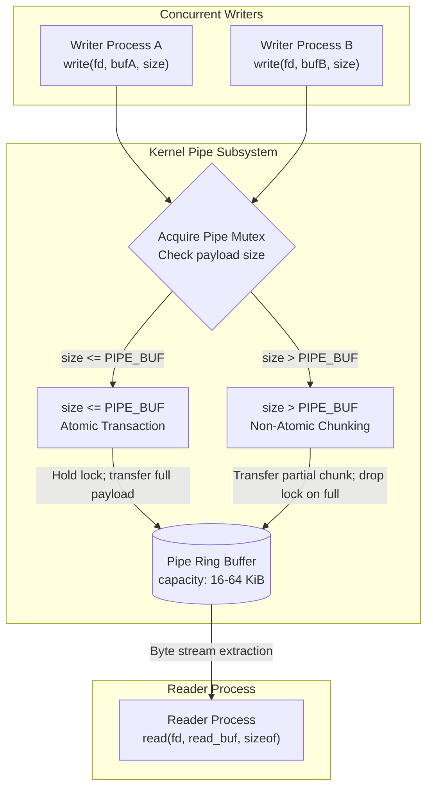

# PIPE_BUF and Write Atomicity

> [!summary] Claim
> When concurrent processes write to a pipe or FIFO, the operating system guarantees that a `write(2)` call of `{PIPE_BUF}` bytes or fewer transfers its payload as a single contiguous sequence that is never interleaved with bytes from other writers.

Part of [The Unix Process Model](README.md) in [Shell and Unix Engineering](../README.md).

## TL;DR

- Mechanism: The kernel holds an internal pipe lock across the entire transfer only when a single `write(2)` request is less than or equal to `PIPE_BUF`.
- Rule: Keep every serialized record strictly less than or equal to `PIPE_BUF` bytes (including newline delimiters) and emit each record in exactly one `write(2)` system call.
- Trap: `PIPE_BUF` guarantees write atomicity, not read atomicity; a reader receives an unstructured byte stream and can slice or merge records across `read(2)` calls.
- Portability fact: `PIPE_BUF` is 4096 bytes on Linux, but only 512 bytes on macOS, FreeBSD, NetBSD, and OpenBSD; writes between 513 and 4096 bytes can interleave on BSD and macOS.
- When not to use it: Do not use pipes when portable records exceed 512 bytes, when message boundaries must be preserved at the socket layer, or when multi-producer queues require zero-copy shared memory.

## Mental model



When concurrent writer processes invoke `write(2)` against the write descriptor of a shared pipe or FIFO, the operating system mediates access through an internal pipe mutex.
If a process submits a payload whose length is less than or equal to `PIPE_BUF`, the kernel guarantees that the entire payload is transferred contiguously into the pipe buffer without yielding the lock to any competing writer.
If the payload length exceeds `PIPE_BUF`, the kernel writes only as many bytes as will fit in the available buffer capacity, unlocks the mutex, and blocks or yields until a reader frees space; during this window, another writer can acquire the lock and append its own data, interleaving chunks on arbitrary byte boundaries before the first writer can resume.
The consuming reader subsequently extracts bytes sequentially from the FIFO ring buffer, receiving either pristine unbroken records if all writers observed the limit, or corrupt interleaved records if any writer exceeded it.

## How it works

The atomicity guarantee for pipes and FIFOs is rooted in POSIX specifications and kernel mutex lifecycles.

### POSIX Specification

POSIX.1-2024 Base Definitions Chapter 14.26 `<limits.h>` defines `{PIPE_BUF}` as the maximum number of bytes guaranteed to be atomic when writing to a pipe `(POSIX.1-2024 Base Definitions 14.26, <limits.h>)`.
POSIX requires that `{PIPE_BUF}` have a minimum acceptable value of `{_POSIX_PIPE_BUF}`, which is defined as exactly 512 bytes.
Individual implementations may define `{PIPE_BUF}` with a higher value, such as 4096 bytes on Linux.
Portable applications query this limit at runtime using `fpathconf(fd, _PC_PIPE_BUF)` or `pathconf(path, _PC_PIPE_BUF)` `(POSIX.1-2024 System Interfaces 17.173, fpathconf)`.
In shell scripts, the path-specific limit is inspected using the `getconf` utility via `getconf PIPE_BUF <path>` `(POSIX.1-2024 Shell and Utilities 20.52, getconf)`.
POSIX `getconf` also requires `_POSIX_PIPE_BUF` as a `system_var` operand: its OPERANDS section lists "the names of the symbolic constants listed under the headings Maximum Values and Minimum Values" of `<limits.h>`, and `{_POSIX_PIPE_BUF}` (value 512) sits under Minimum Values, so a conforming `getconf _POSIX_PIPE_BUF` prints 512 `(POSIX.1-2024 Shell and Utilities 20.52, getconf; Base Definitions 14.26, <limits.h>)`.
BSD (macOS) and musl (Alpine) `getconf` do this (reporting 512), but GNU C Library (glibc) before 2.43 registers `_POSIX_PIPE_BUF` under `PATHCONF` as an alias for `_PC_PIPE_BUF`, a nonconformance tracked as glibc BZ #29147 and fixed in glibc 2.43 (bug resolved 2026-02-13) [glibc BZ #29147](https://sourceware.org/bugzilla/show_bug.cgi?id=29147).
Consequently, on glibc 2.41 (Debian 13) `getconf _POSIX_PIPE_BUF` without a path argument exits 2 with a usage error (`Usage: getconf [-v specification] variable_name [pathname]`), `getconf -a` lists `_POSIX_PIPE_BUF 4096`, and `getconf _POSIX_PIPE_BUF /` evaluates `pathconf` and returns 4096 on Linux (measured in the Debian image, 2026-10).
Additionally, while POSIX pipelines (`cmd1 | cmd2`) are standardly connected using anonymous pipes created via `pipe(2)`, shells differ in implementation: `ksh93u+m 1.0.10` constructs pipelines from Unix domain stream sockets (`socketpair(AF_UNIX, SOCK_STREAM, ...)` with the unused direction shut down on each end, the `socketpipe` macro in `src/cmd/ksh93/sh/io.c` of [ksh93/ksh](https://github.com/ksh93/ksh)) rather than kernel pipes, so descriptor 1 in a pipeline stage reports `socket:[inode]` on Linux rather than `pipe:[inode]`, and writes follow stream socket buffer semantics rather than `PIPE_BUF` atomicity rules (measured in the shell matrix).

### System Call Semantics (The Four Quadrants)

POSIX.1-2024 System Interfaces Chapter 17.699 `write()` governs how the kernel behaves based on payload size `nbyte` and the file status flag `O_NONBLOCK` `(POSIX.1-2024 System Interfaces 17.699, write)`:

1. `O_NONBLOCK` clear, `nbyte <= PIPE_BUF` (Atomic Blocking):
The write is completely atomic.
If sufficient contiguous space exists in the pipe buffer, `write(2)` transfers all `nbyte` bytes immediately and returns `nbyte`.
If the pipe does not have enough free space to accommodate `nbyte` bytes, the calling thread blocks until space becomes available.
The kernel never writes a partial buffer; upon wakeup, it transfers all `nbyte` bytes contiguously without allowing any other thread to interleave bytes.

2. `O_NONBLOCK` set, `nbyte <= PIPE_BUF` (Atomic Immediate or Failure):
The write is atomic and non-blocking.
If space exists for all `nbyte` bytes, `write(2)` transfers the entire payload and returns `nbyte`.
If there is insufficient space for `nbyte` bytes, `write(2)` transfers zero bytes, returns -1, and sets `errno` to `EAGAIN` (or `EWOULDBLOCK`).
A partial write is strictly prohibited for requests of `{PIPE_BUF}` or fewer bytes.

3. `O_NONBLOCK` clear, `nbyte > PIPE_BUF` (Non-Atomic Blocking):
The write is non-atomic and blocking.
The kernel transfers bytes into the pipe buffer as capacity allows.
If the pipe buffer becomes full before all `nbyte` bytes are written, the kernel suspends the calling thread and wakes readers.
While the calling thread is blocked waiting for room, concurrent writers can acquire the pipe lock and write data.
As a result, data written by other processes may be interleaved on arbitrary byte boundaries.
The system call returns `nbyte` only after all requested bytes have eventually been transferred.

4. `O_NONBLOCK` set, `nbyte > PIPE_BUF` (Non-Atomic Immediate or Partial):
The write is non-atomic and non-blocking.
If the pipe is completely full, the kernel transfers no data, returns -1, and sets `errno` to `EAGAIN`.
If at least one byte can be written, the kernel transfers whatever space is currently available (between 1 and `nbyte` bytes) and returns the number of bytes actually written.
The transferred segment can be interleaved with data from concurrent writers.

### Linux Kernel Implementation

In the Linux kernel, pipe I/O is implemented in `fs/pipe.c` `(Linux kernel 6.6 fs/pipe.c, pipe_write)`.
Linux defines `PIPE_BUF` as 4096 bytes in `include/uapi/linux/limits.h` (installed as `<linux/limits.h>`), a fixed value that equals the 4 KiB page size of x86_64 and of the arm64 kernels in the lab matrix.
A pipe's internal storage is represented by `struct pipe_inode_info`, containing an array of `struct pipe_buffer` ring slots (`pipe->bufs`), each holding at most one page.
Each write operation acquires the pipe mutex via `__pipe_lock(pipe)`.
Linux 6.6 `pipe_write` contains no explicit `PIPE_BUF` comparison; atomicity follows from the slot layout, because `PIPE_BUF` is at most `PAGE_SIZE`.
A write first tries to merge its `total_len & (PAGE_SIZE-1)` tail bytes into the last slot, but only when the whole tail fits (`offset + chars <= PAGE_SIZE`); a write of at most one page that cannot merge whole goes entirely into an empty slot, waiting for one if the ring is full, before copying anything.
If the pipe ring is full and nothing has been copied yet, `pipe_write` writes no partial bytes: it calls `__pipe_unlock(pipe)`, sleeps in `wait_event_interruptible_exclusive(pipe->wr_wait, pipe_writable(pipe))`, and reacquires `__pipe_lock(pipe)` when a slot frees (in later kernels the function is named `anon_pipe_write`, as in mainline `fs/pipe.c` as of 2026-10).
Because `__pipe_lock(pipe)` is held continuously across the copy once space is available, no competing writer can inject data into the ring.
Conversely, a write larger than a page copies one page per free slot; once the ring fills with bytes still pending, it drops the lock via `__pipe_unlock(pipe)`, wakes readers via `wake_up_interruptible_sync_poll(&pipe->rd_wait, ...)` when the pipe was empty, and sleeps on `pipe->wr_wait`.
A concurrent writer then acquires `__pipe_lock(pipe)`, inserts its own page buffers, and produces interleaved records within `pipe->bufs`.
Running the lab's `concurrent` probe by hand on Linux 7.2 (arm64, 4 KiB pages) shows the boundary: 300 writes of 4096 bytes from each of two writers arrived with 0 torn records in 30 of 30 runs on each of the Debian and Alpine images, while 4097-byte writes tore 46 to 169 of 600 records per run across 40 runs per image (measured 2026-10).
The lab's `nonblock-atomic` probe shows the same split without timing: with no free slot and 4095 bytes of merge room in the last one, a non-blocking 4096-byte write fails with `EAGAIN` while a 4097-byte write on the same pipe merges its 1-byte tail and returns 1.

### Darwin and BSD XNU Implementation

In macOS and Darwin XNU, pipe logic is located in `bsd/kern/sys_pipe.c` `(XNU main branch as of 2026-10, bsd/kern/sys_pipe.c, pipe_write)`.
Darwin defines `PIPE_BUF` as 512 bytes in `<sys/syslimits.h>` (checked in the macOS SDK header on Darwin 27.2, and `sys_pipe.c` asserts `PIPE_BUF == pipesize_blocks[0]`).
The function `pipe_write` acquires `pipeio_lock(wpipe, 1)` and calculates available space: `space = wpipe->pipe_buffer.size - wpipe->pipe_buffer.cnt`.
XNU explicitly enforces POSIX atomicity with the following branch:
```c
/* Writes of size <= PIPE_BUF must be atomic. */
if ((space < uio_resid(uio)) && (orig_resid <= PIPE_BUF)) {
    space = 0;
}
```
If available space is less than requested and `orig_resid <= PIPE_BUF`, XNU resets `space = 0`.
This prevents partial transfers and forces the thread to wait on `wpipe` until sufficient space opens for the entire request.
If `orig_resid > PIPE_BUF`, XNU leaves `space` untouched, transfers whatever room is available via `uiomove`, drops the lock, and yields, allowing concurrent writers to interleave data.
The lab's `nonblock-atomic` probe shows both branches on Darwin 27.2: with 511 bytes free in a non-blocking pipe, a 512-byte write fails with `EAGAIN` while a 513-byte write on the same pipe returns 511.
Running the lab's `concurrent` probe by hand under blocking contention, 512-byte records never tore in 30 runs, while 513-byte records tore 3 to 13 of 600 per run (measured 2026-10).

## Numbers and limits

The following table summarizes compile-time limits, runtime properties, and buffer capacities across major Unix implementations `(as of 2026-10)`.

| Limit / Metric | Value | Scope / Standard | Mechanism / Sourcing |
|---|---|---|---|
| `_POSIX_PIPE_BUF` | 512 bytes | POSIX invariant minimum | `(POSIX.1-2024 Base Definitions 14.26, <limits.h>)` |
| `getconf _POSIX_PIPE_BUF` | 512 bytes (macOS/Alpine) / rejected (glibc before 2.43) | Shell query utility | POSIX requires 512; BSD and musl print it; glibc 2.41 exits 2 unless passed a pathname, where it returns 4096; fixed in glibc 2.43 (glibc BZ #29147) / lab |
| `getconf PIPE_BUF <path>` | 512 bytes (macOS) / 4096 bytes (Linux) | Runtime path configuration | Universal POSIX `fpathconf` query; verified by lab across Alpine, Debian, macOS |
| `PIPE_BUF` (Linux) | 4096 bytes | Linux, all architectures | `include/uapi/linux/limits.h` / Linux `pipe(7)` / lab |
| `PIPE_BUF` (macOS / Darwin) | 512 bytes | Darwin 27.2 (measured) | `<sys/syslimits.h>` / `getconf PIPE_BUF /` / lab |
| `PIPE_BUF` (FreeBSD) | 512 bytes | FreeBSD `main` (as of 2026-10) | `sys/sys/syslimits.h` in [freebsd-src](https://github.com/freebsd/freebsd-src/blob/main/sys/sys/syslimits.h) |
| `PIPE_BUF` (NetBSD / OpenBSD) | 512 bytes | NetBSD `trunk` / OpenBSD `master` (as of 2026-10) | `sys/sys/syslimits.h` in both source trees |
| `PIPE_BUF` (illumos) | 5120 bytes | illumos (as of 2026-10) | `usr/src/head/limits.h` in [illumos-gate](https://github.com/illumos/illumos-gate/blob/master/usr/src/head/limits.h) |
| Default pipe capacity (Linux) | 65536 bytes (64 KiB) | Linux 2.6.11+ | 16 pages of 4096 bytes; `fcntl(fd, F_GETPIPE_SZ)` / Linux `pipe(7)`; measured 65536 by filling a non-blocking pipe (Debian image, 2026-10) |
| Maximum unprivileged capacity (Linux) | 1048576 bytes (1 MiB) | Linux 2.6.35+ | `/proc/sys/fs/pipe-max-size` default limit / Linux `pipe(7)`; reads 1048576 in the Debian image |
| Default pipe capacity (macOS) | 16384 bytes (16 KiB) initial | Darwin XNU | `PIPE_SIZE` in `bsd/sys/pipe.h`; the buffer grows on demand (`choose_pipespace` in `sys_pipe.c`) |
| Grown pipe capacity (macOS) | 65536 bytes (64 KiB) | Darwin XNU | `BIG_PIPE_SIZE` in `bsd/sys/pipe.h`, largest `pipesize_blocks` entry (`PIPE_SIZE * 4`); filling a non-blocking pipe with 1-byte writes stops at 65536 on Darwin 27.2 (measured 2026-10) |
| Dynamic pipe limit (FreeBSD) | 65536 bytes (64 KiB) | FreeBSD dynamic sizing | `BIG_PIPE_SIZE` in `sys/sys/pipe.h`; `kern.ipc.maxpipekva` caps total pipe memory system-wide, not one pipe |
| Pipeline IPC descriptor (bash, dash, zsh, mksh, posh, BusyBox ash) | `pipe:[inode]` (Linux) | Shell pipeline stages | `readlink /proc/self/fd/1` in a pipeline stage, Debian image (measured 2026-10); conforms to `PIPE_BUF` |
| Pipeline IPC descriptor (ksh93u+m 1.0.10) | `socket:[inode]` (Linux) | Shell pipeline stages | Created via `socketpair(2)` (`socketpipe` in `src/cmd/ksh93/sh/io.c`); stream socket semantics (measured in the shell matrix) |

## Portability

The table below contrasts write atomicity semantics, buffer behavior, and utility characteristics across shells and operating systems `(as of 2026-10)`.

| Shell / Environment | `PIPE_BUF` Value | Write Syscall Behavior | FIFO `O_RDWR` Behavior | Notes and Divergences |
|---|---|---|---|---|
| POSIX sh specification | `>= 512` bytes | Atomic for `<= PIPE_BUF` | Succeeds, or fails if the implementation does not support it (`EINVAL` may be reported) `(POSIX.1-2024 System Interfaces 17.372, open)` | Sourced from `(POSIX.1-2024 System Interfaces 17.699, write)`; `getconf PIPE_BUF <path>` is the standard query, and `getconf _POSIX_PIPE_BUF` must print 512 |
| macOS `/bin/sh` (bash 3.2.57) | 512 bytes | Emits each 500-byte `printf` record in one piece under pipe-full contention (lab) | Opens without blocking (`open(fifo, O_RDWR)` and `exec 3<>fifo` measured on Darwin 27.2) | Host macOS default; `getconf _POSIX_PIPE_BUF` prints 512; verified by lab |
| Current GNU bash (5.3) | 4096 (Linux) / 512 (macOS) | Emits each 500-byte `printf` record in one piece under pipe-full contention (lab) | Host kernel dependent | glibc before 2.43 `getconf` rejects `_POSIX_PIPE_BUF` without path (BZ #29147), a `getconf` property rather than a bash one; verified by lab (bash 5.3 on macOS and Alpine, 5.2 on Debian) |
| dash (0.5.12) | 4096 (Linux) / 512 (macOS) | Emits each 500-byte `printf` record in one piece under pipe-full contention (lab) | Host kernel dependent | Debian default `sh`; verified by lab across Debian, Alpine, and macOS |
| zsh (native 5.9) | 4096 (Linux) / 512 (macOS) | Emits each 500-byte `printf` record in one piece under pipe-full contention (lab) | Host kernel dependent | Does not split unquoted parameters, so the lab splits `${AWK}` with `eval` (measured in the shell matrix); verified by lab |
| zsh (`--emulate sh`) | 4096 (Linux) / 512 (macOS) | Emits each 500-byte `printf` record in one piece under pipe-full contention (lab) | Host kernel dependent | Word splitting enabled; verified by lab |
| ksh93 (93u+ / 93u+m) | 4096 (Linux) / 512 (macOS) | Emits each 500-byte `printf` record in one piece under pipe-full contention (lab), writing to a real FIFO the lab creates | Host kernel dependent | ksh93u+m connects pipelines via sockets, not pipes (`socket:[...]`); signal status reports `256 + N` (measured in the shell matrix); verified by lab (93u+ on macOS, 93u+m 1.0.10 on Debian) |
| mksh (R59c) | 4096 (Linux) / 512 (macOS) | Emits each 500-byte `printf` record in one piece under pipe-full contention (lab) | Host kernel dependent | Verified by lab harness across Debian and Alpine; not run on macOS |
| yash (2.58) | 4096 (Linux) / 512 (macOS) | Emits each 500-byte `printf` record in one piece under pipe-full contention (lab) | Host kernel dependent | Signal status reports `384 + N` (measured in the shell matrix); verified by lab on Alpine only |
| posh (0.14.1) | 4096 (Linux) / 512 (macOS) | Emits each 500-byte `printf` record in one piece under pipe-full contention (lab) | Host kernel dependent | Inherits `IFS` from environment (measured in the shell matrix); aborts on an empty `"$@"` under `set -u`, so the lab passes `${1+"$@"}`; verified by lab on Debian only |
| BusyBox ash (1.37.0) | 4096 (Linux) / 512 (macOS) | Emits each 500-byte `printf` record in one piece under pipe-full contention (lab) | Host kernel dependent | Alpine default `sh`; musl `getconf _POSIX_PIPE_BUF` prints 512; verified by lab on Alpine and Debian |
| GNU libc `getconf` (glibc before 2.43) | 4096 bytes (Linux) | Rejects bare `_POSIX_PIPE_BUF` (exit 2 on glibc 2.41) | N/A | Maps `_POSIX_PIPE_BUF` to `PATHCONF` (`_PC_PIPE_BUF`); requires pathname; fixed in glibc 2.43 (BZ #29147) |
| BSD / musl `getconf` | 512 bytes | Supports bare `_POSIX_PIPE_BUF` | N/A | Returns invariant 512 for `_POSIX_PIPE_BUF` without path argument, as POSIX requires; verified by lab on macOS and Alpine |

## Worked example

The test script [lab](../labs/01-pipe_buf-and-write-atomicity/) implements verification routines for querying runtime limits and testing multi-process concurrency under both atomic and torn conditions.

The core script `pipe_buf_tool.sh` provides subcommands to inspect system limits and run concurrent write streams against a named FIFO; the excerpt below is the lab's real code, omitting only `usage`, `cmd_probe_compile`, and `main`:

```sh
#!/bin/sh
# pipe_buf_tool.sh: Utility for probing and verifying PIPE_BUF write atomicity.
set -eu

cmd_getconf_pipe_buf() {
  target_path="${1:-.}"
  pipe_buf=$(getconf PIPE_BUF "${target_path}")
  printf '%s\n' "${pipe_buf}"
}

cmd_getconf_posix_pipe_buf() {
  target_path="${1-}"
  if [ -n "${target_path}" ]; then
    posix_val=$(getconf _POSIX_PIPE_BUF "${target_path}")
  else
    posix_val=$(getconf _POSIX_PIPE_BUF)
  fi
  printf '%s\n' "${posix_val}"
}

cmd_shell_fifo_atomic() {
  fifo_dir="${1:?missing fifo dir}"
  payload_size="${2:?missing payload size}"
  count="${3:?missing count}"

  fifo="${fifo_dir}/atomic.fifo"
  out="${fifo_dir}/atomic.out"
  rm -f "${fifo}" "${out}"
  mkfifo "${fifo}"

  # awk reader checks whether any single line contains both A and B
  # Split a multi-word awk ("busybox awk") with eval: native zsh does not field-split ${AWK},
  # and a reader that fails to start would leave the writer blocked opening the FIFO.
  eval "set -- ${AWK:-awk}"
  # The reader opens the FIFO, then waits a second before reading, so the writers fill the
  # pipe and block: every later write then contends for space, where a torn record would show.
  {
    sleep 1
    # shellcheck disable=SC2016 # the awk program is single-quoted on purpose
    "$@" '{
      if ($0 ~ /A/ && $0 ~ /B/) {
        corrupted++
      }
      total++
    } END {
      printf "total=%d corrupted=%d\n", total, (corrupted ? corrupted : 0)
    }'
  } <"${fifo}" >"${out}" &
  reader_pid=$!

  # Generate payload strings of exact length (payload_size - 1 chars + newline = payload_size bytes)
  char_count=$((payload_size - 1))
  payload_a=$(printf "%${char_count}s" "" | tr ' ' 'A')
  payload_b=$(printf "%${char_count}s" "" | tr ' ' 'B')

  # Subshell opens FIFO once for write; concurrent child jobs inherit fd 1
  (
    (
      i=0
      while [ "${i}" -lt "${count}" ]; do
        printf '%s\n' "${payload_a}"
        i=$((i + 1))
      done
    ) &
    w1_pid=$!

    (
      i=0
      while [ "${i}" -lt "${count}" ]; do
        printf '%s\n' "${payload_b}"
        i=$((i + 1))
      done
    ) &
    w2_pid=$!

    wait "${w1_pid}" "${w2_pid}"
  ) >"${fifo}"

  wait "${reader_pid}"
  cat "${out}"
  rm -f "${fifo}" "${out}"
}
```

Running the tool under macOS host and BSD or musl environments prints:

```text
$ ./pipe_buf_tool.sh getconf-posix-pipe-buf
512

$ ./pipe_buf_tool.sh getconf-pipe-buf .
512

$ ./pipe_buf_tool.sh shell-fifo-atomic . 500 200
total=400 corrupted=0
```

On glibc Linux environments before glibc 2.43 (such as Debian 13 with glibc 2.41), calling `getconf _POSIX_PIPE_BUF` without a path operand exits 2 and prints usage syntax (`Usage: getconf [-v specification] variable_name [pathname]`), while supplying a path operand (`./pipe_buf_tool.sh getconf-posix-pipe-buf .`) reports `4096` because glibc registers the name as an alias for `_PC_PIPE_BUF` (glibc BZ #29147, fixed in 2.43); the lab's first test branches on `getconf GNU_LIBC_VERSION` for this.
Portable shell code must always invoke `getconf PIPE_BUF <path>` instead:

```text
$ ./pipe_buf_tool.sh getconf-pipe-buf .
4096
```

When two shell writers submit 200 records of 500 bytes (<= 512 bytes) each while the reader holds off for a second, the pipe fills, both writers block, and every later write contends for space; all 400 lines still arrive intact with zero corruption under every shell in the matrix.
That shell test has no in-harness positive control: 8192-byte shell records tore in every hand run, but as rarely as 1 of 400 records under macOS dash, too close to zero to assert.
The C probe carries the positive control instead: `probe concurrent <PIPE_BUF> 300` (512 on macOS, 4096 on Linux) must report zero torn records, and `probe concurrent 8192 300` submits 8192-byte records (> 512 bytes on macOS and > 4096 bytes on Linux) through the same detector, which the kernel interleaves across buffer boundaries (one macOS run shown; 40 runs on macOS ranged 91 to 155 torn records, 30 runs on each Linux image ranged 158 to 272):

```text
$ ./probe concurrent 512 300
total=600 corrupted=0

$ ./probe concurrent 8192 300
total=600 corrupted=125
```

The `nonblock-atomic` probe shows the non-blocking quadrants deterministically: it leaves a pipe with free space below `PIPE_BUF` but above zero, then a `PIPE_BUF`-byte write must fail whole while a `PIPE_BUF + 1`-byte write on the same pipe takes part of the room (macOS output shown; Linux prints `errno=11 big_ret=1`):

```text
$ ./probe nonblock-atomic 512
atomic_ret=-1 errno=35 big_ret=511
```

## Pitfalls

> [!warning] Querying _POSIX_PIPE_BUF Bare via getconf on glibc Linux
> Trigger: Invoking `getconf _POSIX_PIPE_BUF` without a pathname argument in shell scripts to inspect the POSIX invariant minimum write atomicity limit.
> Symptom: The command fails immediately (exit code 2 on Debian 13's glibc 2.41) on glibc-based systems with glibc before 2.43 and outputs `Usage: getconf [-v specification] variable_name [pathname]`; if a pathname is provided (`getconf _POSIX_PIPE_BUF /`), glibc treats the variable as a `PATHCONF` alias and returns the runtime filesystem limit (4096) rather than 512.
> Fix: Do not query `_POSIX_PIPE_BUF` via `getconf` while glibc before 2.43 is in the fleet, even though POSIX requires it to print 512; instead query the runtime limit using `getconf PIPE_BUF <path>`, or treat 512 as an invariant constant defined by `<limits.h>` `(glibc BZ #29147, fixed in glibc 2.43)`.

> [!warning] Pipeline Stages Backed by Sockets in ksh93u+m
> Trigger: Assuming shell pipeline stages (`cmd1 | cmd2`) in ksh93u+m execute over real kernel pipes that obey `PIPE_BUF` atomicity and standard pipe error handling.
> Symptom: In ksh93u+m on Linux, pipeline stages are connected via `socketpair(2)` (`socket:[...]`, the `socketpipe` macro in `src/cmd/ksh93/sh/io.c`); writes are governed by stream socket buffer sizes rather than `PIPE_BUF`, and premature termination of a reader process can fail with `ECONNRESET` ("Connection reset by peer") instead of `EPIPE`.
> Fix: When strict pipe semantics and `PIPE_BUF` atomicity are required under ksh93, create an explicit named pipe using `mkfifo` or use a compiled C probe calling `pipe(2)` (measured in the shell matrix).

> [!warning] Assuming 4096-Byte Atomicity on macOS and BSD
> Trigger: Deploying multi-process logging architectures or worker pipelines written for Linux (`PIPE_BUF = 4096`) to macOS or FreeBSD (`PIPE_BUF = 512`) where message payloads are between 513 and 4096 bytes.
> Symptom: Under concurrent load, JSON log entries appear torn, spliced, or malformed, crashing downstream log ingestors with syntax errors.
> Fix: Enforce a strict payload ceiling of 512 bytes (`_POSIX_PIPE_BUF`) in portable pipelines, or migrate to Unix domain datagram sockets, checking the per-platform datagram limit (`net.local.dgram.maxdgram` is 2048 bytes on Darwin 27.2) `(POSIX.1-2024 System Interfaces 17.699, write)`.

> [!warning] Stdio Buffering Breaking Record Boundaries
> Trigger: Writing records to a pipe or FIFO using standard C I/O (`fprintf`, `fputs`) or shell pipelines without flushing, assuming each record corresponds to one write call.
> Symptom: Standard I/O detects that standard output is a pipe and automatically switches from line buffering to block buffering (`BUFSIZ`, typically 4096 or 8192 bytes); writes occur across arbitrary buffer thresholds rather than record boundaries, splitting messages into non-atomic fragments.
> Fix: Explicitly set line buffering using `setvbuf(stdout, NULL, _IOLBF, 0)` in C, call `fflush` after every record, or prefix shell commands with `stdbuf -oL` `(Linux man-pages setvbuf(3))`.

> [!warning] Implementation-Defined Support for Opening FIFOs with O_RDWR
> Trigger: Attempting to keep a FIFO persistently open in a shell script by opening it for read-write access via `open(path, O_RDWR)` or `exec 3<>path`.
> Symptom: The open succeeds without blocking on Linux and on macOS (measured in the Debian image and on Darwin 27.2 with `open(fifo, O_RDWR)`, and on Darwin with `exec 3<>fifo`), but POSIX.1-2024 lets an implementation that does not support simultaneous read and write fail the `open()` (it may report `EINVAL`), so a script that depends on it is not portable.
> Fix: Open the FIFO with separate read and write descriptors, or enclose concurrent writers within a parent subshell redirection `( writer1 & writer2 & wait ) > fifo` `(POSIX.1-2024 System Interfaces 17.372, open)`.

> [!warning] Confusing Write Atomicity with Read Atomicity
> Trigger: Constructing consumer processes that expect a single `read(2)` call to return exactly one message emitted by a `write(2)` call.
> Symptom: Multiple atomic writes coalesce in the kernel pipe buffer; the consumer reads multiple combined records in one buffer, or a single atomic write is delivered in fragments if the reader's buffer is smaller than the payload.
> Fix: Structure the stream with explicit record framing, such as newline delimiters or length-prefix headers.

> [!warning] Immediate Startup Failure with O_WRONLY and O_NONBLOCK (ENXIO)
> Trigger: Opening a FIFO with `open(path, O_WRONLY | O_NONBLOCK)` before any consumer process has opened the read end.
> Symptom: The `open(2)` system call fails immediately, returns -1, and sets `errno` to `ENXIO` (No such device or address; 6 on both Linux and macOS, as the lab asserts).
> Fix: Ensure consumer processes open the read end before non-blocking writers start, or handle `ENXIO` with a bounded retry backoff loop `(POSIX.1-2024 System Interfaces 17.372, open)`.

## Security and robustness

Pipes and FIFOs introduce specific security and reliability failure modes under high concurrency.

### Denial of Service via Buffer Saturation

A pipe buffer has a bounded capacity (64 KiB by default on Linux; on macOS it starts at 16 KiB and grows to 64 KiB, and filling one stops at 65536 bytes on Darwin 27.2).
If a consuming process stalls, crashes, or is scheduled out, the pipe buffer fills rapidly.
Once full, all subsequent blocking writers enter uninterruptible or interruptible sleep inside the kernel.
In multi-worker architectures, a single hung reader stalls every producer process, creating cascading thread pool exhaustion across an entire application cluster.
To prevent producer deadlocks, high-reliability services set `O_NONBLOCK` on writer descriptors and handle `EAGAIN` by dropping telemetry or redirecting records to an emergency fallback queue.

### Memory Integrity and Kernel Vulnerabilities

Because pipes operate directly on kernel memory pages, race conditions within pipe buffer management can lead to severe privilege escalation vulnerabilities.
The most prominent example is the "Dirty Pipe" vulnerability (CVE-2022-0847).
In Linux kernels from 5.8 until the fixes in 5.16.11, 5.15.25, and 5.10.102, the `flags` member of a new pipe buffer was not initialized in `copy_page_to_iter_pipe` and `push_pipe` (NVD CVE-2022-0847; [Max Kellermann, The Dirty Pipe Vulnerability](https://dirtypipe.cm4all.com/)), so a stale `PIPE_BUF_FLAG_CAN_MERGE` flag left by earlier writes survived into a buffer that referenced a spliced page-cache page.
By splicing a read-only file (such as `/etc/passwd` or setuid executables) into a pipe and subsequently writing data, attackers bypassed page cache write protections, overwriting arbitrary system files without write permissions.
Hardening pipe interactions requires running current, patched kernels and restricting sensitive file descriptor inheritance across privilege boundaries via `O_CLOEXEC`.

### Filesystem Namespace Exposure

Unlike anonymous pipes created via `pipe(2)`, named pipes (FIFOs) reside in the filesystem hierarchy.
If a FIFO is created with permissive permissions (`0666` or default `umask`), unprivileged local processes can open the write end to inject spoofed commands or corrupt log streams.
Conversely, unauthorized processes can open the read end, stealing sensitive inter-process messages.
Robust implementations always create FIFOs inside restricted directories (`0700`) owned by the service user and create the FIFO with strict modes (`0600`).

## The principal's view

Staff-plus engineers evaluate pipes against alternative IPC mechanisms based on payload scale, failure isolation, and operational simplicity.

### Architectural Fit

Pipes and FIFOs provide an elegant, zero-dependency synchronization mechanism for local streams when payloads are small and strictly framed.
The standard example is the GNU Make jobserver: by circulating single-byte tokens through a shared named pipe (or, with `--jobserver-style=pipe`, an inherited anonymous pipe), hundreds of child processes safely arbitrate job concurrency with zero locking overhead, since 1 byte is universally guaranteed atomic under `PIPE_BUF` across all POSIX kernels.
However, relying on `PIPE_BUF` for application logging or message queuing is fragile:
- Payload expansion hazard: A JSON schema change that expands log entries from 400 bytes to 600 bytes introduces silent data corruption on macOS while continuing to work cleanly on Linux.
- Pipeline implementation divergence: Relying on shell pipelines (`cmd1 | cmd2`) for pipe semantics breaks on `ksh93u+m`, which connects pipeline stages via Unix domain socketpairs (one direction shut down on each end) where `PIPE_BUF` atomicity does not apply and closed readers can trigger `ECONNRESET`.
- Tooling query traps: Shell automation scripts probing limits with `getconf _POSIX_PIPE_BUF` fail on glibc Linux clusters older than glibc 2.43 due to glibc BZ #29147, requiring `getconf PIPE_BUF <path>` instead.
- Head-of-line blocking: Because pipes are byte streams, slow consumers stall fast producers once the kernel ring buffer fills.

### Decision Matrix and Migration Paths

When designing inter-process communication pipelines, use the following decision framework:

1. Use Anonymous Pipes or FIFOs when:
   - Synchronizing single-byte coordination tokens (jobservers).
   - Linking simple single-producer, single-consumer command lines (`cmd1 | cmd2`).
   - Emitting line-oriented log records strictly capped at 512 bytes where consumer stall is acceptable.

2. Migrate to Unix Domain Datagram Sockets (`AF_UNIX`, `SOCK_DGRAM`) when:
   - Multiple producer processes write concurrently to a single logging daemon.
   - Payloads exceed 512 bytes (a datagram is delivered whole or not at all, up to a per-platform limit: on Linux the socket send buffer, `net.core.wmem_default`, measured in the Debian image, where a datagram larger than the buffer fails with `EMSGSIZE`; on Darwin 27.2 `net.local.dgram.maxdgram` is only 2048 bytes).
   - Message boundaries must be preserved without parsing delimiters.
   - Non-blocking drops or buffer metrics must be tracked per socket.

3. Migrate to Shared Memory Ring Buffers (`shm_open`, `mmap`) when:
   - High-throughput streaming exceeds 1 GB/s.
   - Low-latency trading systems require sub-microsecond IPC without kernel context switches.
   - Zero-copy circular queues (e.g., LMAX Disruptor pattern) can be bounded in fixed memory regions.

## Interview questions

> [!question] L5: What does PIPE_BUF guarantee about concurrent writes to a FIFO, and how does it differ from total pipe capacity?
>
> > [!success]- Answer
> > `PIPE_BUF` is the maximum number of bytes that the kernel guarantees to write atomically to a pipe without interleaving data from concurrent writers.
> > If a process issues a `write(2)` of `PIPE_BUF` or fewer bytes, the kernel transfers the payload contiguously as an unbroken block.
> > If a write exceeds `PIPE_BUF`, the kernel is permitted to split the payload across multiple chunks and interleave them with data from other writers.
> > In contrast, total pipe capacity is the aggregate buffer size allocated by the kernel (64 KiB by default on Linux; 16 KiB initially on macOS, growing to 64 KiB) that determines how many unread bytes can accumulate before writers block.
> >
> > Follow-up: How do you query this limit portably from the shell, and why does `getconf _POSIX_PIPE_BUF` fail on glibc Linux?

> [!question] L5: Predict the output: two processes simultaneously write 400-byte newline-terminated records using write(2) to a shared FIFO on Linux and on macOS.
>
> > [!success]- Answer
> > On both Linux and macOS, every 400-byte record arrives completely intact with zero corruption or interleaving.
> > This occurs because 400 bytes is strictly less than `{_POSIX_PIPE_BUF}` (512 bytes), which is the guaranteed minimum atomic write limit across all POSIX compliant operating systems.
> > Because each process emits its record in a single `write(2)` call, both kernels hold their respective pipe locks across each transfer.
> >
> > Follow-up: What would happen if each record were 1024 bytes instead?

> [!question] L6: Debug this script: background workers log to a common FIFO via 'printf "[%s] worker %d: %s\n" "$(date)" "$$" "$msg" > "$fifo"' but records intermittently appear torn.
>
> > [!success]- Answer
> > The redirection `> "$fifo"` causes each command invocation to open and close the FIFO independently.
> > If one worker closes the write end before another worker opens it, the reading process encounters EOF and may terminate or restart prematurely.
> > Furthermore, if the expanded log message exceeds `PIPE_BUF` (512 bytes on macOS), the kernel will split the write and allow interleaving.
> > Additionally, if `printf` is an external utility or stdio buffering is used, the record may be emitted in multiple `write(2)` system calls rather than a single atomic call.
> > To fix this, encapsulate all worker processes inside a long-lived parent subshell redirection `( worker1 & worker2 & wait ) > "$fifo"`, cap records at 512 bytes, and ensure single-syscall emission.
> >
> > Follow-up: Why does `exec 3<> "$fifo"`, which works on Linux and macOS, still not solve this portably?

> [!question] L6: How does the Linux kernel implement write atomicity in fs/pipe.c, and why does a write of PIPE_BUF + 1 bytes risk interleaving?
>
> > [!success]- Answer
> > In `fs/pipe.c`, the kernel serializes writes using `__pipe_lock(pipe)`.
> > When a write request is less than or equal to `PIPE_BUF` (4096 bytes), the payload fits within a single page slot in the pipe buffer ring.
> > There is no explicit `PIPE_BUF` test in Linux 6.6 `pipe_write`: the tail merges into the last slot only when it fits whole, and if the pipe lacks space the writer drops the lock and waits on `pipe->wr_wait` without transferring partial data; upon waking, it writes the entire payload under a single locked critical section.
> > When a write exceeds a page, the write loop copies data into available page slots until the ring fills, then unlocks the mutex and sleeps; a 4097-byte write can already split, because its 1-byte tail merges into the last slot before the page-sized rest waits.
> > While the first writer sleeps, a competing writer acquires `__pipe_lock(pipe)` and appends its own pages to `pipe->head`, interleaving chunks within the ring.
> >
> > Follow-up: Why do shell pipelines in `ksh93u+m 1.0.10` fail to inherit these `fs/pipe.c` atomicity guarantees?

> [!question] L6: What happens when a process issues a write(2) of 2048 bytes with O_NONBLOCK set on a pipe that currently has 1024 bytes of free space?
>
> > [!success]- Answer
> > The outcome depends entirely on the operating system's `PIPE_BUF` value.
> > On Linux, where `PIPE_BUF` is 4096 bytes, 2048 bytes is less than `PIPE_BUF`, so POSIX atomic non-blocking rules apply: because all 2048 bytes cannot be written, the kernel transfers 0 bytes, returns -1, and sets `errno` to `EAGAIN`.
> > On macOS, where `PIPE_BUF` is 512 bytes, 2048 bytes exceeds `PIPE_BUF`, so non-atomic rules apply: the kernel transfers the 1024 bytes that fit, returns 1024 (a partial write), and leaves the remaining 1024 bytes unwritten.
> >
> > Follow-up: How must non-blocking worker loops be written to handle this difference portably?

> [!question] L7+: When should an architect select Unix domain datagram sockets (AF_UNIX SOCK_DGRAM) over named pipes (FIFOs) for concurrent multi-process logging?
>
> > [!success]- Answer
> > Architects should choose `AF_UNIX` datagram sockets whenever log messages exceed 512 bytes or have variable schemas.
> > Datagram sockets preserve discrete message boundaries natively, eliminating the need for stream framing or delimiter parsing in the collector.
> > Unlike pipes, which limit atomic writes to `PIPE_BUF`, datagram sockets deliver each message whole up to a per-platform limit: on Linux the socket send buffer (`net.core.wmem_default` by default; measured in the Debian image), but on macOS `net.local.dgram.maxdgram` defaults to only 2048 bytes (measured on Darwin 27.2), so size the schema to the smallest platform.
> > In addition, datagram sockets support sender credentials passing (`SO_PASSCRED` or `SCM_CREDS`), allowing the logging daemon to authenticate the PID, UID, and GID of each logging process securely.
> >
> > Follow-up: What are the performance trade-offs in CPU cache locality and context switches between `AF_UNIX` datagrams and pipes?

> [!question] L7+: How does the GNU Make jobserver use a pipe and PIPE_BUF semantics to implement a reentrant cross-process semaphore without kernel semaphores or flock?
>
> > [!success]- Answer
> > The primary `make` process creates the jobserver and pre-loads it with "one single-character token for each available job" (GNU Make manual), which is `N - 1` for `-jN` because each `make` holds one implicit slot (GNU Make manual, Job Slots: every command `make` starts has one implicit job slot; the `N - 1` count is inferred from that rule).
> > On POSIX systems that support it, GNU Make uses a named pipe and passes `--jobserver-auth=fifo:PATH` in `MAKEFLAGS`; with `--jobserver-style=pipe`, or where named pipes are unsupported, it uses an anonymous pipe and passes `--jobserver-auth=R,W` (GNU Make manual, POSIX Jobserver).
> > To execute a parallel target, a child process reads a single 1-byte token from the pipe; upon target completion, it writes the 1-byte token back to the write descriptor.
> > Because reading and writing a single byte is always atomic under POSIX (`1 <= PIPE_BUF`), tokens can never be corrupted, lost, or partially transferred.
> > Furthermore, when all tokens are consumed, any process attempting to acquire a token naturally blocks in the kernel read wait queue with zero busy-waiting.
> >
> > Follow-up: What deadlock occurs if a sub-make process crashes without writing its token back, and how does GNU Make mitigate this?

> [!question] L7+: An analytics pipeline transferring 2048-byte records across workers runs with zero data corruption on Linux servers, but corrupts records immediately when run on macOS or FreeBSD developer workstations; explain the root cause and the zero-regression fix.
>
> > [!success]- Answer
> > The root cause is reliance on Linux-specific `PIPE_BUF` sizing.
> > On Linux, `PIPE_BUF` is 4096 bytes, so a 2048-byte `write(2)` is atomic and never interleaved by the kernel.
> > On macOS and FreeBSD, `PIPE_BUF` is 512 bytes, so a 2048-byte write is non-atomic and is actively chunked and interleaved whenever the pipe buffer saturates.
> > The zero-regression fix is to migrate the transport from a shared FIFO to an `AF_UNIX` `SOCK_DGRAM` socket (2048-byte records sit exactly at macOS's default `net.local.dgram.maxdgram` of 2048, so any framing overhead needs that sysctl raised), or to partition the single shared FIFO into dedicated per-worker FIFOs that merge via `poll(2)` or `kqueue(2)` in the collector.
> >
> > Follow-up: Why is wrapping each write in an advisory `flock(2)` call insufficient on a FIFO?

## Related

Prerequisites: [[Pipes-and-FIFOs]]

Next: [[SIGPIPE-and-EPIPE]]

See also: [[File-Descriptors-and-Open-File-Descriptions]], [[Close-on-Exec-and-Descriptor-Inheritance]], [[Signals-Dispositions-Masks-and-Delivery]], [[Resource-Limits-and-ulimit]], [[The-proc-Filesystem]], [[Pipe-Buffering-and-Stdbuf]]

## Further reading

- IEEE Std 1003.1-2024 System Interfaces, write: Definitive specification for atomic and non-blocking write semantics on pipes.
- IEEE Std 1003.1-2024 Base Definitions, limits.h: Authoritative standard defining `_POSIX_PIPE_BUF` and `PIPE_BUF`.
- IEEE Std 1003.1-2024 Shell and Utilities, getconf: Standard specifying `getconf` operands and `fpathconf` mapping.
- Sourceware glibc Bugzilla BZ #29147: Bug report detailing incorrect handling of `_POSIX_PIPE_BUF` as a `PATHCONF` symbol in `getconf.c`, fixed in glibc 2.43.
- Linux man-pages pipe(7): Comprehensive description of Linux pipe buffer capacity, `PIPE_BUF`, and `fcntl` controls.
- Linux Kernel fs/pipe.c: Kernel implementation showing mutex acquisition, page allocation, and split-write sleep loops.
- Darwin XNU bsd/kern/sys_pipe.c: Apple XNU kernel source code implementing `PIPE_BUF` atomicity checks.
- AT&T and ksh93u+m Source Repository: Architecture of ksh93 pipeline management using `socketpair(2)` instead of `pipe(2)` (the `socketpipe` macro in `src/cmd/ksh93/sh/io.c`).
- Apache HTTP Server Piped Logs Documentation: How httpd spawns and feeds piped log programs, the classic multi-process pipe writer; the page itself does not discuss `PIPE_BUF` or record interleaving.
- GNU Make Manual, POSIX Jobserver: Real-world systems architecture demonstrating pipe-based token bucket synchronization.
