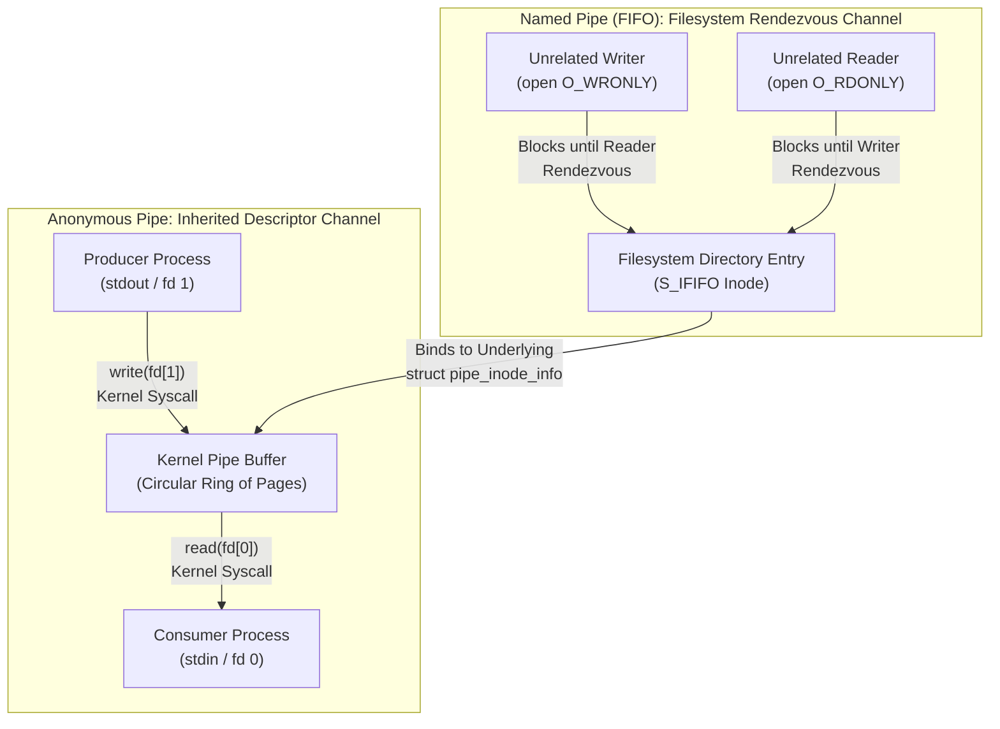

# Pipes and FIFOs

> [!summary] Claim
> Pipes and FIFOs provide unidirectional, byte-stream interprocess communication channels backed by kernel memory ring buffers, differing solely in their namespace binding while sharing identical scheduling, synchronization, and buffer-exhaustion semantics.

Part of [The Unix Process Model](README.md) in [Shell and Unix Engineering](../README.md).

## TL;DR

- Mechanism: The kernel allocates an in-memory circular page buffer where writes append data to the tail and reads consume data from the head without filesystem persistence.
- Rule: Always close unused pipe descriptor ends in both parent and child processes immediately after forking to prevent reader hangs and allow `EOF` delivery.
- Trap: Variable assignments executed inside pipeline stages disappear upon command termination in POSIX shells because each pipeline element executes in an isolated subshell environment.
- Portability fact: While dash, POSIX sh, and bash by default isolate all pipeline elements in subshells, native zsh and ksh93 execute the final pipeline command in the parent shell environment.
- When not to use it: Never use FIFOs for multiplexed request-response messaging or across untrusted multi-tenant shared directories where rogue peers can intercept data or induce denial-of-service deadlocks.

## Mental model



An anonymous pipe is an ephemeral kernel ring buffer addressed exclusively through a pair of file descriptors created by `pipe(2)` and passed across process boundaries via `fork(2)` inheritance.
A FIFO operates over the exact same kernel circular buffer engine but attaches a directory entry with inode type `S_IFIFO` to the filesystem hierarchy via `mkfifo(3)`.
This filesystem entry acts as a public rendezvous point, allowing entirely unrelated processes without shared ancestry to locate and open the channel.
Opening a FIFO blocks each participant until both a reader and a writer arrive at the inode rendezvous.
Once both open operations resolve, all data transfers bypass the disk controller completely, streaming directly through the kernel memory buffer according to identical first-in, first-out semantics.

## How it works

At the system call layer, pipes and FIFOs represent the foundational streaming abstractions of Unix.
They expose a uniform byte-stream interface that abstracts producer-consumer concurrency, flow control, and backpressure without user-space locking.

### 1. Anonymous Pipes and System Call Primitives

An anonymous pipe is instantiated via `pipe(2)` or `pipe2(2)` (POSIX.1-2024 XSH pipe):

```c
#include <unistd.h>
int pipe(int fildes[2]);
int pipe2(int fildes[2], int flags);
```

The system call allocates two new file descriptors referring to two distinct open file descriptions within the kernel:
- `fildes[0]` is open for reading, representing the consumer reception end.
- `fildes[1]` is open for writing, representing the producer transmission end.
- POSIX leaves unspecified whether `fildes[0]` is also open for writing and whether `fildes[1]` is also open for reading (POSIX.1-2024 XSH pipe).

Under POSIX.1-2024, `pipe2()` permits passing `O_CLOEXEC`, `O_CLOFORK`, and `O_NONBLOCK` flags.
Passing `O_CLOEXEC` atomically marks both descriptors with `FD_CLOEXEC`, eliminating the multi-threaded race condition where a concurrent `fork()` and `execve()` leaks descriptors to child programs.
Pipes do not support random access; calling `lseek(2)` on either descriptor immediately returns -1 with `errno` set to `ESPIPE` (POSIX.1-2024 XSH lseek).

### 2. Named Pipes (FIFOs) and Filesystem Rendezvous

A named pipe (FIFO) is created within the filesystem namespace via `mkfifo(3)` or `mkfifoat(2)` (POSIX.1-2024 XSH mkfifo):

```c
#include <sys/stat.h>
int mkfifo(const char *path, mode_t mode);
int mkfifoat(int fd, const char *path, mode_t mode);
```

At the command-line interface, the utility `mkfifo` creates the filesystem node (POSIX.1-2024 XCU mkfifo):

```sh
mkfifo -m 0600 /tmp/work.fifo
```

The resulting directory entry contains an inode marked with the `S_IFIFO` file type.
Unlike regular files, a FIFO contains no data blocks on physical media.
Its directory entry serves purely as a name binding that resolves to an in-memory kernel pipe structure when opened.

### 3. Shell Pipeline Execution and Descriptor Plumbing

When a POSIX shell parses a pipeline `cmd1 | cmd2` (POSIX.1-2024 XCU 2.9.2), it establishes an anonymous channel between the two commands:

1. The parent shell calls `pipe(fds)`.
2. The shell creates child processes for each stage.
   In GNU Bash (`bash-5.3 execute_cmd.c, execute_pipeline`), the shell iterates through the pipeline connection tree (`execute_pipeline()` confirmed in `execute_cmd.c` of the bash-5.3 release tarball, as of 2026-10).
   In Dash (`dash-0.5.12 eval.c, evalpipe`), the shell traverses command nodes and constructs subshells (`evalpipe()` confirmed in dash `src/eval.c` on kernel.googlesource.com, as of 2026-10).
3. In the producer child process (`cmd1`), standard output is redirected to the write end via `dup2(fds[1], STDOUT_FILENO)`, and both `fds[0]` and `fds[1]` are closed.
4. In the consumer child process (`cmd2`), standard input is redirected from the read end via `dup2(fds[0], STDIN_FILENO)`, and both `fds[0]` and `fds[1]` are closed.
5. In the parent shell, both `fds[0]` and `fds[1]` must be closed.
   If the parent retains a copy of `fds[1]`, the consumer will never encounter `EOF` upon producer termination, resulting in a permanent hang.

### 4. Subshell Environments and Variable Retention

Under POSIX.1-2024 XCU 2.13, each command of a multi-command pipeline executes in a subshell environment by default.
Consequently, environment modifications and variable assignments inside a pipeline loop do not persist:

```sh
count=0
printf 'a\nb\nc\n' | while read -r line; do
  count=$((count + 1))
done
echo "$count"  # Outputs 0 in POSIX sh, dash, mksh, and default bash
```

To preserve variable state across loops, POSIX-conforming scripts redirect standard input directly without pipelines:

```sh
count=0
while read -r line; do
  count=$((count + 1))
done << 'EOF'
a
b
c
EOF
echo "$count"  # Outputs 3 portably across all POSIX shells
```

Modern shells offer non-standard workarounds:
- GNU Bash 4.2+ provides `shopt -s lastpipe`, which executes the final pipeline stage in the parent shell when job control is disabled (`set +m`).
  The lab shows `lastpipe` rejected by Bash 3.2.57 and honored by Bash 4.4.23 through 5.3, and bash `NEWS` lists `lastpipe` among the new features of bash-4.2 (bash-5.3 release tarball, as of 2026-10).
- Native Zsh and KornShell (ksh93) by default execute the last pipeline stage in the current shell process (lab-verified on zsh 5.9, ksh93u+m 1.0.10, and ksh93u+ 2012-08-01).
  Zsh started with `--emulate sh` runs the last stage in a subshell like the other shells (lab-verified).

### 5. Pipeline Exit Status Evaluation and the pipefail Option

Under POSIX.1-2024 XCU 2.9.2, the default exit status of a multi-command pipeline `cmd1 | cmd2 | ... | cmdN` is determined solely by the exit status of the final command `cmdN`.
If an intermediate command fails or crashes, the parent shell ignores its failure code unless the `pipefail` option is active.
POSIX.1-2024 standardized `set -o pipefail` (Austin Group Defect 789, POSIX.1-2024 XCU set).
When `pipefail` is enabled, the pipeline exit status becomes the exit value of the rightmost command to terminate with a non-zero status, or 0 if every stage terminates with status 0.
Running `set -o pipefail; (exit 3) | (exit 5) | true; echo $?` prints `5` in every shell below that accepts the option (executed in the Debian and Alpine matrix images, 2026-10-25).
Support for `set -o pipefail` varies across shells and distributions:
- Supported universally in GNU Bash, native Zsh, Zsh in sh emulation, KornShell (ksh93), Mksh, Yash, and BusyBox ash.
- In Dash, `set -o pipefail` is supported in modern Debian packages (`dash >= 0.5.12-7`, changelog entry "Implement pipefail option (Closes: #1071238)" dated 2024-05-17, as of 2026-10).
  Upstream it is commit `6347b9fc52d742f36a0276cdea06cd9ad1f02c77` ("jobs: Implement pipefail option", authored by Chris Novakovic, committed by Herbert Xu), which changes `src/jobs.c`, `src/options.c`, `src/options.h`, and `src/dash.1`.
- Older stock Dash releases (such as macOS `/bin/dash` and Alpine Linux package `dash-0.5.12-r3`) reject the option with `set: Illegal option -o pipefail` and exit status 2.
  Posh (0.14.1) rejects it with `set: pipefail: bad option` and exit status 1.
Because `set` is a POSIX special built-in utility (POSIX.1-2024 XCU 2.15), an error in it causes a non-interactive shell to exit immediately (POSIX.1-2024 XCU 2.8.1).

### 6. FIFO Opening Synchronization and Blocking Semantics

Opening a FIFO creates unique synchronization points governed by POSIX.1-2024 XSH open:

- Blocking Read (`open(path, O_RDONLY)`): Blocks the calling thread until another thread or process opens the FIFO for writing.
- Blocking Write (`open(path, O_WRONLY)`): Blocks the calling thread until another thread or process opens the FIFO for reading.
- Non-blocking Read (`open(path, O_RDONLY | O_NONBLOCK)`): Returns immediately with a valid read descriptor even if no writer is present.
- Non-blocking Write (`open(path, O_WRONLY | O_NONBLOCK)`): If no process currently has the FIFO open for reading, `open()` fails immediately and returns -1 with `errno` set to `ENXIO` (No such device or address).
- Read-Write Mode (`open(path, O_RDWR)`): In POSIX, opening a FIFO with `O_RDWR` is implementation-defined; an implementation that does not support it shall fail the call with `EINVAL` (POSIX.1-2024 XSH open).
  On Linux and macOS, opening with `O_RDWR` succeeds immediately without blocking because the descriptor acts as its own reader and writer (lab-verified by `fifo-rdwr` on the macOS host and in the Debian and Alpine images).

### 7. Kernel Inodes and Ring Buffer Architecture

Inside the Linux kernel (`linux-6.12 fs/pipe.c`), both anonymous pipes and FIFOs share the same backing data structure: `struct pipe_inode_info`, defined in `include/linux/pipe_fs_i.h`.
The excerpt below is abridged from the 6.12 header; since Linux 6.15 `head` and `tail` live inside a `union pipe_index`.
A pipe does not allocate a continuous monolithic memory chunk.
Instead, it manages a circular ring buffer composed of individual memory pages:

```c
struct pipe_inode_info {
    struct mutex mutex;
    wait_queue_head_t rd_wait, wr_wait;
    unsigned int head;            /* Producer write index */
    unsigned int tail;            /* Consumer read index */
    unsigned int max_usage;       /* Capacity in pages */
    unsigned int ring_size;       /* Number of buffer slots */
    unsigned int readers;         /* Active reader count */
    unsigned int writers;         /* Active writer count */
    struct pipe_buffer *bufs;     /* Array of page references */
};
```

The function names below are those of Linux 6.12; since Linux 6.15 they are `anon_pipe_write()` and `anon_pipe_read()`, and FIFOs go through the `fifo_pipe_write()` and `fifo_pipe_read()` wrappers (checked against the v6.12, v6.15, and master trees, as of 2026-10).

When a process executes `write(2)` (`fs/pipe.c:pipe_write`):
1. The kernel acquires `pipe->mutex`.
2. It verifies that `pipe->readers > 0`.
   If no readers exist, the kernel delivers `SIGPIPE` to the writing process and aborts with `-EPIPE`.
3. The kernel copies data from user space into the physical memory page located at `pipe->head`.
4. If the page fills, `head` advances.
   If the ring buffer becomes completely full (`head - tail == max_usage`), the writing process sleeps on `pipe->wr_wait`.
5. Upon writing data, the kernel wakes up sleeping readers on `pipe->rd_wait`.

When a process executes `read(2)` (`fs/pipe.c:pipe_read`):
1. The kernel acquires `pipe->mutex`.
2. If the buffer is empty (`head == tail`), the reading process sleeps on `pipe->rd_wait`.
   If `pipe->writers == 0`, `read()` returns 0 bytes, signaling `EOF`.
3. The kernel copies bytes from the page at `pipe->tail` into user space.
4. When a page is fully consumed, `tail` advances, and sleeping writers on `pipe->wr_wait` are awakened.

### 8. Channel Teardown, EOF, and Broken Pipes

The lifecycle of a pipe is defined by reference counting on its endpoints:
- End-of-File (`EOF`): Occurs when every open file description for writing (`pipe->writers == 0`) is closed.
  Readers consume remaining buffered bytes; subsequent `read()` calls return 0.
- Broken Pipe (`EPIPE`): Occurs when every open file description for reading (`pipe->readers == 0`) is closed.
  Any subsequent `write()` call causes the kernel to raise `SIGPIPE` (POSIX.1-2024 XSH write).
  If the process ignores or handles `SIGPIPE`, `write()` returns -1 with `errno == EPIPE`.
  For comprehensive signal mechanics, see [[SIGPIPE-and-EPIPE]].

## Numbers and limits

The operational behavior of pipes depends on architectural constants and runtime kernel parameters:

| Metric / Parameter | Value | Scope / Platform | Source |
| :--- | :--- | :--- | :--- |
| `_POSIX_PIPE_BUF` | 512 bytes | POSIX minimum guarantee | POSIX.1-2024 `<limits.h>` |
| `PIPE_BUF` (Linux) | 4,096 bytes | Linux atomic write limit | Linux `pipe(7)`; `getconf PIPE_BUF /` prints 4096 in the Debian 13 image (as of 2026-10) |
| `PIPE_BUF` (macOS) | 512 bytes | Darwin atomic write limit | macOS SDK `<sys/syslimits.h>` and `getconf PIPE_BUF /` on the macOS 27.2 host (as of 2026-10) |
| `PIPE_BUF` (FreeBSD / OpenBSD) | 512 bytes | BSD atomic write limit | FreeBSD and OpenBSD `sys/sys/syslimits.h` (as of 2026-10) |
| Default pipe capacity (Linux) | 65,536 bytes (16 pages) | Linux default buffer size | `PIPE_DEF_BUFFERS` in `include/linux/pipe_fs_i.h`, 16 pages since 2.6.11 per `pipe(7)`; 65,536 bytes measured with `dd` in the Debian image (as of 2026-10) |
| Minimum pipe capacity (Linux) | 4,096 bytes (1 page) | Linux via `F_SETPIPE_SZ` | Linux `F_SETPIPE_SZ(2const)` manual page, linked from `fcntl(2)`: requests below the system page size are rounded up to it (as of 2026-10) |
| Maximum unprivileged capacity | 1,048,576 bytes (1 MiB) | Linux default system ceiling | Linux `/proc/sys/fs/pipe-max-size` default per `pipe(7)` and read in the Debian image (as of 2026-10) |
| Default pipe capacity (macOS) | 65,536 bytes (64 KiB) | Darwin pipe buffer size | XNU `bsd/sys/pipe.h` (`PIPE_SIZE` 16384 grows to `BIG_PIPE_SIZE` 64 KiB); 65,536 bytes measured with non-blocking writes on the macOS 27.2 host (as of 2026-10) |
| Default pipe capacity (FreeBSD) | 16,384 bytes (16 KiB) | FreeBSD base pipe allocation | FreeBSD `sys/sys/pipe.h` `PIPE_SIZE` (grows to `BIG_PIPE_SIZE`, 64 KiB; `kern.ipc.maxpipekva` caps total pipe KVA) |
| Pipe resize interface | `fcntl(fd, F_SETPIPE_SZ)` | Linux dynamic buffer resize | Linux 2.6.35+ per `pipe(7)` |
| Pipeline exit status range | 0 to 255 for a normal exit; may exceed 255 after a signal | POSIX exit code range | POSIX.1-2024 XCU 2.8.2 (`WEXITSTATUS`, modulo 256; a signal death gets a status above 128 that shells may set above 255) |
| Per-user pipe page soft limit | 16,384 pages (64 MiB) | Linux per-user buffer allocation | Linux `/proc/sys/fs/pipe-user-pages-soft` default per `pipe(7)` and read in the Debian image, 64 MiB with 4 KiB pages (as of 2026-10) |
| Per-user pipe page hard limit | 0 (unlimited) | Linux per-user maximum buffer | Linux `/proc/sys/fs/pipe-user-pages-hard` default per `pipe(7)` and read in the Debian image (as of 2026-10) |

For atomic write guarantees and interleaved write dynamics when exceeding `PIPE_BUF`, consult [[PIPE_BUF-and-Write-Atomicity]].

## Portability

Shells and utilities exhibit significant divergences in pipeline environment isolation, option handling, and FIFO operations:

| Feature / Behavior | POSIX sh | macOS Bash 3.2 | Current Bash 5.3 | Zsh (Native) | Zsh (`--emulate sh`) | Dash | Ksh93 | Mksh | Yash | Posh | BusyBox Ash |
| :--- | :--- | :--- | :--- | :--- | :--- | :--- | :--- | :--- | :--- | :--- | :--- |
| Last pipeline stage subshell | Subshell | Subshell | Subshell | Parent shell | Subshell | Subshell | Parent shell | Subshell | Subshell | Subshell | Subshell |
| `lastpipe` option support | No | No | Yes (`shopt -s`) | N/A (Default) | No | No | N/A (Default) | No | No | No | No |
| Pipeline exit status (default) | Last cmd | Last cmd | Last cmd | Last cmd | Last cmd | Last cmd | Last cmd | Last cmd | Last cmd | Last cmd | Last cmd |
| `pipefail` option support | Standard (POSIX.1-2024) | Yes (`set -o`) | Yes (`set -o`) | Yes (`set -o`) | Yes (`set -o`) | Debian 0.5.12-7+ (as of 2026-10); No in stock 0.5.12 (Alpine, macOS) | Yes (`set -o`) | Yes (`set -o`) | Yes (`set -o`) | No | Yes (`set -o`) |
| Pipeline exit status array | None | `${PIPESTATUS[@]}` | `${PIPESTATUS[@]}` | `$pipestatus` | None (`pipestatus` is special only in zsh emulation) | None | None | `${PIPESTATUS[@]}` | None | None | None |
| FIFO open with `<>` (`O_RDWR`) | Implementation-defined (`open()` may fail with `EINVAL`) | Supported | Supported | Supported | Supported | Supported | Supported | Supported | Supported | Supported | Supported |
| Process substitution `<(cmd)` | No | Yes | Yes | Yes | Yes | No | Yes | No | Process redirection only (`<(cmd)` redirects stdin, no `/dev/fd` path) | No | Yes (Debian and Alpine builds) |

Utility implementations diverge in option extensions and atomic inode creation guarantees:

| Utility / Implementation | GNU Coreutils | BSD and macOS | BusyBox | uutils Coreutils | Specification / Standard |
| :--- | :--- | :--- | :--- | :--- | :--- |
| `mkfifo -m <mode>` support | Supported (`0600`, etc.) | Supported (`0600`, etc.) | Supported (`0600`, etc.) | Supported (`0600`, etc.) | POSIX.1-2024 XCU `mkfifo` |
| `mkfifo -Z` (SELinux context) | Supported (`-Z`, or `--context=CTX`) | Unsupported (`illegal option -- Z` on macOS) | Supported in SELinux builds (`-Z CTX`) | Supported (`-Z`, `--context`) | GNU Coreutils extension |
| `mkfifo` atomic mode application | Not purely atomic: `mkfifo(path, mode)` then `lchmod()` when `-m` is given (does not follow symlinks) | Atomic: `umask(0)` then `mkfifo(path, mode)` (FreeBSD) | Atomic: `umask(0)` then `mkfifo(path, mode)` | Atomic: `umask(0)` then `mkfifo(path, mode)` since the CVE-2026-35352 fix (issue #10020, closed 2026-09-08, as of 2026-10) | POSIX.1-2024 XSH `mkfifo` |
| Buffer capacity query via `stat` | Linux `st_blksize` is 4 KiB, not the 64 KiB capacity (measured) | macOS `st_blksize` is the current buffer size, 16 KiB for a fresh pipe (measured on macOS 27.2) | Kernel value (4 KiB on Linux) | Kernel value (4 KiB on Linux) | POSIX.1-2024 XSH `fstat` |

## Worked example

The automated test harness for this note is available in [lab](../labs/01-pipes-and-fifos/).
The executable script `pipe-fifo.sh` implements controlled pipeline subshell isolation, exit status validation, and FIFO synchronization:

```sh
#!/bin/sh
# Lab 01: Pipes and FIFOs execution behavior and IPC patterns.
set -eu

mode=${1:-help}
shift || true

case "$mode" in
  pipeline-subshell)
    # Demonstrates whether pipeline elements execute in subshell environments.
    count=0
    # shellcheck disable=SC2030 # intentional pipeline subshell mutation under test
    printf 'alpha\nbeta\ngamma\n' | while read -r _; do
      count=$((count + 1))
    done
    # shellcheck disable=SC2031 # intentional observation of parent environment variable
    printf 'count:%d\n' "$count"
    ;;

  heredoc-env)
    # Portable POSIX alternative: stdin redirection retains current environment.
    count=0
    while read -r _; do
      count=$((count + 1))
    done << 'EOF'
alpha
beta
gamma
EOF
    printf 'count:%d\n' "$count"
    ;;

  pipeline-status)
    # Demonstrates pipeline exit status with and without pipefail.
    opt=${1:-default}
    code=0
    case "$opt" in
      default)
        sh -c 'exit 42' | true || code=$?
        printf 'status:%d\n' "$code"
        ;;
      pipefail)
        # shellcheck disable=SC3040 # probing shell support for pipefail
        if (set -o pipefail) 2>/dev/null; then
          # shellcheck disable=SC3040 # enabling pipefail when supported
          set -o pipefail
          sh -c 'exit 42' | true || code=$?
          printf 'status:%d\n' "$code"
        else
          printf 'unsupported:pipefail\n'
        fi
        ;;
      *)
        printf 'error:unknown status mode\n' >&2
        exit 2
        ;;
    esac
    ;;

  fifo-rendezvous)
    # Coordinated producer and consumer through a named FIFO.
    fifopath=${1:-}
    payload=${2:-default-payload}
    [ -n "$fifopath" ] || { printf 'error:fifo path required\n' >&2; exit 2; }
    rm -f "$fifopath" "$fifopath.out"
    mkfifo -m 0600 "$fifopath"
    cat "$fifopath" > "$fifopath.out" &
    consumer_pid=$!
    printf '%s\n' "$payload" > "$fifopath"
    wait "$consumer_pid"
    cat "$fifopath.out"
    rm -f "$fifopath" "$fifopath.out"
    ;;

  fifo-rdwr)
    # Opening FIFO with O_RDWR avoids blocking open when supported.
    fifopath=${1:-}
    payload=${2:-bidirectional-data}
    [ -n "$fifopath" ] || { printf 'error:fifo path required\n' >&2; exit 2; }
    rm -f "$fifopath"
    mkfifo -m 0600 "$fifopath"
    exec 3<>"$fifopath"
    printf '%s\n' "$payload" >&3
    line=""
    read -r line <&3
    exec 3>&-
    rm -f "$fifopath"
    printf 'rdwr:%s\n' "$line"
    ;;

  fifo-leak-clean)
    # Clean descriptor lifecycle: closing writer yields EOF immediately to reader.
    fifopath=${1:-}
    [ -n "$fifopath" ] || { printf 'error:fifo path required\n' >&2; exit 2; }
    rm -f "$fifopath"
    mkfifo -m 0600 "$fifopath"
    (
      printf 'line1\nline2\n' > "$fifopath"
    ) &
    writer_pid=$!
    read_count=0
    while read -r _; do
      read_count=$((read_count + 1))
    done < "$fifopath"
    wait "$writer_pid"
    rm -f "$fifopath"
    printf 'lines:%d\n' "$read_count"
    ;;

  *)
    printf 'usage: %s {pipeline-subshell|heredoc-env|pipeline-status|fifo-rendezvous|fifo-rdwr|fifo-leak-clean}\n' "$0" >&2
    exit 2
    ;;
esac
```

Executing the lab commands under GNU Bash produces the following captured outputs:

```console
$ ./pipe-fifo.sh pipeline-subshell
count:0
$ ./pipe-fifo.sh heredoc-env
count:3
$ ./pipe-fifo.sh pipeline-status default
status:0
$ ./pipe-fifo.sh pipeline-status pipefail
status:42
$ ./pipe-fifo.sh fifo-rendezvous /tmp/test.fifo "pipeline-payload"
pipeline-payload
$ ./pipe-fifo.sh fifo-rdwr /tmp/test.fifo "token-data"
rdwr:token-data
$ ./pipe-fifo.sh fifo-leak-clean /tmp/test.fifo
lines:2
```

Under shells lacking `pipefail` (such as legacy Dash 0.5.12 on Alpine or macOS, and Posh), `./pipe-fifo.sh pipeline-status pipefail` outputs `unsupported:pipefail`.
Under modern Debian Dash (`dash >= 0.5.12-7`, as of 2026-10), GNU Bash, Zsh, and Ksh93, it outputs `status:42`.

## Pitfalls

> [!warning] FIFO Opening Deadlock in Single-Threaded Shell Scripts
> - Trigger: A single-threaded shell script opens a FIFO for reading (`< "$fifo"`) or writing (`> "$fifo"`) sequentially before spawning the corresponding communication partner.
> - Symptom: The script process hangs indefinitely in the `open(2)` system call, producing 0% CPU utilization while waiting for a peer that cannot start.
> - Fix: Always spawn the background partner (`cmd > "$fifo" &`) before opening the complementary descriptor in the foreground, or open the FIFO using non-blocking primitives or multiplexed file descriptors (`exec 3<>"$fifo"`).

> [!warning] Silent Environment Loss via Pipeline Subshell Execution
> - Trigger: Iterating over streaming data with `producer | while read -r line; do var=...; done` under POSIX sh, dash, or default bash.
> - Symptom: Any variable assignments, accumulator sums, or array updates made inside the loop body vanish immediately once the pipeline terminates.
> - Fix: Feed the loop using standard input redirection from a here-document or file redirection (`while read -r line; do ...; done < file`), or enable `shopt -s lastpipe` in non-interactive GNU Bash scripts.

> [!warning] Bidirectional Pipeline Deadlock via Buffer Exhaustion
> - Trigger: Process A pipes data to Process B, while Process B simultaneously pipes processed records back to Process A through a second pipe or FIFO without asynchronous event loops.
> - Symptom: Both processes write payloads larger than the kernel pipe capacity (e.g., > 64 KiB) and block simultaneously in `write(2)`, resulting in a permanent circular deadlock.
> - Fix: Decouple bidirectional pipelines using non-blocking I/O with multiplexers (`select(2)`, `poll(2)`), intermediate temporary files, or dedicated Unix domain sockets.

> [!warning] Insecure FIFO Placement in Shared Temporary Directories (CVE-2024-22365 and CVE-2025-70342)
> - Trigger: Creating or opening predictable named pipes in world-writable shared directories such as `/tmp` without `O_DIRECTORY` or `O_NOFOLLOW`.
> - Symptom: In Linux-PAM prior to 1.6.0 (CVE-2024-22365), `pam_namespace` called `openat()` (for `protect_dir`) without `O_DIRECTORY`; an unprivileged local user created a FIFO at a path that `pam_namespace` expected to be a directory, blocking the login process indefinitely.
>   In the macOS admin tool `erase-install` prior to v40.4 (CVE-2025-70342), swiftDialog credential output was written to the hardcoded path `/var/tmp/dialog.json`, so an attacker who pre-created a named pipe there could intercept the admin credentials entered during reinstall or erase operations.
> - Fix: Never place FIFOs in shared world-writable directories; isolate FIFO paths within dedicated directories restricted to mode `0700` owned by the process user ID (`mktemp -d`).

> [!warning] Masked Upstream Pipeline Failures Without `pipefail`
> - Trigger: Executing multi-stage pipelines (`producer | transform | consumer`) in cron jobs, CI/CD runners, or ingestion scripts without enabling `pipefail`.
> - Symptom: If `producer` crashes or exits with a non-zero status due to missing database credentials, the pipeline exit status reflects only the final `consumer` command (0), silently processing empty streams and corrupting data.
> - Fix: Enable `set -o pipefail` at the beginning of all production shell scripts where supported, or verify all stage exit codes through `${PIPESTATUS[@]}` in Bash or `$pipestatus` in Zsh.

> [!warning] Fatal Script Abort on `set -o pipefail` Under Heterogeneous `/bin/sh` Images
> - Trigger: Adding `set -o pipefail` unconditionally to `#!/bin/sh` scripts deployed across mixed container base images (such as Alpine Linux images that run scripts under the `dash` package, or Debian images that use posh).
> - Symptom: Because `set` is a special built-in utility in POSIX (POSIX.1-2024 XCU 2.15), an unrecognized option is a special built-in error that terminates a non-interactive shell immediately (POSIX.1-2024 XCU 2.8.1), with exit status 2 in dash and 1 in posh.
>   While modern Debian dash (`>= 0.5.12-7`, as of 2026-10) and BusyBox ash support `pipefail`, legacy dash (such as Alpine `dash-0.5.12-r3` or macOS `/bin/dash`) emits `set: Illegal option -o pipefail` and posh emits `set: pipefail: bad option`, and both abort execution before running any application logic.
> - Fix: Probe option support dynamically before enabling it via `if (set -o pipefail) 2>/dev/null; then set -o pipefail; fi`, or declare an explicit `#!/usr/bin/env bash` or `#!/bin/zsh` shebang whenever pipeline failure propagation is mandatory.

## Security and robustness

Pipes and FIFOs introduce distinct security boundaries governed by file descriptors and filesystem directory entries:

### 1. Filesystem Namespace Exposure and Permission Traps

Anonymous pipes possess no filesystem footprint; they cannot be discovered or opened by unauthorized local processes lacking descriptor inheritance or `ptrace` capabilities.
Conversely, FIFOs exist as visible filesystem nodes.
If created with permissive umasks (e.g., `mkfifo /tmp/ipc.fifo` yielding mode `0666`), any unprivileged local user can open the write end to inject forged commands or open the read end to siphon sensitive streaming data.
Always specify explicit restricted modes during creation:

```sh
mkfifo -m 0600 "$SECURE_DIR/ipc.fifo"
```

Furthermore, utilities that create FIFOs using a two-step `mkfifo` followed by `chmod` suffer from Time-of-Check to Time-of-Use (TOCTOU) race conditions (CVE-2026-35352 in `uutils coreutils` `mkfifo`, and CVE-2005-1039 in GNU coreutils 5.2.1 `mkdir`, `mknod`, and `mkfifo` with `-m`).
An attacker can replace the FIFO with a symbolic link before `chmod` executes, redirecting permission modifications to arbitrary target files.
Secure implementations pass the permission mask directly into the creation system call: `mkfifo(path, 0600)`.

### 2. File Descriptor Leaks Across `execve`

When a process creates a pipe, both file descriptors are allocated with the `FD_CLOEXEC` flag cleared by default (POSIX.1-2024 XSH pipe).
If the process subsequently spawns an external utility via `execve(2)`, the child inherits both descriptors.
Leaking an open write descriptor into a long-running daemon prevents the pipe from ever generating an `EOF` condition, causing downstream consumers to block permanently.
To prevent descriptor leaks:
- Use `pipe2(fds, O_CLOEXEC)` whenever possible in modern C runtimes.
- In shell scripts, close temporary plumbing descriptors before executing external binaries via `exec 3>&-`.
- For complete inheritance rules, see [[Close-on-Exec-and-Descriptor-Inheritance]].

### 3. Resource Exhaustion and Denial of Service

Because pipe buffers reside in non-swappable kernel memory, malicious unprivileged users can allocate thousands of pipes to consume kernel RAM.
On Linux 4.5+, the kernel enforces per-user page limits via `/proc/sys/fs/pipe-user-pages-soft` and `/proc/sys/fs/pipe-user-pages-hard`.
When an unprivileged user reaches the soft limit, subsequent pipe allocations are capped at two pages (8,192 bytes with 4 KiB pages; one page before Linux 5.14, per `pipe(7)` and `PIPE_MIN_DEF_BUFFERS` in `fs/pipe.c`); reaching a non-zero hard limit causes `pipe(2)` to fail with `ENFILE` (Linux `pipe(2)`).

## The principal's view

Staff-plus engineers evaluate interprocess communication mechanisms by balancing latency, synchronization complexity, operational observability, and failure semantics:

- Anonymous Pipes vs FIFOs: Anonymous pipes are the superior choice for parent-child streaming workflows because their lifecycle is strictly bounded by process lifetimes, leaving zero filesystem residue to clean up on crash.
  FIFOs should be reserved for decoupled pipelines between independently launched processes where configuring Unix domain sockets is deemed unnecessary overhead.
- Pipes vs Unix Domain Sockets: Pipes provide unidirectional byte streams without message framing or credential passing.
  When an architecture demands bidirectional RPC, datagram framing (`SOCK_DGRAM`), out-of-band credential verification (`SO_PEERCRED`), or descriptor passing via `SCM_RIGHTS`, migrate immediately to Unix domain sockets.
- Zero-Copy Kernel Splicing: In high-throughput data ingestion, pipes allow Linux processes to achieve zero-copy data routing using `splice(2)` and `vmsplice(2)`.
  The kernel transfers pages directly between network sockets, file page caches, and pipe ring buffers without copying bytes across the kernel-user space boundary.
- Pipeline Failure Observability: In production orchestration, silent failures in upstream pipeline elements represent a primary cause of data corruption.
  Relying on bare `set -o pipefail` in `#!/bin/sh` scripts introduces portability debt across heterogeneous base images: while GNU Bash, Zsh, Ksh93, and modern Debian Dash (`>= 0.5.12-7`, as of 2026-10) support `pipefail`, minimal environments such as Posh and legacy stock Dash abort.
  Principals enforce dynamic probing `(set -o pipefail) 2>/dev/null` for portable POSIX scripts, or mandate dedicated runtimes (`bash` or `zsh`) for mission-critical pipelines.
- When to Migrate Away from Shell Pipelines: While shell pipelines excel at streaming transformation filters, they become hazardous when pipelines require error retry loops, bidirectional backpressure, partial stream re-routing, or structured telemetry.
  When an ingestion flow exceeds two pipeline stages or requires transactional atomicity, rewrite the subsystem in Go, Rust, or C++ using structured concurrent channels.

## Interview questions

> [!question] L5: Predict the output and exit status of running this snippet under `dash` versus `bash` (without lastpipe) versus native `zsh`: `x=0; printf 'hello\n' | read -r x; echo "x=$x"`.
>
> > [!success]- Answer
> > Under `dash` and standard `bash`, the script outputs `x=0` with exit status 0 because the right-hand side of the pipeline executes in an isolated subshell environment whose variable modifications do not propagate to the parent.
> > Under native `zsh`, the script outputs `x=hello` with exit status 0 because native zsh executes the final stage of a pipeline in the parent shell process.
> >
> > Follow-up: How can you write this logic in POSIX-conforming shell script so that `$x` reliably contains `hello` across all shells?

> [!question] L5: Why is `cat file.txt | grep pattern` considered an engineering anti-pattern, and what kernel system call overhead does it introduce?
>
> > [!success]- Answer
> > It represents the "useless use of cat" anti-pattern because `grep` can open and read files directly without intermediate buffering.
> > The redundant pipeline forces the shell to execute an extra `pipe()` system call, two `fork()` calls, two `dup2()` descriptor redirections, and context-switch data bytes across kernel pipe page buffers.
> > Invoking `grep pattern file.txt` executes a single process that opens the file descriptor directly via `open()`, eliminating pipe buffer allocations and interprocess context switching.
> >
> > Follow-up: When is piping standard input into `grep` actually justified?

> [!question] L6: Debug this script: identify every concurrency and lifecycle bug and provide the hardened rewrite:
> ```sh
> #!/bin/sh
> mkfifo /tmp/my_fifo
> echo "data" > /tmp/my_fifo
> result=$(cat /tmp/my_fifo)
> rm /tmp/my_fifo
> echo "Result: $result"
> ```
>
> > [!success]- Answer
> > The script deadlocks permanently at line 3: opening `/tmp/my_fifo` for writing (`>`) blocks until a reader opens the FIFO, but the reader (`cat`) is not scheduled until line 4, which is never reached.
> > Additionally, `/tmp/my_fifo` is created with ambient umask in a shared world-writable directory without collision handling or cleanup traps if the script terminates prematurely.
> > To fix this, create the FIFO in a secure private directory (`mktemp -d`), establish an exit trap to ensure node removal, and launch the consumer asynchronously before writing:
> > ```sh
> > #!/bin/sh
> > set -eu
> > dir=$(mktemp -d)
> > fifo="$dir/ipc.fifo"
> > trap 'rm -rf "$dir"' EXIT
> > mkfifo -m 0600 "$fifo"
> > cat "$fifo" > "$dir/out" &
> > pid=$!
> > printf 'data\n' > "$fifo"
> > wait "$pid"
> > printf 'Result: %s\n' "$(cat "$dir/out")"
> > ```
> >
> > Follow-up: How could `exec 3<>"$fifo"` avoid the need for a background process on platforms supporting read-write FIFOs?

> [!question] L6: Why does `open("/path/to/fifo", O_WRONLY | O_NONBLOCK)` fail with `ENXIO` when no reader is present, whereas `open("/path/to/fifo", O_RDONLY | O_NONBLOCK)` succeeds immediately?
>
> > [!success]- Answer
> > Under POSIX.1-2024 XSH open, an `O_NONBLOCK` reader can open a FIFO immediately because reading an empty channel simply returns `EAGAIN` while a writer holds it open, or 0 (`EOF`) when no writer is present (POSIX.1-2024 XSH read), and the reader can poll for future data.
> > Conversely, opening a write end without a reader would create an unusable descriptor because any subsequent `write()` would immediately trigger a `SIGPIPE` signal and fail with `EPIPE`.
> > Therefore, the kernel enforces fast failure by returning `ENXIO` (No such device or address) on non-blocking write opens when `pipe->readers == 0`.
> >
> > Follow-up: How does an event loop using `epoll` safely establish a connection to a FIFO without blocking or polling?

> [!question] L6: In a multi-stage pipeline `cmd1 | cmd2 | cmd3`, explain how exit statuses are evaluated under default POSIX rules versus `set -o pipefail`, and how bash `${PIPESTATUS[@]}` differs from zsh `$pipestatus`.
>
> > [!success]- Answer
> > Under default POSIX rules (POSIX.1-2024 XCU 2.9.2), the pipeline exit status is determined solely by the exit status of the last command (`cmd3`), masking upstream failures in `cmd1` or `cmd2`.
> > When `set -o pipefail` is enabled, the pipeline exit status is that of the last (rightmost) command to exit with a non-zero status, or 0 if all commands exit successfully.
> > POSIX.1-2024 formally standardized `pipefail` via Austin Group Defect 789; it is supported natively across Bash, Zsh, Ksh93, Mksh, Yash, BusyBox ash, and modern Debian Dash (`dash >= 0.5.12-7`, as of 2026-10).
> > In contrast, legacy Dash builds and Posh reject `set -o pipefail` as an invalid option, aborting non-interactive scripts.
> > GNU Bash exposes all stage exit codes through the 0-indexed uppercase array `${PIPESTATUS[@]}`.
> > Zsh exposes stage exit codes through the 1-indexed lowercase array `$pipestatus`.
> >
> > Follow-up: If both `cmd1` and `cmd2` fail in a pipeline with `pipefail` enabled, which command's status becomes `$?`?

> [!question] L7: Walk through the Linux kernel implementation in `fs/pipe.c` of how `pipe_read()` and `pipe_write()` coordinate over `struct pipe_inode_info`, detailing lock acquisition, wait queue sleeping, and page buffer ring updates.
>
> > [!success]- Answer
> > Both system calls synchronize via `mutex_lock(&pipe->mutex)` on the shared `pipe_inode_info` structure.
> > In `pipe_write()`, the kernel checks `pipe->readers`; if zero, it sends `SIGPIPE` to the calling thread and returns `-EPIPE`.
> > It writes user bytes into the page at `pipe->head`, advancing `head` as pages fill; if the buffer is full (`head - tail == max_usage`), it unlocks the mutex and sleeps on `pipe->wr_wait`.
> > After copying data, it wakes waiting readers on `pipe->rd_wait`.
> > In `pipe_read()`, if the buffer is empty (`head == tail`), the reader sleeps on `pipe->rd_wait` unless `pipe->writers == 0`, in which case it returns 0 (`EOF`).
> > It copies bytes from `pipe->tail`, advances `tail` when a page is emptied, wakes waiting writers on `pipe->wr_wait`, and unlocks the mutex.
> > These are the Linux 6.12 names; since Linux 6.15 the same logic lives in `anon_pipe_write()` and `anon_pipe_read()`, wrapped by `fifo_pipe_write()` and `fifo_pipe_read()` for FIFOs.
> >
> > Follow-up: How does `splice(2)` avoid memory copying when transferring pages between a socket and a pipe?

> [!question] L7: Explain how an unclosed write file descriptor in an unrelated ancestor or child process can cause a pipeline consumer to hang indefinitely, and how `pipe2(..., O_CLOEXEC)` solves this race condition.
>
> > [!success]- Answer
> > A pipe reader detects `EOF` only when `pipe->writers == 0` in the kernel descriptor table.
> > If a parent process forks a producer child but fails to close its own copy of the write descriptor, `pipe->writers` remains at least 1 even after the producer terminates.
> > The downstream consumer will block forever in `read()` waiting for additional data that can never arrive.
> > In multi-threaded applications, calling `pipe()` followed by `fcntl(fd, F_SETFD, FD_CLOEXEC)` leaves a window where a concurrent `fork()` and `execve()` in another thread leaks the write descriptor to an arbitrary binary.
> > `pipe2(fds, O_CLOEXEC)` sets `FD_CLOEXEC` atomically during descriptor creation, preventing descriptor leaks across exec boundaries.
> >
> > Follow-up: How do you identify lingering write descriptors on a stuck pipe using `/proc` on Linux?

> [!question] L7: Analyze the vulnerability pattern in CVE-2024-22365 (Linux-PAM) and explain how an unprivileged user exploiting FIFO blocking semantics can cause a local denial of service in privileged system daemons.
>
> > [!success]- Answer
> > In Linux-PAM prior to version 1.6.0, the `pam_namespace` module invoked `openat()` during directory preparation without passing the `O_DIRECTORY` flag.
> > An unprivileged local attacker created a named pipe with `mkfifo` at a user-controlled path that `pam_namespace` expected to be a directory (the `protect_dir` code path).
> > When a privileged process or login manager attempted to authenticate the user, `openat()` opened the FIFO instead of a directory.
> > Because `open()` was invoked without `O_NONBLOCK`, the system call blocked indefinitely waiting for a writer, freezing the authentication daemon and causing a local denial of service.
> > The fix requires passing `O_DIRECTORY` to `openat()`, which causes the kernel to fail immediately with `ENOTDIR` if the target is a FIFO.
> >
> > Follow-up: Why is `O_NONBLOCK` alone insufficient when opening paths that are strictly expected to be directories?

## Related

Prerequisites: [[Close-on-Exec-and-Descriptor-Inheritance]]

Next: [[PIPE_BUF-and-Write-Atomicity]]

See also: [[01-CS-Foundations/Operating-Systems/IPC-Complete-Guide|IPC Complete Guide]], [[File-Descriptors-and-Open-File-Descriptions]], [[SIGPIPE-and-EPIPE]], [[Processes-fork-exec-and-wait]], [[Posix-Spawn-and-Vfork]], [[dev-fd-and-dev-stdin]]

## Further reading

- IEEE Std 1003.1-2024 (POSIX.1-2024), System Interfaces, `pipe()`: Defines standard system call semantics for creating anonymous channels and descriptor flag inheritance.
- IEEE Std 1003.1-2024 (POSIX.1-2024), System Interfaces, `mkfifo()`: Specifies named pipe creation, file permissions, and directory interaction requirements.
- IEEE Std 1003.1-2024 (POSIX.1-2024), Shell and Utilities (XCU), Section 2.9.2 "Pipelines": Authoritative specification for shell pipeline grammar, descriptor redirection, and exit status determination.
- IEEE Std 1003.1-2024 (POSIX.1-2024), Shell and Utilities (XCU), `set`: Standardizes the `pipefail` option for pipeline exit status determination via Austin Group Defect 789.
- Austin Group Defect 789: Defect report and specification changes introducing `pipefail` to POSIX pipelines and the `set` utility.
- Linux Programmer's Manual, `pipe(7)` and `fifo(7)`: In-depth technical documentation of Linux circular buffer capacity, scheduling, and signal semantics.
- Linux Kernel Source Code (`fs/pipe.c`): Primary source implementation of `pipe_inode_info`, mutex locking, wait queue coordination, and circular page buffer management.
- GNU Bash Source Code (`execute_cmd.c`, `execute_pipeline`): Implementation of child process spawning, pipe descriptor plumbing, and `lastpipe` execution.
- Debian Almquist Shell Source Code (`eval.c`, `evalpipe`): Reference implementation of lightweight POSIX pipeline construction and subshell fork dispatch.
- Debian Almquist Shell Git Repository, commit `6347b9fc52d742f36a0276cdea06cd9ad1f02c77`: Upstream dash commit "jobs: Implement pipefail option", changing `src/jobs.c`, `src/options.c`, `src/options.h`, and `src/dash.1`.
- Debian dash package changelog (`dash 0.5.12-7`): Documents the backport of `pipefail` support to Debian `/bin/sh`.
- NIST National Vulnerability Database, CVE-2024-22365: Technical case study of FIFO blocking open denial-of-service in Linux-PAM `pam_namespace`.
- NIST National Vulnerability Database, CVE-2025-70342: Credential interception via an attacker-created named pipe at the hardcoded path `/var/tmp/dialog.json` in the macOS tool `erase-install`.
- NIST National Vulnerability Database, CVE-2026-35352: TOCTOU race condition in `uutils coreutils` `mkfifo` permission assignment.
- NIST National Vulnerability Database, CVE-2005-1039: Historical race condition in GNU coreutils 5.2.1 `mkdir`, `mknod`, and `mkfifo` permission assignment with `-m`.
