# posix_spawn and vfork

> [!summary] Claim
> `posix_spawn` replaces the unbounded latency and memory-commit duplication of `fork` with an atomic, declarative process creation primitive that avoids copying page tables, while `vfork` eliminates page-table duplication by borrowing the parent address space under fragile, undefined-behavior constraints.

Part of [The Unix Process Model](README.md) in [Shell and Unix Engineering](../README.md).

## TL;DR

- Mechanism: `posix_spawn` encapsulates process creation, file descriptor manipulation, and signal masks into a single declarative interface implemented via kernel primitives or `clone(CLONE_VM | CLONE_VFORK)` on Linux.
- Rule: Use `posix_spawn` in multi-threaded runtimes and memory-heavy daemons to launch external binaries without duplicating page tables or risking lock deadlocks.
- Trap: A child executing after `vfork` shares the parent stack and address space, meaning any function call, variable mutation, or call to `exit` instead of `_exit` corrupts parent state.
- Portability fact: `posix_spawn` is standardized in POSIX.1-2001 through POSIX.1-2024, whereas `vfork` was marked obsolescent (as an XSI option) in POSIX.1-2001 and removed from POSIX.1-2008 entirely (Linux `vfork(2)` STANDARDS; POSIX.1-2004 `vfork` page).
- When not to use it: Avoid `posix_spawn` when the child process must execute arbitrary imperative C logic, such as complex namespace unsharing or custom seccomp filters, before calling `execve`.

## Mental model

```mermaid
flowchart TD
  subgraph ForkExec["Traditional fork + exec"]
    P1["Parent Process (Heap, Stack, Locks)"] -->|"fork() duplicates page tables<br/>(O(N) memory & PTE walk)"| C1["Child Process (COW Copy)"]
    C1 -->|"Child runs user code<br/>(Potential deadlock on parent mutexes)"| E1["Child calls execve()<br/>(Tears down copied address space)"]
  end

  subgraph VForkExec["Historical vfork + exec (3BSD)"]
    P2["Parent Process"] -->|"vfork() suspends parent<br/>(Shares memory & stack pointer)"| C2["Child Process (Hazardous Window)"]
    C2 -->|"Must NOT mutate stack or call exit()<br/>(Stack clobbering risk)"| E2["Child calls execve() or _exit()"]
    E2 -->|"Parent wakes up"| P2_WAKE["Parent Resumes Execution"]
  end

  subgraph PosixSpawn["Standard posix_spawn (Modern)"]
    P3["Parent Process"] -->|"posix_spawn(path, actions, attr)<br/>Declarative descriptors & signals"| K3["Kernel or glibc clone(CLONE_VM|CLONE_VFORK)"]
    K3 -->|"Isolated stack allocated via mmap<br/>Signals masked in child"| S3["Atomic Setup & execve()"]
    S3 -->|"Zero page-table duplication<br/>Reports errno on failure"| OUT3["New Process Image Running"]
  end
```



The diagram contrasts how Unix implementations create a new process to run an external program.
Under traditional `fork` followed by `exec`, the operating system must allocate new page tables and copy every page table entry from the parent to the child under Copy-On-Write semantics, only for `execve` to immediately destroy that duplicated address space.
Under `vfork`, introduced in 3.0BSD, the kernel suspends the parent and allows the child to borrow the parent exact address space and stack pointer, eliminating page table copying but exposing the parent to memory corruption if the child returns from the frame or calls non-async-signal-safe functions.
Under `posix_spawn`, the parent passes declarative objects specifying descriptor actions and process attributes, allowing modern kernels or C libraries to spawn the new image on an isolated temporary stack via `clone(CLONE_VM | CLONE_VFORK)` or native kernel dispatch without copying page tables or exposing the parent stack.

## How it works

Executing an external utility from a Unix process historically required two independent system calls: `fork` to clone the caller, followed by `execve` to replace the cloned virtual memory space with a new executable image `(POSIX.1-2024 XCU 2.9.1.4 and 2.9.1.6)`.
This two-step model gave Unix shells expressive power to manipulate file descriptors, redirection, and signal dispositions in the child between `fork` and `execve`.
However, as application address spaces grew from megabytes to hundreds of gigabytes, the physical cost of `fork` became a primary scaling bottleneck.

### The Cost of fork and Page Table Duplication

When a process invokes `fork`, the kernel does not copy physical data pages immediately; it uses Copy-On-Write (COW).
However, the kernel must duplicate the architectural page tables that map the virtual address space to physical page frames.
On Linux x86_64 and ARM64 architectures using 4 KB pages, a process mapping 64 GB of memory requires 16,777,216 Page Table Entries (PTEs) of 8 bytes each, occupying 134 MB (128 MiB) of last-level page table memory, allocated as separate 4 KB page-table pages rather than one contiguous block.
Duplicating those page tables requires allocating kernel memory, walking the parent page table tree (PGD, P4D, PUD, PMD, and PTE), incrementing the reference count on every physical page frame, and marking every writeable PTE as read-only.
This walk scales linearly with the parent virtual memory footprint ($O(N)$), consuming CPU cache lines and stalling the calling thread for milliseconds to tens of milliseconds (Baumann et al., HotOS 2019, Figure 1: about 7 ms to 24 ms for `fork` plus `exec` from a 256 MiB parent; Chrome saw `fork` delays of up to 100 ms).
Furthermore, if the Linux kernel memory overcommit mode is set to strict no-overcommit (`vm.overcommit_memory = 2`), `dup_mmap` in `mm/mmap.c` charges every accountable (private writable) mapping of the parent again through `security_vm_enough_memory_mm`, and the charge must fit under `CommitLimit`.
If a parent whose private writable memory exceeds the remaining commit headroom (`CommitLimit` minus `Committed_AS`) calls `fork` merely to run `date` or `uptime`, the system call fails immediately with `ENOMEM`.
In multi-threaded processes, `fork` introduces concurrency hazards: only the calling thread is duplicated into the child.
Any mutexes held by background threads in the parent at the instant of `fork` remain locked forever in the child, because the threads that own those mutexes do not exist in the child process.
Calling any non-async-signal-safe function, including `malloc` or `printf`, inside the child before `execve` deadlocks whenever another thread held the same lock at the instant of `fork`, which is why POSIX permits only async-signal-safe functions there (Baumann et al., HotOS 2019, section 4).

### The Historical vfork Solution

In 1979, 3BSD, Berkeley's first VAX distribution and the first to page on the VAX-11/780, introduced `vfork` to eliminate page table duplication during shell command execution (Linux `vfork(2)` HISTORY: "appeared in 3.0BSD"; Baumann et al. date 3BSD `vfork` to 1979; the 3BSD `vfork(2)` page calls full address-space copying "horrendously inefficient in a paged environment"; McKusick, "Twenty Years of Berkeley Unix", and Babaoglu and Joy, SOSP 1981, for 3BSD paging on the VAX-11/780).
Under `vfork`, the kernel does not copy page tables or create a new memory management context (`mm_struct`); with `CLONE_VM`, `copy_mm` in `kernel/fork.c` takes a reference on the parent `mm` with `mmget` instead of calling `dup_mmap`.
Instead, the child process borrows the parent virtual memory space directly, and the kernel places the parent thread on a wait queue until the child either calls `execve` or terminates via `_exit`.
On Linux, `vfork` is implemented via the `clone` system call with flags `CLONE_VM | CLONE_VFORK | SIGCHLD`.
Because the child shares the parent memory space, `vfork` eliminates the $O(N)$ page table duplication cost.
However, `vfork` imposes extreme, fragile constraints on the child:
1. The child executes on the parent exact stack.
If the child calls functions that allocate stack frames, or modifies local variables stored on the stack, it overwrites the parent stack memory.
2. If the function calling `vfork` returns before calling `execve` or `_exit`, the stack activation frame is popped, destroying the return address for the parent.
3. If the child calls `exit(3)` instead of `_exit(2)`, the standard C library runs parent `atexit` callbacks, invokes C++ global destructors, and flushes/closes parent `FILE *` stdio buffers.
4. If a signal arrives at the child process and invokes a user signal handler, that handler executes in the child using the parent stack and mutating shared global variables.
5. In multi-threaded programs on Linux, `vfork` suspends only the calling thread; other parent threads continue executing concurrently in the shared memory space, creating data races and privilege-escalation vulnerabilities if another thread changes credentials via `setuid` (Linux `vfork(2)` CAVEATS).
Because of these architectural hazards, POSIX.1-2001 marked `vfork` as obsolescent, and POSIX.1-2008 removed `vfork` from the standard entirely (POSIX.1-2004 `vfork` page: "may be withdrawn in a future version"; Linux `vfork(2)`: "POSIX.1-2008 removes the specification of vfork()").

### The posix_spawn Specification

To provide a portable, fast, and safe process creation interface, POSIX standardized `posix_spawn` and `posix_spawnp` `(POSIX.1-2024 XSH posix_spawn)`.
The interface encapsulates process creation, file actions, and process attributes into an atomic-like library contract:

```c
#include <spawn.h>

int posix_spawn(pid_t *restrict pid, const char *restrict path,
                const posix_spawn_file_actions_t *restrict file_actions,
                const posix_spawnattr_t *restrict attrp,
                char *const argv[restrict],
                char *const envp[restrict]);

int posix_spawnp(pid_t *restrict pid, const char *restrict file,
                 const posix_spawn_file_actions_t *restrict file_actions,
                 const posix_spawnattr_t *restrict attrp,
                 char *const argv[restrict],
                 char *const envp[restrict]);
```

Unlike `fork`, which returns negative on failure and sets `errno`, `posix_spawn` returns 0 on success or returns an error number directly.
The `file_actions` object (`posix_spawn_file_actions_t`) defines an ordered sequence of descriptor operations executed in the child before the image is executed:
- `posix_spawn_file_actions_addopen`: opens a pathname on a specific file descriptor with open flags and file mode.
- `posix_spawn_file_actions_addclose`: closes a designated file descriptor in the child.
- `posix_spawn_file_actions_adddup2`: duplicates an existing open descriptor to a target file descriptor.
- `posix_spawn_file_actions_addchdir`: changes the working directory of the child to a path string before exec `(POSIX.1-2024 XSH posix_spawn_file_actions_addchdir)`.
- `posix_spawn_file_actions_addfchdir`: changes the working directory of the child using an open directory file descriptor `(POSIX.1-2024 XSH posix_spawn_file_actions_addchdir)`; both functions are first released in Issue 8 and derived from the Solaris `_np` variants.

The `attrp` object (`posix_spawnattr_t`) configures execution flags and signal states:
- `POSIX_SPAWN_RESETIDS`: resets the child effective user and group IDs to its real user and group IDs.
- `POSIX_SPAWN_SETPGROUP`: sets the child process group ID to the value specified by `posix_spawnattr_setpgroup`.
- `POSIX_SPAWN_SETSIGDEF`: forces signals specified in a `sigset_t` to reset to their default actions (`SIG_DFL`).
- `POSIX_SPAWN_SETSIGMASK`: installs the specified signal mask (`sigset_t`) into the child.
- `POSIX_SPAWN_SETSCHEDPARAM`: applies realtime scheduling parameters to the child.
- `POSIX_SPAWN_SETSCHEDPOLICY`: applies scheduling policies (such as `SCHED_FIFO` or `SCHED_RR`).
- `POSIX_SPAWN_SETSID`: creates a new session, making the child the session leader with no controlling terminal `(POSIX.1-2024 XSH posix_spawnattr_setflags)`; it is new in Issue 8 (Austin Group Defect 1044).

### Operating System Implementations

The underlying implementation of `posix_spawn` differs fundamentally across operating systems:
- On macOS (Darwin): `posix_spawn` is implemented as a direct kernel system call (XNU `bsd/kern/syscalls.master` declares it as syscall 244, handled by `posix_spawn()` in `bsd/kern/kern_exec.c`; the libc wrapper in `libsyscall/wrappers/spawn/posix_spawn.c` enters the kernel through the `__posix_spawn` stub).
The kernel allocates the process structure, applies the file actions and attributes directly within kernel space, verifies code signatures, and execs the target binary without copying VM maps or executing intermediate user-space trampoline code.
macOS also provides platform-specific extensions in `<sys/spawn.h>` such as `POSIX_SPAWN_CLOEXEC_DEFAULT` (which closes all descriptors not explicitly preserved) and `POSIX_SPAWN_SETEXEC` (which executes the binary in the calling process like `execve`); both are defined in the macOS SDK `sys/spawn.h` (checked on Darwin 27.2, as of 2026-10).
Solaris likewise implements spawn as a native system call (Baumann et al., HotOS 2019, section 4).
- On FreeBSD: `posix_spawn` is not a system call; libc (`lib/libc/gen/posix_spawn.c`) runs the child through `rfork_thread(RFSPAWN, ...)` on a separate stack, a `vfork` equivalent that also resets signal handlers, and falls back to plain `vfork()` if the kernel rejects `RFSPAWN`.
- On Linux (GNU C Library / glibc): Linux has no native `sys_posix_spawn` system call.
Starting in glibc 2.24 (released August 2016), maintainers rewrote `posix_spawn` to invoke `clone(CLONE_VM | CLONE_VFORK, child_stack)` directly (glibc NEWS 2.24 lists bugs 10354 and 14750 as fixed); current glibc issues `clone3` with `CLONE_VM | CLONE_VFORK | CLONE_CLEAR_SIGHAND` and falls back to `clone` on kernels without `clone3` (`sysdeps/unix/sysv/linux/spawni.c`).
To resolve the stack-clobbering hazards of raw `vfork`, glibc allocates an isolated, private child stack using `mmap(NULL, stack_size, GL(dl_stack_prot_flags), MAP_PRIVATE | MAP_ANONYMOUS | MAP_STACK, -1, 0)`, where `stack_size` is the `argv` pointer array plus 512 bytes plus 32 KiB of slack, rounded up to the page size.
Glibc blocks all signals, including internal NPTL ones, around the `clone`; the child resets handled signals to `SIG_DFL`, applies the requested mask, executes the file actions sequentially, and calls `execve`.
If `execve` fails, the child writes the resulting `errno` into an internal synchronization structure (`struct posix_spawn_args`, a local variable in the parent stack frame that the child can reach because of `CLONE_VM`) and exits with `_exit(SPAWN_ERROR)`, where `SPAWN_ERROR` is 127.
The suspended parent wakes up, reads the error code, unmaps the child stack, and returns the error code directly to the caller.
- On Linux with musl: `src/process/posix_spawn.c` calls `__clone(child, stack + sizeof stack, CLONE_VM | CLONE_VFORK | SIGCHLD, &args)` with a `char stack[1024 + PATH_MAX]` array on the parent stack, and reports an `execve` failure to the parent through a `pipe2(..., O_CLOEXEC)` pipe before `_exit(127)`.

### How Shells Spawn Commands

Command execution inside Unix shells follows the POSIX command search and execution rules `(POSIX.1-2024 XCU 2.9.1.4)`.
When a command is an external binary, shells choose different process creation paths:
- GNU Bash: Bash manages pipelines, job control structures, and terminal ownership through `make_child` in `jobs.c` `(bash-5.3 jobs.c, make_child)`.
Bash calls traditional `fork()`, managing retries on `EAGAIN` and configuring file descriptors imperatively in the child (bash-5.3 `jobs.c`: `while ((pid = fork ()) < 0 && errno == EAGAIN && forksleep < FORKSLEEP_MAX)`).
- Dash (Debian Almquist Shell): Dash optimizes process creation for simple external commands.
In `evalcommand` in `src/eval.c`, dash checks whether the command is the final command in a script without active traps; if so, it directly invokes `shellexec` via `execve`.
Otherwise (`!(flags & EV_EXIT) || have_traps()`), dash invokes `vforkexec`, defined in `src/jobs.c`, which calls `vfork()` to launch the command without duplicating page tables `(dash eval.c, evalcommand; dash jobs.c, vforkexec)`; the Debian 13 `dash` binary imports `vfork` (objdump, as of 2026-10).
To prevent stale PID issues caused by `vfork` memory sharing, dash explicitly caches the process ID in `mypid` (dash git `src/jobs.c`).
- KornShell (ksh93): Modern ksh93u+m launches every external simple command that needs a new process through `sh_ntfork`, which applies the command's redirections in the shell itself and then calls libast `spawnveg`, which "will invoke posix_spawn(3) or an equivalent if possible, and will fallback to fork(2) if absolutely necessary" (ksh93u+m `src/cmd/ksh93/sh/xec.c`, `sh_ntfork`; the Debian 13 `ksh93u+m` 1.0.10 binary imports `posix_spawn` and the glibc 2.35 `posix_spawn_file_actions_addtcsetpgrp_np`, and ksh93u+m NEWS calls the `SHOPT_SPAWN` option "default on most systems").
Furthermore, ksh93 executes subshells `(...)` in-process as virtual subshells, saving variable state on a heap stack and only forking a real operating system process when a command whose effect cannot be undone in-process, such as `trap` or `ulimit`, requires it (ksh93u+m `sh_subfork` callers).

## Numbers and limits

The table below contrasts resource limits, algorithmic complexities, and empirical latencies across process creation mechanisms.

| Metric / Parameter | Value / Limit | Mechanism / Semantics | Primary Source |
| :--- | :--- | :--- | :--- |
| `posix_spawn` latency (0 MB parent) | ~895 us/op | Native kernel syscall without page table copy (macOS arm64) | Measured in [lab](../labs/01-posix-spawn-and-vfork/) `bench` mode (verifier reruns: 794 to 971 us, as of 2026-10) |
| `fork` + `exec` latency (0 MB parent) | ~1460 us/op | Kernel allocates and populates new task page tables (macOS arm64) | Measured in [lab](../labs/01-posix-spawn-and-vfork/) `bench` mode (verifier reruns: 1372 to 1485 us, as of 2026-10) |
| `posix_spawn` latency (500 MB parent) | ~128 us/op (Linux) | Constant time $O(1)$ with respect to parent heap size (about 120 us at 0 MB and 4000 MB too) | Verifier run of a heap-touching variant of the lab `bench` on Debian 13, glibc 2.41, arm64 (as of 2026-10); the lab itself has no heap mode |
| `fork` + `exec` latency (500 MB parent) | ~1700 us/op (Linux) | Scales with parent mapped pages and PTE count (about 137 us at 0 MB, about 14 ms at 4000 MB) | Same verifier run (as of 2026-10); on macOS arm64 the same variant stayed near 1.3 to 1.8 ms up to 4000 MB |
| Large heap `fork` scaling | ~7 ms (dirty) to ~24 ms (fragmented) at a 256 MiB parent; `posix_spawn` ~0.5 ms | PTE allocation and traversal overhead across page tables | Baumann et al., HotOS 2019, Figure 1 (Ubuntu 16.04.3, Intel i7-6850K) |
| Strict overcommit limit | `vm.overcommit_memory = 2` | Fails `fork` with `ENOMEM` if the duplicated private writable commit exceeds `CommitLimit` | Linux kernel `mm/mmap.c` (`dup_mmap`, `security_vm_enough_memory_mm`) |
| Overcommit bypass | `posix_spawn` and `vfork` | No duplicated commit charge (only the small glibc child stack is mapped); skips the `dup_mmap` overcommit check | Linux kernel `kernel/fork.c` (`copy_mm` takes `mmget(oldmm)` under `CLONE_VM`) |
| glibc child stack size | `argv` pointers + 512 B + 32 KiB, page-rounded (about 36 KB with 4 KB pages) | Dedicated stack mapped via `mmap` with `MAP_STACK` | glibc `sysdeps/unix/sysv/linux/spawni.c` |
| Command not found exit code | `127` | Standard exit status returned when binary cannot be located | `(POSIX.1-2024 XCU 2.8.2)` |
| File not executable exit code | `126` | Standard exit status returned on permission denied (`EACCES`) | `(POSIX.1-2024 XCU 2.8.2)` |
| `ARG_MAX` buffer limit | 1,048,576 B (macOS) / 2,097,152 B (Linux glibc with the default 8 MiB stack limit) | Upper bound on combined length of `argv` and `envp`; on Linux `sysconf` derives it from `RLIMIT_STACK` / 4 | `(POSIX.1-2024 XBD <limits.h>)`; `getconf ARG_MAX` on Darwin 27.2 and Debian 13 (as of 2026-10) |
| Default `posix_spawn` file actions limit | Open file descriptor ceiling | Bounded by `{OPEN_MAX}` (`EBADF`, which may track `RLIMIT_NOFILE`) and available process heap (`ENOMEM`) | `(POSIX.1-2024 XSH posix_spawn_file_actions_addclose)` |
| Missing executable `posix_spawn` return | `ENOENT` (2) | Direct integer return value from `posix_spawn` without child creation | Measured in [lab](../labs/01-posix-spawn-and-vfork/) (as of 2026-10) |
| `posh` empty `"$@"` under `set -u` exit | Non-zero (`1` or `2`) | Parameter expansion aborts launcher on empty positional parameter list | Debian Bug #913718 (reported against 0.13.2 in 2018, no fixed version listed); reproduced in posh 0.14.1 (as of 2026-10); the lab wrapper `run_harness.sh` forwards its arguments as `${1+"$@"}`, so posh runs the harness too |

## Portability

The table below documents how different Unix shells and operating system environments handle process spawning and subshell execution.

| Shell / Environment | External Binary Mechanism | Subshell `(...)` Strategy | Empty `"$@"` with `set -u` | Standard / Implementation Reference |
| :--- | :--- | :--- | :--- | :--- |
| POSIX.1-2024 sh | `posix_spawn` or `fork` + `exec` | Distinct environment, `$$` invariant | Expands to zero fields | `(POSIX.1-2024 XCU 2.15 set -u / 2.5.2)` |
| macOS `/bin/bash` 3.2 | `fork` + `execve` | Forked process subshell | Expands to zero fields | GNU bash 3.2 `jobs.c`; lab and verifier run on host 3.2.57 and Alpine bash-3.2 |
| Current GNU bash (5.3) | `fork` + `execve` | Forked process subshell (`$BASHPID` updates) | Expands to zero fields | GNU bash 5.3 `jobs.c` (`make_child`) |
| zsh (native) | `fork` + `execve` | Forked process subshell | Expands to zero fields | zsh 5.9 `Src/exec.c`; Debian binary imports only `fork` |
| zsh (`--emulate sh`) | `fork` + `execve` | Forked process subshell | Expands to zero fields | zsh 5.9 `Src/exec.c` |
| dash | `vfork` + `execve` (`vforkexec`) | Forked process subshell; direct exec on exit | Expands to zero fields | dash `src/eval.c` (`evalcommand`) and `src/jobs.c` (`vforkexec`) |
| ksh93 (ksh93u+m) | `posix_spawn` / `spawnve` | Virtual in-process subshell (forks on side-effect) | Expands to zero fields | ksh93 `src/cmd/ksh93/sh/xec.c`; Debian 1.0.10 binary imports `posix_spawn`; lab test 5 |
| mksh | `fork` + `execve` | Forked process subshell | Expands to zero fields | MirBSD mksh `jobs.c`; Debian binary imports only `fork` |
| yash | `fork` + `execve` | Forked process subshell | Expands to zero fields | yash `exec.c`; Alpine binary imports only `fork` |
| posh | `fork` + `execve` | Forked process subshell | Aborts with `@: parameter not set` | Debian Bug #913718; posh 0.14.1 `jobs.c` (`exchild` calls `fork`) and `exec.c` (`ksh_execve`); Debian binary imports only `fork` |
| BusyBox ash | `fork` + `execve` (ash refuses to build for NOMMU) | Forked process subshell | Expands to zero fields | BusyBox `shell/ash.c` (`depends on !NOMMU`; `#error` under `!BB_MMU`; no `vfork` call in ash) |
| Darwin / macOS kernel | Native `__posix_spawn` syscall | Kernel-level task creation | N/A (kernel syscall interface) | XNU `bsd/kern/syscalls.master` (syscall 244) and `bsd/kern/kern_exec.c` (`posix_spawn()`) |
| FreeBSD libc | `rfork_thread(RFSPAWN)`, falling back to `vfork` | Separate child stack | N/A (C library interface) | FreeBSD `lib/libc/gen/posix_spawn.c` |
| Linux glibc (>= 2.24) | `clone(CLONE_VM \| CLONE_VFORK)` (`clone3` in current glibc) | Dedicated `mmap` child stack | N/A (C library interface) | glibc `spawni.c` |
| Linux musl | `__clone(CLONE_VM \| CLONE_VFORK \| SIGCHLD)` | Child stack array on the parent stack | N/A (C library interface) | musl `src/process/posix_spawn.c` |

## Worked example

The executable test harness and test suites for this note are located in [lab](../labs/01-posix-spawn-and-vfork/).
The C harness demonstrates how `posix_spawn` configures descriptor redirection and signal masking declaratively:

```c
/* Excerpt: run_spawn_with_actions() from labs/01-posix-spawn-and-vfork/spawn_harness.c */
static int run_spawn_with_actions(const char *outfile) {
  posix_spawn_file_actions_t actions;
  posix_spawnattr_t attr;
  sigset_t mask;
  pid_t pid;
  int err, status;

  err = posix_spawn_file_actions_init(&actions);
  if (err != 0) return err;

  /* Redirect standard output (fd 1) to outfile */
  err = posix_spawn_file_actions_addopen(&actions, STDOUT_FILENO, outfile,
                                         O_WRONLY | O_CREAT | O_TRUNC, 0644);
  if (err != 0) {
    posix_spawn_file_actions_destroy(&actions);
    return err;
  }

  err = posix_spawnattr_init(&attr);
  if (err != 0) {
    posix_spawn_file_actions_destroy(&actions);
    return err;
  }

  /* Block SIGUSR1 in the child via spawn attributes */
  sigemptyset(&mask);
  sigaddset(&mask, SIGUSR1);
  posix_spawnattr_setsigmask(&attr, &mask);
  posix_spawnattr_setflags(&attr, POSIX_SPAWN_SETSIGMASK);

  char *const argv[] = {"/bin/echo", "posix_spawn_file_actions_ok", NULL};
  extern char **environ;

  err = posix_spawn(&pid, "/bin/echo", &actions, &attr, argv, environ);
  posix_spawn_file_actions_destroy(&actions);
  posix_spawnattr_destroy(&attr);

  if (err != 0) return err;

  if (waitpid(pid, &status, 0) == -1) return errno;
  return WIFEXITED(status) ? WEXITSTATUS(status) : 1;
}
```

The shell lab tests the behavior of subshell execution, process ID inheritance, and descriptor passing across the matrix:

```bash
# Simplified excerpt of labs/01-posix-spawn-and-vfork/spawn_probe.sh (the lab also reports a mismatch and fails)
probe_pid_subshell() {
  parent_pid=$$
  subshell_pid=$(echo "$$")
  subshell_nested=$( (echo "$$") )
  if [ "$parent_pid" = "$subshell_pid" ] && [ "$parent_pid" = "$subshell_nested" ]; then
    printf 'pid_match: %s\n' "$parent_pid"
  fi
}
```

Running the Bats suite validates that all shells satisfy the process creation invariants:

```
$ bats labs/01-posix-spawn-and-vfork/spawn_lab.bats
1..7
ok 1 posix_spawn: $$ PID remains invariant in subshells
ok 2 posix_spawn: missing executable exits 127 and unexecutable exits 126
ok 3 posix_spawn: child subshell cannot mutate parent environment
ok 4 posix_spawn: exec'd child inherits descriptor 3 except where the shell sets cloexec (ksh93, mksh)
ok 5 posix_spawn: subshell execution is virtual in ksh93 but forked in other families
ok 6 posix_spawn: C harness executes file actions and descriptor redirection
ok 7 posix_spawn: C harness returns ENOENT directly on missing executable
```

## Pitfalls

> [!warning] Stack Corruption and Register Invalidation under Raw vfork
> Trigger: Calling functions that allocate stack frames, returning from the function calling `vfork()`, or mutating non-`volatile` local variables in the child process.
> Symptom: The child overwrites the parent activation record, corrupting the return instruction pointer or saved registers; when the child terminates or execs, the parent resumes and immediately crashes with `SIGSEGV` or executes arbitrary memory.
> Fix: Never return from the function calling `vfork`; invoke only `_exit(2)` or `execve(2)` in the child path; migrate raw `vfork` calls to `posix_spawn`.
> Primary source: Linux `vfork(2)` manual page; POSIX.1-2004 `vfork` APPLICATION USAGE (the 2004 page gives "RATIONALE: None", and POSIX.1-2008 withdrew the function).

> [!warning] Use-After-Free via Uncopied File Action Paths (CVE-2014-4043)
> Trigger: Supplying dynamically allocated or stack-allocated file path strings to `posix_spawn_file_actions_addopen()` and modifying or freeing the underlying memory buffer before invoking `posix_spawn()`.
> Symptom: In GNU C Library versions prior to 2.20, `posix_spawn_file_actions_addopen` failed to duplicate the path string, causing `posix_spawn` to dereference freed heap memory during child setup.
> Fix: Upgrade to glibc 2.20 or later; ensure path string lifetimes remain valid until `posix_spawn` returns.
> Primary source: CVE-2014-4043; NVD Vulnerability Database; glibc NEWS for 2.20 ("did not copy the path argument").

> [!warning] Standard I/O Buffer Destruction via exit(3) in vfork Child
> Trigger: Calling standard library `exit(3)` instead of system call `_exit(2)` when an `execve` invocation fails inside a `vfork` child.
> Symptom: The `exit(3)` routine flushes and closes open standard I/O streams (`FILE *`), deletes temporary files, and executes parent `atexit` callbacks in shared memory; when the parent wakes up, its stdio streams are closed or corrupted.
> Fix: Always invoke `_exit(127)` or `_exit(excode)` when execution fails in a child process created by `vfork` or `clone(CLONE_VM)`.
> Primary source: POSIX.1-2004 `vfork` APPLICATION USAGE ("exit() flushes and closes standard I/O channels, thereby damaging the parent process' standard I/O data structures"); Linux `vfork(2)` caveats.

> [!warning] Stale PID Caching and Internal Signal Redirection
> Trigger: Creating processes via raw `clone(CLONE_VM)` or `vfork()` without updating internal C library thread-local PID caches.
> Symptom: Calls to `getpid()` in the child returned the parent process ID.
> Fix: Glibc 2.25 excised user-space `getpid` caching entirely, ensuring all PID queries invoke the kernel system call directly (the wrapper cached PIDs from glibc 2.3.4 through 2.24).
> Primary source: Linux `getpid(2)` NOTES ("since glibc version 2.25, the PID cache is removed").

> [!warning] Large-Heap Process Out-Of-Memory Failures on fork()
> Trigger: Invoking an external utility via `fork` + `exec` from a runtime managing a large heap (such as a 64 GB JVM, Redis instance, or Python training worker) on a system with strict memory accounting (`vm.overcommit_memory = 2`).
> Symptom: The process creation call fails immediately with `ENOMEM` (Java `java.io.IOException: Cannot run program: error=12, Cannot allocate memory`), even though the system has ample free memory and the child intends to exec immediately.
> Fix: Switch process launching to `posix_spawn` (default on Linux in OpenJDK 13+, selectable since JDK 12 via `-Djdk.lang.Process.launchMechanism=POSIX_SPAWN`; Python 3.8+ `subprocess` uses `os.posix_spawn` only when `close_fds` is false, `preexec_fn`, `pass_fds`, `cwd` and `start_new_session` are unset, and the executable path contains a directory).
> Primary source: OpenJDK bug JDK-8213192 (fix version 13); Python 3.8 What's New; Baumann et al., HotOS 2019.

> [!warning] Parameter Expansion Abort in posh Launchers under set -u (Debian Bug #913718)
> Trigger: Executing a command launcher, runner, or wrapper script under `set -u` (`set -o nounset`) that forwards positional arguments via `"$@"` when zero arguments were passed.
> Symptom: In `posh` (reported against 0.13.2, still reproducible in 0.14.1 as of 2026-10), the shell evaluates empty `"$@"` as an unset variable and aborts execution with `@: parameter not set`, preventing child process creation or wrapper execution.
> Fix: Guard argument forwarding in portable scripts using `${1+"$@"}` or check `[ "$#" -gt 0 ]` prior to expanding `"$@"` rather than assuming universal POSIX nounset exemption across all shell implementations.
> Primary source: Debian Bug #913718; POSIX.1-2024 XCU 2.15 (`set -u`) and 2.5.2.

## Security and robustness

The process creation mechanism directly impacts memory safety, credential isolation, and descriptor security:
1. Concurrency and Async-Signal-Safety in Multi-threaded Programs:
Standard `fork` clones only the calling thread, leaving all mutexes locked by other threads in an unrecoverable locked state in the child.
Because `posix_spawn` is implemented in modern C libraries via `clone(CLONE_VM | CLONE_VFORK)` or native kernel calls, it does not execute arbitrary user code in the intermediate child context.
This eliminates lock deadlocks and ensures that `posix_spawn` is safe to call from multi-threaded services.
2. File Descriptor Leaks and Close-on-Exec:
When a parent process spawns a child, all file descriptors lacking the `FD_CLOEXEC` flag are inherited by default `(POSIX.1-2024 XCU 2.13)`.
Sensitive resources, including database connections, internal IPC sockets, and encryption keys, can leak into untrusted external binaries.
While traditional code calls `fcntl(fd, F_SETFD, FD_CLOEXEC)`, race conditions exist if another thread opens an unflagged descriptor concurrently.
Modern systems mitigate this using `POSIX_SPAWN_CLOEXEC_DEFAULT` on macOS, or `posix_spawn_file_actions_addclosefrom_np` on Linux (glibc 2.34+, per glibc NEWS).
3. Privilege Escalation in Multi-Threaded vfork:
On Linux, calling `vfork` in a multi-threaded application suspends only the invoking thread.
Other parent threads continue running concurrently in the exact same address space.
If another thread calls `setuid` or changes credentials while the child is preparing to execute, two distinct processes with different privilege levels share writable memory, allowing the now-unprivileged parent (for example, running untrusted plug-in code) to `mmap` code that the still-privileged child will execute (Linux `vfork(2)` CAVEATS).
4. Shebang-less Script Execution (ENOEXEC Fallback):
When `execve` returns `ENOEXEC`, POSIX requires the shell to execute a new shell interpreter to parse the script `(POSIX.1-2024 XCU 2.9.1.6)`.
Shells implementing `posix_spawn` must ensure that fallback shells are launched with sanitized environments and exact path resolution to prevent local path hijacking vulnerabilities (such as the one addressed in ksh93u+m on 2025-06-14, where a hijacked `/bin/ksh` or the `SHELL` variable could run shebang-less scripts on `posix_spawn` systems, per ksh93u+m NEWS).

## The principal's view

For distinguished and staff-plus engineers, process creation is an architectural decision balancing latency, memory pressure, and API ergonomics:
1. Systems Languages Architecture:
In C, C++, Rust (`std::process::Command`), and Go (`os/exec`), default to `posix_spawn` or `clone(CLONE_VM | CLONE_VFORK)`.
Never use raw `fork` + `exec` in a multi-threaded daemon or in a process whose heap exceeds 1 GB.
The $O(N)$ page table copy overhead introduces latency spikes that violate p99 service level objectives and risk out-of-memory crashes under memory overcommit limits.
2. Shell Script Performance:
In shell scripts, process spawning is the single most expensive operation.
A tight shell loop that invokes an external utility (such as `sed`, `awk`, or `cut`) 10,000 times spends almost all of its wall-clock time creating and running processes: `x=$(printf '%s\n' "$s" | cut -d: -f1)` took about 2.7 s under dash and 3.6 s under bash, while the same loop with `x=${s%%:*}` took 10 to 28 ms, so over 99% of the time went to the external commands (measured in the `vault-shell-matrix:debian` container on an Apple silicon host, as of 2026-10).
Senior engineers optimize shell scripts by replacing external command spawning with shell builtins, parameter expansions (`${var#*prefix}`), or by consolidating external work into a single streaming pipeline.
3. When fork is Justified:
Traditional `fork` remains valid only when creating long-lived daemon worker processes (such as NGINX or PostgreSQL pre-fork architectures) where the child intentionally shares the warm, read-only cache of the parent process, or when initializing complex sandboxes (such as joining Linux namespaces or loading complex seccomp BPF filters) that cannot be declared via `posix_spawn` file actions and attributes.
4. Language Runtime Defaults:
When configuring server runtimes, verify that subprocess launching uses `posix_spawn`.
For Java runtimes, ensure OpenJDK uses `-Djdk.lang.Process.launchMechanism=POSIX_SPAWN`.
For Python applications, ensure `subprocess.Popen` satisfies the constraints required to trigger `os.posix_spawn` (avoiding legacy `preexec_fn` hooks; in 3.8 also `close_fds=False`, no `pass_fds`, `cwd` or `start_new_session`, and an executable path containing a directory, per the Python 3.8 What's New).
5. Launcher Script Portability across Shell Matrices:
When developing launcher scripts and process wrappers intended to run under diverse shell interpreters in CI/CD containers, never rely on edge-case parameter expansion rules.
While POSIX.1-2024 mandates that `"$@"` is exempt from `set -u` unbound parameter errors when arguments are empty (XCU 2.15 `set -u`: "an unset parameter other than the '@' and '*' special parameters"), `posh` violates this and aborts launchers unexpectedly.
Distinguished engineers write defensive argument forwarding (`${1+"$@"}`) in all orchestration wrappers to guarantee reliable process dispatch regardless of the active shell binary.

## Interview questions

> [!question] L5: Predict the output of the following shell script and explain the process ID behavior:
> ```bash
> echo "parent: $$"
> ( echo "subshell: $$" )
> ```
>
> > [!success]- Answer
> > Both lines print the exact same decimal process ID.
> > Under POSIX XCU 2.5.2, the special parameter `$$` expands to the process ID of the invoked shell and remains invariant across subshells.
> > Even though the subshell executes in a distinct child process created via `fork` (or, in ksh93, in a virtual subshell with no new process at all), POSIX explicitly preserves the value of `$$`.
> > In GNU Bash, the actual process ID of the child subshell can be inspected using the non-standard `$BASHPID` variable.
> >
> > Follow-up: How can a portable POSIX script determine if it is executing inside a child process without `$BASHPID`?

> [!question] L5: Debug this script: A script executes an external binary, but when permissions are stripped, it prints "Binary not found". Why?
> ```bash
> /opt/bin/worker || { [ "$?" -eq 127 ] && echo "Binary not found"; }
> ```
>
> > [!success]- Answer
> > The test checks only for exit code 127, whereas permission denial produces exit code 126.
> > Under POSIX XCU 2.8.2, a command search that fails because the utility does not exist returns status 127.
> > If the file is found but is not executable (due to missing execute bits or `EACCES`), the shell returns exit status 126.
> > Furthermore, `[ "$?" -eq 127 ]` evaluates the exit status of the test command itself rather than preserving the exit status of `/opt/bin/worker` in a variable.
> > The fix captures `status=$?` immediately and branches on 126 versus 127 explicitly.
> >
> > Follow-up: What exit status does the shell return if the child command terminates due to a signal like `SIGTERM`?

> [!question] L6: How does error reporting for a non-existent binary differ between `posix_spawn()` in C and shell command execution, and what divergence occurs in `posh` wrappers?
>
> > [!success]- Answer
> > In C, `posix_spawn()` returns `ENOENT` (value 2) directly as an integer return status without creating a child process or setting `exit(127)`.
> > In a POSIX shell, a command search that fails because the binary does not exist produces an exit status of 127 `(POSIX.1-2024 XCU 2.8.2)`.
> > If a wrapper script executes under `set -u` and forwards optional parameters via `"$@"`, POSIX XCU 2.15 (`set -u`) and 2.5.2 specify that empty `"$@"` generates zero fields without error.
> > However, in `posh` (Debian Bug #913718), expanding empty `"$@"` triggers a fatal error (`@: parameter not set`) before command invocation can occur.
> > Portable launchers must use `${1+"$@"}` or explicit argument count guards to ensure child processes can be spawned across all POSIX shells.
> >
> > Follow-up: Why does `posix_spawn()` return an error code directly instead of setting `errno` and returning -1 like `fork()`?

> [!question] L6: Why did glibc 2.24 rewrite `posix_spawn` to use `clone(CLONE_VM | CLONE_VFORK)` with a dedicated stack instead of standard `fork` or raw `vfork`?
>
> > [!success]- Answer
> > Standard `fork` scales linearly with the parent virtual memory footprint because all page table entries must be duplicated into new page tables.
> > Raw `vfork` avoids page table copying by sharing the parent address space, but it forces the child to execute on the parent stack, causing stack corruption if local variables are modified or functions return.
> > Glibc 2.24 allocates a dedicated child stack using `mmap` with `MAP_STACK` before invoking `clone` with `CLONE_VM` and `CLONE_VFORK`.
> > The `CLONE_VM` flag avoids copying page tables, while `CLONE_VFORK` suspends the parent until the child execs or exits.
> > The dedicated stack ensures the child cannot overwrite or corrupt the parent stack frame during file action execution.
> >
> > Follow-up: How does glibc communicate `execve` failure errors from the child back to the parent in this architecture?

> [!question] L6: What causes a 64 GB Java heap application to throw `java.io.IOException: error=12, Cannot allocate memory` when running `ProcessBuilder` on Linux, and how does `posix_spawn` fix it?
>
> > [!success]- Answer
> > The system has memory overcommit accounting configured to strict mode (`vm.overcommit_memory = 2`).
> > When Java uses `fork()`, the kernel checks whether committed virtual address space plus the parent allocation exceeds `CommitLimit`.
> > Even though copy-on-write delays physical allocation, the virtual commitment of cloning a 64 GB process exceeds system limits, causing `fork()` to fail with `ENOMEM` (error 12).
> > Switching the launch mechanism to `posix_spawn` (via OpenJDK `POSIX_SPAWN`) uses `clone(CLONE_VM | CLONE_VFORK)`.
> > Because `CLONE_VM` shares the existing memory context, `copy_mm` takes a reference with `mmget` instead of running `dup_mmap`, so the kernel skips the per-mapping overcommit charge and creates the child process in time independent of the parent heap, without duplicating the parent commit.
> >
> > Follow-up: Why did OpenJDK completely remove the historical `VFORK` launch mechanism in JDK 27 (JDK-8357089, resolved 2026-03)?

> [!question] L6: Why did POSIX remove `vfork()` in IEEE Std 1003.1-2008 after marking it obsolescent in POSIX.1-2001?
>
> > [!success]- Answer
> > `vfork()` is impossible to specify portably without defining pervasive undefined behavior: the POSIX.1-2004 text (an obsolescent XSI option) already made the behavior undefined if the child does almost anything other than call `_exit` or an `exec` function.
> > Because the child borrows the parent execution context, any modification to memory or return from the calling frame corrupts the parent.
> > Compiler optimizations, register allocation, and stack spilling make it impossible for a C program to guarantee memory safety around `vfork`.
> > In multi-threaded environments, suspending only the calling thread allows other threads to race with the child in shared memory.
> > The only reason the standard records is in POSIX.1-2008 XRAT B.3.1 (System Interfaces Removed in this Version): "The vfork() function was previously under-specified", and applications "are recommended to use the fork() function instead"; `posix_spawn` was introduced separately, because `fork()` "is difficult or impossible to implement without swapping or dynamic address translation" (POSIX.1-2024 `posix_spawn` RATIONALE).
> >
> > Follow-up: What happens if a child process created via raw `vfork` calls `exit(3)` instead of `_exit(2)`?

> [!question] L7+: In a high-throughput trading system or multi-threaded C++ service, why is calling `fork()` undefined or fatal, and how does `posix_spawn` achieve async-signal-safety?
>
> > [!success]- Answer
> > In a multi-threaded process, POSIX mandates that `fork()` duplicates only the calling thread in the child.
> > Any mutexes held by background threads at the moment of `fork` remain permanently locked in the child process.
> > As a consequence, the child cannot allocate memory, interact with logging frameworks, or call any non-async-signal-safe function without risking immediate deadlock.
> > `posix_spawn` solves this by moving process configuration and execution into a declarative kernel or library boundary.
> > In glibc, `posix_spawn` allocates a dedicated stack, blocks signals, and executes descriptor operations without taking application-level heap or runtime locks.
> > This allows multi-threaded low-latency services to spawn external binaries safely without deadlocking background threads.
> >
> > Follow-up: Why does Python `subprocess.Popen` disallow the use of `posix_spawn` when a user provides a `preexec_fn` callback?

> [!question] L7+: How does ksh93 achieve subshell isolation without invoking `fork()` or `clone()`, and what conditions force it to promote a virtual subshell to a real process?
>
> > [!success]- Answer
> > KornShell (ksh93) executes subshells `(...)` in-process as virtual subshells using state-stacking techniques.
> > When entering a subshell, ksh93 creates a new lexical scope for variables, aliases, and redirections on an internal heap stack without creating an operating system task.
> > When the subshell completes, ksh93 unwinds the stacked variable dictionary and restores previous file descriptors.
> > If the subshell performs an operation that cannot be unwound in-process, such as setting a signal trap, changing a `ulimit`, defining a type with `typeset -T`, or a `cd` whose previous directory cannot be restored through a saved descriptor, ksh93 promotes the virtual subshell into a real process via `sh_subfork()`, as it also does for every non-comsub subshell in an interactive shell or under `set -m` (ksh93u+m `sh_subfork` callers in `bltins/trap.c`, `bltins/ulimit.c`, `sh/xec.c`, `bltins/cd_pwd.c`, and `sh/subshell.c`).
> > A background job or a pipeline inside the subshell does not force promotion: under ksh93u+m 1.0.10, `( trap : USR1; sh -c 'echo $PPID' )` and `( ulimit -c 0; sh -c 'echo $PPID' )` report a forked subshell as the parent, while `( sleep 0 & sh -c 'echo $PPID' )` and `( sh -c 'echo $PPID' | cat )` report the main shell (Debian container run, as of 2026-10).
> > A plain external command alone does not force promotion: in the lab, `( sh -c 'echo $PPID' )` under ksh93 reports the main shell PID as the parent (lab test 5, ksh 93u+ 2012-08-01 and ksh93u+m 1.0.10).
> > This optimization avoids process creation overhead entirely for subshells used purely for local variable grouping or data parsing.
> >
> > Follow-up: How does ksh93 ensure that subshell exit statuses and signals conform to POSIX subshell specifications?

> [!question] L7+: Describe the exact Linux kernel mechanics when `clone(CLONE_VM | CLONE_VFORK)` executes: how does the kernel manage page tables, scheduling suspension, and memory teardown during `execve`?
>
> > [!success]- Answer
> > During `clone(CLONE_VM | CLONE_VFORK)`, `copy_process()` in `kernel/fork.c` increments the reference counter on the parent `mm_struct` instead of allocating new page tables.
> > The child `task_struct` is assigned the same `mm` pointer as the parent, sharing all VMAs, page directories, and PTEs.
> > For `CLONE_VFORK`, `kernel_clone()` initializes a completion object on the parent kernel stack and stores a pointer to it in the child (`p->vfork_done = &vfork`).
> > When the child is enqueued on the runqueue, the parent invokes `wait_for_vfork_done()`, which sleeps in `TASK_KILLABLE | TASK_FREEZABLE` state (not `TASK_UNINTERRUPTIBLE`), so a fatal signal can still end the wait.
> > When the child subsequently calls `execve()`, `bprm_mm_init()` has already allocated a brand new `mm_struct` for the image; at the point of no return, `exec_mmap()` releases the vfork waiter through `mm_exit_exec_release()` (which reaches `complete_vfork_done()`) and switches the child to the new `mm`.
> > The child then drops its reference on the shared `mm_struct` with `mmput()`, decrementing the reference count without freeing the parent memory, and only afterwards maps the new ELF segments, so the parent resumes in its untouched original address space before the child image is fully loaded (`kernel/fork.c`, `fs/exec.c`, Linux master as of 2026-10).
> >
> > Follow-up: What happens in the kernel if the child process receives a fatal signal before it calls `execve`?

## Related

Prerequisites: [[Processes-fork-exec-and-wait]]

Next: [[Program-Startup-argv-envp-and-ARG_MAX]]

See also:
- [[File-Descriptors-and-Open-File-Descriptions]]
- [[Close-on-Exec-and-Descriptor-Inheritance]]
- [[Signals-Dispositions-Masks-and-Delivery]]
- [[Async-Signal-Safety]]
- [[Sessions-Process-Groups-and-Controlling-Terminals]]
- [[Exit-Status-and-Wait-Status]]
- [[Resource-Limits-and-ulimit]]
- [[Processes-Fork-Exec-and-File-Descriptors]]

## Further reading

- [POSIX.1-2024 posix_spawn specification](https://pubs.opengroup.org/onlinepubs/9799919799/functions/posix_spawn.html)
  The authoritative standard defining `posix_spawn`, `posix_spawnp`, file actions, attributes, and return codes.
- [POSIX.1-2024 Shell Execution Environment](https://pubs.opengroup.org/onlinepubs/9799919799/utilities/V3_chap02.html)
  Defines the execution environment, subshell inheritance rules, and command search and execution algorithms.
- ["A fork() in the road" (Andrew Baumann, Jonathan Appavoo, Orran Krieger, Timothy Roscoe, HotOS 2019)](https://doi.org/10.1145/3317550.3321435)
  Seminal systems paper analyzing why `fork` is anachronistic on modern hardware and detailing the architectural advantages of declarative process spawning.
- [Linux posix_spawn(3) Manual Page](https://man7.org/linux/man-pages/man3/posix_spawn.3.html)
  Details glibc implementation of `posix_spawn` using `clone(CLONE_VM | CLONE_VFORK)` and dedicated child stack allocation.
- [Linux vfork(2) Manual Page](https://man7.org/linux/man-pages/man2/vfork.2.html)
  Documents the operational semantics, undefined behaviors, stack-clobbering risks, and multi-threading hazards of `vfork`.
- [GNU C Library 2.24 Release Notes](https://sourceware.org/glibc/wiki/Release/2.24)
  Records the architectural rewrite of `posix_spawn` to default to `clone(CLONE_VM | CLONE_VFORK)` on Linux.
- [OpenJDK Bug JDK-8213192 Postmortem](https://bugs.openjdk.org/browse/JDK-8213192)
  Changes the default Linux launch mechanism of the JVM from `vfork` to `posix_spawn` (option added in JDK 12, default from JDK 13); `VFORK` itself was removed later in JDK 27 by JDK-8357089.
- [Debian Bug Report #913718](https://bugs.debian.org/913718)
  Documents the `posh` parameter expansion defect where evaluating empty `"$@"` under `set -u` incorrectly fails with `@: parameter not set`.
