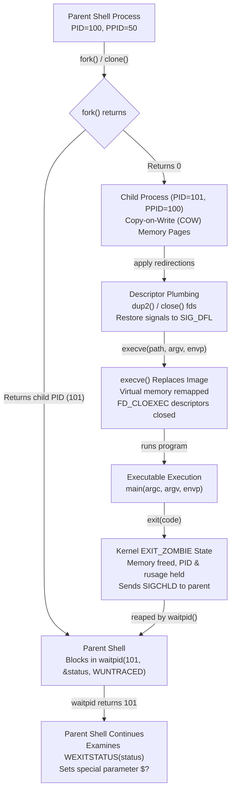

# Processes: fork, exec, and wait

> [!summary] Claim
> Every external shell command and asynchronous job is orchestrated by three primitive operations: `fork` duplicates the execution context via copy-on-write page tables, `exec` replaces the process image while preserving open file descriptors and signal masks, and `wait` reaps termination status to release the kernel process table entry.

Part of [The Unix Process Model](README.md) in [Shell and Unix Engineering](../README.md).

## TL;DR

- Mechanism: The shell duplicates its virtual memory and open descriptor tables via `fork(2)` (or `clone(2)`), configures file redirections and signal dispositions in the child, overlays a new executable image via `execve(2)`, and blocks in the parent via `waitpid(2)` until the child terminates (`(POSIX.1-2024 XCU 2.9.1.4, XSH fork, exec, wait)`).
- Rule: Subshells created via `( ... )` execute within an isolated duplicate environment where modifications to shell variables, working directory, file creation masks, and limits never affect the parent shell, yet special parameter `$$` remains strictly pinned to the parent shell process ID (`(POSIX.1-2024 XCU 2.5.2, 2.13)`).
- Trap: Spawning asynchronous background jobs (`&`) without calling the `wait` builtin leaves terminated children in kernel state `EXIT_ZOMBIE`, exhausting the operating system process ID table and causing future process creation to fail with `EAGAIN` (`(POSIX.1-2024 XSH wait, fork)`).
- Portability fact: Signal exit codes diverge across shells: standard shells map signal `N` to `128 + N` (143 for `SIGTERM`), `ksh93` uses `256 + N` (271), `yash` uses `384 + N` (399), while `mksh` R59 can report 0 because it catches `SIGTERM` even when non-interactive, so a `kill` that lands in the forked child before its `execve` is swallowed and the job runs to completion (a `kill` sent after a 1 s delay yields 143; `posh` 0.14.1 reports 143 either way), and native `zsh` plus `ksh93` run the final pipeline stage in the main shell (`(POSIX.1-2024 XCU 2.8.2, 2.9.2, 2.13)`).
- When not to use it: Avoid tight shell loops that repeatedly invoke external processes or subshells for string manipulation or arithmetic; use native shell parameter expansion, builtins, batch stream utilities (`awk`, `xargs`), or compiled languages to eliminate page table allocation and context switching overhead.

## Mental model



The parent shell calls `fork(2)` to create a child process that initially shares physical memory pages through copy-on-write page table flags.
In the child process, the shell plumbs file descriptors using `dup2(2)`, unblocks signal masks, and resets caught signal dispositions before executing `execve(2)`.
The `execve(2)` system call discards the old address space, loads the new ELF segments, closes any file descriptors marked `FD_CLOEXEC`, and begins execution at the binary entry point.
When the program terminates via `exit(2)`, the kernel deallocates its memory mappings but retains its exit status and resource metrics in the process table as an `EXIT_ZOMBIE`.
The parent shell, blocked in `waitpid(2)`, consumes the exit status, causing the kernel to release the child process ID, and sets `$?` for subsequent script execution.

## How it works

### 1. The fork primitive and Copy-on-Write memory

The Unix process lifecycle begins with `fork(2)` or `_Fork(2)` (`(POSIX.1-2024 XSH fork, _Fork)`).
Under Linux, glibc `fork()` reaches `arch_fork` (`sysdeps/unix/sysv/linux/arch-fork.h`), which issues the `clone(2)` system call with flags `CLONE_CHILD_SETTID | CLONE_CHILD_CLEARTID | SIGCHLD`; the kernel services it in `kernel_clone` (`(Linux kernel/fork.c, kernel_clone)`, checked on mainline as of 2026-10).
The kernel routine `copy_process` duplicates the caller task structure (`struct task_struct`), increments reference counts on shared structures, and allocates a new process identifier (`alloc_pid`).

```
Parent Task Struct                     Child Task Struct
+------------------------+             +------------------------+
| PID: 100               |             | PID: 101               |
| PPID: 50               |             | PPID: 100              |
| files_struct* -------->+---+     +-->| files_struct* -------->| (duplicate fd table)
| sighand_struct* ------>|   |     |   | sighand_struct* ------>| (duplicate dispositions)
| mm_struct* ----------->+---|-----+-->| mm_struct* (COW)       |
+------------------------+   |     |   +------------------------+
                             v     v
                 [ Shared Physical Pages: Read-Only ]
                 [ MMU Page Fault on Write -> Copy ]
```

The memory management descriptor (`struct mm_struct`) is duplicated via `copy_mm`.
Rather than performing a physical copy of all memory pages, the kernel sets each writable page table entry in both parent and child to read-only and sets the copy-on-write bit.
When either process attempts to write to a page, the memory management unit triggers a page fault (`do_wp_page`).
The kernel allocates a fresh base page frame (4 KiB on x86_64; arm64 kernels may be built with 4, 16, or 64 KiB pages), copies the existing page contents, updates the writing process page table with write permissions, and flushes the Translation Lookaside Buffer (TLB).

State preserved across `fork`:
- Environment variables and memory mappings.
- Open file descriptors, which point to the identical open file descriptions and share file offsets (`(POSIX.1-2024 XSH fork)`).
- Current working directory and root directory (`struct fs_struct`).
- File creation mask (`umask`).
- Process signal mask and signal dispositions.
- Resource limits (`struct rlimit`).

State reset or modified across `fork`:
- Process ID (`PID`) and Parent Process ID (`PPID`).
- CPU-time clocks (`tms_utime`, `tms_stime`) reset to zero.
- Pending signals set to an empty set.
- Process locks set by `fcntl(2)` record locking are not inherited (`(POSIX.1-2024 XSH fork)`).
- Pending alarms created via `alarm(2)` are canceled.
- In `(POSIX.1-2024 XSH fcntl)`, file descriptors with the `FD_CLOFORK` flag set are closed in the child process.

Under Austin Group Defect 62 (Final Accepted Text `0000062:0000193`, https://austingroupbugs.net/view.php?id=62), POSIX.1-2024 removed the requirement that `fork()` be async-signal-safe due to multithreaded allocator deadlocks and introduced `_Fork()` (`(POSIX.1-2024 XSH _Fork)`).
The `_Fork()` function duplicates the process without invoking `pthread_atfork()` handlers, ensuring async-signal-safety.

### 2. The execve primitive and process image replacement

The `exec` family replaces the current process memory image with a new executable image (`(POSIX.1-2024 XSH exec)`).
All functions in the family (`execl`, `execlp`, `execle`, `execv`, `execvp`, `fexecve`) eventually invoke the underlying system call `execve(2)`:

```c
int execve(const char *pathname, char *const argv[], char *const envp[]);
```

In the Linux kernel (`fs/exec.c, do_execveat_common`), the kernel performs the following sequence:
1. Allocates a `linux_binprm` structure containing execution credentials, argument counts, and stack pages.
2. Checks file permissions: fails with `EACCES` if execute permission is absent or the mount is marked `noexec`.
3. Reads the binary header into `bprm->buf` (256 bytes defined by `BINPRM_BUF_SIZE`).
4. Iterates over registered binary formats via `search_binary_handler`:
   - If the file starts with `#!`, `binfmt_script.c` parses the interpreter path and optional argument, replaces `argv[0]`, and recursively calls `search_binary_handler`.
   - If the file is an ELF binary, `binfmt_elf.c` parses program headers, verifies `PT_INTERP` (the dynamic linker, typically `/lib64/ld-linux-x86-64.so.2`), and sets up memory maps.
5. Invokes `begin_new_exec`: releases the old virtual memory space (`mm_struct`), destroys any sibling threads in the thread group, and resets signal handlers.
6. Inside `begin_new_exec`, closes the file descriptors with the `FD_CLOEXEC` flag set: older kernels call `do_close_on_exec`, while mainline (as of 2026-10) calls `close_cloexec_files` in `fs/file.c` after `unshare_fd`.
7. Maps the ELF text, data, and BSS segments into the address space, maps the user stack, and pushes `argv`, `envp`, and the ELF Auxiliary Vector (`auxv`).
8. Transfers execution control to the dynamic linker entry point or directly to `_start`.

State preserved across `execve`:
- Process ID (`PID`) and Parent Process ID (`PPID`).
- Open file descriptors that do not have `FD_CLOEXEC` set.
- Current working directory and `umask`.
- Blocked signal mask.
- Ignored signals: any signal set to `SIG_IGN` remains ignored in the new program (`(POSIX.1-2024 XSH exec)`).

State reset across `execve`:
- Caught signals: any signal with a custom signal-catching handler is reset to `SIG_DFL` because the handler memory address is no longer valid.
- Virtual memory mappings: heap, stack, and anonymous mappings are discarded.
- Alternate signal stack (`sigaltstack(2)`) is unallocated.
- Memory locks (`mlock(2)`) are dropped.

When `execve` returns `ENOEXEC` on an executable file that lacks an ELF header or valid `#!` shebang, POSIX requires command search utilities (`execlp`, `execvp`) to execute a command interpreter (`(POSIX.1-2024 XSH exec)`).
In GNU Bash (`execute_cmd.c, shell_execve`), if `execve` fails with `ENOEXEC` and the file is not binary, Bash re-reads the file and executes it within a subshell environment (verified 2026-10: bash 3.2.57, 4.4, 5.2, and 5.3 run such a file in a bash child, not `/bin/sh`).

### 3. The wait primitive, zombies, and exit status encoding

When a child process exits by invoking `exit(2)` or receiving a terminating signal, the kernel frees its address space and closes its file descriptors.
However, the kernel retains the process entry in `EXIT_ZOMBIE` state inside the task table (`(Linux kernel/exit.c, do_wait)`).
The zombie preserves the process ID, the termination status, and resource usage metrics (`struct rusage`) until reaped by the parent (`[[Zombies-and-Orphans]]`).

The parent collects status using `wait(2)` or `waitpid(2)`:

```c
pid_t waitpid(pid_t pid, int *wstatus, int options);
```

The `pid` argument controls reaping scope (`(POSIX.1-2024 XSH wait)`):
- `pid > 0`: Wait for the specific child with matching process ID.
- `pid == 0`: Wait for any child whose process group ID equals that of the caller.
- `pid == -1`: Wait for any child process (equivalent to `wait()`).
- `pid < -1`: Wait for any child whose process group ID equals `abs(pid)`.

The `options` bitmask accepts:
- `WNOHANG`: Return immediately if no child has exited (returns 0).
- `WUNTRACED`: Report status for stopped children.
- `WCONTINUED`: Report status for resumed children (`(POSIX.1-2024 XSI)`).

The kernel encodes the wait status integer as:
- Exited normally: lower 8 bits are 0; bits 8-15 contain the lowest 8 bits of the value passed to `exit()` (`WIFEXITED(status)`, `WEXITSTATUS(status)`).
- Terminated by signal: lower 7 bits contain the signal number; bit 7 indicates whether a core dump occurred (`WIFSIGNALED(status)`, `WTERMSIG(status)`, `WCOREDUMP(status)`).
- Stopped by signal: lower 8 bits are `0x7f`; bits 8-15 contain the stop signal number (`WIFSTOPPED(status)`, `WSTOPSIG(status)`).

```
Wait Status Bit Layout (Linux and traditional Unix; POSIX specifies only the W* macros):
Normal Exit:     [ 15 ... 8: Exit Code (8 bits) ] [ 7 ... 0: 0x00 ]
Signal Death:    [ 15 ... 8: Unused             ] [ Bit 7: CoreDump ] [ 6 ... 0: TermSignal ]
Stopped:         [ 15 ... 8: StopSignal (8 bits)] [ 7 ... 0: 0x7F ]
```

POSIX shells translate signal termination into an exit status greater than 128 (`(POSIX.1-2024 XCU 2.8.2, utilities/wait)`).
Standard shells (`bash`, `dash`, `busybox`, `zsh`, `posh`) compute `128 + WTERMSIG(status)`:
- `SIGINT` (signal 2) yields exit status `130`.
- `SIGKILL` (signal 9) yields exit status `137`.
- `SIGTERM` (signal 15) yields exit status `143`.

POSIX.1-2024 XCU 2.8.2 states that "shell implementations are permitted to assign an exit status greater than 255 if a command terminates due to a signal"; Austin Group Defect 51 kept that permission (its initial proposal to cap the range below 256, which called the ksh93 encoding a misfeature, was not adopted) and specified how such a status maps onto the shell's own wait status (https://austingroupbugs.net/view.php?id=51).
The Korn shell (`ksh93`) assigns `256 + WTERMSIG(status)`, yielding `271` for `SIGTERM`.
Yet Another Shell (`yash`) computes `384 + WTERMSIG(status)` ("the exit status is the signal number plus 384", Command Execution, Yash manual at https://magicant.github.io/yash/doc/exec.html), yielding `399` for `SIGTERM`, which conforms to POSIX as a documented extension greater than 128.
Conversely, `mksh` R59 can report `0` for a background job that was sent `SIGTERM` immediately after `&`.
The cause is a race, not its `sleep` builtin: Debian's `mksh` resolves `sleep` to `/usr/bin/sleep` and still reports 0, and the non-interactive Alpine `mksh` process shows `SIGTERM` in its caught mask (`SigCgt: 0000000008016007` in `/proc/$$/status`).
A `kill` that reaches the forked child before it restores default dispositions and calls `execve` is consumed by that handler, the program then runs to completion (`sleep 3` took 3 s), and `wait` correctly reports its normal exit status 0; the same `kill` sent after a 1 s delay yields 143 (verified 2026-10, Alpine `mksh` 59c and Debian `mksh` 59c).
`posh` 0.14.1, also pdksh-derived, reports 143 in the same probe (lab, Debian 13).

### 4. Shell command execution mechanics

When the shell encounters an external simple command (`(POSIX.1-2024 XCU 2.9.1.4)`):
1. In GNU Bash (`execute_cmd.c, execute_simple_command`), the shell checks whether the command is a builtin, a shell function, or on disk.
2. If disk execution is required, Bash calls `make_child` (`jobs.c, make_child`), which calls `fork()`.
3. If job control is enabled, the parent shell assigns the child to a new process group via `setpgid(2)` and hands foreground terminal control to the child via `tcsetpgrp(3)` (`[[Sessions-Process-Groups-and-Controlling-Terminals]]`).
4. In the child process:
   - Traps caught by the parent shell are reset to default actions (`SIG_DFL`) (`(POSIX.1-2024 XCU 2.13)`).
   - Signals ignored by the parent shell remain ignored (`SIG_IGN`).
   - If executed as an asynchronous background job (`&`), `SIGINT` and `SIGQUIT` are set to `SIG_IGN` when job control is disabled (`(POSIX.1-2024 XCU 2.12)`).
   - Redirections are applied in order (`do_redirections`).
   - Closed file descriptors specified by pipeline bitmap are closed.
   - `shell_execve` calls `execve(pathname, argv, envp)`.
5. In the parent shell:
   - For foreground commands: Bash calls `wait_for(child_pid)` (`jobs.c, wait_for`), which blocks until `waitchld` reaps the child status via `waitpid`.
   - Bash reclaims terminal ownership via `tcsetpgrp(tty_fd, shell_pgid)` and sets `$?` to the reaped exit status.
   - For background commands (`&`): the parent records the child process ID in special parameter `$!` and proceeds to read the next command without waiting.

Optimization (no-fork exec):
When the final command of a shell script or subshell is an external executable and no traps are active, modern shells optimize execution by calling `execve` directly in the current process, eliminating the redundant `fork()` call (`(bash-5.3 execute_cmd.c, execute_disk_command)` flag `CMD_NO_FORK`).
Inside a `( ... )` subshell every shell in the matrix execs the final external command without a second fork, but for the last command of a multi-command `sh -c` string only bash 5.2 and 5.3, ksh93, zsh, yash, and BusyBox ash skip the fork, while dash 0.5.12, posh 0.14.1, mksh R59, and bash 3.2 and 4.4 still fork (verified 2026-10 by comparing `$$` with the child's `$$` and `$PPID`).

Pipelines (`cmd1 | cmd2`):
The shell calls `pipe(2)` to create a unidirectional data channel (`[[Pipes-and-FIFOs]]`).
The shell forks both commands.
The child for `cmd1` executes `dup2(pipe_fds[1], 1)` and closes both pipe descriptors.
The child for `cmd2` executes `dup2(pipe_fds[0], 0)` and closes both pipe descriptors.
The parent closes both ends of the pipe and waits for the pipeline.
By default, the exit status of the pipeline is that of the last command (`cmd2`), unless `pipefail` is enabled (`(POSIX.1-2024 XCU 2.9.2)`).

## Numbers and limits

| Metric / Parameter | Value / Range | Scope / Platform | Source |
|---|---|---|---|
| `fork()` latency (small address space) | about 80 - 120 us per `( : )` subshell (fork plus wait) | Linux 7.2 arm64 container, dash 0.5.12 and bash 5.2 | Measured 2026-10: 1,000 subshells took 82 ms (dash) and 122 ms (bash) |
| `fork()` latency (large address space, 10 GB) | about 90 - 130 ms (9 - 13 ms per GB of RSS) | Linux on physical hosts and VMware (copying page tables) | Redis latency documentation, fork time table (as of 2026-10) |
| Linux default `pid_max` | 32,768 (`PID_MAX_DEFAULT`), raised at boot to 1,024 per possible CPU when larger; ceiling `PID_MAX_LIMIT` 4,194,304 on 64-bit | Linux kernel sysctl `/proc/sys/kernel/pid_max` (the matrix container reads 4194304) | Linux `include/linux/threads.h`, `proc_sys_kernel(5)` (as of 2026-10) |
| Linux maximum thread/process count | `/proc/sys/kernel/threads-max` | Linux kernel | Linux kernel sysctl |
| POSIX minimum `{_POSIX_ARG_MAX}` | 4,096 bytes | POSIX requirement | `(POSIX.1-2024 XBD <limits.h>)` |
| Linux default `ARG_MAX` | 2,097,152 bytes (2 MiB) | Linux kernel 6.x and 7.x (1/4 of the 8 MiB default stack limit) | Linux `fs/exec.c`; `getconf ARG_MAX` with `ulimit -s` 8192 in the Debian 13 container (2026-10) |
| macOS default `ARG_MAX` | 1,048,576 bytes (1 MiB) | Darwin 27 (verified on the matrix host) | `sysctl kern.argmax` (2026-10) |
| Linux `BINPRM_BUF_SIZE` (shebang limit) | 256 bytes | Linux mainline (as of 2026-10) | Linux `include/uapi/linux/binfmts.h` |
| Signal exit status offset (standard shells) | `128 + N` (SIGTERM=143, SIGKILL=137) | bash, dash, zsh, busybox, posh | `(POSIX.1-2024 XCU 2.8.2)`, lab proven for SIGTERM |
| Signal exit status offset (`ksh93`) | `256 + N` (SIGTERM=271, SIGKILL=265) | AT&T ksh93u+ 2012, ksh93u+m 1.0.10 | `(POSIX.1-2024 XCU 2.8.2)` permits values above 255, lab proven for SIGTERM |
| Signal exit status offset (`yash`) | `384 + N` (SIGTERM=399, SIGKILL=393) | Yet Another Shell (yash) | Yash manual (as of 2026-10), lab proven |
| Signal exit status on early-killed async job (`mksh`) | 0 when `SIGTERM` reaches the child before its `execve`; 143 after a 1 s delay | MirBSD mksh R59 (Alpine 59c, Debian 59c) | Lab proven, mechanism verified 2026-10 (caught `SIGTERM`, job ran to completion); `posh` 0.14.1 reports 143 |
| Unknown PID wait exit status | 127 | All POSIX-conforming shells | `(POSIX.1-2024 XCU wait)`, lab proven |
| Pipeline variable isolation | Isolated (initial value retained) | bash, dash, mksh, yash, posh, busybox, zsh-sh | `(POSIX.1-2024 XCU 2.13)`, lab proven |
| Pipeline variable persistence | Mutated (runs last stage in main shell) | ksh93, zsh native | ksh93 / zsh manuals, lab proven |

## Portability

The table below contrasts process model execution across shell implementations and userlands:

| Feature / Behavior | POSIX sh | macOS bash 3.2 | bash 5.3 | zsh (native) | zsh (`--emulate sh`) | dash | ksh93 | mksh | yash | posh | BusyBox ash |
|---|---|---|---|---|---|---|---|---|---|---|---|
| Subshell `$$` invariant | Yes | Yes | Yes | Yes | Yes | Yes | Yes | Yes | Yes | Yes | Yes |
| Subshell actual PID introspection | None | None (`$BASHPID` needs bash 4.0+) | `$BASHPID` | `$sysparams[pid]` (`zsh/system`) | `$sysparams[pid]` (`zsh/system`) | None | `${.sh.pid}` (93u+m only) | `$BASHPID` | None | None | None |
| Last pipeline stage execution | Subshell | Subshell | Subshell (`lastpipe` opt) | Current Shell | Subshell | Subshell | Current Shell | Subshell | Subshell | Subshell | Subshell |
| `wait -n` (wait for next child) | No | No | Yes (4.3+) | No | No | No | No | No | No | No | Accepted, but 1.37 returned 129, not the job status |
| `wait -p var` (capture reaped PID) | No | No | Yes (5.1+) | No | No | No | No | No | No | No | No |
| Exit status on `SIGTERM` (15) | `>128` | 143 | 143 | 143 | 143 | 143 | 271 | 143 (0 if the kill races `execve`) | 399 | 143 | 143 |
| Unknown PID wait exit | 127 | 127 | 127 | 127 | 127 | 127 | 127 | 127 | 127 | 127 | 127 |
| `exec` no-fork subshell optimization | Permitted | Yes | Yes | Yes | Yes | Yes | Yes | Yes | Yes | Yes | Yes |
| Script without `#!` execution (`ENOEXEC`) | Interpreter | Runs as bash | Runs as bash | Runs `/bin/sh` | Runs `/bin/sh` | Runs `/bin/sh` | Runs as ksh (93u+ 2012); 93u+m 1.0.10 aborted in `realloc()` | Runs `/bin/sh` | Runs `/bin/sh` | Runs `/bin/sh` | Runs as ash |
| Descriptors > 2 `FD_CLOEXEC` on `exec` | Unspecified | Inherits | Inherits | Inherits | Inherits | Inherits | Closes | Closes | Inherits | Inherits | Inherits |

## Worked example

The companion lab [lab](../labs/01-processes-fork-exec-and-wait/) provides an executable probe and Bats test matrix verifying subshell isolation, PID invariance, descriptor preservation across `exec`, background process reaping, and signal exit status encoding.

Here is the probe script from the lab:

```sh
#!/bin/sh
# shellcheck shell=sh
# Probe script for Process model: fork, exec, wait behavior.

set -u

# 1. Subshell isolation (fork copies state, child mutations do not affect parent)
var="parent"
# shellcheck disable=SC2030 # deliberate subshell environment isolation test
(
  var="child"
  : "$var"
)
# shellcheck disable=SC2031 # verifying parent retained pre-subshell value
printf '1_subshell_isolation: orig_var=<%s> child_var=<%s>\n' "parent" "$var"

# 2. Subshell $$ invariant (POSIX.1-2024 XCU 2.13: $$ expands to invoking shell PID)
parent_pid="$$"
sub_pid=$(printf '%s' "$$")
if [ "$parent_pid" = "$sub_pid" ]; then
  printf '2_subshell_dollar_dollar: parent_pid=child_pid=match\n'
else
  printf '2_subshell_dollar_dollar: parent_pid=child_pid=diverge\n'
fi

# 3. Exec replaces process image without changing PID
# Child shell records its PID, then execs another shell instance to print its PID
# shellcheck disable=SC2016 # single quotes protect inner expansions
exec_match=$(sh -c 'p="$$"; exec sh -c "echo \"$p == \$\$\""')
case $exec_match in
  *" == "*)
    left=${exec_match%% == *}
    right=${exec_match##* == }
    if [ "$left" = "$right" ]; then
      printf '3_exec_pid_preservation: before=after=match\n'
    else
      printf '3_exec_pid_preservation: before=after=mismatch\n'
    fi
    ;;
  *)
    printf '3_exec_pid_preservation: error\n'
    ;;
esac

# 4. Asynchronous job ($!) and wait reaping exit code
sh -c 'exit 42' &
bg_pid=$!
wait "$bg_pid"
bg_rc=$?
printf '4_async_wait_reap: status=%s\n' "$bg_rc"

# 5. Signal termination exit status (kill -15 / SIGTERM)
# Sleep in background, kill with SIGTERM, wait for exit status
sleep 10 &
term_pid=$!
kill -15 "$term_pid" 2>/dev/null
wait "$term_pid" 2>/dev/null
term_rc=$?
printf '5_signal_termination: status=%s\n' "$term_rc"

# 6. Pipeline execution environment (subshell vs current environment)
pipe_var="initial"
# shellcheck disable=SC2030 # deliberate pipeline subshell environment test
printf 'data\n' | { pipe_var="mutated"; }
# shellcheck disable=SC2031 # intentional test of pipeline variable scope
printf '6_pipeline_isolation: var=%s\n' "$pipe_var"

# 7. Wait on unknown / non-child PID returns 127
wait 999999 2>/dev/null
unknown_rc=$?
printf '7_wait_unknown_pid: status=%s\n' "$unknown_rc"
```

Expected output under standard POSIX shells (`bash`, `dash`, `busybox`, `zsh-sh`, `posh`):

```text
1_subshell_isolation: orig_var=<parent> child_var=<parent>
2_subshell_dollar_dollar: parent_pid=child_pid=match
3_exec_pid_preservation: before=after=match
4_async_wait_reap: status=42
5_signal_termination: status=143
6_pipeline_isolation: var=initial
7_wait_unknown_pid: status=127
```

Expected output under native `zsh`:

```text
1_subshell_isolation: orig_var=<parent> child_var=<parent>
2_subshell_dollar_dollar: parent_pid=child_pid=match
3_exec_pid_preservation: before=after=match
4_async_wait_reap: status=42
5_signal_termination: status=143
6_pipeline_isolation: var=mutated
7_wait_unknown_pid: status=127
```

Expected output under `ksh93`:

```text
1_subshell_isolation: orig_var=<parent> child_var=<parent>
2_subshell_dollar_dollar: parent_pid=child_pid=match
3_exec_pid_preservation: before=after=match
4_async_wait_reap: status=42
5_signal_termination: status=271
6_pipeline_isolation: var=mutated
7_wait_unknown_pid: status=127
```

Expected output under `yash`:

```text
1_subshell_isolation: orig_var=<parent> child_var=<parent>
2_subshell_dollar_dollar: parent_pid=child_pid=match
3_exec_pid_preservation: before=after=match
4_async_wait_reap: status=42
5_signal_termination: status=399
6_pipeline_isolation: var=initial
7_wait_unknown_pid: status=127
```

Expected output under `mksh`:

```text
1_subshell_isolation: orig_var=<parent> child_var=<parent>
2_subshell_dollar_dollar: parent_pid=child_pid=match
3_exec_pid_preservation: before=after=match
4_async_wait_reap: status=42
5_signal_termination: status=0
6_pipeline_isolation: var=initial
7_wait_unknown_pid: status=127
```

## Pitfalls

> [!warning] Pipeline Subshell Variable Loss
> Trigger: Piping data into a loop, such as `cat data.txt | while read -r line; do count=$((count + 1)); done`.
> Symptom: Inside the loop `$count` increments, but immediately following the loop `$count` evaluates to its initial value (typically 0 or empty).
> Root cause: According to `(POSIX.1-2024 XCU 2.13)`, each command of a pipeline is executed in a separate subshell environment, so variable mutations occur inside a forked child process memory image that is discarded when the pipeline completes.
> Fix: Use input redirection into the loop directly without a pipeline: `while read -r line; do count=$((count + 1)); done < data.txt`.
> In Bash, execute `shopt -s lastpipe` within non-interactive scripts to run the final pipeline element in the parent shell.

> [!warning] Zombie Process Table Exhaustion
> Trigger: Spawning background processes (`command &`) inside long-running daemon scripts or polling loops without invoking `wait` or setting a `SIGCHLD` trap.
> Symptom: Over time, the operating system refuses to spawn any new processes, failing with error `fork: Resource temporarily unavailable` (`EAGAIN`), while `ps aux` reveals thousands of `<defunct>` processes.
> Root cause: Terminated child processes remain in kernel state `EXIT_ZOMBIE` until reaped by their parent via `waitpid(2)`.
> The kernel cannot release their process IDs, eventually exhausting `/proc/sys/kernel/pid_max`.
> Fix: Periodically reap background jobs using `wait` or a `SIGCHLD` handler: `trap 'wait -n 2>/dev/null || true' CHLD` in Bash, or invoke `wait` periodically in batch loops.

> [!warning] Signal Leakage Across `exec`
> Trigger: Launching a child program via `exec` after setting an ignored signal disposition via `trap '' INT` or `trap '' TERM`.
> Symptom: The target application fails to respond to graceful shutdown signals (`SIGTERM` or `SIGINT`) or cannot be interrupted via Ctrl+C, forcing operators to escalate to uncatchable `SIGKILL`.
> Root cause: While caught signals are reset to `SIG_DFL` across `execve(2)`, POSIX specifies that ignored signals (`SIG_IGN`) remain ignored across `exec` (`(POSIX.1-2024 XSH exec)`).
> If the invoked binary does not explicitly register a signal handler, it inherits the ignored state.
> Fix: Restore default signal dispositions before calling `exec`: `trap - INT TERM; exec my_daemon`.

> [!warning] The Subshell `$$` Invariant Fallacy
> Trigger: Relying on `$$` to generate unique temporary file paths inside concurrent subshells or background jobs: `( work > "/tmp/work-$$.tmp" ) &`.
> Symptom: Intermittent file corruption, race conditions, or security vulnerabilities caused by concurrent jobs overwriting identical file paths.
> Root cause: POSIX requires `$$` to expand to the process ID of the invoked shell rather than the subshell process ID (`(POSIX.1-2024 XCU 2.13)`).
> Concurrent subshells within the same script produce identical `$$` expansions.
> Fix: Use `mktemp` (`mktemp "${TMPDIR:-/tmp}/work.XXXXXX"`) or inspect `$BASHPID` in Bash.

> [!warning] Container PID 1 Signal Forwarding and Zombie Swallowing
> Trigger: Running a shell wrapper script as the container `ENTRYPOINT` without using `exec` to invoke the target daemon (e.g. `sh -c "/entrypoint.sh"` followed by `my-daemon`).
> Symptom: Docker or Kubernetes stop operations wait out the grace period (10 s by default for `docker stop` on Linux, 30 s by default for a Kubernetes Pod) before forcibly killing the container with `SIGKILL`, and zombie processes from child tasks accumulate indefinitely.
> Root cause: In Linux, PID 1 has unique semantics: the kernel ignores unhandled signals including `SIGTERM` unless explicitly handled, and default shells do not forward signals or reap orphaned child processes (`[[Zombies-and-Orphans]]`).
> Fix: Use `exec my-daemon "$@"` at the end of the entrypoint script so the daemon replaces the shell and assumes PID 1, or use an init supervisor such as `tini` or `dumb-init`.

> [!warning] Non-Standard and Zero Signal Exit Status Divergence
> Trigger: Inspecting `$?` or `wait` exit status after killing a process with a signal, expecting universal `128 + N` (such as 143 for `SIGTERM`) or assuming any signal death yields a non-zero code.
> Symptom: Supervision logic or error handlers fail to detect killed worker jobs in `mksh` (where a `SIGTERM` sent right after `&` is swallowed before `execve` and `wait` later reaps `0`), or strict equality checks (`[ "$?" -eq 143 ]`) break under `ksh93` (status `271`) and `yash` (status `399`).
> Root cause: POSIX requires only that exit status on signal termination be greater than 128 (`(POSIX.1-2024 XCU 2.8.2)`).
> `ksh93` uses `256 + N` (XCU 2.8.2 permits values above 255, a permission Austin Group Defect 51 kept) and `yash` uses `384 + N` as documented extensions, while non-interactive `mksh` catches `SIGTERM`, so a signal that lands in the forked child before `execve` never reaches the program, which then exits normally.
> Fix: Test for termination via signal using ranges (`[ "$status" -gt 128 ]`) rather than exact constants, under `mksh` do not signal a job in the instant after `&` (synchronize on a readiness file or delay first), and in C or Python supervisors inspect `WIFSIGNALED` and `WTERMSIG` directly.

## Security and robustness

### 1. Privilege drop ordering and verification

When executing setuid utilities or dropping privileges from `root` to an unprivileged service account:
1. Revoke supplementary group memberships via `setgroups(0, NULL)`.
2. Change the group ID via `setgid(target_gid)`.
3. Change the user ID via `setuid(target_uid)`.
4. Always verify that `getuid()` and `geteuid()` match the target ID, and check return codes.
Changing user ID before group ID prevents dropping group privileges due to loss of permission.

### 2. File descriptor leakage and `FD_CLOEXEC`

File descriptors left open in parent processes are inherited across `fork` and `execve` unless marked with `FD_CLOEXEC` (`[[Close-on-Exec-and-Descriptor-Inheritance]]`).
If a privileged script opens a sensitive handle (such as `/etc/shadow`, a database connection socket, or a cryptographic key file) and invokes an external utility without `FD_CLOEXEC`, the child binary gains unauthorized read and write access to the resource.
Always use `O_CLOEXEC` on `open(2)` or set `FD_CLOEXEC` via `fcntl(fd, F_SETFD, FD_CLOEXEC)`.
In POSIX.1-2024, use `FD_CLOFORK` to prevent inheritance across `fork()` even before `exec()` occurs (`(POSIX.1-2024 XSH fcntl)`).

### 3. Argument injection and command injection boundaries

Never pass untrusted user input into `sh -c "cmd $input"` or `eval` (`[[Command-Injection]]`).
A command string passed to `sh -c` undergoes full shell parsing, word splitting, and expansion.
When invoking programs from high-level languages (Python, Go, Node.js), pass argument vectors directly to `execve` via argument slices (`subprocess.run(["cmd", arg])`), bypassing the shell parser entirely.

### 4. PID rollover and signal targeting races

On heavily loaded systems where process IDs roll over quickly, sending signals to a recorded PID (`kill -9 $pid`) without verifying process identity creates a dangerous race condition: if the target process has terminated and the operating system reallocated that PID to an unrelated service, the signal terminates an innocent workload.
On Linux 5.3+, use `pidfd_open(2)` and `pidfd_send_signal(2)` to bind signals to file descriptor handles that do not suffer from PID recycling races.

## The principal's view

At the principal engineer level, process execution is viewed through the lens of operating system economics, tail latency, and system boundary contracts.

### The fork cost model

Every `fork()` carries a non-negotiable tax:
- Duplicating page table hierarchies (a fully mapped 512 GB address space with 4 KiB pages needs about 1 GiB of last-level page table entries: 512 GB / 4 KiB * 8 bytes, the formula the Redis latency documentation uses).
- Allocating kernel task structures and file descriptor arrays.
- Invalidating hardware translation lookaside buffers (TLBs) and branch target buffers.
- Forcing CPU context switches between address spaces.

Executing 1,000 subshells in a loop costs on the order of 100 ms of pure process overhead (measured 2026-10: 82 ms in dash and 122 ms in bash 5.2 for 1,000 `( : )` subshells, 120 ms and 178 ms for 1,000 `/bin/true` fork and exec pairs, Debian 13 arm64 container), and the cost grows with the parent's memory size because page tables are copied.
When designing data pipelines, batch operations must stream across pipes or process files in chunks via streaming utilities (`awk`, `sed`, `jq`) rather than invoking shell loops.

### Architecture boundaries: when to graduate from shell

Shell scripts are ideal for process orchestration: gluing independent executables together with pipes, redirections, and exit code propagation.
Graduate from shell to a compiled systems language (Go, Rust, or C++) when:
1. Concurrency requires thread pools, mutexes, or channels rather than process forks.
2. Latency requirements demand steady-state execution without process startup penalties (< 10 ms).
3. Memory state must be shared and modified across concurrent tasks without copy-on-write overhead.
4. Error handling requires structured types and exception propagation rather than scalar integer exit codes.
5. Complex IPC requires bidirectional streaming, shared memory rings, or descriptor passing over Unix sockets.

### Production operational standards

For production container images and server fleets:
- Mandate `exec "$@"` at the conclusion of entrypoint wrapper scripts to ensure the application binary receives OS signals directly.
- Configure `ulimit -u` (`RLIMIT_NPROC`) to prevent runaway processes from initiating fork bombs that crash virtual machines.
- Ensure all CI and cron tasks use `set -e` combined with explicit error traps to ensure failed commands terminate scripts immediately rather than leaving orphaned background jobs.
- Account for signal exit status divergence across shell families: standard shells produce `128 + N`, `ksh93` produces `256 + N`, `yash` produces `384 + N`, and `mksh` can report exit code 0 when the signal reaches a background child before its `execve`; test status ranges (`$? -gt 128`) rather than hardcoded magic numbers.

## Interview questions

> [!question] L5: Predict the output of the following script and explain the exact values of variables and process identifiers:
> ```sh
> count=10
> (
>   count=20
>   cd /tmp
>   echo "Inside: count=$count, dir=$(pwd), pid=$$"
> )
> echo "Outside: count=$count, dir=$(pwd), pid=$$"
> ```
>
> > [!success]- Answer
> > The output displays `Inside: count=20, dir=/tmp, pid=<PID>` followed by `Outside: count=10, dir=<ORIG_DIR>, pid=<PID>`.
> > The parentheses construct `( ... )` executes inside a forked subshell environment.
> > Under `(POSIX.1-2024 XCU 2.13)`, modifications to shell variables and the current working directory remain local to the subshell memory space and are discarded upon termination.
> > Special parameter `$$` evaluates to the process ID of the root invoking shell in both contexts, as required by POSIX, even though the subshell executes in an independent child process.
> >
> > Follow-up: How can an engineer running Bash obtain the actual process ID of the child subshell?

> [!question] L5: Detail what happens across `fork()` followed by `execve()`, including what kernel state is duplicated, what is shared, and what is reset.
>
> > [!success]- Answer
> > During `fork()`, the kernel duplicates the task structure, allocates a new PID, and marks memory pages as copy-on-write.
> > The parent and child share open file descriptions, offsets, and file descriptor flags.
> > During `execve()`, the kernel discards the old virtual address space and allocates new memory maps for the ELF binary.
> > File descriptors marked `FD_CLOEXEC` are closed, while unmarked descriptors remain open.
> > Signal handlers set to custom functions are reset to `SIG_DFL`, while ignored signals remain `SIG_IGN`, and the signal mask is preserved.
> >
> > Follow-up: If a parent process opens a file descriptor with `O_CLOEXEC`, what happens to that descriptor in the child before and after `execve()`?

> [!question] L6: Debug this script where the summary count always prints 0, identifying the root cause and three production fixes:
> ```sh
> total=0
> cat /var/log/app.log | while read -r line; do
>   if [ -n "$line" ]; then
>     total=$((total + 1))
>   fi
> done
> echo "Total lines: $total"
> ```
>
> > [!success]- Answer
> > The pipeline operator `|` causes the `while` loop to execute in a subshell environment under POSIX rules (`(POSIX.1-2024 XCU 2.13)`).
> > The variable `total` is incremented inside the child process address space, which is discarded when the pipeline finishes.
> > Fix 1: Eliminate the pipeline and redirect input directly into the loop: `while read -r line; do ... done < /var/log/app.log`.
> > Fix 2: In Bash scripts, enable `shopt -s lastpipe` and disable job control (`set +m`) so the final pipeline element executes in the parent shell.
> > Fix 3: In Bash, use process substitution: `while read -r line; do ... done < <(cat /var/log/app.log)`.
> >
> > Follow-up: Why does this script work as expected in AT&T `ksh93` and native `zsh` without any modifications?

> [!question] L6: Explain the Wait and Cooperative Exit (WCE) protocol implemented by POSIX shells when Ctrl+C (`SIGINT`) is received while a foreground process is running.
>
> > [!success]- Answer
> > When a user presses Ctrl+C, the terminal line discipline broadcasts `SIGINT` to all processes in the foreground process group, which includes both the shell and the running command.
> > Rather than immediately aborting, the shell catches or blocks `SIGINT` and waits for the foreground child process to terminate via `waitpid()`.
> > If the child process exits normally (because it handled `SIGINT` gracefully or ignored it), the shell continues executing the script.
> > If the child process terminated due to unhandled `SIGINT` (verified via `WIFSIGNALED` and `WTERMSIG == SIGINT`), the shell unblocks `SIGINT`, resets its disposition to `SIG_DFL`, and raises `SIGINT` on itself to exit cooperatively.
> >
> > Follow-up: What bug occurs in build pipelines if a command catches `SIGINT` and exits with code 0 instead of terminating via signal?

> [!question] L6: Why did POSIX.1-2024 remove async-signal-safety from `fork()` under Austin Group Defect 62 and introduce `_Fork()`?
>
> > [!success]- Answer
> > Standard `fork()` executes `pthread_atfork()` handlers and manipulates internal runtime data structures such as memory allocator mutexes.
> > In a multithreaded process, if a signal interrupts a thread while an internal allocator mutex is held, and the signal handler invokes `fork()`, the child process inherits the locked mutex with no thread to unlock it, resulting in deadlocks.
> > Austin Group Defect 62 resolved this by making `fork()` not async-signal-safe and introducing `_Fork()`.
> > The `_Fork()` function performs only direct kernel process duplication without calling user handlers or resetting runtime library states.
> >
> > Follow-up: What functions are safe to call in the child process between a call to `_Fork()` and `execve()`?

> [!question] L7+: Design a bounded concurrency job pool in portable POSIX shell that executes up to N parallel worker jobs, collects exit codes, and prevents race conditions without using non-standard utilities like GNU `parallel`.
>
> > [!success]- Answer
> > Maintain an active job count variable and a list of background process IDs.
> > Launch worker tasks in the background with `&`, recording their process IDs in `$!`.
> > When the number of active background processes reaches limit N, block using the `wait` builtin.
> > In standard POSIX sh where `wait -n` is absent, the shell can wait for the oldest running PID explicitly via `wait "$oldest_pid"`, decrementing the job counter.
> > In Bash 4.3+, invoke `wait -n` to block until any single job completes, and in Bash 5.1+, use `wait -p finished_pid -n` to track the exact reaped PID and exit status.
> > When all tasks have been dispatched, execute a bare `wait` to collect all remaining background processes.
> >
> > Follow-up: How do you handle non-zero exit codes from worker jobs in this pool if the script runs under `set -e`, and how do you portably detect whether a reaped worker was terminated by a signal given that exit codes diverge across shells (`128 + N` in Bash/Dash, `256 + N` in ksh93, `384 + N` in Yash, and 0 in mksh when the signal races the child's `execve`)?

> [!question] L7+: Explain why a 30 GB Redis instance can experience out-of-memory errors or millisecond latency spikes during `fork()` under Linux Copy-on-Write page table mechanics even if the child process only writes a few bytes.
>
> > [!success]- Answer
> > During `fork()`, the kernel duplicates all page table entries from parent to child and clears the write bit on all writable pages.
> > For a 30 GB process, page table structures alone occupy approximately 60 MB of memory (30 GB / 4 KiB * 8 bytes, the Redis latency documentation formula, which measures 9 - 13 ms of fork time per GB on physical hosts).
> > Duplicating 60 MB of page tables requires allocating kernel memory and holding the memory management semaphores, causing multi-millisecond CPU stalls on the main thread.
> > Furthermore, Linux memory overcommit settings (`/proc/sys/vm/overcommit_memory`) may check whether the system has sufficient physical memory and swap to accommodate a full duplicate of the 30 GB virtual address space.
> > If overcommit is disabled (`mode 2`), `fork()` fails immediately with `ENOMEM`, even though copy-on-write pages are shared initially.
> >
> > Follow-up: What transparent huge page (THP) behavior exacerbates memory consumption after `fork()` in write-heavy workloads?

> [!question] L7+: In Kubernetes and Docker containers, what exact system call failures occur when an entrypoint script executes a daemon without `exec` (e.g. `#!/bin/sh \n /bin/app`), and how does orphan reparenting interact with PID 1?
>
> > [!success]- Answer
> > Without `exec`, the entrypoint shell process remains PID 1 in the container pid namespace, and `/bin/app` executes as child PID 2.
> > When Kubernetes sends `SIGTERM` to stop the container, the signal is delivered only to PID 1.
> > Default shells like `dash` or `ash` do not forward received signals to child processes unless explicit `trap` handlers are configured.
> > Consequently, `/bin/app` never receives `SIGTERM`, ignores shutdown deadlines, and is forcefully terminated via `SIGKILL` when the grace period expires (30 s by default in Kubernetes, 10 s for `docker stop` on Linux).
> > Furthermore, if `/bin/app` spawns worker processes that orphan their children, the Linux kernel reparents those orphans to PID 1.
> > If the shell does not continuously execute `waitpid(-1, &status, WNOHANG)` upon receiving `SIGCHLD`, those orphaned processes remain indefinitely in `EXIT_ZOMBIE` state, eventually exhausting the container PID limit.
> >
> > Follow-up: How does an init wrapper like `tini` or `dumb-init` resolve both problems at the kernel interface level?

## Related

Prerequisites: [[The-proc-Filesystem]], [[Resource-Limits-and-ulimit]]

Next: [[Posix-Spawn-and-Vfork]]

See also: [[01-CS-Foundations/Operating-Systems/README|Operating Systems]], [[File-Descriptors-and-Open-File-Descriptions]], [[Close-on-Exec-and-Descriptor-Inheritance]], [[Exit-Status-and-Wait-Status]], [[Signals-Dispositions-Masks-and-Delivery]], [[Async-Signal-Safety]], [[Zombies-and-Orphans]], [[Pipes-and-FIFOs]], [[Sessions-Process-Groups-and-Controlling-Terminals]]

## Further reading

- [POSIX.1-2024 Base Specifications (The Open Group)](https://pubs.opengroup.org/onlinepubs/9799919799/): The authoritative standard defining `fork()`, `_Fork()`, `exec`, `wait()`, `waitpid()`, and Shell Command Language execution environments.
- [Ken Thompson and Dennis Ritchie, "The UNIX Time-Sharing System" (Communications of the ACM, 1974)](https://dl.acm.org/doi/10.1145/361011.361061): The foundational paper introducing the separation of process creation (`fork`) from program invocation (`exec`).
- [Linux man-pages: fork(2), clone(2), execve(2), wait(2)](https://man7.org/linux/man-pages/): Comprehensive kernel documentation of system calls, Copy-on-Write semantics, descriptor flags, and wait status bit layouts.
- [GNU Bash Source Code (`execute_cmd.c`, `jobs.c`)](https://git.savannah.gnu.org/cgit/bash.git): Real-world implementation showing command resolution, child process management, pipeline plumbing, and signal synchronization.
- [Dash Source Code (`src/eval.c`, `src/jobs.c`)](https://git.kernel.org/pub/scm/utils/dash/dash.git): Minimalist, performance-oriented implementation of standard POSIX shell process creation and job control.
- [Austin Group Defect 62 on `fork()` and `_Fork()`](https://austingroupbugs.net/view.php?id=62): Historical record documenting the removal of async-signal-safety from `fork()` and the specification of `_Fork()`.
- [Austin Group Defect 1318 on `FD_CLOFORK` and `O_CLOFORK`](https://austingroupbugs.net/view.php?id=1318): Standard defect report adding close-on-fork flags to POSIX.1-2024.
- [Yash Command Execution Manual](https://magicant.github.io/yash/doc/exec.html): The official specification of Yash process execution and its `384 + N` signal exit status encoding.
- [MirBSD Korn Shell Manual (mksh.1)](https://manpages.debian.org/unstable/mksh/mksh.1.en.html): Reference documentation for mksh job control, signal handling, and builtin execution semantics.
- [Brendan Gregg, "Systems Performance: Enterprise and the Cloud, 2nd Edition" (Addison-Wesley, 2020)](https://www.brendangregg.com/systems-performance-2nd-edition-book.html): In-depth treatment of process execution costs, CPU scheduling latency, context switching, and Linux tracing tools.
