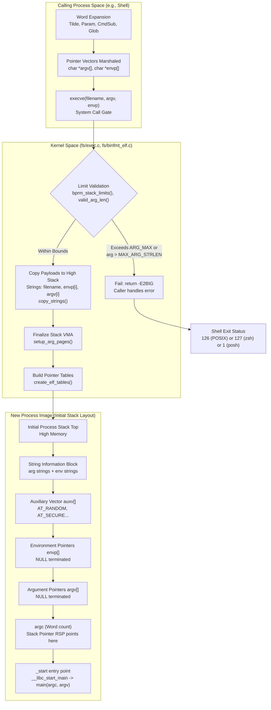

# Program Startup: argv, envp, and ARG_MAX

> [!summary] Claim
> Program startup under Unix is the kernel-mediated marshaling of argument and environment string arrays across the `execve(2)` boundary onto the newly mapped initial process stack, constrained in aggregate by `ARG_MAX` and in individual string length by `MAX_ARG_STRLEN`.

Part of [The Unix Process Model](README.md) in [Shell and Unix Engineering](../README.md).

## TL;DR

- Mechanism: The caller passes null-terminated pointer vectors `argv` and `envp` to `execve(2)`, which allocates temporary kernel pages, copies all byte payloads and pointer tables to the top of the new process user stack, and sets `%rsp` to `argc` followed by `argv[]`, `NULL`, `envp[]`, `NULL`, and the auxiliary vector (`(POSIX.1-2024 XSH exec)`).
- Rule: The combined byte count of the argument and environment lists cannot exceed `ARG_MAX` (`(POSIX.1-2024 <limits.h>)`); POSIX leaves it implementation-defined whether null terminators, pointers, and alignment bytes count (`(POSIX.1-2024 XSH exec, E2BIG)`), Linux counts both terminators and pointer tables, and on Linux no single argument or environment string may exceed `MAX_ARG_STRLEN` (128 KiB including its terminating NUL on 4 KiB pages).
- Trap: Shell builtins execute directly in-process without invoking `execve(2)` and bypass `ARG_MAX`, creating a deceptive failure mode where `echo *` succeeds on 100,000 files while `/bin/echo *` fails immediately with `Argument list too long` (`E2BIG`).
- Portability fact: On `E2BIG`, POSIX sh, bash, dash, ksh93, mksh, yash, and busybox ash exit 126, zsh exits 127, and posh exits 1 (its exec failure path calls `errorf()`); furthermore, `exec -a <name>` is supported by bash, zsh, ksh93, mksh, yash, and busybox ash but rejected by dash and posh, and fails with "applet not found" when targeting BusyBox multicall binaries.
- When not to use it: Never use command-line arguments (`argv`) or environment variables (`envp`) as a bulk data transfer bus; stream bulk records through file descriptors, pipelines (`|`), or files, and chunk unavoidable argument streams through `xargs -0` or `find -exec ... +`.

## Mental model



The calling shell expands words and prepares two contiguous arrays of character pointers terminating in `NULL` pointers, which it passes to `execve(2)` along with the executable pathname.
Inside the kernel execution engine (`fs/exec.c`), the loader enforces bounds checks against `ARG_MAX` and `MAX_ARG_STRLEN`; if the aggregate size or any single string exceeds system boundaries, the system call aborts immediately and returns `-E2BIG` to the caller without altering the process image.
When limits are satisfied, the kernel maps the new program address space, copies all string bytes into the high memory region of the initial process stack, and builds the pointer arrays for the auxiliary vector, environment variables, and command-line arguments.
The stack pointer register (`%rsp` on x86_64 or `sp` on aarch64) is aligned and set directly to `argc`, pointing immediately above the `argv[]` pointer array.
Execution transfers to the runtime entry point `_start`, which initializes the C library runtime, binds the global `environ` pointer to `envp`, and invokes `main(argc, argv)`.

## How it works

### Specification: POSIX.1-2024 System Interfaces and Shell Execution

The POSIX execution model is grounded in the `exec` family of functions (`(POSIX.1-2024 XSH exec)`).
A successful call to `execve(path, argv, envp)` does not return because the calling process memory image is overlaid entirely by the new process image file.
POSIX specifies the standard C entry point as:
```c
int main(int argc, char *argv[]);
extern char **environ;
```
Here, `argc` represents the non-negative count of arguments, and `argv` is an array of `argc + 1` pointers where `argv[argc]` is a `NULL` pointer (`(POSIX.1-2024 XSH exec)`).
POSIX explicitly notes that "Some implementations provide a third argument to main() called envp" and requires only the two-argument calling sequence (`(POSIX.1-2024 XSH exec, RATIONALE)`); conforming portable applications access environment strings through the external global symbol `environ`.
Both `argv` and `environ` arrays are terminated by a null pointer, and the terminating null pointer of `argv` is never counted in `argc`.

When a shell executes an external command, it follows POSIX Command Search and Execution (`(POSIX.1-2024 XCU 2.9.1.4)`) and Non-built-in Utility Execution (`(POSIX.1-2024 XCU 2.9.1.6)`).
In GNU Bash, command execution is orchestrated in `execute_cmd.c` (`(bash-5.3 execute_cmd.c, execute_disk_command and shell_execve)`, read in the bash-5.3 release tarball).
When a simple command resolves to an executable file on disk, `shell_execve()` receives the `argv` array built from the expanded words and calls `execve()`.
If `execve()` fails because the combined argument and environment payload exceeds system constraints, the kernel returns `-E2BIG`.
POSIX mandates: "Otherwise, if the command name is found, but it is not an executable utility, the exit status shall be 126" (`(POSIX.1-2024 XCU 2.8.2)`); it names no `E2BIG`-specific status, so mapping `E2BIG` onto 126 is each shell's reading of this rule.
Bash, Dash, Ksh93, Mksh, Yash, and BusyBox ash apply this rule and return status 126 on `E2BIG` (lab test 5).
Zsh diverges by reporting status 127 on `E2BIG`, because its `execute()` exits 126 only for `EACCES` or `ENOEXEC` and 127 for every other `execve` error (`(zsh Src/exec.c, execute)`).
Posh diverges from POSIX by returning status 1 on `E2BIG` because its `TEXEC` path in `execute()` reports the `ksh_execve()` failure through `errorf()`, which unconditionally sets `exstat = 1` (`(posh exec.c, execute; posh io.c, errorf)`; no changelog entry through posh 0.14.6 `debian/changelog`, checked 2026-10).

### The Initial Process Stack Layout (System V ABI)

When the kernel initializes an ELF binary under the System V Application Binary Interface, it constructs the initial process stack in user-space virtual memory before executing the first instruction.
The stack grows downward from high memory to low memory.
The memory arrangement from the highest address down to the initial stack pointer is organized as follows:

| Address Region | Contents | Purpose / Structure |
| :--- | :--- | :--- |
| Highest Address | Information Block | Contiguous raw string bytes for `argv`, `envp`, and auxiliary data |
| Variable | `AT_RANDOM` bytes | 16 cryptographically secure random bytes for stack canary generation |
| Variable | Auxiliary Vector (`auxv`) | Array of `Elf64_auxv_t` key-value pairs terminated by `AT_NULL` (`a_type = 0`) |
| Variable | Trailing `NULL` pointer | Terminates the `envp` pointer array |
| Variable | Environment Pointers (`envp`) | Array of `char *` pointers pointing to `KEY=VALUE\0` strings |
| Variable | Trailing `NULL` pointer | Terminates the `argv` pointer array |
| `SP + 8` | Argument Pointers (`argv`) | Array of `argc` character pointers pointing to argument strings |
| `SP` (Stack Pointer) | Argument Count (`argc`) | 64-bit integer representing the number of arguments |

When execution branches to `_start` in the C runtime (`crt1.o`), the register pointing to the stack (`%rsp` on x86_64, `sp` on aarch64; `x0` does not hold `argc`) points directly to `argc`.
The runtime entry code reads `argc`, computes `argv = SP + 8`, and computes `envp = argv + argc + 1`.
The entry routine calls `__libc_start_main()`, which assigns `environ = envp`, runs dynamic library constructors (`.init_array`), and enters `main()`.

### Linux Kernel Implementation: fs/exec.c and bprm_stack_limits

The Linux kernel processes program execution inside `fs/exec.c` through `do_execveat_common()`.
The kernel allocates a `struct linux_binprm` tracking structure to manage binary parameters.
Argument limits are enforced through three distinct kernel mechanisms:

1. Dynamic `ARG_MAX` stack reservation (`fs/exec.c`, `bprm_stack_limits()`):
Since Linux 2.6.23, `ARG_MAX` is no longer a rigid static limit of 128 KiB (`MAX_ARG_PAGES 32`).
Instead, the kernel dynamically bounds the memory available for arguments and environment variables to 25% (one quarter) of the current soft stack size resource limit (`RLIMIT_STACK`) (`(man7 execve(2), Limits on size of arguments and environment)`).
Since Linux 4.13 (commit `da029c11e6b1`, "exec: Limit arg stack to at most 75% of _STK_LIM"), that quarter is also capped at `_STK_LIM / 4 * 3`, which is 6 MiB, and the result is floored at the 32-page `ARG_MAX` constant (131,072 bytes) from `include/uapi/linux/limits.h`: `limit = min(_STK_LIM / 4 * 3, rlim_cur / 4)` then `limit = max(limit, ARG_MAX)` (`(fs/exec.c, bprm_stack_limits)`).
If the stack resource limit is unlimited (`ulimit -s unlimited`), or larger than 24 MiB, the cap applies and the limit is 6 MiB (6,291,456 bytes): on Debian 13 with kernel 7.2.9, `getconf ARG_MAX` reports 6291456 and 61 arguments of 100,000 bytes succeed while 63 fail with `E2BIG` (measured 2026-10).

2. Accounting for pointer tables (Commit `98da7d08850f`, CVE-2017-1000365):
Prior to Linux 4.12, the kernel only accounted for string payload lengths when checking stack limits, ignoring the memory consumed by `argv[]` and `envp[]` pointer vectors.
The commit message shows the consequence: on 32-bit with an 8 MiB stack, 1,677,721 single-byte strings stay under the 2 MiB string quota while their pointers consume another 6,710,884 bytes, exhausting the stack, which "could result in pathological behavior in setuid binaries (CVE-2017-1000365)"; the fix was coordinated with Qualys during the Stack Clash disclosure.
In commit `98da7d08850fb8bdeb395d6368ed15753304aa0c` ("fs/exec.c: account for argv/envp pointers", authored by Kees Cook on 2017-06-23, first released in Linux 4.12), the kernel added explicit accounting for pointer tables:
```c
ptr_size = (bprm->argc + bprm->envc) * sizeof(void *);
```
Current `bprm_stack_limits()` computes the same quantity as `max(bprm->argc, 1) + bprm->envc` pointers with an overflow check, returning `-E2BIG` if the pointers alone exceed the limit.
The kernel enforces that string bytes plus pointer tables do not exceed 25% of `RLIMIT_STACK` (and never more than 6 MiB), so at least 75% of the stack limit remains for program execution.

3. Single string constraint `MAX_ARG_STRLEN`:
Introduced in Linux 2.6.23 together with the variable-length argument support (`(man7 execve(2))`), and now living in `include/uapi/linux/binfmts.h`, the kernel defines:
```c
#define MAX_ARG_STRLEN (PAGE_SIZE * 32)
```
In `fs/exec.c`, the helper function `valid_arg_len()` rejects any individual argument or environment variable string whose length exceeds `MAX_ARG_STRLEN`.
On standard systems with 4 KiB memory pages, this caps any single argument at exactly 131,072 bytes (128 KiB) including its terminating NUL, so the longest passable string is 131,071 characters: on Debian 13 a 131,071-character argument to `/bin/true` succeeds and a 131,072-character one fails with status 126 (measured 2026-10).
If a script passes a single argument of 150 KiB, `execve()` fails with `-E2BIG` even if total argument consumption is far below `ARG_MAX`.

### Darwin and BSD Kernel Implementation

On macOS and Darwin systems, the exec limit is the kernel compile-time constant `NCARGS`, which xnu defines as `ARG_MAX` in `bsd/sys/param.h`, with `ARG_MAX` set to `(1024 * 1024)` for macOS in `bsd/sys/syslimits.h`; `execve` budgets argument space against `NCARGS` (`imgp->ip_argspace = NCARGS` in `bsd/kern/kern_exec.c`), and sysctl `kern.argmax` reports `ARG_MAX` (`bsd/kern/kern_sysctl.c`) (xnu main, checked 2026-10).
On macOS 27.2 (Darwin 27.2.0) `(as of 2026-10)`, `kern.argmax` and `getconf ARG_MAX` both report 1,048,576 bytes (1 MiB) (measured on the host).
Unlike Linux, macOS does not dynamically resize `ARG_MAX` when `ulimit -s` is modified; `getconf ARG_MAX` remains fixed at 1,048,576 after `ulimit -s 1024` (measured on the host).
Furthermore, Darwin appends an additional `apple` pointer vector directly after `envp[]` on the initial process stack, passing Mach-O execution attributes such as the executable path (`executable_path`) to the dynamic linker `dyld`; a fourth `main()` parameter `char **apple` on the host prints `apple[0]` as `executable_path=<path>` (measured).

### Shebang Execution and argv[0] Mutation

When a program invokes `execve` on a script starting with a shebang line (`#!pathname [arg]`), the kernel binary loader (`binfmt_script.c` on Linux) intercepts the call.
The kernel reads the interpreter path from the first line of the file, shifts the argument list, and restarts the execution loop with the interpreter binary.
Crucially, the kernel discards the caller's `argv[0]` and inserts the script pathname after the interpreter when invoking the interpreter:
- `argv[0]` becomes the interpreter binary path (e.g., `/bin/sh`).
- `argv[1]` becomes the optional interpreter argument specified on the shebang line (if present).
- `argv[2]` becomes the absolute or relative pathname of the script file, as passed to `execve` (it is `argv[1]` when the shebang line has no interpreter argument).
- `argv[3...]` receives `argv[1...]` of the caller's original argument list.

Because the kernel drops the caller's `argv[0]` and the interpreter sets `$0` from the script path during interpreter invocation, passing a custom process title via `exec -a <name> ./script.sh` does not alter `$0` inside the interpreted script (on Debian 13, `exec -a cust /s/s.sh orig1` prints `$0` as `/s/s.sh` and `$1` as `orig1`, measured 2026-10).
When running `exec -a <name> <binary>`, the kernel passes `<name>` directly as `argv[0]` to the target executable without shebang translation.
However, if the target executable is a multicall binary such as BusyBox (`/bin/sh` on Alpine Linux), BusyBox inspects `argv[0]` to resolve the internal applet (`(BusyBox libbb/appletlib.c, run_applet_and_exit)`); if `<name>` is not a recognized applet name, BusyBox writes `<name>: applet not found` and exits with status 127 (reproduced on Alpine 3.22 with BusyBox 1.37.0).

## Numbers and limits

The limits governing program startup arguments across Unix implementations `(as of 2026-10)` are detailed below:

| System / Boundary | Parameter / Limit | Value | Mechanism / Source |
| :--- | :--- | :--- | :--- |
| POSIX Baseline | `_POSIX_ARG_MAX` | 4,096 bytes | `(POSIX.1-2024 <limits.h>)` minimum conformant limit |
| POSIX xargs Headroom | `{ARG_MAX} - 2048` | System dependent | `(POSIX.1-2024 XCU xargs)` reserved buffer for child invocations |
| Linux (default 8 MiB stack) | `ARG_MAX` (`_SC_ARG_MAX`) | 2,097,152 bytes (2 MiB) | `RLIMIT_STACK / 4` in `fs/exec.c` (`bprm_stack_limits`); `getconf ARG_MAX` on Debian 13 (measured) |
| Linux (stack 1 MiB / 256 KiB) | `ARG_MAX` (`_SC_ARG_MAX`) | 262,144 / 131,072 bytes | Quarter of the stack, floored at the 32-page `ARG_MAX` constant (measured with `ulimit -s`) |
| Linux (stack unlimited or above 24 MiB) | `ARG_MAX` cap | 6,291,456 bytes (6 MiB) | `_STK_LIM / 4 * 3` since Linux 4.13 (commit `da029c11e6b1`); measured on Debian 13 |
| Linux Single String | `MAX_ARG_STRLEN` | 131,072 bytes (128 KiB) including NUL | `PAGE_SIZE * 32` in `include/uapi/linux/binfmts.h` (4 KiB page); 131,071 characters pass (measured) |
| Linux Single String (16 KiB page) | `MAX_ARG_STRLEN` | 524,288 bytes (512 KiB) | `PAGE_SIZE * 32` on Apple Silicon Linux / Asahi kernels, which use 16 KiB pages because the Apple IOMMUs only support 16K-aligned pages (Asahi Linux docs, Broken Software) |
| Linux Minimum Stack Reserve | Stack Headroom | 75% of `RLIMIT_STACK` | 1/4 rule since Linux 2.6.23; pointers counted since Linux 4.12 (commit `98da7d08850f`, CVE-2017-1000365) |
| Linux Empty argv Injection | `argc` on empty vector | `argc = 1`, `argv[0] = ""` | Linux 5.18+ commit `dcd46d897adb` in `fs/exec.c`; reproduced on kernel 7.2.9 |
| macOS 27.2 (Darwin 27.2.0) | `kern.argmax` | 1,048,576 bytes (1 MiB) | `sysctl kern.argmax` and `getconf ARG_MAX` (measured on the host) |
| macOS 27.2 (Darwin 27.2.0) | Empty argv Vector | `argc = 0`, `argv[0] = NULL` | Permitted by Darwin kernel (measured on the host with an `execv` C probe) |
| FreeBSD (main) | `ARG_MAX` | 524,288 bytes (512 KiB) | `(2 * 256 * 1024)` in `sys/sys/syslimits.h`; 256 KiB on KVA-starved architectures |
| OpenBSD (master) | `ARG_MAX` | 524,288 bytes (512 KiB) | `(512 * 1024)` in `sys/sys/syslimits.h`; same since rev 1.14 ("double ARG_MAX", OpenBSD 6.7) through the 8.0 release (cvsweb) |
| NetBSD (trunk) | `ARG_MAX` | 262,144 bytes (256 KiB) | `(256 * 1024)` in `sys/sys/syslimits.h`; same on the `netbsd-10` and `netbsd-11` release branches |
| `posh` Execution Failure | `E2BIG` exit status | 1 | `(posh exec.c, execute; posh io.c, errorf)` non-conforming exit code `(as of 2026-10)` |
| BusyBox Applet Lookup | Unknown `argv[0]` exit | 127 | `libbb/appletlib.c` (`run_applet_and_exit`) writes `: applet not found` and calls `exit(127)` |
| Windows (API contrast) | `CreateProcessW` | 32,767 UTF-16 chars | `lpCommandLine` maximum, including the terminating null (Microsoft Learn) |
| Windows (Shell contrast) | `cmd.exe` | 8,191 characters | Command prompt string limit (Microsoft Learn) |

## Portability

The table below contrasts argument handling, exit status semantics, and shell builtin behaviors across major shell families and core utility implementations:

| Feature / Behavior | POSIX sh | macOS bash 3.2 | Current bash 5.3 | zsh (native) | zsh (`--emulate sh`) | dash | ksh93 | mksh | yash | posh | BusyBox ash |
| :--- | :--- | :--- | :--- | :--- | :--- | :--- | :--- | :--- | :--- | :--- | :--- |
| `E2BIG` Exit Status | 126 (XCU 2.8.2 "not an executable utility") | 126 | 126 | 127 | 127 | 126 | 126 | 126 | 126 | 1 (bug) | 126 |
| `exec -a <name>` | No options defined (XCU `exec`) | Supported | Supported | Supported | Supported | Rejected (127) | Supported | Supported | Supported (yash 2.58.1, lab) | Rejected (127) | Supported (applet match required if multicall) |
| Builtin Immunity to `ARG_MAX` | Yes | Yes | Yes | Yes | Yes | Yes | Yes | Yes | Yes | Yes | Yes |
| Empty String Preservation `""` | Preserved | Preserved | Preserved | Preserved | Preserved | Preserved | Preserved | Preserved | Preserved | Preserved | Preserved |
| Unquoted `$*` with Null `IFS` | Separate fields (XCU 2.5.2) | Separate fields | Separate fields | Separate fields | Separate fields | Separate fields | Separate fields | Separate fields | Separate fields | One space-joined field | Separate fields |
| `argc` Mapping to Positional `$#` | `$# == argc-1` | `$# == argc-1` | `$# == argc-1` | `$# == argc-1` | `$# == argc-1` | `$# == argc-1` | `$# == argc-1` | `$# == argc-1` | `$# == argc-1` | `$# == argc-1` | `$# == argc-1` |
| Initial `$0` Representation | Command path | Command path | Command path | Command path | Command path | Command path | Command path | Command path | Command path | Command path | Command path |
| Default `xargs` Limit Rule | `ARG_MAX - 2048` | BSD `xargs`: `ARG_MAX - 4096` | GNU `xargs`: 128 KiB buffer | N/A | N/A | N/A | N/A | N/A | N/A | N/A | About 32 KiB per batch (measured) |

The `E2BIG`, `exec -a`, builtin, empty-string, and `$#` rows are proved by the lab (tests 1, 4, 5, 6, and 7) on every shell in `matrix-output.txt`.
The `$*` row was measured separately with `IFS=; set -- a b; printf '<%s>' $* "$*"`: every shell prints `<a><b><ab>` except posh 0.14.1, which prints `<a b><ab>`; this includes ksh93u+m 1.0.10 and macOS ksh 93u+ 2012-08-01 (measured 2026-10).
The `xargs` row describes the userland `xargs` that ships beside each shell, not the shell: macOS `xargs(1)` documents "The current default value for size is ARG_MAX - 4096", GNU findutils `xargs --show-limits` on Debian 13 reports a POSIX upper limit of `ARG_MAX - 2048 - environment` and a command buffer of 131,072 bytes, and BusyBox 1.37.0 `xargs` batched 3,837 eight-byte arguments per invocation (measured 2026-10).
The `$0` row reflects a script run through its shebang, where `$0` is the script path the kernel inserts (measured), not a lab assertion.

Every shell tested in the lab (`bash`, `dash`, `ksh93`, `mksh`, `yash`, `zsh`, `posh`, `busybox`) preserves empty string arguments `""` as distinct empty elements on the argument vector.
When an external executable execution fails with `E2BIG`, POSIX sh, Bash, Dash, Ksh93, Mksh, Yash, and BusyBox ash exit with code 126, while native Zsh and Zsh in `--emulate sh` exit with code 127.
Posh diverges from POSIX by exiting with status 1 on `E2BIG` due to its `errorf()` assignment of `exstat = 1` (`(posh io.c, errorf)`).
The `exec -a` extension is implemented by Bash, Zsh, Ksh93, Mksh, Yash, and modern BusyBox ash, but is rejected by Dash and Posh because POSIX specifies no options for `exec` (`(POSIX.1-2024 XCU exec, OPTIONS: None)`); both treat `-a` as the command name and exit 127 with `-a: not found` (measured on Debian 13).
On BusyBox userlands where `/bin/sh` is a multicall binary, `exec -a <name> /bin/sh` fails with `<name>: applet not found` unless `<name>` is a valid applet alias.

## Worked example

The automated test suite for this note is implemented under the [lab](../labs/01-program-startup-argv-envp-and-arg_max/).
The probe script `startup-probe.sh` inspects argument boundaries, count, `$0`, and inherited environment variables:

```sh
#!/bin/sh
# startup-probe.sh: inspect argv boundaries, argc, $0, and environment variables.
# Used by labs/01-program-startup-argv-envp-and-arg_max/test.bats.

printf 'cmd: <%s>\n' "$0"
printf 'argc: %d\n' "$#"

printf 'args:'
if [ "$#" -gt 0 ]; then
  for arg in "$@"; do
    printf ' <%s>' "${arg}"
  done
fi
printf '\n'

printf 'env: <%s>\n' "${STARTUP_PROBE_ENV:-UNSET}"
```

The accompanying test file `test.bats` verifies boundary preservation, environment inheritance, builtin immunity, and `E2BIG` exit code divergence:

```bash
#!/usr/bin/env bats
# Tests for Program Startup: argv, envp, and ARG_MAX.

setup() {
  load ../lib/lab
  STARTUP_PROBE="$BATS_TEST_DIRNAME/startup-probe.sh"
  ARGV0_PROBE="$BATS_TEST_TMPDIR/argv0-probe"
  if [ ! -x "$ARGV0_PROBE" ]; then
    if command -v gcc >/dev/null 2>&1; then
      gcc -O2 "$BATS_TEST_DIRNAME/argv0-probe.c" -o "$ARGV0_PROBE"
    elif command -v cc >/dev/null 2>&1; then
      cc -O2 "$BATS_TEST_DIRNAME/argv0-probe.c" -o "$ARGV0_PROBE"
    elif command -v clang >/dev/null 2>&1; then
      clang -O2 "$BATS_TEST_DIRNAME/argv0-probe.c" -o "$ARGV0_PROBE"
    fi
  fi
}

@test "startup-probe preserves spaces and empty arguments" {
  run_lab "$STARTUP_PROBE" "first arg" "" "third arg"
  [ "$status" -eq 0 ]
  [ "${lines[1]}" = "argc: 3" ]
  [ "${lines[2]}" = "args: <first arg> <> <third arg>" ]
  [ "${lines[3]}" = "env: <UNSET>" ]
}

@test "shell builtin handles arguments larger than ARG_MAX without calling execve" {
  # shellcheck disable=SC2016 # the expansions belong to the shell under test
  run_lab_c '
    big=$(dd if=/dev/zero bs=1024 count=1100 2>/dev/null | tr "\0" "a")
    printf "%d\n" "${#big}"
  '
  [ "$status" -eq 0 ]
  [ "$output" = "1126400" ]
}

@test "external command execution exceeding ARG_MAX fails with E2BIG exit status" {
  # shellcheck disable=SC2016 # the expansions belong to the shell under test
  run_lab_c '
    big=$(dd if=/dev/zero bs=1024 count=1100 2>/dev/null | tr "\0" "a")
    /bin/echo "$big"
  '
  case $(lab_shell_family) in
    zsh | zsh-sh)
      [ "$status" -eq 127 ]
      ;;
    posh)
      [ "$status" -eq 1 ]
      ;;
    bash | dash | ksh93 | mksh | yash | busybox)
      [ "$status" -eq 126 ]
      ;;
    *)
      false
      ;;
  esac
}

@test "exec -a sets custom argv0 in supporting shells and fails in strict POSIX shells" {
  # shellcheck disable=SC2016 # the expansions belong to the shell under test
  run_lab_c 'probe="$1"; exec -a custom_proc_name "$probe"' sh "$ARGV0_PROBE"

  case $(lab_shell_family) in
    bash | zsh | zsh-sh | ksh93 | mksh | yash | busybox)
      [ "$status" -eq 0 ]
      [ "$output" = "custom_proc_name" ]
      ;;
    dash | posh)
      [ "$status" -ne 0 ]
      ;;
    *)
      false
      ;;
  esac
}
```

The 1,126,400-byte string in tests 4 and 5 exceeds the 1 MiB `ARG_MAX` on macOS, while on Linux it stays under the 2 MiB `ARG_MAX` and instead trips the 128 KiB `MAX_ARG_STRLEN` per-string limit; both paths return `E2BIG`, so the exit-status assertions hold on both kernels.
When executed against the lab harness, the test run demonstrates consistent behavior across the shell matrix (all 7 tests pass on every shell listed in `matrix-output.txt`, captured 2026-10-25):

```text
1..7
ok 1 startup-probe preserves spaces and empty arguments
ok 2 quoted glob character is literal while unquoted glob is expanded by shell
ok 3 exported environment variable is inherited while unexported variable is omitted
ok 4 shell builtin handles arguments larger than ARG_MAX without calling execve
ok 5 external command execution exceeding ARG_MAX fails with E2BIG exit status
ok 6 exec -a sets custom argv0 in supporting shells and fails in strict POSIX shells
ok 7 positional parameter count matches exact argument list length
```

## Pitfalls

> [!warning] The wildcard cliff: batch rm or chown fails with E2BIG
> Trigger: Running `rm -f /var/spool/data/*` in a directory containing 150,000 files.
> Symptom: The shell expands the wildcard into 150,000 distinct words, calls `execve("/bin/rm", argv, envp)`, and fails immediately with `Argument list too long` (`E2BIG`); zero files are removed, leaving the batch operation completely unexecuted (`(POSIX.1-2024 XSH exec)`).
> Fix: Stream file deletion without argument expansion using `find /var/spool/data -type f -delete`, or chunk the argument stream via `printf '%s\0' /var/spool/data/* | xargs -0 rm -f`.

> [!warning] The single-argument trap: MAX_ARG_STRLEN on Linux
> Trigger: Passing a single monolithic JSON configuration, base64 blob, or embedded SQL migration payload larger than 128 KiB as a command-line argument on Linux.
> Symptom: `execve(2)` fails with `E2BIG` even though total argument consumption is only 130 KiB and `getconf ARG_MAX` reports 2 MiB, triggered by `valid_arg_len()` in `fs/exec.c` enforcing `MAX_ARG_STRLEN = (PAGE_SIZE * 32)` (`(Linux include/uapi/linux/binfmts.h)`).
> Fix: Pass large data payloads via standard input pipes (`cat payload.json | jq .`), stream through anonymous pipes or `/dev/fd/N`, or stage the content in a temporary file.

> [!warning] Environment bloat cannibalizing argument capacity
> Trigger: Nested wrapper scripts, container managers, or CI/CD pipelines injecting hundreds of exported environment variables (massive `PATH`, token blocks, and exported shell functions).
> Symptom: Commands with modest argument counts fail sporadically with `E2BIG`; GNU `xargs` aborts with ``xargs.c:512: main: Assertion `bc_ctl.arg_max >= LINE_MAX' failed.`` (exit status 134) because the environment consumed almost all available `ARG_MAX` stack reservation, and dies with `environment is too large for exec` once the environment alone exceeds it (`(findutils xargs.c, main after bc_init_controlinfo)`; the assertion reproduced on Debian 13 with a 2.09 MB environment, measured 2026-10).
> Fix: Purge unwanted environment variables before invoking external subprocesses using `env -i PATH="$PATH" HOME="$HOME" command` or selective `unset` statements.

> [!warning] The argc == 0 privilege escalation (CVE-2021-4034 PwnKit)
> Trigger: Calling `execve(path, (char*[]){ NULL }, envp)` where the argument vector is completely empty.
> Symptom: Vulnerable SUID-root binaries like `pkexec` assumed `argc >= 1` and evaluated `argv[1]` without bounds checks; due to contiguous stack layout, `argv[1]` indexed directly into `envp[0]`, allowing untrusted environment variables to be rewritten and re-evaluated, bypassing `ld.so` `AT_SECURE` variable stripping to gain full root execution (`(CVE-2021-4034, Qualys Advisory)`).
> Fix: In application code, validate `if (argc < 1 || argv[0] == NULL) exit(1);`; on Linux kernels >= 5.18, commit `dcd46d897adb` forces `argc = 1` and injects `argv[0] = ""` when an empty vector is supplied.

> [!warning] Argument injection via unquoted leading dash
> Trigger: Expanding an unvalidated variable or wildcard starting with a hyphen into a utility invocation: `rm "$filename"`.
> Symptom: If the variable expands to `-rf` or `--preserve-root=all`, the utility option parser (`getopt`) interprets the filename as command-line flags rather than a file operand.
> Fix: Terminate option parsing using the POSIX standard `--` delimiter: `rm -- "$filename"`, or qualify relative filenames with a path prefix: `rm "./$filename"`.

> [!warning] In-place argv mutation clobbering adjacent memory
> Trigger: Modifying process title in `ps` by writing into `argv[0]` past its original allocated `strlen(argv[0])`.
> Symptom: Under the System V ABI stack layout, `argv` and `envp` string payloads are placed contiguously in the information block; overflowing `argv[0]` overwrites `argv[1]` and clobbers environment variables in active memory.
> Fix: Use platform-sanctioned process title APIs such as `setproctitle(3)` on BSD/macOS, or copy the original environment strings to heap storage before updating the title region.

> [!warning] Builtin masking creates false confidence
> Trigger: Testing a wildcard expansion with `echo *` or `printf '%s\n' *` in an interactive shell containing 120,000 files.
> Symptom: The command executes cleanly because `echo` and `printf` are shell builtins running in-process; subsequently replacing the command with `/bin/echo *` or moving it into an external execution script crashes immediately with `E2BIG`.
> Fix: Explicitly test large dataset workflows using external binary paths to verify behavior across real `execve(2)` kernel boundaries.

> [!warning] exec -a on multicall binaries (BusyBox applet dispatch)
> Trigger: Invoking `exec -a <custom_title> /bin/sh` or `/bin/busybox` on systems where `/bin/sh` is a symlink to BusyBox (such as Alpine Linux or embedded containers).
> Symptom: The command fails immediately with `<custom_title>: applet not found` and exit status 127, aborting process startup.
> Fix: BusyBox checks `argv[0]` to route execution to its internal applet functions (`(BusyBox libbb/appletlib.c, run_applet_and_exit)`); when changing process titles via `exec -a`, target standalone binaries rather than multicall multiplexers, or supply an existing applet alias.

> [!warning] Posh exits with status 1 on E2BIG instead of POSIX 126
> Trigger: Executing an external command whose arguments exceed `ARG_MAX` under `posh`.
> Symptom: `posh` prints `posh: <cmd>: Argument list too long` (for example `posh: /bin/echo: Argument list too long` on Debian 13, measured) and exits with status 1 rather than the status 126 that XCU 2.8.2 assigns to a found but non-executable command.
> Fix: In monitoring scripts or automated pipelines, check for exit status 1 alongside 126 (POSIX) and 127 (zsh) when diagnosing `E2BIG` command failures across heterogeneous shells (`(posh exec.c, execute; posh io.c, errorf; no changelog entry through posh 0.14.6, checked 2026-10)`).

## Security and robustness

The program startup boundary represents the primary security perimeter between untrusted parent state and newly executed process images.
When a privileged or SUID binary executes, the kernel ELF loader validates process credentials.
If the real UID differs from the effective UID (`uid != euid`) or the real GID differs from the effective GID (`gid != egid`), the kernel sets the `AT_SECURE` flag in the auxiliary vector (`auxv`).
The dynamic linker (`ld.so`) inspects `AT_SECURE` during program startup and strips dangerous environment variables listed in glibc `UNSECURE_ENVVARS`, including `LD_PRELOAD`, `LD_LIBRARY_PATH`, `LD_AUDIT`, and `GCONV_PATH` (`(glibc sysdeps/generic/unsecvars.h)`); `BASH_ENV` is not on that list and is instead ignored by bash itself in privileged mode.
This sanitization prevents an unprivileged user from injecting arbitrary shared libraries into a privileged process address space.

Defensive shell programming requires treating both `argv` and `envp` as untrusted input vectors.
To prevent option injection attacks, all variable expansions passed as operands must follow the `--` option terminator (`(POSIX.1-2024 XBD 12.2 Utility Syntax Guidelines)`).
When orchestrating subprocesses across security domains, scripts should use `env -i` to construct an explicit, sanitized environment whitelist rather than inheriting parent variables indiscriminately:
```sh
env -i PATH='/usr/bin:/bin' LC_ALL='C' /usr/libexec/worker -- "$clean_input"
```

To prevent denial-of-service conditions through argument exhaustion, long-running systems must actively monitor stack resource limits (`ulimit -s`).
Because Linux computes `ARG_MAX` as one quarter of `RLIMIT_STACK`, reducing the stack size to 1 MiB correspondingly shrinks `ARG_MAX` to 256 KiB, and smaller stacks shrink it further down to the 128 KiB floor (`getconf ARG_MAX` reports 262144 at `ulimit -s 1024` and 131072 at `ulimit -s 256` on Debian 13, measured 2026-10), dramatically increasing the risk of unexpected `E2BIG` failures in production child processes.

## The principal's view

Command-line arguments (`argv`) and environment variables (`envp`) are designed as an ephemeral control-plane configuration bus, not a high-throughput data bus.
The kernel must copy every byte in `argv` and `envp` into kernel space, validate memory allocations, and remap those pages into the child process stack on every single `execve(2)` call.
When an engineering team attempts to pass large data payloads (such as bulk file lists, serialization schemas, or multi-megabyte payloads) through command-line parameters, they couple application throughput directly to kernel stack limits and memory copy overhead.

A principal engineer applies clear separation of concerns at process boundaries:
1. When batching operating system tasks against thousands of filesystem targets, use `find -exec ... +` or `xargs -0` to amortize `execve` spawn overhead while remaining safely below the `ARG_MAX - 2048` headroom threshold.
2. When transmitting structured payloads, serialization blobs, or credentials, avoid `argv` entirely; command-line arguments are visible in `/proc/PID/cmdline` to other users on the host and are exposed in audit logging systems (`auditd`).
3. Stream data payloads through anonymous pipes, UNIX domain sockets, or file descriptors, which operate without `ARG_MAX` limitations and enforce zero leakage into process table listings.
4. If an operational workload demands executing tens of thousands of sub-tasks per second, eliminate shell process spawning altogether; migrate the workload into a persistent worker architecture communicating over gRPC, shared memory rings, or Unix domain sockets.
5. In cross-platform automation spanning heterogeneous container bases (such as Alpine and Debian), never assume command invocation failures consistently yield exit code 126; account for 127 under zsh and 1 under posh.
6. When managing processes in minimal containers where `/bin/sh` symlinks to BusyBox, avoid mutating `argv[0]` via `exec -a` against system tools, as multicall binaries depend on `argv[0]` for internal applet dispatch.

## Interview questions

> [!question] L5: What will this command sequence output, and why do the two commands behave differently when run in a directory containing 200,000 files?
> ```sh
> echo * | wc -w
> /bin/echo * | wc -w
> ```
>
> > [!success]- Answer
> > The first command outputs 200000 because `echo` is a shell builtin that executes directly inside the shell process memory without invoking `execve(2)`.
> > The second command fails to execute and prints an error message like `Argument list too long` with exit status 126 (POSIX, bash, dash, ksh93, mksh, yash, busybox), 127 (zsh), or 1 (posh).
> > The external binary `/bin/echo` requires the shell to invoke `execve(2)`, which enforces the kernel `ARG_MAX` constraint on the combined size of `argv` and `envp`.
> > Because the 200,000 expanded filenames exceed the kernel stack allocation limit for arguments, `execve(2)` returns `-E2BIG` before `/bin/echo` can start.
> >
> > Follow-up: How can you write a portable script to count files in a directory without encountering `E2BIG` or parsing `ls` output?

> [!question] L5: What is the relationship between the C runtime `argc` parameter and the shell special parameter `$#`?
>
> > [!success]- Answer
> > In a C program, `argc` represents the total count of strings in `argv`, where `argv[0]` is the program name or path.
> > In a shell script, the special parameter `$#` represents only the count of positional parameters passed to the script, excluding the script name itself.
> > Therefore, `$#` is always equal to `argc - 1`.
> > The script name or invocation path is held separately in the special parameter `$0`, which corresponds to `argv[0]`.
> >
> > Follow-up: What happens to `$0` when a script is executed via `sh script.sh` compared to direct execution `./script.sh`?

> [!question] L6: Debug this cleanup script: why does it crash in production, and how do you make it robust against argument limits and spaces in filenames?
> ```sh
> #!/bin/sh
> cd /var/log/audit || exit 1
> rm -f $(find . -name '*.log')
> ```
>
> > [!success]- Answer
> > Command substitution `$(...)` expands the entire output of `find` as unquoted words on the command line of `rm`.
> > If `/var/log/audit` contains tens of thousands of log files, the expanded argument list exceeds `ARG_MAX`, causing `execve(2)` to fail with `E2BIG`.
> > Additionally, any filename containing whitespace or glob characters undergoes word splitting and pathname expansion, causing `rm` to attempt deleting incorrect file fragments.
> > The correct and robust fix is to use `find` built-in deletion: `find . -name '*.log' -type f -delete`.
> > Alternatively, use streaming with null delimiters: `find . -name '*.log' -type f -exec rm -f -- {} +`.
> >
> > Follow-up: Why is `find ... -exec rm -f -- {} +` safer than piping into `xargs rm -f`?

> [!question] L6: How does the Linux kernel dynamically determine `ARG_MAX`, and what happens to `ARG_MAX` if a user runs `ulimit -s 1024`?
>
> > [!success]- Answer
> > Since Linux 2.6.23, `ARG_MAX` is calculated dynamically in `fs/exec.c` as 25% of the process stack resource limit (`RLIMIT_STACK / 4`).
> > On systems with the standard 8 MiB soft stack limit, `sysconf(_SC_ARG_MAX)` reports 2,097,152 bytes (2 MiB).
> > If a user executes `ulimit -s 1024`, the soft stack limit is lowered to 1,024 KiB (1 MiB).
> > Consequently, the maximum space available for `argv` and `envp` shrinks to 256 KiB.
> > Any command execution whose combined argument and environment payload exceeds 256 KiB will fail immediately with `E2BIG`.
> >
> > Follow-up: What limit does the Linux kernel enforce if `ulimit -s unlimited` is configured?

> [!question] L6: How did an empty argument list (argc == 0) lead to local root privilege escalation in CVE-2021-4034 (PwnKit)?
>
> > [!success]- Answer
> > A process can invoke `execve(path, argv, envp)` with an empty pointer array `argv = { NULL }`, resulting in `argc = 0`.
> > The vulnerable SUID-root binary `pkexec` entered `main()` and attempted to read arguments starting at index 1 without verifying that `argc > 1`.
> > Because the System V ABI lays out the `envp` pointer array immediately following the `argv` array on the initial stack, reading `argv[1]` performed an out-of-bounds read into `envp[0]`.
> > Subsequent code in `pkexec` wrote back to `argv[1]`, which directly modified the environment variable pointer in `envp[0]`.
> > An attacker manipulated this out-of-bounds write to inject `GCONV_PATH`, forcing the dynamic library loader to execute arbitrary shared libraries with root privileges.
> >
> > Follow-up: How did Linux kernel commit `dcd46d897adb` permanently mitigate this class of vulnerability in kernel space?

> [!question] L6: Why will an external command fail with `E2BIG` on Linux when passed a single 150 KiB argument, even if `getconf ARG_MAX` reports 2,097,152 bytes and the environment is empty?
>
> > [!success]- Answer
> > In addition to the aggregate `ARG_MAX` limit, Linux enforces a separate per-argument limit `MAX_ARG_STRLEN` defined in `include/uapi/linux/binfmts.h`.
> > `MAX_ARG_STRLEN` is defined as `PAGE_SIZE * 32`, which equals 131,072 bytes (128 KiB) on standard architectures with 4 KiB memory pages.
> > During `execve(2)`, the kernel helper `valid_arg_len()` checks each string and returns `-E2BIG` if any single argument or environment variable exceeds `MAX_ARG_STRLEN`.
> > A 150 KiB string exceeds 128 KiB, causing immediate failure regardless of the total aggregate size of `argv`.
> >
> > Follow-up: Does this 128 KiB restriction also apply to individual environment variable strings on Linux?

> [!question] L7+: Walk through the exact memory layout of the initial process stack constructed by the kernel for an x86_64 ELF binary under the System V ABI.
>
> > [!success]- Answer
> > The kernel maps the user-space stack pages growing downward from the highest address space.
> > At the highest memory boundary, the kernel places the string information block containing the null-terminated byte sequences of all `argv` arguments, all `envp` variables, and auxiliary strings.
> > Below the string data, the kernel writes `AT_RANDOM` (16 bytes of entropy for stack canaries) and the auxiliary vector (`auxv`), an array of `Elf64_auxv_t` key-value pairs terminated by `AT_NULL`.
> > Below `auxv`, the kernel writes a `NULL` pointer terminator, followed by the array of `char *` pointers representing `envp[]`.
> > Below `envp[]`, the kernel writes another `NULL` pointer terminator, followed by the array of `char *` pointers representing `argv[]`.
> > Finally, at the lowest stack address pointed to by `%rsp`, the kernel stores `argc` as an 8-byte integer.
> >
> > Follow-up: Why must the dynamic linker inspect the auxiliary vector (`auxv`) before executing any user constructors?

> [!question] L7+: Why does running `exec -a custom_title ./script.sh` fail to change `$0` when `script.sh` begins with `#!/bin/sh`, and why does `exec -a custom_title /bin/sh` fail on Alpine Linux?
>
> > [!success]- Answer
> > When `execve(2)` targets a script with a shebang header (`#!`), the kernel binary loader intercepts the execution and shifts the argument vector to invoke the specified interpreter.
> > During this transformation, the kernel replaces `argv[0]` with the interpreter binary path and places the script pathname at `argv[1]` or `argv[2]`.
> > The original `argv[0]` supplied by the caller is discarded by the kernel script loader.
> > Therefore, the interpreted script receives the script path rather than `custom_title` as its `$0`.
> > When targeting a standalone binary directly, the kernel preserves `custom_title` as `argv[0]` on the new process stack.
> > However, on Alpine Linux and other BusyBox environments, `/bin/sh` is a multicall binary that inspects `argv[0]` to dispatch its internal applet (`(BusyBox libbb/appletlib.c, run_applet_and_exit)`).
> > If `custom_title` is not in the compiled applet table, BusyBox emits `custom_title: applet not found` and exits with status 127.
> > Setting a custom `$0` via `exec -a` requires targeting a standalone binary rather than a multicall dispatcher.
> >
> > Follow-up: How can a daemon written in C safely change its process name in `ps` across both Linux and BSD without corrupting its environment?

## Related

Prerequisites: [[Posix-Spawn-and-Vfork]]

Next: [[File-Descriptors-and-Open-File-Descriptions]]

See also: [[Processes-fork-exec-and-wait]], [[Environment-Variables-and-Inheritance]], [[Resource-Limits-and-ulimit]], [[The-proc-Filesystem]], [[Close-on-Exec-and-Descriptor-Inheritance]].

## Further reading

- [POSIX.1-2024 System Interfaces: exec](https://pubs.opengroup.org/onlinepubs/9799919799/functions/exec.html) - Normative specification of the `exec` family, argument counting, and `E2BIG` error requirements.
- [POSIX.1-2024 Shell Command Language: Command Search and Execution](https://pubs.opengroup.org/onlinepubs/9799919799/utilities/V3_chap02.html) - Specifies exit status 126 for a found but non-executable command (2.8.2), 127 for a failed search (2.9.1.4), and parameter binding rules.
- [POSIX.1-2024 Shell and Utilities: xargs](https://pubs.opengroup.org/onlinepubs/9799919799/utilities/xargs.html) - Defines the required `{ARG_MAX}-2048` command line length boundary calculation.
- [Linux Kernel fs/exec.c](https://git.kernel.org/pub/scm/linux/kernel/git/torvalds/linux.git/tree/fs/exec.c) - The authoritative source for `do_execveat_common`, `bprm_stack_limits`, and `copy_strings`.
- [Linux Kernel Commit 98da7d08850f](https://git.kernel.org/pub/scm/linux/kernel/git/torvalds/linux.git/commit/?id=98da7d08850fb8bdeb395d6368ed15753304aa0c) - Kees Cook's fix for CVE-2017-1000365 accounting for `argv`/`envp` pointer vectors, first released in Linux 4.12.
- [Linux Kernel Commit dcd46d897adb](https://git.kernel.org/pub/scm/linux/kernel/git/torvalds/linux.git/commit/?id=dcd46d897adb70d63e025f175a00a89797d31a43) - Kees Cook's patch "exec: Force single empty string when argv is empty", enforcing `argc = 1` and `argv[0] = ""` on empty argument vectors since Linux 5.18.
- [Linux Kernel Commit da029c11e6b1](https://github.com/torvalds/linux/commit/da029c11e6b12f321f36dac8771e833b65cec962) - Kees Cook's "exec: Limit arg stack to at most 75% of _STK_LIM", the 6 MiB cap since Linux 4.13.
- [execve(2) man page](https://man7.org/linux/man-pages/man2/execve.2.html) - The Linux limits history: 32 pages before 2.6.23, a quarter of `RLIMIT_STACK` after, the 3/4 `_STK_LIM` cap, and `MAX_ARG_STRLEN`.
- [Qualys Security Advisory: CVE-2021-4034 (PwnKit)](https://www.qualys.com/2022/01/25/cve-2021-4034/pwnkit.txt) - Detailed technical analysis of out-of-bounds environment access via `argc == 0`.
- [Qualys Security Advisory: The Stack Clash](https://www.qualys.com/2017/06/19/stack-clash/stack-clash.txt) - Explains stack boundary collisions and `RLIMIT_STACK` bypass vulnerabilities in `execve`.
- [Debian posh Repository](https://salsa.debian.org/clint/posh) - Source for Policy-compliant Ordinary Shell exhibiting non-conforming exit status 1 through `errorf()` in io.c.
- [BusyBox appletlib.c](https://git.busybox.net/busybox/tree/libbb/appletlib.c) - Implementation of multicall applet dispatch routing on argv[0].
