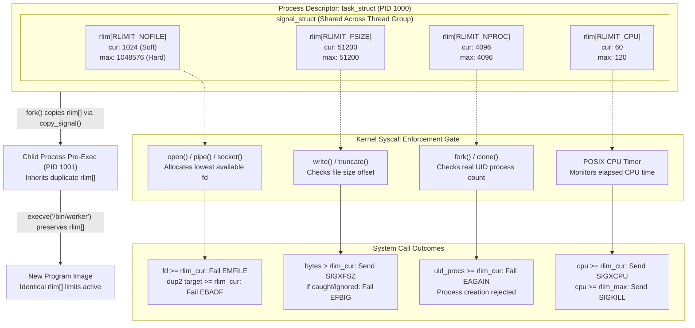

# Resource Limits and ulimit

> [!summary] Claim
> Process resource limits establish kernel-enforced consumption ceilings across processes and thread groups, governing CPU time, memory allocations, open descriptors, and process creation, inherited across `fork()` and preserved across `execve()`.

## TL;DR

- Mechanism: The kernel maintains per-process resource boundaries via `struct rlimit` arrays in shared signal structures, enforced at syscall boundaries (`open`, `fork`, `write`, `brk`) and modified via `getrlimit(2)`, `setrlimit(2)`, `prlimit64(2)`, or the shell builtin `ulimit`.
- Rule: Always lower resource limits inside subshells or wrappers when spawning untrusted workloads, and never lower a hard limit in an unprivileged supervisor because hard limit reductions are permanent and irreversible.
- Trap: Setting a bare `ulimit` assignment like `ulimit -n 1024` lowers both the soft and hard limits in POSIX shells, permanently barring an unprivileged process or its children from ever raising the ceiling again.
- Portability fact: `ulimit -f` and `ulimit -c` default to 1024-byte blocks in Bash outside POSIX mode (and in bash 3.2 even in POSIX mode, so macOS `/bin/sh`) but 512-byte blocks in bash 4.0+ POSIX mode, dash, ksh93, and BusyBox ash, while dash and mksh use `-p` for processes, zsh defaults bare assignments to soft-only, and posh omits `ulimit` completely.
- When not to use it: Never rely on `RLIMIT_NPROC` for multi-tenant container isolation, because it counts every task (threads included) of the real UID within its user namespace rather than isolating subtrees; use Linux cgroups v2 (`pids.max`) instead.

## Mental model



The diagram illustrates how the kernel anchors resource boundaries in `struct signal_struct`, which is shared across all threads within a process thread group.
When a process invokes the `ulimit` shell builtin or the underlying `setrlimit(2)` system call, the kernel validates and updates the target entry in the `rlim[]` array.
The soft limit (`rlim_cur`) acts as the active enforcement threshold, while the hard limit (`rlim_max`) serves as an immutable ceiling that unprivileged callers cannot increase.
During standard execution, core system calls query these limits before granting kernel resources: descriptor allocators return `EMFILE` when a newly assigned descriptor meets or exceeds `rlim_cur`, file writes past the file size boundary trigger `SIGXFSZ` and fail with `EFBIG`, process spawns fail with `EAGAIN` once the real user ID's task count reaches the process limit (root, `CAP_SYS_RESOURCE`, and `CAP_SYS_ADMIN` are exempt, per `copy_process()` in `kernel/fork.c`), and CPU timers deliver `SIGXCPU` at the soft limit, again once per second, and `SIGKILL` at the hard limit (Linux `getrlimit(2)`).
When process creation occurs, `copy_signal()` in `kernel/fork.c` executes a `memcpy` of the entire limit array from parent to child, and subsequent `execve()` invocations preserve these values intact into the executed binary.

## How it works

Resource limiting in Unix originates from two distinct historical mechanisms: the System V `ulimit(2)` system call, which restricted only the maximum writeable file size, and the 4.2BSD `getrlimit(2)` and `setrlimit(2)` system calls, which introduced generalized multidimensional resource tuples.
POSIX.1-2024 unifies these interfaces across the System Interfaces volume (XSH `getrlimit`, `setrlimit`) and the Shell and Utilities volume (XCU Chapter 3, Utilities, `ulimit`).
Austin Group Defect 854 added the note that `ulimit` "is required to be intrinsic", that is, always provided as a shell regular built-in, because modifying resource limits alters the execution environment of the calling process itself ([POSIX.1-2024 ulimit, CHANGE HISTORY](https://pubs.opengroup.org/onlinepubs/9799919799/utilities/ulimit.html)).
Austin Group Defect 1418 added the `-H`, `-S`, `-a`, `-c`, `-d`, `-n`, `-s`, `-t`, and `-v` options and tied `-f` to `RLIMIT_FSIZE`, and Defect 1669 moved `ulimit` from the XSI option to the Base, leaving only `-t` (CPU time) XSI-shaded (same source).

In the Linux kernel, resource limits do not live directly in `struct task_struct`.
Instead, they are stored in `task_struct->signal->rlim[RLIM_NLIMITS]`, defined in `include/linux/sched/signal.h`.
Because all threads within a thread group share the same `signal_struct`, resource limits apply to the process as a whole rather than individual threads.
Each element is an instance of `struct rlimit`:

```c
struct rlimit {
  rlim_t rlim_cur; /* Soft limit: currently enforced value */
  rlim_t rlim_max; /* Hard limit: maximum ceiling for rlim_cur */
};
```

When a shell executes `ulimit` to inspect or modify a limit, it invokes `getrlimit(2)` or `setrlimit(2)`.
Since glibc 2.13 (with the `prlimit` system call available since Linux 2.6.36), the glibc `getrlimit()` and `setrlimit()` wrappers no longer invoke the corresponding system calls and use `prlimit64(2)` instead (Linux `getrlimit(2)`).
The kernel implementation in `kernel/sys.c` routes the request through `do_prlimit()` (simplified excerpt: the trailing `RLIMIT_CPU` timer re-arm and the source comments are omitted):

```c
static int do_prlimit(struct task_struct *tsk, unsigned int resource,
                      struct rlimit *new_rlim, struct rlimit *old_rlim)
{
  struct rlimit *rlim;
  int retval = 0;

  if (resource >= RLIM_NLIMITS)
    return -EINVAL;
  resource = array_index_nospec(resource, RLIM_NLIMITS);

  if (new_rlim) {
    if (new_rlim->rlim_cur > new_rlim->rlim_max)
      return -EINVAL;
    if (resource == RLIMIT_NOFILE && new_rlim->rlim_max > sysctl_nr_open)
      return -EPERM;
  }

  rlim = tsk->signal->rlim + resource;
  task_lock(tsk->group_leader);
  if (new_rlim) {
    if (new_rlim->rlim_max > rlim->rlim_max && !capable(CAP_SYS_RESOURCE))
      retval = -EPERM;
    if (!retval)
      retval = security_task_setrlimit(tsk, resource, new_rlim);
  }
  if (!retval) {
    if (old_rlim)
      *old_rlim = *rlim;
    if (new_rlim)
      *rlim = *new_rlim;
  }
  task_unlock(tsk->group_leader);
  return retval;
}
```

The kernel enforces three fundamental validation invariants in `do_prlimit()`:
1. `new_rlim->rlim_cur > new_rlim->rlim_max`: A soft limit can never exceed its corresponding hard limit; any attempt to set `rlim_cur` above `rlim_max`, or to lower `rlim_max` below `rlim_cur`, fails with `EINVAL` (`Invalid argument`).
2. `new_rlim->rlim_max > rlim->rlim_max`: An unprivileged process (lacking `CAP_SYS_RESOURCE` in the initial user namespace) cannot increase its hard limit; doing so returns `EPERM` (`Operation not permitted`).
3. `RLIMIT_NOFILE` hard limit cannot exceed `/proc/sys/fs/nr_open` (which defaults to 1,048,576 on Linux, `sysctl_nr_open = 1024*1024` in `fs/file.c`), returning `EPERM` even if called by root.

Inheritance across process creation is direct and unconditional.
During `fork()` or `clone()`, `copy_signal()` in `kernel/fork.c` performs `memcpy(sig->rlim, current->signal->rlim, sizeof sig->rlim)`.
The child process inherits an identical copy of the parent's limits.
During `execve()`, the kernel replaces the virtual memory address space in `begin_new_exec()` (through `exec_mmap()`) and lays out the new image in `setup_new_exec()` in `fs/exec.c`, but the `signal_struct` and its `rlim[]` array remain attached to the process.
POSIX.1-2024 XSH `exec` explicitly lists "File size limit" and "Resource limits" among the attributes the new process image inherits, and sets the saved resource limits to a copy of the current hard and soft limits ([POSIX.1-2024 exec](https://pubs.opengroup.org/onlinepubs/9799919799/functions/exec.html)).

In addition, Linux `fs/exec.c` couples `RLIMIT_STACK` directly to program startup memory bounds.
Inside `bprm_stack_limits()`, the kernel computes the memory available for command line arguments and environment variables:
`limit = _STK_LIM / 4 * 3;`
`limit = min(limit, bprm->rlim_stack.rlim_cur / 4);`
`limit = max_t(unsigned long, limit, ARG_MAX);`
Thus, the storage for `argv` and `envp` strings is the smaller of 6 MiB and 25% of the current soft stack limit, but never less than `ARG_MAX` (32 pages, 128 KiB), and the space for the pointer arrays is then subtracted from it (as of 2026-10).
For setuid binaries (`secureexec`), `begin_new_exec()` in `fs/exec.c` clamps `bprm->rlim_stack.rlim_cur` down to `_STK_LIM` (8 MiB) whenever it is larger, to prevent parent processes from configuring pathological stack layouts.

The implementation of `ulimit` inside shell sources reveals major divergences:
In GNU Bash (`builtins/ulimit.def`), the macro `BLOCKSIZE(x)` evaluates `posixly_correct ? 512 : 1024` for `RLIMIT_CORE` and `RLIMIT_FSIZE`.
Consequently, default Bash calculates `-f` and `-c` in 1024-byte blocks, whereas entering POSIX mode (`set -o posix`) switches to standard 512-byte blocks; the Bash NEWS dates this to bash 4.0, and bash 3.2 (macOS `/bin/sh` and `/bin/bash`) still uses 1024-byte blocks in POSIX mode (measured: `ulimit -f 100` gives `RLIMIT_FSIZE` 102400 bytes there, 51200 in bash 5.3 `--posix`).
When neither `-H` nor `-S` is passed, Bash, Dash (`src/miscbltin.c`), ksh93 (`src/cmd/ksh93/bltins/ulimit.c`), mksh (`ulimit.c`), and BusyBox ash (`shell/shell_common.c`) assign the requested value to both `rlim_cur` and `rlim_max`.
In contrast, Zsh (`do_limit()` in `Src/Builtins/rlimits.c`) checks `if (soft || !hard)`: if neither flag is passed, `!hard` evaluates to true, so Zsh alters only `rlim_cur` while leaving `rlim_max` untouched (unless the new value exceeds the hard limit, in which case `ulimit` sets both).
Furthermore, if an unprivileged caller lowers the hard limit below the current soft limit (`ulimit -H -n 64`), Zsh executes `if (val < limits[lim].rlim_cur) limits[lim].rlim_cur = val;`, automatically clamping the soft limit to prevent the kernel from rejecting the call with `EINVAL` (measured in zsh 5.9.2: soft 1048576 becomes 64, exit 0).
Shell options for process limits also diverge fundamentally because POSIX.1-2024 standardizes neither `RLIMIT_NPROC` nor a process count flag in XCU `ulimit`: Dash (`src/miscbltin.c`) and mksh (`ulimits.opt`) assign `-p` to `RLIMIT_NPROC` and reject `-u`, Bash and ksh93 assign `-u` to `RLIMIT_NPROC` and reserve `-p` for pipe buffer size, while Yash (`builtins/ulimit.c`), Zsh, and BusyBox ash support `-u` and reject `-p`.
Finally, the Debian policy-compliant shell `posh` intentionally omits the `ulimit` builtin entirely (its Debian changelog for posh 0.2.0 reads "Remove ulimit builtin."), causing any limit invocation to fail with exit status 127 (`ulimit: not found`).

## Numbers and limits

| Resource Limit | POSIX Macro | Standard Flag | Standard POSIX Unit | Linux Default (as of 2026-10) | macOS Darwin Default (as of 2026-10) | Kernel Enforcement Action | Source |
|---|---|---|---|---|---|---|---|
| CPU Time | `RLIMIT_CPU` | `-t` (XSI) | Seconds | `unlimited` | `unlimited` | Sends `SIGXCPU` at soft limit (then once per second), then `SIGKILL` at hard limit | POSIX.1-2024 XCU `ulimit` / `getrlimit(2)` |
| File Size | `RLIMIT_FSIZE` | `-f` | 512-byte blocks | `unlimited` | `unlimited` | Sends `SIGXFSZ` (shell status 128+25 on Linux and macOS); fails syscall with `EFBIG` if ignored | POSIX.1-2024 XCU `ulimit` / lab probe |
| Data Segment Size | `RLIMIT_DATA` | `-d` | 1024-byte blocks | `unlimited` | `unlimited` | `brk()`, `sbrk()`, and (since Linux 4.7) `mmap()` fail with `ENOMEM` | POSIX.1-2024 XCU `ulimit` / `getrlimit(2)` |
| Stack Size | `RLIMIT_STACK` | `-s` | 1024-byte blocks | 8,192 KiB soft (`_STK_LIM`) / `unlimited` hard | 8,176 KiB soft / 65,520 KiB hard (measured) | Sends `SIGSEGV` when stack exceeds boundary | Kernel `INIT_RLIMITS` / matrix host measured |
| Core Dump Size | `RLIMIT_CORE` | `-c` | 512-byte blocks | 0 soft (disabled) / `unlimited` hard | 0 soft / `unlimited` hard (measured) | Truncates or suppresses core image writing | POSIX.1-2024 XCU `ulimit` / kernel `INIT_RLIMITS` |
| Open File Descriptors | `RLIMIT_NOFILE` | `-n` | Count (max fd + 1) | Kernel 1,024 soft / 4,096 hard; systemd 240+ services 1,024 / 524,288; Docker containers 20,480 / 1,048,576 (matrix measured) | 256 soft / `unlimited` hard (launchd `maxfiles`; the matrix host's login shell had raised soft to 1,048,576) | Descriptor allocation fails with `EMFILE`; `dup2` fails with `EBADF` | `include/uapi/linux/fs.h` / systemd NEWS / lab probe |
| Virtual Address Space | `RLIMIT_AS` | `-v` | 1024-byte blocks | `unlimited` | `unlimited` | `mmap()` and `brk()` fail with `ENOMEM` | POSIX.1-2024 XCU `ulimit` / `getrlimit(2)` |
| Max User Processes | `RLIMIT_NPROC` | `-u` (Bash, ksh93, yash, zsh, BusyBox ash); `-p` (dash, mksh); omitted in posh | Count (threads included on Linux) | Distribution-dependent (kernel boot value `max_threads/2`; 64,279 in the matrix containers) | 6,000 soft / 9,000 hard (measured, launchd `maxproc`) | `fork()` and `clone()` fail with `EAGAIN` | Linux `getrlimit(2)` / lab probe |
| Max Locked Memory | `RLIMIT_MEMLOCK` | `-l` | 1024-byte blocks | 8 MiB soft / 8 MiB hard (kernel `MLOCK_LIMIT` since Linux 5.16; 64 KiB before) | `unlimited` (measured) | `mlock()`, `mlockall()`, `mmap(MAP_LOCKED)` fail with `ENOMEM` | `include/uapi/linux/resource.h` / Linux `getrlimit(2)` |
| Real-Time Priority | `RLIMIT_RTPRIO` | `-r` | Integer priority | 0 | Not supported | `sched_setscheduler()` fails with `EPERM` | Linux `sched(7)` |
| Real-Time Time Slice | `RLIMIT_RTTIME` | `-R` (bash 5.1+, mksh); none in POSIX | Microseconds | `unlimited` | Not supported | Sends `SIGXCPU` then `SIGKILL` if RT task does not block | Linux 2.6.25 `getrlimit(2)` / Bash NEWS |
| Pipe Buffer Size | None (Bash-internal pseudo-resource `RLIMIT_PIPESIZE` = 257, not a kernel limit) | `-p` (Bash/ksh93; `-p` is processes in dash/mksh; rejected in yash/zsh/BusyBox ash; omitted in posh) | 512-byte blocks (Bash); bytes (ksh93u+m prints 4096) | 8 blocks (4,096 bytes) | 1 block (512 bytes) (measured) | Read-only report of `PIPE_BUF` via `pathconf(".", _PC_PIPE_BUF)`, the atomic write size, not the real pipe capacity (64 KiB on Linux) | GNU Bash `builtins/ulimit.def` (`pipesize()`) |

## Portability

| Implementation | Specifying Bare `ulimit <val>` | Default Block Unit for `-f` and `-c` | Process Limit Flag | Lowering Hard Limit Below Soft | Pipeline Subshell Isolation | Subshell Limit Isolation | Exit Status on Child `SIGXFSZ` |
|---|---|---|---|---|---|---|---|
| POSIX.1-2024 | Sets both soft and hard limits | 512 bytes | Not standardized (`-u` or `-p` extension) | Fails with `EINVAL` | Subshell environment, but any stage may run in the current environment as an extension | Subshell isolated | Greater than 128 (signal number not standardized; 153 where `SIGXFSZ` is 25) |
| GNU Bash 5.3 | Sets both soft and hard limits | 1024 bytes (POSIX mode uses 512, since bash 4.0) | `-u` (`-p` is pipe size) | Fails with `EINVAL` (`cannot modify limit`) | Parent unaffected | Parent unaffected | 153 |
| macOS Bash 3.2 | Sets both soft and hard limits | 1024 bytes (POSIX mode also uses 1024, measured) | `-u` (`-p` is pipe size) | Fails with `EINVAL` (`cannot modify limit`) | Parent unaffected | Parent unaffected | 153 |
| dash 0.5.12 | Sets both soft and hard limits | 512 bytes | `-p` (`-u` rejected: illegal option) | Fails with `EINVAL` (`error setting limit`) | Parent unaffected | Parent unaffected | 153 |
| zsh 5.9 (native) | Sets soft limit ONLY | 512 bytes | `-u` (`-p` rejected: bad option: -p) | Automatically clamps soft to hard | Parent unaffected | Parent unaffected | 153 |
| zsh (`--emulate sh`) | Sets soft limit ONLY | 512 bytes | `-u` (`-p` rejected: bad option: -p) | Automatically clamps soft to hard | Parent unaffected | Parent unaffected | 153 |
| ksh93u+ / ksh93u+m | Sets both soft and hard limits | 512 bytes | `-u` (`-p` is pipe size) | Fails with `EINVAL` (`64: limit exceeded [Invalid argument]`, measured in both) | Parent unaffected | Parent unaffected | 281 (256 + 25) |
| mksh R59 | Sets both soft and hard limits | 512 bytes | `-p` (`-u` rejected: unknown option) | Fails with `EINVAL` (`bad nofiles(descriptors) limit`) | Parent unaffected | Parent unaffected | 153 |
| yash 2.58.1 | Sets both soft and hard limits | 512 bytes | `-u` (`-p` rejected: not a valid option) | Fails with `EINVAL` | Parent unaffected | Parent unaffected | 409 (384 + 25) |
| posh 0.14.1 | No builtin (`ulimit: not found`, exit 127) | None (no `ulimit` builtin) | None (`-u` and `-p` not found, exit 127) | Fails with 127 (`ulimit: not found`) | Not applicable (no `ulimit`) | Not applicable (no `ulimit`) | 153 (measured with a dash child that sets the limit) |
| BusyBox ash 1.37 | Sets both soft and hard limits | 512 bytes | `-u` (`-p` rejected: invalid option -- 'p') | Fails with `EINVAL` | Parent unaffected | Parent unaffected | 153 |

## Worked example

The companion lab under [lab](../labs/01-resource-limits-and-ulimit/) provides an executable test harness validating these mechanics.
The test harness pairs a C introspection helper `inspect_rlimit.c` with a shell probe script `probe_limits.sh`.

The C probe inspects the real kernel state via `getrlimit(2)`, checks `dup2` descriptor boundaries, and tests write failure modes (simplified excerpt of `inspect_rlimit.c`: `main()` and the unexpected-errno diagnostic in `test_write_efbig()` are omitted):

```c
#include <errno.h>
#include <fcntl.h>
#include <signal.h>
#include <stdio.h>
#include <stdlib.h>
#include <string.h>
#include <sys/resource.h>
#include <unistd.h>

static void print_limit(const char *name, int resource) {
  struct rlimit rl;
  if (getrlimit(resource, &rl) != 0) {
    fprintf(stderr, "getrlimit(%s): %s\n", name, strerror(errno));
    exit(1);
  }
  printf("%s cur=", name);
  if (rl.rlim_cur == RLIM_INFINITY) {
    printf("unlimited");
  } else {
    printf("%llu", (unsigned long long)rl.rlim_cur);
  }
  printf(" max=");
  if (rl.rlim_max == RLIM_INFINITY) {
    printf("unlimited\n");
  } else {
    printf("%llu\n", (unsigned long long)rl.rlim_max);
  }
}

static void test_write_efbig(const char *path) {
  signal(SIGXFSZ, SIG_IGN);
  int fd = open(path, O_WRONLY | O_CREAT | O_TRUNC, 0644);
  if (fd < 0) {
    fprintf(stderr, "open(%s): %s\n", path, strerror(errno));
    exit(1);
  }
  char buf[512];
  memset(buf, 'A', sizeof(buf));
  int caught_efbig = 0;
  for (int i = 0; i < 32; i++) {
    ssize_t n = write(fd, buf, sizeof(buf));
    if (n < 0) {
      if (errno == EFBIG) {
        caught_efbig = 1;
      }
      break;
    }
  }
  close(fd);
  if (caught_efbig) {
    printf("write_result=EFBIG\n");
  } else {
    printf("write_result=NO_ERROR\n");
  }
}

static void test_probe_fds(void) {
  int r9 = dup2(0, 9);
  int e9 = errno;
  int r10 = dup2(0, 10);
  int e10 = errno;

  const char *s9 = (r9 >= 0) ? "ok" : ((e9 == EBADF) ? "EBADF" : "err");
  const char *s10 = (r10 >= 0) ? "ok" : ((e10 == EBADF) ? "EBADF" : "err");

  if (r9 >= 0) {
    close(9);
  }
  if (r10 >= 0) {
    close(10);
  }

  int fds[32];
  int count = 0;
  int saw_emfile = 0;
  for (int i = 0; i < 32; i++) {
    int fd = open("/dev/null", O_RDONLY);
    if (fd < 0) {
      if (errno == EMFILE) {
        saw_emfile = 1;
      }
      break;
    }
    fds[count++] = fd;
  }
  for (int i = 0; i < count; i++) {
    close(fds[i]);
  }

  printf("fd9=%s fd10=%s emfile=%s\n", s9, s10, saw_emfile ? "ok" : "fail");
}
```

The shell probe script `probe_limits.sh` drives shell builtin configurations:

```sh
#!/bin/sh
# probe_limits.sh: probe shell ulimit builtin behavior and kernel rlimit mechanics.
# shellcheck disable=SC3045 # ulimit flags (-H, -S, -n, -u, -p, -f) are under direct test across shell implementations

set -eu

mode="${1:-}"

case "${mode}" in
  subshell_isolation)
    command -v ulimit >/dev/null 2>&1 || {
      printf 'ulimit: not found\n' >&2
      exit 127
    }
    orig="$(ulimit -n)"
    sub="$( (
      ulimit -n 256
      ulimit -n
    ))"
    parent="$(ulimit -n)"
    printf 'subshell=%s parent=%s orig=%s\n' "${sub}" "${parent}" "${orig}"
    ;;

  pipeline_isolation)
    command -v ulimit >/dev/null 2>&1 || {
      printf 'ulimit: not found\n' >&2
      exit 127
    }
    orig="$(ulimit -n)"
    # shellcheck disable=SC2312 # intentional pipeline subshell demonstration
    stage="$({ ulimit -n 256 && ulimit -n; } | cat)"
    parent="$(ulimit -n)"
    printf 'stage=%s parent=%s orig=%s\n' "${stage}" "${parent}" "${orig}"
    ;;

  lower_and_raise_hard)
    command -v ulimit >/dev/null 2>&1 || {
      printf 'ulimit: not found\n' >&2
      exit 127
    }
    # Lowers both soft and hard limits to 128
    ulimit -S -n 128
    ulimit -H -n 128
    # Attempts to raise hard limit to 256 as unprivileged user
    if (ulimit -H -n 256) 2>/dev/null; then
      printf 'raise_status=0\n'
    else
      printf 'raise_status=1\n'
    fi
    ;;

  lower_hard_below_soft)
    command -v ulimit >/dev/null 2>&1 || {
      printf 'ulimit: not found\n' >&2
      exit 127
    }
    # Attempting to set rlim_max < rlim_cur without lowering rlim_cur
    # In POSIX shells (bash, dash, ksh93, mksh, busybox, yash) setrlimit fails with EINVAL (status 1)
    # In zsh, rlimits.c automatically clamps rlim_cur down to rlim_max (status 0)
    # The harness soft limit is above 64 (256 or more), so a clamp shows as soft=64.
    if soft=$( (ulimit -H -n 64 && ulimit -S -n) 2>/dev/null); then
      printf 'invalid_status=0 soft=%s\n' "${soft}"
    else
      printf 'invalid_status=1\n'
    fi
    ;;

  fsize_enforcement)
    target_file="${2:-}"
    command -v ulimit >/dev/null 2>&1 || {
      printf 'ulimit: not found\n' >&2
      exit 127
    }
    # Set file limit to 1 block (512 or 1024 bytes)
    ulimit -f 1
    # dd writing 10240 bytes will exceed limit and deliver SIGXFSZ
    # Grouped in compound block to suppress shell job termination notice on stderr
    if { dd if=/dev/zero of="${target_file}" bs=1024 count=10 2>/dev/null; } 2>/dev/null; then
      printf 'dd_status=0\n'
    else
      dd_status="$?"
      printf 'dd_status=%d\n' "${dd_status}"
    fi
    ;;

  fsize_efbig)
    target_file="${2:-}"
    inspector="${3:-}"
    command -v ulimit >/dev/null 2>&1 || {
      printf 'ulimit: not found\n' >&2
      exit 127
    }
    ulimit -f 1
    "${inspector}" write_efbig "${target_file}"
    ;;

  nofile_boundary)
    inspector="${2:-}"
    command -v ulimit >/dev/null 2>&1 || {
      printf 'ulimit: not found\n' >&2
      exit 127
    }
    ulimit -n 10
    "${inspector}" probe_fds
    ;;

  nproc_option)
    u_ok=0
    p_ok=0
    if (ulimit -u) >/dev/null 2>&1; then
      u_ok=1
    fi
    if (ulimit -p) >/dev/null 2>&1; then
      p_ok=1
    fi
    printf 'u=%d p=%d\n' "${u_ok}" "${p_ok}"
    ;;

  *)
    printf 'Unknown mode: %s\n' "${mode}" >&2
    exit 1
    ;;
esac
```

Running the test suite via `bats` confirms all assertions across the matrix:

```
1..9
ok 1 ulimit builtin reports limits and isolates changes inside subshells
ok 2 pipeline stage runs in subshell and does not leak limit changes to parent
ok 3 lowering hard limit is irreversible for unprivileged processes
ok 4 lowering hard limit below soft limit fails in POSIX shells but clamps soft in zsh
ok 5 exceeding RLIMIT_FSIZE delivers SIGXFSZ terminating child process
ok 6 write past RLIMIT_FSIZE fails with EFBIG when SIGXFSZ is ignored
ok 7 RLIMIT_NOFILE boundary enforces descriptor allocation ceiling
ok 8 process limit option differs across shells
ok 9 ulimit -f without flags sets both soft and hard limits in POSIX shells but soft only in zsh
```

## Pitfalls

> [!warning] Accidental Hard Limit Reduction via Bare `ulimit` Assignment
> Trigger: Running a bare limit modification such as `ulimit -n 1024` without explicitly specifying the `-S` soft limit flag.
> Symptom: Both soft and hard limits are clamped to 1024; subsequent attempts to raise the limit for demanding child processes fail with `Operation not permitted` (`EPERM`).
> Fix: Always pass `-S` when lowering limits dynamically (`ulimit -S -n 1024`), or scope limit modifications strictly inside subshells `( ulimit -n 1024; exec worker )`.

> [!warning] The Huge-`RLIMIT_NOFILE` Spawn Penalty (Python bpo-38061)
> Trigger: Raising the soft `RLIMIT_NOFILE` to hundreds of thousands or more (container runtimes commonly pass 1,048,576; the matrix containers inherit a 1,048,576 hard limit) while running language runtimes that close descriptors by looping up to the limit.
> Symptom: Spawning child processes costs tens of milliseconds per execution, burning CPU on hundreds of thousands of redundant `close()` syscalls that mostly fail with `EBADF`.
> Incident: In Python issue bpo-38061 ("FreeBSD: Optimize subprocess.Popen(close_fds=True) using closefrom()"), a FreeBSD 12 VM with a maximum descriptor count near 230,000 took 53.3 ms per `Popen().wait()` with `close_fds=True` against 1.22 ms without, because FreeBSD's fallback called `close()` on every descriptor number; Linux was unaffected because `_posixsubprocess` already enumerated `/proc/self/fd`, and Python 3.9 fixed FreeBSD with `closefrom(2)` ([cpython#82242](https://github.com/python/cpython/issues/82242)).
> Fix: Keep a small soft limit with a generous hard ceiling (systemd 240+ already defaults services to 1,024 soft / 524,288 hard, per systemd NEWS; `LimitNOFILE=1024:524288` restores that where a runtime raised it), and use `close_range(2)` (Linux 5.9+), `closefrom(2)`, or `POSIX_SPAWN_CLOEXEC_DEFAULT` (macOS Darwin) instead of a close loop.

> [!warning] Privilege Dropping Bypass via `RLIMIT_NPROC` Exhaustion (RageAgainstTheCage)
> Trigger: A privileged root daemon drops privileges to an unprivileged service account via `setuid(target_uid)` without checking the return value, while an attacker exhausts `RLIMIT_NPROC` for `target_uid`.
> Symptom: The kernel's `set_user()` credential allocation fails with `EAGAIN`; the daemon ignores the failure and continues executing attacker-controlled tasks while retaining root privileges.
> Incident: The 2010 "RageAgainstTheCage" (RATC) exploit, whose source header reads "android 1.x/2.x adb setuid() root exploit" and "(C) 2010 The Android Exploid Crew", reads `RLIMIT_NPROC`, forks until `fork()` fails for the unprivileged `shell` account, kills the running adb server, and relies on the restarted root `adbd` failing its `setuid()` drop and staying root ([exploit source](https://github.com/srclib/RageAgainstTheCage/blob/master/RageAgainstTheCage/rageagainstthecage.c)).
> Fix: Always check the return value of privilege-dropping functions (`if (setuid(uid) != 0) abort();`), and run Linux 3.1 or later, where `set_user()` no longer fails on `RLIMIT_NPROC` but only sets `PF_NPROC_EXCEEDED`, so the next `execve()` fails with `EAGAIN` instead (`fs/exec.c`).

> [!warning] Core Dump Information Disclosure and Storage Exhaustion (CVE-2006-2451)
> Trigger: Allowing untrusted or crashing processes to generate core dumps when `RLIMIT_CORE` is nonzero.
> Symptom: Unencrypted memory containing TLS private keys, database passwords, and environment secrets is dumped into world-readable files on disk, or fills the root partition causing a denial of service.
> Incident: Linux CVE-2006-2451 (the `suid_dumpable` support in Linux 2.6.13 up to before 2.6.17.4, and 2.6.16 before 2.6.16.24) let a local user cause disk exhaustion and possibly gain privileges through the `PR_SET_DUMPABLE` argument of `prctl()` and a program that dumps core into a directory the user cannot write ([NVD](https://nvd.nist.gov/vuln/detail/CVE-2006-2451)); it worked only where a nonzero `RLIMIT_CORE` let the core be written.
> Fix: Explicitly disable core dumps in production environments with `ulimit -c 0`, configure `sysctl fs.suid_dumpable=0`, and direct necessary crash telemetry to private collectors via `/proc/sys/kernel/core_pattern`.

> [!warning] Portability Collisions on Process and Pipe Options (dash and mksh vs bash and ksh93)
> Trigger: Executing `ulimit -p 10` in dash or mksh under the assumption that `-p` adjusts pipe buffer capacity, or executing `ulimit -u` assuming `-u` is universal for processes.
> Symptom: In dash and mksh, `-p` corresponds to `RLIMIT_NPROC` (maximum processes) and `-u` is rejected with an illegal or unknown option error.
> Setting `ulimit -p 10` sets the process ceiling to 10 and causes subsequent `fork()` calls to fail with `EAGAIN` (`Resource temporarily unavailable`).
> Fix: Avoid non-standard options `-u` and `-p` in portable scripts, query `getconf PIPE_BUF /` for the atomic pipe write size, and branch explicitly on shell family when resource tuning is required.

> [!warning] Complete Absence of ulimit Builtin in Policy-Compliant Shells (posh)
> Trigger: Executing scripts that invoke `ulimit` inside `posh` (Debian Policy-compliant Ordinary SHell) or within packaging harnesses verifying Debian Policy 10.4 conformance.
> Symptom: The shell aborts immediately with exit code 127 (`ulimit: not found`) under `set -e`, causing script failure during environment bootstrapping or package installation.
> Incident: Maintenance scripts and daemon launchers ported to minimal Debian environments fail when run under `posh`, because `posh` intentionally stripped `ulimit` from its pdksh codebase (posh 0.2.0 changelog: "Remove ulimit builtin.") to track the minimal Debian policy specification, making it non-conforming to POSIX.1-2024, which requires `ulimit` as an intrinsic utility.
> Fix: Guard all `ulimit` invocations with `command -v ulimit >/dev/null 2>&1`, or manage process resource constraints externally through systemd unit configurations (`LimitNOFILE`, `LimitNPROC`) or PAM configuration files.

> [!warning] Silent Soft Limit Clamping on Hard Reductions in Zsh
> Trigger: Attempting to lower a hard limit below the active soft limit (`ulimit -H -n 64` when soft limit is 1024) in Zsh.
> Symptom: Rather than returning an error (`EINVAL`) as specified by POSIX `setrlimit(2)`, Zsh silently and automatically lowers the active soft limit to match the new hard ceiling.
> Fix: Never assume hard limit modifications will be validated against active soft limits under Zsh; inspect both limits explicitly with `ulimit -S -n` and `ulimit -H -n`.

> [!warning] Silent File Truncation and Pipeline Termination via `RLIMIT_FSIZE`
> Trigger: A long-running backup, compression, or data migration pipeline writing output to a file that reaches the `RLIMIT_FSIZE` soft limit.
> Symptom: The writing utility terminates abruptly with exit status 153 (`SIGXFSZ`) without printing error messages, leaving behind a silently corrupted, truncated file.
> Fix: Audit `ulimit -f` before executing large batch jobs, or catch `SIGXFSZ` in writer utilities to ensure buffered streams flush error diagnostics to standard error before exit.

## Security and robustness

Resource limits represent a foundational security primitive for mitigating denial-of-service vectors, runaway fork bombs, memory exhaustion, and disk-filling attacks.
Because limits survive `execve()`, a hardened process supervisor can configure strict resource boundaries before executing untrusted third-party binaries.
However, resource limits possess inherent architectural shortcomings that prevent them from serving as complete multi-tenant security boundaries.

The most critical security failure mode involves `RLIMIT_NPROC`.
On Linux, `RLIMIT_NPROC` is accounted against the real user ID across all of that user's tasks (`user_struct->processes` before Linux 5.14; per-user-namespace `ucounts`, `UCOUNT_RLIMIT_NPROC` in `kernel/fork.c`, since Linux 5.14).
If multiple microservices or containerized workloads share a common unprivileged user ID (such as `nobody` or `app`) without separate Linux user namespaces, a single misbehaving process that exhausts its process quota causes `fork()` to fail with `EAGAIN` across all other independent services sharing that UID.
Worse, the count includes threads: on Linux the limit is on "the number of extant process (or, more precisely on Linux, threads)" (Linux `getrlimit(2)`), so one heavily threaded service created via `pthread_create()` or `clone(CLONE_THREAD)` can exhaust the quota for every process of that UID.

Similarly, `RLIMIT_AS` limits virtual address space rather than physical resident memory (RSS).
In modern virtual memory architectures featuring aggressive memory mapping (`mmap`), sparse file mappings, and shared libraries, a process can easily allocate several gigabytes of virtual address space without consuming equivalent physical RAM.
Setting `RLIMIT_AS` too low causes standard memory allocators to fail abruptly with `ENOMEM`, breaking dynamic linkers and address space layout randomization (ASLR).
Furthermore, as demonstrated by Qualys in the Stack Clash advisory (CVE-2017-1000364), lowering `RLIMIT_STACK` does not protect the stack: with `RLIMIT_STACK` at or below `MIN_GAP` (136 MB on x86, and the 8 MB default already is), the initial heap-to-stack and mmap-to-stack distances are already at their minimum, and the exploits set the soft limit themselves before executing a setuid target.

For production container security and multi-tenant isolation, engineers must deploy Linux cgroups v2 (`cgroup2`) instead of traditional resource limits.
Cgroups isolate memory consumption (`memory.max`, `memory.high`), CPU bandwidth (`cpu.max`), I/O throttling (`io.max`), and process counts (`pids.max`) hierarchically per control group rather than globally per UID.
Traditional `rlimit` controls should be reserved for defense-in-depth bounds within individual processes (such as `RLIMIT_CORE = 0` to prevent credential exposure and `RLIMIT_NOFILE` to detect descriptor leaks).

## The principal's view

At staff-plus level, resource management is an architectural contract governed by infrastructure orchestrators, not a script-level concern.
The historical design of Unix resource limits dates to an era of single-tenant timesharing systems where resource accounting mapped naturally to user IDs.
In modern distributed, multi-threaded, and containerized architectures, treating `ulimit` as a primary containment mechanism is an anti-pattern.

The principal engineer establishes strict boundaries between orchestrator responsibilities and application code:
1. Application libraries must never call `setrlimit()`.
Mutating global process limits inside a shared library introduces spooky action at a distance, alters thread group invariants, and frequently triggers `EPERM` crashes when running under unprivileged container runners.
2. Production supervisors (systemd, Kubernetes CRI runtimes) manage system limits externally.
Set generous hard ceilings at the container boundary (`LimitNOFILE=524288`), configure sensible soft defaults, and eliminate arbitrary caps on memory or CPU time that trigger unhandled `SIGKILL` or `SIGXCPU` signals.
3. Replace `RLIMIT_NPROC` and `RLIMIT_AS` with Linux cgroups v2 controllers (`pids.max` and `memory.max`).
Cgroups provide deterministic, hierarchical containment that tracks actual memory pages and process hierarchies without cross-service interference.

When shell scripts require complex resource sandboxing, CPU time slicing, or dynamic ceiling adjustments, stop writing shell scripts.
Shell builtins lack atomic limit adjustments, exhibit dangerous portability quirks (such as Dash and mksh interpreting `-p` as processes, Bash and ksh93 reserving `-p` for pipes, Yash and Zsh rejecting `-p`, Zsh auto-clamping soft limits, and posh omitting `ulimit` altogether), and cannot handle asynchronous signals gracefully.
Migrate the workflow to a compiled systems programming language with explicit Linux cgroups v2 integration or systemd transient scopes (`systemd-run`).

## Interview questions

> [!question] L5: What is the architectural difference between a soft resource limit (`rlim_cur`) and a hard resource limit (`rlim_max`), and what system call error occurs when an unprivileged process attempts to raise its hard limit?
>
> > [!success]- Answer
> > The soft limit (`rlim_cur`) represents the active boundary currently enforced by the operating system kernel for that resource.
> > The hard limit (`rlim_max`) serves as an immutable ceiling for the soft limit that unprivileged callers cannot exceed.
> > An unprivileged process can dynamically adjust its soft limit to any value between zero and its current hard limit.
> > An unprivileged process can lower its hard limit, but this reduction is permanent and irreversible.
> > If an unprivileged process attempts to increase its hard limit above its current ceiling, `setrlimit(2)` fails with `errno` set to `EPERM` (`Operation not permitted`).
> >
> > Follow-up: What Linux capability allows a process to raise its hard limit or exceed system-wide quotas?

> [!question] L5: Predict the output: What does the command `ulimit -p 10; echo $?` output when executed in GNU Bash versus Dash versus posh, and what mechanism causes the divergence?
>
> > [!success]- Answer
> > In GNU Bash, the command prints `1` after the error `ulimit: pipe size: cannot modify limit: Invalid argument` (measured in bash 5.2) because Bash associates `-p` with the atomic pipe write size (`PIPE_BUF`), which is read-only.
> > In Dash (and mksh), the command prints `0`, successfully executing the limit modification.
> > Dash and mksh implement `-p` as the option flag for `RLIMIT_NPROC` (maximum user processes) and reject `-u`.
> > In contrast, Bash and ksh93 use `-u` for processes and reserve `-p` for pipe size.
> > Yash, Zsh, and BusyBox ash support `-u` for processes but reject `-p` as an invalid option.
> > In posh, the command prints an error (`ulimit: not found`) and prints `127` because posh omits the `ulimit` builtin utility entirely.
> > Consequently, executing `ulimit -p 10` in Dash or mksh lowers the user's process creation limit to 10 processes, causing future `fork()` calls to fail with `EAGAIN`.
> >
> > Follow-up: How should portable POSIX scripts query atomic pipe write capacities instead of relying on `ulimit -p`?

> [!question] L6: Debug this script: A developer writes a backup script containing `ulimit -n 64; python3 backup.py; ulimit -n 1048576`. Why does the final `ulimit` invocation fail with `Operation not permitted`, and how must the script be refactored?
>
> > [!success]- Answer
> > In POSIX shells (including Bash and Dash), specifying a bare limit value without `-S` or `-H` sets both the soft limit and the hard limit simultaneously.
> > The initial command `ulimit -n 64` lowered both `rlim_cur` and `rlim_max` to 64 in the parent shell environment.
> > Because lowering a hard limit is irreversible for an unprivileged process, the shell permanently surrendered its capability to raise the ceiling.
> > When the script subsequently executes `ulimit -n 1048576`, the kernel rejects the hard limit increase with `EPERM`.
> > To fix this, the developer should execute the restricted command inside an isolated subshell: `( ulimit -n 64; exec python3 backup.py )`.
> >
> > Follow-up: How does Zsh differ from standard POSIX shells when executing a bare `ulimit -n 64` command, and when lowering hard limits below soft limits?

> [!question] L6: Why does a huge `RLIMIT_NOFILE` (for example the 1,048,576 that container runtimes commonly pass) cause severe spawn latency in subprocess-heavy runtimes (Python bpo-38061), and what kernel system calls resolve the issue?
>
> > [!success]- Answer
> > Historical runtimes closed inherited file descriptors before invoking `execve()` by looping from descriptor 3 up to `sysconf(_SC_OPEN_MAX)`, which tracks the soft `RLIMIT_NOFILE`.
> > When the soft limit is raised to 1,048,576, `_SC_OPEN_MAX` returns 1,048,576.
> > For every spawned child process, the runtime executes about one million sequential `close()` system calls, mostly failing with `EBADF`.
> > Python issue bpo-38061 measured this on FreeBSD 12 with a limit near 230,000: 53.3 ms per `Popen().wait()` with `close_fds=True` against 1.22 ms without; Python 3.9 fixed it with FreeBSD `closefrom(2)`, while Linux was already immune because `_posixsubprocess` enumerates `/proc/self/fd` ([cpython#82242](https://github.com/python/cpython/issues/82242)).
> > On Linux 5.9+, `close_range(3, ~0U, 0)` closes the whole range in one system call, with cost proportional to the descriptor table rather than one syscall per number.
> > On macOS Darwin, runtimes pass `POSIX_SPAWN_CLOEXEC_DEFAULT` to `posix_spawn()` to achieve the same optimization.
> >
> > Follow-up: How can systemd unit configuration be tuned to mitigate this overhead without modifying runtime source code?

> [!question] L6: How did the historical "RageAgainstTheCage" exploit leverage `RLIMIT_NPROC` exhaustion to prevent privileged daemons from dropping root permissions via `setuid()`?
>
> > [!success]- Answer
> > Privileged daemons often initialize as root and then invoke `setuid(unpriv_uid)` to drop privileges before handling untrusted network input.
> > In historical Linux kernels, the credential switch invoked `set_user()`, which verified whether the target UID was at or above its `RLIMIT_NPROC` process limit.
> > An attacker spawned processes until exhausting the target UID's process quota.
> > When the daemon called `setuid()`, the kernel rejected the transition and returned -1 with `errno = EAGAIN`.
> > Poorly written daemons failed to check the return code of `setuid()`, continuing execution under the assumption that privileges had been dropped while still running as root.
> >
> > Follow-up: How did Linux kernel developers modify `setuid()` and `execve()` logic to eliminate this vulnerability class?

> [!question] L6: How does the kernel handle a process that exceeds its `RLIMIT_FSIZE` soft limit when writing to disk, and how does the error mode change if `SIGXFSZ` is ignored?
>
> > [!success]- Answer
> > A write that straddles the soft `RLIMIT_FSIZE` limit is shortened to end exactly at the limit; when a write has no room for any byte, the kernel generates a `SIGXFSZ` signal for the thread (POSIX.1-2024 XSH `write`).
> > By default, the disposition of `SIGXFSZ` terminates the process and dumps core, and the shell reports exit status 128 + 25 = 153 on Linux and macOS (256 + 25 in ksh93, 384 + 25 in yash, measured in the shell matrix).
> > If the process explicitly catches or ignores `SIGXFSZ`, or blocks the signal in its thread mask, the kernel suppresses process termination.
> > Instead, the offending system call (such as `write()` or `truncate()`) returns -1 with `errno` set to `EFBIG` (`File too large`).
> > Any bytes written up to the exact boundary of the limit are committed to disk before the error is returned.
> >
> > Follow-up: Why does `write()` return `EFBIG` rather than `ENOSPC` when a file size limit is encountered?

> [!question] L7+: Why is `RLIMIT_NPROC` fundamentally unsafe for multi-tenant isolation in shared-user container environments, and how does Linux cgroups v2 (`pids.max`) eliminate the vulnerability?
>
> > [!success]- Answer
> > `RLIMIT_NPROC` accounts process consumption across the real user ID (per user namespace through `ucounts` since Linux 5.14, `user_struct->processes` before), not across process subtrees or containers.
> > In multi-tenant environments where distinct microservices run under a shared UID (such as `nobody`) without user namespaces, one tenant can exhaust the UID's limit and starve all other tenants.
> > When the limit is reached, unrelated containers sharing that UID fail to execute `fork()` and crash with `EAGAIN`.
> > Furthermore, on Linux `RLIMIT_NPROC` counts threads created via `clone(CLONE_THREAD)` as well as processes (Linux `getrlimit(2)`), so one heavily threaded tenant can exhaust it alone.
> > Linux cgroups v2 provides the `pids.max` controller, which enforces hierarchical, tree-scoped process limits strictly within a dedicated cgroup slice regardless of UID credentials.
> >
> > Follow-up: How do user namespaces alter `RLIMIT_NPROC` accounting across nested containers?

> [!question] L7+: What architectural vulnerability did Qualys discover in "Stack Clash" (CVE-2017-1000364) regarding `RLIMIT_STACK` and the Linux stack guard page, and why is lowering `RLIMIT_STACK` not a mitigation?
>
> > [!success]- Answer
> > The Linux kernel since 2010 placed a single 4 KiB guard page below the expanding process stack to catch overflows ([NVD CVE-2017-1000364](https://nvd.nist.gov/vuln/detail/CVE-2017-1000364)).
> > In CVE-2017-1000364, Qualys proved that programs allocating stack frames larger than 4 KiB could jump over the guard page without triggering a page fault.
> > The stack pointer could then move into adjacent memory regions such as the heap or mmap areas, allowing arbitrary memory corruption.
> > Lowering `RLIMIT_STACK` does not help, because the advisory shows that any `RLIMIT_STACK` at or below `MIN_GAP` (136 MB on x86; the default 8 MB already is) leaves the initial heap-to-stack and mmap-to-stack distances at their minimum, and against setuid targets the attacker chooses the soft limit anyway.
> > Qualys instead recommended a guard gap of at least 1 MB and compiling userland with `-fstack-check`.
> > The kernel remediation (Linux 4.11.5 and earlier are affected, per NVD) replaced the guard page with a default stack guard gap of 256 pages (1 MiB with 4 KiB pages), tunable only through the `stack_guard_gap=` boot parameter (`mm/mmap.c`).
> >
> > Follow-up: How does `fs/exec.c` enforce stack bounds when calculating maximum argument vector space (`ARG_MAX`) during `execve()`?

## Related

Prerequisites: [[Environment-Variables-and-Inheritance]]

See also: [[Posix-Spawn-and-Vfork]], [[Program-Startup-argv-envp-and-ARG_MAX]], [[File-Descriptors-and-Open-File-Descriptions]], [[Close-on-Exec-and-Descriptor-Inheritance]], [[Pipes-and-FIFOs]], [[PIPE_BUF-and-Write-Atomicity]], [[SIGPIPE-and-EPIPE]], [[Exit-Status-and-Wait-Status]], [[Signals-Dispositions-Masks-and-Delivery]], [[Async-Signal-Safety]], [[Sessions-Process-Groups-and-Controlling-Terminals]], [[Daemonization]], [[Zombies-and-Orphans]], [[The-proc-Filesystem]], [[dev-fd-and-dev-stdin]]

## Further reading

- IEEE Std 1003.1-2024 (POSIX.1-2024) XCU Chapter 3 (`ulimit`): The international standard specification for the intrinsic shell resource limit builtin and its options.
- IEEE Std 1003.1-2024 (POSIX.1-2024) XSH `getrlimit`, `setrlimit`: The POSIX interface specification defining soft and hard limit semantics, saved limits, and signal handling.
- Linux Programmer's Manual `getrlimit(2)`, `prlimit(2)`: The definitive Linux documentation for kernel resource structures, per-user accounting, and PID-targeted limit inspection.
- Linux Kernel Implementation `kernel/sys.c` (`do_prlimit`), `kernel/fork.c` (`copy_signal`, `copy_process`), `fs/exec.c` (`bprm_stack_limits`, `begin_new_exec`): The kernel source code implementing capability checks, copy-on-fork semantics, and stack-limit bounds on argument vectors.
- Python Issue bpo-38061 ("FreeBSD: Optimize subprocess.Popen(close_fds=True) using closefrom()"): Technical discussion and measurements of the performance impact of high descriptor limits on subprocess creation.
- The Android Exploid Crew's "RageAgainstTheCage" exploit source (2010): The proof-of-concept source demonstrating the privilege retention attack via `RLIMIT_NPROC` exhaustion against unchecked `setuid()`.
- Qualys Security Advisory ("The Stack Clash", CVE-2017-1000364): In-depth research detailing stack overflow mechanics, stack guard-page jumping, and `RLIMIT_STACK` interactions.
