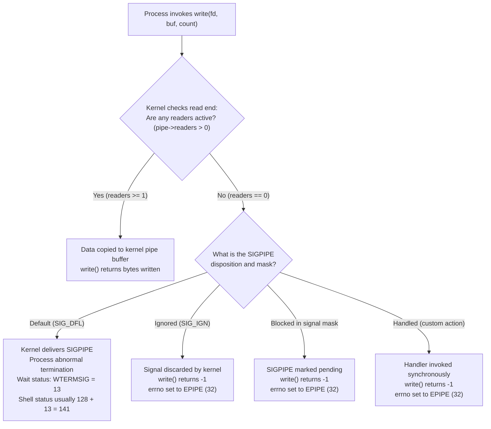

# SIGPIPE and EPIPE

> [!summary] Claim
> A write to a pipe or stream socket with no open read descriptors synchronously delivers a `SIGPIPE` signal to the writing thread and returns `-1` with `errno` set to `EPIPE` (32) if the signal is ignored or caught, providing automatic teardown for pipeline producers while demanding explicit suppression in network servers.

Part of [The Unix Process Model](README.md) in [Shell and Unix Engineering](../README.md).

## TL;DR

- Mechanism: When all read file descriptors for a pipe or stream socket are closed, the kernel atomically sends `SIGPIPE` to the writing thread and marks the system call with `-EPIPE`.
- Rule: Default disposition terminates the producer quietly; network daemons and interactive utilities must ignore or block `SIGPIPE` and check `write()` return values for `EPIPE`.
- Trap: Enabling `set -e` alongside `set -o pipefail` crashes scripts when standard consumers like `head` or `grep -m 1` exit early and leave upstream writers terminated with signal status 141.
- Portability fact: Pipelines return the exit status of the rightmost command by default; `pipefail` exposes upstream failures, standardized in POSIX.1-2024, supported in bash, zsh, ksh93, mksh, yash, busybox, Debian dash (backported in 0.5.12-7), and upstream dash since 0.5.13, but absent from dash 0.5.12 as Alpine 3.22 and macOS ship it and from posh (lab test 3).
- When not to use it: Never rely on `SIGPIPE` in multi-threaded processes or connection-oriented socket servers; use `MSG_NOSIGNAL` or `SO_NOSIGPIPE` to keep client disconnects isolated.

## Mental model



When a process calls `write()` on a pipe descriptor, the kernel inspects the underlying open file description to count active reading endpoints.
If at least one reader remains open, data transfers into the kernel ring buffer, blocking only if capacity is exhausted.
When all readers have closed their descriptors, the reader reference count reaches zero, creating a broken pipe.
Under default signal handling, the kernel dispatches `SIGPIPE` (signal 13) directly to the calling thread, terminating the process immediately so producers do not compute data into a void.
If the process overrides this behavior by setting `SIGPIPE` to `SIG_IGN`, blocking it via `pthread_sigmask()`, or installing a signal handler, the kernel preserves process execution, returns `-1` from `write()`, and sets `errno` to `EPIPE` (32).

## How it works

### The kernel mechanism

The broken pipe check occurs directly in the kernel file system implementation before data copying begins.
In Linux, the pipe subsystem handles writes inside `pipe_write()` in `fs/pipe.c`.
The function acquires `pipe->mutex` and immediately verifies reader presence:

```c
if (!pipe->readers) {
    send_sig(SIGPIPE, current, 0);
    ret = -EPIPE;
    goto out;
}
```

The call to `send_sig()` targets `current`, meaning the signal is generated specifically for the thread currently executing `write()`.
If the thread has not masked or caught `SIGPIPE`, thread-directed signal delivery results in whole-process termination.
If `SIGPIPE` is caught by a handler, the handler executes, and upon return, `write()` yields `-1` with `errno` set to `EPIPE`.
If `SIGPIPE` is blocked in the thread signal mask, the signal remains pending in `sigpending()`, and `write()` returns `-1` with `errno = EPIPE` without invoking a handler.
In Apple XNU (macOS Darwin), `pipe_write()` in `bsd/kern/sys_pipe.c` only returns `EPIPE` when the peer endpoint is gone; the signal is raised one layer up, in `fp_writev()` in `bsd/kern/sys_generic.c`, which calls `psignal(vfs_context_proc(ctx), SIGPIPE)` for a non-socket descriptor without `FG_NOSIGPIPE` (a process-directed signal, under the source comment "XXX Raise the signal on the thread?") `(xnu main, bsd/kern/sys_generic.c, fp_writev, as of 2026-10)`.

### Stream sockets and network disconnects

Connection-oriented stream sockets (`SOCK_STREAM`, such as TCP) inherit pipe semantics under POSIX.
When a remote peer closes a TCP connection, it transmits a `FIN` packet.
A write to a socket that has received a `FIN` may succeed initially because TCP allows unilateral half-closed connections.
However, if the peer has fully closed its endpoint or discarded incoming data, it replies with a `RST` (reset) packet.
On Linux, the first `write()` or `send()` after the `RST` usually fails with the pending socket error `ECONNRESET` and no signal, because `sk_stream_error()` in `net/core/stream.c` substitutes `sock_error()` for `-EPIPE`; later writes trigger `SIGPIPE` and fail with `EPIPE`.

Operating systems provide interfaces to suppress `SIGPIPE` on sockets without altering process-wide signal dispositions:
- Linux supports the `MSG_NOSIGNAL` flag in `send()` and `sendto()`.
  The flag is checked in the protocol code, not in `sock_sendmsg()` in `net/socket.c`: TCP tests `!(flags & MSG_NOSIGNAL)` in `sk_stream_error()` (`net/core/stream.c`), and Unix domain stream sockets test it in `unix_stream_sendmsg()` (`net/unix/af_unix.c`) before `send_sig(SIGPIPE, current, 0)`; with the flag set, the call returns `-EPIPE` without the signal.
- FreeBSD and macOS support the socket-level option `SO_NOSIGPIPE`; the macOS SDK also defines `MSG_NOSIGNAL` in `<sys/socket.h>`, and a `send(..., MSG_NOSIGNAL)` to a closed `socketpair` peer returned `EPIPE` without killing the process on macOS 27.2 (measured by the verifier, as of 2026-10).
  Applications configure it via `setsockopt(fd, SOL_SOCKET, SO_NOSIGPIPE, &opt, sizeof(opt))` to suppress `SIGPIPE` for all operations on that descriptor.
- Modern POSIX systems also support setting `SIGPIPE` to `SIG_IGN` globally with `signal(SIGPIPE, SIG_IGN)`, transforming every broken pipe write on pipes, FIFOs, and stream sockets into an `EPIPE` return.

### Specifications in POSIX.1-2024

The interactions between pipes, signals, and shell pipelines are governed by several sections of POSIX.1-2024:
- System Interfaces `write()`: `(POSIX.1-2024 XSH write)` specifies that `write()` fails with `[EPIPE]` if an attempt is made to write to a pipe or FIFO not open for reading by any process, and dictates that a `SIGPIPE` signal shall also be sent to the thread.
- Base Definitions `<signal.h>`: `(POSIX.1-2024 XBD <signal.h>)` defines `SIGPIPE` with default action "Abnormal termination".
- Shell Command Language `Pipelines`: `(POSIX.1-2024 XCU 2.9.2)` establishes that each command of a multi-command pipeline runs in a subshell environment, although a shell may, as an extension, run any of them in the current environment.
  The exit status of the pipeline is the exit status of the last command, unless `!` inverts it or `set -o pipefail` is active.
- Shell Command Language `Exit Status`: `(POSIX.1-2024 XCU 2.8.2)` mandates that when a command terminates abnormally due to receipt of a signal, the shell assigns an exit status greater than 128.
- Special Built-In Utilities `set`: `(POSIX.1-2024 XCU 2.15)` formally standardizes `set -o pipefail`, defining the pipeline exit status as the exit status of the rightmost command to fail with a non-zero status.
- Special Built-In Utilities `trap`: `(POSIX.1-2024 XCU 2.15)` dictates that signals ignored on entry to a non-interactive shell cannot be trapped or reset, ensuring child utilities inherit `SIG_IGN`.

### Shell pipeline orchestration and implementation

When a shell executes `cmd1 | cmd2`, standard implementations call `pipe()`, creating two file descriptors.
The shell forks two child processes, using `dup2()` to connect standard output of `cmd1` to the pipe write end and standard input of `cmd2` to the pipe read end.
Crucially, the shell parent process must close its own copies of both descriptors `(bash-5.3 execute_cmd.c, execute_pipeline)`.
If the parent retains the read descriptor, `pipe->readers` never drops to zero when `cmd2` exits, preventing `cmd1` from ever receiving `SIGPIPE`.

Shell implementations diverge in inter-process transport and pipeline inspection:
- Standard shells (GNU bash, dash, zsh, mksh, yash, BusyBox ash) connect pipeline stages using unidirectional kernel pipes via `pipe()`.
- In contrast, `ksh93` (specifically `ksh93u+m 1.0.10` on Linux, as of 2026-10) connects pipeline stages with bidirectional Unix domain socket pairs via `socketpair(AF_UNIX, SOCK_STREAM, 0, ...)`, reverting to `pipe()` only when POSIX mode is enabled (`set -o posix`); its `sh.1` says each stage is connected "by a socketpair(2) or (if the posix shell option is on) by a pipe(2)", and `readlink /proc/self/fd/0` in a stage prints `socket:[...]` by default and `pipe:[...]` under `-o posix` (measured in Debian 13).
  On Linux, when a downstream reader exits while unread data remains in its receive queue, `unix_release_sock()` sets the writer's pending error to `ECONNRESET`, so the producer's next write fails with `ECONNRESET` ("Connection reset by peer", errno 104) and no signal; if the queue happened to be empty, the write takes the ordinary path and raises `SIGPIPE` with `EPIPE` ("Broken pipe", errno 32).
  Which path a producer such as `yes` takes is decided by timing: under `set -o pipefail`, `yes 2>/dev/null | head -n 1` gave 1 (`ECONNRESET`) in 24 of 30 runs and 269 (`SIGPIPE`) in 6, and 269 in 30 of 30 under `-o posix` (measured by the verifier in ksh93u+m 1.0.10, as of 2026-10).
  macOS `/bin/ksh` (ksh93u+ 2012-08-01) connects its stages with pipes (`stat -L -f %HT /dev/fd/0` in a stage prints `Fifo`).
- Pipeline status arrays allow scripts to inspect every pipeline stage: GNU bash and `mksh` provide `${PIPESTATUS[@]}` (a 0-indexed array), native zsh provides `$pipestatus` (a 1-indexed array), while dash, posh, yash, and BusyBox ash provide no built-in array.
- In GNU bash, `execute_pipeline()` creates children via `make_child()` and tracks their process identifiers.
As children exit, bash reaps them with `waitpid()` and records each command exit status into the `PIPESTATUS` array.
In `sig.c`, bash calls `initialize_terminating_signals()` during startup to track signals capable of aborting the shell `(bash-5.3 sig.c, initialize_terminating_signals)`.
When bash spawns child processes for external commands, any signal caught by a shell `trap` is restored to `SIG_DFL` before `execve()`.
However, signals set to `SIG_IGN` remain `SIG_IGN` across `execve()`, which causes child tools to inherit broken pipe error returns instead of clean signal termination.

## Numbers and limits

| Parameter / Metric | Value | Scope / Platform | Source / Proof |
|---|---|---|---|
| `SIGPIPE` signal number | 13 | Linux, macOS, BSD, Solaris by convention since Sixth Edition Unix; POSIX does not fix it | V6 `usr/sys/param.h` (`SIGPIPE 13 /* end of pipe */`); `kill -l 13` prints `PIPE` on macOS and Debian; POSIX `kill` lists no number for `SIGPIPE` `(POSIX.1-2024 XCU kill)` |
| `EPIPE` error code | 32 | Linux, macOS, FreeBSD | `errno.h` `(Linux asm-generic/errno-base.h, macOS sys/errno.h)`; lab test 7 prints `EPIPE=32` |
| `ECONNRESET` error code | 104 (Linux), 54 (macOS) | Linux, macOS | `errno.h` (`macOS sys/errno.h` defines 54); produced under ksh93u+m socketpair pipelines by `unix_release_sock()` in `net/unix/af_unix.c` |
| Linux default pipe buffer | 16 pages (65,536 bytes with 4 KiB pages) | Linux 2.6.11+ | `pipe(7)`; a nonblocking writer filled 65,536 bytes on Linux 7.2 aarch64 with 4 KiB pages (measured by the verifier, as of 2026-10) |
| Linux maximum pipe buffer | 1,048,576 bytes (1 MiB default) | Linux `/proc/sys/fs/pipe-max-size`, 2.6.35+ | `pipe(7)`, `F_SETPIPE_SZ`; `cat /proc/sys/fs/pipe-max-size` prints 1048576 in Debian 13 |
| macOS default pipe buffer | 16,384 bytes initial, grows to 65,536 | macOS Darwin / XNU | `PIPE_SIZE` 16384 and `BIG_PIPE_SIZE` (64*1024) in `sys/pipe.h`; a nonblocking writer filled 65,536 bytes on macOS 27.2 (measured by the verifier, as of 2026-10) |
| `PIPE_BUF` atomic write limit | 4,096 bytes (Linux), 512 bytes (macOS) | POSIX minimum 512 bytes | `limits.h` `(POSIX.1-2024 XBD <limits.h>)`; `getconf PIPE_BUF /` prints 4096 in Debian 13 and 512 on macOS |
| Signal exit status (POSIX baseline) | `> 128` | POSIX standard | `(POSIX.1-2024 XCU 2.8.2)` |
| `SIGPIPE` exit status (standard shells) | 141 (`128 + 13`) | bash, dash, zsh, mksh, posh, busybox | Verified by lab (`sigpipe.bats` test 2) |
| `SIGPIPE` pipeline exit status (`pipefail` in ksh93u+m) | 1 or 269, by timing; 269 under `set -o posix` | ksh93u+m 1.0.10 on Linux | Verified by lab (`sigpipe.bats` test 3); 24 of 30 runs gave 1 (measured by the verifier, as of 2026-10) |
| `SIGPIPE` exit status (ksh93) | 269 (`256 + 13`) | ksh93u+m 1.0.10 and ksh93u+ 2012-08-01 | Verified by lab (`sigpipe.bats` test 2) |
| `SIGPIPE` exit status (yash direct child) | 397 (`384 + 13`) | yash 2.58.1 | Verified by lab (`sigpipe.bats` test 2) |
| `SIGPIPE` pipeline exit status (`pipefail` in yash) | 397 for `yes \| head -n 1`; 141 (`397 & 255`) when the stage carries a redirection such as `yes 2>/dev/null` | yash 2.58.1 | Verified by lab (`sigpipe.bats` test 3) `(as of 2026-10)` |
| Minimum readers to avoid `SIGPIPE` | 1 | Universal | Kernel `pipe->readers > 0` check in `fs/pipe.c` |

## Portability

| Implementation | Pipeline exit status (`yes \| head -n 1`) | `set -o pipefail` support | Pipeline status under `pipefail` | Array variable for pipeline statuses | `trap '' PIPE` child behavior |
|---|---|---|---|---|---|
| **POSIX sh** | 0 (last command) | Standardized in POSIX.1-2024 | Implementation-defined `> 128` | None required by POSIX | Inherits `SIG_IGN`; `write()` fails with `EPIPE` |
| **macOS bash 3.2** | 0 | Supported | 141 | `${PIPESTATUS[@]}` (0-indexed) | `yes` outputs write error to stderr |
| **GNU bash 5.3** | 0 | Supported | 141 | `${PIPESTATUS[@]}` (0-indexed) | `yes` outputs write error to stderr |
| **zsh (native)** | 0 | Supported | 141 | `$pipestatus` (1-indexed) | `yes` outputs write error to stderr |
| **zsh (`--emulate sh`)** | 0 | Supported | 141 | None (`$PIPESTATUS` and `$pipestatus` both unset, measured) | `yes` outputs write error to stderr |
| **Debian dash 0.5.12** | 0 | Supported (Debian backport since package 0.5.12-7, Debian bug #1071238; upstream since dash 0.5.13) | 141 | None | `yes` outputs write error to stderr |
| **dash 0.5.12 (Alpine, macOS)** | 0 | Not supported (fails on `set`; upstream added it in 0.5.13) | N/A | None | `yes` outputs write error to stderr |
| **ksh93u+m 1.0.10** | 0 | Supported | 1 (`yes` got `ECONNRESET`) or 269 (`256 + 13`), by timing; 269 under `set -o posix` | None (no built-in array) | `yes` outputs `Connection reset by peer` (`ECONNRESET`) or `Broken pipe`, by timing; always `Broken pipe` under `set -o posix` |
| **ksh93u+ (2012, macOS `/bin/ksh`)** | 0 | Supported | 13 (the bare signal number, 20 of 20 runs) | None (no built-in array) | `yes` outputs write error to stderr |
| **mksh R59** | 0 | Supported (since R46: first present in the `mksh-R46` tag source and manual, absent from R45) | 141 | `${PIPESTATUS[@]}` (0-indexed) | `yes` outputs write error to stderr |
| **yash 2.58** | 0 | Supported | 397 (`384 + 13`); 141 when the stage has a redirection | None | `yes` outputs write error to stderr |
| **posh 0.14.1** | 0 | Not supported (fails on `set`) | N/A | None | `yes` outputs write error to stderr |
| **BusyBox ash 1.37** | 0 | Supported (built with `CONFIG_ASH_BASH_COMPAT`, which defines `BASH_PIPEFAIL` in `shell/ash.c`) | 141 | None | BusyBox `yes` outputs `yes: : Broken pipe` |
| **GNU coreutils** | N/A | N/A | N/A | N/A | Prints `standard output: Broken pipe` (or `Connection reset by peer` on socketpair) |
| **BSD / macOS utils** | N/A | N/A | N/A | N/A | `yes` prints `yes: stdout: Broken pipe` to stderr (macOS 27.2 `/usr/bin/yes`) |

## Worked example

The test script in [lab](../labs/01-sigpipe-and-epipe/) isolates pipeline termination, signal exit codes, `EPIPE` generation under `SIG_IGN`, and `pipefail` propagation.

```sh
#!/bin/sh
# pipe_probe.sh - Probe SIGPIPE generation, pipeline exit status, and EPIPE error handling.
# Part of 19-Shell-and-Unix-Engineering/01-Unix-Process-Model/SIGPIPE-and-EPIPE
set -u

# Step 1: Default pipeline termination.
# Upstream generates infinite lines; head consumes 2 and terminates.
# Upstream receives SIGPIPE and dies silently; pipeline exit status reflects head (0).
printf '=== Step 1: Default pipeline termination ===\n'
yes 2>/dev/null | head -n 2
printf 'pipeline exit status: %d\n' "$?"

# Step 2: Signal exit status inspection.
# When a process terminates due to SIGPIPE (signal 13), the shell wait status reflects it.
printf '=== Step 2: Direct SIGPIPE exit status ===\n'
exit_code=0
sh -c 'kill -13 $$' 2>/dev/null || exit_code="$?"
printf 'kill -13 exit status: %d\n' "${exit_code:-0}"

# Step 3: Ignored SIGPIPE exposing EPIPE.
# When SIGPIPE is set to SIG_IGN, the kernel does not kill the writer.
# The write() system call fails with EPIPE (errno 32).
printf '=== Step 3: Ignored SIGPIPE exposing EPIPE ===\n'
(
  trap '' PIPE
  yes | head -n 2
)
printf 'pipeline exit status: %d\n' "$?"

# Step 4: Pipeline exit status under pipefail (where supported).
printf '=== Step 4: Pipeline exit status under pipefail ===\n'
# shellcheck disable=SC3040 # feature detection of pipefail support in subshell
if (set -o pipefail 2>/dev/null); then
  pf_status=0
  # Measure the shell under test itself, in a subshell, not whatever sh is on PATH.
  # shellcheck disable=SC2312,SC3040 # the pipeline status is the value being measured; pipefail is guarded above
  pf_status=$(set -o pipefail; yes 2>/dev/null | head -n 2 >/dev/null; echo "$?") || pf_status="$?"
  printf 'pipefail exit status: %s\n' "${pf_status:-0}"
else
  printf 'pipefail not supported by this shell\n'
fi
```

When executed under Debian 13 `sh` (dash 0.5.12-12) with GNU coreutils 9.7, the lab prints the following output (re-run by the verifier, as of 2026-10):

```text
=== Step 1: Default pipeline termination ===
y
y
pipeline exit status: 0
=== Step 2: Direct SIGPIPE exit status ===
kill -13 exit status: 141
=== Step 3: Ignored SIGPIPE exposing EPIPE ===
y
y
yes: standard output: Broken pipe
pipeline exit status: 0
=== Step 4: Pipeline exit status under pipefail ===
pipefail exit status: 141
```

Under macOS with BSD utilities, Step 3 prints `yes: stdout: Broken pipe`; under Alpine's BusyBox `yes` it prints `yes: : Broken pipe`.
Under `ksh93u+m 1.0.10` on Linux, Step 2 prints `kill -13 exit status: 269`; because pipelines connect via `socketpair` instead of `pipe`, Step 3 prints `yes: standard output: Connection reset by peer` in most runs and `Broken pipe` in the rest, and Step 4 prints 1 or 269 for the same reason (lab tests 3, 5, and 6 accept exactly these outcomes and pin the `pipe` behavior with `set -o posix`).
Under macOS `/bin/ksh` (ksh93u+ 2012), Step 2 prints 269 and Step 4 prints `pipefail exit status: 13`.
Under `yash`, Step 2 prints `kill -13 exit status: 397`, while Step 4 prints `pipefail exit status: 141`: the `2>/dev/null` makes yash run `yes` in a grandchild, and the intermediate yash exits with 397 truncated to 8 bits; without the redirection the same pipeline reports 397 (lab test 3).

## Pitfalls

> [!warning] The set -euo pipefail early-reader termination trap
> Trigger: Running a pipeline such as `find . -name '*.log' | head -n 5` or `cat data.csv | grep -m 1 pattern` inside a shell script configured with `set -e` and `set -o pipefail`.
> Symptom: The script aborts unexpectedly with exit code 141, even though the downstream command completed its task successfully.
> Mechanism: `head` or `grep -m 1` reads its desired quota and exits 0, closing its read descriptor.
> The upstream process (`find` or `cat`) attempts another `write()`, is terminated by `SIGPIPE`, and yields exit status 141.
> Because `pipefail` is active, the pipeline takes the non-zero status of the upstream failure instead of `head`'s zero, and `set -e` triggers immediate script termination.
> Fix: Temporarily disable pipefail using `set +o pipefail` around the command, or mask status 141 by inspecting the pipeline status:
> ```bash
> { find . -name '*.log' | head -n 5; } || { rc=$?; [ "$rc" -eq 141 ] || exit "$rc"; }
> ```

> [!warning] Lingering read descriptors causing infinite hangs instead of SIGPIPE
> Trigger: A downstream pipeline consumer forks an asynchronous background job or subshell that does not close its inherited standard input.
> Symptom: Upstream writer never receives `SIGPIPE` and never sees `EPIPE` after the main consumer exits; once the pipe buffer fills, the writer blocks indefinitely.
> Mechanism: The kernel checks `pipe->readers == 0` before raising `SIGPIPE`.
> Because the background process holds a duplicated open file description to the read end, the reference count remains at least 1.
> Fix: Close standard input in background tasks (`background_cmd <&- &` or `background_cmd </dev/null &`), or ensure child utilities set `FD_CLOEXEC` on open descriptors `[[Close-on-Exec-and-Descriptor-Inheritance]]`.

> [!warning] Inherited SIG_IGN silencing SIGPIPE in child processes
> Trigger: Spawning child processes from a runtime or supervisor that sets `SIGPIPE` to `SIG_IGN` and does not restore it for children, such as Python's `os.system()` or `subprocess` with `restore_signals=False` (Python ignores `SIGPIPE` at startup), or a systemd unit, where `IgnoreSIGPIPE=` defaults to yes.
> Symptom: Core Unix utilities like `yes`, `sed`, or `cat` fail with noisy errors (`cat: write error: Broken pipe`) or enter infinite loops instead of terminating silently.
> Mechanism: Per POSIX, signal dispositions set to `SIG_IGN` survive across `execve()`.
> Downstream tools rely on `SIG_DFL` to exit cleanly; when `SIGPIPE` is ignored, their `write()` calls return `EPIPE`.
> If the utility does not handle `EPIPE` or treats write errors as fatal diagnostics (as GNU coreutils does via `close_stdout()` in `gnulib/lib/closeout.c`), it prints an error and exits 1.
> Fix: Explicitly restore `SIG_DFL` before executing child processes.
> In Python: `subprocess.Popen(..., restore_signals=True)`, which is the default and resets `SIGPIPE`, `SIGXFZ`, and `SIGXFSZ` to `SIG_DFL` in the child; on macOS with Python 3.15.1, `yes | head -n 1` under `subprocess.run` stayed silent, while `restore_signals=False` and `os.system()` printed `yes: stdout: Broken pipe` (measured by the verifier, as of 2026-10).
> In C: `signal(SIGPIPE, SIG_DFL)` immediately before `execve()`.

> [!warning] Socket server daemon crash from unhandled SIGPIPE (CVE-2017-10664)
> Trigger: A multi-threaded network server or daemon writes to a client TCP socket after the client abruptly disconnects or terminates the connection.
> Symptom: The entire daemon process terminates abruptly with signal 13, causing a denial of service for all active users.
> Mechanism: A TCP write to a socket that has received a `RST` raises `SIGPIPE`.
> By default, `SIGPIPE` terminates the entire process, not just the writing thread.
> In CVE-2017-10664, QEMU's `qemu-nbd` server omitted `SIGPIPE` suppression; an attacker disconnecting during a reply crashed the storage daemon.
> A similar flaw in `nss_ldap` (CVE-2005-2377) caused background daemons like `crond` to crash when an LDAP directory dropped connections.
> Fix: On Linux, supply `MSG_NOSIGNAL` to `send()`.
> On BSD/macOS, configure `SO_NOSIGPIPE` via `setsockopt()`.
> In daemons, ignore `SIGPIPE` during initialization (`signal(SIGPIPE, SIG_IGN)`) and handle `EPIPE` explicitly in socket error branches.

> [!warning] ksh93 socketpair pipelines exposing ECONNRESET instead of EPIPE
> Trigger: Running pipeline producers in `ksh93` (specifically `ksh93u+m 1.0.10`) on Linux when downstream consumers exit early, or relying on `EPIPE` and pipe atomicity.
> Symptom: An upstream producer's first failed write often reports `ECONNRESET` ("Connection reset by peer", errno 104) instead of `EPIPE` (errno 32), and no `SIGPIPE` is raised for it, so the producer exits 1 instead of dying with status 269; error-handling branches expecting `EPIPE`, and `pipefail` checks expecting 269, fail to match, and the outcome changes from run to run.
> Mechanism: By default, `ksh93` constructs pipelines using bidirectional Unix domain sockets (`socketpair()`) rather than standard unidirectional pipes (`pipe()`).
> When a downstream consumer terminates while unread data remains in its receive queue, `unix_release_sock()` in `net/unix/af_unix.c` sets the producer's pending socket error to `ECONNRESET`, which the producer's next write returns; when the queue is empty at that moment, the write gets `EPIPE` and `SIGPIPE` as with a pipe.
> Fix: Run `ksh93` in strict POSIX mode with `set -o posix` (or `ksh -o posix`), which forces `ksh93` to construct pipelines using standard `pipe()` descriptors; or update write error handling to accept both `EPIPE` and `ECONNRESET`.

> [!warning] Dash pipefail divergence between Debian packaging and vanilla upstream
> Trigger: Using `set -o pipefail` in `/bin/sh` scripts deployed across Debian/Ubuntu containers and Alpine Linux or macOS hosts.
> Symptom: The script executes cleanly on Debian/Ubuntu, but fails immediately with `set: Illegal option -o pipefail` on Alpine Linux or macOS.
> Mechanism: POSIX.1-2024 standardized `set -o pipefail`.
> Debian backported `pipefail` support to `dash` (since Debian package `dash 0.5.12-7`, 2024-05-17, changelog entry "Implement pipefail option (Closes: #1071238)"), while upstream dash first released it in 0.5.13 (commit "jobs: Implement pipefail option", 2024-04-05, present in the `v0.5.13` tag), so the unpatched `dash 0.5.12` that Alpine 3.22 and macOS ship does not include it; Alpine's dash prints `dash: 1: set: Illegal option -o pipefail` and exits 2 (lab test 3).
> Fix: Guard `pipefail` with feature detection in `/bin/sh` scripts (`if (set -o pipefail 2>/dev/null); then set -o pipefail; fi`), or invoke `bash` or another compliant shell (`#!/usr/bin/env bash`) when pipeline status propagation is required.

> [!warning] Shell signal exit status arithmetic across ksh93 and yash
> Trigger: Hardcoding `141` (`128 + 13`) in scripts or test assertions to detect `SIGPIPE` termination across different shell families.
> Symptom: Status checks like `[ "$?" -eq 141 ]` fail to recognize `SIGPIPE` termination under `ksh93` or `yash`.
> Mechanism: POSIX specifies that process termination by a signal produces an exit status strictly greater than 128.
> Standard shells (bash, dash, zsh, mksh, BusyBox ash) report `128 + N` (141 for `SIGPIPE`).
> However, `ksh93` reports `256 + N` (269), and `yash` reports `384 + N` (397), including for a pipeline stage under `pipefail`; a yash stage that carries a redirection reports 141 because an intermediate yash exits with 397 truncated to 8 bits, and ksh93u+ 2012 reports the bare signal number 13 under `pipefail`.
> Fix: Match all valid shell conventions portably:
> ```bash
> case "$rc" in 141 | 269 | 397) handle_sigpipe ;; esac
> ```

## Security and robustness

### Denial of service via signal amplification

In network daemons, unhandled `SIGPIPE` constitutes an availability vulnerability.
Because stream sockets inherit pipe semantics, any unauthenticated client on a public network can force a server into a `SIGPIPE` condition.
The client connects, sends a request that solicits a large response, and immediately closes the TCP connection or sends a TCP `RST`.
When the server attempts to flush its write buffer, the kernel issues `SIGPIPE`.
Unless the daemon explicitly sets `signal(SIGPIPE, SIG_IGN)` or passes `MSG_NOSIGNAL`, the process terminates.
Multi-threaded services must never rely on thread-local signal masks alone for process survival, as any newly created thread or external library call can reset mask configurations.

### Asynchronous signal safety and trap handlers

Handling `SIGPIPE` with a custom shell trap or C signal handler introduces reentrancy risks.
Under POSIX, signal handlers must only invoke async-signal-safe functions `[[Async-Signal-Safety]]`.
Attempting to allocate memory, acquire non-recursive mutexes, or perform buffered I/O (`printf`, `fprintf`) inside a `SIGPIPE` handler causes deadlocks or heap corruption if the signal interrupted another I/O call.
In shell scripts, `trap 'echo error' PIPE` causes the shell builtin `echo` to attempt writing to standard output.
If standard output is the broken pipe, the trap triggers a secondary `EPIPE`, printing diagnostics to standard error or cascading into unexpected loop behavior.

### Runtime language defaults and impedance mismatches

Modern languages handle the conflict between CLI utilities and network daemons differently:
- **Rust**: By default, Rust's runtime sets `SIGPIPE` to `SIG_IGN` during startup (tracked in Rust issue #62569).
  This protects network daemons, but causes CLI tools like `my_tool | head -n 1` to panic with `Broken pipe (os error 32)`.
  Rust has not stabilized an opt-out: the experimental `#[unix_sigpipe = "sig_dfl"]` attribute was replaced by the unstable compiler flag `-Zon-broken-pipe=kill` (tracking issue #97889), and issue #62569 is still open `(Rust Unstable Book, as of 2026-10)`.
- **Go**: The Go runtime distinguishes file descriptors 1 and 2 (standard output and error) from other descriptors.
  A broken pipe write to stdout or stderr terminates the process via `SIGPIPE`, maintaining standard pipeline filter behavior.
  Writes to network sockets or other descriptors suppress `SIGPIPE` and return `syscall.EPIPE`.
- **Python**: Python sets `SIGPIPE` to ignored at startup, so a broken pipe write surfaces as a catchable `BrokenPipeError` exception (`[Errno 32] Broken pipe`).
  When piping Python output into `head`, unhandled exceptions produce tracebacks on stderr during final stream flushing.
  Robust Python CLI scripts flush stdout and catch `BrokenPipeError`, redirecting standard output to `/dev/null` before calling `sys.exit(1)`, the status the Python documentation's "Note on SIGPIPE" recipe uses.

## The principal's view

A staff-plus engineer recognizes `SIGPIPE` as a pragmatic Research Unix design decision, already present in Sixth Edition Unix (1975), whose `param.h` defines `SIGPIPE 13 /* end of pipe */`: an out-of-band control mechanism designed so small, single-purpose utilities could be composed without negotiating stream boundaries.
The Unix pipeline depends on early termination.
If `yes` or `seq 1 10000000` had to check every `write()` return code and explicitly negotiate shutdown with `head -n 5`, utility code would be bogged down in defensive boilerplate.
`SIGPIPE` shifts the burden of stream termination to the kernel.

However, that elegance collapses at two architectural boundaries:
1. **The Shell Resilience Boundary**: The ubiquitous DevOps mantra to use `set -euo pipefail` is fundamentally at war with Unix pipeline composition.
   Pipeline filters are designed to be severed.
   When combining `pipefail` with `set -e`, a team must establish standard patterns: either wrapping consumers in helper functions that swallow status 141, or auditing every pipeline that truncates input streams.
   Furthermore, engineers must account for transport and encoding heterogeneity across shells: `ksh93u+m` constructs pipelines with `socketpair()` by default, so early consumer teardown can surface as `ECONNRESET` instead of `EPIPE`, depending on timing, while signal wait statuses range from 141 (bash/dash/zsh) to 269 (`ksh93`) and 397 (`yash`).
2. **The Systems Software Boundary**: In high-concurrency daemons, message brokers, and proxy engines (such as Envoy, Nginx, or Redis), `SIGPIPE` is pure operational risk.
   The golden rule of network systems engineering is: ignore `SIGPIPE` at the process entry point on line one of `main()`, use `MSG_NOSIGNAL` or `SO_NOSIGPIPE` on all stream sockets, and handle connection teardown purely through standard synchronous error paths (`errno == EPIPE` or `ECONNRESET`).

## Interview questions

> [!question] L5: What happens at the kernel level when an upstream command writes to a pipeline whose downstream consumer has already exited?
>
> > [!success]- Answer
> > The kernel checks the open file description for the pipe and finds that the reading endpoint reference count (`pipe->readers`) is zero.
> > Under default signal dispositions, the kernel synchronously dispatches a `SIGPIPE` signal to the writing thread.
> > Because the default action of `SIGPIPE` is abnormal process termination, the writer is immediately killed.
> > The writer process transitions to a zombie state and reports an exit status greater than 128 to its parent: typically 128 plus the signal number (141) in bash, dash, and zsh, 256 plus the signal number (269) in ksh93, or 384 plus the signal number (397) in yash.
> > If the process has ignored or blocked `SIGPIPE`, the write system call fails immediately and returns `-1` with `errno` set to `EPIPE` (32), or `ECONNRESET` (104) if writing to a stream socket closed with unread data as in ksh93 pipelines.
> >
> > Follow-up: Why does the shell pipeline `yes | head -n 1` return an overall exit status of 0 in standard POSIX sh?

> [!question] L5: Predict the output: What does the following bash snippet print, and what is its final exit status?
> ```bash
> set -o pipefail
> yes 2>/dev/null | head -n 2
> echo "status: $?"
> ```
>
> > [!success]- Answer
> > The command prints two lines containing `y` followed by `status: 141`.
> > `head -n 2` reads two lines from standard input and terminates with exit status 0.
> > The subsequent write attempt by `yes` encounters a closed pipe reader and triggers `SIGPIPE`, terminating `yes` with signal 13 (exit status 141).
> > Because `pipefail` is enabled, the pipeline exit status becomes the rightmost non-zero exit code (141) rather than `head`'s exit code (0).
> > The subsequent command substitution or `$?` expansion captures 141 and prints `status: 141`.
> >
> > Follow-up: How would the output change if `set -e` were added before running the pipeline?

> [!question] L6: Debug this script: Why does cat access.log | grep -m 1 "ERROR" abort scripts running under set -euo pipefail, and how is it fixed?
>
> > [!success]- Answer
> > `grep -m 1` exits immediately with status 0 after finding the first matching error line.
> > When `grep` exits, it closes its standard input file descriptor, terminating the read end of the pipe.
> > `cat` continues streaming `access.log` and attempts to write to the closed pipe, triggering `SIGPIPE` and terminating with exit code 141.
> > Because `pipefail` is enabled, the pipeline reports status 141, and `set -e` aborts the deployment script.
> > To fix this while retaining `pipefail` globally, mask the `SIGPIPE` exit code explicitly:
> > `{ cat access.log | grep -m 1 "ERROR"; } || { rc=$?; [ "$rc" -eq 141 ] || exit "$rc"; }`
> > Alternatively, eliminate the unnecessary pipeline by passing the file directly to grep: `grep -m 1 "ERROR" access.log`.
> >
> > Follow-up: Does `grep -m 1 "ERROR" access.log` completely avoid `SIGPIPE`, and why?

> [!question] L6: What happens across `fork()` and `execve()` to the signal disposition of `SIGPIPE` when a Python parent script sets `signal.signal(signal.SIGPIPE, signal.SIG_IGN)` before launching a shell command?
>
> > [!success]- Answer
> > When the Python process calls `fork()`, the child process inherits an exact duplicate of the parent signal table, including `SIG_IGN` for `SIGPIPE`.
> > When the child calls `execve()` to execute an external utility, signals set to `SIG_IGN` remain ignored per the POSIX specification.
> > Consequently, the executed binary runs with `SIGPIPE` ignored.
> > The exception is a launch through `subprocess` with its default `restore_signals=True`, which resets `SIGPIPE` to `SIG_DFL` in the child before `execve()`; `os.system()` and `restore_signals=False` keep `SIG_IGN`.
> > When the binary writes to a broken pipe, the kernel does not kill it with `SIGPIPE`; instead, `write()` returns `-1` with `errno = EPIPE` (or `ECONNRESET` on socketpair pipelines under ksh93).
> > If the executed utility is a standard tool like GNU `cat` or `yes`, it fails to terminate silently and instead emits `write error: Broken pipe` (or `Connection reset by peer`) to standard error.
> >
> > Follow-up: How do signals set to a custom C handler behave across `execve()` compared to `SIG_IGN`?

> [!question] L6: In a high-throughput multi-threaded network server written in C, why is setting `signal(SIGPIPE, SIG_IGN)` at process startup preferred over blocking `SIGPIPE` using `pthread_sigmask()` in each worker thread?
>
> > [!success]- Answer
> > Blocking `SIGPIPE` with `pthread_sigmask()` does not prevent signal generation; it merely marks `SIGPIPE` as pending for the thread.
> > If any third-party library or runtime component subsequently unblocks signals or calls `sigwait()`, the pending `SIGPIPE` can be delivered unexpectedly and terminate the process.
> > Setting `SIGPIPE` to `SIG_IGN` instructs the kernel to discard the signal immediately upon generation.
> > Discarding the signal ensures that `write()` or `send()` calls reliably return `-1` with `errno = EPIPE` without generating pending signal state.
> > Setting `SIG_IGN` once in `main()` guarantees uniform protection across all threads without requiring defensive mask management in every thread entry point.
> >
> > Follow-up: What Linux-specific socket flag allows suppressing `SIGPIPE` on a per-call basis without modifying process signal dispositions?

> [!question] L7: Under what exact kernel condition will writing to a pipe whose consumer has exited NOT generate `SIGPIPE` or `EPIPE`, and how does this lead to deadlocks in pipeline orchestration?
>
> > [!success]- Answer
> > `SIGPIPE` and `EPIPE` are generated if and only if the underlying open file description has zero open reading descriptors (`pipe->readers == 0`).
> > If the consumer process spawned a child process or background daemon that inherited standard input without `FD_CLOEXEC`, that child retains an open descriptor pointing to the read end.
> > Even after the primary consumer terminates and exits, `pipe->readers` remains greater than zero.
> > As a result, the kernel permits the upstream writer to continue filling the pipe buffer.
> > Once the pipe buffer capacity (64 KiB on Linux) is reached, the writer blocks waiting for reader buffer consumption that will never happen, resulting in a permanent deadlock.
> >
> > Follow-up: How can a shell script or supervisor daemon guarantee that child processes do not leak inherited pipe descriptors?

> [!question] L7: Compare how Linux and macOS handle broken pipe errors on network stream sockets at the system call level, citing the specific API mechanisms and flags.
>
> > [!success]- Answer
> > Both operating systems conform to POSIX by generating `SIGPIPE` and returning `EPIPE` when writing to a socket that has received a `RST` from the peer.
> > Linux provides the `MSG_NOSIGNAL` flag for `send()` and `sendto()`, which the protocol code checks before raising the signal (`sk_stream_error()` for TCP, `unix_stream_sendmsg()` for Unix domain stream sockets), returning `-EPIPE` without `SIGPIPE`.
> > On Linux, the first send after a peer `RST` usually returns the pending `ECONNRESET` instead, and only later sends see `EPIPE`.
> > Linux does not provide a descriptor-level socket option to suppress `SIGPIPE` across all subsequent system calls.
> > In contrast, macOS (Darwin / XNU) provides the `SO_NOSIGPIPE` socket option via `setsockopt(fd, SOL_SOCKET, SO_NOSIGPIPE, &opt, sizeof(opt))`.
> > Setting `SO_NOSIGPIPE` on macOS disables `SIGPIPE` generation for all future `write()`, `send()`, and `writev()` calls on that specific descriptor; current macOS also accepts `MSG_NOSIGNAL` on `send()` (defined in the SDK's `<sys/socket.h>`, and measured to suppress the signal on a `socketpair`).
> > On modern systems, cross-platform code typically pairs `signal(SIGPIPE, SIG_IGN)` with `send(..., MSG_NOSIGNAL)` on Linux and `SO_NOSIGPIPE` on macOS.
> >
> > Follow-up: Does `write()` support the `MSG_NOSIGNAL` flag on Linux?

> [!question] L7+: Design a resilient command execution engine in Go that executes arbitrary user shell pipelines while preventing both zombie leaks and false-positive pipeline failures caused by early consumer exit.
>
> > [!success]- Answer
> > The engine must execute pipeline commands by creating explicit OS pipes with `os.Pipe()` and wiring them through `Cmd.Stdin` and `Cmd.Stdout`; Go opens its own descriptors close-on-exec, so a child receives only its three standard streams plus anything listed in `ExtraFiles`.
> > Each child command must be launched with its own process group using `SysProcAttr: &syscall.SysProcAttr{Setpgid: true}`, so the engine can signal the whole group, including background jobs that would otherwise keep retaining descriptor references.
> > The parent engine must immediately close its local copies of the pipe descriptors after spawning each child so `pipe->readers` drops cleanly when the consumer exits.
> > As children terminate, the engine collects wait statuses via `waitid()` or `Process.Wait()`.
> > In the exit status evaluation pass, if an upstream command exited with signal 13 (`SIGPIPE`), but the immediate downstream consumer exited 0, the engine treats the upstream `SIGPIPE` as a successful normal stream termination rather than an execution failure.
> > Wait status evaluation should test `WIFSIGNALED(status) && WTERMSIG(status) == SIGPIPE` directly rather than relying on shell-specific 141 exit code arithmetic.
> > Finally, the engine sends `SIGTERM` followed by `SIGKILL` to any lingering process groups to ensure no leaked children keep pipes open.
> >
> > Follow-up: Why must the Go parent engine close its own copy of the pipe read file descriptor before waiting for child termination?

## Related

Prerequisites: [[PIPE_BUF-and-Write-Atomicity]]

Next: [[Exit-Status-and-Wait-Status]]

See also: [[Pipes-and-FIFOs]], [[Close-on-Exec-and-Descriptor-Inheritance]], [[Signals-Dispositions-Masks-and-Delivery]], [[Async-Signal-Safety]], [[File-Descriptors-and-Open-File-Descriptions]], [[Processes-fork-exec-and-wait]]

## Further reading

- [POSIX.1-2024 System Interfaces: write()](https://pubs.opengroup.org/onlinepubs/9799919799/functions/write.html) - Formal specification of the `EPIPE` error condition and synchronous `SIGPIPE` delivery rules.
- [POSIX.1-2024 Shell Command Language: Pipelines](https://pubs.opengroup.org/onlinepubs/9799919799/utilities/V3_chap02.html) - Section 2.9.2 defining pipeline status and the standardized `pipefail` option.
- [Linux Kernel fs/pipe.c implementation](https://git.kernel.org/pub/scm/linux/kernel/git/torvalds/linux.git/tree/fs/pipe.c) - The authoritative C source for `pipe_write()` reader validation and `send_sig()` dispatch.
- [Gnulib closeout.c source](https://git.savannah.gnu.org/cgit/gnulib.git/tree/lib/closeout.c) - Implementation of `close_stdout()` showing how GNU coreutils manages `EPIPE` diagnostics on standard output closure.
- [CVE-2017-10664 Vulnerability Record](https://cve.org/CVERecord?id=CVE-2017-10664) - Primary disclosure documenting daemon termination in QEMU `qemu-nbd` caused by unhandled `SIGPIPE` on client disconnect.
- [libcurl CURLOPT_NOSIGNAL API Reference](https://curl.se/libcurl/c/CURLOPT_NOSIGNAL.html) - Production guidelines for managing signals and avoiding multi-threaded race conditions in network clients.
- [Debian Bug #1071238](https://bugs.debian.org/1071238) - Closed by the Debian `dash 0.5.12-7` upload (2024-05-17) that added `set -o pipefail` to Debian's default shell; upstream dash includes it since 0.5.13.
- [MirBSD Korn Shell mksh(1) manual](https://www.mirbsd.org/mksh.htm) - Authoritative reference for mksh extensions including `${PIPESTATUS[@]}`.
- [ksh93 repository: ksh93u+m](https://github.com/ksh93/ksh) - Source code and documentation of ksh93u+m pipeline transport via `socketpair`.
