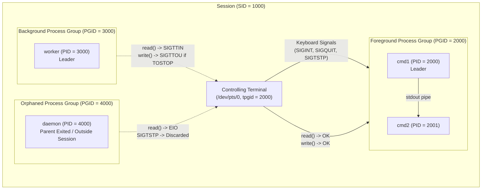

# Sessions Process Groups and Controlling Terminals

> [!summary] Claim
> Unix structures process execution into a strict two-level hierarchy of sessions and process groups to multiplex access to a controlling terminal, route keyboard signals to foreground pipelines, and protect background tasks where orphaned process groups require that no member has a parent in a different group within the same session.

Part of [The Unix Process Model](README.md) in [Shell and Unix Engineering](../README.md).

## TL;DR

The kernel organizes processes into process groups identified by a PGID inside a session identified by a SID, routing terminal input and keyboard signals exclusively to the foreground process group.
Shells and parent supervisors must execute `setpgid()` concurrently in both the parent and the child immediately after `fork()` to eradicate the scheduling race prior to `execve()`.
An orphaned process group requires that no member has a parent in a different group of the same session, so a group made with `setpgid()` in a container whose init (PID 1) is in the same session stays unorphaned after its parent exits; only a `setsid()` in the exiting parent puts the reaper in another session.
Without a controlling terminal, `set -m` is turned off with a warning by dash and BusyBox ash, aborts zsh, fails with status 1 in yash, and is unknown to posh, while bash, mksh, and ksh93 enable it; with a pseudo-terminal as controlling terminal every shell except posh enables it, and ksh93u+ 2012 alone keeps a script's synchronous pipelines in the shell's PGID.
Never implement raw session, process group, and terminal multiplexing logic in application microservices; delegate daemonization, socket activation, and cgroup-based process isolation to modern supervisors like systemd.

## Mental model



The controlling terminal maintains a single pointer (`tpgid`) referencing the active foreground process group within the session.
When a user presses an interrupt character such as `Ctrl+C` or `Ctrl+Z`, the terminal line discipline broadcasts the corresponding signal (`SIGINT` or `SIGTSTP`) exclusively to all processes sharing that foreground PGID.
Background process groups continue running concurrently inside the same session, but any attempt by a background process to read from the controlling terminal triggers an immediate `SIGTTIN` signal to suspend the group, or returns `-EIO` if `SIGTTIN` is blocked or ignored.
If a background group's parents terminate such that no member process has a parent in a different process group within the same session, the group becomes orphaned; the kernel prevents these orphaned processes from stopping by discarding job-control stop signals and instantly failing terminal reads with `EIO` (a process with no controlling terminal at all gets `ENXIO` when it opens `/dev/tty`).

## How it works

### The Process Hierarchy

Unix process relationships extend beyond single parent-child pairings into a structured hierarchy defined by POSIX.1-2024:
Every process belongs to exactly one process group, and every process group belongs to exactly one session (POSIX.1-2024 XBD 3.280, 3.329).
A process group is identified by a positive integer called the Process Group ID (PGID) (POSIX.1-2024 XBD 3.281).
The process group leader is the process whose PID equals its PGID (POSIX.1-2024 XBD 3.282).
A session is a collection of one or more process groups established for job control and login containment (POSIX.1-2024 XBD 3.329).
The session leader is the process whose PID equals its Session ID (SID) (POSIX.1-2024 XBD 3.330).

```
Session (SID)
   |
   +-- Foreground Process Group (PGID == tpgid)
   |      |-- Process (PID == PGID) [Leader]
   |      +-- Process (PID)
   |
   +-- Background Process Group 1 (PGID)
   |      +-- Process (PID == PGID) [Leader]
   |
   +-- Background Process Group 2 (PGID)
          +-- Process (PID == PGID) [Leader]
```

Process groups isolate pipelines.
When a user executes `cat file | grep pattern | sort`, the shell places all three processes into a dedicated process group.
Signaling that process group with a single kernel invocation targets every member process simultaneously without walking process trees in user space.

### System Calls: Managing Process Groups

Process groups are inspected and mutated via system calls declared in `<unistd.h>`:
`getpgrp(void)` returns the PGID of the calling process (POSIX.1-2024 XSH 3 `getpgrp`).
`getpgid(pid_t pid)` returns the PGID of the process specified by `pid`, or of the calling process if `pid` is `0` (POSIX.1-2024 XSH 3 `getpgid`).
`setpgid(pid_t pid, pid_t pgid)` sets the PGID of process `pid` to `pgid` (POSIX.1-2024 XSH 3 `setpgid`).
If `pid` is `0`, the caller's process ID is used.
If `pgid` is `0`, the process ID of the target process is used, turning that process into a new process group leader.

The kernel imposes strict boundaries on `setpgid()`:
The target process must be the calling process itself or an un-execed child of the calling process (`ESRCH` otherwise).
The target process cannot be a session leader (`EPERM`).
A process cannot be moved to a process group in a different session (`EPERM`).
A parent cannot change the PGID of a child after that child has successfully executed an `execve()` system call (`EACCES`).

In the Linux kernel, the `setpgid` system call (`SYSCALL_DEFINE2(setpgid, ...)` in `kernel/sys.c`) enforces these constraints under `rcu_read_lock()` and a write lock on `tasklist_lock`.
It moves the task with `change_pid(..., PIDTYPE_PGID, pgrp)`, which re-links the task's `PIDTYPE_PGID` entry onto the target group's `struct pid` and frees the old `struct pid` once nothing uses it.

### The Two-Sided `setpgid()` Race Condition

When a shell forks a child to execute a pipeline command under job control, a timing race arises:
If only the child calls `setpgid(0, pgid)`, the parent might execute `tcsetpgrp()` or `kill(-pgid, SIGINT)` before the child has executed its system call, failing with `EPERM` or `ESRCH`.
If only the parent calls `setpgid(child, pgid)`, the child might invoke `execve()` before the parent's `setpgid()` call reaches the kernel, causing the parent's `setpgid()` to fail with `EACCES`.

To make process group establishment deterministic, POSIX systems and production shells employ the two-sided `setpgid()` protocol:
Both the parent and the child execute `setpgid(child_pid, target_pgid)` immediately after `fork()`.
Whichever process runs first establishes the process group.
The second call either succeeds as a no-op or returns `EACCES` harmlessly if the child already called `execve()`.
GNU bash implements this in `jobs.c` inside `make_child()`, where the parent calls `setpgid(pid, pipeline_pgrp)` and the child calls `setpgid(mypid, pipeline_pgrp)` (bash-5.3 `jobs.c`, `make_child`).
dash implements the same pattern in `src/jobs.c`: the child calls `setpgid(0, pgrp)` in `forkchild()` and the parent calls `setpgid(pid, pgrp)` in `forkparent()`, each commented "This can fail because we are doing it in the parent also" (or "child") (dash-0.5.12 `src/jobs.c`).

### System Calls: Managing Sessions

Sessions are inspected and created via `<unistd.h>`:
`getsid(pid_t pid)` returns the session ID of process `pid` (POSIX.1-2024 XSH 3 `getsid`).
If `pid` is `0`, `getsid()` returns the caller's SID.
`setsid(void)` allocates a new session (POSIX.1-2024 XSH 3 `setsid`).

The contract of `setsid()` dictates three atomic transitions:
1. The calling process becomes the session leader of a new session (`SID == PID`).
2. The calling process becomes the process group leader of a new process group (`PGID == PID`).
3. The calling process has no controlling terminal; any association with its former controlling terminal is severed.

`setsid()` fails with `EPERM` if the calling process is already a process group leader.
Because a process group leader's PID already matches an existing PGID, allowing it to create a session with `SID == PID` would collide with the existing process group ID namespace.
Therefore, a process wishing to create a session must fork first and have the parent exit:

```c
pid_t pid = fork();
if (pid < 0) {
  perror("fork");
  exit(EXIT_FAILURE);
}
if (pid > 0) {
  _exit(EXIT_SUCCESS); /* Parent exits; child cannot be a process group leader */
}
if (setsid() < 0) {
  perror("setsid");
  exit(EXIT_FAILURE);
}
```

In the Linux kernel (`kernel/sys.c`, `ksys_setsid()`), nothing new is allocated: the caller's own `struct pid` becomes its SID and PGID through `set_special_pids()`, `proc_clear_tty()` drops the controlling terminal, and the call fails with `EPERM` if the caller is already a session leader or if a process group with that ID exists.

### The Controlling Terminal and Controlling Process

A controlling terminal is a terminal device file associated with a session (POSIX.1-2024 XBD 3.87).
A session can have at most one controlling terminal, and a terminal can be the controlling terminal for at most one session.
The controlling process is the session leader that established the connection to the controlling terminal (POSIX.1-2024 XBD 3.86).

#### Acquisition Semantics
POSIX leaves terminal allocation implementation-defined (POSIX.1-2024 XBD 11.1.3).
Two models exist (Stevens and Rago, APUE section 9.6):
- System V: If a session leader without a controlling terminal opens a terminal device, and the `O_NOCTTY` flag is omitted in `open()`, the terminal automatically becomes the controlling terminal for that session; Linux follows this model, and so does macOS for pseudo-terminals (a session leader that opened a pty slave without `O_NOCTTY` could then open `/dev/tty` on both, checked by hand on macOS and Debian, as of 2026-10).
- BSD: Opening a terminal never acquires it; the session leader must call `ioctl(fd, TIOCSCTTY, 0)`, which also works on Linux and macOS and is what the lab's probe uses.
Production daemons must always specify `O_NOCTTY` when opening any terminal or serial device to prevent accidental ctty acquisition:

```c
int fd = open("/dev/ttyS0", O_RDWR | O_NOCTTY);
```

#### The `/dev/tty` Device
The character special file `/dev/tty` is a magic device that aliases the controlling terminal of the calling process's process group (POSIX.1-2024 XBD 10.1: "a synonym for the controlling terminal associated with the process group of that process, if any").
If a process has no controlling terminal, opening `/dev/tty` fails immediately with `ENXIO` (Device not configured / No such device or address).
Opening `/dev/tty` allows an interactive utility to prompt the user directly even when standard input and standard output have been redirected to files.

#### Release and Hangup
A process relinquishes its controlling terminal by calling `setsid()`.
On Linux and BSD, a process can explicitly release its terminal via `ioctl(fd, TIOCNOTTY)`.
When the controlling process (the session leader) exits, the terminal is dissociated from the session (POSIX.1-2024 XBD 11.1.3).
In Linux `drivers/tty/tty_jobctrl.c`, `disassociate_ctty()` hangs up a real terminal (`tty_vhangup_session()`) but, for a pseudo-terminal, only signals its foreground group.
Descriptors of a hung-up terminal switch to the `hung_up_tty_*` operations in `drivers/tty/tty_io.c`: `read()` returns `0` (end of file), `write()` returns `-EIO`, and `ioctl()` returns `-EIO`, or `-ENOTTY` for `TIOCSPGRP`.
The kernel sends a `SIGHUP` signal to each process in the foreground process group (POSIX.1-2024 XSH `_exit`, Consequences of Process Termination).

### Terminal Access Control and Signal Generation

The kernel line discipline enforces job control rules defined in POSIX.1-2024 XBD 11.1.4:
The Linux terminal driver stores the foreground process group in `tty->ctrl.pgrp` (a `struct pid` pointer).
User space inspects and alters this pointer using:
`pid_t tcgetpgrp(int fildes)` returns the foreground PGID (POSIX.1-2024 XSH 3 `tcgetpgrp`).
`int tcsetpgrp(int fildes, pid_t pgid)` sets the foreground PGID (POSIX.1-2024 XSH 3 `tcsetpgrp`).
Under Linux, `tcgetpgrp()` and `tcsetpgrp()` map directly to `ioctl(fd, TIOCGPGRP, &pgid)` and `ioctl(fd, TIOCSPGRP, &pgid)`.

#### Keyboard Signal Delivery
When the terminal driver receives special control characters from the input stream (and `ISIG` is set in `c_lflag`), it does not deliver bytes to the read buffer:
- `INTR` (`Ctrl+C`, ASCII 0x03) generates `SIGINT`.
- `QUIT` (`Ctrl+\`, ASCII 0x1C) generates `SIGQUIT`.
- `SUSP` (`Ctrl+Z`, ASCII 0x1A) generates `SIGTSTP`.
In Linux `drivers/tty/n_tty.c`, the line discipline invokes `isig()`, whose helper `__isig()` calls `kill_pgrp()` on the terminal's foreground group.
Only processes whose PGID equals `tty->pgrp` receive the signal; background processes never see keyboard interrupts.

#### Background Reads and `SIGTTIN`
When a process belonging to a background process group calls `read()` on its controlling terminal, the driver halts the operation:
In `drivers/tty/n_tty.c`, `n_tty_read()` calls `job_control()`, which calls `__tty_check_change(tty, SIGTTIN)` in `drivers/tty/tty_jobctrl.c`; that function acts only when the terminal is the caller's controlling terminal and `task_pgrp(current) != tty->ctrl.pgrp`.
If `SIGTTIN` is blocked or ignored, or the process group is orphaned, the read call aborts and returns `-1` with `errno` set to `EIO` (POSIX.1-2024 XBD 11.1.4).
Otherwise, the kernel sends `SIGTTIN` to the background process group via `kill_pgrp()` and returns `-ERESTARTSYS`.
The default disposition of `SIGTTIN` stops the process group.

#### Background Writes and `SIGTTOU`
By default, background processes are permitted to write to the controlling terminal.
However, if the terminal attribute `TOSTOP` is set (`stty tostop`, setting `c_lflag & TOSTOP`), background writes are restricted:
`n_tty_write()` calls `tty_check_change()` (in `drivers/tty/tty_jobctrl.c`) when `TOSTOP` is enabled, and for a background writer:
If `SIGTTOU` is blocked or ignored, the write proceeds; otherwise, if the group is orphaned, the write fails with `EIO` (POSIX.1-2024 XBD 11.1.4).
Otherwise, the kernel sends `SIGTTOU` to the background process group, suspending it until brought to the foreground.

#### Background `tcsetpgrp()` Execution
If a background process calls `tcsetpgrp()`, POSIX requires the kernel to generate `SIGTTOU` to prevent background jobs from hijacking the terminal.
If the caller blocks or ignores `SIGTTOU`, POSIX requires that `tcsetpgrp()` be allowed and no signal sent (POSIX.1-2024 XSH `tcsetpgrp`); Linux's `__tty_check_change()` returns success in that case, which is why a job-control shell ignores `SIGTTOU` before handing the terminal over.
`tcsetpgrp()` fails with `EPERM` only when the requested group is not a process group in the caller's session, and with `EIO` when the caller's group is orphaned and `SIGTTOU` is neither blocked nor ignored.

### Orphaned Process Groups

POSIX defines an orphaned process group with mathematical precision:
An orphaned process group is a process group in which the parent of every member is either itself a member of the group, or is not a member of the group's session (POSIX.1-2024 XBD 3.247).
Conversely, a process group is NOT orphaned as long as at least one process in the group has a parent that is in a different process group within the SAME session.

Linux implements this check in `kernel/exit.c` via `will_become_orphaned_pgrp()`:

```c
static int will_become_orphaned_pgrp(struct pid *pgrp, struct task_struct *ignored_task)
{
  struct task_struct *p;

  do_each_pid_task(pgrp, PIDTYPE_PGID, p) {
    if ((p == ignored_task) ||
        (p->exit_state && thread_group_empty(p)) ||
        is_global_init(p->real_parent))
      continue;

    if (task_pgrp(p->real_parent) != pgrp &&
        task_session(p->real_parent) == task_session(p))
      return 0; /* Outside parent in same session exists: not orphaned */
  } while_each_pid_task(pgrp, PIDTYPE_PGID, p);

  return 1; /* Orphaned */
}
```

#### Why Orphaned Process Groups Exist and the Container Trap
The session leader or parent shell is responsible for managing jobs.
If a job stops while in the background, the shell receives a `SIGCHLD` and prints a job status notification.
If the shell terminates, any stopped child processes would remain stopped indefinitely because no surviving parent in the session exists to issue a `SIGCONT` or call `tcsetpgrp()`.

In containerized environments (such as Docker, Kubernetes, or container CI runners), an insidious failure mode occurs if a process group is created with `setpgid()` rather than `setsid()`:
When the parent exits, the child reparents to the container init (PID 1) or a subreaper.
If PID 1 shares the test's session, PID 1 acts as a parent in a different process group within the SAME session.
Under POSIX.1-2024 XBD 3.247, the child's process group is NOT orphaned because an outside parent exists in the session.
Linux skips a member whose parent is the global init (the `is_global_init()` test above), but a container's PID 1 is only the init of its PID namespace, so it counts as a parent in the same session.
Consequently, when the child receives `SIGTSTP`, the signal is NOT discarded; the child stops, holding pipes or FIFOs open and hanging container test suites indefinitely (this hung the vault's own shell matrix for nine hours before the lab's probe switched to `setsid()`).
To properly orphan a process group in containers, the intermediate child must execute `setsid()` before creating the target process group, ensuring that upon intermediate parent termination, any outside reaper belongs to an entirely separate session.

To prevent perpetual suspensions, POSIX mandates two safeguards:
1. SIGHUP on Orphaning: If the exit of a process causes a process group to become orphaned, and any member of that newly orphaned process group is in a stopped state, the kernel immediately sends `SIGHUP` followed by `SIGCONT` to every process in that group (POSIX.1-2024 XSH `_exit`, Consequences of Process Termination).
If the processes have default `SIGHUP` dispositions, they terminate immediately.
If they catch or ignore `SIGHUP`, `SIGCONT` awakens them to continue running in the background.
2. Discarding Stop Signals: A process in an orphaned process group is not permitted to stop in response to `SIGTSTP`, `SIGTTIN`, or `SIGTTOU` (POSIX.1-2024 XSH 2.4.3 Signal Actions).
If the default action of one of these signals would stop the process, the kernel discards the signal silently.
(Note that `SIGSTOP` cannot be discarded or caught, and will still stop an orphaned process).
3. Read / Write EIO: Any attempt by a member of an orphaned process group to read from the controlling terminal (or write with `TOSTOP` while not ignoring or blocking `SIGTTOU`) returns `-1` with `errno` set to `EIO` instead of generating `SIGTTIN` or `SIGTTOU` (POSIX.1-2024 XBD 11.1.4).
If no controlling terminal exists in the session, opening `/dev/tty` returns `-1` with `errno` set to `ENXIO`.

### Shell Job Control Architecture (`set -m` vs `set +m`)

POSIX shells operate in two distinct modes regarding process groups and terminal ownership (POSIX.1-2024 XCU 2.11 Job Control, 2.9.3.1 Asynchronous AND-OR Lists, 2.12 Signals and Error Handling, and `set -m` in 2.15):

#### Interactive Shell Mode (`set -m` / `set -o monitor`)
In interactive shells, monitor mode is enabled by default.
For every pipeline entered interactively:
1. The shell calls `pipe()` to create inter-process descriptors.
2. The shell calls `fork()` for each command in the pipeline.
3. Both parent and child invoke `setpgid(child_pid, pipeline_pgid)`.
4. If foreground: the shell calls `tcsetpgrp(tty_fd, pipeline_pgid)` to surrender terminal control.
5. The shell waits for all processes in the pipeline via `waitpid(-pipeline_pgid, &status, WUNTRACED)`.
6. If a child stops (`WIFSTOPPED(status)`), the shell reclaims the terminal with `tcsetpgrp(tty_fd, shell_pgid)` and reports `[1]+ Stopped`.
7. If the pipeline terminates, the shell reclaims the terminal and prompts for the next command.
8. If background (`&`): the shell places the children into a new PGID, leaves `tcsetpgrp()` untouched pointing to the shell, and leaves `SIGINT`/`SIGQUIT` at `SIG_DFL` because keyboard interrupts will not reach that group (lab tests 9 and 10 show both for every shell except posh, under a pseudo-terminal).

#### Non-Interactive Script Mode (`set +m` / default)
In shell scripts, job control is disabled by default to minimize system call overhead:
1. Pipelines and child commands do NOT receive a new process group.
2. Every child process shares the shell's PGID (`child_pgid == shell_pgid`).
3. For asynchronous commands (`&`), POSIX requires two adjustments:
   - Redirection: Standard input is automatically redirected to `/dev/null` if not explicitly redirected (POSIX.1-2024 XCU 2.9.3.1).
   - Signal Dispositions: The shell sets `SIGINT` and `SIGQUIT` dispositions to `SIG_IGN` prior to executing the child command (POSIX.1-2024 XCU 2.12).
Without these adjustments, typing `Ctrl+C` in a terminal running a shell script would broadcast `SIGINT` to the script's process group, killing background worker jobs along with the foreground script.

#### Headless Execution and Terminal Availability
When a script explicitly executes `set -m` inside an environment lacking a controlling terminal (such as a container runner, systemd daemon, cron job, or headless bats harness):
- `dash` (0.5.12) and `BusyBox ash` (1.37.0) fail to open `/dev/tty`, find no terminal on descriptors 2, 1, or 0 (dash `setjobctl()` in `src/jobs.c`), print `can't access tty; job control turned off` to standard error (`dash: 1: set: can't access tty; job control turned off`, `ash: set: line 0: can't access tty; job control turned off`), and continue with job control off; background tasks keep running in the shell's PGID with `sigint=IGN sigquit=IGN`.
- `zsh` (5.9) and `zsh --emulate sh` fail the `set -m` invocation, printing `zsh:set:1: can't change option: -m` to standard error, and the shell exits with status 1 even without `set -e`.
- `yash` (2.58.1) attempts to open `/dev/tty`, encounters `ENXIO`, prints ``set: cannot open file `/dev/tty': No such device or address`` followed by `set: disabling job control`, and `set` returns status 1; the script continues unless `set -e` is on (the lab's probe script exits because it runs under `set -eu`).
- `posh` (0.14.1) does not support job control options (`-m` and `+m`), printing `set: -m: unknown option` and exiting immediately because an error in a special built-in utility such as `set` makes a non-interactive shell exit (POSIX.1-2024 XCU 2.8.1).
- `bash` (3.2 through 5.3) and `mksh` tolerate the absent controlling terminal, setting internal job control flags and successfully isolating pipelines and background jobs into distinct process groups.
- `ksh93` (both legacy ksh93u+ 2012 and ksh93u+m 1.0.10) enables monitor mode without a controlling terminal; in ksh93u+m 1.0.10, synchronous pipelines receive their own PGID (`sh_pgid != pipe_pgid`), whereas in legacy ksh93u+ 2012, synchronous pipelines remain in the parent shell's process group (`sh_pgid == pipe_pgid`), with or without a terminal.
- With a pseudo-terminal as controlling terminal (the lab's `pgrp_probe pty` runner), dash, BusyBox ash, zsh, `zsh --emulate sh`, and yash enable job control as well: every shell except posh then gives the pipeline and the background job their own process groups (ksh93u+ 2012 aside for the pipeline) and leaves `SIGINT` and `SIGQUIT` at `SIG_DFL` in the background job (lab tests 9 and 10).

## Numbers and limits

| Property / Parameter | Value / Range | Scope / Specification | Source / Verification Method |
| :--- | :--- | :--- | :--- |
| PID / PGID / SID Range (Linux default) | `1` to `32767` (`pid_max` = `32768`) | IDs wrap below `/proc/sys/kernel/pid_max` | `PID_MAX_DEFAULT` = `0x8000` in `include/linux/threads.h`; the kernel raises the default on machines with many CPUs (as of 2026-10) |
| PID / PGID / SID Range (Linux 64-bit ceiling) | `1` to `4194303` (`pid_max` at most `4194304` = `2^22`) | Highest settable `pid_max` | `PID_MAX_LIMIT` in `include/linux/threads.h`; both lab containers report `pid_max` = `4194304` (as of 2026-10) |
| PID / PGID / SID Range (macOS) | `1` to `99999` | Highest PID XNU assigns | `PID_MAX` in XNU `bsd/sys/proc_internal.h` (`kern.maxproc` limits the number of processes, not the ID range) (as of 2026-10) |
| Process Groups per Session | Unlimited by spec | Bounded by available system PIDs | POSIX.1-2024 XBD 3.329 (as of 2026-10) |
| Processes per Process Group | Unlimited by spec | Bounded by `RLIMIT_NPROC` and RAM | POSIX.1-2024 XBD 3.280 (as of 2026-10) |
| Controlling Terminals per Session | `1` (or `0`) | Per-session constraint | POSIX.1-2024 XBD 3.87 (as of 2026-10) |
| Foreground Process Groups per CTTY | `1` (or `0`) | Per-terminal constraint | POSIX.1-2024 XBD 3.160 (as of 2026-10) |
| PTY Allocation Limit (Linux default) | `4096` | System-wide pseudo-terminals | `/proc/sys/kernel/pty/max`, `NR_UNIX98_PTY_DEFAULT` in `include/linux/tty.h`; read as `4096` in both lab containers (as of 2026-10) |
| SIGHUP Signal Number | `1` | Universal across Linux, macOS, BSD | Fixed by POSIX (XSI numeric signals of XCU `kill`); printed from `<signal.h>` on macOS and Linux (as of 2026-10) |
| SIGINT Signal Number | `2` | Universal across Linux, macOS, BSD | Fixed by POSIX (XSI numeric signals of XCU `kill`); printed from `<signal.h>` on macOS and Linux (as of 2026-10) |
| SIGQUIT Signal Number | `3` | Universal across Linux, macOS, BSD | Fixed by POSIX (XSI numeric signals of XCU `kill`); printed from `<signal.h>` on macOS and Linux (as of 2026-10) |
| SIGTSTP Signal Number | Linux: `20`; macOS/BSD: `18` | Terminal stop signal | Printed from `<signal.h>` on macOS and on Linux arm64 (not by the lab) (as of 2026-10) |
| SIGCONT Signal Number | Linux: `18`; macOS/BSD: `19` | Process continue signal | Printed from `<signal.h>` on macOS and on Linux arm64 (not by the lab) (as of 2026-10) |
| SIGSTOP Signal Number | Linux: `19`; macOS/BSD: `17` | Uncatchable stop signal | Printed from `<signal.h>` on macOS and on Linux arm64 (not by the lab) (as of 2026-10) |
| SIGTTIN Signal Number | `21` | Background terminal read signal | Same on Linux and macOS, but not fixed by POSIX; printed from `<signal.h>` (as of 2026-10) |
| SIGTTOU Signal Number | `22` | Background terminal write signal | Same on Linux and macOS, but not fixed by POSIX; printed from `<signal.h>` (as of 2026-10) |
| `TIOCSCTTY` ioctl constant | Linux: `0x540E`; macOS: `0x20007461` | Acquire controlling terminal | `asm-generic/ioctls.h`, `sys/ttycom.h`; printed on Linux arm64 and macOS (as of 2026-10) |
| `TIOCNOTTY` ioctl constant | Linux: `0x5422`; macOS: `0x20007471` | Release controlling terminal | `asm-generic/ioctls.h`, `sys/ttycom.h` (as of 2026-10) |
| `TIOCSPGRP` ioctl constant | Linux: `0x5410`; macOS: `0x80047476` | Set foreground PGID (`tcsetpgrp`) | `asm-generic/ioctls.h`, `sys/ttycom.h` (as of 2026-10) |
| `TIOCGPGRP` ioctl constant | Linux: `0x540F`; macOS: `0x40047477` | Get foreground PGID (`tcgetpgrp`) | `asm-generic/ioctls.h`, `sys/ttycom.h` (as of 2026-10) |
| `TIOCSTI` ioctl constant | Linux: `0x5412`; macOS: `0x80017472` | Simulate terminal input | `asm-generic/ioctls.h`, `sys/ttycom.h` (as of 2026-10) |
| `EPERM` Errno Value | `1` | Operation not permitted | Same on Linux and macOS (POSIX fixes only the names); printed from `<errno.h>` (as of 2026-10) |
| `ESRCH` Errno Value | `3` | No such process | Same on Linux and macOS (POSIX fixes only the names); printed from `<errno.h>` (as of 2026-10) |
| `EIO` Errno Value | `5` | Input/output error | Same on Linux and macOS (POSIX fixes only the names); printed from `<errno.h>` (as of 2026-10) |
| `ENXIO` Errno Value | `6` | Device not configured / No such device or address | Same on Linux and macOS (POSIX fixes only the names); printed from `<errno.h>` (as of 2026-10) |
| `EBADF` Errno Value | `9` | Bad file descriptor | Same on Linux and macOS (POSIX fixes only the names); printed from `<errno.h>` (as of 2026-10) |
| `EACCES` Errno Value | `13` | Permission denied | Same on Linux and macOS (POSIX fixes only the names); printed from `<errno.h>` (as of 2026-10) |
| `ENOTTY` Errno Value | `25` | Inappropriate ioctl for device | Same on Linux and macOS (POSIX fixes only the names); printed from `<errno.h>` (as of 2026-10) |

## Portability

The matrix below documents divergence across shells observed in the lab on macOS, Alpine Linux 3.22, and Debian 13 (as of 2026-10).
The two `set -m` PGID columns come from lab tests 2 (no terminal) and 9 (pseudo-terminal); "needs a tty" marks shells that do this only with a controlling terminal.
The `set -m` without CTTY column is test 2, the stdin column test 5, and the disposition column test 3.
The `SIGTERM` column is not tested by this lab; it comes from the vault's shell matrix (`128 + N` in most shells, `256 + N` in ksh93, `384 + N` in yash), and the `disown` column from `command -v disown` in each shell (checked by hand in the lab images and on macOS).

| Shell / Environment | Default Script Job Control | `set -m` Sync Pipeline PGID | `set -m` Async `&` PGID | `set -m` Without CTTY | `set +m` Async Stdin Redirection | `set +m` Async Signal Disposition | Signal Exit Status (`SIGTERM` = 15) | `disown` Builtin Support |
| :--- | :--- | :--- | :--- | :--- | :--- | :--- | :--- | :--- |
| POSIX.1-2024 `sh` | `+m` (disabled) | All stages in one process group (XCU 2.11) | Child made a process group leader (XCU 2.11) | Unspecified without tty | Redirected to `/dev/null` (XCU 2.9.3.1) | `SIGINT`/`SIGQUIT` = `SIG_IGN` (XCU 2.12) | `> 128` (XCU 2.8.2) | None (not in POSIX) |
| macOS bash 3.2 | `+m` (disabled) | New PGID | New PGID | Enables job control | Redirected to `/dev/null` | `SIGINT`/`SIGQUIT` = `SIG_IGN` | `143` (`128 + 15`) | Supported (`disown -h -a -r`) |
| Current bash (5.2/5.3) | `+m` (disabled) | New PGID | New PGID | Enables job control | Redirected to `/dev/null` | `SIGINT`/`SIGQUIT` = `SIG_IGN` | `143` (`128 + 15`) | Supported (`disown -h -a -r`) |
| zsh native (5.9) | `+m` (disabled) | New PGID (needs a tty) | New PGID (needs a tty) | Error, shell exits (`can't change option: -m`) | Inherits stdin (no `/dev/null`) | `SIGINT`/`SIGQUIT` = `SIG_IGN` | `143` (`128 + 15`) | Supported (`disown [job]`) |
| zsh `--emulate sh` | `+m` (disabled) | New PGID (needs a tty) | New PGID (needs a tty) | Error, shell exits (`can't change option: -m`) | Inherits stdin (no `/dev/null`) | `SIGINT`/`SIGQUIT` = `SIG_IGN` | `143` (`128 + 15`) | Supported (`disown [job]`) |
| dash (0.5.12) | `+m` (disabled) | New PGID (needs a tty) | New PGID (needs a tty) | Disables (`can't access tty`) | Redirected to `/dev/null` | `SIGINT`/`SIGQUIT` = `SIG_IGN` | `143` (`128 + 15`) | Absent (unknown command) |
| ksh93 (ksh93u+ 2012) | `+m` (disabled) | Inherits shell PGID | New PGID | Enables job control | Redirected to `/dev/null` (`read` still returns `0`, empty) | `SIGINT`/`SIGQUIT` = `SIG_IGN` | `271` (`256 + 15`) | Supported (`disown [job]`) |
| ksh93 (ksh93u+m 1.0.10) | `+m` (disabled) | New PGID | New PGID | Enables job control | Redirected to `/dev/null` (`read` still returns `0`, empty) | `SIGINT`/`SIGQUIT` = `SIG_IGN` | `271` (`256 + 15`) | Supported (`disown [job]`) |
| mksh (R59 2020) | `+m` (disabled) | New PGID | New PGID | Enables job control | Redirected to `/dev/null` | Retains `SIG_DFL` for an exec'd simple command (bug) | `143` (`128 + 15`) | Absent (unknown command) |
| mksh (R59 2025, Debian) | `+m` (disabled) | New PGID | New PGID | Enables job control | Redirected to `/dev/null` | `SIGINT`/`SIGQUIT` = `SIG_IGN` | `143` (`128 + 15`) | Absent (unknown command) |
| yash (2.58.1) | `+m` (disabled) | New PGID (needs a tty) | New PGID (needs a tty) | `set` fails with status 1 (`disabling job control`) | Redirected to `/dev/null` | `SIGINT`/`SIGQUIT` = `SIG_IGN` | `399` (`384 + 15`) | Supported (`disown [job]`) |
| posh (0.14.1) | `+m` (disabled) | Unsupported | Unsupported | Unsupported (`unknown option -m`), shell exits | Redirected to `/dev/null` | Retains `SIG_DFL` for an exec'd simple command (bug) | `143` (`128 + 15`) | Absent (unknown command) |
| BusyBox ash (1.37.0) | `+m` (disabled) | New PGID (needs a tty) | New PGID (needs a tty) | Disables (`can't access tty`) | Redirected to `/dev/null` | `SIGINT`/`SIGQUIT` = `SIG_IGN` | `143` (`128 + 15`) | Absent (unknown command) |

Key implementation nuances:
- In ksh93u+ 2012, non-interactive monitor mode (`set -m`) only creates distinct process groups for asynchronous jobs (`&`); synchronous pipelines remain inside the parent shell's process group, with or without a controlling terminal (tests 2 and 9).
- In ksh93u+m 1.0.10, synchronous pipelines also receive a distinct process group (`sh_pgid != pipe_pgid`); its `NEWS` records that script job control was repaired on 2021-02-11 (background jobs get their own process group) and that `-m` on the command line stopped being ignored on 2020-09-17, but no entry names synchronous pipelines, so the exact change is not pinned down.
- When running in an environment without a controlling terminal, executing `set -m` prints `can't access tty; job control turned off` in dash and BusyBox ash, aborts zsh with `can't change option: -m`, makes `set` return 1 with `disabling job control` in yash, and fails with `unknown option` in posh.
- In mksh R59c (2020/10/31, Alpine) and in posh 0.14.1, a simple command run asynchronously under `set +m` (`probe traps &`, which the shell execs directly) gets `SIGINT` and `SIGQUIT` at their default dispositions (`sigint=DFL sigquit=DFL`, test 3), while a two-command subshell (`(cmd; :) &`) ignores both (`SigIgn` 0x6 in `/proc/self/status`, checked by hand).
Debian's mksh (59c-41, version string R59 2025/04/26) is R59c plus MirBSD CVS changes; its 59c-12 entry (2021-10) drops the "duplicate, reversed, SIGINT/SIGQUIT handler munging on exec" (Debian bug #992885), which matches this behavior, and it ignores both (`sigint=IGN sigquit=IGN`); Debian still packages upstream version 59c, so no newer upstream release had shipped by 2025-04 (the 59c-41 changelog date).
- In native zsh and `zsh --emulate sh`, background asynchronous jobs do not automatically redirect standard input to `/dev/null`.
- In ksh93 (both versions), the first `read` in an asynchronous list whose standard input was implicitly redirected returns exit status `0` with an empty variable (test 5 prints `GOT: `), although `readlink /proc/self/fd/0` shows `/dev/null`; an explicit `</dev/null` gives status `1`, as do bash and dash (EOF).
- When a background job in `set -m` writes to a controlling terminal where `stty tostop` is active, Linux sends `SIGTTOU`, suspending the job; if `SIGTTOU` is ignored or blocked, Linux permits the write, and POSIX likewise allows a background `tcsetpgrp()` in that case (POSIX.1-2024 XSH `tcsetpgrp`).

## Worked example

The test suite in [lab](../labs/01-sessions-process-groups-and-controlling-terminals/) verifies process group inheritance, monitor mode group isolation with and without a controlling terminal, signal disposition overrides, terminal detachment on `setsid()`, orphaned process group stop discarding, and the orphaned-group `EIO` read.

Every suite runs as the leader of a new session with no controlling terminal, so the C probe (`pgrp_probe.c`) makes a real one where a test needs it: the parent opens a pseudo-terminal master with `posix_openpt()`, `grantpt()`, and `unlockpt()` and keeps it open, and a child that has just called `setsid()` opens the slave named by `ptsname()` with `O_NOCTTY` and acquires it with `ioctl(fd, TIOCSCTTY, 0)`.
- `setsid`: that session leader opens `/dev/tty` (errno `0`), its own second `setsid()` fails with `EPERM`, and its child, which is not a group leader, calls `setsid()` and then gets `ENXIO` from `/dev/tty`.
- `orphan_read`: the leader stays alive; its child moves to a new group in the same session, forks a grandchild, and exits, so the grandchild is reparented to the reaper in another session and its group is orphaned while still a background group of the leader's terminal; the grandchild keeps `SIGTTIN` at its default, so only the orphaned-group rule can make its `read()` fail with `EIO` (if the group were not orphaned it would stop, and the parent's bounded `poll()` would print `no_report`).
- `orphan_stop`: the child calls `setsid()` and forks the grandchild, which reads the child's pid before the fork, waits for `getppid()` to change, and sends itself `SIGTSTP`; its group is orphaned because its only member's parent is now the reaper in another session (a plain `setpgid()` would not do: in a container the reaper is in the test's own session, so the grandchild stopped and hung the matrix), and the parent's read is bounded by `poll()` and followed by a kill of the group.
- `pty CMD...`: runs a shell as a session leader whose controlling terminal and standard input are a fresh pseudo-terminal, which lets tests 9 and 10 show real job control in shells that refuse `set -m` without a terminal.

The lab probe script (`job_control_probe.sh`) drives the low-level C inspection harness (excerpt: the unused `async-stdin` mode is omitted):

```sh
#!/bin/sh
# Probe shell process group, session, and terminal behavior.

set -eu

if [ -z "${PROBE:-}" ]; then
  script_dir=$(dirname "$0")
  if [ -x "${script_dir}/pgrp_probe" ]; then
    PROBE="${script_dir}/pgrp_probe"
  elif [ -x "./pgrp_probe" ]; then
    PROBE="./pgrp_probe"
  else
    PROBE="pgrp_probe"
  fi
fi

MODE="${1:-help}"
TMP="${BATS_TEST_TMPDIR:-/tmp}"

case "${MODE}" in
  pgid-inherited)
    if (set +m) 2>/dev/null; then
      set +m 2>/dev/null || true
    fi
    "${PROBE}" info >"${TMP}/sh.out"
    "${PROBE}" info | cat >"${TMP}/pipe.out"
    "${PROBE}" info >"${TMP}/bg.out" &
    wait
    sh_pgid=$(sed -n 's/.*[[:space:]]pgid=\([0-9][0-9]*\).*/\1/p' "${TMP}/sh.out")
    pipe_pgid=$(sed -n 's/.*[[:space:]]pgid=\([0-9][0-9]*\).*/\1/p' "${TMP}/pipe.out")
    bg_pgid=$(sed -n 's/.*[[:space:]]pgid=\([0-9][0-9]*\).*/\1/p' "${TMP}/bg.out")
    rm -f "${TMP}/sh.out" "${TMP}/pipe.out" "${TMP}/bg.out"
    printf 'shell_pgid=%s pipe_pgid=%s bg_pgid=%s\n' "${sh_pgid}" "${pipe_pgid}" "${bg_pgid}"
    ;;

  pgid-monitored)
    set -m
    "${PROBE}" info >"${TMP}/sh.out"
    "${PROBE}" info | cat >"${TMP}/pipe.out"
    "${PROBE}" info >"${TMP}/bg.out" &
    wait
    sh_pgid=$(sed -n 's/.*[[:space:]]pgid=\([0-9][0-9]*\).*/\1/p' "${TMP}/sh.out")
    pipe_pgid=$(sed -n 's/.*[[:space:]]pgid=\([0-9][0-9]*\).*/\1/p' "${TMP}/pipe.out")
    bg_pgid=$(sed -n 's/.*[[:space:]]pgid=\([0-9][0-9]*\).*/\1/p' "${TMP}/bg.out")
    rm -f "${TMP}/sh.out" "${TMP}/pipe.out" "${TMP}/bg.out"
    printf 'shell_pgid=%s pipe_pgid=%s bg_pgid=%s\n' "${sh_pgid}" "${pipe_pgid}" "${bg_pgid}"
    ;;

  async-traps)
    opt="${2:-+m}"
    case "${opt}" in
      +m)
        if (set +m) 2>/dev/null; then
          set +m 2>/dev/null || true
        fi
        ;;
      -m)
        set -m
        ;;
      *)
        printf 'invalid option: %s\n' "${opt}" >&2
        exit 1
        ;;
    esac

    traps_out="${TMP}/async_traps.out"
    "${PROBE}" traps >"${traps_out}" &
    wait
    cat "${traps_out}"
    rm -f "${traps_out}"
    ;;

  setsid-detach)
    "${PROBE}" setsid
    ;;

  orphan-read)
    "${PROBE}" orphan_read
    ;;

  orphan-stop)
    "${PROBE}" orphan_stop
    ;;

  *)
    printf 'Usage: %s {pgid-inherited|pgid-monitored|async-stdin|async-traps|setsid-detach|orphan-read|orphan-stop}\n' "$0" >&2
    exit 1
    ;;
esac
```

The accompanying test file (`job_control.bats`) asserts exact, discriminating behavior across the full shell matrix (excerpt: tests 1, 2, 6, 8, and 9; comments trimmed):

```bash
#!/usr/bin/env bats
# Tests for sessions, process groups, and controlling terminals.

setup() {
  load ../lib/lab
  SCRIPT="${BATS_TEST_DIRNAME}/job_control_probe.sh"
  PROBE="${BATS_TEST_TMPDIR}/pgrp_probe"
  if [ ! -x "${PROBE}" ]; then
    gcc -O2 -Wall -Wextra -Werror "${BATS_TEST_DIRNAME}/pgrp_probe.c" -o "${PROBE}"
  fi
  export PROBE
}

@test "under set +m pipelines and background jobs share shell process group" {
  run_lab "${SCRIPT}" pgid-inherited
  [ "${status}" -eq 0 ]
  sh_pgid=$(printf '%s\n' "${output}" | sed -n 's/.*shell_pgid=\([0-9]*\).*/\1/p')
  pipe_pgid=$(printf '%s\n' "${output}" | sed -n 's/.*pipe_pgid=\([0-9]*\).*/\1/p')
  bg_pgid=$(printf '%s\n' "${output}" | sed -n 's/.*bg_pgid=\([0-9]*\).*/\1/p')

  [ -n "${sh_pgid}" ]
  [ "${sh_pgid}" = "${pipe_pgid}" ]
  [ "${sh_pgid}" = "${bg_pgid}" ]
}

@test "under set -m background jobs receive distinct process group" {
  run_lab "${SCRIPT}" pgid-monitored
  case $(lab_shell_family) in
    bash | mksh)
      [ "${status}" -eq 0 ]
      sh_pgid=$(printf '%s\n' "${output}" | sed -n 's/.*shell_pgid=\([0-9]*\).*/\1/p')
      pipe_pgid=$(printf '%s\n' "${output}" | sed -n 's/.*pipe_pgid=\([0-9]*\).*/\1/p')
      bg_pgid=$(printf '%s\n' "${output}" | sed -n 's/.*bg_pgid=\([0-9]*\).*/\1/p')
      [ -n "${sh_pgid}" ]
      [ -n "${bg_pgid}" ]
      [ "${sh_pgid}" != "${bg_pgid}" ]
      [ "${sh_pgid}" != "${pipe_pgid}" ]
      ;;
    ksh93)
      [ "${status}" -eq 0 ]
      sh_pgid=$(printf '%s\n' "${output}" | sed -n 's/.*shell_pgid=\([0-9]*\).*/\1/p')
      pipe_pgid=$(printf '%s\n' "${output}" | sed -n 's/.*pipe_pgid=\([0-9]*\).*/\1/p')
      bg_pgid=$(printf '%s\n' "${output}" | sed -n 's/.*bg_pgid=\([0-9]*\).*/\1/p')
      [ -n "${sh_pgid}" ]
      [ -n "${bg_pgid}" ]
      [ "${sh_pgid}" != "${bg_pgid}" ]
      case $(lab_shell_version) in
        *93u+m*)
          [ "${sh_pgid}" != "${pipe_pgid}" ]
          ;;
        *)
          [ "${sh_pgid}" = "${pipe_pgid}" ]
          ;;
      esac
      ;;
    dash | busybox)
      [ "${status}" -eq 0 ]
      case "${output}" in
        *"can't access tty; job control turned off"*) ;;
        *) false ;;
      esac
      sh_pgid=$(printf '%s\n' "${output}" | sed -n 's/.*shell_pgid=\([0-9]*\).*/\1/p')
      pipe_pgid=$(printf '%s\n' "${output}" | sed -n 's/.*pipe_pgid=\([0-9]*\).*/\1/p')
      bg_pgid=$(printf '%s\n' "${output}" | sed -n 's/.*bg_pgid=\([0-9]*\).*/\1/p')
      [ -n "${sh_pgid}" ]
      [ "${sh_pgid}" = "${pipe_pgid}" ]
      [ "${sh_pgid}" = "${bg_pgid}" ]
      ;;
    zsh | zsh-sh)
      [ "${status}" -ne 0 ]
      case "${output}" in
        *"can't change option: -m"*) ;;
        *) false ;;
      esac
      ;;
    yash)
      [ "${status}" -ne 0 ]
      case "${output}" in
        *"disabling job control"*) ;;
        *) false ;;
      esac
      ;;
    posh)
      [ "${status}" -ne 0 ]
      case "${output}" in
        *"unknown option"*) ;;
        *) false ;;
      esac
      ;;
    *)
      false
      ;;
  esac
}

@test "setsid creates a new session and detaches controlling terminal" {
  run_lab "${SCRIPT}" setsid-detach
  [ "${status}" -eq 0 ]
  [ "${output}" = "ctty_devtty_errno=0 leader_setsid_errno=1 child_was_leader=0 setsid_ok sid_is_pid=1 pgid_is_pid=1 devtty_errno=6" ]
}

@test "reading from controlling terminal in an orphaned background group fails with EIO" {
  run_lab "${SCRIPT}" orphan-read
  [ "${status}" -eq 0 ]
  [ "${output}" = "orphan_read background=1 ret=-1 errno=5" ]
}

@test "with a controlling terminal set -m gives pipelines and background jobs their own process groups" {
  lab_shell_words
  run "${PROBE}" pty "${LAB_SHELL_WORDS[@]}" "${SCRIPT}" pgid-monitored
  case $(lab_shell_family) in
    posh)
      [ "${status}" -ne 0 ]
      case "${output}" in
        *"unknown option"*) ;;
        *) false ;;
      esac
      ;;
    *)
      [ "${status}" -eq 0 ]
      sh_pgid=$(printf '%s\n' "${output}" | sed -n 's/.*shell_pgid=\([0-9]*\).*/\1/p')
      pipe_pgid=$(printf '%s\n' "${output}" | sed -n 's/.*pipe_pgid=\([0-9]*\).*/\1/p')
      bg_pgid=$(printf '%s\n' "${output}" | sed -n 's/.*bg_pgid=\([0-9]*\).*/\1/p')
      [ -n "${sh_pgid}" ]
      [ -n "${pipe_pgid}" ]
      [ -n "${bg_pgid}" ]
      [ "${sh_pgid}" != "${bg_pgid}" ]
      [ "${pipe_pgid}" != "${bg_pgid}" ]
      case $(lab_shell_family):$(lab_shell_version) in
        ksh93:*93u+m*)
          [ "${sh_pgid}" != "${pipe_pgid}" ]
          ;;
        ksh93:*)
          [ "${sh_pgid}" = "${pipe_pgid}" ]
          ;;
        *)
          [ "${sh_pgid}" != "${pipe_pgid}" ]
          ;;
      esac
      ;;
  esac
}
```

Executing the Bats suite under `bash` on Debian 13 (the matrix runs it under every shell on macOS, Alpine 3.22, and Debian 13, and repeats it 10 times per shell) prints:

```text
1..10
ok 1 under set +m pipelines and background jobs share shell process group
ok 2 under set -m background jobs receive distinct process group
ok 3 asynchronous commands ignore SIGINT and SIGQUIT without job control
ok 4 asynchronous commands retain default SIGINT and SIGQUIT with job control
ok 5 asynchronous commands have stdin redirected to dev null under set +m except zsh
ok 6 setsid creates a new session and detaches controlling terminal
ok 7 kernel discards SIGTSTP for an orphaned process group
ok 8 reading from controlling terminal in an orphaned background group fails with EIO
ok 9 with a controlling terminal set -m gives pipelines and background jobs their own process groups
ok 10 with a controlling terminal set -m leaves SIGINT and SIGQUIT at default in background jobs
```

## Pitfalls

> [!warning] The Two-Sided `setpgid()` Race Condition
> **Trigger:** A custom parent supervisor executes `fork()` and assumes the child will establish its own process group via `setpgid(0, target)` before the parent attempts to assign terminal ownership with `tcsetpgrp(tty_fd, target)`.
> **Symptom:** Intermittent race conditions under load; `tcsetpgrp()` fails with `EPERM` because the target process group does not yet exist in the session, or child calls `execve()` before the parent's `setpgid()` runs, causing `setpgid()` to fail with `EACCES`.
> **Fix:** Execute `setpgid(child_pid, target_pgid)` concurrently in both the parent and child process paths immediately after `fork()`, ignoring `EACCES` in the parent if the child has already execed.

> [!warning] Container Reparenting Breaks Orphaned Process Group Detection
> **Trigger:** Creating a background process group via `setpgid()` in a container or subreaper environment, expecting child exit to orphan the group.
> **Symptom:** The process group is reparented to the container init (PID 1) or subreaper; because PID 1 shares the same session as the container workload, the group still has a parent in another group in the same session and is NOT orphaned under POSIX.1-2024 XBD 3.247; `SIGTSTP` stops the processes and hangs automated CI/CD runners indefinitely.
> **Fix:** Have the intermediate parent call `setsid()` before creating the child process group, guaranteeing that upon parent exit, any outside parent lives in an entirely distinct session.

> [!warning] Headless CI and Daemon Failure on `set -m`
> **Trigger:** Shell scripts or CI jobs invoking `set -m` (or `set -o monitor`) inside environments without a controlling terminal (such as cron jobs, systemd units, Docker containers, or headless bats test suites).
> **Symptom:** In zsh and yash, the shell aborts immediately with a non-zero exit status (`can't change option: -m` or `disabling job control`); in posh, it fails with `unknown option`; in dash and BusyBox ash, it prints a diagnostic message to stderr (`can't access tty; job control turned off`) and leaves job control disabled, causing background jobs to share the script's PGID unexpectedly.
> **Fix:** Never assume `set -m` succeeds without a controlling terminal; guard `set -m` or allocate a pseudo-terminal (pty) if process group isolation is required under dash, zsh, or ash.

> [!warning] The Orphaned Process Group SIGHUP Wave
> **Trigger:** An interactive shell launches a pipeline, user presses `Ctrl+Z` to stop the pipeline (`SIGTSTP`), and the user exits the login shell without resuming or disowning the stopped job.
> **Symptom:** The kernel detects that the stopped job's process group has become orphaned upon parent shell exit; the kernel generates an immediate `SIGHUP` followed by `SIGCONT` to all processes in the group, terminating any process with default `SIGHUP` handling.
> **Fix:** `disown` only stops the shell from sending its own `SIGHUP`; the kernel's orphan-time `SIGHUP` (POSIX.1-2024 XSH `_exit`) still reaches a stopped job, so resume stopped jobs with `bg` before exiting, start long-lived jobs under `nohup` (which ignores `SIGHUP`), or install a `SIGHUP` handler.

> [!warning] Background Terminal Read EIO
> **Trigger:** A background process, daemon, or container entrypoint script attempts to read from `/dev/tty` or from standard input that remains connected to a terminal device.
> **Symptom:** The process abruptly terminates or logs `EIO: Input/output error` on line discipline reads.
> In container environments (Docker, Kubernetes) or CI runners where the reading process group is orphaned or ignores `SIGTTIN`, the kernel refuses to generate `SIGTTIN` and immediately fails the `read()` syscall with `EIO` (or fails with `ENXIO` on opening `/dev/tty` if no controlling terminal exists).
> **Fix:** Explicitly redirect standard input from `/dev/null` (`exec </dev/null`) in background services and CI scripts, or allocate a pseudo-terminal (pty) if interactive user input is required.

> [!warning] TIOCSTI Keystroke Injection Privilege Escalation
> **Trigger:** A privileged process (such as `sudo`, `su`, or container sandbox) drops privileges or executes an untrusted child while retaining the parent's controlling terminal in the same session.
> **Symptom:** An untrusted child process issues `ioctl(fd, TIOCSTI, &char)` to push characters into the terminal input buffer; upon child exit, the parent shell reads the injected characters and executes arbitrary commands with root privileges.
> This vulnerability class caused high-severity security advisories including CVE-2016-2779 (`util-linux runuser` TTY hijacking), CVE-2017-5226 (Bubblewrap sandbox breakout), and CVE-2005-4890 (`su - user -c` in shadow before 4.1.5 and sudo before 1.7.4).
> **Fix:** Isolate unprivileged children into a separate session via `setsid()`, allocate an independent pseudo-terminal (pty) pair, or disable `TIOCSTI` system-wide on Linux 6.2+ via `sysctl dev.tty.legacy_tiocsti=0`.

> [!warning] `setsid()` Failure on Process Group Leader
> **Trigger:** A script or daemon attempts to detach by invoking `setsid()` directly from a newly executed binary or subshell whose PID equals its PGID.
> **Symptom:** `setsid()` returns `-1` with `errno` set to `EPERM` (Operation not permitted); the daemon remains attached to the caller's session and terminal.
> **Fix:** Always perform a `fork()` followed by `_exit(0)` in the parent prior to calling `setsid()`, ensuring the process calling `setsid()` is a child whose PID cannot match any existing PGID.

> [!warning] Linux TTY Job Control Use-After-Free (CVE-2020-29661)
> **Trigger:** Racing `ioctl(TIOCSPGRP)` calls on both sides of a pseudo-terminal pair (master and slave) on Linux through 5.9.13.
> **Symptom:** Kernel memory corruption and local privilege escalation (CVE-2020-29661, found by Jann Horn of Google Project Zero): `tiocspgrp()` in `drivers/tty/tty_jobctrl.c` took `tty->ctrl_lock` of the descriptor passed to `ioctl()` instead of `real_tty->ctrl_lock` of the terminal being changed, so the racing calls corrupted the reference count of `struct pid` and caused a use-after-free.
> **Fix:** Apply upstream Linux kernel commit `54ffccbf053b` ("tty: Fix ->pgrp locking in tiocspgrp()"), which takes `real_tty->ctrl_lock`; the sibling `TIOCGSID` read-after-free, CVE-2020-29660, is fixed by `c8bcd9c5be24`.

## Security and robustness

Terminal session management represents a historic source of sandbox breakouts and privilege escalations:

### Terminal Injection Defenses
The historical `TIOCSTI` ioctl allows any process with read access to a terminal file descriptor to simulate keyboard input.
When a privileged supervisor executes an unprivileged child inside the supervisor's session without allocating a dedicated pty, the child can inject shell commands (e.g. `\nrm -rf /; make install\n`).
Sandboxes and container runtimes isolate terminal descriptors in two ways:
When a terminal is requested (`docker run -t`), the runtime allocates a fresh pseudo-terminal master/slave pair (`/dev/pts/N`), and attaches the slave as the payload's controlling terminal with `ioctl(0, TIOCSCTTY, 0)` (runc v1.1.12 `standard_init_linux.go`, run only when a console is requested); runc starts the payload in a new session with `setsid()` in `nsexec.c` whether or not a terminal was requested, so `-t` adds the pty and controlling terminal on top of the session (runc `nsexec.c`); without a terminal, bubblewrap's fix for CVE-2017-5226 simply calls `setsid()` before running sandboxed code, so the payload has no controlling terminal to inject into (bubblewrap commit `d7fc532c`).
In Linux 6.2, kernel developers added `CONFIG_LEGACY_TIOCSTI=n` and the runtime sysctl `dev.tty.legacy_tiocsti=0`, allowing system administrators to disable terminal injection kernel-wide (`TIOCSTI` then fails with `EIO`; current kernels still allow it to `CAP_SYS_ADMIN`, `drivers/tty/tty_io.c`) (commit `83efeeeb3d04`, "tty: Allow TIOCSTI to be disabled"; both lab containers still report `legacy_tiocsti` = `1`) (as of 2026-10).

### Robust Daemonization Sequence
Robust Unix daemonization requires decoupling from all ancestral sessions and terminal interfaces:
1. `fork()` and terminate the parent: Ensures the process is not an init script or shell session leader.
2. `setsid()`: Allocates a new session and new process group with no controlling terminal.
3. Second `fork()` and terminate the first child: Guarantees the daemon is not a session leader, preventing it from ever acquiring a controlling terminal accidentally on System V-style systems (including Linux) when opening device files.
4. `chdir("/")`: Prevents the daemon from holding an unmount lock on any mounted filesystem.
5. `umask(0)`: Clears inherited file creation mode restrictions.
6. Close descriptors `0`, `1`, `2` and redirect them to `/dev/null`: Eliminates silent write failures or `EIO` errors when background threads log to stale descriptors.

### Signal Isolation across Sessions
When an interactive terminal disconnects, the kernel line discipline broadcasts `SIGHUP` to the session's foreground process group.
Background jobs that were spawned via `nohup` or `disown` ignore `SIGHUP` or are unlinked from the shell's tracking table.
However, if those jobs retain file descriptors pointing to `/dev/pts/N`, subsequent writes after the terminal emulator closes will fail with `EIO`.
Robust daemons and long-running background tasks must explicitly decouple standard I/O descriptors from the controlling terminal upon startup.

## The principal's view

At the principal engineer level, process groups and sessions are recognized as low-level primitives designed for multiplexing physical terminals (BSD job control, with sessions standardized in POSIX.1-1988, per the XSH `setsid` change history), not for modern distributed workload supervision:

1. **The Modern Supervisor Model**: Production applications should never daemonize themselves using raw `fork()` and `setsid()` sequences.
Self-daemonization obscures process lifecycles, breaks parent-child supervision trees, and complicates container telemetry.
Modern architectures enforce running application processes in the foreground (`daemon off;`), delegating lifecycle tracking, session isolation, descriptor plumbing, and watchdog monitoring entirely to service supervisors like systemd.

2. **Process Groups vs Linux Cgroups**: In legacy Unix, killing a tree of child processes required broadcasting a signal to a process group: `kill(-pgid, SIGTERM)`.
This mechanism is fragile: any child process can invoke `setpgid()` or `setsid()` to escape the group, leaving rogue background processes running when the parent dies.
On modern Linux systems, process isolation must rely on cgroups v2 (`cgroup.kill` and freezer controllers), which form an unescapable hierarchical boundary regardless of how many sessions or process groups child processes create.

3. **Container Session Boundaries**: In container runtimes, subreapers, and headless CI harnesses, process group semantics interact subtly with PID namespaces and reparenting.
A process group created via `setpgid()` does not become orphaned when its parent terminates if PID 1 shares the same session, as PID 1 fulfills the condition of an outside parent in the same session.
Engineers must recognize that creating a truly isolated or orphaned hierarchy in containerized workloads requires an explicit `setsid()` call to establish a distinct session boundary.

4. **Language Boundary Decision**: When building high-performance systems in Go, Rust, or C++, avoid shelling out to intermediate shell scripts (`sh -c`) to manage background pipelines.
Every shell invocation incurs fork-exec overhead, introduces subtle signal masking rules (`set +m` vs `set -m`), and exposes descriptor inheritance hazards.
Instead, use explicit POSIX spawn attribute interfaces:
In C or Rust, invoke `posix_spawn()` with `posix_spawnattr_setflags(&attr, POSIX_SPAWN_SETPGROUP)` and `posix_spawnattr_setpgroup(&attr, target_pgid)`: the group is set in the child before it execs, so the new program never runs outside the group (whether the group already exists when `posix_spawn()` returns in the parent depends on the implementation).

## Interview questions

> [!question] L5: What is the mechanical difference between a Process ID (PID), a Process Group ID (PGID), and a Session ID (SID)?
>
> > [!success]- Answer
> > A PID uniquely identifies an individual process in the kernel process table.
> > A PGID identifies a process group, which is a collection of one or more processes (such as a pipeline) that receive shared group signals simultaneously.
> > A SID identifies a session, which is a collection of process groups associated with at most one controlling terminal.
> > A process group leader has PID equal to PGID, and a session leader has PID equal to SID.
> >
> > Follow-up: Can a process change its Session ID without calling `setsid()`?

> [!question] L5: Predict the output: What happens when an unquoted background command is launched in a standard shell script without monitor mode?
>
> ```sh
> #!/bin/sh
> ( read -r line || line="EOF"; echo "GOT: $line" ) &
> wait
> ```
>
> > [!success]- Answer
> > The script outputs `GOT: EOF` in POSIX-compliant shells like bash, dash, and mksh (ksh93 prints `GOT: `, because its first `read` there returns `0` with an empty line).
> > When job control is disabled (`set +m`, the default in scripts), POSIX mandates that asynchronous commands (`&`) have their standard input automatically redirected to `/dev/null`.
> > The `read` command encounters an immediate end-of-file condition, returns non-zero, and triggers the `line="EOF"` fallback.
> > Note that in native zsh, standard input is not redirected to `/dev/null`, so it would block waiting for input if run interactively.
> >
> > Follow-up: How does enabling `set -m` change the standard input redirection behavior for background jobs?

> [!question] L6: Debug this script where a developer writes a daemon initialization script in C, but `setsid()` consistently fails.
>
> ```c
> int main(void) {
>   if (setsid() < 0) {
>     perror("setsid");
>     exit(1);
>   }
>   return 0;
> }
> ```
>
> > [!success]- Answer
> > `setsid()` returns `-1` with `errno` set to `EPERM` whenever the calling process is already a process group leader.
> > When a user executes a program directly from an interactive shell, the shell places the newly created process into its own process group, making its PID equal to its PGID.
> > To fix this bug, the program must call `fork()` first and have the parent exit via `_exit(0)`.
> > Because the child inherits its parent's PGID but obtains a distinct PID, its PID cannot equal its PGID, guaranteeing `setsid()` succeeds.
> >
> > Follow-up: Why does the POSIX specification explicitly forbid a process group leader from creating a new session?

> [!question] L6: Why do production shells execute `setpgid()` in both the parent and child processes immediately after `fork()`?
>
> > [!success]- Answer
> > Operating system schedulers provide no guarantees about whether the parent or child executes first after a `fork()`.
> > If only the child calls `setpgid()`, the parent may call `tcsetpgrp()` or signal the PGID before the child has run, causing `EPERM` or `ESRCH`.
> > If only the parent calls `setpgid()`, the child may execute `execve()` before the parent's system call executes, causing `setpgid()` to fail with `EACCES`.
> > Calling `setpgid()` concurrently in both parent and child guarantees that the process group is established before either process proceeds to dependent operations.
> >
> > Follow-up: What error code does `setpgid()` return if the parent attempts to set the PGID of a child that has already completed `execve()`?

> [!question] L6: What causes a background process to receive `SIGTTIN`, and under what exact conditions does a terminal access fail with `EIO` or `ENXIO` instead?
>
> > [!success]- Answer
> > A background process receives `SIGTTIN` when it attempts to `read()` from its controlling terminal while not in the terminal's foreground process group.
> > The default action of `SIGTTIN` is to stop the background process group.
> > The read fails with `-1` and `errno = EIO` instead of generating `SIGTTIN` if the reading thread blocks or ignores `SIGTTIN`.
> > The read also fails immediately with `EIO` without signaling if the calling process belongs to an orphaned process group.
> > If the process has no controlling terminal at all, attempting to open `/dev/tty` fails immediately with `ENXIO`.
> >
> > Follow-up: Does writing to the controlling terminal from a background process group generate `SIGTTOU` by default?

> [!question] L7: Define an orphaned process group under POSIX, and explain why creating a process group via `setpgid()` in a container fails to orphan upon parent exit while `setsid()` succeeds.
>
> > [!success]- Answer
> > Under POSIX.1-2024 XBD 3.247, an orphaned process group is one where the parent of every member is either itself a member of the group, or is not a member of the group's session.
> > In other words, no process in the group has a parent in a different process group within the same session.
> > When a process in a container calls `setpgid()` and forks a child, and then the parent exits, the child is reparented to the container init (PID 1), which Linux does not exempt the way it exempts the global init (`is_global_init()` in `will_become_orphaned_pgrp()`).
> > If PID 1 resides inside the container test session, PID 1 represents a parent outside the child's group within the same session, meaning the child's group is NOT orphaned.
> > As a result, sending `SIGTSTP` stops the child instead of being discarded by the kernel, hanging container test suites.
> > By having the intermediate process call `setsid()`, the child is created inside a distinct session; when the intermediate parent exits and the child reparents to PID 1, PID 1 belongs to an external session, satisfying the definition of an orphaned group.
> >
> > Follow-up: What happens if an active stopped process in an orphaned process group is awakened by `SIGCONT`?

> [!question] L7: Explain how the `TIOCSTI` ioctl enables local privilege escalation during privilege-dropping operations, and describe the defense mechanisms implemented in modern kernels.
>
> > [!success]- Answer
> > When a privileged program drops privileges or launches an unprivileged child without allocating a new session or pty, the child shares the parent's controlling terminal.
> > The child can execute `ioctl(fd, TIOCSTI, &ch)` to push arbitrary characters into the terminal input queue.
> > When the child terminates and the privileged parent shell regains foreground focus, the parent shell reads the injected keystrokes as user input and executes them with elevated privileges.
> > Modern container sandboxes defend against this by allocating pseudo-terminals (`openpty()`) and launching child processes inside separate sessions (`setsid()`).
> > Linux 6.2 introduced the `dev.tty.legacy_tiocsti=0` sysctl and `CONFIG_LEGACY_TIOCSTI=n` kernel config to completely disable `TIOCSTI` terminal injection system-wide (as of 2026-10).
> >
> > Follow-up: Why did CVE-2017-5226 affect Bubblewrap, and how did Bubblewrap remediate it?

> [!question] L7: Trace the step-by-step system call sequence an interactive shell performs to implement `fg %1` when resuming a suspended background pipeline.
>
> > [!success]- Answer
> > The shell first inspects its internal job table to retrieve the target job's PGID.
> > Bash then saves the shell's own terminal modes with `tcgetattr()`; it does not apply per-job modes before resuming (bash 5.2 `start_job()` in `jobs.c`; dash's `restartjob()` touches no `termios` at all).
> > The shell blocks (bash, via `sigprocmask` in `give_terminal_to()`) or ignores (dash, interactive job control) `SIGTTOU` so that handing over the terminal does not suspend it.
> > The shell invokes `tcsetpgrp(tty_fd, job_pgid)` to make the suspended pipeline the foreground process group.
> > The shell calls `killpg(job_pgid, SIGCONT)` to broadcast the continue signal to every process in the target process group; bash and dash both call `tcsetpgrp()` before `SIGCONT`.
> > The shell waits for the job's processes with `waitpid(-1, &status, WUNTRACED)` (dash uses `wait3`) in a loop, until they exit or suspend again; both shells wait on any child, not on the job's group (bash `waitchld()`, dash `dowait()`).
> > Upon job completion or suspension, the shell invokes `tcsetpgrp(tty_fd, shell_pgid)` to reclaim foreground ownership, and bash restores the saved shell terminal modes with `tcsetattr(tty_fd, TCSADRAIN, ...)` (bash `wait_for()` and `start_job()`).
> >
> > Follow-up: Why must the shell ignore `SIGTTOU` before calling `tcsetpgrp()` when resuming a job?

## Related

Prerequisites: [[Async-Signal-Safety]]

Next: [[Daemonization]]

See also:
- [[Processes-fork-exec-and-wait]]
- [[Signals-Dispositions-Masks-and-Delivery]]
- [[Exit-Status-and-Wait-Status]]
- [[File-Descriptors-and-Open-File-Descriptions]]
- [[Zombies-and-Orphans]]
- [[The-proc-Filesystem]]
- [[Signals-Process-Groups-Sessions-and-Job-Control]]
- [[Capstone-Unix-Shell-with-Job-Control]]

## Further reading

- [POSIX.1-2024 Base Definitions Chapter 3 Definitions](https://pubs.opengroup.org/onlinepubs/9799919799/basedefs/V1_chap03.html): Authoritative specifications for process groups, sessions, controlling terminals, and orphaned process groups.
- [POSIX.1-2024 Base Definitions Chapter 11 General Terminal Interface](https://pubs.opengroup.org/onlinepubs/9799919799/basedefs/V1_chap11.html): Formal specification of terminal access control, line disciplines, and background signal generation rules.
- [POSIX.1-2024 System Interfaces tcsetpgrp](https://pubs.opengroup.org/onlinepubs/9799919799/functions/tcsetpgrp.html): Specification and error handling for controlling terminal foreground process group assignment.
- [POSIX.1-2024 System Interfaces posix_openpt](https://pubs.opengroup.org/onlinepubs/9799919799/functions/posix_openpt.html): Specification for pseudo-terminal allocation and controlling terminal establishment.
- [Linux Kernel kernel/exit.c](https://github.com/torvalds/linux/blob/master/kernel/exit.c): Implementation of `will_become_orphaned_pgrp()` and kernel signal propagation on parent death.
- [Linux Kernel drivers/tty/tty_jobctrl.c](https://github.com/torvalds/linux/blob/master/drivers/tty/tty_jobctrl.c): Implementation of terminal job control ioctls (`TIOCSPGRP`, `TIOCGPGRP`, `TIOCGSID`).
- [NVD CVE-2020-29661](https://nvd.nist.gov/vuln/detail/CVE-2020-29661): Analysis of the Linux kernel TTY subsystem job control locking vulnerability and use-after-free fix.
- [NVD CVE-2016-2779](https://nvd.nist.gov/vuln/detail/CVE-2016-2779): Historical analysis of TTY hijacking and command injection via `TIOCSTI` in `util-linux runuser`.
- [Stevens and Rago, Advanced Programming in the UNIX Environment](https://www.pearson.com/en-us/subject-catalog/p/advanced-programming-in-the-unix-environment/P200000000523): Chapter 9 provides the canonical explanation of Unix process relationships, sessions, and controlling terminals.
