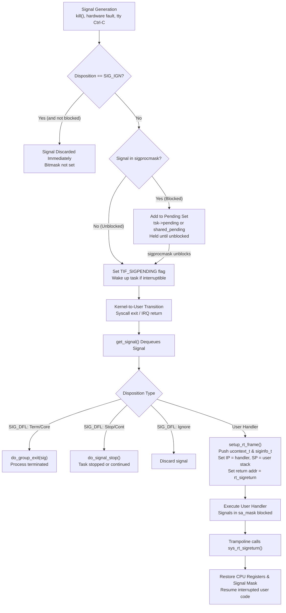

# Signals: Dispositions, Masks, and Delivery

> [!summary] Claim
> Signals are kernel-managed asynchronous notifications governed by three orthogonal layers: dispositions dictate the action taken upon receipt, masks hold signals pending without dropping them, and delivery occurs exclusively on return to user space where the kernel builds a user stack frame to invoke the handler.

Part of [The Unix Process Model](README.md) in [Shell and Unix Engineering](../README.md).

## TL;DR

- Mechanism: Signals generated by hardware traps, kernel subsystems, or `kill(2)` update pending bitmasks (the thread's `task_struct->pending` or the process-wide `signal->shared_pending`); on return to user mode, `get_signal` evaluates dispositions and masks, constructing an `rt_sigframe` on the user stack to invoke the handler (`(POSIX.1-2024 XSH sigaction, sigprocmask)`, Linux `kernel/signal.c`).
- Rule: Dispositions set to `SIG_IGN` (except possibly `SIGCHLD`, which POSIX.1-2024 leaves unspecified) and blocked signal masks persist across `execve(2)` into the new program image, whereas custom caught handlers always revert to `SIG_DFL`, and non-interactive POSIX shells permanently refuse to catch or reset signals inherited as ignored (`(POSIX.1-2024 XCU 2.12, 2.15 trap, XSH exec)`).
- Trap: Running asynchronous commands (`&`) without job control (`set +m`) causes conforming shells to set `SIGINT` and `SIGQUIT` to `SIG_IGN` (though `posh` and Alpine's `mksh R59 2020/10/31` leave them at `SIG_DFL`), while shells without a controlling terminal refuse or disable `set -m`, and a blocked mask inherited by bash, zsh, yash, posh, or BusyBox ash leaks into every child binary (dash, ksh93, and mksh clear it at startup) (`(POSIX.1-2024 XCU 2.12, XSH exec)`, lab `test.bats`).
- Portability fact: On signal termination, most shells record exit code `128 + N` (143 for `SIGTERM`), `ksh93` records `256 + N` (271), and `yash` records `384 + N` (399), all permitted because XCU 2.8.2 allows statuses above 255; `set -m` without a controlling tty fails or disables job control in `dash`, `busybox`, `yash`, and `zsh`, `posh` has no `-m` option at all, and in `ksh93u+m 1.0.10` a child started from a virtual subshell sees the main shell as its parent, so signalling its `$PPID` hits the main shell (`(POSIX.1-2024 XCU 2.8.2, 2.11)`, lab `test.bats`).
- When not to use it: Never use asynchronous Unix signals for general inter-process communication or high-throughput data exchange; use non-blocking pipes, Unix domain stream sockets, or shared memory with event file descriptors to prevent signal coalescing, stack overflow, and handler re-entrancy bugs.

## Mental model



When a signal is generated by a process call or kernel interrupt, the kernel checks whether its disposition is `SIG_IGN`.
On Linux an ignored signal is dropped at generation only if it is not blocked: `sig_ignored()` in `kernel/signal.c` never ignores a blocked signal, "since the signal handler may change by the time it is unblocked"; POSIX leaves this case unspecified (`(POSIX.1-2024 XSH 2.4.1)`).
Unignored signals are posted to the target thread private or process-shared pending bitmask.
If the signal is masked in the active `sigprocmask`, it remains pending without triggering execution until a subsequent call clears the mask bit.
Once unblocked, the kernel marks the thread with `TIF_SIGPENDING`, forcing an evaluation in `get_signal` upon the next transition from kernel space back to user space.
For user-defined handlers, the kernel constructs an `rt_sigframe` on the user stack, saves the register context and current signal mask, and alters the instruction pointer to enter the handler.
When the handler returns, a trampoline invokes the `rt_sigreturn(2)` system call to copy the saved execution context back into CPU registers, restoring the original mask and resuming normal program execution.

## How it works

### 1. Signal Dispositions and `sigaction`

A signal disposition defines the action executed by the process when a specific signal is delivered.
POSIX specifies three fundamental dispositions: `SIG_DFL` (default action), `SIG_IGN` (ignore), and a pointer to an application signal handler (`(POSIX.1-2024 XSH sigaction)`).
The default action depends on the signal number: termination (`Term`), core dump with termination (`Core`), process stop (`Stop`), continue execution (`Cont`), or discard (`Ign`).
The system interface `sigaction(2)` configures dispositions through `struct sigaction`:

```c
struct sigaction {
  void     (*sa_handler)(int);
  void     (*sa_sigaction)(int, siginfo_t *, void *);
  sigset_t   sa_mask;
  int        sa_flags;
  void     (*sa_restorer)(void);
};
```

This is the Linux layout: POSIX requires only `sa_handler`, `sa_mask`, `sa_flags`, and `sa_sigaction` (which may share storage with `sa_handler`), and `sa_restorer` is a Linux field that the C library fills in, not an application interface (`(POSIX.1-2024 XBD signal.h)`, man7 `sigaction(2)`).

Key flags accepted in `sa_flags` (`(POSIX.1-2024 XSH sigaction)`):
- `SA_RESTART`: Automatically restarts certain interrupted slow system calls (`read`, `write`, `waitpid`, `connect`) instead of returning `-1` with `errno = EINTR`.
- `SA_NOCLDSTOP`: Prevents generation of `SIGCHLD` when children stop or continue.
- `SA_NOCLDWAIT`: Prevents children from transforming into zombies upon termination, discarding exit status automatically.
- `SA_NODEFER`: Prevents the delivered signal from being automatically added to the thread signal mask during handler execution.
- `SA_RESETHAND`: Resets the signal disposition to `SIG_DFL` upon entering the handler.
- `SA_SIGINFO`: Causes the kernel to pass three arguments (`int sig, siginfo_t *info, void *ucontext`) to `sa_sigaction` instead of `sa_handler`.
- `SA_ONSTACK`: Executes the handler on an alternate signal stack registered via `sigaltstack(2)`.

Signals `SIGKILL` (9) and `SIGSTOP` (19 on Linux, 17 on Darwin) cannot be caught, ignored, or blocked.
An attempt to catch or ignore `SIGKILL` or `SIGSTOP` with `sigaction` returns `-1` with `errno = EINVAL` (setting them to `SIG_DFL` may either succeed or fail), whereas `sigprocmask` silently leaves them unblocked without reporting an error, since the system enforces that they cannot be blocked "without causing an error to be indicated" (`(POSIX.1-2024 XSH sigaction, sigprocmask)`; measured 2026-10: `sigprocmask(SIG_BLOCK, {SIGKILL, SIGSTOP})` returns 0 and leaves `SIGKILL` unblocked on macOS and on Debian 13).

### 2. State Inheritance Across `fork` and `execve`

Process creation via `fork(2)` and program execution via `execve(2)` follow strict, asymmetrical inheritance rules:

```
Attribute               Across fork()              Across execve()
---------------------   ------------------------   ------------------------------
Dispositions: SIG_DFL   Preserved (SIG_DFL)        Preserved (SIG_DFL)
Dispositions: SIG_IGN   Preserved (SIG_IGN)        Preserved (SIGCHLD: unspecified)
Dispositions: Handler   Preserved (Handler)        Reset to SIG_DFL
Signal Mask             Preserved (sigset_t)       Preserved (sigset_t)
Pending Signals         Cleared to empty set       Preserved
Alternate Stack         Preserved                  Cleared (SA_ONSTACK cleared)
```

The `fork(2)` system call creates an identical copy of the calling process address space and kernel execution state (`(POSIX.1-2024 XSH fork)`).
The child process inherits the complete signal mask and all signal dispositions.
However, POSIX dictates that pending signals are never inherited across `fork`: the child pending signal set is initialized to empty.

The `execve(2)` system call overlays a new program binary onto the existing process (`(POSIX.1-2024 XSH execve)`).
Because the old text and data segments are unmapped, custom function pointers in user memory become invalid.
Consequently, any signal configured with a user handler is automatically reset to `SIG_DFL`.
In contrast, signals set to `SIG_IGN` remain `SIG_IGN`, and signals set to `SIG_DFL` remain `SIG_DFL`; the one exception in POSIX.1-2024 is an ignored `SIGCHLD`, for which "it is unspecified whether the SIGCHLD signal is set to be ignored or to the default action in the new process image" (`(POSIX.1-2024 XSH exec)`).
Pending signals are inherited across `execve` ("the pending signal set is preserved across an execve(2)", man7 `signal(7)`).
Crucially, the calling thread signal mask is preserved across `execve` intact.
If a launcher blocks a signal and invokes `execve`, the spawned binary begins life with that signal blocked.
When a shell sits in between, the result depends on the shell: in the lab (`test.bats`, "shells differ on clearing a signal mask inherited across execve"), dash, ksh93, and mksh start with an empty mask, while bash, zsh, yash, posh, and BusyBox ash pass the inherited mask on to every command they run.

### 3. Signal Masks and Pending Sets

A process or thread controls signal delivery using a signal mask (`sigset_t`).
In single-threaded applications, `sigprocmask(2)` inspects and mutates the mask; in multithreaded applications, `pthread_sigmask(3)` must be used (`(POSIX.1-2024 XSH sigprocmask, pthread_sigmask)`).
The system supports three operations:
- `SIG_BLOCK`: The new mask is the union of current mask and the specified set.
- `SIG_UNBLOCK`: The new mask is the intersection of current mask and the complement of the specified set.
- `SIG_SETMASK`: The new mask replaces the current mask entirely.

Blocking is distinct from ignoring.
An ignored, unblocked signal is discarded immediately upon arrival; it never enters a pending state.
A signal that is both ignored and blocked may be discarded or left pending (POSIX leaves it unspecified; Linux keeps it pending), and setting `SIG_IGN` for a pending signal discards it "whether or not it is blocked" (`(POSIX.1-2024 XSH 2.4.1, 2.4.3)`).
A blocked signal is retained in the kernel pending bitmask.
The application can query pending signals at any time via `sigpending(2)`.
When the signal is subsequently unblocked via `sigprocmask`, the kernel delivers at least one instance before `sigprocmask` returns (`(POSIX.1-2024 XSH sigprocmask)`).

Standard signals (numbers 1 to 31) do not queue.
If signal `SIGUSR1` is sent ten times while blocked, only a single bit is set in the pending set (`signal->shared_pending` for a process-directed `kill`, `tsk->pending` for a thread-directed `tgkill`); nine signals are discarded.
Real-Time (RT) signals (numbers `SIGRTMIN` to `SIGRTMAX`) queue up to resource limit `RLIMIT_SIGPENDING`.
RT signals carry an accompanying payload (`sigval`) transmitted via `sigqueue(3)`, and the kernel guarantees FIFO delivery per signal number, delivering lower-numbered signals before higher-numbered signals.

If a synchronous hardware exception (`SIGSEGV`, `SIGBUS`, `SIGILL`, `SIGFPE`) is generated while blocked, POSIX defines the result as undefined behavior (`(POSIX.1-2024 XSH sigprocmask)`).
On Linux, a fault raised while the signal is blocked or ignored goes through `force_sig_info_to_task()` in `kernel/signal.c`, which unblocks the signal and resets its disposition to `SIG_DFL`, so the process is killed with the default action (termination with a core dump) rather than looping on the faulting instruction; the kernel does not panic.

### 4. Kernel Delivery Lifecycle and Stack Framing

In the Linux kernel (`kernel/signal.c`), signal processing operates through generation, dequeueing, and delivery:

```
[ Signal Generation ]
  kill(2) -> do_send_sig_info() -> send_signal_locked() -> __send_signal_locked()
    |-> Check if ignored: prepare_signal() -> sig_ignored() (never true while blocked)
    |-> Allocate sigqueue struct (if RT or siginfo required)
    |-> Set bit in tsk->pending or signal->shared_pending
    \-> complete_signal() -> signal_wake_up() -> set_tsk_thread_flag(t, TIF_SIGPENDING)

[ Return to User Space ]
  __exit_to_user_mode_loop() -> arch_do_signal_or_restart() -> get_signal()
    |-> dequeue_signal(): private pending checked first, then shared pending
    |-> Handle SIG_DFL / SIG_IGN in kernel
    \-> User handler: arch/x86/kernel/signal.c: setup_rt_frame() -> x64_setup_rt_frame()
          |-> Allocate user stack frame (rt_sigframe / ucontext_t)
          |-> Save user registers (RIP, RSP, RFLAGS, RAX, etc.)
          |-> Save current blocked signal mask
          |-> Set user RSP to frame address
          |-> Set user RIP to sa_handler address
          \-> Store sa_restorer (glibc __restore_rt) in frame->pretcode as the return address
              (x86-64 requires SA_RESTORER; arm64 puts sa_restorer or the vDSO sigtramp in LR)

[ Handler Return ]
  User handler completes -> executes ret -> pops pretcode -> restorer runs syscall rt_sigreturn
    \-> sys_rt_sigreturn() in kernel
          |-> restore_sigcontext(): copy stack frame back to CPU registers
          |-> set_current_blocked(&set): restore original signal mask
          \-> return to interrupted user instruction
```

In `kernel/signal.c`, `dequeue_signal` always checks the thread private queue (`tsk->pending`) before inspecting the process-wide shared queue (`tsk->signal->shared_pending`).
In the first word of the pending mask, `next_signal` prefers the synchronous fault signals in `SYNCHRONOUS_MASK`, then takes the lowest set bit with `ffz(~x) + 1`; later words are scanned for their lowest set bit only.
Thus, after synchronous faults, lowest-numbered signals are delivered first (Linux `kernel/signal.c`, `next_signal()`).

When `setup_rt_frame` builds the user frame on the stack, it copies the active signal mask into `ucontext_t.uc_sigmask`.
After the frame is built, `signal_setup_done()` calls `signal_delivered()`, which updates the thread's blocked mask by adding all signals in `sa_mask` and the delivered signal itself (unless `SA_NODEFER` is configured) (Linux `kernel/signal.c`).
When the handler finishes, it calls `rt_sigreturn(2)`.
The kernel copies the saved `ucontext_t` back into processor registers and restores the original signal mask, ensuring seamless resumption of user code.

### 5. The Shell Execution Environment and `trap`

Shells manage signal dispositions through the `trap` special built-in utility (`(POSIX.1-2024 XCU 2.15 trap)`).
The syntax is `trap [action condition...]` or `trap -p [condition...]`.
If `action` is `-`, each condition resets to its default disposition (`SIG_DFL`).
If `action` is empty string `""`, each condition is ignored (`SIG_IGN`).
Otherwise, `action` is read and executed by the shell when the corresponding condition arises.

Crucially, shells do not execute shell trap script commands directly inside the C signal handler.
C signal handlers must execute asynchronously in signal context where calling `malloc`, parser routines, or file operations causes memory corruption and deadlocks.
In `dash` (`src/trap.c`), the C handler `onsig(int signo)` sets a flag in array `gotsig[signo - 1] = 1` and updates `pending_sig = signo`.
In `bash` (`trap.c`), the trapped-signal handler `trap_handler(sig)` calls `set_trap_state(sig)`, which increments `pending_traps[sig]`; `termsig_sighandler()` in `sig.c` is the separate handler for fatal signals that are not trapped (bash 5.2.37 `trap.c` and `sig.c`, as packaged by Debian).
The shell checks these flags at safe synchronization boundaries (between pipeline commands, before prompts, or upon return from built-ins) and calls `dotrap()` in dash or `run_pending_traps()` in bash.

POSIX dictates that "the value of "$?" after the trap action completes shall be the value it had before the trap action was executed" (`(POSIX.1-2024 XCU 2.15 trap)`).
In `dash` `dotrap()` (`src/trap.c`), the shell saves `exitstatus` into variable `status` (through `savestatus`), executes `evalstring(p, 0)`, and restores `exitstatus = status`.

The Immutable Ignored Rule:
POSIX explicitly specifies: "Signals that were ignored on entry to a non-interactive shell cannot be trapped or reset, although no error need be reported when attempting to do so" (`(POSIX.1-2024 XCU 2.15 trap)`).
In `dash` `setsignal()` (`src/trap.c`), if `act.sa_handler == SIG_IGN` upon shell entry, the internal mode is tagged `S_HARD_IGN` (except `SIGTSTP`, `SIGTTIN`, and `SIGTTOU` when job control is on); any subsequent attempt by `trap` to catch or reset that signal returns immediately without modifying the disposition.
In `bash` `trap.c`, `sigmodes[i]` starts as `SIG_INHERITED`, a signal found ignored on entry gets `SIG_HARD_IGNORE`, and `set_signal()` returns without change for a hard-ignored signal (bash 5.2.37 `trap.c`, as packaged by Debian).
This invariant guarantees that parent tools like `nohup(1)` or background operators (`&`) can protect a job tree from signals without child scripts accidentally subverting the protection.

Asynchronous Lists (`&`) and Job Control:
Under POSIX, if job control is disabled (`set +m`, the default in non-interactive shell scripts), commands in an asynchronous AND-OR list (`command &`, defined in XCU 2.9.3.1) automatically inherit `SIG_IGN` for `SIGINT` and `SIGQUIT` (`(POSIX.1-2024 XCU 2.12)`).
When job control is enabled (`set -m`, default in interactive shells), background jobs run in their own process groups and retain `SIG_DFL` because the terminal line discipline only sends signals to the foreground process group.
However, implementation divergence exists across minimal shells: `posh 0.14.1` and Alpine's `mksh R59 2020/10/31` fail to set `SIG_IGN` in asynchronous jobs under `set +m`, leaving both signals set to `SIG_DFL`, while Debian's `mksh R59 2025/04/26 +Debian` ignores them (lab `test.bats`).
The Debian build is a MirBSD CVS snapshot, not a new upstream release (Debian `mksh` changelog: 59c-12, 11 Oct 2021, "Package CVS HEAD").
POSIX does not require a controlling terminal for `set -m`: XCU 2.11 makes its terminal steps conditional ("If the shell has a controlling terminal..."), so what a shell does without one is implementation behavior (`(POSIX.1-2024 XCU 2.11, 2.15 set)`).
When scripts attempt to execute `set -m` in headless environments lacking a controlling terminal (such as containers, daemons, or CI runners with stdin from `/dev/null`), `dash` and BusyBox `ash` print a warning (`can't access tty; job control turned off`) and disable job control, leaving asynchronous jobs under `SIG_IGN`.
Under identical headless conditions, `yash` emits a warning (`set: disabling job control`) after failing to open `/dev/tty` and disables job control, and `zsh` aborts with an error (`can't change option: -m`) and non-zero exit status, although with a terminal (`script -qec`) both `zsh` and `dash` accept `set -m`.
`posh` fails with `set: -m: unknown option` whether or not a terminal is present, because it has no job control at all (its `set -o` lists no `monitor` option; measured 2026-10 on Debian `posh 0.14.1`).
Only `bash`, `ksh93`, and `mksh` permit `set -m` without a controlling terminal, retaining `SIG_DFL` (lab `test.bats`) and placing each asynchronous job into its own process group via `setpgid(2)` (measured 2026-10 from `/proc/self/stat`; `ksh93u+ 2012` keeps synchronous pipelines in its own group, while `ksh93u+m 1.0.10`, `bash`, and `mksh` give them their own groups too, matching the Sessions lab `job_control.bats`).

Subshell Trap Resets:
When entering a subshell `( ... )`, POSIX dictates that "traps that are not being ignored shall be set to the default actions" (`(POSIX.1-2024 XCU 2.15 trap)`).
Signals that were set to `SIG_IGN` remain ignored, except in native `zsh`, whose subshells reset an ignored `SIGUSR2` to `SIG_DFL` (lab `signal-probe.sh` step 4; `SigIgn` in `/proc/self/status` drops the bit in a native `zsh` subshell but keeps it under `zsh --emulate sh`).
If a command substitution consists solely of a single `trap` command, such as `$(trap)`, POSIX permits the subshell to retain the parent trap strings to allow inspection.
In Korn shell implementations (`ksh93`), subshells are optimized as virtual in-process execution environments that avoid calling `fork(2)` unless an operation strictly forces a fork.
In `ksh93u+m 1.0.10`, spawning a background task inside a subshell (`( : & wait "$!" )`) does not force the subshell to fork, whereas in macOS `ksh93u+ 2012-08-01` it does (lab `signal-probe.sh` step 3).
Because the virtual subshell shares the OS process of the parent script, an external utility invoked inside it has the main shell as its parent, so the utility's own `$PPID` (`getppid(2)`) is the main shell's PID.
Delivering a signal to that `$PPID` from within a virtual subshell therefore signals the main shell process: `ksh93` aborts the virtual subshell as the default action would (its output is discarded) and then runs the main shell's trap, which prints `PARENT_TRAP` after the command substitution returns (measured 2026-10: `x=$( ( kill -USR1 $$; echo survived ) )` leaves `x` empty and fires the main trap in both `ksh93` versions, where every forking shell keeps `survived`).

Wait Interruption:
When a non-interactive shell blocks inside the `wait` utility waiting for asynchronous background jobs, the receipt of a trapped signal causes `wait` to "return immediately with an exit status >128, immediately after which the trap associated with that signal shall be taken" (`(POSIX.1-2024 XCU 2.12)`).
Implementations diverge: both `ksh93` versions return after the signal but with status 1, and `yash` reports `384 + N` (394 for `SIGUSR1`) (measured 2026-10; lab `signal-probe.sh` step 5).
`zsh` (native and `--emulate sh`) also has a race: when the trapped signal arrives together with a `SIGCHLD` from another child exiting, `wait` sometimes resumes waiting and later returns 0 (11 of 150 runs before the lab's signalling child was kept alive, 0 of 80 after; measured 2026-10 on Debian `zsh 5.9`).

The WCE (Wait and Cooperative Exit) Idiom:
When a user presses Ctrl-C in a terminal, the terminal driver broadcasts `SIGINT` to the entire foreground process group, reaching both the parent shell script and the active child binary.
Martin Cracauer's survey names three strategies (IUE, WUE, WCE) and lists `bash`, FreeBSD `sh` since 3.0, and most commercial `/bin/sh` as WCE shells, with pdksh using WUE; POSIX does not mandate one ([Cracauer, Proper handling of SIGINT/SIGQUIT](https://www.cons.org/cracauer/sigint.html)).
Under WCE, the shell waits for the child to exit.
If the child process terminates due to `SIGINT` (`WIFSIGNALED` with signal 2), the shell cooperates by terminating itself with `SIGINT`.
If the child process traps or swallows `SIGINT` and exits cleanly (status 0), the shell assumes the interrupt was handled internally (such as canceling a search in an editor) and continues executing the script.

## Numbers and limits

The following table documents kernel, architecture, and shell limits governing signals (as of 2026-10).

| Parameter / Metric | Linux x86_64 / arm64 | macOS Darwin (arm64) | POSIX / Standard Reference | Source / Verification |
|---|---|---|---|---|
| Standard signal count | 31 (signals 1 to 31; glibc and musl `NSIG` 65) | 31 (signals 1 to 31; `NSIG` 32) | `{NSIG_MAX}`, `sysconf(_SC_NSIG)` (`(POSIX.1-2024 XBD limits.h)`) | Measured 2026-10 (`NSIG`, Debian 13, Alpine 3.22, macOS) |
| Real-time signal count | Kernel 33 (32 to 64); glibc 31 (`SIGRTMIN` 34 to `SIGRTMAX` 64); musl 30 (`SIGRTMIN` 35) | 0 (no `SIGRTMIN`; `_POSIX_REALTIME_SIGNALS` = -1) | At least `{_POSIX_RTSIG_MAX}` (8); POSIX.1-2024 `<signal.h>` requires `SIGRTMIN` and `SIGRTMAX` | man7 `signal(7)` / Darwin `<unistd.h>`; measured 2026-10 |
| Kernel `sigset_t` size | 8 bytes (64 bits, `_NSIG` 64) | 4 bytes (32 bits) | Unspecified scalar or array | man7 `signal(7)` (signals 1 to 64) / measured Darwin `sizeof(sigset_t)` |
| glibc `sigset_t` size | 128 bytes (1024 bits; musl also 128) | 4 bytes (32 bits) | Implementation defined | Measured 2026-10 `sizeof(sigset_t)` (Debian 13, Alpine 3.22, macOS) |
| Alternate stack `SIGSTKSZ` | Dynamic under `_GNU_SOURCE` since glibc 2.34 (2021), `sysconf(_SC_SIGSTKSZ)`: 20,480 bytes on Debian 13 arm64; musl arm64 12,288 | 131,072 bytes (128 KiB) | XSI; >= `MINSIGSTKSZ` | Measured 2026-10 / Darwin `<signal.h>` |
| Alternate stack `MINSIGSTKSZ` | Dynamic under `_GNU_SOURCE` since glibc 2.34: 20,480 bytes on Debian 13 arm64 (historically 2,048 on x86_64); musl arm64 6,144 | 32,768 bytes (32 KiB) | XSI; minimum required bytes | Measured 2026-10 / Darwin `<signal.h>` |
| RT signal queue limit | `RLIMIT_SIGPENDING` per real user ID (`ulimit -i`, "Max pending signals" in `/proc/PID/limits`; 64,279 in the Debian 13 container) | Not applicable | `{SIGQUEUE_MAX}` >= `{_POSIX_SIGQUEUE_MAX}` | man7 `getrlimit(2)`; measured 2026-10 |
| Standard signal exit status | `128 + N` (143 for `SIGTERM`) | `128 + N` (143 for `SIGTERM`) | `> 128` (`(POSIX.1-2024 XCU 2.8.2)`) | Lab `signal-probe.sh` |
| ksh93 signal exit status | `256 + N` (271 for `SIGTERM`, ksh93u+m 1.0.10) | `256 + N` (271 for `SIGTERM`, ksh93u+ 2012) | `> 128`, values above 255 permitted (`(POSIX.1-2024 XCU 2.8.2)`) | Lab `signal-probe.sh` |
| yash signal exit status | `384 + N` (399 for `SIGTERM`, Alpine yash 2.58.1) | Not measured (yash not installed on the host) | `> 128`, values above 255 permitted (`(POSIX.1-2024 XCU 2.8.2)`) | Lab `signal-probe.sh` |
| Asynchronous job INT/QUIT (`set +m`) | `SIG_IGN` (standard) / `SIG_DFL` (posh 0.14.1, Alpine mksh R59 2020/10/31) | `SIG_IGN` (bash 3.2, bash 5.3, dash, ksh93u+, zsh) | `SIG_IGN` (`(POSIX.1-2024 XCU 2.12)`) | Lab `test.bats` |
| Headless `set -m` without tty | Disabled (dash, BusyBox ash, yash) / Error (zsh) / no `-m` (posh) / Allowed (bash, ksh93, mksh) | Allowed (bash 3.2, bash 5.3, ksh93u+) / Disabled (dash) / Error (zsh) | Unspecified: XCU 2.11 terminal steps apply only "if the shell has a controlling terminal" (`(POSIX.1-2024 XCU 2.11)`) | Lab `test.bats` |
| Signal round trip (`raise` + handler + `sigreturn`) | About 0.6 to 0.8 microseconds (Debian 13 arm64 container on an Apple silicon Mac) | About 1.5 microseconds (macOS arm64 host) | Hardware / kernel dependent | Measured 2026-10: 3 runs of 1,000,000 `raise(SIGUSR1)` calls with an empty handler, `-O2` |

## Portability

The matrix below documents divergence across shells and standard Unix utilities (as of 2026-10).

| Feature / Behavior | POSIX.1-2024 sh | macOS bash 3.2 | current bash (5.3) | zsh (native) | zsh (`--emulate sh`) | dash | ksh93 | mksh | yash | posh | BusyBox ash |
|---|---|---|---|---|---|---|---|---|---|---|---|
| Signal exit status encoding | `> 128` | `128 + N` | `128 + N` | `128 + N` | `128 + N` | `128 + N` | `256 + N` | `128 + N` | `384 + N` | `128 + N` | `128 + N` |
| Inherited `SIG_IGN` immutable to `trap` | Required | Enforced | Enforced | Overridable | Overridable | Enforced | Enforced | Enforced | Enforced | Enforced | Enforced |
| Subshell preserves ignored signals | Required | Preserved | Preserved | Reset to DFL | Preserved | Preserved | Preserved | Preserved | Preserved | Preserved | Preserved |
| Subshell resets custom traps to DFL | Required | Reset | Reset | Reset | Reset | Reset | Reset (virtual subshell aborted; in 93u+m the main trap also fires) | Reset | Reset | Reset | Reset |
| `trap -p [sig]` syntax support | Required | Supported | Supported | Ignored (prints nothing) | Ignored (prints nothing) | Error (`Illegal option`) | Supported (action only) | Error (59c; added in Debian 59c-42) | Supported | Error | Error |
| `$?` preserved across trap execution | Required | Preserved | Preserved | Preserved | Preserved | Preserved | Preserved | Preserved | Preserved | Preserved | Preserved |
| Shell unblocks an inherited signal mask | Not required | Leaked | Leaked | Leaked | Leaked | Unblocked | Unblocked | Unblocked | Leaked | Leaked | Leaked |
| `&` under `set +m` ignores INT/QUIT | Required | Ignored | Ignored | Ignored | Ignored | Ignored | Ignored | DFL (2020) / IGN (2025) | Ignored | Default (DFL) | Ignored |
| `set -m` without controlling tty | Unspecified (XCU 2.11) | Allowed (pgid set) | Allowed (pgid set) | Error (cannot set) | Error (cannot set) | Disabled (warns) | Allowed (pgid set) | Allowed (pgid set) | Disabled (warns) | Error (no `-m` option) | Disabled (warns) |

Every shell cell outside two rows is asserted by `test.bats` across the matrix; the `trap -p` row and the process-group detail of the `set -m` row were measured by hand on 2026-10 (Debian 13, Alpine 3.22, and the macOS host), and the mksh `trap -p` note comes from the Debian `mksh` changelog.

## Worked example

The accompanying [lab](../labs/01-signals-dispositions-masks-and-delivery/) compiles a low-level C harness (`sigmask-probe.c`) and executes a portable probe script (`signal-probe.sh`) under bats.

The C harness inspects the kernel signal state directly using `sigaction(2)` and `sigprocmask(2)`; the block below is a simplified excerpt of `sigmask-probe.c` (error checks and the `check_handler`, `exec_blocked`, `test_exec_catch_to_dfl`, `test_exec_preserves_ign`, and `test_eintr` modes are omitted):

```c
/* sigmask-probe.c: kernel interface probe for signal dispositions and masks */
#include <errno.h>
#include <signal.h>
#include <stdio.h>
#include <stdlib.h>
#include <string.h>
#include <unistd.h>

static void dummy_handler(int signo) { (void)signo; }

static const char *handler_str(void (*h)(int)) {
  if (h == SIG_IGN) return "IGN";
  if (h == SIG_DFL) return "DFL";
  return "CATCH";
}

int main(int argc, char **argv) {
  if (argc < 2) return 1;
  const char *mode = argv[1];

  if (strcmp(mode, "check_disposition") == 0) {
    struct sigaction sa_int, sa_quit, sa_term;
    sigaction(SIGINT, NULL, &sa_int);
    sigaction(SIGQUIT, NULL, &sa_quit);
    sigaction(SIGTERM, NULL, &sa_term);
    printf("int=%s quit=%s term=%s\n",
           handler_str(sa_int.sa_handler),
           handler_str(sa_quit.sa_handler),
           handler_str(sa_term.sa_handler));
    return 0;
  }

  if (strcmp(mode, "test_exec_mask") == 0) {
    sigset_t set;
    sigemptyset(&set);
    sigaddset(&set, SIGUSR1);
    sigprocmask(SIG_BLOCK, &set, NULL);
    char *child_argv[] = {argv[0], "check_mask", NULL};
    execv(argv[0], child_argv);
    return 1;
  }

  if (strcmp(mode, "check_mask") == 0) {
    sigset_t cur;
    sigemptyset(&cur);
    sigprocmask(SIG_SETMASK, NULL, &cur);
    printf("usr1_blocked=%s\n", sigismember(&cur, SIGUSR1) ? "yes" : "no");
    return 0;
  }
  return 1;
}
```

The shell probe script `signal-probe.sh` tests five core properties across the shell under test; the block below is the lab file verbatim:

```sh
#!/bin/sh
# shellcheck shell=sh
# Probe script for Signals: Dispositions, Masks, and Delivery (POSIX.1-2024 XCU/XSH).

set -u

# Poll until background process has replaced its process image via execve.
wait_for_exec() {
  target_pid=$1
  iter=0
  while [ "$iter" -lt 100 ]; do
    if [ -f "/proc/$target_pid/comm" ]; then
      comm=$(cat "/proc/$target_pid/comm" 2>/dev/null) || comm=""
      case $comm in
        *sleep*)
          break
          ;;
        *)
          :
          ;;
      esac
    else
      comm=$(ps -o comm= -p "$target_pid" 2>/dev/null) || comm=""
      case $comm in
        *sleep*)
          break
          ;;
        *)
          :
          ;;
      esac
    fi
    iter=$((iter + 1))
    sleep 0.02 2>/dev/null || true
  done
}

# 1. Signal exit status (SIGTERM termination of external command).
/bin/sleep 10 &
term_pid=$!
wait_for_exec "$term_pid"
kill -15 "$term_pid" 2>/dev/null
wait "$term_pid" 2>/dev/null
term_rc=$?
printf '1_signal_exit_status: status=%s\n' "$term_rc"

# 2. Trap execution at command boundary and $? preservation.
trap 'trap_fired=1' USR1
trap_fired=0
sh -c 'kill -USR1 "$PPID"; exit 42'
rc=$?
printf '2_trap_execution: trap_fired=%s rc=%s\n' "$trap_fired" "$rc"
trap - USR1

# 3. Subshell resets caught traps to SIG_DFL.
trap 'printf "PARENT_TRAP\n"' USR1
subshell_out=$(
  (
    : &
    wait "$!" 2>/dev/null || true
    sh -c 'kill -USR1 "$PPID"' 2>/dev/null
    printf 'survived\n'
  ) 2>/dev/null
) 2>/dev/null
trap - USR1
case $subshell_out in
  *PARENT_TRAP*)
    sub_reset="no"
    ;;
  *survived*)
    sub_reset="no"
    ;;
  *)
    sub_reset="yes"
    ;;
esac
printf '3_subshell_trap_reset: reset_to_dfl=%s\n' "$sub_reset"

# 4. Subshell preserves ignored signals (SIG_IGN).
trap '' USR2
sub_ign_out=$(
  (
    : &
    wait "$!" 2>/dev/null || true
    sh -c 'kill -USR2 "$PPID"' 2>/dev/null
    printf 'subshell_survived\n'
  ) 2>/dev/null
)
trap - USR2
case $sub_ign_out in
  *subshell_survived*)
    sub_ign="yes"
    ;;
  *)
    sub_ign="no"
    ;;
esac
printf '4_subshell_ignored_preserved: ignored=%s\n' "$sub_ign"

# 5. Wait interrupted by trapped signal returns > 128.
trap 'wait_trap_fired=1' USR1
wait_trap_fired=0
/bin/sleep 5 &
sleep_bg=$!
# The killer lingers for a second after signalling and then exits by itself: in zsh, a
# SIGCHLD from the killer exiting at the same moment as the trapped SIGUSR1 sometimes
# lets wait resume (about 1 run in 10), and killing the killer instead makes bash 3.2
# print a "Terminated" job notice on the shell's own stderr.
(
  /bin/sleep 0.2
  kill -USR1 "$$" 2>/dev/null
  exec /bin/sleep 1
) &
killer_bg=$!
wait "$sleep_bg" 2>/dev/null
wait_status=$?
# The group redirection also catches job notices that bash prints between commands.
{
  kill "$sleep_bg" || true
  wait "$sleep_bg" || true
  wait "$killer_bg" || true
  :
} 2>/dev/null
trap - USR1
if [ "$wait_status" -gt 128 ]; then
  wait_gt128="yes"
else
  wait_gt128="no"
fi
printf '5_wait_signal_interrupted: gt_128=%s trap_fired=%s\n' "$wait_gt128" "$wait_trap_fired"
```

Captured execution output under `bash` (3.2 to 5.3), `dash`, BusyBox `ash`, `mksh`, `posh`, and `zsh --emulate sh` (asserted by `test.bats` across the matrix):

```text
1_signal_exit_status: status=143
2_trap_execution: trap_fired=1 rc=42
3_subshell_trap_reset: reset_to_dfl=yes
4_subshell_ignored_preserved: ignored=yes
5_wait_signal_interrupted: gt_128=yes trap_fired=1
```

Captured execution output under `ksh93` (`ksh93u+m 1.0.10` on Debian):

```text
1_signal_exit_status: status=271
2_trap_execution: trap_fired=1 rc=42
PARENT_TRAP
3_subshell_trap_reset: reset_to_dfl=yes
4_subshell_ignored_preserved: ignored=yes
5_wait_signal_interrupted: gt_128=no trap_fired=1
```

In `ksh93u+m`, signal status encodes as `256 + N` (271 for `SIGTERM`).
macOS `ksh93u+ 2012-08-01` prints the same lines without `PARENT_TRAP`, because there `: &` forces the subshell to fork, so the reset trap kills the forked subshell instead.
The line `PARENT_TRAP` appears because virtual subshells share the parent process ID; external utilities querying `$PPID` send signals directly to the parent shell.
Additionally, interrupted `wait` in `ksh93` returns status 1 (`gt_128=no`) while still dispatching the trap; it does return after the signal rather than waiting for the job (measured 2026-10 in both `ksh93` versions).

Captured execution output under `yash 2.58.1`:

```text
1_signal_exit_status: status=399
2_trap_execution: trap_fired=1 rc=42
3_subshell_trap_reset: reset_to_dfl=yes
4_subshell_ignored_preserved: ignored=yes
5_wait_signal_interrupted: gt_128=yes trap_fired=1
```

In `yash`, fatal signals encode as `384 + N` (399 for `SIGTERM`).
Native `zsh` outputs `4_subshell_ignored_preserved: ignored=no` because native subshells reset ignored signals to default actions.
Step 5 keeps its signalling child alive for a second and silences cleanup job notices: without that, native `zsh` and `zsh --emulate sh` missed the interruption in about 1 run in 10, and macOS bash 3.2 occasionally printed a `Terminated` notice into the captured output.
The bats suite (`test.bats`) also runs `sigmask-probe exec_blocked`, which blocks `SIGUSR1` and then executes the shell under test, and asserts that dash, ksh93, and mksh print `usr1_blocked=no` while bash, zsh, yash, posh, and BusyBox ash print `usr1_blocked=yes`.
Across the accompanying bats suite (`test.bats`), asynchronous background tests assert `int=IGN quit=IGN term=DFL` for conforming shells while validating that `posh 0.14.1` and `mksh R59 2020` leave them at `int=DFL quit=DFL term=DFL`.
Finally, headless `set -m` tests assert that running without a controlling terminal triggers warnings and disables job control in `dash`, `busybox`, and `yash`, raises errors in `zsh` (`can't change option: -m`) and `posh` (`unknown option`, since `posh` has no job control), and succeeds in `bash`, `ksh93`, and `mksh`, where the asynchronous job keeps `int=DFL quit=DFL`.

## Pitfalls

> [!warning] Docker Container PID 1 Ignores Default Signals
> Trigger: Running a microservice (e.g., Node.js, Python, or compiled binary) directly as PID 1 inside a container without registering an explicit signal handler for `SIGTERM`.
> Symptom: Executing `docker stop` or `kubectl delete pod` sends `SIGTERM`, but the process continues running unaffected; Docker waits 10 seconds (the daemon's default stop timeout for Linux containers, per the `docker container run --stop-timeout` reference) before forcefully killing the process with uncatchable `SIGKILL`, preventing graceful shutdown and database connection draining.
> Fix: In the Linux kernel (`kernel/signal.c`, `sig_task_ignored()` at generation and `get_signal()` at delivery), signals whose disposition is `SIG_DFL` are discarded for a namespace init (`SIGNAL_UNKILLABLE`), whether they come from inside the namespace or from an ancestor namespace such as the host running `docker stop`; only `SIGKILL` and `SIGSTOP` from an ancestor namespace are forced (man7 `pid_namespaces(7)`); use a lightweight init process like `tini` (`docker run --init`) or `dumb-init` to forward signals, or register an explicit `SIGTERM` handler in the application code.

> [!warning] Blocked Signal Mask Leaked Across Exec
> Trigger: A supervisor, wrapper script, or multithreaded runtime modifies the process signal mask using `sigprocmask(2)` or `pthread_sigmask(3)` to block signals like `SIGTERM`, `SIGINT`, or `SIGCHLD`, and then invokes `execve(2)`.
> Symptom: The newly executed binary inherits the blocked signal mask intact; child processes fail to process termination requests, child processes spawned by the binary fail to be reaped, and timeout watchdogs cannot interrupt execution.
> Fix: POSIX guarantees that signal masks survive `execve(2)` (`(POSIX.1-2024 XSH exec)`), and an intermediate shell clears the mask only if it is dash, ksh93, or mksh (lab `test.bats`); always unblock all signals via `sigprocmask(SIG_SETMASK, &empty_set, NULL)` immediately before calling `execve`, or configure `posix_spawn` with attribute `POSIX_SPAWN_SETSIGMASK` set to an empty signal set.

> [!warning] Asynchronous List nohup Trap Failure
> Trigger: Launching a script as a background job (`./worker.sh &`) in a non-interactive shell (`set +m`), where the script internally attempts to catch `SIGINT` via `trap 'cleanup' INT` (or, under `nohup(1)`, which starts the utility with `SIGHUP` ignored, attempts to catch `SIGHUP`).
> Symptom: The cleanup trap never executes when `SIGINT` is sent to the worker process, leaving temporary files or lockfiles on disk.
> Fix: POSIX dictates that asynchronous lists under `set +m` inherit `SIG_IGN` for `SIGINT` and `SIGQUIT`, and non-interactive shells cannot override signals inherited as `SIG_IGN` (`(POSIX.1-2024 XCU 2.12, 2.15 trap)`); trap `SIGTERM` instead of `SIGINT` for lifecycle management, or explicitly enable job control (`set -m`) in the parent shell where the shell allows it without a terminal (bash, ksh93, mksh; see the headless `set -m` pitfall).

> [!warning] Broken WCE Loop Prevents Script Abort
> Trigger: A script executes a loop over external commands, catching `SIGINT` in a custom trap that calls `exit 0` or `exit 1` instead of re-raising the signal, or calling a subprogram that swallows `SIGINT`.
> Symptom: When the user presses Ctrl-C in the terminal, the active command terminates, but the enclosing script loop continues running the subsequent iterations, forcing the user to spam Ctrl-C repeatedly.
> Fix: Follow the Wait and Cooperative Exit (WCE) protocol: when a script traps `SIGINT` to perform cleanup, the trap handler must reset the disposition to default and send `SIGINT` to itself via `trap - INT; kill -s INT "$$"`, allowing the parent shell to detect termination via `WIFSIGNALED` (reported in `$?` as 130) and abort its loop.

> [!warning] Sigreturn Oriented Programming (SROP) Register Control
> Trigger: An application stack buffer overflow allows an attacker to overwrite the stack frame and invoke the `rt_sigreturn(2)` system call (Bosman and Bos, IEEE S&P 2014; SROP is an exploitation technique with no CVE of its own, and CVE-2014-4043, once cited here, is an unrelated glibc `posix_spawn_file_actions_addopen` use-after-free, per NVD).
> Symptom: The kernel restores the complete CPU register set (`RIP`, `RSP`, `RAX`, `RDI`, `RSI`, `RDX`) directly from the forged user stack frame without verifying authenticity, yielding arbitrary register control and execution redirection.
> Fix: Enforce compiler stack canaries, compile with Control-flow Enforcement Technology (`-fcf-protection` for shadow stack and indirect branch tracking), and keep user-space address space layout randomization (ASLR) enabled, since SROP needs the addresses of a `syscall` gadget and of the forged frame (KASLR protects kernel addresses, not the user stack).

> [!warning] Headless Job Control set -m Failure
> Trigger: Invoking `set -m` inside scripts executed without a controlling terminal (`/dev/tty`), such as background daemons, cron tasks, container entrypoints, or automated CI harnesses with stdin from `/dev/null`.
> Symptom: In `dash` and BusyBox `ash`, the command writes a warning to standard error (`can't access tty; job control turned off`) and disables job control, causing asynchronous background jobs (`&`) to continue inheriting `SIG_IGN` for `SIGINT` and `SIGQUIT`; in `zsh`, `set -m` fails with exit status 1 (`can't change option: -m`), breaking scripts under `set -e`; in `yash`, it warns and disables job control; in `posh`, `set -m` aborts with `unknown option` even on a terminal, because `posh` has no job control.
> Fix: POSIX makes the terminal steps of job control conditional on having a controlling terminal and leaves the headless case to the implementation (`(POSIX.1-2024 XCU 2.11)`); avoid invoking `set -m` in unattended or headless scripts, or allocate an explicit pseudo-terminal via `posix_openpt(3)` if terminal process-group isolation is mandatory.

> [!warning] Asynchronous Background Job Signal Leak in posh and Older mksh
> Trigger: Spawning asynchronous background jobs (`command &`) under `set +m` in `posh 0.14.1` or older `mksh` releases (such as Alpine `mksh R59 2020/10/31`), expecting `SIGINT` and `SIGQUIT` to be ignored.
> Symptom: The shell violates POSIX.1-2024 XCU 2.12 by leaving `SIGINT` and `SIGQUIT` set to `SIG_DFL` instead of resetting them to `SIG_IGN`; a terminal interrupt or group signal sent by a user or supervisor terminates background worker processes immediately.
> Fix: Explicitly protect asynchronous jobs by setting `SIG_IGN` inside an explicit subshell before invoking the target command (`(trap '' INT QUIT; exec "$@") &`), or use an `mksh` build that carries the MirBSD CVS change (Debian ships one: `mksh 59c-41` reports `R59 2025/04/26 +Debian` and applies `SIG_IGN`), since no upstream release after R59c (2020/10/31) exists (Debian `mksh` changelog, as of 2026-10).

> [!warning] Virtual Subshell Target Misdirection in ksh93
> Trigger: Signalling a subshell or inspecting the parent process ID from within `( ... )` or `$( ... )` in `ksh93` (such as Debian `ksh93u+m 1.0.10`).
> Symptom: Because `ksh93` implements subshells as virtual in-process contexts without calling `fork(2)`, an external command started inside one has the main shell as its parent, so the `$PPID` it sees (`getppid(2)`) is the main shell rather than a subshell process; a signal it sends there aborts the virtual subshell and unexpectedly executes the main shell's trap handler (lab `signal-probe.sh` step 3 under `ksh93u+m 1.0.10`).
> The shell's own `$PPID` is unchanged in subshells in every shell, so this is not a `$PPID` bug.
> Fix: In `ksh93`, force a virtual subshell to fork into a real operating system process before inspecting process hierarchies or dispatching signals; execute a resource limit mutation like `ulimit -t unlimited 2>/dev/null` inside the subshell, or launch the subshell as an asynchronous job `( ... ) &` which forces an OS `fork(2)` (measured 2026-10: with `ulimit -t unlimited` first, a child's `$PPID` is the forked subshell in both `ksh93u+m 1.0.10` and `ksh93u+ 2012`; without it, `ksh93u+m` reports the main shell).

## Security and robustness

### 1. Non-reentrancy and async-signal-safety

Because a signal handler interrupts user code asynchronously at any instruction boundary, invoking non-reentrant functions within a handler results in deadlocks and heap corruption.
Functions like `malloc`, `free`, `printf`, and `syslog` acquire internal mutex locks; if interrupted while holding the lock, re-entering the function inside the signal handler deadlocks the process permanently.
POSIX restricts signal handler operations to async-signal-safe functions (`(POSIX.1-2024 XSH 2.4.3)`).
In production systems, signal handlers should perform only atomic flag assignments (`volatile sig_atomic_t flag = 1;`) or write a single byte to a non-blocking self-pipe or `signalfd(2)` descriptor.

### 2. Privilege boundaries and setuid executables

When a privileged or setuid process executes `execve(2)` to drop privileges or launch helper utilities, inherited signal masks and dispositions represent an attack vector.
If `SIGPIPE` or `SIGALRM` is set to `SIG_IGN` before exec, an unprivileged child binary that relies on the default action of `SIGALRM` after `alarm(2)` (termination) to enforce authentication timeouts, without installing its own handler, will have its timeout disabled, creating denial of service or privilege escalation risks.
Robust launchers purge signal masks (`sigprocmask`), reset non-standard dispositions, and reset alternate signal stacks before delegating execution across security domains.

### 3. Signal flooding and pending queue exhaustion

Standard signals coalesce, meaning high-frequency signal delivery drops intermediate events without notice.
Real-time signals queue in kernel memory; a process with permission to signal the target (normally the same user, see `kill(2)`) that sends thousands of real-time signals via `sigqueue(3)` can exhaust the `RLIMIT_SIGPENDING` allocation charged to the receiving user, causing subsequent `sigqueue` calls toward that user's processes to fail with `EAGAIN`.
To see drops, enable the `kernel.print-fatal-signals` sysctl, which makes `print_dropped_signal()` in `kernel/signal.c` log "reached RLIMIT_SIGPENDING, dropped signal" (rate-limited), or trace the `signal:signal_generate` tracepoint with eBPF.

## The principal's view

At the staff-plus architecture level, signals must be viewed as kernel-level lifecycle interrupts rather than a data transport layer.
Unix signals are fundamentally low-bandwidth, non-durable, and difficult to reason about in multithreaded systems.

When architecting production infrastructure:
- Thread Isolation: In multithreaded C++ or Rust daemons, block all signals in all worker threads at process startup (`pthread_sigmask(SIG_SETMASK, &all_sigs, NULL)`). Spawn a dedicated signal-handling thread that synchronously waits on signals via `sigwaitinfo(2)` or `sigtimedwait(2)`. This design eliminates asynchronous stack frame interruptions, race conditions, and async-signal-safety hazards entirely.
- Event-Driven Synchronous Multiplexing: On Linux, convert asynchronous signals into readable file descriptors using `signalfd(2)`. Register the resulting descriptor with `epoll_ctl(2)` alongside network sockets and timers. On BSD and macOS, use `kqueue(2)` with filter `EVFILT_SIGNAL`. Signals are processed as standard event-loop messages without interrupting CPU execution pipelines.
- Shell Script Lifecycle Discipline: In production shell automation, never scatter ad-hoc `trap` calls across scripts. Establish a centralized cleanup harness that registers a single `EXIT` trap, validates pre-existing dispositions, and follows the cooperative exit convention (`trap - INT; kill -s INT "$$"`) to ensure container orchestrators and parent scripts terminate predictably.
- Headless Environment Robustness: Never design container entrypoints, daemons, or CI scripts that depend on `set -m` to isolate background jobs, as non-interactive environments without a controlling terminal disable or reject job control in `dash`, BusyBox `ash`, `yash`, `zsh`, and `posh`. Isolate process hierarchies using container cgroups, supervisor daemons (`tini`, `dumb-init`), or explicit background subshells with manual signal traps.
- Virtual Subshell Portability: Avoid relying on subshell parentheses `( ... )` to create separate operating system processes across all shells. Korn shell (`ksh93`) executes virtual subshells within the caller process, causing external commands inspecting `$PPID` to deliver signals into the main script rather than the subshell. Force explicit process forks in `ksh93` using `ulimit -t unlimited 2>/dev/null` or background execution `( ... ) &` before dispatching signals.

## Interview questions

> [!question] L5: What happens to signal dispositions and signal masks when a process calls `fork()` versus `execve()`?
>
> > [!success]- Answer
> > The `fork()` system call duplicates both the signal dispositions and the blocked signal mask from the parent to the child, but clears all pending signals.
> > The `execve()` system call preserves the blocked signal mask, preserves dispositions set to `SIG_IGN` (POSIX.1-2024 leaves an ignored `SIGCHLD` unspecified) and `SIG_DFL`, but resets all custom caught signal handlers back to `SIG_DFL` because the original address space is unmapped.
> > Process-wide pending signals are preserved across `execve()`, while alternate signal stacks are discarded.
> >
> > Follow-up: Why does POSIX mandate that signals set to `SIG_IGN` remain ignored across `execve()` instead of resetting to default?

> [!question] L5: Predict the output of the following script under GNU bash versus native zsh:
>
> ```sh
> trap '' INT
> "$SHELL" -c '
>   trap "printf \"TRAPPED\n\"" INT
>   kill -INT "$$" 2>/dev/null
>   printf "SURVIVED\n"
> '
> ```
>
> > [!success]- Answer
> > Under GNU bash, dash, and standard POSIX shells, the script prints only `SURVIVED`.
> > This occurs because POSIX mandates that signals ignored on entry to a non-interactive shell cannot be trapped or reset.
> > Under native zsh and `zsh --emulate sh`, the script prints `TRAPPED` followed by `SURVIVED` (lab `test.bats`, zsh 5.9 and 5.9.2) because zsh diverges from POSIX by allowing non-interactive scripts to override signals that were ignored on entry.
> >
> > Follow-up: Why does `zsh --emulate sh` still permit overriding inherited `SIG_IGN` despite POSIX emulation mode?

> [!question] L6: Debug the following script where pressing Ctrl-C fails to abort the loop:
>
> ```sh
> while read -r host; do
>   ssh "$host" './deploy.sh'
> done < hosts.txt
> ```
>
> > [!success]- Answer
> > When the user presses Ctrl-C, `SIGINT` is sent to both the shell script and the child `ssh` process.
> > The `ssh` command handles `SIGINT` and exits with an error status (such as 130 or 255) rather than terminating itself directly via unhandled signal delivery.
> > Because the child exited via `exit()` rather than dying from `SIGINT`, the parent shell's Wait and Cooperative Exit (WCE) logic assumes the interrupt was handled by the child and continues the loop.
> > The fix is to inspect the child exit status explicitly inside the loop: `ssh "$host" './deploy.sh' || { status=$?; [ "$status" -eq 130 ] && break; }`, or propagate termination by killing the shell with `kill -s INT "$$"`.
> >
> > Follow-up: What happens if `ssh` is invoked with the `-n` or `< /dev/null` redirection inside the `while read` loop?

> [!question] L6: Why does a Node.js or Python application running as PID 1 inside a Docker container ignore `SIGTERM` when stopped via `docker stop`?
>
> > [!success]- Answer
> > In the Linux kernel (`kernel/signal.c`), the process with PID 1 in a PID namespace is treated as the container init process.
> > The kernel explicitly refuses to apply default actions (`SIG_DFL`) for any signal sent to PID 1 from within its namespace, or from an ancestor namespace such as the host where `docker stop` runs, unless PID 1 has registered an explicit handler; only `SIGKILL` and `SIGSTOP` from an ancestor namespace are forced (man7 `pid_namespaces(7)`).
> > Because standard language runtimes do not install explicit `SIGTERM` handlers by default, the kernel discards incoming `SIGTERM` signals.
> > After a 10-second timeout, Docker sends `SIGKILL`, which the kernel forcibly applies from the parent namespace to tear down the container.
> >
> > Follow-up: How do `tini` or `docker run --init` solve this architectural issue?

> [!question] L6: How does the `SA_RESTART` flag in `sigaction` alter blocking system call execution, and which system calls return `EINTR`?
>
> > [!success]- Answer
> > When a signal handler is invoked while a thread is blocked inside a system call, the kernel must decide whether to resume the call or fail with `EINTR`.
> > If `SA_RESTART` is omitted, slow blocking system calls return `-1` with `errno = EINTR`, forcing the application to handle the restart manually.
> > If `SA_RESTART` is specified, the kernel automatically restarts certain slow calls (`read`, `write`, `ioctl`, `waitpid`, and socket operations on slow devices) via internal mechanism `ERESTARTSYS`.
> > Non-restartable operations include timeouts (`poll`, `select`, `epoll_wait`, `nanosleep`, `sigsuspend`), which always abort with `EINTR`.
> >
> > Follow-up: Why can restarting a non-idempotent `write()` call on a stream pipe lead to data corruption?

> [!question] L7: Trace the kernel execution flow when delivering a signal to a user-space process on Linux x86_64 from `get_signal()` through `rt_sigreturn()`.
>
> > [!success]- Answer
> > When a thread transitions from kernel space to user space (upon syscall return or hardware interrupt), the kernel checks `test_thread_flag(TIF_SIGPENDING)`.
> > In `kernel/signal.c`, `get_signal()` dequeues the highest-priority unblocked signal from `tsk->pending` or `signal->shared_pending`.
> > For a user handler, `setup_rt_frame()` allocates space on the user stack to construct an `rt_sigframe` containing `ucontext_t` and `siginfo_t`.
> > The kernel saves CPU general-purpose registers, floating-point state, and the active signal mask into the frame, then configures `RIP` to point to the handler and `RSP` to the stack frame.
> > On x86-64 the return address stored in the frame (`frame->pretcode`) is the `sa_restorer` that glibc registers with `SA_RESTORER` (`__restore_rt`), which the kernel requires there; arm64 instead puts `sa_restorer` or the vDSO `sigtramp` in the link register (`arch/x86/kernel/signal_64.c`, `arch/arm64/kernel/signal.c`), and the thread resumes in user mode to execute the handler.
> > Upon handler return, the restorer executes system call `rt_sigreturn` (`sys_rt_sigreturn` in the kernel), which restores the original register state and signal mask before resuming interrupted code.
> >
> > Follow-up: What security vulnerability arises if the kernel accepts the user stack frame contents in `rt_sigreturn()` without validation?

> [!question] L7: Why did POSIX specify that signals ignored on entry to a non-interactive shell cannot be trapped or reset?
>
> > [!success]- Answer
> > The rule preserves process tree isolation and supervision contracts across process hierarchies.
> > Utilities like `nohup(1)` and background shell lists (`&`) operate by setting `SIGHUP`, `SIGINT`, or `SIGQUIT` to `SIG_IGN` prior to executing a target script.
> > If child scripts could execute `trap - INT` or `trap '...' INT` to overwrite inherited `SIG_IGN` settings, any nested sub-script could inadvertently undo the caller's immunity, causing background tasks to be killed by terminal disconnections.
> > By making `SIG_IGN` immutable in non-interactive shells, POSIX guarantees that immunity granted by a supervisor cannot be subverted by descendant processes.
> > However, implementation bugs exist: `posh 0.14.1` and Alpine's `mksh R59 2020/10/31` fail to apply `SIG_IGN` to asynchronous background jobs (lab `test.bats`), leaving them vulnerable to default terminal signals.
> >
> > Follow-up: Why does POSIX exempt interactive shells from this immutability rule?

> [!question] L7+: How does Sigreturn Oriented Programming (SROP) exploit the architectural design of `rt_sigreturn(2)`, and how is it mitigated?
>
> > [!success]- Answer
> > SROP exploits the stateless nature of `rt_sigreturn(2)`, which unconditionally reads a `ucontext_t` structure from the current stack pointer and loads its values into all CPU registers.
> > An attacker with stack-write control crafts a fake `sigcontext` frame on the stack and sets `RAX` to `__NR_rt_sigreturn` (15 on Linux x86_64) before executing a `syscall` gadget.
> > The kernel blindly unpacks the forged frame, loading attacker-controlled values into `RIP`, `RSP`, `RDI`, `RSI`, and `RDX`, achieving arbitrary code execution with a single gadget.
> > Modern mitigations include Shadow Stacks (Intel CET) which maintain an isolated return address stack in hardware, and ASLR which prevents predictable stack target addressing.
> >
> > Follow-up: How does Linux signal frame cookie validation or kernel signal randomization help mitigate SROP on modern architectures?

## Related

Prerequisites: [[Exit-Status-and-Wait-Status]]

Next: [[Async-Signal-Safety]]

See also: [[Processes-fork-exec-and-wait]], [[Sessions-Process-Groups-and-Controlling-Terminals]], [[SIGPIPE-and-EPIPE]], [[Posix-Spawn-and-Vfork]], [[Signals-Process-Groups-Sessions-and-Job-Control]]

## Further reading

- [POSIX.1-2024 Base Specifications Issue 8: sigaction](https://pubs.opengroup.org/onlinepubs/9799919799/functions/sigaction.html) - Authoritative specification for signal dispositions, actions, and `sa_flags` semantics.
- [POSIX.1-2024 Base Specifications Issue 8: sigprocmask](https://pubs.opengroup.org/onlinepubs/9799919799/functions/sigprocmask.html) - Standards definition for examining and altering process and thread signal masks.
- [POSIX.1-2024 Shell Execution Environment & trap](https://pubs.opengroup.org/onlinepubs/9799919799/utilities/V3_chap02.html) - Formal specifications for shell signal handling, trap execution timing, and asynchronous job dispositions.
- [Linux Kernel Signal Implementation (kernel/signal.c)](https://raw.githubusercontent.com/torvalds/linux/master/kernel/signal.c) - Reference implementation of signal generation, pending queue management, and delivery.
- [Framing Signals: A Return to Portable Shellcode (IEEE S&P 2014)](https://www.cs.vu.nl/~herbertb/papers/srop_sp14.pdf) - Foundational paper by Bosman and Bos exposing the mechanics and exploitation of Sigreturn Oriented Programming.
- [Proper handling of SIGINT/SIGQUIT (Martin Cracauer)](https://www.cons.org/cracauer/sigint.html) - Architectural rationale behind Wait and Cooperative Exit (WCE) in Unix shells.
