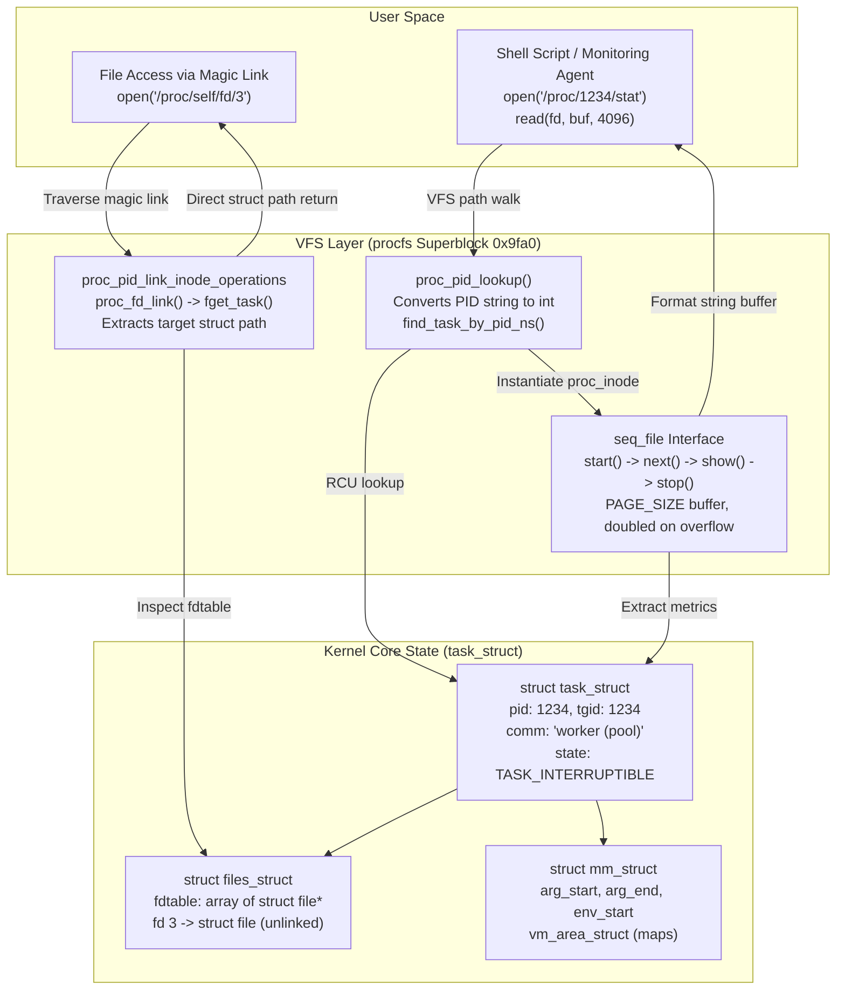

# The /proc Filesystem

> [!summary] Claim
> The `/proc` filesystem is a dynamically synthesized Virtual Filesystem (VFS) interface that projects live kernel process tables and subsystem telemetry into a hierarchical file tree, transforming process introspection, descriptor tracking, and kernel parameter tuning into standard POSIX byte-stream operations.

Part of [The Unix Process Model](README.md) in [Shell and Unix Engineering](../README.md).

## TL;DR

- Mechanism: The kernel mounts an in-memory VFS provider (`procfs`, magic `0x9fa0`) that dynamically generates directory dentries and streams text representations of `task_struct`, `mm_struct`, and `files_struct` on demand during `read()` calls via the `seq_file` interface.
- Rule: Always parse `/proc/[pid]/stat` from the outside in by finding the first `(` and the last `)` because the executable name (`comm`) can contain arbitrary whitespace and parentheses that corrupt naive delimiter splitting.
- Trap: Relying on `stat()` or `ls -l` for `/proc` file sizes yields `st_size = 0`, causing utilities or custom scripts expecting pre-allocated buffers or memory-mapped offsets to read zero bytes.
- Portability fact: POSIX.1-2024 designates `/proc` as an optional, non-standard extension (POSIX.1-2024 XBD 2.1.1 lists "dynamically populated file systems (for example, /proc)" among non-standard extensions); Linux and Plan 9 make `/proc` ubiquitous, FreeBSD makes it optional and marks it deprecated (`procfs(4)`), and Darwin (macOS) omits it entirely in favor of `sysctl(3)` and Mach task ports.
- When not to use it: Avoid polling `/proc` in high-frequency monitoring loops or latency-critical paths because directory scanning and text parsing cause lock contention on kernel process tables; use `netlink` connectors (`PROC_EVENT_EXIT`), eBPF (`sched_process_exec`), or `pidfd_open(2)` instead.

## Mental model



When user space invokes a file system call on `/proc`, the VFS delegates path resolution to `procfs` (filesystem magic `0x9fa0`).
The lookup function `proc_pid_lookup()` converts the numeric directory name to an integer PID, locates the corresponding `struct task_struct` within the PID namespace the procfs instance was mounted for (`fs_info->pid_ns`), applies the `hidepid=ptraceable` check when that mode is set, and instantiates a transient `proc_inode` (`fs/proc/base.c`).
When reading metrics such as `/proc/[pid]/stat` or `/proc/[pid]/status`, the kernel uses the `seq_file` iterator framework, lazily formatting internal task, memory (`mm_struct`), and descriptor (`files_struct`) fields into text buffers without allocating persistent storage.
For descriptor references under `/proc/[pid]/fd/[n]`, the kernel assigns `proc_pid_link_inode_operations`; calling `readlink()` or `open()` invokes `proc_fd_link()`, which queries the target descriptor table directly and returns the underlying `struct path`, allowing user space to reopen and append to unlinked files even after their directory entries have been deleted from disk.

## How it works

The `/proc` filesystem originated in Version 8 Unix (Killian, 1984) and SVR4 (Faulkner and Gomes, 1991) to replace the `ptrace` system call with a file system interface to processes (T. J. Killian, "Processes as Files", USENIX Software Tools Users Group Summer Conference, June 1984, pp. 203-207; R. Faulkner and R. Gomes, "The Process File System and Process Model in UNIX System V", USENIX Winter Conference, Dallas, January 1991).
In Linux, `procfs` is implemented as an in-memory pseudo-filesystem registered via `proc_fs_type` in `fs/proc/root.c` (`register_filesystem(&proc_fs_type)` in `proc_root_init()`).
POSIX.1-2024 Base Definitions designates dynamically populated file systems such as `/proc` as non-standard extensions (POSIX.1-2024 XBD 2.1.1, which names `/proc` as its example).

### 1. Inode Instantiation and Directory Lookup

Unlike physical filesystems that map disk blocks to inodes, `procfs` creates `struct inode` instances on the fly:

1. Path Walking:
When a process executes `open("/proc/1234/status", O_RDONLY)`, the VFS resolves `/proc` and encounters the root directory operations `proc_root_operations` (`fs/proc/root.c`).
The VFS calls `proc_pid_lookup()` (`fs/proc/base.c`).

2. PID Resolution:
`proc_pid_lookup()` extracts the numeric ASCII string `"1234"` with `name_to_int()` and calls `find_task_by_pid_ns()` under `rcu_read_lock()` to find the `struct task_struct` within the `struct pid_namespace` recorded in the procfs superblock (`fs_info->pid_ns`), which is the namespace of whoever mounted that procfs instance, not necessarily the caller's (`fs/proc/base.c`).
If the process does not exist or has already been reaped by its parent (`waitpid`), the lookup returns `-ENOENT`.

3. Security Evaluation:
The kernel checks visibility using `has_pid_permissions()`, which passes when the mount's `hidepid` level is below the level being enforced, when the caller is in the mount's `gid=` group, or when `ptrace_may_access(task, PTRACE_MODE_READ_FSCREDS)` succeeds (`fs/proc/base.c`).
With `hidepid=4` (`hidepid=ptraceable`), `proc_pid_lookup()` itself refuses non-ptraceable tasks; with `hidepid=1` and `hidepid=2`, the check runs in `proc_pid_permission()`, `pid_revalidate()`, and `proc_pid_readdir()`, so the directory stays visible but unreadable (1) or disappears from listings (2).

4. Inode Allocation:
The kernel instantiates a `struct inode` via `proc_pid_instantiate()`, which calls `proc_pid_make_inode()`.
The inode number of a per-PID inode is assigned dynamically with `get_next_ino()`; `proc_alloc_inum()` is used only for registered `proc_dir_entry` nodes such as `/proc/self` (`fs/proc/base.c`, `fs/proc/generic.c`).
The inode's file operations are linked to the specific handler structure (for `/proc/[pid]/status`, the `ONE("status", ..., proc_pid_status)` table entry, which uses `proc_single_file_operations`).

### 2. The seq_file Streaming Interface

Virtual files inside `/proc` expose dynamic kernel data that changes continuously.
To prevent buffer overflows and eliminate memory waste, Linux implements the `seq_file` API (`fs/seq_file.c`, `<linux/seq_file.h>`):

- When a process calls `read()` on a `/proc` file, the VFS invokes `seq_read()`, a wrapper around `seq_read_iter()`.
- The `seq_file` subsystem manages a private buffer (initially `PAGE_SIZE`, which is 4096 bytes on 4 KiB-page kernels; `fs/seq_file.c`).
- The driver implements four iterator hooks: `start()`, `next()`, `show()`, and `stop()`.
- `show()` uses formatted helpers such as `seq_printf()` to print fields directly into the page buffer.
- If the generated text exceeds the allocated buffer, `seq_read_iter()` discards the output, frees the buffer, allocates one twice the size via `seq_buf_alloc()` (`kvmalloc()`), and retries the sequence until the output fits (`fs/seq_file.c`).
- Because contents are generated on demand during `read()`, the kernel cannot determine the final length in advance; per-PID inodes from `proc_pid_make_inode()` leave `i_size` at 0.
Consequently, `stat()` reports `st_size = 0` on regular `/proc` files such as `/proc/[pid]/stat` (proven by the lab's `stat_zero` test).

### 3. Magic Symlinks vs Standard Symlinks

The symlinks found in `/proc` - specifically `/proc/[pid]/fd/[n]`, `/proc/[pid]/exe`, `/proc/[pid]/cwd`, and `/proc/[pid]/root` - are "magic symlinks" (`fs/proc/fd.c`, `man 7 path_resolution`):

- In a standard symbolic link (`S_IFLNK`), the inode stores a target pathname string; when resolving the link, the VFS reads the string and begins a new pathname walk from the root or current directory.
- In a `procfs` magic link, the inode operations vector points to `proc_pid_link_inode_operations`.
- When `readlink()` is invoked, `proc_fd_link()` extracts the target file descriptor from the target's `files_struct` using `fget_task()`, obtains `struct file *`, and returns its `f_path`; `do_proc_readlink()` then formats that path with `d_path()`, which appends the literal suffix `" (deleted)"` when the dentry has been unlinked (`d_unlinked()`, `fs/d_path.c`), not on an `i_nlink` test.
- When `open()` or `openat()` traverses a magic link, the VFS does NOT perform string pathname resolution.
Instead, the kernel's `get_link` callback (`proc_pid_get_link()`) hands the `struct path` (`dentry` and `vfsmount`) to `nd_jump_link()` directly.
- This bypasses directory permissions on intermediate path components and allows processes to open and modify files whose directory entries have been deleted from disk.
- Because magic symlinks can bypass container root filesystems and mount namespace boundaries, Linux 5.6 introduced the `openat2(2)` system call with the `RESOLVE_NO_MAGICLINKS` flag, which rejects any path component backed by a magic link with `ELOOP` (`openat2(2)`).

### 4. Dynamic Process Identification: /proc/self and /proc/thread-self

Linux provides virtual links that identify the caller dynamically:

- `/proc/self`: Implemented in `fs/proc/self.c`.
When traversed or read, `proc_self_get_link()` queries `task_tgid_nr_ns(current, ns)`, where `ns` is the procfs instance's PID namespace, to retrieve the caller's Thread Group ID (Process ID) as that procfs sees it.
It formats the integer into an in-memory string.
Every process that reads `/proc/self` resolves its own PID.
- `/proc/thread-self`: Implemented in `fs/proc/thread_self.c` (added in Linux 3.17, `proc_thread-self(5)`).
It queries `task_pid_nr_ns(current, ns)` to retrieve the caller's Thread ID (TID), allowing individual POSIX threads within a multi-threaded application to inspect their own thread directory under `/proc/[pid]/task/[tid]`.

### 5. Shell Process Substitution Mechanics

In GNU Bash, process substitution (`<(cmd)` and `>(cmd)`) allows command output to appear as a physical file argument:

- In `subst.c`, Bash implements `process_substitute()` (`(bash-5.3 subst.c, process_substitute)`).
- On operating systems supporting file descriptor paths, Bash opens an anonymous pipe and binds it to an unused file descriptor.
- Bash's `configure` sets the compile-time prefix `DEV_FD_PREFIX` to `"/dev/fd/"` when `/dev/fd` works and falls back to `"/proc/self/fd/"` otherwise (bash-5.3 `configure`; `subst.c` builds the path from it).
In the shell matrix, `echo <(true)` printed `/dev/fd/63` in bash 5.2, `/dev/fd/64` in BusyBox ash, `/dev/fd/3` in ksh93u+m, and `/proc/self/fd/11` in zsh.
- On Linux systems where `/dev/fd` is a symbolic link pointing to `/proc/self/fd`, passing `/dev/fd/63` to a child utility causes that child to open its own file descriptor 63; because descriptors are inherited across `fork()` and `execve()`, the child accesses the pipe end directly.
- In POSIX mode (`set -o posix` or invoked as `sh`), Bash 5.0 and earlier (measured: 3.2 and 4.4) disabled process substitution entirely, failing with a syntax error (`syntax error near unexpected token '('`).
- Starting in Bash 5.1, Bash enabled process substitution in POSIX mode (GNU Bash NEWS, bash-5.1 item u: "Process substitution is now available in posix mode").
- Process substitution is not specified by POSIX.1-2024; minimalist POSIX shells such as Dash, Posh, and Mksh reject `<(...)` as a syntax error, while Ksh93, BusyBox ash (`BASH_PROCESS_SUBST`, enabled by `CONFIG_ASH_BASH_COMPAT` where `/dev/fd` exists, `shell/ash.c`), and Zsh (including under sh emulation) support it.
- Yash accepts `<(cmd)` but gives it a different meaning: it is a process redirection of standard input, not a file name, so `cat <(echo a) <(echo b)` prints only `b` and `echo <(true)` prints an empty line; in POSIXly-correct mode yash rejects it ("process redirection is not supported in the POSIXly-correct mode"), measured in the shell matrix with yash 2.58.1 and proven by the lab's process substitution test.

## Numbers and limits

| Metric / Limit | Value | Scope | Source / Verification |
|---|---|---|---|
| `PROC_SUPER_MAGIC` | `0x9fa0` | Linux VFS magic number | Linux kernel `include/uapi/linux/magic.h`, verified by lab (`proc_magic.c`) |
| `TASK_COMM_LEN` | 16 bytes (15 characters plus NUL) | Maximum process name buffer | Linux kernel `include/linux/sched.h` enum (as of 2026-10) |
| `/proc/[pid]/stat` field count | 52 fields (field 52 is `exit_code`, since Linux 3.5) | Space-separated metric fields | `proc_pid_stat(5)` (as of 2026-10) |
| Default `st_size` for `/proc` virtual files | 0 bytes | Inode size metadata | Linux `fs/proc/base.c` `proc_pid_make_inode()` leaves `i_size` unset, verified by lab |
| `seq_file` initial buffer size | `PAGE_SIZE` (4096 bytes on 4 KiB-page kernels), doubled on overflow | Kernel streaming allocation | Linux `fs/seq_file.c` `seq_read_iter()` (as of 2026-10) |
| `/proc/[pid]/cmdline` max kernel read | No fixed cap: the whole argument area is streamed (13961 bytes read back for a `sh` started with 3002 arguments in the Debian matrix image) | Page-at-a-time copy loop | Linux `fs/proc/base.c` `proc_pid_cmdline_read()` and `get_mm_cmdline()` (as of 2026-10) |
| `hidepid=0` | Visible to all | Default procfs mount option | Linux kernel documentation `Documentation/filesystems/proc.rst` |
| `hidepid=1` | Entries unreadable | Non-owner access restricted | Linux kernel 3.3+ mount option (`proc(5)`) |
| `hidepid=2` | Invisible entries | Hidden from non-owner `ls`/`ps` | Linux kernel 3.3+ mount option (`proc(5)`) |
| `hidepid=4` (`ptraceable`) | Ptrace-restricted | Visible only if ptraceable | Linux kernel 5.8+ mount option (`HIDEPID_NOT_PTRACEABLE` in `include/linux/proc_fs.h`; `proc.rst`; kernelnewbies Linux 5.8) |
| `subset=pid` | PID entries only | Hides non-PID top-level nodes | Linux kernel 5.8+ mount option (`proc(5)`) |
| `openat2()` `RESOLVE_NO_MAGICLINKS` | Supported | Traversal security bitmask | Linux kernel 5.6+ `include/uapi/linux/openat2.h` |
| Linux `/proc/sys/fs/file-max` | Dynamic (~10% RAM, at about 1 KiB per file) | System-wide open file limit | Linux `fs/file_table.c` `files_maxfiles_init()` (as of 2026-10) |
| Linux `/proc/sys/fs/nr_open` | 1048576 (default) | Per-process hard descriptor ceiling | Linux `fs/file.c` `sysctl_nr_open = 1024*1024` (as of 2026-10) |
| Bash POSIX mode process substitution cutoff | Version 5.1 | POSIX mode `<(...)` support | GNU Bash NEWS (bash-5.1 item u) / verified by lab (as of 2026-10) |
| Native zsh word splitting default | Disabled | Unquoted `$var` splitting | Zsh `zshoptions(1)` / verified by lab (as of 2026-10) |
| Shell pattern parenthesis escaping requirement | Mandatory `\(` | ksh93, mksh, zsh parameter patterns | POSIX.1-2024 XCU 2.2 (the application shall quote `(` and `)` to represent themselves), 2.2.1, 2.14.1 / verified by lab (as of 2026-10) |
| macOS Darwin `/proc` presence | Absent (`ENOENT`) | Host filesystem | Tested on host, Darwin 27.2.0 (as of 2026-10) |
| FreeBSD `/proc` default state | Optional `fstab` mount; deprecated in favor of `libprocstat(3)` and `kvm(3)` | System default | FreeBSD `procfs(4)` manual (as of 2026-10) |

## Portability

| Environment / Shell | `/proc` Availability | Process Substitution (`<(cmd)`) | Pattern Parens in `${var%pat}` | Unquoted Word Splitting | `/proc/$$/fd/` Symlink Type | `st_size` on Virtual Files | Process Name Source (`comm`) |
|---|---|---|---|---|---|---|---|
| POSIX.1-2024 `sh` | Non-standard (XBD 2.1.1) | Unspecified / Non-standard | Requires `\(`: unquoted `(` is not an ordinary pattern character (XCU 2.2, 2.14.1) | Enabled via `IFS` (XCU 2.6.5) | Unspecified | Unspecified | `ps -o comm=` |
| macOS Bash 3.2 | Absent (`/proc` missing) | Supported in bash; syntax error in posix mode (`/bin/sh`) | Bare `(` accepted in pattern | Enabled via `IFS` | Absent on host | N/A | Mach port / `sysctl` |
| Current Bash (5.3) | Ubiquitous on Linux | Supported (including `--posix` mode as of 5.1) | Bare `(` accepted in pattern | Enabled via `IFS` | Magic symlink (`S_IFLNK`) | Reports 0 bytes | `/proc/[pid]/comm` (16 bytes) |
| Zsh (native) | Supported where mounted | Supported; expands to `/proc/self/fd/N` on Linux (`=(cmd)` uses tmpfile) | Bare `(` triggers `bad pattern`; requires `\(` | Disabled by default (needs `SH_WORD_SPLIT`) | Magic symlink (`S_IFLNK`) | Reports 0 bytes | `/proc/[pid]/comm` (16 bytes) |
| Zsh (`--emulate sh`) | Supported where mounted | Supported (kept under sh emulation) | Bare `(` accepted in pattern | Enabled via `IFS` | Magic symlink (`S_IFLNK`) | Reports 0 bytes | `/proc/[pid]/comm` (16 bytes) |
| Dash | Supported where mounted | Not parsed (syntax error) | Bare `(` accepted in pattern | Enabled via `IFS` | Magic symlink (`S_IFLNK`) | Reports 0 bytes | `/proc/[pid]/comm` (16 bytes) |
| Ksh93 (93u+ and 93u+m) | Supported where mounted | Supported via `/dev/fd/` | Bare `(` triggers `'}' unexpected`; requires `\(` | Enabled via `IFS` | Magic symlink (`S_IFLNK`) | Reports 0 bytes | `/proc/[pid]/comm` (16 bytes) |
| Mksh (R59) | Supported where mounted | Not parsed (syntax error) | Bare `(` triggers `no closing quote`; requires `\(` | Enabled via `IFS` | Magic symlink (`S_IFLNK`) | Reports 0 bytes | `/proc/[pid]/comm` (16 bytes) |
| Yash | Supported where mounted | No file-name substitution: `<(cmd)` is a process redirection of stdin; rejected in POSIXly-correct mode | Bare `(` accepted in pattern | Enabled via `IFS` | Magic symlink (`S_IFLNK`) | Reports 0 bytes | `/proc/[pid]/comm` (16 bytes) |
| Posh (0.14.1) | Supported where mounted | Not parsed (syntax error) | Bare `(` accepted in pattern | Enabled via `IFS` | Magic symlink (`S_IFLNK`) | Reports 0 bytes | `/proc/[pid]/comm` (16 bytes) |
| BusyBox ash | Supported where mounted | Supported (`CONFIG_ASH_BASH_COMPAT` with `/dev/fd`) | Bare `(` accepted in pattern | Enabled via `IFS` | Magic symlink (`S_IFLNK`) | Reports 0 bytes | `/proc/[pid]/comm` (16 bytes) |
| FreeBSD | Optional (`procfs` mount, deprecated) | Shell-dependent | Shell-dependent | Shell-dependent | No `fd` directory in `procfs(4)`; per-process `file` is a symlink to the executable | VFS-dependent | `sysctl kern.proc` |
| Darwin (macOS) | Completely absent | Uses `/dev/fd` from devfs fdesc support | Shell-dependent | Shell-dependent | No `/proc`; `/dev/fd/N` reports the open file's own type (`c` for a terminal or `/dev/null`, `p` for a pipe, `d` for a directory; measured on Darwin 27.2.0) | N/A | `proc_pidinfo()` (libproc) / `sysctl` |

## Worked example

The test suite in the accompanying [lab](../labs/01-the-proc-filesystem/) proves `/proc` filesystem detection, virtual file size semantics, dynamic `/proc/self` resolution, magic symlink persistence, and robust stat parsing.

Here is a simplified excerpt from `labs/01-the-proc-filesystem/proc_probe.sh` (comments, the `workdir` argument check, and the other modes are omitted):

```sh
#!/bin/sh
# shellcheck shell=sh
set -eu

action="${1:-help}"
shift || true

case "$action" in
  detect)
    if [ -d /proc ] && [ -e /proc/self ]; then
      printf 'procfs: available\n'
    else
      printf 'procfs: unavailable\n'
    fi
    ;;

  stat_zero)
    if [ ! -d /proc ] || [ ! -e /proc/self ]; then
      printf 'procfs: unavailable\n'
      exit 0
    fi
    # shellcheck disable=SC2012 # inspecting directory entry size field via ls -ln
    size_field=$(ls -ln "/proc/$$/stat" 2>/dev/null | awk '{print $5}')
    byte_count=$(wc -c <"/proc/$$/stat" 2>/dev/null | tr -d ' ' || echo 0)
    if [ "$size_field" = "0" ] && [ "$byte_count" -gt 0 ]; then
      printf 'stat_size=0 stream_bytes=nonzero\n'
    else
      printf 'stat_size=%s stream_bytes=%s\n' "$size_field" "$byte_count"
    fi
    ;;

  self_vs_dollar)
    if [ ! -d /proc ] || [ ! -e /proc/self ]; then
      printf 'procfs: unavailable\n'
      exit 0
    fi
    child_comm=$(/bin/cat /proc/self/comm 2>/dev/null || echo unknown)
    parent_comm=$(cat "/proc/$$/comm" 2>/dev/null || echo unknown)
    printf 'self_comm=%s parent_comm=%s\n' "$child_comm" "$parent_comm"
    ;;

  magic_fd_deleted)
    if [ ! -d /proc ] || [ ! -e /proc/self ]; then
      printf 'procfs: unavailable\n'
      exit 0
    fi
    workdir="${1:-}"
    target="$workdir/magic_test_$$.tmp"
    exec 3>"$target"
    printf 'first_payload\n' >&3
    rm -f "$target"
    link_target=$(readlink "/proc/$$/fd/3" 2>/dev/null || echo "")
    case "$link_target" in
      *deleted*) deleted_flag=yes ;;
      *) deleted_flag=no ;;
    esac
    printf 'second_payload\n' >>"/proc/$$/fd/3"
    content=$(cat "/proc/$$/fd/3" 2>/dev/null || echo "")
    exec 3>&-
    case "$content" in
      *"first_payload"*"second_payload"*) preserved_flag=yes ;;
      *) preserved_flag=no ;;
    esac
    printf 'link_deleted=%s content_preserved=%s\n' "$deleted_flag" "$preserved_flag"
    ;;

  parse_stat_robust)
    stat_line="$1"
    pid="${stat_line%% \(*}"
    prefix="${stat_line%\)*}"
    comm="${prefix#*\(}"
    remainder="${stat_line##*\)\ }"
    read -r state ppid pgrp _ <<EOT
$remainder
EOT
    printf 'pid=<%s> comm=<%s> state=<%s> ppid=<%s> pgrp=<%s>\n' "$pid" "$comm" "$state" "$ppid" "$pgrp"
    ;;
esac
```

When executing this probe under Linux (shown here from the Debian matrix image, where `/bin/sh` is dash), the lab prints:

```text
$ ./proc_probe.sh detect
procfs: available

$ ./proc_probe.sh stat_zero
stat_size=0 stream_bytes=nonzero

$ ./proc_probe.sh self_vs_dollar
self_comm=cat parent_comm=proc_probe.sh

$ sh ./proc_probe.sh self_vs_dollar
self_comm=cat parent_comm=sh

$ ./proc_probe.sh magic_fd_deleted /tmp
link_deleted=yes content_preserved=yes

$ ./proc_probe.sh parse_stat_robust '1234 (worker (pool) thread) S 100 200 300'
pid=<1234> comm=<worker (pool) thread> state=<S> ppid=<100> pgrp=<200>
```

In `self_vs_dollar`, `/bin/cat /proc/self/comm` dynamically resolves to the executing `cat` utility, while `/proc/$$/comm` stably reflects the invoking shell process.
That shell's `comm` is the base name of the file passed to `execve()`, so a script run through its `#!` line reports the script name (`proc_probe.sh`), while `sh ./proc_probe.sh` reports `sh` (both measured in the Debian matrix image).
The probe names `/bin/cat` explicitly because mksh R59 on Alpine has a `cat` builtin, and a builtin reads `/proc/self` as the shell itself (measured in the shell matrix: plain `cat` printed `mksh` there, while Debian's mksh runs `/usr/bin/cat`).
In `magic_fd_deleted`, `readlink` confirms the target file is marked `(deleted)`, yet reopening `/proc/$$/fd/3` allows user space to append `second_payload` and recover the complete byte stream.
In `parse_stat_robust`, nested parentheses and spaces within `(worker (pool) thread)` are safely isolated without misaligning the trailing `state` and `ppid` fields (the line is synthetic: a real `comm` holds at most 15 bytes, so the kernel would truncate this name).
Literal parentheses in parameter expansion patterns are escaped with backslashes (`\(` and `\)`) to prevent parse or pattern errors in ksh93, mksh, and native zsh.
The remaining numeric fields are split using `read -r` rather than unquoted variable expansion to preserve whitespace field splitting across all POSIX shells as well as native zsh.

## Pitfalls

> [!warning] The Zero-Byte st_size Pre-Allocation Trap
> Trigger: Calling `stat()` or inspecting `st_size` on files in `/proc` (such as `/proc/cpuinfo` or `/proc/[pid]/status`) before allocating user space read buffers or passing the file to `mmap()`.
> Symptom: Applications allocate 0 bytes, read loops terminate prematurely with zero data, and `mmap()` fails with `ENODEV` because these files provide no `mmap` file operation (measured in the Debian matrix image: `mmap()` of `/proc/self/status` fails with `ENODEV`, "No such device").
> Fix: Never trust `st_size` on `/proc` files; always read the file sequentially into dynamically expanding buffers until `read()` returns 0 (EOF).

> [!warning] The `/proc/[pid]/stat` Whitespace and Parentheses Injection
> Trigger: Splitting `/proc/[pid]/stat` with naive whitespace tokenizers (`awk '{print $3}'` or `IFS=' ' read -r pid comm state ...`).
> Symptom: A process with embedded spaces or closing parentheses in its task name (configured via `prctl(PR_SET_NAME)` or `pthread_setname_np`) shifts all subsequent columns; monitoring daemons mistake thread names for process states or PPIDs, causing alerting failures or crash loops.
> Fix: Always extract the process name by locating the FIRST open parenthesis `(` and the LAST closing parenthesis `)`; parse everything prior as the PID, everything between as `comm`, and tokenize only the remaining suffix string.

> [!warning] The Subprocess `/proc/self` Resolution Divergence
> Trigger: Invoking an external command with `/proc/self/` paths, such as `diff /proc/self/fd/3 /proc/self/fd/4` or `cat /proc/self/comm`.
> Symptom: The child process resolves `/proc/self` to its own PID rather than the parent script's PID, resulting in `ENOENT` for a descriptor the child does not hold (`cat: /proc/self/fd/7: No such file or directory` in the Debian matrix image) or reading the wrong process state.
> Fix: Use the parent shell's explicit process identifier `/proc/$$/fd/3` when passing paths to external utilities, or route data through standard descriptor duplication (`3>&1`); remember that many shells exec the last command of a `-c` string in place, after which `$$` names that command (see the L5 question below).

> [!warning] Host Binary Overwrite via `/proc/self/exe` in Containers (CVE-2019-5736)
> Trigger: Container runtimes executing untrusted container payloads where the host runtime binary remains accessible via `/proc/self/exe`.
> Symptom: An attacker running as root inside a container (a malicious image under `runc run`, or an existing container entered with `docker exec`) exploits runc's file-descriptor mishandling around `/proc/self/exe` to overwrite the host's `runc` binary and gain root code execution across the host system (NVD: runc through 1.0-rc6, Docker before 18.09.2, published 2019-02-11).
> Fix: Upgrade runc; runc clones its binary before entering the container into a `memfd_create(..., MFD_ALLOW_SEALING | MFD_CLOEXEC)` file sealed with `F_SEAL_SEAL | F_SEAL_SHRINK | F_SEAL_GROW | F_SEAL_WRITE`, falling back to an `O_TMPFILE` copy (`libcontainer/exeseal/cloned_binary_linux.go`), and since runc 1.2.0 (2024-10-22) prefers a read-only `overlayfs` mount of the binary when privileges and the kernel allow it (runc `CHANGELOG.md`).

> [!warning] Container Escape via Leaked File Descriptor Magic Links (CVE-2024-21626)
> Trigger: Spawning a container process when file descriptors referencing host directories were inadvertently left open by the runtime without `O_CLOEXEC`.
> Symptom: An attacker specifies `/proc/self/fd/<n>` as the container's working directory (`process.cwd`); the kernel traverses the magic symlink directly into the host filesystem, completely bypassing the container's mount namespace and root filesystem isolation.
> Fix: Upgrade to runc 1.1.12 or later (NVD: runc 1.1.11 and earlier are affected); always set `O_CLOEXEC` on all internal descriptors immediately upon creation, verify descriptor tables prior to `execve()`, and use `openat2(..., RESOLVE_NO_MAGICLINKS)` when resolving untrusted paths.

> [!warning] Non-Atomic Multi-File Process Inspection Race
> Trigger: Reading `/proc/[pid]/cmdline`, `/proc/[pid]/stat`, and `/proc/[pid]/maps` through separate sequential `open()` calls in monitoring tools.
> Symptom: If the target process exits between calls and its PID is recycled by the kernel, the monitoring tool reads initial telemetry from the original process and memory maps from an unrelated new process, producing corrupted telemetry.
> Fix: Open a directory file descriptor to `/proc/[pid]` first, check the process start time field (`starttime`, field 22 in `/proc/[pid]/stat`, `proc_pid_stat(5)`), or pin the process lifetime using `pidfd_open(2)` (Linux 5.3+, `pidfd_open(2)`).

> [!warning] Parameter Expansion Pattern Parenthesis Syntax Errors in ksh93, mksh, and zsh
> Trigger: Using unescaped parentheses in parameter expansion pattern words (such as `${line%% (*}` or `${line%)*}`) when parsing `/proc` stat lines.
> Symptom: In ksh93 (both 2012 and u+m), the shell fails to parse the script at startup with a syntax error (`'}' unexpected`); in mksh, the parser fails with `no closing quote`; in native zsh, pattern compilation fails with `bad pattern:  (*`.
> Fix: Always backslash-escape literal parentheses in parameter expansion patterns (`pid="${stat_line%% \(*}"`, `prefix="${stat_line%\)*}"`, `remainder="${stat_line##*\)\ }"`); POSIX.1-2024 XCU 2.2 requires the application to quote `(` and `)` when they are to represent themselves, XCU 2.2.1 specifies that a backslash preserves the literal meaning of the following character, and XCU 2.14.1 makes a quoted or escaped character match itself.

> [!warning] Shell Divergences in Process Substitution Availability
> Trigger: Relying on process substitution `<(cmd)` in shell scripts with a `#!/bin/sh` shebang or executing them across heterogeneous environments.
> Symptom: Minimalist POSIX shells (dash, posh, mksh) and GNU Bash 5.0 and earlier (measured: 3.2 and 4.4) running in POSIX mode abort execution with syntax errors because process substitution is not specified by POSIX.1-2024; yash parses `<(cmd)` as a process redirection of standard input, so `cat <(echo a) <(echo b)` prints only `b` and `diff <(a) <(b)` receives no file operands (measured in the shell matrix).
> Fix: In portable `sh` scripts, replace process substitution with temporary files or named FIFOs created via `mkfifo`; when process substitution is necessary, require an explicit interpreter such as `#!/bin/bash` (non-POSIX), `#!/bin/zsh`, `#!/bin/ksh93`, or modern Bash 5.1+ which supports process substitution in POSIX mode.

> [!warning] Unquoted Parameter Expansion Word Splitting Incompatibility in Native zsh
> Trigger: Relying on unquoted parameter expansion (`set -- $remainder` or `for token in $var`) to split whitespace-delimited metrics from `/proc` under native zsh.
> Symptom: Native zsh does not perform word splitting on unquoted parameter expansions by default, storing the entire string into `$1` while subsequent positional variables remain unset.
> Fix: Parse whitespace-delimited records using `read -r` with a here-document, explicitly set `setopt SH_WORD_SPLIT`, or invoke zsh in sh emulation mode (`zsh --emulate sh`).

## Security and robustness

The `/proc` filesystem is a central security boundary in the Linux kernel.
Because it exposes sensitive memory maps, credentials, and descriptor pointers, improper configuration introduces serious privilege escalation vectors:

1. Information Leakage and hidepid Hardening:
By default (`hidepid=0`), any unprivileged local user can view every process running on the host, including command-line arguments in `/proc/[pid]/cmdline` and environment variables in `/proc/[pid]/environ` for processes with matching credentials.
Administrators must harden production systems by mounting `procfs` with `hidepid=2` (invisible to other users) or `hidepid=4` (`ptraceable`), alongside `subset=pid` (Linux 5.8+) to conceal top-level kernel statistics from sandboxes.
Monitoring services can be granted access using the `gid=<group>` mount option (since Linux 3.3, `proc(5)`).

2. Process Memory Access via `/proc/[pid]/mem`:
The virtual file `/proc/[pid]/mem` exposes the raw virtual address space of a process.
Reading and writing to `/proc/[pid]/mem` is governed by `ptrace` access checks (`PTRACE_MODE_ATTACH_FSCREDS`, `proc_pid_mem(5)`).
In CVE-2016-5195 ("Dirty COW"), attackers exploited a race condition in the Linux memory subsystem's Copy-On-Write (COW) handling (`mm/gup.c`, kernels before 4.8.3, exploited in the wild in October 2016 per NVD) by repeatedly writing to `/proc/self/mem` while calling `madvise(MADV_DONTNEED)`, successfully writing to read-only memory mappings and obtaining root privileges.

3. Magic Links and Namespace Isolation:
Because magic links resolve directly to the kernel `struct path`, they do not respect traditional `chroot` or mount namespace restrictions.
If a sandboxed process retains an open descriptor to a directory outside its sandbox, opening `/proc/self/fd/<n>` steps directly out of the confinement boundary.
Secure runtimes enforce descriptor hygiene and invoke `openat2(2)` with `RESOLVE_NO_MAGICLINKS` and `RESOLVE_BENEATH` to guarantee path lookups cannot escape designated subtrees.

## The principal's view

To a principal engineer, the `/proc` filesystem represents a defining Unix triumph and a cautionary architectural lesson in systems design.
By projecting execution state into a file hierarchy, Unix allowed standard shell utilities (`cat`, `grep`, `awk`) to replace proprietary system monitoring binaries.

However, staff-plus engineers recognize the architectural trade-offs:
- Text Parsing Overhead: Encoding kernel structures into ASCII text and decoding them back into integers in user space consumes substantial CPU cycles; a single `top` refresh on a server with 10,000 threads can dominate CPU utilization (an illustrative scale, not a measured figure).
- Lock Contention: Iterating over `/proc` requires acquiring RCU read locks and tasklist references; heavy monitoring loops degrade scheduling throughput for low-latency workloads.
- Lack of Atomicity: File reads are point-in-time snapshots; reading `/proc/[pid]/stat` and `/proc/[pid]/statm` cannot guarantee consistent metrics across high-frequency memory allocations.
- Shell Portability and Parsing Hazards: Extracting metrics from `/proc` using shell scripts introduces cross-shell failure modes; bare parentheses in parameter expansion patterns break ksh93, mksh, and native zsh, unquoted expansions fail to field-split in native zsh, process substitution `<(cmd)` fails in dash, posh, mksh, and bash 5.0 and earlier in POSIX mode, and yash reads `<(cmd)` as a redirection of standard input rather than a file name.

Architectural recommendations:
- Harden Shell Parsing Logic: When shell scripts must parse `/proc`, backslash-escape pattern parentheses (`\(` and `\)`), tokenize records via `read -r` rather than unquoted expansion, and replace process substitution with temporary files or FIFOs in `#!/bin/sh` scripts.
- Replace `/proc` Polling with Event-Driven Primitives: Never write monitoring daemons that scan `/proc` in tight loops.
Use Netlink Process Connectors (`PROC_EVENT_EXEC`, `PROC_EVENT_EXIT`) to receive asynchronous lifecycle notifications without polling.
- Migrate to eBPF for Deep Telemetry: Use BPF programs attached to kernel tracepoints (`sched_process_exec`, `sys_enter_openat`) to extract telemetry directly inside kernel space without VFS allocation overhead.
- Use pidfd for Process Management: Replace integer PIDs with process file descriptors via `pidfd_open(2)` (Linux 5.3+) to prevent race conditions caused by PID recycling during signal delivery and descriptor tracking.
- Confine Untrusted Path Resolution: In security-sensitive code, never resolve untrusted user paths with standard `open()` or `stat()`; use `openat2(2)` with `RESOLVE_NO_MAGICLINKS` to neutralize symlink traversal exploits.

## Interview questions

> [!question] L5: Why does `ls -l /proc/cpuinfo` report a file size of 0 bytes, while `cat /proc/cpuinfo` prints multiple kilobytes of text?
>
> > [!success]- Answer
> > The `/proc` filesystem is a virtual in-memory filesystem that synthesizes file contents dynamically upon request.
> > The kernel does not know the exact output length in advance without generating the entire file.
> > To avoid wasted memory and CPU overhead during directory traversals, the kernel initializes `procfs` inode file sizes to zero.
> > When user space invokes `read()`, the kernel's `seq_file` interface formats the data on the fly into a stream buffer.
> >
> > Follow-up: How does this zero-byte size affect programs that use `mmap()` or allocate buffers based on `st_size`?

> [!question] L5: Predict the output: What does the command `sh -c 'cat /proc/self/comm; cat /proc/$$/comm'` print on a Linux system?
>
> > [!success]- Answer
> > The first command prints `cat`, unless the shell has a `cat` builtin (mksh R59 on Alpine does), in which case it prints the shell's own name.
> > The second command depends on whether the shell execs the last command of a `-c` string in place instead of forking it.
> > Measured in the shell matrix: dash (Debian's `sh`), mksh, posh, and bash 4.4 fork it and print their own name (`sh` for Debian's dash), while bash 5.1 and later, zsh, ksh93, yash, and BusyBox ash (Alpine's `sh`) exec `cat` in the shell's own process, so `/proc/$$/comm` names `cat` and the second line is `cat` too.
> > `/proc/self` is a dynamic magic link evaluated at runtime to the PID of the calling process, which is the child `cat` process.
> > The parameter `$$` expands to the PID of the invoking shell, so `/proc/$$/comm` inspects whatever program that PID is running when `cat` opens the file: the shell, or `cat` itself after an exec-in-place.
> >
> > Follow-up: Why does `cat /proc/self/fd/3` fail if file descriptor 3 was opened only in the parent shell?

> [!question] L6: How do Linux magic symlinks under `/proc/[pid]/fd/` differ from standard filesystem symbolic links, and what happens when you open `/proc/self/fd/3` after the target file has been unlinked?
>
> > [!success]- Answer
> > Standard symbolic links store a pathname string that the VFS resolves from root or current working directory.
> > Magic symlinks in `procfs` point directly to the open file object's `struct path` in kernel memory.
> > Traversing a magic link bypasses pathname lookup and opens the underlying dentry and mount directly.
> > If the file was unlinked, `readlink()` reports the path with a ` (deleted)` suffix.
> > Opening `/proc/self/fd/3` succeeds and reconnects to the unlinked file because the open file description retains an active reference to the inode.
> >
> > Follow-up: Why did Linux 5.6 introduce `RESOLVE_NO_MAGICLINKS` in `openat2(2)`?

> [!question] L6: Debug this script - why does `read -r pid comm state ppid rest < "/proc/$1/stat"` intermittently corrupt process state and parent PID fields in production monitoring daemons?
>
> > [!success]- Answer
> > The script naively splits `/proc/[pid]/stat` on whitespace characters.
> > In Linux, the executable name (`comm`) can contain arbitrary spaces and parentheses configured via `prctl(PR_SET_NAME)`.
> > If a thread is named `pool (ab) x` (a `comm` holds at most 15 bytes, `TASK_COMM_LEN` 16 with the NUL), whitespace splitting misaligns all subsequent fields.
> > The state field mistakenly captures part of the process name, and numeric metrics shift into wrong variables.
> > The fix is to extract boundaries by isolating everything up to the first open parenthesis as the PID, everything between the first open parenthesis and the last closing parenthesis as `comm`, and the remainder as the numeric fields.
> > When writing this in shell parameter expansion, the parentheses must be backslash-escaped (`\(` and `\)`) to prevent syntax and pattern errors in ksh93, mksh, and native zsh.
> > Tokenizing the remaining fields should use `read -r` rather than unquoted variable expansion to ensure deterministic word splitting across all shells, including native zsh.
> >
> > Follow-up: What is the maximum byte length of the `comm` field in the Linux kernel?

> [!question] L6: How does GNU Bash implement process substitution `<(cmd)` under the hood on Linux versus macOS?
>
> > [!success]- Answer
> > On Linux, Bash creates an anonymous pipe and generates a path using the prefix `/dev/fd/<n>`.
> > Because `/dev/fd` on Linux is a symbolic link to `/proc/self/fd`, the child process accesses the pipe via the kernel's descriptor table.
> > On macOS, Darwin does not provide `/proc` but implements `/dev/fd` through the fdesc support built into devfs (XNU `bsd/miscfs/devfs/devfs_fdesc_support.c`).
> > There, `fdesc_open()` returns `ENODEV` on purpose so the open path takes the `dupfdopen()` route, which duplicates the existing descriptor (sharing its open file description) instead of reopening a path.
> >
> > Follow-up: What happens if a shell script attempts to use process substitution under Dash, Posh, Mksh, or Bash in POSIX mode?

> [!question] L7: Explain how CVE-2019-5736 allowed container escapes in `runc` through `/proc/self/exe`, and how modern runtimes mitigate it.
>
> > [!success]- Answer
> > When `runc exec` attached to a container, the host `runc` binary executed inside the container's mount namespace.
> > The file `/proc/self/exe` pointed directly to the host's physical `runc` binary on disk.
> > A malicious container could therefore overwrite the host `runc` binary with minimal user interaction, because the runtime's own executable was reachable from inside the container through `/proc/self/exe` (NVD: "file-descriptor mishandling, related to /proc/self/exe"; runc maintainers' advisory on oss-security, 2019-02-11).
> > The attacker then wrote malicious code into the host binary, which the next `runc` invocation on the host ran as root.
> > runc mitigates this by cloning its binary into a sealed `memfd_create()` file (or an `O_TMPFILE` copy) before entering the container, and since runc 1.2.0 prefers a read-only `overlayfs` mount of the binary (runc `CHANGELOG.md`).
> >
> > Follow-up: Why does running from a sealed `memfd_create()` copy stop the overwrite, and what would an unsealed copy still allow?

> [!question] L7: How does the kernel implement the `seq_file` interface for `/proc`, and why is it preferred over allocating a single kernel memory buffer?
>
> > [!success]- Answer
> > The `seq_file` API defines four iterator callbacks: `start()`, `next()`, `show()`, and `stop()`.
> > It streams data to user space from a buffer that starts at `PAGE_SIZE` (4096 bytes on 4 KiB-page kernels) during `read()` calls.
> > If formatted output exceeds the current buffer capacity, `seq_read_iter()` frees it, allocates one of double the size, and restarts the iteration (`fs/seq_file.c`).
> > This prevents kernel out-of-memory errors when exporting large tables like `/proc/net/tcp` or `/proc/[pid]/maps`.
> > It eliminates unbounded contiguous kernel memory allocations while guaranteeing clean streaming semantics.
> >
> > Follow-up: What kernel locks are held during `seq_file` iteration over process lists?

> [!question] L7: In high-density container hosts running tens of thousands of tasks, why does frequent `/proc` directory scanning degrade application latency, and what alternative architectures replace it?
>
> > [!success]- Answer
> > Directory lookups in `/proc` require converting ASCII strings to integers and taking RCU read locks across task tables.
> > Scanning thousands of process directories causes high CPU cache invalidation and memory bus contention.
> > Generating text strings inside `seq_file` repeatedly burns kernel CPU cycles on formatting operations.
> > High-performance monitoring systems replace polling with asynchronous kernel event streaming via eBPF tracepoints.
> > Modern architectures consume process lifecycle events via Netlink connectors or `perf_event_open` without touching `/proc`.
> >
> > Follow-up: How does `pidfd_open(2)` solve the race condition inherent in PID recycling during `/proc` inspection?

## Related

Prerequisites: [[Zombies-and-Orphans]]

Next: [[dev-fd-and-dev-stdin]]

See also: [[Proc-Filesystem-and-Process-Credentials]], [[File-Descriptors-and-Open-File-Descriptions]], [[Close-on-Exec-and-Descriptor-Inheritance]], [[Processes-fork-exec-and-wait]], [[Resource-Limits-and-ulimit]], [[Signals-Dispositions-Masks-and-Delivery]], [[Sessions-Process-Groups-and-Controlling-Terminals]], [[sysctl-and-proc-sys]], [[ps-and-Process-States]], [[Linux-Capabilities]], [[Namespaces-from-the-Shell-unshare-and-nsenter]]

## Further reading

- [POSIX.1-2024 Base Definitions Section 2.1.1: Conformance Requirements](https://pubs.opengroup.org/onlinepubs/9799919799/basedefs/V1_chap02.html#tag_02_01_01) - Authoritative classification of dynamically populated filesystems such as `/proc` as optional non-standard extensions.
- [POSIX.1-2024 Shell Command Language Section 2.6.2: Parameter Expansion](https://pubs.opengroup.org/onlinepubs/9799919799/utilities/V3_chap02.html#tag_19_06_02) - Specification of prefix and suffix parameter removal pattern mechanics.
- [POSIX.1-2024 Shell Command Language Section 2.6.5: Field Splitting](https://pubs.opengroup.org/onlinepubs/9799919799/utilities/V3_chap02.html#tag_19_06_05) - Specification of IFS field splitting on unquoted variable expansions.
- [POSIX.1-2024 Shell Command Language Section 2.14: Pattern Matching Notation](https://pubs.opengroup.org/onlinepubs/9799919799/utilities/V3_chap02.html#tag_19_14) - Definition of pattern syntax and rules governing special characters including parentheses.
- [Linux man-pages: proc(5)](https://man7.org/linux/man-pages/man5/proc.5.html) - Complete interface specification of Linux `/proc` filesystem entries, formats, and sysctl interfaces.
- [Linux man-pages: proc_pid_stat(5)](https://man7.org/linux/man-pages/man5/proc_pid_stat.5.html) - Precise documentation of the 52 positional fields in `/proc/[pid]/stat`.
- [Linux man-pages: path_resolution(7)](https://man7.org/linux/man-pages/man7/path_resolution.7.html) - Comprehensive description of Linux VFS path walking, symbolic links, and `procfs` magic link semantics.
- [Linux man-pages: openat2(2)](https://man7.org/linux/man-pages/man2/openat2.2.html) - Specification of granular path resolution flags, including `RESOLVE_NO_MAGICLINKS` and `RESOLVE_BENEATH`.
- [Linux Kernel source: fs/proc/base.c](https://git.kernel.org/pub/scm/linux/kernel/git/torvalds/linux.git/tree/fs/proc/base.c) - Kernel implementation of per-process directory lookup, permission checks, and status generation.
- [Linux Kernel source: fs/proc/fd.c](https://git.kernel.org/pub/scm/linux/kernel/git/torvalds/linux.git/tree/fs/proc/fd.c) - Kernel implementation of descriptor magic symlinks via `proc_fd_link()` and `proc_pid_link_inode_operations`.
- [Linux Kernel source: fs/seq_file.c](https://git.kernel.org/pub/scm/linux/kernel/git/torvalds/linux.git/tree/fs/seq_file.c) - Architecture of the kernel sequential file streaming buffer interface.
- [GNU Bash source: subst.c](https://git.savannah.gnu.org/cgit/bash.git/tree/subst.c) - Implementation of process substitution via `process_substitute()` and the `configure`-chosen `DEV_FD_PREFIX`.
- [GNU Bash NEWS](https://git.savannah.gnu.org/cgit/bash.git/tree/NEWS) - Release notes documenting that process substitution was enabled in POSIX mode in Bash 5.1.
- [Zsh Manual: Options](https://zsh.sourceforge.io/Doc/Release/Options.html) - Documentation of `SH_WORD_SPLIT` and parameter expansion behavior under native zsh versus sh emulation.
- [MirBSD Korn Shell (mksh) Manual](https://www.mirbsd.org/mksh.htm) - Specification of mksh grammar, parameter expansion, and rejection of process substitution syntax.
- [NIST NVD: CVE-2019-5736](https://nvd.nist.gov/vuln/detail/CVE-2019-5736) - Vulnerability analysis of runc container escapes via `/proc/self/exe` binary overwrite.
- [NIST NVD: CVE-2024-21626](https://nvd.nist.gov/vuln/detail/CVE-2024-21626) - Vulnerability analysis of runc container escapes via leaked `/proc/self/fd` directory magic links.
- [NIST NVD: CVE-2016-5195](https://nvd.nist.gov/vuln/detail/CVE-2016-5195) - Vulnerability analysis of Dirty COW kernel privilege escalation via `/proc/self/mem`.
- [FreeBSD man-pages: procfs(4)](https://man.freebsd.org/cgi/man.cgi?query=procfs&sektion=4) - Documentation of FreeBSD procfs, which the page marks deprecated in favor of `libprocstat(3)` and `kvm(3)`.
