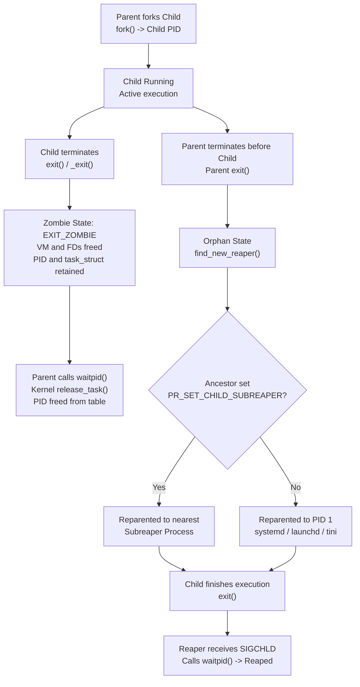

# Zombies and Orphans

> [!summary] Claim
> A terminated Unix process remains a zombie retaining its kernel task table entry and exit status until it is reaped by its parent or, if that parent exits first, by the init process or subreaper it is reparented to.

Part of [The Unix Process Model](README.md) in [Shell and Unix Engineering](../README.md).

## TL;DR

- Mechanism: Process exit frees virtual memory and file descriptors while retaining a kernel `struct task_struct` and PID slot until a parent executes `waitpid`; if the parent exits first, the kernel reparents the zombie to init or a subreaper, which then reaps it.
- Rule: Always reap child processes in a loop with `waitpid(-1, &status, WNOHANG)` upon `SIGCHLD`, or configure `SA_NOCLDWAIT` / `SIG_IGN` on `SIGCHLD` when exit statuses are discarded.
- Trap: Sending `kill -9` to a zombie fails because the process is already terminated and cannot execute signal delivery handlers.
- Portability fact: Calling `wait` on an already reaped process ID returns exit status 127 as POSIX.1-2024 requires in zsh, ksh93, mksh, yash, posh, and bash in POSIX mode (including macOS `/bin/sh`), but returns the cached exit status in native bash, dash (Debian `sh`), and BusyBox ash (Alpine `sh`), as measured in the shell matrix.
- When not to use it: Never rely on shell scripts or application runtimes to act as container PID 1 without an init supervisor such as `tini` or `dumb-init`.

## Mental model



When a parent forks a child, the kernel records parentage in the process table.
If the child terminates while its parent remains alive, the kernel frees its address space and open file descriptors but retains its process ID and exit status in the `EXIT_ZOMBIE` state until the parent calls `waitpid()`.
If the parent terminates while the child executes, the child becomes an orphan, and the kernel immediately reassigns its parent pointer via `find_new_reaper()` to the nearest ancestor marked with `PR_SET_CHILD_SUBREAPER` or to the namespace init process at PID 1.
When that orphan eventually terminates, its adopted reaper receives `SIGCHLD` and calls `waitpid()`, clearing the task struct and releasing the PID slot back to the operating system.

## How it works

The lifecycle transitions between active execution, zombie status, and orphan reparenting occur entirely within the kernel process management subsystem.
When a process executes `exit()` or `_exit()`, the kernel transitions the thread into `kernel/exit.c: do_exit()`.
During `do_exit()`, the kernel disassembles the process execution context in a fixed order: `exit_mm()`, `exit_sem()`, `exit_shm()`, `exit_files()`, then `exit_fs()` (Linux `kernel/exit.c`, as of 2026-10).
The memory management descriptor is detached via `exit_mm()`, which drops the task's reference to its address space and, when it was the last user, tears down all virtual memory areas, page tables, and RSS allocations.
System V semaphore undo structures are released via `exit_sem()`, and System V shared memory attachments are dropped via `exit_shm()`.
The open file table is detached via `exit_files()`, which, when it was the last user of the table, closes all open file descriptors and decrements open file description reference counts.
The filesystem context is detached via `exit_fs()`, releasing root and current working directory inodes.

At this point, user-space execution is completely halted, and the process holds 0 bytes of user memory and 0 open file descriptors.
However, the process lifetime defined by POSIX has not ended, because it ends only "when its process ID is returned to the system" `(POSIX.1-2024 Base Definitions 3.285)`.
POSIX distinguishes between a live process `(POSIX.1-2024 Base Definitions 3.189)` and a zombie process `(POSIX.1-2024 Base Definitions 3.426)`.
A zombie process is defined as "the remains of a live process ... after it terminates ... and before its status information ... is consumed by its parent process" `(POSIX.1-2024 Base Definitions 3.426)`.
The kernel sets the task state to `EXIT_ZOMBIE` in `exit_notify()` and preserves the `struct task_struct`, the process ID, and the exit status.

Signals cannot alter a zombie process.
A signal sent via `kill()` delivers an asynchronous event to an active thread queue.
Because a zombie possesses no threads, no CPU context, and no execution stack, signal delivery logic cannot execute.
A call to `kill(zombie_pid, SIGKILL)` returns 0 on POSIX conforming implementations because the PID represents an existing entity whose lifetime has not ended, but the signal is ignored and the zombie remains in the process table; the `kill()` rationale states that implementations returning `ESRCH` for a zombie "do not conform" `(POSIX.1-2024 functions/kill.html)`, and both `kill -0` and `kill -9` on a zombie returned 0 while it stayed in state `Z` on the macOS host and in the Debian 13 container (measured 2026-10).
The only operation that clears a zombie is status collection by its parent via `wait()`, `waitpid()`, or `waitid()` `(POSIX.1-2024 functions/waitpid.html)`.

When the parent calls `waitpid(child_pid, &status, 0)`, the kernel executes `kernel/exit.c: wait_task_zombie()`.
The kernel extracts the termination code from `p->exit_code`, copies resource utilization statistics (`rusage`), and calls `release_task()`.
The `release_task()` function unlinks the task from the process tree, calls `free_pids()`, which calls `free_pid()` in `kernel/pid.c` to remove the process ID from the namespace's IDR with `idr_remove()` (the PID allocator has used an IDR rather than a bitmap since Linux 4.15), and frees the `struct task_struct` back to the kernel slab cache after an RCU grace period (Linux `kernel/exit.c` and `kernel/pid.c`, as of 2026-10).

Automatic zombie suppression is provided by the POSIX signal interface, as an XSI option `(POSIX.1-2024 functions/sigaction.html, functions/wait.html)`.
If a parent configures `sigaction` with the `SA_NOCLDWAIT` flag on `SIGCHLD`, or explicitly sets the signal disposition of `SIGCHLD` to `SIG_IGN`, the kernel discards the exit status upon process termination.
In this state, children do not transform into `EXIT_ZOMBIE` upon death; the kernel executes `release_task()` immediately.
Any subsequent call to `wait()` or `waitpid()` by that parent blocks until all children terminate and fails with `errno` set to `ECHILD` `(POSIX.1-2024 functions/wait.html)`.

Orphan creation occurs when a parent terminates before its children.
Inside `kernel/exit.c: exit_notify()`, the exiting process calls `forget_original_parent()`.
The kernel iterates over all living children and existing zombies owned by the dying process and reassigns them using `find_new_reaper()`.
In Linux 3.4 and later, `find_new_reaper()` walks up the ancestor process tree checking whether an ancestor has set the subreaper attribute via `prctl(PR_SET_CHILD_SUBREAPER, 1, 0, 0, 0)` `(Linux 3.4+, man 2 prctl)`.
If an ancestor subreaper exists, that ancestor becomes the adopted parent.
If no ancestor has registered as a subreaper, parentage is reassigned to the fallback reaper of the PID namespace, which is PID 1 (`init` on standard Linux, `systemd`, or `launchd` on macOS); POSIX only requires that the parent process ID become that of "an implementation-defined system process" `(POSIX.1-2024 functions/_Exit.html)`, and the lab's orphan probe printed `REPARENTED_PARENT=1` on the macOS host and in the Debian 13 container.
Once reparented, the adopted parent receives `SIGCHLD` when the child exits and is responsible for calling `waitpid()`.

Process termination can also create an orphaned process group `(POSIX.1-2024 Base Definitions 3.247)`.
POSIX defines an orphaned process group as a process group in which the parent of every member is either itself a member of the group or is not a member of the group's session.
This occurs when the job-control shell or session manager that launched a background process group exits.
If an orphaned process group contains any processes in the stopped state (`TASK_STOPPED`), those processes could remain frozen permanently because no job-control parent remains in the session to send `SIGCONT`.
To prevent this, POSIX mandates that when the exit of a process causes a process group to become orphaned, and any member of that newly orphaned process group is stopped, "a SIGHUP signal followed by a SIGCONT signal shall be sent to each process in the newly-orphaned process group" `(POSIX.1-2024 functions/_Exit.html)`.
In the Linux kernel, this is enforced by `kernel/exit.c: kill_orphaned_pgrp()`, which calls `__kill_pgrp_info()` with `SIGHUP` and then with `SIGCONT`; the lab's `orphaned_pgrp` probe observed both signals in every shell's run on macOS, Alpine, and Debian.

Terminal access by orphaned process groups is strictly constrained.
Normally, a background process group attempting to read from the controlling terminal receives `SIGTTIN`, which suspends the process group.
However, members of an orphaned process group are prohibited from stopping in response to `SIGTSTP`, `SIGTTIN`, or `SIGTTOU`, and such a signal is discarded where it would stop them `(POSIX.1-2024 XSH 2.4.3 Signal Actions)`.
If an orphaned process group attempts to `read()` from its controlling terminal, the kernel does not generate `SIGTTIN`; instead, the `read()` system call fails immediately with `errno` set to `EIO` `(POSIX.1-2024 functions/read.html)`.
Similarly, if terminal attribute `TOSTOP` is enabled and a member of an orphaned background process group attempts to `write()` to its controlling terminal while neither blocking nor ignoring `SIGTTOU`, the `write()` call fails with `EIO` `(POSIX.1-2024 functions/write.html)`.

Shells manage background child processes through internal job tables.
In GNU bash, background processes launched with `&` are recorded in the job table in `jobs.c`.
When asynchronous children exit, bash receives `SIGCHLD` and executes `waitchld()` with `WNOHANG` in `jobs.c`, harvesting the exit status into user space and preventing kernel zombies.
Dash executes equivalent reaping loops in `src/jobs.c: dowait()`.
POSIX lets a shell retain the exit status of terminated background processes so that a later `wait $pid` succeeds, but the `wait` rationale says it "is also required to remember only {CHILD_MAX}" of them and may discard the status of an asynchronous list whose `$!` was never referenced `(POSIX.1-2024 utilities/wait.html)`.
POSIX requires that once a known process ID has been successfully waited for, it must be removed from the shell's known list, and an unknown PID is treated as one that "exited with exit status 127", so subsequent waits on that PID return 127 `(POSIX.1-2024 utilities/wait.html)`.

## Numbers and limits

| Limit / Parameter | Value | Scope | Source / Mechanism |
|---|---|---|---|
| Linux kernel default `pid_max` | `32768` (`2^15`), or 1024 per possible CPU if larger | System-wide | `PID_MAX_DEFAULT` and `PIDS_PER_CPU_DEFAULT` in `include/linux/threads.h`, applied in `kernel/pid.c` `(as of 2026-10)` |
| Linux `pid_max` ceiling (64-bit) | `4194304` (`2^22`) | System-wide | `PID_MAX_LIMIT`; `/proc/sys/kernel/pid_max` read `4194304` in the Debian 13 container on the OrbStack kernel (raised by userspace, not the kernel default) `(as of 2026-10)` |
| Linux `pid_max` ceiling (32-bit) | `32768` (`2^15`) | System-wide | `PID_MAX_LIMIT` equals `PID_MAX_DEFAULT` on 32-bit `(as of 2026-10)` |
| macOS System Process Maximum | `9000` | System-wide | `sysctl kern.maxproc` measured on macOS host `(as of 2026-10)` |
| macOS Per-User Process Maximum | `6000` | Per UID | `sysctl kern.maxprocperuid` measured on macOS host `(as of 2026-10)` |
| POSIX Minimum Child Limit | `25` | Per real user ID | `{_POSIX_CHILD_MAX}`, "maximum number of simultaneous processes per real user ID" `(POSIX.1-2024 <limits.h>)` |
| Debian 13 Child Limit | `64279` | Per real user ID | `getconf CHILD_MAX` and `ulimit -u` measured in the Debian 13 container; tracks `RLIMIT_NPROC`, so it varies by host `(as of 2026-10)` |
| macOS Host Child Limit | `6000` | Per real user ID | `getconf CHILD_MAX` measured on the macOS host, equal to `kern.maxprocperuid` `(as of 2026-10)` |
| Bash Dead Job Cache Cap | `32768` | Shell instance | `MAX_CHILD_MAX` in GNU bash 5.3 `jobs.c` clamps a `CHILD_MAX` assignment; the floor is `sysconf(_SC_CHILD_MAX)`, and the bash(1) manual still says "currently 8192"; bash 5.3 kept the status of the first of 10001 jobs in the Alpine container `(as of 2026-10)` |
| Zombie User Virtual Memory | `0 bytes` | Per zombie | Released by `kernel/exit.c: exit_mm()` at termination |
| Zombie Open File Descriptors | `0 descriptors` | Per zombie | Released by `kernel/exit.c: exit_files()` at termination |
| Cgroup v2 PID Limit | `max` (unbounded) | Cgroup slice | `/sys/fs/cgroup/pids.max` read `max` in the Debian 13 container started without `--pids-limit` `(as of 2026-10)` |
| Kubelet PID Pressure Threshold | No default; set with `--eviction-hard` or `--eviction-soft` (for example `pid.available<10%`) | Node condition | Kubernetes node-pressure eviction docs list default hard thresholds only for memory, nodefs, imagefs, and inodes; `pid.available` drives `PIDPressure` `(as of 2026-10)` |

## Portability

The table below documents process reaping, wait retention, subreaper support, and orphan management across Unix shells and platforms.
The two `wait` columns are measured in the shell matrix (the lab's `double-wait` and `wait-all` tests, macOS host, Alpine 3.22, and Debian 13); the subreaper column and the function names come from the cited man pages and source trees.
The `wait-all` tests run the bare `wait` twice, once while the first job is still running and once a second after it exited, because mksh and posh forget only the jobs that the bare `wait` itself waited for.

| Shell / Platform | Second `wait $pid` | `wait` (no args) Purge | `PR_SET_CHILD_SUBREAPER` | `SIGCHLD` Reaping Engine |
|---|---|---|---|---|
| POSIX.1-2024 `sh` | Returns 127 `(POSIX utilities/wait.html)` | Not explicit: removal is stated for a PID "successfully waited for" `(POSIX utilities/wait.html)` | Not specified (Linux-only `prctl(2)`) | Unspecified by POSIX |
| macOS bash 3.2 | Returns 127 (`sh` mode); 42 (native) | Purges known jobs | Not available (macOS has no `prctl`; orphans go to `launchd`, PID 1) | `jobs.c: waitchld()` with `WNOHANG` |
| Current bash (5.3) | Returns 127 (`--posix`); 42 (native) | Purges known jobs | Not a shell feature (Linux 3.4+ kernel attribute) | `jobs.c: waitchld()` and `reap_dead_jobs()` |
| zsh (native) | Returns 127 | Retains cached status | Not a shell feature (Linux 3.4+ kernel attribute) | `Src/jobs.c: zwaitjob()` and `waitforpid()` |
| zsh (`--emulate sh`) | Returns 127 | Retains cached status | Not a shell feature (Linux 3.4+ kernel attribute) | `Src/jobs.c: waitforpid()` |
| dash (0.5.12) | Returns 42 (cached) | Retains cached status | Not a shell feature (Linux 3.4+ kernel attribute) | `src/jobs.c: dowait()` |
| ksh93 (u+m 1.0.10) | Returns 127 | Retains cached status | Not a shell feature (Linux 3.4+ kernel attribute) | `job_wait()` in ksh93 engine |
| mksh (R59) | Returns 127 | Purges a job still running when `wait` starts; retains one that had already exited | Not a shell feature (Linux 3.4+ kernel attribute) | `c_wait()` in `funcs.c` |
| yash (2.58) | Returns 127 | Purges known jobs | Not a shell feature (Linux 3.4+ kernel attribute) | `wait_builtin()` in `job.c` |
| posh (0.14) | Returns 127 | Purges a job still running when `wait` starts; retains one that had already exited | Not a shell feature (Linux 3.4+ kernel attribute) | `posh_builtin_wait()` in `src/builtins.c` calling `waitfor()` in `jobs.c` |
| BusyBox ash (1.37) | Returns 42 (cached) | Retains cached status | Not a shell feature (Linux 3.4+ kernel attribute) | `waitcmd()` calling `dowait()` in `shell/ash.c` |

## Worked example

The companion [lab](../labs/01-zombies-and-orphans/) provides executable C probes and shell scripts measuring zombie generation, orphan reparenting, and wait retention.
The C probe `zombie_orphan_probe.c` demonstrates kernel process lifecycle transitions:

```c
/* Simplified excerpt from labs/01-zombies-and-orphans/zombie_orphan_probe.c */
#define _POSIX_C_SOURCE 200809L
#include <errno.h>
#include <signal.h>
#include <stdio.h>
#include <stdlib.h>
#include <sys/wait.h>
#include <unistd.h>

static int run_zombie_probe(void) {
  pid_t pid = fork();
  if (pid == 0) {
    _exit(42);
  }
  printf("ZOMBIE_PID=%d\n", (int)pid);
  fflush(stdout);
  sleep(3);
  int status = 0;
  waitpid(pid, &status, 0);
  if (WIFEXITED(status)) {
    printf("REAPED=%d\n", WEXITSTATUS(status));
  }
  return 0;
}
```

The shell harness script `reap_monitor.sh` exercises asynchronous process execution and shell table retention:

```sh
#!/bin/sh
# Simplified excerpt from labs/01-zombies-and-orphans/reap_monitor.sh
set -eu
mode="${1:-}"

case "${mode}" in
  spawn-reap)
    code="${2:-0}"
    (exit "${code}") &
    job_pid=$!
    reap_rc=0
    wait "${job_pid}" 2>/dev/null || reap_rc=$?
    printf 'STATUS=%d\n' "${reap_rc}"
    ;;
  double-wait)
    code="${2:-42}"
    (exit "${code}") &
    job_pid=$!
    status1=0
    wait "${job_pid}" 2>/dev/null || status1=$?
    status2=0
    wait "${job_pid}" 2>/dev/null || status2=$?
    printf 'FIRST_WAIT=%d\nSECOND_WAIT=%d\n' "${status1}" "${status2}"
    ;;
esac
```

Running the lab suite under the shell matrix executes discriminating tests across all supported process configurations.
Below is the output captured from running the C probe modes on the macOS host (2026-10-26; PIDs vary per run):

```text
$ ./zombie_orphan_probe zombie
ZOMBIE_PID=13389
REAPED=42

$ ./zombie_orphan_probe orphan
CHILD_PID=13895
ORIGINAL_PARENT=13894
REPARENTED_PARENT=1
ORPHAN_REPARENTED=1

$ ./zombie_orphan_probe nocldwait
NOCLDWAIT_PID=13898
NOCLDWAIT_ECHILD=1

$ ./zombie_orphan_probe orphaned_pgrp
SIGHUP=1
SIGCONT=1
```

Executing `reap_monitor.sh` demonstrates shell wait status retention and PID purge mechanics (each line is the value the lab asserts for that shell: native bash and zsh):

```text
$ sh reap_monitor.sh spawn-reap 42
STATUS=42

$ bash reap_monitor.sh double-wait 42
FIRST_WAIT=42
SECOND_WAIT=42

$ zsh reap_monitor.sh double-wait 42
FIRST_WAIT=42
SECOND_WAIT=127
```

## Pitfalls

> [!warning] Container PID 1 Zombie Reaping Failure (The PID 1 Problem)
> **Trigger:** Running application runtimes (such as Node.js, Python, or Java) directly as container entrypoints (`PID 1`) without an init supervisor when subprocesses spawn background grandchild processes.
> **Symptom:** When background grandchild daemons terminate, they are reparented to PID 1.
> Because standard application runtimes do not install a `SIGCHLD` handler calling `waitpid()`, terminated processes accumulate indefinitely as `<defunct>` entries, eventually exhausting `pid_max` or cgroup `pids.max` and causing all future `fork()` and `exec()` calls to fail with `EAGAIN` ("Resource temporarily unavailable").
> **Fix:** Run containers with Docker `--init` (which injects `tini`), prepend `dumb-init` to container entrypoints, or configure `prctl(PR_SET_CHILD_SUBREAPER, 1, 0, 0, 0)` in custom application supervisors `(Phusion Docker Postmortem 2015; Yelp dumb-init)`.

> [!warning] Unexpected SIGHUP Termination of Stopped Jobs in Orphaned Process Groups
> **Trigger:** A background process is stopped via `SIGTSTP` or job control, and the parent shell or script terminates while the process remains suspended.
> **Symptom:** The kernel detects that the process group is newly orphaned and contains stopped members.
> Per POSIX specifications, the kernel delivers `SIGHUP` followed by `SIGCONT` to every process in the group, immediately killing processes that have not installed a custom `SIGHUP` handler `(POSIX.1-2024 functions/_Exit.html; Linux kernel/exit.c: kill_orphaned_pgrp)`.
> **Fix:** Start such jobs under `nohup`, which sets `SIGHUP` to ignored so the kernel's `SIGHUP` is discarded, or ensure stopped jobs are resumed with `bg` or `kill -CONT` before exiting the parent shell session; `disown -h` only stops the shell itself from sending `SIGHUP` and does not protect against the kernel's orphaned-group `SIGHUP` `(POSIX.1-2024 functions/_Exit.html)`.

> [!warning] Silent Terminal EIO Crashing Orphaned Background Readers
> **Trigger:** An orphaned process group attempts to read from its controlling terminal `/dev/tty` or an inherited terminal standard input descriptor.
> **Symptom:** Because members of an orphaned process group cannot be stopped by `SIGTTIN`, POSIX requires the kernel to fail the `read()` call immediately with `errno` set to `EIO` ("Input/output error"), causing unhandled script crashes `(POSIX.1-2024 functions/read.html)`.
> **Fix:** Explicitly redirect standard input from `/dev/null` when spawning background tasks, or detach the child into a new session via `setsid()` / [[Daemonization]].

> [!warning] Multiple wait Invocations Failing under set -e in POSIX Shells
> **Trigger:** A script running under `set -e` calls `wait "$pid"` multiple times on the same background child PID.
> **Symptom:** In strict POSIX shells (including zsh, ksh93, mksh, yash, and posh), the first `wait` successfully harvests the child and removes the PID from the shell's known jobs table.
> The second `wait "$pid"` encounters an unknown PID and returns exit status 127, triggering immediate script termination under `set -e`.
> **Fix:** Harvest the exit status exactly once and store it in a shell variable in a form `set -e` tolerates (`status=0; wait "$pid" || status=$?`, the lab's idiom; a bare `wait "$pid"; status=$?` exits before the assignment when the job failed), querying the variable for subsequent evaluation `(POSIX.1-2024 utilities/wait.html)`.

> [!warning] Unbounded Shell Background Job Spawning Exhausting CHILD_MAX Memory
> **Trigger:** A long-running daemon shell script spawns background tasks in a continuous loop without calling `wait` or referencing `$!`.
> **Symptom:** The shell's internal saved-status list grows until hitting the shell's internal `CHILD_MAX` boundary (at least `sysconf(_SC_CHILD_MAX)`, and at most 32768 for a value assigned to `CHILD_MAX`, in GNU bash 5.3), after which older status entries are discarded and a late `wait "$pid"` for them returns 127 `(GNU bash 5.3 jobs.c: bgp_add, set_maxchild)`.
> **Fix:** Periodically invoke `wait` with no operands, which in bash also discards the saved statuses (measured in the shell matrix), and `wait` for each job whose status matters while it is still recent.

## Security and robustness

Process lifecycle mismanagement presents significant denial-of-service vulnerabilities in multi-tenant systems.
Process table exhaustion is the primary attack vector associated with un-reaped zombies; CVE-1999-0377 records the classic remote form, "filling a machine's process tables through multiple connections to network services" (NVD).
Because each zombie process occupies a slot in the kernel PID table and retains its kernel `struct task_struct` and `struct pid`, an application that leaks zombies will eventually reach `/proc/sys/kernel/pid_max`.
Once the PID ceiling is reached, `idr_alloc_cyclic()` fails with `-ENOSPC`, which the kernel's `alloc_pid()` function in `kernel/pid.c` converts to `-EAGAIN`, so `fork()` fails with `EAGAIN`.
At this threshold, no new processes can be created anywhere on the host system.
Privileged maintenance commands (`sudo`, `ssh`, `systemctl`) fail with `fork: Resource temporarily unavailable`, so remediation must come from an already running shell's builtins (`kill`) or, failing that, a reboot.

In containerized environments, host-level PID exhaustion can be triggered by a single unprivileged container if resource limits are omitted.
To guarantee container isolation and protect against rogue fork bombs or zombie leaks, Linux cgroups v2 provides the `pids` controller.
Setting `/sys/fs/cgroup/pids.max` (or Docker `--pids-limit`) enforces a hard upper bound on the total number of tasks (living threads and zombies combined) within the container's cgroup slice.
When a container exceeds its allotted `pids.max`, the kernel rejects subsequent `clone()` and `fork()` calls with `EAGAIN` while leaving the rest of the host operating normally.
In Kubernetes clusters, KEP-757 introduced node-level and pod-level PID management.
The Kubelet detects node-level exhaustion via the `pid.available` eviction signal, computed as `node.stats.rlimit.maxpid - node.stats.rlimit.curproc` (Kubernetes node-pressure eviction docs, as of 2026-10).
If available host PIDs drop below a configured `pid.available` threshold (there is no default one; the default hard thresholds cover only memory, nodefs, imagefs, and inodes), Kubelet transitions the node into the `PIDPressure=True` condition and evicts pods, ordering them by Pod priority alone because PIDs have no requests.

From an administrative perspective, zombie processes cannot be cleared using `kill -9` (`SIGKILL`).
When administrators inspect process tables with `ps aux` or `top` and observe processes in state `Z` with command `<defunct>`, attempting to signal the zombie PID is futile.
The only mechanism to eliminate a zombie without rebooting the system is to force its parent process to reap it.
If the parent application is responsive, signaling the parent with `SIGCHLD` may prompt a properly written event loop to execute `waitpid()`.
If the parent process is defective, hung, or running in an uninterruptible sleep state (`D`), the only remediation is to terminate the parent process.
Terminating the parent causes the kernel's `forget_original_parent()` routine to reparent all children and zombies to the namespace reaper (PID 1 or subreaper), which immediately harvests the exit status and frees the PID slots.
Inside containers where PID 1 itself is the broken runtime failing to reap orphans, killing PID 1 terminates the entire container PID namespace.

## The principal's view

At distinguished engineering scale, process lifecycles must be designed around explicit supervision trees rather than ad-hoc backgrounding.
The common operational anti-pattern of launching background workers via shell scripts inside production containers without an init process is an architectural defect.
Production containers are not virtual machines; they do not launch a full `systemd` or `init` suite by default.
Every staff-plus engineer should mandate the container init rule: any container image that executes more than a single static binary must utilize an init supervisor such as `tini` (`docker run --init`) or `dumb-init`.
An init supervisor ensures signal propagation (translating external `SIGTERM` into graceful worker shutdowns) and implements non-blocking `waitpid(-1, &status, WNOHANG)` loops to harvest orphaned background tasks.

When designing systems daemons that manage subprocess pools in C, Rust, or Go, engineers must select the appropriate reaping architecture.
If worker exit codes are completely irrelevant to the supervisor, configuring `sigaction` with `SA_NOCLDWAIT` or setting `SIGCHLD` to `SIG_IGN` delegates reaping directly to the kernel, eliminating zombie allocation entirely without requiring user-space event handling.
If worker exit statuses must be inspected, the supervisor must implement a self-pipe or `signalfd` event loop that invokes `waitpid(-1, &status, WNOHANG)` in a loop until it returns 0 or -1 with `ECHILD`.
Failing to loop over `waitpid()` inside a `SIGCHLD` handler is a standard concurrency defect, because POSIX standard signals do not queue; multiple simultaneous worker terminations coalesce into a single `SIGCHLD` notification, stranding un-reaped zombies in the process table.

Finally, engineers should recognize when shell scripting has exceeded its domain.
Shell scripts excel at sequential orchestration, descriptor plumbing, and ephemeral pipeline execution.
However, shell scripts lack reliable primitives for asynchronous process supervision, non-blocking process polling across arbitrary PIDs, and dynamic subreaper registration.
When a service requires spawning dynamic background worker pools, tracking worker heartbeats, or surviving parent lifecycle restarts, migrate the service from shell to a compiled systems language (Go or Rust) integrated with `systemd` unit management or container cgroup controllers.

## Interview questions

> [!question] L5: What is a zombie process in Unix, what system resources does it consume, and why does `kill -9` fail to remove it?
>
> > [!success]- Answer
> > A zombie process is a process that has terminated via `exit()` or a fatal signal but whose exit status has not yet been collected by its parent via `wait()` or `waitpid()`.
> > It consumes zero bytes of user virtual memory and zero file descriptors because the kernel releases those resources during `do_exit()`.
> > It retains only a kernel `struct task_struct`, an entry in the kernel process table, and its assigned process ID.
> > `kill -9` fails to remove a zombie because the process is already dead and possesses no running threads or execution context to receive or process signal delivery.
> >
> > Follow-up: What is the only way to eliminate a zombie process without rebooting the system?

> [!question] L5: Predict the output when a script runs `(exit 42) & pid=$!; wait "$pid"; echo "$?"; wait "$pid"; echo "$?"` across bash and zsh.
>
> > [!success]- Answer
> > In GNU bash (default native mode), the output is `42` followed by `42`.
> > In zsh (as well as strict POSIX mode shells), the output is `42` followed by `127`.
> > Native bash caches the exit status in its internal dead jobs table up to `{CHILD_MAX}`.
> > POSIX and zsh remove the process ID from the shell's known jobs table immediately upon the first successful wait, treating the second call as an unknown PID which yields exit status 127 per POSIX.1-2024 utilities/wait.
> >
> > Follow-up: How would you modify the script so that it behaves identically and deterministically across all POSIX shells?

> [!question] L6: What is an orphan process, how does kernel reparenting work under `PR_SET_CHILD_SUBREAPER`, and why was this system call introduced in Linux 3.4?
>
> > [!success]- Answer
> > An orphan process is an actively executing process whose original parent has terminated.
> > When a parent exits, `kernel/exit.c: forget_original_parent()` walks up the process tree to find a new parent using `find_new_reaper()`.
> > If an ancestor has configured `prctl(PR_SET_CHILD_SUBREAPER, 1, 0, 0, 0)`, the kernel reassigns the orphan to that ancestor rather than to PID 1.
> > If no subreaper is registered, the orphan reparents to the namespace init process at PID 1.
> > This capability was introduced in Linux 3.4 `(PR_SET_CHILD_SUBREAPER(2const), HISTORY)` because double-forking services were re-parented to PID 1, which left a service manager unable to receive their `SIGCHLD` signals or reap them, and the commit lets a service manager mark itself as a sub-init that stays the parent of all orphaned descendants `(Linux commit ebec18a6d3aa, Lennart Poettering, 2012-03-23)`.
> >
> > Follow-up: Does a child process created via `fork()` inherit the subreaper attribute of its parent?

> [!question] L6: Explain the precise POSIX definition of an orphaned process group, and describe what happens when a process termination causes a stopped process group to become orphaned.
>
> > [!success]- Answer
> > Under POSIX.1-2024 Base Definitions 3.247, an orphaned process group is one in which the parent of every member is either itself a member of the group or is not a member of the group's session.
> > If the exit of a process causes a process group to become orphaned while any member of that group is in the stopped state (`TASK_STOPPED`), the kernel sends a `SIGHUP` signal followed immediately by a `SIGCONT` signal to every member of the group.
> > This mechanism prevents stopped processes from hanging frozen forever in memory after their job-control shell has terminated.
> > If a member of an orphaned process group subsequently attempts to read from its controlling terminal, the call fails immediately with `EIO` instead of suspending on `SIGTTIN`.
> >
> > Follow-up: Why does POSIX mandate sending `SIGHUP` before `SIGCONT` rather than sending `SIGCONT` alone?

> [!question] L6: Why does the batch script `cat tasks.txt | while read -r url; do curl -s "$url" & done; wait` fail to wait for its background workers and exhaust system descriptors?
>
> > [!success]- Answer
> > In bash and dash, each stage of a pipeline runs inside a separate subshell (POSIX allows, but does not require, this for every stage).
> > Because the `while` loop runs in a child subshell, the background `curl` processes are children of that subshell rather than the main script.
> > When the pipeline finishes reading `tasks.txt`, the subshell terminates, orphaning all background `curl` processes.
> > The `wait` command in the outer script has no child processes in its execution environment and returns 0 immediately without waiting for any network downloads.
> > zsh and ksh93 run the last stage in the current shell, so there the same `wait` does wait for the workers (measured on the macOS host: the loop's 2-second background jobs made `wait` take 2 seconds in zsh 5.9 and ksh93u+, and 0 in bash 3.2 and dash).
> > Furthermore, spawning hundreds of uncontrolled concurrent background tasks can exhaust the container's PID limit or socket descriptors.
> > To fix this, avoid the pipeline by using redirection (`while read -r url; do ... done < tasks.txt`) and bound concurrency using `xargs -P` or a job semaphore.
> >
> > Follow-up: How does modern ksh93 handle variable scope and subshell execution in the last stage of a pipeline?

> [!question] L6: Why does setting the signal disposition of `SIGCHLD` to `SIG_IGN` or configuring `SA_NOCLDWAIT` prevent zombie processes, and what are the consequences for subsequent `waitpid()` calls?
>
> > [!success]- Answer
> > POSIX specifies that setting `SIGCHLD` to `SIG_IGN` or setting the `SA_NOCLDWAIT` flag in `sigaction` informs the kernel that the parent will not harvest exit statuses.
> > When a child terminates under these settings, the kernel bypasses the `EXIT_ZOMBIE` state and calls `release_task()` immediately.
> > The process ID and kernel task struct are freed as soon as execution ceases.
> > Any subsequent call to `wait()` or `waitpid()` by the parent blocks until all existing children have terminated and returns -1 with `errno` set to `ECHILD` (XSI, POSIX.1-2024 functions/wait.html); the lab's `nocldwait` probe shows the `ECHILD` result on every platform in the matrix.
> >
> > Follow-up: Can you obtain the exit status of a child process if `SA_NOCLDWAIT` is active?

> [!question] L7: When a Node.js microservice running as PID 1 in a Kubernetes pod triggers EAGAIN on worker `child_process.fork()` while memory usage remains flat, how do you diagnose the kernel-level failure and resolve it?
>
> > [!success]- Answer
> > Inspecting the pod with `ps aux` reveals thousands of `<defunct>` processes assigned to PPID 1.
> > Memory remains flat because zombies release user virtual memory and file descriptors during `do_exit()`, retaining only kernel slab memory.
> > The failure occurs because the pod hit its cgroup PID ceiling (`/sys/fs/cgroup/pids.max`) or the node hit `/proc/sys/kernel/pid_max`.
> > When the PID ceiling is reached, kernel `alloc_pid()` in `kernel/pid.c` returns `-EAGAIN`, preventing any new thread or process creation across the pod.
> > `kubectl exec` fails because the container runtime cannot spawn the target shell inside the exhausted PID namespace.
> > The root cause is that Node.js was executed directly as PID 1 without an init system, and Node.js does not harvest orphaned grandchild processes reparented to it.
> > Immediate remediation requires restarting or deleting the pod to destroy the exhausted PID namespace.
> > Architectural remediation requires injecting an init supervisor such as `tini` or `dumb-init` as the container entrypoint, or configuring `shareProcessNamespace: true` in the Kubernetes PodSpec with an init container.
> >
> > Follow-up: How does Kubernetes KEP-757 prevent a single container from causing host-wide PID exhaustion?

> [!question] L7: How does the Linux kernel synchronize reparenting, task exit, and process group signaling in `kernel/exit.c`, and why does POSIX mandate sending `SIGHUP` before `SIGCONT` rather than `SIGCONT` alone to newly orphaned stopped process groups?
>
> > [!success]- Answer
> > In `kernel/exit.c`, process termination acquires `tasklist_lock` in write mode to protect process hierarchy mutations.
> > The kernel calls `forget_original_parent()` to reparent children to the nearest subreaper or PID namespace init, followed by `kill_orphaned_pgrp()` to detect newly orphaned process groups containing stopped members.
> > POSIX mandates delivering `SIGHUP` before `SIGCONT` because stopped processes cannot process signals until they resume execution.
> > By queuing `SIGHUP` into the task's pending signal set and subsequently delivering `SIGCONT`, the kernel transitions the process state from `TASK_STOPPED` to `TASK_RUNNING`.
> > Upon resuming execution, the process immediately executes the pending `SIGHUP` signal handler or undergoes default termination.
> > If `SIGCONT` were sent alone, the stopped background processes would resume running in the background indefinitely without notification that their controlling parent had perished.
> >
> > Follow-up: What happens if a process in an orphaned process group catches `SIGHUP` with a custom signal handler?

## Related

Prerequisites: [[Daemonization]]

Next: [[The-proc-Filesystem]]

See also: [[Processes-fork-exec-and-wait]], [[Exit-Status-and-Wait-Status]], [[Signals-Dispositions-Masks-and-Delivery]], [[Sessions-Process-Groups-and-Controlling-Terminals]], [[Resource-Limits-and-ulimit]]

## Further reading

- [POSIX.1-2024 Base Definitions Chapter 3 Definitions](https://pubs.opengroup.org/onlinepubs/9799919799/basedefs/V1_chap03.html) - Formal specifications defining process lifetime, zombie processes, and orphaned process groups.
- [POSIX.1-2024 System Interfaces _Exit](https://pubs.opengroup.org/onlinepubs/9799919799/functions/_Exit.html) - Specification of process termination semantics, reparenting, and orphaned process group signaling.
- [POSIX.1-2024 Shell and Utilities wait](https://pubs.opengroup.org/onlinepubs/9799919799/utilities/wait.html) - Standards governing shell background process status retention, child tracking limits, and status removal.
- [Linux kernel/exit.c source implementation](https://git.kernel.org/pub/scm/linux/kernel/git/torvalds/linux.git/tree/kernel/exit.c) - Core kernel code implementing do_exit, release_task, find_new_reaper, and kill_orphaned_pgrp.
- [Linux prctl(2) child subreaper documentation](https://man7.org/linux/man-pages/man2/prctl.2.html) - Reference manual for PR_SET_CHILD_SUBREAPER process supervision introduced in Linux 3.4.
- [Docker and the PID 1 zombie reaping problem](https://blog.phusion.nl/2015/01/20/docker-and-the-pid-1-zombie-reaping-problem/) - Foundational postmortem analyzing container PID 1 signal handling and zombie reaping failures.
- [Kubernetes Enhancement Proposal KEP-757 PID Limiting](https://github.com/kubernetes/enhancements/tree/master/keps/sig-node/757-pid-limiting) - Architectural design introducing pod and node PID isolation via Linux cgroups.
