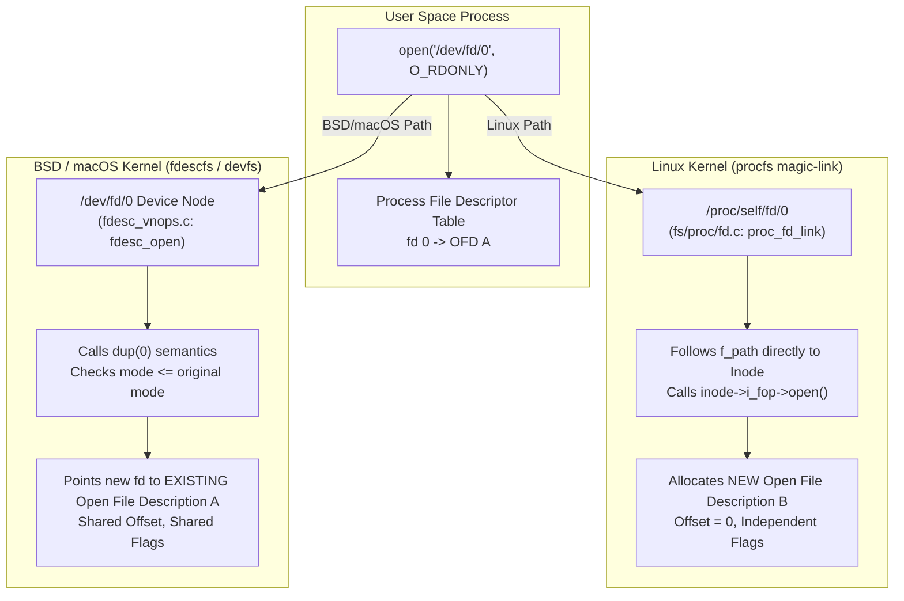

# /dev/fd and /dev/stdin

> [!summary] Claim
> Opening `/dev/fd/n` or `/dev/stdin` projects a process's open file descriptor into the filesystem namespace, but diverges profoundly between platforms: BSD and macOS duplicate the existing open file description via kernel `dup` semantics (unless a FreeBSD `fdescfs` is mounted with `nodup`), whereas Linux resolves a `/proc/self/fd/n` magic-link to allocate a brand-new open file description with an independent file offset and access checks.

## TL;DR

- Path resolution traverses a virtual device node or `/proc/self/fd` symlink to reference an existing entry in the process descriptor table.
- Use standard redirection (`<&`, `>&`) or utility `-` operand conventions instead of `/dev/stdin` when writing strictly conforming portable shell scripts.
- Opening `/dev/stdin` on Linux creates a new open file description with offset 0 for regular files and fails with `EACCES` under dropped privileges or `ENXIO` when descriptor 0 is a socket (such as a ksh93 pipeline stage), whereas BSD duplicates the existing descriptor sharing the offset.
- POSIX.1-2024 classifies `/dev/fd` and `/dev/stdin` as non-standard implementation extensions (POSIX.1-2024 Base Definitions 2.1.1), meaning compliant systems and minimal chroots are not required to provide them.
- Never use `/dev/fd` paths to pass streaming sockets, secret credentials across user boundaries, or multi-pass reads over pipes.

## Mental model



When a process opens `/dev/fd/0`, the request branches into two entirely different kernel subsystems depending on the operating system.
On BSD and macOS systems using `fdescfs` or `devfs`, the kernel executes `fdesc_open()`, which records the descriptor number and returns the special error `ENODEV`; the open path then calls `dupfdopen()`, which verifies permission compatibility and duplicates the pointer to the existing open file description, resulting in shared file positions and shared status flags identical to `dup(2)` (FreeBSD `sys/fs/fdescfs/fdesc_vnops.c` and `sys/kern/kern_descrip.c`; XNU `bsd/miscfs/devfs/devfs_fdesc_support.c`).
On Linux, `/dev/fd` is a symbolic link to `/proc/self/fd`, which the virtual filesystem resolves via `proc_fd_link()`.
The Linux kernel dereferences the magic-link back to the underlying inode and invokes the filesystem's standard `open()` callback.
This allocates a completely distinct `struct file` instance with its own independent file offset initialized to zero, while subjecting the operation to a brand-new access permission check against the calling process's credentials.

## How it works

The Unix process model decouples numeric file descriptors, which are indices into a per-process descriptor table, from open file descriptions, which are system-wide kernel objects containing the read/write offset, status flags, and vnode pointer (see [[File-Descriptors-and-Open-File-Descriptions]]).
Historically, programs expecting filename arguments could not easily accept inherited descriptors or pipeline outputs without temporary files.
To solve this, `/dev/fd` appeared in the 8th Edition Research UNIX System (1985) as character special files, a feature Stevens's APUE credits to Tom Duff ([TUHS discussion of the V8 sources](https://www.tuhs.org/pipermail/tuhs/2020-April/020909.html)), and `fdescfs` first appeared in 4.4BSD from code donated by Jan-Simon Pendry (copyright 1992-1993 in `fdesc_vnops.c`; FreeBSD `fdescfs(4)` HISTORY).

### Specification Status

POSIX.1-2024 does not standardize `/dev/fd` or `/dev/stdin` as mandatory filesystem objects.
In POSIX.1-2024 Base Definitions Chapter 10 (Directory Structure and Devices, Section 10.1 Directory Structure and Files), the standard mandates only three special device entries in `/dev`: `/dev/null` and `/dev/tty`, which shall be readable and writable, and `/dev/console`, which shall exist but need not be readable or writable.
In POSIX.1-2024 Base Definitions Chapter 2 (Conformance, Section 2.1.1 Requirements), the standard lists `/dev/stdin`, `/dev/stdout`, and `/dev/stderr` among the "features not required by POSIX.1-2024" that an implementation may provide as non-standard extensions:
"Additional character special files with special properties (for example, `/dev/stdin`, `/dev/stdout`, and `/dev/stderr`)."
Standard descriptor duplication in portable shell scripts is defined solely in POSIX.1-2024 Shell and Utilities (XCU) Section 2.7 (Redirection) via `<&n` and `>&n`, which map to `dup2(2)` or `fcntl(F_DUPFD)` without filesystem traversal.

### Linux Kernel Implementation (`procfs` Magic Symlinks)

On Linux, `/dev/fd` is conventionally a symbolic link pointing to `/proc/self/fd`.
In the kernel source tree, `/proc/[pid]/fd/` is managed in `fs/proc/fd.c`.
Each entry in this directory is a magic symbolic link instantiated by `proc_fd_instantiate()` with inode operations defined by `proc_pid_link_inode_operations`, and `tid_fd_update_inode()` gives it mode `0500`, `0300`, or `0700` according to whether the descriptor is open for reading, writing, or both (measured in the shell matrix as `lr-x------`, `l-wx------`, and `lrwx------`).
When a process executes `readlink(2)` or `open(2)` on `/proc/self/fd/n`, the VFS invokes `proc_fd_link()`:

```c
static int proc_fd_link(struct dentry *dentry, struct path *path, struct task_struct *task)
{
	int ret = -ENOENT;
	unsigned int fd = proc_fd(d_inode(dentry));
	struct file *fd_file;

	fd_file = fget_task(task, fd);
	if (fd_file) {
		*path = fd_file->f_path;
		path_get(&fd_file->f_path);
		ret = 0;
		fput(fd_file);
	}
	return ret;
}
```

The function queries the target task's descriptor table with `fget_task(task, fd)`.
If descriptor `fd` is not open, the directory lookup in `proc_lookupfd_common()` already fails with `-ENOENT`, so the path does not exist at all; if the descriptor is closed between lookup and resolution, `fget_task` returns `NULL` and `proc_fd_link` also returns `-ENOENT`.
If descriptor `fd` is valid, `proc_fd_link` retrieves the path structure `fd_file->f_path` and increments its reference count via `path_get()`.

Crucially, when `open(2)` resolves this link, the kernel does not read a path string from disk.
Instead, it takes the resolved `f_path` and invokes `do_dentry_open()`, which calls the underlying filesystem's `f_op->open` function.
This instantiates a brand-new `struct file` (Open File Description).
Consequences of this mechanism on Linux:
- Offset independence: For regular files, the newly opened descriptor receives its own `f_pos` initialized to zero, completely decoupled from descriptor `n`'s position.
- Flag independence: Flags like `O_NONBLOCK` or `O_APPEND` on the new descriptor do not alter descriptor `n`.
- Inode permission re-validation: The kernel checks the current process's effective UID and GID against the target inode permissions.
- Sockets cannot be reopened: `socket_file_ops` in `net/socket.c` has no `open` method, and a sockfs inode keeps the default `i_fop` that `inode_init_always_gfp()` in `fs/inode.c` installs, whose `open` is `no_open()`, which returns `-ENXIO` (`init_special_inode()` likewise leaves `S_IFSOCK` inodes on it).
This default replaced the older `sock_no_open()` stub in 2014 (commit bd9b51e79cb0, "make default ->i_fop have ->open() fail with ENXIO").
Attempting to open `/proc/self/fd/n` when `n` is a UNIX domain or TCP socket fails with `ENXIO`.
- Pipeline socket divergence in ksh93: `ksh93u+m` connects the commands in a pipeline (`cmd1 | cmd2`) with `socketpair(2)` instead of `pipe(2)` by default (`ksh93(1)`), and this bites on Linux.
As a consequence, descriptor 0 in the downstream process is a Unix domain socket.
If the downstream command attempts to open `/dev/stdin` (such as `cat /dev/stdin`), the open operation fails with `ENXIO` because Linux refuses to reopen sockets via `/proc/self/fd/0`.
Enabling POSIX mode in ksh93u+m (`set -o posix`) directs the shell to use standard `pipe(2)` for pipelines (ksh93u+m NEWS, 2022-06-09), which allows `/dev/stdin` to be reopened successfully (measured in the shell matrix with ksh93u+m 1.0.10).
On BSD and macOS systems, `dupfdopen()` duplicates the socket descriptor via `dup` semantics, so an external `cat /dev/stdin` reading a socket succeeds (lab test 6 shows a socket opening through `/dev/fd` on macOS).
- Anonymous pipes succeed: Anonymous pipes use `pipefifo_fops`, whose `open` (`fifo_open()`) permits reopening the existing pipe ring buffer with a new `struct file` (lab test 8).

### BSD and macOS Implementation (`fdescfs` / `devfs`)

On macOS and FreeBSD, `/dev/fd` is backed by `fdescfs` or the character device subsystem of `devfs` (on FreeBSD, `devfs` alone creates only `/dev/fd/0`, `/dev/fd/1`, and `/dev/fd/2`; mounting `fdescfs` adds an entry for every open descriptor, per `fdescfs(4)`).
The filesystem entry `/dev/fd/0` is not a symbolic link: FreeBSD `fdescfs` reports it as a character special device (`VCHR`) unless mounted with `linrdlnk` or `rdlnk`, while macOS `stat` reports the type and mode of the object behind the descriptor (measured: a regular file when descriptor 0 is a file, a character special file for `/dev/null`); macOS `/dev/stdin` itself is a symbolic link to `fd/0` (measured).
The open operation is handled in the kernel by `fdesc_open()` in `sys/fs/fdescfs/fdesc_vnops.c` (XNU: `bsd/miscfs/devfs/devfs_fdesc_support.c`), which stores the descriptor number in the thread and returns `ENODEV` so that the open path calls `dupfdopen()` in `kern_descrip.c`:

When user space calls `open("/dev/fd/n", flags)`:
- The kernel looks up descriptor `n` directly in the calling process's open file table.
- If descriptor `n` is closed or invalid, `dupfdopen()` fails with `EBADF` (lab tests 4 and 7 on macOS).
- The kernel validates access modes: the requested flags must be a subset of the flags on the existing descriptor.
An attempt to open an `O_RDONLY` descriptor with `O_RDWR` or `O_WRONLY` fails with `EACCES` (`dupfdopen()` in FreeBSD and XNU); open flags other than `O_RDONLY`, `O_WRONLY`, and `O_RDWR` are ignored (`fdescfs(4)`).
- If allowed, the kernel duplicates the existing `struct file *` reference into the calling process's lowest available file descriptor slot and increments the reference count.
- Sockets succeed because the descriptor is duplicated rather than reopened through an inode handler.
- The duplicated descriptor points to the identical Open File Description, sharing the exact same `f_offset` and status flags.
- Exception: FreeBSD `fdescfs` mounted with the `nodup` option instead reopens the vnode behind a descriptor, Linux style, with the requested mode (`fdescfs(4)`).

### Shell Internal Redirection Emulation

To accommodate operating environments lacking `/dev/fd`, GNU Bash implements internal pathname interception.
In `redir.c`, Bash maintains `_redir_special_filenames`:

```c
static STRING_INT_ALIST _redir_special_filenames[] = {
#if !defined (HAVE_DEV_FD)
  { "/dev/fd/[0-9]*",	RF_DEVFD },
#endif
#if !defined (HAVE_DEV_STDIN)
  { "/dev/stderr",	RF_DEVSTDERR },
  { "/dev/stdin",	RF_DEVSTDIN },
  { "/dev/stdout",	RF_DEVSTDOUT },
#endif
#if defined (NETWORK_REDIRECTIONS)
  { "/dev/tcp/*/*",	RF_DEVTCP },
  { "/dev/udp/*/*",	RF_DEVUDP },
#endif
  { (char *)NULL,	-1 }
};
```

When Bash compiles without OS-level `/dev/fd` (`!defined(HAVE_DEV_FD)`), `redir_open()` intercepts paths matching `/dev/fd/[0-9]*`.
It extracts the numeric descriptor index and branches into `redir_special_open()`, which duplicates it with `fcntl(fd, F_DUPFD, SHELL_FD_BASE)` instead of opening a path (bash 5.3 `redir.c`).
On platforms where `HAVE_DEV_FD` is defined (such as Linux and macOS), Bash leaves `/dev/fd/` entries out of `_redir_special_filenames` and delegates path resolution directly to the operating system's `open()` system call.

### Process Substitution Plumbing

Process substitution (`<(cmd)` and `>(cmd)`) is handled in Bash inside `subst.c` by `process_substitute()`.
The shell executes the following steps:
- It creates an inter-process communication channel using `pipe(fd)`.
- It calls `move_to_high_fd(parent_pipe_fd, 1, 64)` (`general.c`), which searches downward from descriptor 63 for the highest free descriptor above 3 and moves the parent's pipe end there with `dup2()`, preventing collisions with standard redirections (descriptors 0 to 9); in practice the first substitution gets `/dev/fd/63` and the next `/dev/fd/62` (measured with bash 3.2, 5.2, and 5.3).
- It forks an asynchronous subshell child process to execute `cmd`.
- In the child subshell, it connects standard output (for `<(...)`) or standard input (for `>(...)`) to the pipe and closes unnecessary descriptor copies.
- In the parent shell, it formats the string `/dev/fd/N` (where `N` is the high descriptor) and substitutes this string into the outer command line.
- Crucially, the parent does not mark descriptor `N` with `FD_CLOEXEC`.
- When the outer command forks and executes, descriptor `N` is inherited across `execve(2)`, allowing the external binary to open and read `/dev/fd/N`.
- Once the outer command completes, the parent shell closes descriptor `N` and reaps the background subshell.
On operating systems without native `/dev/fd` support, `subst.c` falls back to `make_named_pipe()`, which creates a named pipe with `mkfifo(2)` (mode 0600) under a random temporary name in `$TMPDIR`.

Process substitution support diverges sharply across shell families and configuration modes (as of 2026-10).
In GNU Bash, process substitution is enabled outside POSIX mode.
When Bash runs in POSIX mode (`set -o posix`, `--posix`, or invoked as `/bin/sh`), versions up to Bash 4.4 strictly disable `<(cmd)`, treating the syntax as an unexpected token error.
Beginning with Bash 5.1, GNU Bash supports process substitution even when running in POSIX mode (Bash NEWS for bash-5.1, item u: "Process substitution is now available in posix mode"; measured with bash 4.4 and 5.1 `--posix` in the shell matrix).
In BusyBox `ash`, releases since 1.34.0 (commit a1b0d3856, June 2021) support process substitution `<(cmd)` when built with `CONFIG_ASH_BASH_COMPAT` on a platform with `/dev/fd` (the internal `BASH_PROCESS_SUBST` macro in `shell/ash.c`), creating a pipe and passing a `/dev/fd/N` argument.
In Yash (Yet Another Shell), `<(cmd)` and `>(cmd)` are implemented as process redirection operators rather than command expansions.
Yash connects standard input or output directly to a background command without expanding to a pathname argument, and Yash rejects this syntax entirely in POSIX mode ("process redirection is not supported in the POSIXly-correct mode", measured with yash 2.58.1; yash manual, POSIXly-correct mode).
In Dash, Posh, and Mksh, process substitution is unsupported and yields a parse syntax error.

## Numbers and limits

| Metric / Parameter | Value | System / Subsystem | Source / Verification |
| :--- | :--- | :--- | :--- |
| POSIX required `/dev` files | 3 (`/dev/null`, `/dev/console`, `/dev/tty`) | POSIX filesystem namespace | (POSIX.1-2024 Base Definitions 10.1) |
| Standard I/O descriptors | 3 (`0` stdin, `1` stdout, `2` stderr) | POSIX process model | (POSIX.1-2024 XBD 3.353 to 3.355; `STDIN_FILENO` in `<unistd.h>`) |
| Minimum atomic pipe write limit | 512 bytes (`_POSIX_PIPE_BUF`) | POSIX process limits | (POSIX.1-2024 XBD `<limits.h>`; `getconf _POSIX_PIPE_BUF` measured 512 on macOS and musl, 2026-10) |
| Linux atomic pipe write limit | 4096 bytes (`PIPE_BUF`) | Linux VFS pipe layer | Linux `limits.h`; `getconf PIPE_BUF /` (measured in shell matrix 2026-10) |
| Default Linux pipe capacity | 65536 bytes (64 KiB) | Linux pipe ring buffer | Measured in the shell matrix (Debian 13 container, nonblocking writes until `EAGAIN`, 2026-10) |
| macOS default pipe capacity | 65536 bytes (64 KiB) | Darwin pipe buffer | Measured on the macOS host (nonblocking writes of 1, 512, 4096, and 16384 bytes until `EAGAIN`, 2026-10) |
| Linux `/proc/self/fd/` inode format | `S_IFLNK` (magic symlink, mode 0500, 0300, or 0700 by access mode) | Linux procfs | Linux kernel `fs/proc/fd.c` `tid_fd_update_inode` (measured in shell matrix 2026-10) |
| macOS `/dev/fd/0` inode format | Type and mode of the underlying object (regular file for a file, `S_IFCHR` for `/dev/null` or a terminal) | Darwin devfs `fdesc` | XNU `devfs_fdesc_support.c` `fdesc_getattr` (measured with `stat` on macOS 2026-10) |
| Linux closed descriptor error | `ENOENT` (errno 2, "No such file or directory") | Linux `proc_fd_link` | Linux kernel `fs/proc/fd.c` (measured in lab 2026-10) |
| macOS closed descriptor error | `EBADF` (errno 9, "Bad file descriptor") | Darwin `devfs` / `fdescfs` | XNU `bsd/kern/kern_descrip.c` `dupfdopen` (measured in lab 2026-10) |
| Linux socket reopen error | `ENXIO` (errno 6, "No such device or address") | Linux `sockfs` | Linux kernel `fs/inode.c` `no_open` (measured in lab 2026-10) |
| macOS socket open via `/dev/fd` | `0` (Success via `dup` semantics) | Darwin `fdesc_open` | XNU `devfs_fdesc_support.c` and `dupfdopen` (measured in lab 2026-10) |
| Bash process substitution fd | Highest free descriptor below 64 (63, then 62) | GNU Bash `subst.c` | GNU Bash `general.c` `move_to_high_fd` (measured bash 3.2, 5.2, 5.3, 2026-10) |
| Bash POSIX mode `<(...)` support | Supported in >= 5.1; syntax error in <= 4.4 | GNU Bash parser | GNU Bash `NEWS` bash-5.1 item u (measured bash 4.4 and 5.1 `--posix`, 2026-10) |
| BusyBox ash `<(...)` support | Supported when `CONFIG_ASH_BASH_COMPAT=y` and `/dev/fd` exists | BusyBox `ash.c` `BASH_PROCESS_SUBST` | BusyBox 1.34.0+ (measured 1.37.0 in shell matrix 2026-10) |
| ksh93u+m default pipeline transport | `socketpair(2)` (AF_UNIX stream socket) | ksh93u+m pipeline subsystem | ksh93u+m manual `ksh93(1)` (as of 2026-10) |
| ksh93u+m POSIX mode pipeline transport | `pipe(2)` (unidirectional pipe) | ksh93u+m `set -o posix` | ksh93u+m manual `ksh93(1)`; NEWS 2022-06-09 (as of 2026-10) |

## Portability

| Shell / Environment | `/dev/stdin` in Redirection | Process Substitution `<(cmd)` | Fallback Emulation if `/dev/fd` Missing | Offset Semantics on Regular File |
| :--- | :--- | :--- | :--- | :--- |
| POSIX.1-2024 `sh` | Optional extension | Not specified (a syntax error in dash, posh, and mksh) | None (Relies on OS path) | Not specified |
| macOS `bash` 3.2 | Supported | Supported outside POSIX mode; syntax error in POSIX mode | `redir.c` `_redir_special_filenames` | Shared offset (`dup` semantics) |
| GNU `bash` 5.3 | Supported | Supported (`/dev/fd/N` or FIFO); supported in POSIX mode | `redir.c` `_redir_special_filenames` | Platform-dependent (OS `open`) |
| `zsh` 5.9 (native) | Supported | Supported (`<(cmd)` as `/proc/self/fd/N` on Linux, `=(cmd)` as a temporary file under `TMPPREFIX`, default `/tmp/zsh`, deleted after the command; `zshexpn(1)`, `zshparam(1)`) | Process substitution uses named pipes when `/dev/fd` is missing (`zshexpn(1)`) | Platform-dependent (OS `open`) |
| `zsh` (`--emulate sh`) | Supported | Supported (`<(cmd)`) | Process substitution uses named pipes when `/dev/fd` is missing (`zshexpn(1)`) | Platform-dependent (OS `open`) |
| `dash` 0.5.12 | Supported (via OS) | Not supported (Syntax error) | None (Delegates to `open`) | Platform-dependent (OS `open`) |
| `ksh93u+m` 1.0.10 | Supported, even on a Linux pipeline socket; an external utility opening `/dev/stdin` on a ksh pipeline fails with `ENXIO` on Linux unless `set -o posix` | Supported (`/dev/fd/N` or FIFO) | Process substitution uses a FIFO when `/dev/fd` is missing (`ksh93(1)`); `sh_open()` in `io.c` maps `/dev/stdin` to descriptor 0, tries `open(2)`, and on failure falls back to `dup(2)` of the shell's own descriptor, which is why `< /dev/stdin` works on a socket | Platform-dependent (OS `open`) |
| `mksh` R59 | Supported (via OS) | Not supported (Syntax error) | None (Delegates to `open`) | Platform-dependent (OS `open`) |
| `yash` 2.58 | Supported (via OS) | Process redirection only (operator, not expansion); disabled in POSIX mode | None (Delegates to `open`) | Platform-dependent (OS `open`) |
| `posh` 0.14 | Supported (via OS) | Not supported (Syntax error) | None (Delegates to `open`) | Platform-dependent (OS `open`) |
| BusyBox `ash` 1.37 | Supported (via OS) | Supported (`/dev/fd/N`, with `CONFIG_ASH_BASH_COMPAT`) | None (Delegates to `open`) | Platform-dependent (OS `open`) |
| GNU / BSD Coreutils | Supported via kernel | N/A (Utility treats as path) | `-` convention handled in userspace | Platform-dependent |

## Worked example

The test harness in [lab](../labs/01-dev-fd-and-dev-stdin/) measures the behavioral divergence between Linux and BSD descriptor resolution and validates shell compatibility across the test matrix.

The lab script `labs/01-dev-fd-and-dev-stdin/dev_fd_demo.sh` exercises standard input streaming, sequential rereading, descriptor duplication via `<&`, and process substitution:

```sh
#!/bin/sh
# Demonstrates /dev/stdin, /dev/fd, and descriptor duplication mechanics.

set -eu

if [ "$#" -lt 1 ]; then
  echo "Usage: $0 <stream|reread|dup|procsub>" >&2
  exit 2
fi

action=$1

case "${action}" in
  stream)
    # Read the full payload from /dev/stdin through an external tool
    cat /dev/stdin
    ;;

  reread)
    # Attempt two sequential reads from /dev/stdin
    read -r line1 </dev/stdin
    read -r line2 </dev/stdin
    printf '1: %s\n2: %s\n' "${line1}" "${line2}"
    ;;

  dup)
    # Read from file descriptor 3, expected to be duplicated from stdin via 3<&0
    read -r line <&3
    printf 'dup: %s\n' "${line}"
    ;;

  procsub)
    # Detect process substitution vs process redirection without syntax errors
    out=$(eval 'echo X <(:) Y' 2>/dev/null) || out=""
    case "${out}" in
      "X "/*" Y")
        printf 'procsub: supported\n'
        ;;
      "X Y")
        printf 'procsub: redirection only\n'
        ;;
      *)
        printf 'procsub: unsupported\n'
        ;;
    esac
    ;;

  *)
    echo "Unknown action: ${action}" >&2
    exit 2
    ;;
esac
```

The accompanying C probe `labs/01-dev-fd-and-dev-stdin/dev_fd_probe.c` directly inspects the kernel system call layer:

```c
/* Simplified excerpt from labs/01-dev-fd-and-dev-stdin/dev_fd_probe.c */
static int probe_offset(const char *tempfile) {
  int fd1 = open(tempfile, O_CREAT | O_RDWR | O_TRUNC, 0600);
  write(fd1, "0123456789", 10);
  lseek(fd1, 5, SEEK_SET);

  char path[64];
  snprintf(path, sizeof(path), "/dev/fd/%d", fd1);
  int fd2 = open(path, O_RDONLY);

  char buf[3] = {0};
  read(fd2, buf, 2);
  close(fd1);
  close(fd2);
  unlink(tempfile);

  if (strcmp(buf, "01") == 0) {
    printf("offset: linux-new-ofd\n");
  } else if (strcmp(buf, "56") == 0) {
    printf("offset: bsd-dup-ofd\n");
  }
  return 0;
}
```

When executed on macOS (Darwin arm64) using the Bats suite, the lab produces:

```text
1..10
ok 1 reading from /dev/stdin consumes stream data
ok 2 sequential reads from /dev/stdin reflect kernel offset semantics
ok 3 descriptor duplication with <& operates without filesystem paths
ok 4 opening a closed descriptor via /dev/fd returns non-zero error
ok 5 C probe confirms kernel offset behavior on regular file
ok 6 C probe confirms socket open handling across kernels
ok 7 C probe confirms closed descriptor error reporting
ok 8 C probe confirms anonymous pipe open via /dev/fd
ok 9 process substitution availability matches shell family matrix
ok 10 unknown action in demo script fails with status 2
```

In test 2 the shell's second `read` from `/dev/stdin` returns `beta` on macOS and `alpha` again on Linux, and in test 5 the probe on macOS reports `bsd-dup-ofd` because `dupfdopen()` duplicated descriptor `fd1`, preserving offset 5 and reading `56`.
Under Linux containers, test 5 asserts `linux-new-ofd` because the open through the `proc_fd_link()` magic-link allocated a new open file description with offset 0, reading `01`.
In test 1 on Linux, `ksh93u+m` exits non-zero with `No such device or address` when `cat` opens `/dev/stdin` because its pipeline transport defaults to `socketpair(2)`, whereas the other shells use `pipe(2)`; that `set -o posix` switches ksh93u+m to `pipe(2)` was measured by hand in the shell matrix, not by the test.
In test 9, process substitution availability reports `supported` for Bash (outside POSIX mode, or in POSIX mode in Bash 5.1+), Zsh, ksh93, and BusyBox ash (`CONFIG_ASH_BASH_COMPAT`), `redirection only` for Yash, and `unsupported` for Dash, Posh, Mksh, and Bash <= 4.4 in POSIX mode; the matrix exercises POSIX mode only through macOS `/bin/sh` (bash 3.2), and the Bash 5.1+ and Yash POSIX-mode branches were measured by hand.

## Pitfalls

> [!warning] Pitfall 1: Multi-Pass Read Exhaustion on Streaming Input
> Trigger: Running multiple commands or multiple sequential read loops against `/dev/stdin` when standard input is backed by a pipe, socket, or terminal.
> Symptom: The first utility consumes available bytes; subsequent utilities read 0 bytes (immediate EOF) or fail with parse errors.
> Fix: Read the stream once into a temporary buffer file or shell variable, or route the input stream concurrently using `tee(1)`.

> [!warning] Pitfall 2: Kernel Offset Desynchronization Across Operating Systems
> Trigger: Calling `open("/dev/stdin")` or `/dev/fd/0` on a redirected regular file after a previous command has read partial data from standard input.
> Symptom: On Linux, the newly opened descriptor resets to offset 0 (rereading already processed bytes); on BSD and macOS, it duplicates the descriptor and shares the advanced offset.
> Fix: Never rely on filesystem paths to inherit or rewind file offsets.
> Use `lseek(2)`, explicit byte tracking, or standard descriptor duplication (`exec 3<&0`) when position sharing is required.

> [!warning] Pitfall 3: Dropped-Privilege Permission Denied (`EACCES`) on Stdin Reopen
> Trigger: On Linux, a privileged process opens a file or inherits a pseudo-terminal (`/dev/pts/N`), drops privileges (`setuid(nobody)` or `sudo -u user`), and executes a script that calls `cat /dev/stdin`.
> Symptom: The command crashes with `open /dev/stdin: Permission denied` (`EACCES`), even though descriptor 0 is fully readable with `read(0)`.
> Fix: Modify scripts and tools to read directly from descriptor 0 (using the `-` operand or default stream consumption) rather than invoking `open()` on `/dev/stdin`.
> This failure mode is documented in `proc_pid_fd(5)` and was reported on the Linux kernel mailing list in 2008 for `/dev/stdout` after `su` ([RFC: /dev/stdin, symlinks & permissions](https://lkml.iu.edu/hypermail/linux/kernel/0803.2/0534.html)).

> [!warning] Pitfall 4: Subshell Descriptor Leaks and `/dev/fd` Path Overflows (CVE-2012-3410)
> Trigger: Heavy use of nested process substitutions `<(...)` combined with background asynchronous lists, or passing excessively long `/dev/fd/` strings to older Bash releases.
> Symptom: Upstream writer processes stall indefinitely because reader descriptors remain open in un-reaped subshells.
> Historically, Bash versions prior to 4.2 patch 33 suffered a stack-based buffer overflow in `lib/sh/eaccess.c` when expanding the `/dev/fd` prefix of a long filename, which NVD says might let local users bypass restricted shell access (CVE-2012-3410, published 2012-08-27).
> Fix: Ensure background child processes close inherited descriptors, and apply upstream patch level `bash42-033`.

> [!warning] Pitfall 5: Path Lookup Failures in Minimal Containers and Chroot Jails
> Trigger: Invoking scripts that depend on `/dev/stdin` or `/dev/fd` inside a scratch Docker container, initramfs image, or chroot environment where `/dev` is unpopulated or `/proc` is not mounted.
> Symptom: Commands abort with `/dev/stdin: No such file or directory` (`ENOENT`).
> Fix: Structure pure shell scripts to use POSIX descriptor duplication (`<&`, `>&`), which relies exclusively on kernel descriptor tables and operates with zero filesystem dependencies.

> [!warning] Pitfall 6: ksh93 Pipeline Sockets Trigger ENXIO on /dev/stdin under Linux
> Trigger: Running a pipeline into an external command that opens `/dev/stdin` (for example `cmd1 | cat /dev/stdin`) under `ksh93u+m` on Linux.
> Symptom: The command crashes with `cat: /dev/stdin: No such device or address` (`ENXIO`), even though standard input contains data.
> Fix: Enable POSIX mode in ksh93 (`set -o posix`) to use standard `pipe(2)`, or let the shell supply descriptor 0 (`cat <&0`, plain `cat`, or `cat < /dev/stdin`, which ksh93u+m 1.0.10 opens itself and which succeeds on a pipeline socket in the shell matrix).

## Security and robustness

Exposing file descriptors into the global pathname hierarchy introduces distinct security boundaries and kernel attack surfaces.

### Privilege Dropping and Inode Traversal
On Linux, resolving `/dev/fd/n` invokes full VFS path lookup on the target inode referenced by `proc_fd_link()`.
If a privileged daemon opens a sensitive configuration file (such as `/etc/shadow`) on descriptor 3 and drops privileges to an unprivileged worker before executing child code, the child process retains descriptor 3 in its table and can read bytes via `read(3, buf, len)`.
However, if the child attempts to call `open("/dev/fd/3", O_RDONLY)`, Linux performs an explicit DAC check on `/etc/shadow` against the child's unprivileged UID, returning `EACCES`.
Conversely, if an unprivileged process inherits an open descriptor to a directory in an otherwise restricted ancestor path, opening `/proc/self/fd/n` can allow the process to traverse directories that its path permissions would otherwise block.

### Ptrace Access Controls
Access to inspect `/proc/[pid]/fd/` across process boundaries is protected by the Linux kernel via `PTRACE_MODE_READ_FSCREDS`.
A process cannot read the symlinks in another process's `/proc/PID/fd/` directory unless it possesses `CAP_SYS_PTRACE` or its filesystem UID and GID match the target's real, effective, and saved UIDs and GIDs (`proc_pid_fd(5)`, `ptrace(2)` access mode checks).
Furthermore, the directory is always mode `0500` (`dr-x------`, measured), and if the target process is not dumpable (for example after executing a set-user-ID program or changing its credentials), its `/proc/PID` files become owned by root (`proc_pid(5)`), preventing unauthorized descriptor inspection.

### Sandbox Escapes and Magic-Link Hazards
Because `/proc/self/fd/n` and `/proc/self/exe` magic-links bypass path traversal restrictions during resolution, they have historically been involved in container escapes (such as CVE-2019-5736 in `runc` through 1.0-rc6, where NVD attributes the host `runc` binary overwrite to "file-descriptor mishandling, related to /proc/self/exe").
An attacker who controls a path inside a container can create a symlink pointing to `/proc/self/fd/N` of a host process traversing the container mount namespace.
When the host process resolves this link, it accesses the host resource directly.
Modern container runtimes and Linux kernels (5.6 and later) mitigate this using `openat2(2)` with `RESOLVE_BENEATH` and `RESOLVE_NO_MAGICLINKS`, which explicitly prevents path resolution from traversing `/proc/[pid]/fd` magic links (`openat2(2)`: `RESOLVE_BENEATH` currently also disables magic-link resolution).

## The principal's view

From an architectural perspective, `/dev/fd` and `/dev/stdin` are ergonomic conveniences designed for shell command-line utilities, but they constitute a leaky abstraction when used in production systems engineering.
They blur the fundamental Unix distinction between descriptor plumbing (which operates in memory via integer indices) and the filesystem namespace (which involves mount namespaces, path resolution, directory lookup, and filesystem access checks).

When architecting production CLI utilities or pipeline orchestration systems:
- Prefer explicit descriptor conventions: Implement utility argument parsing that treats `-` as standard input or standard output.
When `-` is passed, read directly from descriptor 0 or write to descriptor 1 without calling `open(2)`.
- Do not rely on `/dev/fd` in sandboxed or multi-tenant code: Scratch containers, isolated chroot environments, and bare microVMs frequently omit `/dev` or `/proc` mounts.
Any script relying on `/dev/stdin` will fail, whereas scripts using pure POSIX redirection (`<&`, `>&`) run unconditionally.
- Account for pipeline transport divergence across shells: While POSIX shells connect pipelines via `pipe(2)`, shells such as `ksh93u+m` default to `socketpair(2)`.
On Linux, external utilities that attempt to reopen `/dev/stdin` fail with `ENXIO` because the underlying descriptor is a socket, making `/dev/stdin` fragile across shell implementations.
- Switch to compiled languages for complex I/O topologies: When data flow requires teeing, bidirectional streaming, non-blocking multiplexing, or multiple concurrent readers, process substitution in shell script becomes fragile and prone to descriptor leaks.
Move to Go, Rust, or C, where pipes are explicitly managed via `pipe2(2)` with `O_CLOEXEC`, goroutines or async event loops handle backpressure, and resource lifetimes are bound by lexical scopes.

## Interview questions

> [!question] L5: What is the fundamental difference between `cmd < /dev/stdin` and `cmd <&0`?
>
> > [!success]- Answer
> > The construct `cmd < /dev/stdin` performs a pathname lookup, requiring the kernel to resolve `/dev/stdin` through filesystem mounts and call `open(2)` to allocate a file descriptor.
> > The construct `cmd <&0` is pure shell descriptor duplication, executing `dup2(2)` or `fcntl(F_DUPFD)` entirely in kernel memory without touching any filesystem.
> > Consequently, `cmd <&0` succeeds in bare chroot environments lacking `/dev` and preserves existing open file descriptions, whereas `cmd < /dev/stdin` fails if `/dev` or `/proc` is absent.
> >
> > Follow-up: Why might `cmd < /dev/stdin` fail with permission denied on Linux even when standard input is readable?

> [!question] L5 (Predict the output): What does the following script print on macOS versus Linux?
> ```sh
> printf "alpha\nbeta\n" > data.txt
> {
>   read -r line1 < /dev/stdin
>   read -r line2 < /dev/stdin
>   printf '%s:%s\n' "$line1" "$line2"
> } < data.txt
> ```
>
> > [!success]- Answer
> > On macOS, it prints `alpha:beta`.
> > On Linux, it prints `alpha:alpha`.
> > On macOS, opening `/dev/stdin` duplicates file descriptor 0, sharing the open file description and its advanced offset between sequential reads.
> > On Linux, opening `/dev/stdin` resolves `/proc/self/fd/0` to the underlying file and allocates a new open file description with offset 0 for each `open(2)` call.
> >
> > Follow-up: How would you structure this script so that it behaves identically and portably across both operating systems?

> [!question] L6: Why does `cat /dev/stdin` fail with `EACCES` when executed after dropping privileges with `sudo -u nobody`, while `cat` without arguments succeeds?
>
> > [!success]- Answer
> > When running without arguments, `cat` reads directly from inherited file descriptor 0 using `read(2)`, which requires no pathname permissions.
> > When running `cat /dev/stdin` on Linux, the utility calls `open("/dev/stdin", O_RDONLY)`, which resolves to the process's controlling terminal `/dev/pts/N`.
> > Because `/dev/pts/N` is owned by the original login user with mode `0620`, the dropped user `nobody` lacks permission to open the device node, causing `open(2)` to fail with `EACCES`.
> >
> > Follow-up: How can an entrypoint script detect whether descriptor 0 is safe to open as a path versus only readable as a stream?

> [!question] L6 (Debug this script): Identify the bug and explain why the second command fails in this data pipeline:
> ```sh
> curl -s https://api.example.com/stream | {
>   sha256sum /dev/stdin > checksum.txt
>   jq . /dev/stdin > formatted.json
> }
> ```
>
> > [!success]- Answer
> > Standard input is a unidirectional pipe stream, which can only be consumed once.
> > The `sha256sum` process reads the entire pipe to EOF, leaving the pipe buffer empty.
> > When `jq` subsequently opens `/dev/stdin`, it reads zero bytes from the exhausted pipe; `jq` treats empty input as zero JSON values, so it prints nothing and exits 0 (measured), silently leaving `formatted.json` empty.
> > The fix is to stream the input into `tee` or buffer the payload into a temporary file before processing.
> >
> > Follow-up: What system call error occurs if `jq` attempts to call `lseek(2)` on `/dev/stdin` when fed by a pipe?

> [!question] L6: What sequence of system calls does Bash execute to evaluate `diff <(cmd1) <(cmd2)`, and why are the resulting descriptors relocated?
>
> > [!success]- Answer
> > Bash calls `pipe(2)` twice to create two anonymous pipes.
> > It moves the parent read ends of both pipes to high-numbered descriptors with `move_to_high_fd()`, which searches downward from 63 for a free slot and uses `dup2(2)` (typically `/dev/fd/63` and `/dev/fd/62`), and closes the original low descriptors.
> > It forks two subshells, redirecting standard output to the write end of each pipe, and executes `cmd1` and `cmd2`.
> > It formats strings `/dev/fd/X` and `/dev/fd/Y` as arguments to `diff`, leaving descriptors `X` and `Y` open without `FD_CLOEXEC` so the child `diff` process inherits them across `execve(2)`.
> > Relocating pipes to high descriptors prevents accidental collisions with user redirections targeting descriptors 0 through 9.
> >
> > Follow-up: When does the parent shell close descriptors `X` and `Y`?

> [!question] L7: Why does calling `open("/dev/fd/N")` on a UNIX domain socket succeed on macOS but fail with `ENXIO` on Linux?
>
> > [!success]- Answer
> > macOS handles `/dev/fd/N` via `fdescfs` vnode operations, which duplicate the descriptor table entry using kernel `dup` semantics without calling an inode open handler.
> > Linux resolves `/dev/fd/N` through `procfs` as a magic-link, invoking `do_dentry_open()` on the underlying `sockfs` inode.
> > In the Linux kernel, sockfs inodes keep the default `i_fop` from `fs/inode.c`, whose `open` is `no_open()`, which returns `-ENXIO` (since 2014 this default replaced the dedicated `sock_no_open()` in `net/socket.c`).
> > The Linux kernel design intentionally disallows reopening sockets via filesystem paths because sockets represent active point-to-point connections rather than passive file data.
> > In shell environments like `ksh93u+m` on Linux, pipeline stages are connected with `socketpair(2)` by default, meaning an external command opening `/dev/stdin` triggers this exact `ENXIO` failure unless `set -o posix` is enabled or the shell supplies descriptor 0 (`cat <&0`).
> >
> > Follow-up: How can a C program on Linux safely duplicate a socket descriptor without relying on `/proc`?

> [!question] L7: An orchestration script running in a minimal container crashes with `ENOENT` on `/dev/stdin`; how do you re-architect the script without modifying container mounts?
>
> > [!success]- Answer
> > Identify all occurrences of `/dev/stdin` in the script and replace them with standard POSIX descriptor redirections or utility standard input operands.
> > For utilities accepting filename arguments, pass `-` if supported by the utility, which directs the utility to read directly from descriptor 0.
> > For shell redirections like `exec 3< /dev/stdin`, replace the command with `exec 3<&0`, which duplicates descriptor 0 directly using `dup2(2)`.
> > This eliminates all filesystem lookups and allows the script to run in bare scratch environments without `/dev` or `/proc` mounts.
> >
> > Follow-up: Are there utilities where passing `-` does not behave identically to `/dev/stdin`?

> [!question] L7+: How can an adversary exploit `/proc/self/fd/` magic-links to escape directory sandboxes, and what kernel defense mechanisms neutralize this vector?
>
> > [!success]- Answer
> > If a privileged host process or container engine enters an untrusted directory tree while holding open directory file descriptors to the host root, an attacker can create a symbolic link pointing to `/proc/self/fd/N`.
> > When the privileged process opens the symlink, Linux magic-link resolution follows the path directly to the target inode outside the chroot or container root, escaping directory path restrictions.
> > The Linux kernel mitigates this via `openat2(2)` using resolution flags `RESOLVE_BENEATH`, which confines lookup beneath a directory, and `RESOLVE_NO_MAGICLINKS`, which returns `-ELOOP` whenever a `/proc/[pid]/fd` link is encountered.
> > Additionally, setting `O_CLOEXEC` on all internal descriptors prevents untrusted child processes from inheriting sensitive handles.
> >
> > Follow-up: What access checks does the kernel perform during `PTRACE_MODE_READ_FSCREDS` on `/proc/PID/fd`?

## Related

Prerequisites: [[The-proc-Filesystem]]

Next: [[Environment-Variables-and-Inheritance]]

See also: [[File-Descriptors-and-Open-File-Descriptions]], [[Close-on-Exec-and-Descriptor-Inheritance]], [[Pipes-and-FIFOs]], [[PIPE_BUF-and-Write-Atomicity]], [[SIGPIPE-and-EPIPE]]

## Further reading

- [POSIX.1-2024 Base Definitions Chapter 2: Conformance](https://pubs.opengroup.org/onlinepubs/9799919799/basedefs/V1_chap02.html) - Specifies that `/dev/stdin` and related devices are non-standard implementation extensions.
- [POSIX.1-2024 Base Definitions Chapter 10: Directory Structure and Devices](https://pubs.opengroup.org/onlinepubs/9799919799/basedefs/V1_chap10.html) - Documents the minimal mandatory device files required for POSIX conformance.
- [Linux man-pages: proc_pid_fd(5)](https://man7.org/linux/man-pages/man5/proc_pid_fd.5.html) - Details the structure, magic-link semantics, and permission checks of `/proc/[pid]/fd/`.
- [FreeBSD Manual Pages: fdescfs(4)](https://man.freebsd.org/cgi/man.cgi?query=fdescfs&sektion=4) - Details BSD file descriptor filesystem architecture, `dup(2)` open semantics, and the `nodup`, `linrdlnk`, and `rdlnk` mount options.
- [GNU Bash Source: redir.c](https://git.savannah.gnu.org/cgit/bash.git/tree/redir.c) - Demonstrates internal shell interception and descriptor emulation for `/dev/fd/` and `/dev/stdin`.
- [GNU Bash Source: subst.c](https://git.savannah.gnu.org/cgit/bash.git/tree/subst.c) - Shows how process substitution creates pipes, relocates high descriptors, and substitutes `/dev/fd/` paths.
- [GNU Bash NEWS](https://git.savannah.gnu.org/cgit/bash.git/tree/NEWS) - Documents release changes, including permitting process substitution in POSIX mode in Bash 5.1.
- [Linux Kernel Source: fs/proc/fd.c](https://git.kernel.org/pub/scm/linux/kernel/git/torvalds/linux.git/tree/fs/proc/fd.c) - Implements `proc_fd_link` and magic-link inode operations.
- [Linux Kernel Source: fs/inode.c](https://git.kernel.org/pub/scm/linux/kernel/git/torvalds/linux.git/tree/fs/inode.c) - Shows the default `no_open()` returning `ENXIO`, which makes reopening socket descriptors via filesystem paths fail; [commit bd9b51e79cb0](https://git.kernel.org/pub/scm/linux/kernel/git/torvalds/linux.git/commit/?id=bd9b51e79cb0b8bc00a7e0076a4a8963ca4a797c) explains why it replaced `sock_no_open()`.
- [Martijn Dekker: ksh93u+m Repository and Manual](https://manpages.debian.org/testing/ksh93u+m/ksh93.1.en.html) - Documents KornShell pipeline transport mechanics, socketpair defaults, and POSIX pipe fallback.
- [Yash Manual: Redirection and Process Redirection](https://magicant.github.io/yash/doc/redir.html) - Details Yash process redirection syntax and its operator semantics versus word expansions.
- [BusyBox ash Source: shell/ash.c](https://git.busybox.net/busybox/tree/shell/ash.c) - Documents ash process substitution support under `CONFIG_ASH_BASH_COMPAT` (the internal `BASH_PROCESS_SUBST` macro).
- [Tom Duff, "Rc - A Shell for Plan 9 and UNIX Systems" (1990)](https://9p.io/sys/doc/rc.html) - Describes rc's `<{cmd}` pipeline branching, which passes the command an argument such as `/dev/fd/6` that connects to a pipe when opened.
- [NVD: CVE-2012-3410 Record](https://nvd.nist.gov/vuln/detail/CVE-2012-3410) - Documents the historical stack buffer overflow in GNU Bash `lib/sh/eaccess.c` when expanding the `/dev/fd` prefix of a long filename.
