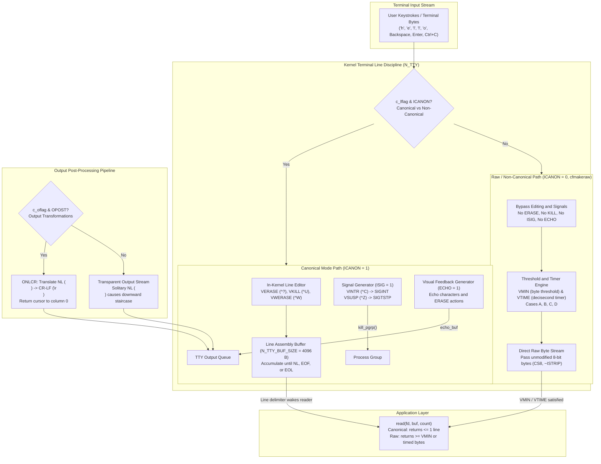

# Canonical and Raw Mode

> [!summary] Claim
> Canonical mode buffers input lines and executes character editing inside the kernel terminal line discipline before waking user-space readers, whereas raw mode disables all kernel line assembly, signal generation, character transformations, and visual echo to expose an unbuffered, transparent byte stream governed exclusively by `VMIN` and `VTIME`.

Part of [Terminals and Job Control](README.md) in [Shell and Unix Engineering](../README.md).

## TL;DR

In canonical mode (`ICANON`), the kernel terminal line discipline buffers input until a line delimiter (`\n`, `EOF`, or `EOL`) arrives while performing in-kernel line editing (`ERASE`, `KILL`, `WERASE`), whereas non-canonical and raw modes bypass line assembly to deliver bytes directly to `read()` calls based on `c_cc[VMIN]` and `c_cc[VTIME]` thresholds.
Always save the initial terminal configuration with `tcgetattr()` or `stty -g` before toggling non-canonical attributes or raw mode, and restore those exact settings across all exit handlers, signal traps, and child process executions.
Clearing `ICANON` without explicitly initializing `c_cc[VMIN]` and `c_cc[VTIME]` makes `VMIN` inherit `VEOF` (ASCII 4, `^D`) and `VTIME` inherit `VEOL` (ASCII 0) on systems where the subscripts are shared, such as illumos and Solaris (`VMIN` 4 = `VEOF`, `<sys/termios.h>`) and Linux SPARC user space (`#define VMIN VEOF`), causing single-character reads to hang until four bytes are typed; on Linux x86 and arm64, macOS, and FreeBSD the subscripts are distinct and a fresh pseudo-terminal starts with `VMIN` 1 and `VTIME` 0 (measured in the shell matrix).
Portable POSIX `sh`, `dash`, and `posh` provide no built-in single-character or non-canonical `read` options (dash 0.5.12 and posh 0.14.1 reject `read -n` outright, measured in the shell matrix), requiring scripts on minimal shells to invoke external `stty -icanon -echo min 1 time 0` and `dd bs=1 count=1` to read raw keystrokes.
Never leave a terminal in raw mode when launching child commands or external filters, and never use raw mode for basic line-oriented interactive scripts where canonical mode or GNU Readline handles cursor navigation, multibyte UTF-8 input, and signal handling without user-space state machinery.

## Mental model



Every keystroke typed into a terminal emulator or serial link enters the kernel terminal line discipline (`drivers/tty/n_tty.c`), which inspects the local flags `c_lflag` to branch between canonical line processing and non-canonical raw delivery before data reaches user space.
In canonical mode (`ICANON` set), the line discipline buffers incoming bytes in an internal circular buffer (`read_buf`), processes editing characters (`VERASE`, `VKILL`, `VWERASE`) entirely in kernel space, generates visual feedback when `ECHO` is active, converts `^C` or `^Z` into asynchronous signals when `ISIG` is active, and only unblocks sleeping `read()` requests when a complete line delimiter (`\n`, `VEOF`, or `VEOL`) is received, guaranteeing that at most one line is returned per system call.
In raw mode (`ICANON`, `ISIG`, `ECHO`, and `OPOST` cleared via `cfmakeraw()` or `stty raw`), the line discipline disables all line assembly, signal generation, editing transformations, and output carriage-return insertions, feeding arriving 8-bit bytes directly into the reading process according to the byte count `VMIN` and decisecond timeout `VTIME`.

## How it works

### The System Call Interface and the termios Structure

The Unix terminal interface controls terminal characteristics via the POSIX `termios` API (`POSIX.1-2024 XBD 11.2.1`).
Terminal parameters are inspected via `tcgetattr(int fd, struct termios *termios_p)` and modified via `tcsetattr(int fd, int optional_actions, const struct termios *termios_p)` (`POSIX.1-2024 XSH tcgetattr`, `tcsetattr`).
The `optional_actions` argument determines the exact timing of attribute application:
- `TCSANOW`: The configuration change occurs immediately.
- `TCSADRAIN`: The change occurs after all output written to `fd` has been transmitted to the hardware or terminal emulator.
- `TCSAFLUSH`: The change occurs after all output written to `fd` has been transmitted, and any unread input currently queued in the line discipline input buffer is discarded.

The `struct termios` structure contains five primary functional fields:
1. `tcflag_t c_iflag`: Input modes governing input character translation, parity stripping, break handling, and software flow control (`POSIX.1-2024 XBD 11.2.2`).
2. `tcflag_t c_oflag`: Output modes controlling post-processing of output characters, including newline expansion and carriage return delays (`POSIX.1-2024 XBD 11.2.3`).
3. `tcflag_t c_cflag`: Hardware control modes specifying character width, parity generation, stop bits, and modem control lines (`POSIX.1-2024 XBD 11.2.4`).
4. `tcflag_t c_lflag`: Local modes controlling terminal functions, including canonical mode (`ICANON`), signal generation (`ISIG`), and visual echo (`ECHO`) (`POSIX.1-2024 XBD 11.2.5`).
5. `cc_t c_cc[NCCS]`: An array of control characters and timing threshold parameters (`POSIX.1-2024 XBD 11.2.6`).

### Canonical Mode Input Processing

Canonical mode input processing is enabled when the `ICANON` bit is set in `c_lflag` (`POSIX.1-2024 XBD 11.1.6`).
In canonical mode, terminal input is processed strictly in units of lines.
A line is defined as a sequence of bytes delimited by a newline character (NL, `\n`), an end-of-file character (EOF, `VEOF`, default `^D` or ASCII 0x04), or an end-of-line character (EOL, `VEOL`, default `\0` on Linux and `0xff`, the disabled value, on macOS, measured in the shell matrix; POSIX leaves all initial values implementation-defined in XBD 11.2.6).
When an application calls `read(fd, buf, count)` on a canonical terminal file descriptor, the thread sleeps on the line discipline's wait queue (`tty->read_wait` in Linux `drivers/tty/n_tty.c`) until a line delimiter is committed.

Canonical mode enforces strict reading constraints:
No matter how many bytes are requested in the `read()` system call, at most one line is returned per call (`POSIX.1-2024 XBD 11.1.6`).
If an application requests 1024 bytes and the terminal input buffer contains multiple complete lines (for example, `alpha\nbeta\n`), the first `read()` call returns only `alpha\n` (6 bytes).
The second line remains queued in the kernel read buffer and is returned only upon subsequent `read()` calls.
Conversely, an application is not required to read an entire line in a single call; requesting fewer bytes than a line contains returns a partial line without losing data, and the remainder is retrieved by subsequent reads.

In-kernel line editing operates continuously on the current uncommitted line (`drivers/tty/n_tty.c`, `n_tty_receive_char_canon()` and `eraser()`):
- `VERASE` (default `^?` / ASCII 127 on a fresh Linux or macOS pseudo-terminal, measured in the shell matrix; some terminals and `stty erase ^H` setups use `^H` / ASCII 8): Deletes the preceding character in the current line buffer.
- `VKILL` (default `^U` / ASCII 0x15): Discards the entire uncommitted line buffer back to the last line boundary (`canon_head`).
- `VWERASE` (default `^W` / ASCII 0x17, active when `IEXTEN` is set): Deletes the preceding whitespace-delimited word.
- `VREPRINT` (default `^R` / ASCII 0x12, active when `IEXTEN` is set): Reprints the uncommitted line buffer after emitting a newline.
- `VLNEXT` (default `^V` / ASCII 0x16, active when `IEXTEN` is set): Escapes the literal value of the next input character, preventing control character interpretation.

The EOF character (`VEOF`) exhibits dual behavior depending on buffer state:
When typed on a line that contains uncommitted text, `VEOF` commits the line buffer and wakes sleeping readers without appending a newline character, making the partial text immediately available.
When typed on an empty line (where the current line contains zero bytes), `read()` returns a count of zero bytes, which user-space runtimes interpret as standard end-of-file (`POSIX.1-2024 XBD 11.1.9`).

### Non-Canonical Mode and the VMIN/VTIME Engine

Non-canonical mode is activated when the `ICANON` bit in `c_lflag` is cleared (`POSIX.1-2024 XBD 11.1.7`).
In non-canonical mode, input characters are not assembled into lines, and in-kernel erase and kill editing does not occur.
Input bytes are delivered directly from the input queue to user-space buffers according to the parameters `c_cc[VMIN]` and `c_cc[VTIME]`.
`VMIN` represents the minimum number of bytes required to satisfy a `read()` call.
`VTIME` represents a timer measured in units of tenths of a second (deciseconds, 100 ms intervals).

POSIX specifies four distinct operating cases governing `VMIN` and `VTIME` (`POSIX.1-2024 XBD 11.1.7`):
- **Case A: `VMIN > 0, VTIME > 0` (Inter-byte timeout)**:
  `VTIME` serves as an inter-byte timer that begins only after the first byte is received.
  The timer resets upon the arrival of each subsequent byte.
  A `read()` request is satisfied if `VMIN` bytes arrive before the timer expires, or if the inter-byte timer expires between characters.
  If the timer expires, `read()` returns all bytes accumulated up to that point (at least one byte).
  The calling process blocks indefinitely until the very first byte arrives.
- **Case B: `VMIN > 0, VTIME = 0` (Block for count)**:
  `VTIME` is inactive.
  The `read()` system call blocks indefinitely until at least `VMIN` bytes are available or until a signal interrupts the call.
  Once `VMIN` bytes arrive, `read()` completes and returns the available data.
- **Case C: `VMIN = 0, VTIME > 0` (Read timeout)**:
  `VTIME` serves as a read timer that begins immediately when `read()` is invoked.
  If at least one byte arrives before the timer expires, `read()` returns immediately with the available bytes.
  If no bytes arrive within `VTIME * 0.1` seconds, `read()` returns 0 bytes, signaling a read timeout without blocking indefinitely.
- **Case D: `VMIN = 0, VTIME = 0` (Pure polling / non-blocking)**:
  `read()` returns immediately without blocking.
  If data is currently available in the input queue, `read()` returns up to the requested buffer size.
  If no characters are available in the input queue, `read()` returns 0 bytes immediately.

If the file descriptor was opened with `O_NONBLOCK` via `open()` or `fcntl()`, non-blocking I/O semantics take effect.
POSIX does not specify whether `O_NONBLOCK` takes precedence over `VMIN` and `VTIME`, and with no data available `read()` may return either 0 or -1 with `EAGAIN` (`POSIX.1-2024 XBD 11.1.7`); on Linux, `n_tty_wait_for_input()` (called from `n_tty_read()`) returns `-EAGAIN` when `tty_io_nonblock()` is true and no input is ready, superseding blocking `VMIN` configurations (`drivers/tty/n_tty.c`); FreeBSD's `ttydisc_read_raw_no_timer()` and its timer variants return `EWOULDBLOCK` (the same value as `EAGAIN`) when `IO_NDELAY` is set and too few bytes are queued, so a non-blocking read fails with -1 there too (`sys/kern/tty_ttydisc.c`, read from source and not run).

### The Spectrum: Cooked vs Cbreak vs Raw Mode

Historically, Unix terminals operated along a three-tier spectrum:
1. **Cooked mode (Canonical)**:
   Canonical processing (`ICANON`), signal generation (`ISIG`), visual echo (`ECHO`), input carriage return mapping (`ICRNL`), and output newline expansion (`OPOST | ONLCR`) are all enabled.
   Line editing is handled entirely by the kernel line discipline.
2. **Cbreak mode (Rare / Half-cooked)**:
   Line buffering and character editing are disabled (`~ICANON`), and visual echo is disabled (`~ECHO`).
   Signal characters (`ISIG`, controlling `^C`, `^\`, `^Z`) and software flow control (`IXON`, controlling `^S`, `^Q`) remain active.
   `VMIN` is set to 1 and `VTIME` is set to 0.
   Applications receive keystrokes immediately one by one, while users retain the ability to interrupt (`Ctrl+C`) or suspend (`Ctrl+Z`) the process via kernel signals.
   Interactive programs like `less` (its `screen.c` clears `ICANON` and the `ECHO` flags but leaves `ISIG`) and GNU Readline (`rltty.c` clears `ICANON`, `ECHO`, `ICRNL`, and `INLCR`, sets `ISIG`, and keeps `IXON` unless `_rl_use_tty_xon_xoff` is 0) operate in cbreak mode, whereas Vim's `mch_settmode()` in `src/os_unix.c` also clears `ISIG` and `IEXTEN` (and `IXON` when the terminal has no XON code), so Vim runs closer to raw mode and handles `Ctrl+C` itself.
3. **Raw mode (Full transparent byte stream)**:
   All line buffering, signal generation, character transformations, parity checking, flow control, and output post-processing are completely disabled.
   Every byte typed on the keyboard or transmitted over serial is passed directly to `read()` unmodified, and every byte written via `write()` is passed to the display hardware without translation.

The non-POSIX BSD and glibc function `cfmakeraw(struct termios *t)` configures raw mode; the glibc version (`termios/cfmakeraw.c`; termios(3) lists the first five statements and omits the `c_cc` assignments) executes the following transformations (FreeBSD's `lib/libc/gen/termios.c` additionally clears `IMAXBEL`, `IXOFF`, `INPCK`, `IGNPAR`, `ECHOE`, `ECHOK`, `NOFLSH`, `TOSTOP`, and `PENDIN`, and sets `IGNBRK` and `CREAD`):
```c
t->c_iflag &= ~(IGNBRK | BRKINT | PARMRK | ISTRIP | INLCR | IGNCR | ICRNL | IXON);
t->c_oflag &= ~OPOST;
t->c_lflag &= ~(ECHO | ECHONL | ICANON | ISIG | IEXTEN);
t->c_cflag &= ~(CSIZE | PARENB);
t->c_cflag |= CS8;
t->c_cc[VMIN] = 1;
t->c_cc[VTIME] = 0;
```

The POSIX `stty` utility provides equivalent combination modes (`POSIX.1-2024 XCU 4, stty`):
- `stty raw` (an XSI combination mode) disables input and output processing and is specified as equivalent to:
  `stty cs8 erase ^- kill ^- intr ^- quit ^- eof ^- eol ^- -post -inpck`
- `stty cooked` or `stty -raw` disables raw mode, but the flags it restores are implementation-specific:
  macOS `stty -raw` restored `icanon`, `isig`, `echo`, `opost`, `onlcr`, and `icrnl` after `stty -echo -onlcr raw`, whereas GNU coreutils 9.7 and BusyBox 1.37 `stty -raw` set `brkint ignpar istrip icrnl ixon opost isig icanon` and left `echo` and `onlcr` off (measured in the shell matrix; GNU `src/stty.c`).
- `stty sane` resets all modes to "some reasonable, unspecified, values" (POSIX wording).

### Output Processing and the Staircase Defect

Output processing is controlled by `c_oflag` (`POSIX.1-2024 XBD 11.2.3`).
When `OPOST` is active, the kernel line discipline post-processes every byte sent via `write()`:
- `ONLCR`: Translates an outgoing newline character (NL, `\n`, ASCII 0x0A) into a carriage-return and newline pair (CR-LF, `\r\n`, ASCII 0x0D 0x0A).
The ASCII Line Feed (`\n`) command instructs a mechanical teletype or display grid to move the active print head or cursor down by one row without altering the horizontal column position.
The Carriage Return (`\r`) command moves the cursor back to the leftmost margin (column 0).
In canonical mode, `ONLCR` automatically prepends `\r` to every `\n`, allowing programs to print simple newlines (`printf("hello\n")`) and start subsequent lines at column 0.

When an application switches to raw mode, `OPOST` is cleared.
With `OPOST` cleared, the kernel transmits solitary `\n` bytes directly to the terminal emulator.
The terminal moves the cursor down one row while retaining the horizontal column position of the previous line.
Subsequent output begins at that column offset, creating a diagonal staircase pattern across the screen.
In raw mode, applications must either write explicit `\r\n` sequences (`printf("hello\r\n")`) or selectively leave `OPOST | ONLCR` enabled.

## Numbers and limits

The following limits, buffer dimensions, and default control characters govern canonical and raw mode across major Unix operating systems.

| Constant / Limit | POSIX Standard | Linux 7.2, glibc and musl (as of 2026-11) | macOS (Darwin 27) / FreeBSD 14.x (as of 2026-11) | Source / Lab Proof |
| :--- | :--- | :--- | :--- | :--- |
| `{MAX_CANON}` | `>= 255` bytes (`_POSIX_MAX_CANON` is 255) | `fpathconf` reports 255; the N_TTY line buffer itself is 4096 bytes (`N_TTY_BUF_SIZE`) | 1024 bytes on macOS (measured) / 255 on FreeBSD (`sys/syslimits.h`) | `fpathconf(fd, _PC_MAX_CANON)`, asserted by the [lab](../labs/02-canonical-and-raw-mode/) `defaults` test on Darwin, Debian, and Alpine / `drivers/tty/n_tty.c` |
| `{MAX_INPUT}` | `>= 255` bytes (`_POSIX_MAX_INPUT` is 255) | `fpathconf` reports 255; the real queue is the 4096-byte `read_buf` | 1024 bytes on macOS (measured) / 255 on FreeBSD (`sys/syslimits.h`) | `fpathconf(fd, _PC_MAX_INPUT)`, asserted by the [lab](../labs/02-canonical-and-raw-mode/) `defaults` test |
| `NCCS` | Implementation-defined | 32 entries (glibc and musl, measured) / 19 entries (kernel `asm-generic` uapi) | 20 entries (macOS measured, FreeBSD `sys/_termios.h`) | `<termios.h>`, asserted by the [lab](../labs/02-canonical-and-raw-mode/) `defaults` test on Darwin and Linux; FreeBSD `sys/_termios.h` |
| `VMIN` max value | Not fixed: `cc_t` is only "an unsigned integer type", and `MIN > {MAX_INPUT}` is undefined | 255 (`cc_t` is 1 byte, measured) | 255 (`cc_t` is 1 byte, measured) | `POSIX.1-2024 XBD <termios.h>`, `XBD 11.1.7` |
| `VTIME` resolution | 0.1 seconds (decisecond) | 0.1 seconds (100 ms) | 0.1 seconds (100 ms) | `POSIX.1-2024 XBD 11.1.7` |
| `VTIME` max timeout | Not fixed (depends on the width of `cc_t`) | 25.5 seconds (255 deciseconds) | 25.5 seconds (255 deciseconds) | `POSIX.1-2024 XBD 11.1.7` plus the 1-byte `cc_t` measured |
| `VEOF` default index | Implementation-defined subscript | Index 4 | Index 0 | `<termios.h>`, asserted by the [lab](../labs/02-canonical-and-raw-mode/) `defaults` test on Darwin and Linux |
| `VMIN` default index | May equal `VEOF` (`XBD 11.2.6`) | Index 6 (Linux SPARC user space: `VMIN` is `VEOF`, index 4) | Index 16 | `<termios.h>`, `arch/sparc/include/uapi/asm/termbits.h`, asserted by the [lab](../labs/02-canonical-and-raw-mode/) `defaults` test on Darwin and Linux |
| `VTIME` default index | May equal `VEOL` (`XBD 11.2.6`) | Index 5 (Linux SPARC user space: `VTIME` is `VEOL`, index 5) | Index 17 | `<termios.h>`, `arch/sparc/include/uapi/asm/termbits.h`, asserted by the [lab](../labs/02-canonical-and-raw-mode/) `defaults` test on Darwin and Linux |
| `VEOL` default index | Implementation-defined subscript | Index 11 | Index 1 | `<termios.h>`, asserted by the [lab](../labs/02-canonical-and-raw-mode/) `defaults` test on Darwin and Linux |
| `VEOF` default value | Implementation-defined (`XBD 11.2.6`) | 0x04 (`^D`) | 0x04 (`^D`) | Asserted by the [lab](../labs/02-canonical-and-raw-mode/) `defaults` test on Darwin and Linux; FreeBSD `CEOF` in `sys/ttydefaults.h` |
| `VERASE` default value | Implementation-defined | 0x7F (DEL) | 0x7F (DEL) | Asserted by the [lab](../labs/02-canonical-and-raw-mode/) `defaults` test on Darwin and Linux; FreeBSD `CERASE` in `sys/ttydefaults.h` |
| `VKILL` default value | Implementation-defined | 0x15 (`^U`) | 0x15 (`^U`) | Asserted by the [lab](../labs/02-canonical-and-raw-mode/) `defaults` test on Darwin and Linux; FreeBSD `CKILL` in `sys/ttydefaults.h` |
| `VINTR` default value | Implementation-defined | 0x03 (`^C`) | 0x03 (`^C`) | Asserted by the [lab](../labs/02-canonical-and-raw-mode/) `defaults` test on Darwin and Linux; the lab relies on it for `SIGINT`; FreeBSD `CINTR` in `sys/ttydefaults.h` |
| `VQUIT` default value | Implementation-defined | 0x1C (`^\`) | 0x1C (`^\`) | Asserted by the [lab](../labs/02-canonical-and-raw-mode/) `defaults` test on Darwin and Linux; FreeBSD `CQUIT` in `sys/ttydefaults.h` |
| `VSUSP` default value | Implementation-defined | 0x1A (`^Z`) | 0x1A (`^Z`) | Asserted by the [lab](../labs/02-canonical-and-raw-mode/) `defaults` test on Darwin and Linux; FreeBSD `CSUSP` in `sys/ttydefaults.h` |
| `_POSIX_VDISABLE` | Character disable value | 0x00 (`\0`) | 0xFF (255) on macOS (measured) and FreeBSD (`sys/_termios.h`) | `fpathconf(fd, _PC_VDISABLE)`, asserted by the [lab](../labs/02-canonical-and-raw-mode/) `defaults` test |

## Portability

Terminal handling varies across shells and C libraries, particularly in how single-character reads and raw mode toggles are supported.

| Implementation | Built-in Single-Char Read | Silent Read Flag | `stty -g` Format | `stty raw` Support | `cfmakeraw()` in Libc | Notes |
| :--- | :--- | :--- | :--- | :--- | :--- | :--- |
| POSIX sh | None (`read [-r] [-d delim]` only; `-d` is new in POSIX.1-2024) | None | Unspecified form, reusable as one `stty` operand | XSI combination mode (`raw`, `-raw`, `cooked`) | Not standardized | Standard scripts must invoke external `stty` and `dd`. |
| macOS bash 3.2 | `read -n N` | `read -s` | Platform `stty` (`gfmt1:` key=hex list on macOS) | Supported | Yes (`<termios.h>`) | `read -n 1` terminates on newline or 1 character; `read -N` is an invalid option (measured). |
| Current bash (5.3) | `read -n N` / `read -N N` | `read -s` | Platform `stty` | Supported | Yes (`<termios.h>`) | `read -N 1` reads exactly one character and ignores the delimiter (measured in bash 5.2). |
| zsh (native) | `read -k N` | `read -s` | Platform `stty` | Supported | Yes (`<termios.h>`) | `read -k` reads from the terminal unless `-u` or `-p` is given (measured: "can't open terminal" without a tty, works with `-u 0`); `read -n` is not a character count. |
| zsh (`--emulate sh`) | `read -k N` | `read -s` | Platform `stty` | Supported | Yes (`<termios.h>`) | Retains zsh `read` options under sh emulation (measured). |
| dash (0.5.12) | None (`read: Illegal option -n`, status 2) | None | Platform `stty` | Supported | Yes (`<termios.h>`) | Rejects `-n`, `-N`, `-s`, and `-d` with `Illegal option` and status 2 (measured). |
| ksh93 (93u+m) | `read -n N` / `read -N N` | None (`read -s` saves the line to the history file) | Platform `stty` | Supported | Yes (`<termios.h>`) | Also `-d delim`; macOS ksh93u+ 2012 accepts the same `-n`, `-N`, `-d` (measured; `read --man`). |
| mksh (R59) | `read -n N` / `read -N N` (bytes) | None (`read -s` saves the line to the history, mksh(1)) | Platform `stty` | Supported | Yes (`<termios.h>`) | Also `-d delim`; `-k` is an unknown option (measured). |
| yash (2.58) | None | None | Platform `stty` | Supported | Yes (`<termios.h>`) | Rejects `-n`, `-N`, `-k`, `-s`, and even the POSIX.1-2024 `-d` with status 2 (measured on 2.58.1). |
| posh (0.14.1) | None (`read: invalid option -- 'n'`, status 1) | None | Platform `stty` | Supported | Yes (`<termios.h>`) | Like dash, rejects `-n`, `-N`, `-s`, and `-d` (status 1, measured). |
| BusyBox ash (1.37) | `read -n N` (no `-N`) | `read -s` | Platform `stty` | Supported | Yes (musl/glibc) | `-n` clears `ICANON` with `VMIN` 1; `-s` clears only `ECHO`, `ECHOK`, `ECHONL` (`shell/shell_common.c`); `-d` works, `-N` is an illegal option (measured). |
| GNU coreutils stty | N/A | N/A | Colon-separated hex (measured, coreutils 9.7) | `stty raw` / `cooked` | Yes (glibc) | `stty raw` sets `c_iflag` to 0 and clears `ISIG`/`ICANON`/`OPOST` but not `ECHO`; `-raw` leaves `echo` and `onlcr` untouched (`src/stty.c`, measured). |
| BSD / macOS stty | N/A | N/A | `gfmt1:` followed by `key=hex` pairs (measured) | `stty raw` / `-raw` | Yes (BSD libc) | Documents `stty -g` output as reusable to restore the terminal state (stty(1)); `-raw` restored `echo` and `onlcr` (measured). |
| BusyBox stty | N/A | N/A | Colon-separated hex (measured, identical to GNU) | `stty raw` / `cooked` | Yes (musl/glibc) | `-raw` matches GNU: `echo` and `onlcr` stay off (measured on 1.37). |
| uutils stty | N/A | N/A | Colon-separated hex (`print_in_save_format()` in `stty.rs`) | `stty raw` / `cooked` (`stty.rs`) | No (`stty.rs` never calls `cfmakeraw()`; it applies the `raw` and `cooked` flag lists itself through the `nix` crate's termios bindings over the platform libc) | Clean-room Rust coreutils implementation. |

## Worked example

The accompanying [lab](../labs/02-canonical-and-raw-mode/) tests canonical line buffering, single-line extraction limits, line editing, the four `VMIN`/`VTIME` cases (Case A separately, with its first-byte and per-byte timer), echo with and without raw mode, newline staircase behavior, signal transparency, and the default control characters and limits of a fresh pseudo-terminal.

Here is the core C probe implementation excerpt from `pty_raw_probe.c`:

```c
static void apply_raw(struct termios *tio) {
  tio->c_iflag &= ~(tcflag_t)(IGNBRK | BRKINT | PARMRK | ISTRIP | INLCR | IGNCR | ICRNL | IXON);
  tio->c_oflag &= ~(tcflag_t)OPOST;
  tio->c_lflag &= ~(tcflag_t)(ECHO | ECHONL | ICANON | ISIG | IEXTEN);
  tio->c_cflag &= ~(tcflag_t)(CSIZE | PARENB);
  tio->c_cflag |= (tcflag_t)CS8;
  tio->c_cc[VMIN] = 1;
  tio->c_cc[VTIME] = 0;
}
```

When executing the test suite across terminal modes, the probe verifies each kernel mechanism (output captured on the macOS host; Debian and Alpine print identical lines except the three `defaults` lines, which read as shown after the block, and the bats test asserts the whole `defaults` output for Darwin and for Linux):

```
$ labs/02-canonical-and-raw-mode/raw_probe.sh line-buffering
canon_pending=0 canon_delivered=6 data=hello

$ labs/02-canonical-and-raw-mode/raw_probe.sh max-one-line
read1_len=6 read1=alpha read2_len=5 read2=beta

$ labs/02-canonical-and-raw-mode/raw_probe.sh editing
erase_len=6 erase_str=fobar kill_len=6 kill_str=clean

$ labs/02-canonical-and-raw-mode/raw_probe.sh vmin-vtime
caseB_partial=0 caseB_full=3 caseC_timeout=0 caseC_waited=1 caseD_empty=0

$ labs/02-canonical-and-raw-mode/raw_probe.sh case-a
caseA_idle=eintr caseA_full=3 caseA_short=2 caseA_short_waited=1 caseA_reset=5

$ labs/02-canonical-and-raw-mode/raw_probe.sh staircase-echo
echo_on=1 echo_bytes=0 canon_crlf=1 raw_crlf=0 raw_ends_nl=1

$ labs/02-canonical-and-raw-mode/raw_probe.sh signals
canon_sig=2 raw_sig=0 raw_byte=0x03 read_ret=1

$ labs/02-canonical-and-raw-mode/raw_probe.sh defaults
NCCS=20 VEOF_idx=0 VEOL_idx=1 VMIN_idx=16 VTIME_idx=17 VEOF_val=0x04 VMIN_val=0x01
VTIME_val=0x00 VEOL_val=0xff VERASE_val=0x7f VKILL_val=0x15 VINTR_val=0x03 VQUIT_val=0x1c VSUSP_val=0x1a
MAX_CANON=1024 MAX_INPUT=1024 VDISABLE=0xff cc_t_bits=8
```

On Debian and Alpine (Linux 7.2, glibc and musl) the `defaults` output is:

```
NCCS=32 VEOF_idx=4 VEOL_idx=11 VMIN_idx=6 VTIME_idx=5 VEOF_val=0x04 VMIN_val=0x01
VTIME_val=0x00 VEOL_val=0x00 VERASE_val=0x7f VKILL_val=0x15 VINTR_val=0x03 VQUIT_val=0x1c VSUSP_val=0x1a
MAX_CANON=255 MAX_INPUT=255 VDISABLE=0x00 cc_t_bits=8
```

The output proves that:
1. Input in canonical mode remains pending (0 bytes delivered) until `\n` arrives.
2. Even when two full lines are available in the kernel buffer, `read()` returns at most one line per invocation.
3. In-kernel editing characters (`VERASE` and `VKILL`) remove characters before user-space reads them.
4. Non-canonical `VMIN=3` blocks until all 3 bytes arrive, while `VMIN=0, VTIME=2` returns 0 only after the timer runs (`caseC_waited=1` means the read took at least 150 ms; `caseD_empty=0` with `VTIME=0` returns at once).
5. In Case A (`VMIN=3, VTIME=2`) a read with no byte queued is still blocked when a 600 ms `SIGALRM` interrupts it (`caseA_idle=eintr`), so the timer starts only at the first byte; 3 queued bytes return 3; 2 queued bytes return 2 after the timer (`caseA_short_waited=1`); and with `VMIN=6, VTIME=5` five bytes written 200 ms apart (800 ms in all, longer than `VTIME`) all arrive in one read (`caseA_reset=5`), so every byte restarts the timer.
6. With `ICANON` and `ECHO` set, writing `abc\n` to the master echoes back `abc\r\n` (`echo_on=1`), whereas raw mode echoes nothing (`echo_bytes=0`), and raw mode transmits solitary `\n` bytes without prepending `\r`.
7. Raw mode delivers `^C` (0x03) as an ordinary byte rather than triggering `SIGINT`.
8. The default control characters, indexes, `NCCS`, `MAX_CANON`, `MAX_INPUT`, and `_POSIX_VDISABLE` of a fresh pseudo-terminal are exactly the values in the `defaults` output.

## Pitfalls

> [!warning] Terminal state leak on abnormal termination (The Uncooked Terminal Trap)
> Trigger: An interactive application puts the terminal into raw or non-canonical mode via `stty raw` or `cfmakeraw()` and terminates unexpectedly due to an unhandled signal (`SIGINT`, `SIGTERM`, `SIGSEGV`) or an unhandled exception before restoring the original `termios`.
> Symptom: The calling shell is left in raw mode; typed keystrokes do not visually echo, pressing Enter emits `^M` or moves down without returning to the left margin (the newline staircase defect), and pressing `Ctrl+C` prints `^C` without interrupting foreground commands.
> Fix: Always capture the original terminal configuration using `tcgetattr()` or `saved_stty=$(stty -g)` before making any modifications.
> Register cleanup handlers across `atexit()` and all catchable signals (`SIGINT`, `SIGTERM`, `SIGHUP`, `SIGQUIT`, `SIGTSTP`) in C, or configure shell traps that restore on exit and make each signal exit: `trap 'stty "$saved_stty"' EXIT; trap 'exit 130' INT; trap 'exit 143' TERM; trap 'exit 129' HUP`.
> A signal trap that only restores the terminal, such as `trap 'stty "$saved_stty"' INT`, lets the script resume after `Ctrl+C`.
> If caught in an uncooked terminal interactively, type `Ctrl+J stty sane Ctrl+J` blindly (using `Ctrl+J` / Line Feed because Carriage Return may be unmapped).

> [!warning] The VMIN/VEOF and VTIME/VEOL array collision trap
> Trigger: A developer disables canonical mode by clearing `ICANON` in `c_lflag` (`tio.c_lflag &= ~ICANON`) and calls `tcsetattr()`, but forgets to explicitly assign values to `c_cc[VMIN]` and `c_cc[VTIME]`.
> Symptom: On System V derived systems where `VMIN` shares an identical array index with `VEOF` and `VTIME` shares an index with `VEOL` (illumos and Solaris `<sys/termios.h>` define both pairs as 4 and 5, and Linux SPARC user space defines `VMIN` as `VEOF`), the non-canonical engine inherits `VMIN = VEOF` (ASCII 4, `^D`) and `VTIME = VEOL` (ASCII 0).
> On Linux x86 and arm64, macOS, and FreeBSD the subscripts are distinct and a fresh pseudo-terminal starts with `VMIN` 1 and `VTIME` 0 (measured in the shell matrix), so there the bug only bites when an earlier program left other values behind.
> Single-character reads (`read(fd, &ch, 1)`) block indefinitely until the user types at least four characters, completely breaking single-keystroke interactive input.
> Fix: Always explicitly assign `tio.c_cc[VMIN] = 1; tio.c_cc[VTIME] = 0;` immediately upon clearing `ICANON`.

> [!warning] The dash and posh option rejection trap with read -n
> Trigger: Running a shell script under `dash` or `posh` that attempts to read a single character using `read -n 1 char`.
> Symptom: Neither `dash` nor `posh` supports the non-standard `-n` option: dash 0.5.12 prints `read: Illegal option -n` and returns status 2, posh 0.14.1 prints `read: invalid option -- 'n'` and returns status 1, no input is consumed, and `$char` stays empty, so a script without `set -e` carries on with an empty answer (measured in the shell matrix; yash 2.58.1 rejects it the same way).
> Fix: Test shell capabilities before using extensions, or use the standard POSIX pattern for single-character reads:
> ```sh
> old_stty=$(stty -g)
> stty -icanon -echo min 1 time 0
> char=$(dd bs=1 count=1 2>/dev/null)
> stty "$old_stty"
> ```

> [!warning] The newline staircase defect from unhandled OPOST disabling
> Trigger: An application disables output post-processing (`OPOST` or `ONLCR`) via `stty raw` or `cfmakeraw()` and continues emitting standard Unix newline characters (`\n`).
> Symptom: Every printed line moves downward by one row while remaining at the final horizontal column of the previous line, producing a jagged diagonal staircase across the terminal emulator.
> Fix: When operating with `OPOST` disabled, write explicit carriage-return and newline pairs (`\r\n`) on every line break, or selectively disable only `ICANON` and `ECHO` while leaving `OPOST` and `ONLCR` enabled.

> [!warning] Linux kernel raw PTY buffer overflow race condition (CVE-2014-0196)
> Trigger: Concurrent processes writing to a raw pseudo-terminal when `LECHO` is enabled and `OPOST` is disabled in `drivers/tty/n_tty.c`.
> Symptom: In Linux kernels through 3.14.3 (NVD), `n_tty_write()` lacked locking when output post-processing was disabled, allowing a race condition between worker echo processing and direct process writes that overflowed the TTY flip buffer, causing kernel memory corruption and local privilege escalation.
> Fix: Linux kernel commit `4291086b1f081b869c6d79e5b7441633dc3ace00` ("n_tty: Fix n_tty_write crash when echoing in raw mode", 2014-05-03) introduced `mutex_lock(&ldata->output_lock)` in `n_tty_write()` to serialize raw PTY writes.

> [!warning] Terminal escape injection and TIOCSTI sandbox escape (CVE-2017-5226)
> Trigger: Running untrusted or unprivileged processes attached to a shared controlling terminal in raw or canonical mode where `TIOCSTI` (`ioctl(fd, TIOCSTI, &byte)`) is permitted.
> Symptom: An unprivileged process pushes fake keystrokes into the terminal line discipline input queue, executing arbitrary commands in the context of the parent shell as soon as the unprivileged child exits.
> Fix: Sandbox tools hit by this class, Bubblewrap (CVE-2017-5226) and `util-linux` `runuser` (CVE-2016-2779), are mitigated by isolating the child so it has no shared controlling terminal to inject into: Bubblewrap added an opt-in `--new-session` option that calls `setsid()` (commit `06a7f31fe4a0`, 2017-01-17, "Make the call to setsid() optional, with --new-session"), and `runuser -c` starts a new session via `setsid(2)` while `runuser --pty` allocates a pseudo-terminal (`login-utils/runuser.1.adoc`, SECURITY NOTES; util-linux briefly shipped a libseccomp filter for `TIOCSTI` in commit `8e4925016875` and reverted it in `23f75093264a`), or by Linux 6.2+ `CONFIG_LEGACY_TIOCSTI=n` or the `dev.tty.legacy_tiocsti = 0` sysctl, which makes `TIOCSTI` fail for callers without `CAP_SYS_ADMIN` (`drivers/tty/tty_io.c`, commit "tty: Allow TIOCSTI to be disabled").

## Security and robustness

Terminal mode configuration directly impacts application security and session integrity:
- **Credential security during password collection**:
  When reading passwords or encryption keys, applications must disable visual feedback (`ECHO`).
  However, disabling `ICANON` to read a password character-by-character introduces severe vulnerabilities: if the application fails to handle `VERASE` (Backspace, 0x7F) in user space, typing Backspace will embed raw `0x7F` bytes into the password buffer rather than deleting the preceding character, causing authentication failures.
  The secure POSIX pattern disables `ECHO` while keeping `ICANON` enabled (glibc `getpass()` clears only `ECHO` and `ISIG` in `misc/getpass.c`, and BusyBox `read -s` clears only the `ECHO` flags in `shell/shell_common.c`), allowing the kernel line discipline to process corrections securely without leaking credentials to the screen.
- **Signal handling and process interruption**:
  In raw mode, `ISIG` is cleared, meaning `Ctrl+C` (ASCII 0x03) and `Ctrl+Z` (ASCII 0x1A) do not generate `SIGINT` or `SIGTSTP`.
  If an interactive program enters an infinite computation loop while in raw mode, the user cannot terminate or suspend it from the keyboard.
  Robust raw-mode programs must either operate in cbreak mode (preserving `ISIG`) or explicitly inspect incoming bytes in their read loop, mapping byte `0x03` to an application exit or `raise(SIGINT)`.
- **Handling job suspension (`SIGTSTP` / `SIGCONT`)**:
  Full-screen terminal programs (such as text editors and pagers) that operate in raw mode must intercept `SIGTSTP`.
  Upon receiving `SIGTSTP`, the program must restore the original cooked terminal settings, move the cursor to the bottom margin, and raise `SIGSTOP` or reset the signal disposition to suspend itself.
  When resumed via `SIGCONT`, the program must reinstall its raw terminal configuration and redraw the screen.
  Failing to restore cooked mode before suspension corrupts the parent shell's interactive input.

## The principal's view

The choice between canonical mode and raw mode represents an architectural decision regarding where line editing, character transformations, and input buffering should reside: in the kernel line discipline or in user space.

Staff-plus engineers evaluate this trade-off using the following criteria:
1. **Delegation to the kernel (Canonical mode)**:
   Use canonical mode for CLI utilities, pipelines, batch tools, and straightforward prompts.
   The kernel handles circular buffering, backspace deletion, word erasure, line killing, and visual echo with zero user-space complexity.
   It guarantees robust signal delivery (`SIGINT`, `SIGQUIT`, `SIGTSTP`) and prevents terminal state corruption on sudden process termination.
2. **User-space control (Cbreak / Raw mode)**:
   Use raw or cbreak mode when the application must respond to individual keystrokes in real time: full-screen text editors (`vim`, `nano`), terminal multiplexers (`tmux`), pagers (`less`), and interactive command-line environments with syntax highlighting and autocompletion.
   Taking raw mode requires assuming the full responsibility of terminal state management: tracking cursor coordinates, handling multibyte UTF-8 boundaries, parsing multi-byte ANSI escape sequences, managing history buffers, and guaranteeing clean restoration across signals.
3. **Language and toolchain boundaries**:
   Never implement ad-hoc raw mode state machines in shell scripts.
   Shell scripts lack atomic signal handling and fine-grained byte parsing; an unhandled error easily leaves the user's terminal corrupted.
   If single-keystroke interaction or rich UI is required, use a compiled language (C, Go, Rust) with a dedicated TUI library (such as `ncurses`, `crossterm`, or `bubbletea`) or delegate command-line editing to an established library like GNU Readline.

## Interview questions

> [!question] L5: What is the fundamental difference between canonical mode and raw mode in Unix terminal I/O?
>
> > [!success]- Answer
> > In canonical mode (`ICANON` set in `c_lflag`), the kernel terminal line discipline buffers input characters into lines and performs character editing (`ERASE`, `KILL`, `WERASE`) internally, releasing data to user-space `read()` calls only when a line delimiter (`\n`, `EOF`, or `EOL`) arrives.
> > In raw mode, `ICANON`, `ISIG`, `ECHO`, and `OPOST` are all disabled (via `cfmakeraw()` or `stty raw`), causing incoming keystrokes to bypass line assembly, signal generation, and editing transformations to deliver unmodified 8-bit bytes directly to `read()` according to `VMIN` and `VTIME` parameters.
> >
> > Follow-up: Why does `read()` on a canonical terminal file descriptor return at most one line even if the user requests a much larger buffer?

> [!question] L5: Why does writing `printf("line1\nline2\n")` in raw mode produce a diagonal "staircase" effect on the terminal display?
>
> > [!success]- Answer
> > In canonical mode, output post-processing (`OPOST`) and newline translation (`ONLCR`) are enabled in `c_oflag`, automatically translating every outgoing newline character (`\n`, Line Feed) into a carriage-return and newline pair (`\r\n`).
> > In raw mode, `OPOST` is cleared, so the terminal emulator receives a solitary Line Feed byte (`0x0A`), which moves the active cursor down by one row without resetting the horizontal column position to the left margin.
> >
> > Follow-up: How can an application prevent the staircase defect while operating in raw mode without re-enabling full cooked mode?

> [!question] L6: Predict the output: What does `read()` return when a user types `abc`, then presses Backspace, then types `d` and presses Enter, in canonical mode versus raw mode?
>
> > [!success]- Answer
> > In canonical mode, the kernel line discipline intercepts the Backspace byte (`0x7F` or `0x08`) and erases the preceding `'c'` from the kernel buffer before Enter (`0x0A`) commits the line, so `read()` returns 4 bytes: `abd\n`.
> > In raw mode, erase processing is disabled, so if `read()` is called with a buffer of 16 bytes after the user finishes typing, it returns all 6 literal bytes: `abc\x7fd\r` (assuming Enter sends `\r` because `ICRNL` is disabled).
> >
> > Follow-up: What happens to the Backspace character if `ICANON` is enabled but `IEXTEN` is disabled?

> [!question] L6: Debug this script: Why does the following shell snippet corrupt the user's terminal session when interrupted with `Ctrl+C`?
> ```sh
> stty raw -echo
> char=$(dd bs=1 count=1 2>/dev/null)
> echo "Pressed: $char"
> stty sane
> ```
>
> > [!success]- Answer
> > The script toggles the terminal into raw mode without establishing signal traps or saving the original terminal state.
> > If the user presses `Ctrl+C` while `dd` is waiting for input, the shell terminates immediately without executing `stty sane`, leaving the parent terminal with echo disabled, line editing broken, and output newline translation disabled.
> > The robust fix saves the original state via `old_stty=$(stty -g)` and registers an exit trap via `trap 'stty "$old_stty"' EXIT`, plus `trap 'exit 130' INT`, `trap 'exit 143' TERM` and `trap 'exit 129' HUP` so an interrupted script still stops and runs the exit trap.
> >
> > Follow-up: Why is `stty "$old_stty"` superior to `stty sane` for restoring the terminal configuration?

> [!question] L6: How do `VMIN` and `VTIME` interact in non-canonical mode under Case A, Case B, Case C, and Case D?
>
> > [!success]- Answer
> > Under Case A (`VMIN > 0, VTIME > 0`), `VTIME` acts as an inter-byte timer that begins only after the first byte arrives; `read()` blocks indefinitely for the first byte and returns when `VMIN` bytes arrive or the inter-byte timer expires between characters.
> > Under Case B (`VMIN > 0, VTIME = 0`), the timer is disabled, and `read()` blocks indefinitely until at least `VMIN` bytes are available.
> > Under Case C (`VMIN = 0, VTIME > 0`), `VTIME` acts as a read timer that starts immediately when `read()` is called, returning available bytes or returning 0 bytes on timeout.
> > Under Case D (`VMIN = 0, VTIME = 0`), `read()` is completely non-blocking, returning available bytes or 0 bytes immediately.
> >
> > Follow-up: How does setting `O_NONBLOCK` on the terminal file descriptor affect Case B?

> [!question] L6: What is the System V `VMIN`/`VEOF` collision trap when switching from canonical to non-canonical mode?
>
> > [!success]- Answer
> > In traditional System V implementations (illumos and Solaris define `VMIN` as 4 like `VEOF`, and `VTIME` as 5 like `VEOL`) and in Linux SPARC user space, the `VMIN` subscript in the `c_cc` array shares the exact same numeric index as `VEOF`, and `VTIME` shares the same index as `VEOL`; mainstream Linux, macOS, and FreeBSD use distinct subscripts (Linux 4 and 6, macOS 0 and 16, measured in the shell matrix).
> > In canonical mode, `c_cc[VEOF]` is initialized to ASCII 4 (`^D`), so clearing `ICANON` without explicitly setting `c_cc[VMIN]` causes `VMIN` to inherit the value 4.
> > A subsequent `read()` intended to fetch a single keystroke hangs indefinitely waiting for four bytes to be typed.
> >
> > Follow-up: Why does POSIX explicitly state that `VMIN` and `VTIME` may have the same index values as `VEOF` and `VEOL`?

> [!question] L7+: How does a full-screen terminal program like `vim` or `tmux` handle terminal state across job suspension (`Ctrl+Z`) and resumption (`fg`)?
>
> > [!success]- Answer
> > The application intercepts `SIGTSTP` with a dedicated signal handler rather than allowing default suspension while in raw mode.
> > Upon receiving `SIGTSTP`, the handler restores the saved canonical/cooked terminal state via `tcsetattr(STDIN_FILENO, TCSADRAIN, &saved_tio)`, exits the alternate screen buffer (`rmcup`), moves the cursor to the bottom margin, and unblocks/raises `SIGTSTP` with default disposition to allow the shell to suspend the process.
> > When the shell resumes the program with `SIGCONT`, the application's `SIGCONT` handler re-enters raw mode via `tcsetattr()`, re-enables the alternate screen buffer (`smcup`), and triggers a full screen refresh.
> >
> > Follow-up: What race condition occurs if `tcsetattr()` uses `TCSANOW` instead of `TCSADRAIN` before suspending?

> [!question] L7+: Why does GNU Readline configure the terminal in cbreak mode rather than full `cfmakeraw()` mode during interactive shell input?
>
> > [!success]- Answer
> > GNU Readline needs immediate access to single keystrokes and escape sequences to handle cursor movements, command history, and inline autocompletion in user space, which requires disabling canonical mode (`~ICANON`) and echo (`~ECHO`).
> > However, full raw mode would disable `ISIG`, preventing the kernel line discipline from converting `Ctrl+C` into `SIGINT` and `Ctrl+Z` into `SIGTSTP`, which would require Readline to reimplement process group signal dispatching manually.
> > Furthermore, full raw mode disables `OPOST` and `ONLCR`, breaking normal shell output formatting, and disables `IXON`, breaking terminal flow control.
> > Cbreak mode provides character-at-a-time input while preserving kernel signal generation and output translation.
> >
> > Follow-up: How does Readline handle terminal resizing (`SIGWINCH`) while blocked in a non-canonical `read()` call?

## Related

Prerequisites: [[TTY-Line-Discipline]]

Next: [[termios-and-stty]]

See also: [[TTYs-PTYs-and-Line-Discipline]]

## Further reading

- [POSIX.1-2024 General Terminal Interface (XBD Chapter 11)](https://pubs.opengroup.org/onlinepubs/9799919799/basedefs/V1_chap11.html): The authoritative specification defining canonical mode, non-canonical mode, the `termios` structure, and `VMIN`/`VTIME` semantics.
- [POSIX.1-2024 stty utility specification (XCU Chapter 4)](https://pubs.opengroup.org/onlinepubs/9799919799/utilities/stty.html): Standard specification for terminal configuration commands, including `stty raw`, `cooked`, `sane`, and `stty -g`.
- [Linux Kernel N_TTY implementation (`drivers/tty/n_tty.c`)](https://git.kernel.org/pub/scm/linux/kernel/git/torvalds/linux.git/tree/drivers/tty/n_tty.c): Production kernel implementation of canonical line buffering, erase/kill editing, echo buffers, and the non-canonical read wait queue.
- [Linux termios(3) manual page](https://man7.org/linux/man-pages/man3/termios.3.html): Detailed API documentation covering `tcgetattr`, `tcsetattr`, `cfmakeraw`, and `c_cc` control character indices.
- [Linux Kernel commit 4291086b1f081b869c6d79e5b7441633dc3ace00 (CVE-2014-0196)](https://git.kernel.org/pub/scm/linux/kernel/git/torvalds/linux.git/commit/?id=4291086b1f081b869c6d79e5b7441633dc3ace00): Upstream kernel vulnerability fix resolving the race condition in `n_tty_write()` under raw mode echoing.
- [FreeBSD libc termios implementation (`lib/libc/gen/termios.c`)](https://raw.githubusercontent.com/freebsd/freebsd-src/main/lib/libc/gen/termios.c): BSD source implementation of `cfmakeraw()` and `cfmakesane()`.
