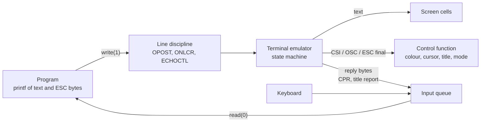

# Escape Sequences: ECMA-48 and xterm

> [!summary] Claim
> A terminal is a byte-stream parser, so every colour, cursor move, title change, and "where is the cursor" question is just bytes that start with ESC (0x1B), are split by a fixed grammar from ECMA-48, and are extended by xterm - which means the same grammar also carries replies back into your program's input.

Part of [Terminals and Job Control](README.md) in [Shell and Unix Engineering](../README.md).

## TL;DR

- Mechanism: the program writes ordinary bytes; the terminal emulator parses them as text plus control functions of the form `ESC [ params intermediates final` (CSI) or `ESC ] string (BEL or ESC \)` (OSC), per ECMA-48 clause 5.4, and xterm adds the private modes and strings.
- Rule: spell ESC with `printf '\033'` (octal is the only form POSIX `printf` requires), emit sequences from `tput` or a terminfo-aware library when you can, and wrap non-printing bytes in a prompt with the readline markers.
- Trap: the terminal also answers - `ESC [ 6 n` makes it write `ESC [ row ; col R` into your stdin, indistinguishable from typing, and a window-title report can carry attacker-chosen text (CVE-2003-0063).
- Portability fact: `\e`, `\x1b`, `$'...'`, and `echo -e` are all shell specific, and even one shell name is not one behavior: `printf '\e'` writes the two characters backslash and `e` in upstream dash 0.5.12 and in macOS's dash, but ESC in Debian's patched dash 0.5.12 and in dash 0.5.13 and later, while the octal form works everywhere.
- When not to use it: for anything beyond a few colours and a status line, use a library or `tput` instead of hand-written sequences, and never write untrusted bytes to a terminal without stripping control characters.

## Mental model



The program writes text and ESC-introduced control functions in one stream through `write(2)`, and the line discipline post-processes it (for example turning LF into CR LF) before the emulator's state machine sees it.
The state machine routes printable bytes to the screen and routes each complete control function to its action: a colour, a cursor move, a mode switch, or a title change.
A few control functions are queries, and their answers are written onto the same input queue the keyboard feeds, so the program reads them with `read(2)` exactly as it reads typed characters.
That return path is what makes escape sequences a protocol rather than a one-way paint command, and it is also where most of the security trouble starts.

## How it works

### The grammar (ECMA-48, clause 5)

ECMA-48 (5th edition, June 1991, the standard behind ISO 6429) divides the byte space into C0 controls (0x00 to 0x1F), graphic characters, and C1 controls.
In a 7-bit code a C1 control is the two-byte form `ESC Fe` with Fe in 0x40 to 0x5F; in an 8-bit code it is a single byte in 0x80 to 0x9F (ECMA-48 5.3).
A control sequence is `CSI P...P I...I F` (ECMA-48 5.4):

- CSI is `ESC [` in 7-bit form or the single byte 0x9B in 8-bit form.
- Parameter bytes P are 0x30 to 0x3F: digits, `:`, `;`, and the private markers `<`, `=`, `>`, `?`.
- Intermediate bytes I are 0x20 to 0x2F.
- The final byte F is 0x40 to 0x7E, and 0x70 to 0x7E are reserved for private use.

Parameters are decimal numbers separated by `;`, and an empty parameter means "the default for this function" (ECMA-48 5.4.2).
So `ESC [ H` is CUP with both defaults (row 1, column 1), `ESC [ ; 5 H` is row default, column 5, and a string whose first parameter byte is `?` is private, which is how DEC and xterm modes such as `ESC [ ? 1049 h` are spelled (ECMA-48 5.4.1).

Three controls matter for robustness:

- CAN (0x18) means "the data preceding is in error, ignore it" (ECMA-48 8.3.6) and SUB (0x1A) replaces an invalid character (8.3.148); emulators use both to abandon a sequence in progress.
- A C0 control inside a sequence is executed immediately and the sequence continues; the Linux console documents this as "acted upon immediately and then discarded (even in the middle of an escape sequence)" (console_codes(4)).
- A new ESC inside a sequence abandons the old one, which is why `ESC [ 3 ESC [ 0 m 1 m` is SGR 0 followed by the text `1m` and not SGR 31.

OSC is `ESC ]` (8.3.89), its string runs until ST (`ESC \`, 8.3.143), and "the interpretation of the command string depends on the relevant operating system".
xterm accepts either BEL or ST to end an OSC and replies with whichever terminator the query used; the BEL form dates from X11R4 (December 1989) and ST has been accepted since XFree86-3.1.2Ee (August 1996) (xterm ctlseqs, Operating System Commands).

### What xterm adds

xterm's `ctlseqs` document (revision 1.748, 2026/08/23, as of 2026-11) is the de facto reference every other emulator measures itself against.
The pieces a shell programmer meets most:

- SGR (`CSI Ps m`, ECMA-48 8.3.117): 0 resets, 1 bold, 31 red; ECMA-48 itself marks 38 and 48 "reserved for future standardization", intended for the colour model of ISO 8613-6 (CCITT T.416), and the `38;5;n` and `38;2;r;g;b` forms are the xterm-era extensions built on that slot.
- DECSET and DECRST (`CSI ? Pm h` and `l`): 25 shows or hides the cursor, 1049 saves the cursor and switches to the alternate screen buffer, 2004 turns on bracketed paste, after which pasted text arrives as `ESC [ 200 ~ ... ESC [ 201 ~` (ctlseqs, DECSET and Bracketed Paste Mode).
- OSC 0, 1, 2 set the icon name and window title; OSC 52 manipulates the selection (clipboard) and, like the window operations that include the title report, "may be disabled using the allowWindowOps resource" (ctlseqs, Operating System Commands and Window manipulation).
- DSR (`CSI 6 n`, ECMA-48 8.3.35) asks for a CPR (8.3.14), and xterm answers `CSI row ; col R`; ctlseqs warns that "it is possible for this sequence to be sent by a function key", because shifted F3 can send `CSI 1 ; 2 R`.
- Window operations (`CSI Ps t`, XTWINOPS) include 21, "Report xterm window's title", whose result is `OSC l label ST`.

### From `printf` to the screen, down to the system call

`printf '\033[31mred\033[0m\n'` is one `write(2)` of 13 bytes on file descriptor 1, which is the slave side of a pseudo-terminal (see [[Pseudo-Terminals]]).
In the kernel the tty layer applies output processing (`OPOST`, `ONLCR`), then the master side of the pseudo-terminal delivers the bytes to the emulator process, which runs the parser; nothing in the kernel interprets ESC on the way out.
The Linux virtual console is the one place the kernel parses these bytes itself: `do_con_trol()` in `drivers/tty/vt/vt.c` runs a state machine whose `handle_ascii()` sends CAN and SUB back to `ESnormal`, makes BEL end an ANSI control string, and treats ESC as a new start, and `include/linux/console_struct.h` sets `#define NPAR 16`, the cap on CSI parameters (Linux master as fetched 2026-11-03, `console_codes(4)` agrees: "at most NPAR (16)" parameters).

On the way in, the reply is written to the master, the line discipline treats it like keyboard input, and with `ICANON` and `ECHO` set it is both queued for `read(2)` and echoed.
`ECHOCTL` ("not in POSIX", termios(3)) makes the echo of control characters appear as `^X`; termios(3) words it as "terminal special characters other than TAB, NL, START, and STOP", and the lab shows that an unread ESC is echoed as `^[` on a real pseudo-terminal.
That is the origin of stray `^[[7;42R` text after a program dies between asking for the cursor position and reading the answer; the lab reproduces it on a real pseudo-terminal.

### Emitting ESC from a shell

POSIX `printf` guarantees the escapes `\\`, `\a`, `\b`, `\f`, `\n`, `\r`, `\t`, `\v` and `\ddd` with one to three octal digits; `\e` is not listed (POSIX.1-2024 XCU printf, EXTENDED DESCRIPTION).
POSIX.1-2024 adds dollar-single-quotes, where `\e` yields ESC and `\xXX` more than two digits is unspecified (POSIX.1-2024 XCU 2.2.4), but not every shell has caught up, and `echo` with a first operand `-e` is implementation-defined (POSIX.1-2024 XCU echo, OPERANDS).
The lab measures the actual bytes each spelling produces; see Portability.
dash is the case that shows why a shell name is not enough: its `printf` escape table gained `\e` as a Debian patch (`0008-Support-e-in-echo-and-printf-builtins.diff`, dated 2014-06-28, present in Debian's dash 0.5.12-12) that upstream 0.5.12 never had, and upstream dash 0.5.13 (tag commit dated 2025-09-21) then shared one escape routine between `printf` and its new dollar-single-quote support, so `\e`, `\x`, and `$'...'` all work there (dash `src/bltin/printf.c` at v0.5.12 and v0.5.13).
yash goes the other way: its `printf` handles only `\\`, `\a`, `\b`, `\f`, `\n`, `\r`, `\t`, `\v`, the two quotes `\"` and `\'`, and octal, which is the POSIX set plus the quotes, so `\e` and `\x1b` stay literal there (yash `builtins/printf.c`, trunk as of 2026-11).

## Numbers and limits

| Quantity | Value | Source |
| --- | --- | --- |
| ESC | 0x1B (27) | ECMA-48 8.3.48 |
| CSI | `ESC [` (2 bytes, 7-bit) or 0x9B (1 byte, 8-bit) | ECMA-48 5.3, 5.4 |
| Parameter, intermediate, final byte ranges | 0x30-0x3F, 0x20-0x2F, 0x40-0x7E | ECMA-48 5.4 |
| CSI parameters kept by the Linux console | 16 (`NPAR`) | `include/linux/console_struct.h`, console_codes(4), Linux master as of 2026-11 |
| xterm string terminators for OSC | BEL (since X11R4, 1989) and ST (since XFree86-3.1.2Ee, 1996) | xterm ctlseqs, as of 2026-11 |
| Readline prompt markers | 0x01 starts and 0x02 ends an ignored run | `lib/readline/readline.h` in bash-5.3, `RL_PROMPT_START_IGNORE`, `RL_PROMPT_END_IGNORE` |
| Prompt `ESC[31muser@host ESC[0m$ ` | 20 bytes, 11 visible, 9 phantom | measured by the lab (`width`), 2026-11 |
| Title report for the title `id>pwned` | 13 bytes: `ESC ] l`, 8 title bytes, `ESC \` | measured by the lab (`title` client) |
| Echo of `a ESC [ A LF` with `ECHOCTL` on and off | `a^[[A` CR LF and `a` ESC `[A` CR LF | measured by the lab (`pty_probe echo-ctl`) |
| CVE-2003-0063 published | 2003-03-03, XFree86 4.2.0 and earlier | NVD |
| CVE-2008-2383 published | 2009-01-02 | NVD |
| CVE-2022-45063 published | 2022-11-10, xterm before 375 | NVD |

## Portability

Cells marked "lab" were produced by running this note's lab with that shell on macOS (aarch64) on 2026-11-02 and 2026-11-03; cells marked "matrix" come from running the same lab under the vault's shell matrix (Alpine 3.22 and Debian 13, as of 2026-11), where all 20 tests pass in every installed shell; cells marked "spec" are what the cited text requires.
The lab asserts one exact result per cell, including the dash cells: the three dash lineages (upstream up to 0.5.12 and Apple's dash, Debian's 0.5.12-12 and Ubuntu's 0.5.12-6ubuntu5, upstream 0.5.13 and later) are told apart by the installed package version, or by `LAB_DASH_VERSION` for a hand-built dash, and a dash of unknown version fails the test instead of passing with either outcome.

| Shell | `printf '\033Z'` | `printf '\e'` | `printf '\x1b'` | `$'\033'` | `echo -e '\033Z'` |
| --- | --- | --- | --- | --- | --- |
| POSIX sh | ESC (spec) | unspecified (spec) | unspecified (spec) | ESC in POSIX.1-2024 (spec) | unspecified (spec) |
| bash 3.2 to 5.3 (macOS 3.2.57, Alpine 3.2, 4.4, 5.1, 5.2, 5.3) | ESC (lab, matrix) | ESC (lab, matrix) | ESC (lab, matrix) | ESC (lab, matrix) | ESC (lab, matrix); macOS 3.2.57 as `/bin/sh` in POSIX mode behaves like XSI `echo`, so it prints `-e ` first (measured by hand, asserted by the lab through a behavior probe) |
| zsh 5.9, native and `--emulate sh` | ESC (lab, matrix) | ESC (lab, matrix) | ESC (lab, matrix) | ESC (lab, matrix) | ESC (lab, matrix) |
| dash 0.5.12 upstream (Alpine 0.5.12-r3) and Apple's dash-16 (macOS `/bin/dash`) | ESC (lab, matrix) | literal `\e` (lab, matrix) | literal `\x1b` (lab, matrix) | literal `$\033Z` (lab, matrix) | prints `-e ` then ESC (lab, matrix) |
| dash 0.5.12-12 (Debian 13) and 0.5.12-6ubuntu5 (Ubuntu 24.04, the CI host) | ESC (matrix, lab) | ESC (matrix, lab; Debian patch 0008) | literal `\x1b` (matrix, lab) | literal `$\033Z` (matrix, lab) | prints `-e ` then ESC (matrix, lab) |
| dash 0.5.13.5 (built from upstream tag v0.5.13.5, commit 037bbdf, and run through the lab with `LAB_DASH_VERSION=0.5.13.5`) | ESC (lab) | ESC (lab) | ESC (lab) | ESC (lab) | prints `-e ` then ESC (lab) |
| ksh93u+ 2012 | ESC (lab) | ESC (lab) | ESC (lab; followed by a hex digit it reads three digits as one code point, so `\x1bc` becomes the two bytes `c6 bc`, U+01BC in UTF-8, measured by hand) | ESC (lab) | ESC (lab) |
| ksh93u+m 1.0.10 | ESC (matrix) | ESC (matrix) | ESC (matrix) | ESC (matrix) | ESC (matrix) |
| mksh R59 (Alpine 2020/10/31, Debian 2025/04/26; no `printf` builtin, so `printf` is `/usr/bin/printf`: BusyBox on Alpine, GNU coreutils on Debian) | ESC (matrix) | ESC (matrix) | ESC (matrix) | ESC (matrix) | ESC (matrix) |
| yash 2.58.1 | ESC (matrix) | literal `\e` (matrix; POSIX set only) | literal `\x1b` (matrix) | ESC (matrix) | prints `-e ` then ESC (matrix) |
| posh 0.14.1 (no `printf` builtin; `/usr/bin/printf` is GNU coreutils on Debian) | ESC (matrix) | ESC (matrix) | ESC (matrix) | literal `$\033Z` (matrix) | prints `-e ` then ESC (matrix) |
| BusyBox ash 1.37.0 | ESC (matrix) | ESC (matrix) | ESC (matrix) | ESC for `\033` (matrix; no `\e` inside `$'...'`) | ESC (matrix) |

Classification of the divergences, all measured in the shell matrix:

- POSIX-conforming: dash 0.5.12 and yash printing `\e` and `\x1b` literally (POSIX.1-2024 XCU printf leaves them unspecified), and dash, yash, and posh printing `-e ` (XCU echo makes a first operand `-e` implementation-defined).
- Documented extensions: Debian's `\e` patch in dash 0.5.12-12 (the patch also documents it in `dash.1`), dash 0.5.13's `\e`, `\x`, and `$'...'`, and the `\e` and `\x` escapes in BusyBox `printf` and GNU coreutils `printf`, which are what posh and mksh run because neither has a `printf` builtin (`command -v printf` prints `/usr/bin/printf` in both, measured in the shell matrix).

| Utility | Result |
| --- | --- |
| `sed` as the ANSI stripper | BSD sed on macOS (lab), GNU sed on Debian 13, and BusyBox sed on Alpine 3.22 (matrix) all accept a literal ESC byte in the pattern and the `#` delimiter and pass the stripper tests; uutils sed has not been run |
| `stty`, `dd`, `od` | BSD versions on macOS (lab) and the GNU (Debian 13) and BusyBox (Alpine 3.22) versions (matrix) run the raw-mode query client and pass the pseudo-terminal tests |
| `tput` | not used by the lab; see [[terminfo-and-tput]] |

The pseudo-terminal tests start the shell under test inside a fresh session with a real controlling terminal, so they are the only tests here that a plain `set -m` in the matrix could not stand in for.

## Worked example

The lab is [lab](../labs/02-escape-sequences-ecma-48-and-xterm/): `esc-probes.sh` emits and strips sequences in the shell under test, `parser_probe.c` is a small model of the terminal's state machine, and `pty_probe.c` plays the terminal end of a real pseudo-terminal so a shell script can ask a question and receive the answer.

Stripping colours with `sed` looks like a solved problem.
This is the lab's stripper, verbatim from `esc-probes.sh`:

```sh
strip_stream() {
  esc=$(printf '\033')
  bel=$(printf '\007')
  LC_ALL=C sed \
    -e "s#${esc}\\[[0-?]*[ -/]*[@-~]##g" \
    -e "s#${esc}][^${bel}${esc}]*${bel}##g" \
    -e "s#${esc}][^${bel}${esc}]*${esc}\\\\##g"
}
```

It removes complete CSI sequences, then OSC strings ended by BEL or by ST.
Feed it the bytes `ESC [ 3 ESC [ 0 m 1 m` and a single pass deletes the inner `ESC [ 0 m` and leaves `ESC [ 3 1 m`, a valid red:

```text
$ printf '\033[3\033[0m1m\n' | sh esc-probes.sh strip | od -c
0000000  033   [   3   1   m  \n
```

The terminal, meanwhile, never sees red, because the second ESC abandoned the first sequence.
The lab's parser model reports what an emulator would do with the same bytes:

```text
$ printf '\033[3\033[0m1m' | parser_probe
RESTART
CSI params=0 inter= final=m
TEXT "1m"
```

The asking side is a shell script on a real terminal.
This is the loop that reads a reply one byte at a time, verbatim from `term-client.sh`:

```sh
read_until() {
  reply=
  while :; do
    c=$(
      dd bs=1 count=1 2>/dev/null
      echo x
    )
    c=${c%x}
    [ -n "$c" ] || break
    reply=$reply$c
    if [ "$c" = "$1" ]; then
      break
    fi
  done
}
```

Simplified excerpt of the `cpr-raw` mode: switch the line to raw mode with a two second read timeout, ask, read until `R`, restore:

```sh
saved=$(stty -g)
stty -echo -icanon min 0 time 20
printf '\033[6n'
read_until R
stty "$saved"
```

`pty_probe term 7 42 sh term-client.sh cpr-raw` runs that client inside a pseudo-terminal whose "terminal" answers `ESC [ 7 ; 42 R`.
Expected output, as the lab asserts it:

```text
transcript=<ESC>[6nrow=7 col=42\r\n
child_status=0
```

With the `cpr-cooked` mode nobody reads the reply, so the line discipline echoes it as text:

```text
transcript=<ESC>[6n^[[7;42R
child_status=0
```

The spelling probe, run in bash 5.3 and in three dash builds, shows the portability trap in bytes (a trailing `Z` marks the end; hex of the output):

```text
bash 5.3:               octal=1b5a  backslash-e=1b5a  hex-escape=1b5a  dollar-quote=1b5a  echo-e=1b5a0a
dash 0.5.12 / Apple:    octal=1b5a  backslash-e=5c655a  hex-escape=5c7831625a  dollar-quote=245c3033335a  echo-e=2d65201b5a0a
dash 0.5.12-12 Debian:  octal=1b5a  backslash-e=1b5a  hex-escape=5c7831625a  dollar-quote=245c3033335a  echo-e=2d65201b5a0a
dash 0.5.13.5:          octal=1b5a  backslash-e=1b5a  hex-escape=1b5a  dollar-quote=1b5a  echo-e=2d65201b5a0a
```

Under bats the suite reports `1..20` and passes all 20 tests with `LAB_SHELL` set to bash 5.3, macOS bash 3.2, Apple's dash, a dash 0.5.13.5 built from the upstream tag, zsh, `zsh --emulate sh`, ksh93u+ 2012, and `/bin/sh` on the macOS host, and in the shell matrix with Alpine's bash 3.2 to 5.3, dash, mksh, yash, BusyBox ash, zsh, and Debian's bash, dash, posh, ksh93u+m, mksh, BusyBox ash, and zsh.
The three dash tests assert one exact value per lineage: upstream up to 0.5.12 and Apple's dash print `\e`, `\x1b`, and `$\033Z` literally, Debian's 0.5.12-12 adds only `\e`, and upstream 0.5.13 and later have all three, so the Debian lineage is the only one where `\e` is the sole difference.
Mutation checks, each run against the bash 5.3 host suite, made the matching tests fail: a parser that ignores CAN fails test 11, a harness that never answers the cursor query fails tests 18 to 20, `ECHOCTL` forced on fails test 17, and a stripper without the OSC rules fails test 14.
Declaring the wrong dash lineage fails the dash tests too: Alpine's dash declared as 0.5.13.5 fails tests 2 to 4, Debian's dash declared as 0.5.12 fails test 2 and as 0.5.13.5 fails tests 3 and 4, and the 0.5.13.5 build declared as 0.5.12, 0.5.12-12, or Apple's fails tests 2 to 4, 3 and 4, and 2 to 4 respectively.

## Pitfalls

> [!warning] `\e` and `\x1b` in `printf`
> Trigger: a script uses `printf '\e[31m'` or `printf '\x1b[31m'` and runs under dash, yash, or any `sh` that is one of them.
> Symptom: the terminal shows `\e[31m` as text, because the shell emitted a backslash and the letter `e` (measured: bytes `5c 65` in upstream dash 0.5.12, Apple's dash, and yash; `\x1b` is literal in those and in Debian's dash).
> The same script works on Debian, where `\e` is a patch to dash 0.5.12, and on dash 0.5.13 and later, so a test on one machine proves nothing about another.
> Fix: write `\033`, the only form POSIX.1-2024 `printf` requires, or use `tput`.

> [!warning] `echo -e` for escapes
> Trigger: `echo -e '\033[1m'` in a `#!/bin/sh` script.
> Symptom: dash, yash, and posh print `-e ` followed by the escape (measured: `2d 65 20 1b`), and macOS `/bin/sh` does the same in POSIX mode; POSIX makes a first operand `-e` implementation-defined (XCU echo).
> Fix: use `printf`; POSIX itself says "New applications are encouraged to use printf instead of echo".

> [!warning] Unwrapped escapes in a prompt
> Trigger: `PS1` contains colour sequences without readline's non-printing markers.
> Symptom: readline counts every byte as a column, so the lab's 20-byte, 11-column prompt looks 9 columns wider than it is, and history recall or long lines wrap and redraw over the prompt.
> Fix: wrap each sequence in `\[` and `\]`, which bash passes to readline as 0x01 and 0x02 (`RL_PROMPT_START_IGNORE`, `RL_PROMPT_END_IGNORE` in bash-5.3 `readline.h`); see [[Readline-and-inputrc]].

> [!warning] A one-pass `sed` stripper
> Trigger: a log pipeline removes colours with one `sed` call and trusts the result to be plain text.
> Symptom: nested or interleaved sequences reassemble after the first pass (the lab turns `ESC [ 3 ESC [ 0 m 1 m` into `ESC [ 3 1 m`), and the stripper disagrees with the terminal about what the bytes mean.
> Fix: delete every ESC and other C0/C1 control byte after the structured strip, or reject control bytes outright; never rely on a regex to mirror a state machine.

> [!warning] Reading a terminal reply in cooked mode
> Trigger: a script writes `ESC [ 6 n` (or any query) and does not read the answer in raw mode with a timeout.
> Symptom: the reply lands in the line buffer and is echoed as `^[[7;42R`, and a following `read` sees it as part of the user's input; the lab reproduces the echo on a real pseudo-terminal.
> Fix: use `stty -echo -icanon min 0 time N` around the query, restore the saved `stty -g` state on every exit path (also from a trap), and give up after a timeout because many terminals and every pipe never answer.

> [!warning] Terminal text that comes back as input
> Trigger: a terminal answers a title or status query with text the attacker controls.
> Symptom: CVE-2003-0063 (xterm in XFree86 4.2.0 and earlier) let a file set the window title and then insert it back on the command line so that it could "execute arbitrary commands"; CVE-2008-2383 reached command execution through LF characters around a command name in a DECRQSS string; CVE-2022-45063 (xterm before 375) let an OSC 50 font response carry Ctrl-G into zsh's vi line editor, with the NVD note that font operations are off in some distributions' default configurations.
> Fix: keep window and font operations disabled (xterm resources such as `allowWindowOps`), never `cat` untrusted files to a terminal, and see [[Terminal-Escape-Injection]].

> [!warning] 8-bit C1 controls in a UTF-8 terminal
> Trigger: emitting the single-byte CSI 0x9B (or any C1 byte) to a terminal in UTF-8 mode.
> Symptom: ctlseqs notes that C1 controls "can be mistaken for badly-formed UTF-8", since 0x80 to 0xBF are continuation bytes, so the sequence is either not recognised or corrupts the text.
> Fix: emit the 7-bit `ESC [` form; it is understood in every mode.

## Security and robustness

- Treat anything written to a terminal as code: ESC sequences can retitle the window, rewrite screen contents, change the clipboard (OSC 52, subject to the emulator's `allowWindowOps`-style switches), and trigger replies that re-enter the input stream.
- Sanitise at the boundary, not at the sink: when printing untrusted strings (file names, log lines, git messages), replace or drop C0 controls (except TAB and LF where meant), DEL, and C1 controls; tools such as `cat -v` (GNU and BSD) show the bytes so you can check what a string contains.
- Replies are untrusted input: parse a CPR strictly (`ESC [ digits ; digits R`), bound the read by length and time, and never put reply text in a command line, a shell `eval`, or a file name.
- Cap what you parse: an emulator or log viewer should bound parameter counts (the Linux console keeps 16), string lengths, and nesting, and should resynchronise on CAN, SUB, and ESC; the lab's parser model does the same and reports `INCOMPLETE` instead of hanging on truncated input.
- Restore terminal state on every exit path, including signals: raw mode, the alternate screen (`CSI ? 1049 l`), a hidden cursor (`CSI ? 25 h`), and bracketed paste (`CSI ? 2004 l`) all persist after a crash.
- Check `[ -t 1 ]` before emitting colour, honour `NO_COLOR` and `TERM=dumb`, and never write sequences into data files or pipes.

## The principal's view

The decision is how much terminal knowledge to bake into a program: raw sequences, terminfo, or a library.
Raw sequences are simple, fast, and work on every emulator in practice, because xterm's behaviour is the compatibility target, but they hard-code an assumption about `TERM` and fail on `TERM=dumb`, on serial consoles, and on multiplexers that rewrite the stream (see [[Terminal-Multiplexers-tmux-and-screen]]).
terminfo costs a fork or a library call per query and a database that must exist on the host, and it buys the right bytes for each terminal (see [[terminfo-and-tput]] and [[Terminal-Emulators-and-TERM]]).
For a build script or CI tool, a small set of SGR colours with a `[ -t 1 ]` and `NO_COLOR` check is the right level; for a full-screen UI, use a library (ncurses, or a language-level TUI library) and let it own raw mode, resize, and cleanup.
Never build a terminal parser from regular expressions; if you need one for log processing, write a state machine like ECMA-48 5.4 describes, or call a tested library, and decide explicitly what happens to unknown and truncated sequences.
The portability of the spelling itself is a trap that scales with the fleet: one dash name covers three behaviors (upstream 0.5.12, Debian's patched 0.5.12, and 0.5.13 and later), so a script that works on the developer's Debian image can print `\e` on Alpine or macOS, and the only spelling that survives all of them is `\033`.
The cost of getting this wrong is mostly silent: garbled prompts, a stuck raw terminal, a log pipeline that leaks control bytes, and, at worst, a code-execution path through terminal replies.

## Interview questions

> [!question] L5: What is the byte sequence behind "make this text red", and what are its parts?
>
> > [!success]- Answer
> > It is `ESC [ 31 m` followed by the text and `ESC [ 0 m`.
> > `ESC [` is the 7-bit form of CSI, `31` is the parameter, and `m` is the final byte that selects SGR (Select Graphic Rendition).
> > Parameters are bytes 0x30 to 0x3F, intermediates are 0x20 to 0x2F, and the final byte is 0x40 to 0x7E (ECMA-48 5.4).
> >
> > Follow-up: What do `ESC [ H` and `ESC [ ; 5 H` mean?

> [!question] L5: Which spelling of ESC is safe in a portable `#!/bin/sh` script, and why?
>
> > [!success]- Answer
> > Use `printf '\033'`, because POSIX `printf` requires octal `\ddd` escapes and does not list `\e`.
> > Under upstream dash 0.5.12, Apple's dash, and yash, `printf '\e'` writes a backslash and the letter `e`; Debian's patched dash and dash 0.5.13 and later write ESC, so no spelling but octal is the same everywhere.
> > `$'\e'` is specified in POSIX.1-2024 XCU 2.2.4, but dash before 0.5.13 and posh do not implement `$'...'` at all, and BusyBox ash 1.37.0 implements `$'...'` without `\e` (it keeps the backslash), as measured in the shell matrix.
> >
> > Follow-up: Why is `echo -e` worse than `printf` here?

> [!question] L5: Predict the output: in upstream dash 0.5.12 (or macOS's dash), what does `printf '\e[31mX' | od -An -c` print?
>
> > [!success]- Answer
> > It prints the characters `\ e [ 3 1 m X`, with no `033`, because that dash does not translate `\e`.
> > In bash, in Debian's dash, and in dash 0.5.13 and later the first output column is `033`, the octal value of ESC.
> > The lab pins the upstream result as the bytes 5c 65 (backslash, `e`) and the Debian result as 1b.
> >
> > Follow-up: What single-character change makes the command portable?

> [!question] L6: Why do you wrap colour codes in `\[` and `\]` in a bash prompt?
>
> > [!success]- Answer
> > Readline computes the prompt width to place the cursor, and it cannot know that `ESC [ 31 m` occupies zero columns.
> > The markers become bytes 0x01 and 0x02 (`RL_PROMPT_START_IGNORE` and `RL_PROMPT_END_IGNORE`) and tell readline to skip what lies between them.
> > Without them the lab's example prompt is counted as 20 columns although 11 are visible, so editing a long line redraws in the wrong place.
> >
> > Follow-up: Why does `PS1` need the markers while `printf` in a script does not?

> [!question] L6: Debug this script: it asks the terminal for the cursor position but the reply shows on screen as `^[[7;42R` and the next `read` misbehaves.
>
> ```sh
> printf '\033[6n'
> read -r reply
> ```
>
> > [!success]- Answer
> > The terminal answers `ESC [ 7 ; 42 R` with no newline, so a canonical-mode `read` never gets a complete line; meanwhile `ECHO` and `ECHOCTL` print the ESC as `^[`.
> > Put the tty in non-canonical mode with a timeout, read bytes until `R`, then restore the saved settings:
> > `saved=$(stty -g); stty -echo -icanon min 0 time 20; ...; stty "$saved"`.
> > The reply and the typed keys share one queue, so also expect that a user keystroke can arrive mid-reply.
> >
> > Follow-up: What do you do when stdin is a pipe or the terminal never answers?

> [!question] L6: Why does a downstream tool still show colours after a regex has stripped ANSI codes from the log?
>
> > [!success]- Answer
> > A single `sed` pass is not a parser: after it removes an inner sequence the surrounding bytes can form a new valid one.
> > The lab shows `ESC [ 3 ESC [ 0 m 1 m` becoming `ESC [ 3 1 m` after one pass, while a real terminal abandons `ESC [ 3` at the second ESC and prints `1m`.
> > Strip structured sequences, then delete every remaining control byte, or filter with a state machine.
> >
> > Follow-up: Which other input forms (8-bit C1, OSC with ST, DCS) does a naive regex miss?

> [!question] L7+: Explain how CVE-2003-0063 turned a text file into command execution, and what class of mistake it represents.
>
> > [!success]- Answer
> > In xterm of XFree86 4.2.0 and earlier, an escape sequence in a viewed file could set the window title, and a title-report query then inserted that title back into the command line, which could execute arbitrary commands (NVD description).
> > The mistake is a reply channel that echoes attacker-controlled data into the input stream, which the program cannot tell from typing.
> > Later cases (CVE-2008-2383 with DECRQSS, CVE-2022-45063 with OSC 50) show the pattern repeating; the fix is to disable or sanitise reports and never feed them to a command interpreter.
> >
> > Follow-up: Which xterm resource family controls these features today?

> [!question] L7+: What can go wrong in a library function that reads the cursor position from a real terminal?
>
> > [!success]- Answer
> > Save `tcgetattr` state, switch to non-canonical mode without echo and with a bounded `VMIN`/`VTIME`, write `ESC [ 6 n`, read until `R` with a byte limit, parse strictly, restore state in every path including signals.
> > Failures include the terminal not answering (a pipe, a dumb terminal, a multiplexer that swallows it), the reply arriving between user keystrokes, `ESC [ 1 ; 2 R` from a shifted F3 key being mistaken for a reply (ctlseqs warns about this), and a crash that leaves the tty raw.
> > Tests need a real pseudo-terminal, as the lab does, because a pipe cannot reproduce echo or line discipline behaviour.
> >
> > Follow-up: How would you test the no-answer path deterministically?

> [!question] L7+: Why can't you validate terminal output with a regular expression, and what would you use instead?
>
> > [!success]- Answer
> > The grammar is context dependent: ESC, CAN, SUB, BEL, and ST change state, C0 controls execute in the middle of a sequence, strings run to a terminator, and different emulators differ on limits (the Linux console keeps 16 parameters).
> > A regex models one reading and a terminal another, which is a parser differential and a security bug when the regex is a filter.
> > Use a state machine that follows ECMA-48 5.4, or drop all control bytes, and test it against the sequences that abort, nest, and truncate.
> >
> > Follow-up: What should the filter do with bytes 0x80 to 0x9F in UTF-8 text?

## Related

Prerequisites: [[Pseudo-Terminals]]

Next: [[terminfo-and-tput]]

See also: [[Terminal-Escape-Sequences-and-Unicode]], [[Terminal-Escape-Injection]], [[Readline-and-inputrc]], [[Terminal-Emulators-and-TERM]], [[Terminal-Multiplexers-tmux-and-screen]], [[termios-and-stty]], [[TTY-Line-Discipline]]

## Further reading

- ECMA-48, 5th edition (June 1991), clauses 5.3, 5.4, 8.3: the grammar and every control function, from the standard itself.
- xterm Control Sequences (`ctlseqs`), Thomas Dickey: the reference for private modes, OSC, window operations, and the replies; read the OSC and DECSET sections first.
- POSIX.1-2024 XCU `printf`, `echo`, and 2.2.4 Dollar-Single-Quotes: exactly which ESC spellings the standard guarantees.
- console_codes(4), Linux man-pages: a short, honest description of one real implementation, including CAN, SUB, and the 16 parameter cap.
- termios(3), Linux man-pages: `ECHOCTL` and the flags that decide how a reply is echoed.
- Linux `drivers/tty/vt/vt.c`, `do_con_trol()` and `handle_ascii()`: the parser as code.
- Bash `lib/readline/readline.h`, `RL_PROMPT_START_IGNORE`: where the prompt markers are defined.
- NVD records CVE-2003-0063, CVE-2008-2383, and CVE-2022-45063: the primary descriptions of the terminal reply attacks.
