# Job Control Signals

> [!summary] Claim
> Job control is a small set of signals that the terminal driver aims at a process group - SIGINT, SIGQUIT and SIGTSTP from keystrokes, SIGTTIN and SIGTTOU from an access check on background groups - so who is affected depends entirely on which group the shell last handed the terminal to.

Part of [Terminals and Job Control](README.md) in [Shell and Unix Engineering](../README.md).

## TL;DR

- Mechanism: with `ISIG` set, the line discipline turns the INTR, QUIT and SUSP characters into SIGINT, SIGQUIT and SIGTSTP for the terminal's foreground process group, and the kernel sends SIGTTIN or SIGTTOU to a background group that reads, writes with `TOSTOP` set, or changes termios (POSIX.1-2024 XBD 11.1.9 and 11.1.4).
- Rule: signals are addressed to groups, not processes; SIGTSTP, SIGTTIN and SIGTTOU stop by default, SIGCONT resumes even when ignored, and SIGSTOP cannot be caught or ignored (POSIX.1-2024 XSH 2.4.1 and 2.4.3).
- Trap: a stop signal sent to a process whose group is orphaned is discarded (a session leader's own group always is, and so is everything a detached script starts without a group of its own), a background `tcsetattr` stops the job even with `TOSTOP` clear, ignoring or blocking SIGTTIN turns a stop into `EIO` (a silent short read), and a zsh or mksh script that only runs `set -m` never gives its foreground jobs the terminal.
- Portability: POSIX fixes the signal mapping and the access rules; the default characters, `DSUSP`, signal numbers (SIGSTOP is 17 on macOS and 19 on Linux x86 and ARM), `set -m` support (posh has none) and the text `jobs` prints all differ.
- When not to use it: scripts, CI, containers and daemons have no controlling terminal, so supervise with `setsid`, explicit group kills and timeouts, not with `set -m`.

## Mental model

```mermaid
flowchart LR
  KEY["Keystroke<br/>INTR, QUIT or SUSP character"] --> LD["Line discipline<br/>is ISIG set?"]
  LD -->|"SIGINT, SIGQUIT, SIGTSTP"| FG["Foreground process group<br/>the one tcsetpgrp last chose"]
  BG["Background group<br/>read, write with TOSTOP, tcsetattr"] --> AC["Kernel access check<br/>ignored or blocked? orphaned?"]
  AC -->|"SIGTTIN, SIGTTOU: group stops"| BG
  AC -->|"EIO: no signal, call fails"| BG
  FG -->|"stopped: SIGCHLD and wait status"| SH["Shell<br/>waitpid with WUNTRACED"]
  SH -->|"tcsetpgrp, then SIGCONT"| FG
  SH -->|"SIGCONT for bg"| BG
```



A keystroke arrives at the master end of the terminal and the line discipline compares it with the INTR, QUIT and SUSP characters; if `ISIG` is set it sends the matching signal to whatever process group is currently the terminal's foreground group, so a shell that put a job in its own group and called `tcsetpgrp` protects itself and every background job from the keystroke.
A process in any other group that reads the terminal, or writes it with `TOSTOP`, or changes its termios settings, never reaches the driver: the kernel first runs an access check and either stops the whole group with SIGTTIN or SIGTTOU or, when the signal is ignored or blocked or the group is orphaned, fails the call with `EIO`.
The shell learns about every stop through `waitpid` with `WUNTRACED`, records a suspended job, takes the terminal back, and later resumes the job with `tcsetpgrp` followed by SIGCONT (`fg`) or with SIGCONT alone (`bg`).

## How it works

### Two sources of job-control signals

| Source | Signals | Addressed to | Specification |
| --- | --- | --- | --- |
| Line discipline, on input characters | SIGINT, SIGQUIT, SIGTSTP | The terminal's foreground process group | POSIX.1-2024 XBD 11.1.9 and 11.2.5 (`ISIG`) |
| Terminal access check, on a system call | SIGTTIN, SIGTTOU | The calling process's own group | POSIX.1-2024 XBD 11.1.4 |
| Modem disconnect or master close | SIGHUP | The controlling process and, in practice, the foreground group | POSIX.1-2024 XBD 11.1.10 |
| The shell, `fg`, `bg` and `kill` | SIGCONT, SIGSTOP, SIGTSTP | A job's group | POSIX.1-2024 XCU 2.11, `fg`, `bg` |

### Signal characters (`ISIG`)

POSIX.1-2024 XBD 11.1.9 defines INTR, QUIT and SUSP as input characters recognized when `ISIG` is set.
Each one "generates" its signal for "all processes in the foreground process group for which the terminal is the controlling terminal", and the character itself is discarded.
XBD 11.2.5 adds `NOFLSH`: unless it is set, the input and output queues are flushed when one of these characters is processed.
The values of INTR, QUIT and SUSP are changeable and may be disabled (`_POSIX_VDISABLE`), and `stty` reaches them as `intr`, `quit`, `susp`, `isig` and `noflsh` (POSIX.1-2024 XCU `stty`).
The lab remaps INTR to `^X` and QUIT to `^C` and shows that the same key then sends a different signal.

Linux does this in the `n_tty` line discipline: `n_tty_receive_char_special` compares the byte with `INTR_CHAR`, `QUIT_CHAR` and `SUSP_CHAR` when `L_ISIG(tty)` and calls `n_tty_receive_signal_char`, which calls `isig` (`n_tty.c`, git master as fetched 2026-11-03).
`isig` flushes the echo buffer, the output buffer and the input buffer unless `L_NOFLSH(tty)`, and `__isig` ends in `kill_pgrp(tty_pgrp, sig, 1)` on the terminal's foreground group.
macOS does the same in `ttyinput`: when `ISSET(lflag, ISIG)` it calls `ttyflush` unless `NOFLSH`, echoes the character, and signals with `tty_pgsignal_locked(tp, SIGINT or SIGQUIT or SIGTSTP, 1)` (XNU `bsd/kern/tty.c`, `ttyinput`).
BSD adds a fourth character, `DSUSP` (^Y): when `IEXTEN` and `ISIG` are both set, XNU's `ttread` sends SIGTSTP as the reader consumes that byte, so the suspend takes effect at the next read (XNU `bsd/kern/tty.c`, `ttread`); `grep DSUSP` over Linux `n_tty.c` finds nothing.

### Access control for background groups

POSIX.1-2024 XBD 11.1.4 states the rules, and the kernels implement them in the read and write paths.

| Operation from a background group | Condition | Result |
| --- | --- | --- |
| `read` | SIGTTIN not ignored, not blocked, group not orphaned | SIGTTIN to the group; default action stops it |
| `read` | SIGTTIN ignored or blocked, or group orphaned | `-1`, `errno` = `EIO`, no signal |
| `write` | `TOSTOP` clear | The write is allowed |
| `write` | `TOSTOP` set, SIGTTOU ignored or blocked | The write is allowed |
| `write` | `TOSTOP` set, group orphaned, SIGTTOU neither ignored nor blocked | `-1`, `errno` = `EIO`, no signal |
| `write` | `TOSTOP` set otherwise | SIGTTOU to the group |
| `tcsetattr`, `tcsetpgrp`, `tcdrain`, `tcflow`, `tcflush`, `tcsendbreak`, `tcsetwinsize` | Treated as a write with `TOSTOP` set, whatever `TOSTOP` says | As the `write` rows with `TOSTOP` set |

The last row is the one people miss: POSIX.1-2024 XBD 11.1.4 says certain calls "are treated in the same fashion as write(), except that TOSTOP is ignored", and the `tcsetattr` page repeats it for a process "in a background process group".
Linux centralizes the check in `__tty_check_change(tty, sig)` (`drivers/tty/tty_jobctrl.c`).
If the caller's controlling terminal is `tty` and its group is not the terminal's group, then: `is_ignored(sig)` (which is true for a blocked signal as well as `SIG_IGN`) makes the call proceed, except that SIGTTIN returns `-EIO`; an orphaned group returns `-EIO`; otherwise `kill_pgrp(pgrp, sig, 1)` and `-ERESTARTSYS`.
`n_tty_read` reaches it through `job_control`, which calls `__tty_check_change(tty, SIGTTIN)`, and `n_tty_write` calls `tty_check_change` only `if (L_TOSTOP(tty) ...)`, which is why a write needs `TOSTOP` but termios changes do not.
XNU repeats the logic by hand: `ttread` tests `isbackground`, then the `p_sigignore` and `uu_sigmask` bits for SIGTTIN and `pg_jobc == 0` (the orphaned test), and `ttwrite` adds `ISSET(tp->t_lflag, TOSTOP)`; `ttioctl_locked` applies the write rule, without the `TOSTOP` test, to the termios-setting ioctls (XNU `bsd/kern/tty.c`).

### Stopping, continuing, and the orphaned exception

POSIX.1-2024 XSH 2.4.3 gives SIGTSTP, SIGTTIN and SIGTTOU a default action that stops the process, generates SIGCHLD for the parent (unless the parent set `SA_NOCLDSTOP`), and defers all other signals except SIGKILL until the process continues.
It adds that "a process that is a member of an orphaned process group shall not be allowed to stop in response to the SIGTSTP, SIGTTIN, or SIGTTOU signals" and the signal is discarded.
Linux implements that in `get_signal` (`kernel/signal.c`): for a stop signal other than SIGSTOP it drops the siglock, tests `is_current_pgrp_orphaned()`, and does `goto relock` (the signal is dropped) when true.
The process-group rules that decide "orphaned" are in [[Sessions-Process-Groups-and-Controlling-Terminals]] and are not repeated here; `setpgid(2)` states that when a process exit orphans a group that has a stopped member, every member gets SIGHUP followed by SIGCONT.

The definition makes the exception common in automation.
POSIX.1-2024 XBD 3.247: an orphaned process group is one "in which the parent of every member is either itself a member of the group or is not a member of the group's session".
A session leader's parent is outside its session, so a detached job (`setsid`, a CI step, a container entrypoint) leads an orphaned group, and every child it starts without a group of its own has a parent inside that group, so the whole tree is orphaned too.
`kill -s TSTP` on such a child does nothing: the signal is discarded and the process keeps running, on macOS as on Linux.
The lab hit this: with the suite detached, `stop_cont` and `cont_ign` reported `stopped=no` on all 30 shell configurations (shell matrix, 2026-11-03) until `jctl clean --own-group` forked the shell into a new group and stayed behind as a parent in the old one, which makes the new group non-orphaned.
SIGSTOP and SIGCONT are not affected: even in the orphaned group `kill -s STOP` stopped the process, so only the SIGTSTP half of `tstp_ign` was vacuous there (a process ignoring SIGTSTP "did not stop" because nothing stopped it).

SIGCONT is the one signal that cancels others.
POSIX.1-2024 XSH 2.4.1: generating a stop signal discards pending SIGCONT, generating SIGCONT discards pending stop signals, and a stopped process "shall be continued, even if the SIGCONT signal is ignored by the process or is blocked".
Linux does the flushing in `prepare_signal` (`kernel/signal.c`), which also wakes every thread and records `SIGNAL_CLD_CONTINUED` so the parent can be told.
POSIX.1-2024 XSH `kill` exempts SIGCONT from the user-ID check when the target is in the same session as the sender, a property that matters in the Security section.

### What the shell does

A shell with job control (`set -m`, on by default in interactive shells; POSIX.1-2024 XCU 2.11) puts each job in its own process group, calls `tcsetpgrp` to give a foreground job the terminal, and takes the terminal back when the job ends or stops.
It notices stops because it calls `waitpid` with `WUNTRACED` (POSIX.1-2024 XSH `waitpid`).
bash's `waitchld` sets `waitpid_flags = (job_control && subshell_environment == 0) ? (WUNTRACED|wcontinued) : 0` (bash `jobs.c`, git master as fetched 2026-11-03, `waitchld`), so with job control off a stopped child is never reported.
dash's `waitproc` adds `WUNTRACED` only `if (jobctl)` (dash `src/jobs.c`, `waitproc`).

Signal handling in the shell itself is split between the shell and its children.
bash's `initialize_job_signals` ignores SIGTSTP, SIGTTOU and SIGTTIN in an interactive shell and catches SIGINT; `default_tty_job_signals` restores them to `SIG_DFL` in children, "unless that signal was ignored at entry to the shell" (bash `jobs.c`).
dash's `setsignal` makes the shell ignore SIGTSTP and SIGTTOU when `mflag` is set, and `forkchild` ignores SIGINT and SIGQUIT in a background child that has no job control (dash `src/trap.c` `setsignal`, `src/jobs.c` `forkchild`), which is the behavior POSIX.1-2024 XCU 2.12 requires: with job control disabled, an asynchronous AND-OR list inherits SIGINT and SIGQUIT as ignored.
POSIX.1-2024 XCU 2.9.3.1 adds that its standard input then comes from `/dev/null`, and dash's `forkchild` does that too.

A foreground job that dies of SIGINT creates a quiet problem.
The shell is not in the foreground group while the job runs, so it never receives the keystroke; it must infer the interrupt from the wait status.
dash's `waitforjob` does so explicitly for a job-control job (inside `if (jp->jobctl)`) and says as much in a comment ("we intuit from the subprocess exit status whether a SIGINT occurred"): `if (jp->sigint) raise(SIGINT)`.
bash's `wait_for` does the equivalent: its comment for a non-interactive shell with job control reads "and the job died due to SIGINT, pretend we got the SIGINT" (bash `jobs.c`, `wait_for`).
Consequence: a program that handles SIGINT and then exits normally does not abort the calling script's loop; it must restore the default action and re-raise SIGINT to its own pid.

### Hangup

POSIX.1-2024 XBD 11.1.10: on a modem disconnect with `CLOCAL` clear, SIGHUP goes to the controlling process, and later reads return zero.
Linux's `tty_signal_session_leader` sends SIGHUP and SIGCONT to the session leader, and SIGHUP to the foreground group when its `exit_session` argument is non-zero; `disassociate_ctty` sends SIGHUP to the foreground group, and SIGCONT too when called through `TIOCNOTTY` (`tty_jobctrl.c`; `tty(4)` describes the same for `TIOCNOTTY`).
On Linux a pty master close reaches `pty_close` (`drivers/tty/pty.c`), which calls `tty_vhangup` on the slave; that is `__tty_hangup(tty, 0)`, so `tty_signal_session_leader` runs with `exit_session` zero and the kernel itself signals only the session leader (SIGHUP and SIGCONT), recording the foreground group in `tty_old_pgrp` (`tty_io.c`, `tty_jobctrl.c`, git master as fetched 2026-11-03).
The foreground job then gets SIGHUP either from the shell, which forwards it to its jobs, or from the kernel when the session leader exits: `disassociate_ctty(1)` finds the terminal already gone and sends SIGHUP and SIGCONT to `tty_old_pgrp`.
The lab closes the pty master and records SIGHUP in the foreground job on macOS (bash, dash, zsh and ksh93u+) and, in the shell matrix on 2026-11-03, on Linux in bash 3.2 to 5.3, dash, zsh, mksh, ksh93u+m, yash and BusyBox ash; it proves that the job is signalled, not which of the two paths delivered the signal.
XNU's `ptcclose` (`bsd/kern/tty_dev.c`) calls the line discipline's `l_modem` hook with carrier lost, and `ttymodem` (`bsd/kern/tty.c`) then, when `CLOCAL` is clear, sets `TS_ZOMBIE`, sends SIGHUP to the session leader only with `psignal(tp->t_session->s_leader, SIGHUP)`, and flushes both queues (xnu `main` as fetched 2026-11-03).

### How the lab gets a terminal

A shell inside CI or a container has no controlling terminal, so job control cannot be exercised through `set -m` there.
`jctl.c` builds one the standard way: `posix_openpt`, `grantpt`, `unlockpt`, then in the child `setsid` and an `ioctl(slave, TIOCSCTTY, 0)` before `exec` of the shell under test (POSIX.1-2024 `posix_openpt`).
The parent plays the keyboard by writing bytes to the master and decides when to type by waiting for marker files that the recorders create after they have installed handlers and confirmed their group's role (foreground or background) with `tcgetpgrp`, so no test depends on a sleep winning a race.

## Numbers and limits

| Quantity | Value | Source |
| --- | --- | --- |
| Default INTR, QUIT, SUSP, DSUSP on a macOS pty | `^C`, `^\`, `^Z`, `^Y` | measured with `stty -a` in a pty by `jctl pty` on 2026-11-03 |
| Default `TOSTOP`, `NOFLSH` on a macOS pty | both off (`-tostop`, `-noflsh`) | same `stty -a` run |
| SIGSTOP, SIGTSTP, SIGCONT, SIGCHLD, SIGTTIN, SIGTTOU on macOS | 17, 18, 19, 20, 21, 22 | measured with `kill -l` on 2026-11-03 |
| Same signals on Linux x86 and ARM | 19, 20, 18, 17, 21, 22 | signal(7) numbering table, fetched 2026-11-03; `kill -l` in the Debian aarch64 image gave the same |
| Default action of SIGINT, SIGQUIT, SIGHUP | abnormal termination; abnormal termination with additional actions such as a core image; abnormal termination | POSIX.1-2024 `<signal.h>` (T, A, T) |
| Default action of SIGTSTP, SIGTTIN, SIGTTOU, SIGSTOP | stop | POSIX.1-2024 `<signal.h>` (S) |
| A second occurrence of a signal that is already pending | delivered once or twice, implementation-defined; no queuing guaranteed outside the realtime range | POSIX.1-2024 XSH 2.4.1 |
| Exit status of a child killed by signal N | 128 + N in most shells, 256 + N in ksh93, 384 + N in yash | measured in the shell matrix |
| `jobs` word for a stopped background job | `Stopped` (bash 3.2.57 upstream to 5.3), `Stopped(SIGTTIN)` with no space (bash 5.3 in POSIX mode, invoked as `sh`), `Stopped (tty input)` (dash, BusyBox ash, mksh), `Stopped (SIGTTIN)` (ksh93u+ and u+m), `Stopped(SIGTTIN)` (yash), `suspended (tty input)` (zsh), `Running` (Apple's `/bin/bash` 3.2.57, stale) | measured by the lab in the shell matrix on 2026-11-03 |
| Time the lab waits before the first typed byte and between bytes | 500 ms after the recorder reports ready | lab constant in `jctl.c`, not a measurement |
| Time every probe may run | `alarm(25)` in `rec`, `ttyread`, `ttywrite` and `handoff`, `alarm(30)` in `spin`, `alarm(60)` in `pty` and `clean --own-group`; the pty driver gives up after 15 s without a marker and 20 s for the child to exit | lab constants in `jctl.c`, not a measurement |

## Portability

| Shell | `set -m` in a script on a pty | Foreground job: owns the terminal, shares the shell's group | `jobs` for a stopped job | Async list, no job control: `INT`/`QUIT` |
| --- | --- | --- | --- | --- |
| POSIX sh | defined by `set` | owns the terminal (XCU 2.11) | suspended job message (XCU 2.11) | ignored (XCU 2.12) |
| macOS `/bin/bash` 3.2.57 (Apple build) | works (lab) | yes, no (lab) | `Running`, stale (lab asserts it; Apple's `waitchld` asks for stops only when interactive) | ignored (lab) |
| bash 3.2.57 upstream (Alpine, musl) | works (lab, shell matrix) | yes, no (lab) | `Stopped` (lab) | ignored (lab) |
| bash 4.4, 5.1, 5.2, 5.3 | works (lab, shell matrix) | yes, no (lab) | `Stopped` (lab); `Stopped(SIGTTIN)` in POSIX mode, measured with bash 5.3 invoked as `sh` (lab) | ignored (lab) |
| zsh 5.9 and 5.9.2 native | works (lab) | no, no without `-i`; yes, no with `zsh -f -i` (lab) | `suspended (tty input)` (lab asserts the exact text) | ignored (lab) |
| zsh 5.9 and 5.9.2 `--emulate sh` | works (lab) | no, no without `-i`; yes, no with `-f -i` (lab) | `suspended (tty input)` (lab asserts the exact text) | ignored (lab) |
| dash 0.5.12 and macOS `/bin/dash` | works (lab) | yes, no (lab) | `Stopped (tty input)` (lab asserts the exact text) | ignored (lab) |
| ksh93u+ 2012-08-01 (macOS `/bin/ksh`) | works (lab) | yes, yes; the shell shares the job's group (lab) | `Stopped (SIGTTIN)` (lab asserts the exact text) | ignored (lab) |
| ksh93u+m 1.0.10 | works (lab, shell matrix) | yes, yes without `-i`; yes, no with `ksh93 -i` (lab) | `Stopped (SIGTTIN)` (lab asserts the exact text) | ignored (shell matrix) |
| mksh R59 2020/10/31 and 2025/04/26 | works, but hands no terminal over without `-i` (lab; mksh `jobs.c`) | no, no without `-i`; yes, no with `mksh -i` (lab) | `Stopped (tty input)` (lab asserts the exact text) | ignored in R59 2025/04/26, default in R59 2020/10/31 (shell matrix) |
| yash 2.58.1 | works (lab, shell matrix) | yes, no (lab) | `Stopped(SIGTTIN)`, no space (lab asserts the exact text) | ignored (shell matrix) |
| BusyBox ash 1.37.0 | works (lab, shell matrix) | yes, no (lab) | `Stopped (tty input)` (lab asserts the exact text) | ignored (shell matrix) |
| posh 0.14.1 | `set -m` is refused, no `-m` option at all (shell matrix; lab asserts the refusal) | not applicable | not applicable | default action, not ignored (shell matrix) |

Reading the first data column: a script has a terminal only when something gives it one, which in the lab is the pty; without one `set -m` prints "can't access tty; job control turned off" in dash and BusyBox ash, "can't change option: -m" in zsh, and yash disables it after failing to open `/dev/tty` (shell matrix).
The zsh and mksh cells are the surprising ones.
A zsh or mksh script that runs `set -m` gives each job its own group but leaves the terminal with the shell, so the "foreground" job is in a background group and its first terminal read or termios change stops it (lab: the `handoff` mode reports `job_in_tty_fg=no`, and an unmodified `tout` run under zsh hung until the harness timed out because `stty tostop` was stopped with SIGTTOU).
In mksh this is deliberate: `j_change` sets `ttypgrp_ok` only for a talking (interactive) shell, and `exchild` hands the terminal to a foreground job only when it is set (mksh `jobs.c`, git master as fetched 2026-11-03).
zsh's `acquire_pgrp` (`Src/jobs.c`, git master as fetched 2026-11-03) says the same in a comment: for a non-interactive shell that leads its own group, "attachtty() will be a no-op".
Starting the shell with `-i` fixes it (the `handoff_i` mode reports `job_in_tty_fg=yes`), which is why `probe.sh` adds `-f -i` for zsh and `-i` for mksh in the signal tests.
ksh93 (u+ 2012 and u+m 1.0.10) leaves a foreground job in the shell's own group, which is also the terminal's foreground group, so the shell receives the keystrokes too; the lab's `trap : INT QUIT TSTP` keeps it alive.
The result is measured in the shell matrix on 2026-11-03, and `ksh93 -i` gives the job its own group and the terminal.

| Utility or mechanism | GNU | BSD and macOS | BusyBox |
| --- | --- | --- | --- |
| `stty isig`, `intr`, `quit`, `tostop` | POSIX names (XCU `stty`); coreutils 9.7 lists `intr`, `quit`, `susp`, `isig` and `noflsh` in `--help` and accepts `-tostop` in a pty (Debian image, 2026-11-03) | works (lab, macOS `stty`) | 1.37.0 `stty -isig`, `intr`, `quit` and `tostop` (lab: `isig_off`, `intr_remap` and `tout` pass on Alpine, where `stty` is BusyBox) |
| `timeout` | `setpgid(0, 0)` unless `--foreground` (coreutils `src/timeout.c`), so from a script the command leaves the terminal's foreground group; from a job-control shell it stays in it (measured, coreutils 9.12) | `/usr/bin/timeout` ships in macOS 27.2 (as of 2026-11); timeout(1): without `--foreground` it "makes itself the leader of a process group", with the same result as GNU (measured in a pty) | 1.37.0 never calls `setpgid`: the command stays in the terminal's foreground group even from a script (measured in a pty, Debian image, 2026-11-03) |
| `ps -o stat= -p PID` for the stop state | not used | not used | not used |

The lab reads the stop state through `jctl state` (`/proc/PID/stat` on Linux, `sysctl` `KERN_PROC_PID` on macOS) so that no `ps` flavor is involved.

## Worked example

Lab: [lab](../labs/02-job-control-signals/).
`probe.sh` starts `inner.sh` in a fresh pty, `jctl` plays the keyboard and records what each process received, and `job_control_signals.bats` asserts the logs.
Simplified excerpt of the `keys` mode, assembled from `probe.sh` and `inner.sh`:

```sh
# probe.sh: type INTR, QUIT and SUSP once both recorders report ready
# ($pty_extra is " -f -i" for zsh, " -i" for mksh, empty for the other shells)
exec "$JCTL" pty "$LOGDIR" --send 'bg.ready=' --send 'fg.ready=\003' \
  --send 'fg.ready=\034' --send 'fg.ready=\032' --shell "$shell$pty_extra" -- "$inner" keys

# inner.sh, mode keys (runs as the session leader on the pty)
set -m
trap : INT QUIT TSTP
"$JCTL" rec "$LOGDIR" bg bg &    # lands in its own, background, group
"$JCTL" rec "$LOGDIR" fg fg      # foreground job: owns the terminal
wait
```

`jctl rec` installs handlers for INT, QUIT, TSTP, CONT, TTIN, TTOU and HUP, logs the dispositions it inherited, waits until it is in the role it was asked to play, then logs every signal.
Output the lab expects, captured under bash 5.3.15 on macOS on 2026-11-03 (process-group numbers vary):

```text
bg.log:  init INT=DFL QUIT=DFL TSTP=DFL TTIN=DFL TTOU=DFL
         ready role=bg pgrp=59135
         exit write_failed=0
fg.log:  init INT=DFL QUIT=DFL TSTP=DFL TTIN=DFL TTOU=DFL
         ready role=fg pgrp=59136
         sig INT
         sig QUIT
         sig TSTP
         exit write_failed=0
```

The same flow with `stty -isig` leaves `fg.log` without any `sig` line and shows `^C^\^Z` in the pty output, which proves the bytes arrived as data.
The background read test (`tin`) logs `tin_state=T` and `jobs` prints a stopped job:

```text
[1]+  Stopped                    "$JCTL" ttyread "$LOGDIR/tin.log" "$rmode"
```

With `SIGTTIN` ignored the same read returns at once, and `tin.log` ends with `read ret=-1 err=EIO`.
The stop and continue modes need a group that is not orphaned, so `probe.sh` starts them through `jctl clean --own-group` (excerpt of `probe.sh` and `inner.sh`):

```sh
# probe.sh: jctl forks, the child does setpgid(0, 0) and execs the shell; jctl waits in the old group
exec "$JCTL" clean --own-group --shell "$shell$zsh_extra" -- "$inner" stop_cont

# inner.sh, mode stop_cont: "$JCTL" state reads /proc/PID/stat or sysctl, never ps
"$JCTL" spin "$spinlog" none &
pid=$!
kill -s TSTP "$pid"
wait_state "$pid" T 5          # stopped=yes only if the group is not orphaned
kill -s CONT "$pid"
wait_size_gt "$spinlog" "$after" 5   # resumed=yes
```

The `stop_cont` log reads `stopped=yes frozen=yes resumed=yes`.
`bats job_control_signals.bats` printed `1..17` and 17 `ok` lines in all 30 shell configurations of the shell matrix on 2026-11-03: on macOS bash 5.3.15 (twice, as `sh` and `bash`), Apple's bash 3.2.57 (twice, as `/bin/sh` and `/bin/bash`), dash, zsh, `zsh --emulate sh` and ksh93u+ 2012-08-01; on Debian 13 `sh` (dash 0.5.12), bash 5.2.37, dash, mksh R59 2025/04/26, zsh (native and `--emulate sh`), posh 0.14.1, ksh93u+m 1.0.10 and BusyBox ash; on Alpine 3.22 BusyBox ash (`sh` and `busybox ash`), bash 5.2.37 and 3.2.57, 4.4, 5.1, 5.2, 5.3, dash, mksh R59 2020/10/31, zsh (native and `--emulate sh`) and yash 2.58.1.
posh passes by asserting that it refuses `set -m`.
No process was left behind.

## Pitfalls

> [!warning] A background process that touches termios stops even with TOSTOP clear
> Trigger: a job started with `&` from an interactive shell runs `stty`, `tput` with a changed mode, `read -s`, or any code that calls `tcsetattr`.
> Symptom: the job turns `Stopped (tty output)` and nothing prints; the lab's `tset` mode shows the process in state `T` and no line after the `tcsetattr` call.
> Fix: do not change termios from a background group; run the step in the foreground, or ignore SIGTTOU for that step (POSIX.1-2024 `tcsetattr`: the operation completes if the process is ignoring SIGTTOU; the lab does not test this branch).

> [!warning] Ignoring SIGTTIN replaces a stop with EIO
> Trigger: `trap '' TTIN` in a script, or a library that ignores SIGTTIN, followed by a terminal read from a background group.
> Symptom: the read returns `-1` with `EIO` at once; code that treats a failed read as end of input proceeds with defaults (lab: `tin_ign` and `tin_blk` both log `read ret=-1 err=EIO`).
> Fix: never ignore SIGTTIN around terminal reads; test `[ -t 0 ]` and refuse to prompt when not in the foreground.

> [!warning] A zsh or mksh script with `set -m` never gets the terminal for its jobs
> Trigger: `#!/bin/zsh` or `#!/bin/mksh` with `set -m` (or `setopt monitor`) that runs `stty`, `ssh` or an editor as a foreground command.
> Symptom: the command is in a new group that is not the terminal's foreground group, so its first terminal access stops it with SIGTTIN or SIGTTOU (lab: `job_in_tty_fg=no` in both shells; the `tout` mode hung under non-interactive zsh, and the foreground recorder of the `keys` mode logged `notready role=fg` under non-interactive mksh because it never became the terminal's foreground group).
> mksh does this by design: `j_change` sets `ttypgrp_ok` only when `Flag(FTALKING)` is set, and `exchild` calls `tcsetpgrp` for a foreground job only when `ttypgrp_ok` is true (mksh `jobs.c`, git master as fetched 2026-11-03).
> Fix: start the script with `zsh -i` or `mksh -i` (lab: `job_in_tty_fg=yes` then), or do not enable `-m` in scripts and use `setsid` and explicit group kills.

> [!warning] macOS /bin/bash reports a stopped job as Running
> Trigger: macOS `/bin/bash` (Apple's 3.2.57) in a script with `set -m`, calling `jobs` after a child stopped.
> Symptom: `jobs` prints `Running` for a process whose kernel state is `T` (lab: `tin` on `/bin/bash`), so a script that polls `jobs` never sees the stop.
> This is Apple's build, not bash 3.2: Apple's `waitchld` sets `waitpid_flags = (interactive_shell && subshell_environment == 0)`, so a non-interactive shell never asks for stops, while upstream 3.2.57 uses `job_control` there with the comment "XXX - was interactive_shell instead of job_control" (diff of Apple's `bash-3.2/jobs.c` against the 3.2.57 release, fetched 2026-11-03).
> Upstream 3.2.57 built from the release tarball prints `Stopped`, on macOS as on Linux musl (measured 2026-11-03).
> Fix: do not use `jobs` as a state probe in scripts; read the real state with `ps -o stat=` or `/proc/PID/stat`, or avoid depending on stops.

> [!warning] A program that catches SIGINT and exits 0 does not abort its caller
> Trigger: a tool handles SIGINT, cleans up, and exits with status 0 or 1 inside a script's loop.
> Symptom: the user presses Ctrl-C, the tool exits, and the loop carries on with the next iteration, because the shell only abandons the loop when the child "died due to SIGINT" (bash `jobs.c` `wait_for`; dash `waitforjob` raises SIGINT in itself only when `jp->sigint` is set, and only for a job-control job).
> Fix: after cleanup, reset the action with `trap - INT` (or `signal(SIGINT, SIG_DFL)`) and kill your own pid with SIGINT so the wait status says "killed by SIGINT".

> [!warning] GNU timeout hides an interactive command from the terminal
> Trigger: `timeout 60 ./interactive-tool` inside a script (or anything else without job control) that runs on a terminal.
> Symptom: the tool is in a separate background group, so a terminal read stops it and Ctrl-C does not reach it directly (coreutils manual: `--foreground` exists so the command "can use the foreground TTY normally" and so signals "from the terminal" reach it, a need it scopes to "when not invoking timeout from an interactive shell").
> The cause is `if (!foreground) setpgid (0, 0);` in coreutils `src/timeout.c`: typed at an interactive shell, `timeout` already leads the foreground job's group, so the call changes nothing, while under a script it leaves the script's group, which owns the terminal (measured in a pty with coreutils 9.12 and macOS `/usr/bin/timeout` on 2026-11-03: without job control the command's group differs from the terminal's, with `set -m` they match).
> Fix: use `timeout --foreground`, accepting that the command's own children are then not timed out.

> [!warning] A pending INTR flushes your type-ahead
> Trigger: a program receives SIGINT from the keyboard while the user is typing or pasting.
> Symptom: unread input is discarded, because `NOFLSH` is clear by default and the driver flushes the queues when it processes INTR, QUIT or SUSP (Linux `isig`, XNU `ttyinput`).
> Fix: `stty noflsh` when type-ahead must survive, accepting stale output after an interrupt.

> [!warning] Waiting without WUNTRACED never sees a stop
> Trigger: a program or a script with job control off waits for a child that gets SIGTTIN or SIGTSTP.
> Symptom: the wait blocks until the child ends, because the kernel reports a stop only to `waitpid` calls that pass `WUNTRACED`; bash passes it only when `job_control` is on (source-read in `waitchld`, not lab-run).
> Fix: use `waitpid(..., WUNTRACED)` in C, or `set -m` in the shell, and bound every wait with a timeout.

## Security and robustness

- SIGCONT bypasses the usual permission check inside a session: POSIX.1-2024 XSH `kill` states the user-ID tests "shall not be applied when sending SIGCONT to a process that is a member of the same session" as the sender, so a process that stops a setuid helper with SIGSTOP or SIGTSTP can be resumed by anything else in the session, and `SIGSTOP` is not a lock.
- The foreground group is not a trust boundary: any process whose controlling terminal it is can push input with `TIOCSTI`, foreground or not, which is how CVE-2016-2779 let `runuser` users "escape to the parent session"; see [[Terminal-Escape-Injection]].
  Linux's `tiocsti` (`tty_io.c`) now also refuses it without `CAP_SYS_ADMIN` when `CONFIG_LEGACY_TIOCSTI` is off or `dev.tty.legacy_tiocsti` is 0; the Kconfig default is still `y`, and the matrix kernel reported 1 (as of 2026-11).
- Signal handlers that record signals must use only async-signal-safe calls: the lab's `jctl rec` handler saves and restores `errno`, builds its line with `strlen` and `memcpy`, calls `write` on a pre-opened descriptor, and sets `sig_atomic_t` flags, all on the POSIX.1-2024 XSH 2.4.3 async-signal-safe list (see [[Async-Signal-Safety]]).
- Bound every wait on a child that can stop: a child stopped by SIGTTIN is alive and silent, so unbounded `wait` or a `read` on its pipe hangs the caller; the lab arms an `alarm` (25 to 60 s) in every probe and polls with deadlines.
- Process-group setup races: both parent and child call `setpgid` so that neither can run first, and dash's `forkchild` notes that the call "can fail because we are doing it in the parent also"; a hand-written spawner must do the same.
- Cleanup on suspend: a program that changes termios must restore it before it stops (SIGTSTP handler) and re-apply it when SIGCONT arrives, or the shell prompt returns in raw mode; the POSIX text of `fg` requires the shell to restore the saved terminal settings for a job it resumes in the foreground (POSIX.1-2024 XCU 2.11).

## The principal's view

Job control is a user-interface feature of an interactive session, not a process-management API.
Use it where a person sits at a terminal and needs ^C, ^Z, `fg` and `bg`; there it is exactly right and the cost is the group bookkeeping this note describes.
Do not build supervision on it: scripts, CI jobs, containers, daemons and anything started by cron or systemd have no controlling terminal, `set -m` in them either fails or (zsh, mksh) half-works, and the stop signals do nothing useful without a shell to continue the job.
For supervising children use a supervisor with a cgroup or a session of its own (systemd, s6, runit, a container runtime), or, in a script, `setsid` plus `kill -s TERM -- -PGID`, `wait`, and an explicit timeout.
The trade-off is that you give up terminal-driven interruption for those children and must forward SIGINT and SIGTERM yourself.
Reach for C, Rust or Python (with `pty`) when the job is to test or drive a terminal program, as the lab does; a shell cannot call `posix_openpt`, `tcsetpgrp` or `ioctl`, and `expect` ([[expect-and-Automating-Interactive-Programs]]) already wraps the pty plumbing when you only need scripted interaction.
When writing a terminal program, handle SIGTSTP and SIGCONT on purpose, restore termios on every exit path including stop, and re-raise SIGINT with the default action so calling shells stop their loops.

## Interview questions

> [!question] L5: What happens, step by step, when you press Ctrl-C while `sleep 100` runs in your shell?
>
> > [!success]- Answer
> > The terminal's line discipline sees the INTR character and, because `ISIG` is set, sends SIGINT to the terminal's foreground process group.
> > The shell gave that group the terminal with `tcsetpgrp` when it started the job, so `sleep` is in it and the shell is not.
> > `sleep` has the default action for SIGINT and terminates, the shell's `waitpid` reports death by SIGINT, and the shell prints a new prompt.
> >
> > Follow-up: Why does the shell not die as well?

> [!question] L5: What is the difference between SIGTSTP and SIGSTOP?
>
> > [!success]- Answer
> > SIGTSTP is the terminal stop signal sent for the SUSP character; a process can catch it, block it or ignore it.
> > SIGSTOP stops unconditionally and cannot be caught, blocked or ignored.
> > The lab ignores SIGTSTP in a child and shows `kill -s TSTP` leaves it running while `kill -s STOP` stops it.
> >
> > Follow-up: Which one should a program send to itself to suspend after restoring the terminal, and why?

> [!question] L5: You start `vim file &` in an interactive shell; what do you see, and why?
>
> > [!success]- Answer
> > The shell reports the job stopped with a terminal-input or terminal-output message and `vim` does nothing.
> > `vim` is in a background group, its first terminal read or its `tcsetattr` triggers SIGTTIN or SIGTTOU, and the default action stops the group.
> > `fg` gives the group the terminal and sends SIGCONT, after which `vim` runs normally.
> >
> > Follow-up: Which of its calls triggers the stop first, the read or the termios change?

> [!question] L6: Predict the behavior of this interactive session.
>
> > [!success]- Answer
> > ```sh
> > $ stty tostop
> > $ ( echo hello ) &
> > $ jobs
> > ```
> > With `TOSTOP` set, the background `echo` writes to the terminal, the kernel sends SIGTTOU to its group, and the job stops before `hello` appears.
> > `jobs` lists it as stopped (the wording is shell-specific), and `hello` is printed only after `fg`.
> > With `stty -tostop` the write goes through and `hello` appears at once.
> > The lab's `tout`, `tout_off` and `tout_ign` modes prove all three outcomes, including that ignoring SIGTTOU also lets the write through.
> >
> > Follow-up: What changes if the subshell runs `trap '' TTOU` first?

> [!question] L6: Debug this script, which freezes immediately when started from an interactive shell as `./login.sh &`.
>
> > [!success]- Answer
> > ```sh
> > #!/bin/sh
> > stty -echo
> > printf 'password: '
> > read -r pw
> > stty echo
> > ```
> > The script runs in a background group, and `stty -echo` calls `tcsetattr`, which POSIX treats like a write with `TOSTOP` set whatever its value is, so the group gets SIGTTOU and stops before the prompt.
> > The read would also stop it with SIGTTIN.
> > Run it in the foreground, or make the script check that it owns the terminal, and do not ignore SIGTTOU or SIGTTIN to "fix" it, because `read` would then fail with `EIO`.
> >
> > Follow-up: How can the script detect that it is in the background?

> [!question] L6: Why do background jobs in a script without job control not die on Ctrl-C, and what is the exception?
>
> > [!success]- Answer
> > POSIX.1-2024 XCU 2.12 says that with job control disabled an asynchronous list inherits SIGINT and SIGQUIT as ignored, and XCU 2.9.3.1 redirects its stdin from `/dev/null`.
> > The lab's `async_disp` mode shows `INT=IGN QUIT=IGN` for the background command in bash, zsh and dash.
> > The exceptions are posh, and mksh R59 2020/10/31, which leave them at the default; also any program that installs its own SIGINT handler overrides the inherited ignore.
> >
> > Follow-up: What is the disposition of those two signals under `set -m`, and why is that safe?

> [!question] L6: Why does a zsh script that runs `set -m` and then `ssh host` hang?
>
> > [!success]- Answer
> > Non-interactive zsh (and mksh) creates a process group for the job but does not give it the terminal, so the job is a background group from the driver's point of view.
> > The first terminal read or termios change by `ssh` sends SIGTTIN or SIGTTOU and stops it.
> > The lab's `handoff` mode reports `job_in_tty_fg=no` for zsh and mksh and `yes` for bash and dash; running zsh or mksh with `-i` fixes it (`handoff_i` reports `yes`).
> >
> > Follow-up: How would you write the script so it behaves the same under bash, dash and zsh?

> [!question] L7: A test harness sends `kill -s TSTP` to a worker and polls its state for `T`, but the worker keeps running, although the same test passes when run by hand in a terminal; why?
>
> > [!success]- Answer
> > The harness is detached (a CI step, a container, `setsid`), so it is a session leader and its group is orphaned; the worker it starts has a parent in that same group, so the worker's group is orphaned too.
> > POSIX.1-2024 XSH 2.4.3 forbids stopping a member of an orphaned group in response to SIGTSTP, SIGTTIN or SIGTTOU, and Linux discards the signal (macOS behaved the same in the lab).
> > In a terminal the interactive shell is the parent in another group, so the job's group is not orphaned and the stop works.
> > Start the worker in a new group with a parent left behind in the old one (fork, `setpgid` in the child, and keep the parent alive; the lab's `jctl clean --own-group`), or send SIGSTOP when the test is about stopping and not about SIGTSTP.
> >
> > Follow-up: Why are SIGSTOP and SIGCONT unaffected by the orphaned-group rule?

> [!question] L7: A child handles SIGINT, prints "interrupted", and exits with status 130, yet your `for` loop in a script continues to the next item; explain and fix it.
>
> > [!success]- Answer
> > The shell was not in the foreground group, so it never received the Ctrl-C and cannot tell the user pressed it.
> > Shells abandon the loop only when the wait status says the child was killed by SIGINT (bash `wait_for`, dash `waitforjob`); an exit status of 130 is just a number.
> > The child must clean up, set SIGINT back to the default action and `kill(getpid(), SIGINT)`.
> > This is the cooperative contract between programs and job-control shells, and it is why wrappers must propagate the signal, not the status.
> >
> > Follow-up: What does a wrapper that runs a child and must report it do to preserve this?

> [!question] L7: Design a safe way to run an arbitrary command with a deadline from a script, with and without a terminal.
>
> > [!success]- Answer
> > With no terminal, start the command in its own session with `setsid`, record the group id, wait with a deadline, then send SIGTERM and later SIGKILL to the whole group with `kill -- -PGID`; do not rely on job control.
> > With a terminal and an interactive command, GNU `timeout --foreground` keeps the command in the foreground group so it can read the terminal and receive Ctrl-C, at the cost that its children are not timed out.
> > In both cases bound the wait, because a child that reads the terminal from a background group is stopped, not dead.
> >
> > Follow-up: What do you do about children that call `setsid` themselves?

> [!question] L7+: What does your terminal program have to do to be a good citizen under SIGTSTP and SIGCONT?
>
> > [!success]- Answer
> > On SIGTSTP it restores the saved termios and the screen state, then stops itself with the default action (it reset SIGTSTP to `SIG_DFL` and re-raised, not SIGSTOP, so the shell sees the same stop a keystroke would produce).
> > On SIGCONT it re-applies its own termios and redraws, since the shell restored its cooked-mode settings in between.
> > On every other exit, including death by SIGINT, it restores termios first and then re-raises the signal with the default action.
> > It must not assume it owns the terminal after a stop, because it may resume in the background, where a write with `TOSTOP` set or a `tcsetattr` will stop it again.
> >
> > Follow-up: How do you test this without a human, and what makes such tests flaky?

> [!question] L7+: How would you build a pty-based test for job-control behavior that does not flake?
>
> > [!success]- Answer
> > Make the child the session leader with `setsid` and attach the slave with `TIOCSCTTY`, then drive it by writing to the master, as the lab does.
> > Never type on a timer alone: have each participant report readiness (here the recorders confirm with `tcgetpgrp` that they are in the role they were asked to play, because a shell hands the terminal over after `fork`).
> > Read the process state from the kernel (`/proc/PID/stat` or `sysctl`) instead of parsing `jobs`, whose text differs between shells and, on Apple's bash 3.2.57, lags.
> > Bound everything with `alarm` and deadlines, and pair every negative assertion (no signal arrived) with a positive twin that differs in one setting.
> >
> > Follow-up: Which of the lab's assertions is the positive twin of the `stty -isig` test?

## Related

Prerequisites: [[terminfo-and-tput]]

Next: [[fg-bg-jobs-and-the-Foreground-Process-Group]]

See also: [[Signals-Process-Groups-Sessions-and-Job-Control]], [[Rebuild-a-Minimal-Shell-With-Job-Control]], [[Sessions-Process-Groups-and-Controlling-Terminals]], [[Signals-Dispositions-Masks-and-Delivery]], [[TTY-Line-Discipline]], [[termios-and-stty]], [[Pseudo-Terminals]], [[Zombies-and-Orphans]], [[Exit-Status-and-Wait-Status]], [[Async-Signal-Safety]], [[Terminal-Escape-Injection]]

## Further reading

- POSIX.1-2024 XBD chapter 11 "General Terminal Interface" (https://pubs.opengroup.org/onlinepubs/9799919799/basedefs/V1_chap11.html): sections 11.1.4, 11.1.9, 11.1.10 and 11.2.5 are the normative text for everything the keyboard and the access check do.
- POSIX.1-2024 XSH 2.4 "Signal Concepts" (https://pubs.opengroup.org/onlinepubs/9799919799/functions/V2_chap02.html): the stop and continue rules, and the orphaned-group exception.
- POSIX.1-2024 XCU 2.9.3.1, 2.11 and 2.12 (https://pubs.opengroup.org/onlinepubs/9799919799/utilities/V3_chap02.html): what a shell must do with jobs, and what an asynchronous list inherits.
- POSIX.1-2024 `tcsetattr` (https://pubs.opengroup.org/onlinepubs/9799919799/functions/tcsetattr.html): the background-group rule for termios changes.
- Linux `drivers/tty/tty_jobctrl.c` (https://raw.githubusercontent.com/torvalds/linux/master/drivers/tty/tty_jobctrl.c): `__tty_check_change`, the whole access check in one function.
- Linux `drivers/tty/n_tty.c` (https://raw.githubusercontent.com/torvalds/linux/master/drivers/tty/n_tty.c): `isig` and `n_tty_receive_char_special`, where characters become signals.
- XNU `bsd/kern/tty.c` (https://raw.githubusercontent.com/apple-oss-distributions/xnu/main/bsd/kern/tty.c): the BSD version, including `DSUSP` in `ttread`.
- XNU `bsd/kern/tty_dev.c` (https://raw.githubusercontent.com/apple-oss-distributions/xnu/main/bsd/kern/tty_dev.c): `ptcclose`, the pty master close that starts the hangup.
- bash `jobs.c` (https://git.savannah.gnu.org/cgit/bash.git/plain/jobs.c) and dash `src/jobs.c` (https://git.kernel.org/pub/scm/utils/dash/dash.git/plain/src/jobs.c): how two real shells implement the shell's half.
- signal(7) (https://man7.org/linux/man-pages/man7/signal.7.html) and setpgid(2) (https://man7.org/linux/man-pages/man2/setpgid.2.html): numbering tables and the orphaned-group SIGHUP and SIGCONT rule.
- POSIX.1-2024 XBD 3.247 "Orphaned Process Group" (https://pubs.opengroup.org/onlinepubs/9799919799/basedefs/V1_chap03.html): the definition behind the discarded stop signals.
- mksh `jobs.c` (https://raw.githubusercontent.com/MirBSD/mksh/master/jobs.c): `j_change` and `exchild`, why a non-interactive mksh never hands the terminal to a job.
- bash 3.2.57 and Apple's `bash-3.2/jobs.c` (https://ftp.gnu.org/gnu/bash/bash-3.2.57.tar.gz, https://raw.githubusercontent.com/apple-oss-distributions/bash/main/bash-3.2/jobs.c): the one-line `waitchld` difference behind `Running`.
- GNU coreutils `timeout` (https://www.gnu.org/software/coreutils/manual/html_node/timeout-invocation.html): why `--foreground` exists.
