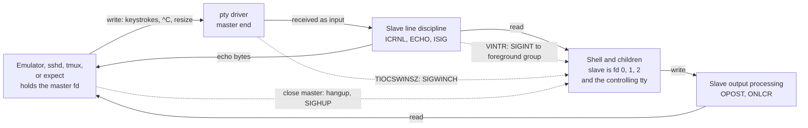

# Pseudo Terminals

> [!summary] Claim
> A pseudo-terminal is a kernel-held pair of character devices in which bytes written to the master side are received by the slave's line discipline exactly as if a keyboard had typed them, so every program that asks "am I on a terminal?" can be driven, observed, and resized by an ordinary process.

Part of [Terminals and Job Control](README.md) in [Shell and Unix Engineering](../README.md).

## TL;DR

- Mechanism: `posix_openpt`, `grantpt`, `unlockpt`, and `ptsname` give a master descriptor and a slave path; the slave is a real tty with its own line discipline, termios, window size, and (once a session leader adopts it) controlling-terminal behavior.
- Rule: the process that holds the master owns the terminal's lifetime - closing it hangs up the slave, so keep it open, drain it until end of file, and give the child the slave as its controlling terminal with `setsid` plus `TIOCSCTTY`.
- Trap: a command on a pty writes `CR NL`, not `NL` (the `ONLCR` output flag), so captured output ends in `\r`, and a program that sees a tty changes behavior (columns, colors, buffering, prompts).
- Portability: POSIX.1-2024 standardizes only the four allocation calls (and renamed master and slave "manager" and "subsidiary"); `openpty` and `forkpty` are BSD library functions, and end-of-output looks different per kernel (Linux fails master reads with `EIO`, macOS returns 0 and can drop unread bytes).
- When not to use it: if the child only needs data in and out, use pipes - a pty adds echo, line editing, CR NL translation, and a hangup lifecycle you must then manage.

## Mental model



The terminal emulator, `sshd`, `tmux`, or `expect` process holds the master descriptor and is the "keyboard and screen".
Bytes it writes enter the pty driver and are delivered to the slave side's line discipline as received input, where `ICRNL` maps carriage return to newline, `ECHO` sends a copy back toward the master, and `ISIG` turns the interrupt character into `SIGINT` for the slave's foreground process group.
The shell reads that input from the slave, which it holds as descriptors 0, 1, and 2 and as its controlling terminal.
What the shell writes passes through output processing (`ONLCR` turns each newline into carriage return plus newline) and becomes data the master holder reads.
Two out-of-band arrows complete the picture: a window-size change made through the master raises `SIGWINCH` in the foreground group, and closing the master hangs the slave up and sends `SIGHUP` to its session leader.

## How it works

**Allocation, in four calls (POSIX.1-2024 XSH `posix_openpt`, `grantpt`, `unlockpt`, `ptsname`).**
`posix_openpt(O_RDWR | O_NOCTTY)` returns a descriptor for a new master; `O_NOCTTY` keeps the calling process from adopting the terminal as its controlling terminal, and the standard presents the call as the portable way to obtain a manager-side descriptor.
`grantpt` sets the slave's owner to the caller's real user ID and its mode to readable and writable by the owner and writable by the group (POSIX.1-2024 XSH `grantpt`); on Linux it is a no-op because the permissions are configured at allocation (Linux man-pages 6.19 `grantpt(3)`), and the lab measured mode 0620 owned by the caller on both Linux and macOS.
`unlockpt` must be called before the slave is opened (POSIX.1-2024 XSH `unlockpt`); the kernel flag behind it is `TIOCSPTLCK` (Linux `drivers/tty/pty.c`, `pty_unix98_ioctl`, as of 2026-11).
`ptsname` returns the slave path, "need not be thread-safe", and its string may be overwritten by a later call; POSIX Issue 8 adds `ptsname_r` for threads (POSIX.1-2024 XSH `ptsname`).

**What the Linux kernel does (Linux `drivers/tty/pty.c`, `fs/devpts/inode.c`, as of 2026-11).**
Opening `/dev/ptmx` runs `ptmx_open`: it asks `devpts_new_index` for a free number, builds the pair with `tty_init_dev`, sets `TTY_PTY_LOCK` so the slave cannot be opened yet, and creates the node under `/dev/pts` with `devpts_pty_new`.
`devpts_new_index` fails with `ENOSPC` once the global count, incremented to include the pty being allocated (`atomic_inc_return(&pty_count)`), reaches `pty_limit` minus `pty_reserve`, unless the devpts mount carries the `reserve` option.
Each open of `/dev/ptmx` is an independent master with its own slave (Linux man-pages 6.19 `pts(4)`), `/dev/ptmx` is character device 5,2 (the same page), and the devpts documentation lists `ptmxmode` and the per-instance `max=<count>` mount options (kernel.org `filesystems/devpts`).
Opening the slave first is refused: `pts_unix98_lookup` returns `EIO` when no master is open, and `pty_open` returns `EIO` while the pair is locked or the other side has closed.
The only way in is therefore master first, then `grantpt` and `unlockpt`, then the slave.

**The data path.**
`pty_write` hands the bytes to the other side with `tty_insert_flip_string_and_push_buffer(to->port, ...)`: a write on one end is injected as received input on the other end's line discipline, which is the N_TTY discipline in `drivers/tty/n_tty.c`.
That is why the master side can type for the slave: `n_tty_receive_signal_char` calls `isig` for the interrupt, quit, and suspend characters, so one byte written to the master signals the slave's foreground group (the details of that discipline belong to [[TTY-Line-Discipline]] and [[Canonical-and-Raw-Mode]]).
`TIOCSIG` does the same without a byte, limited to `SIGINT`, `SIGQUIT`, and `SIGTSTP` (`pty_signal`).
Window size is a property of the pair: `pty_resize` sends `SIGWINCH` to the foreground group of both ends when the size actually changes.

**Hangup and end of file.**
When the master closes, `pty_close` sets `TTY_OTHER_CLOSED` on the slave, removes the `/dev/pts` node with `devpts_pty_kill`, and calls `tty_vhangup` on the slave.
POSIX says a hangup sends `SIGHUP` to the controlling process, makes later reads return 0 (end of file), and makes later writes fail with `EIO` until the device is closed (POSIX.1-2024 XBD 11.1.10 Modem Disconnect), and the lab measures exactly that.
In the other direction, when the last slave descriptor closes, a master read first drains queued bytes and only then fails: `n_tty_wait_for_input` returns `-EIO` when `TTY_OTHER_CLOSED` is set, and `poll` reports `EPOLLHUP`.
macOS differs: the lab measured that a master read after the slave closed returns 0, not `EIO`, and returns no bytes at all when the slave wrote and closed before the master read.
The XNU source explains the drop: `ptsclose` (`bsd/kern/tty_dev.c`) calls `ttyclose`, which calls `ttyflush(tp, FREAD | FWRITE)` and empties the slave's output queue `t_outq`, the queue `ptcread` drains for the master, and `ptcread` then returns 0 when that queue is empty and `TS_CONNECTED` is clear (XNU `bsd/kern/tty.c` and `bsd/kern/tty_dev.c`, as of 2026-11).
It is implementation behavior, not a documented guarantee.

**Controlling terminal.**
Opening the slave does not make it anybody's controlling terminal when `O_NOCTTY` is given; the child calls `setsid` and then `ioctl(slave, TIOCSCTTY, 0)`, after which the terminal's foreground process group is the session leader's group (POSIX.1-2024 XBD 11.1.3).
The mechanics of sessions are in [[Sessions-Process-Groups-and-Controlling-Terminals]].
`openpty` and `forkpty` (header `<pty.h>`, library `-lutil` on glibc) bundle the sequence, and `login_tty` prepares a descriptor as stdin, stdout, stderr, and controlling terminal; man-pages lists their standard as "BSD", not POSIX (Linux man-pages 6.19 `openpty(3)`).

**Other ioctls on the pair.**
`TIOCPKT` switches the master into packet mode, in which the kernel tracks status flags such as `TIOCPKT_FLUSHWRITE`, `TIOCPKT_START`, and `TIOCPKT_STOP` for the master reader (`pty_set_pktmode`, `pty_flush_buffer`, `pty_start`, and `pty_stop` in `pty.c`); the lab does not exercise it, so the wire format is not described here.
`TIOCSTI` pushes a byte into a terminal's input queue; it is the basis of the sandbox-escape CVEs below.

## Numbers and limits

| Quantity | Value | Source |
|---|---|---|
| Linux global pty limit, `kernel.pty.max` | 4096 | measured by hand in the Debian and Alpine matrix images on an OrbStack Linux 7.2.12 kernel, 2026-11-03 (the kernel default `NR_UNIX98_PTY_DEFAULT` in `fs/devpts/inode.c`); the lab test "the pty count limit is a readable system setting" reads it and requires a positive integer |
| Linux `kernel.pty.reserve` | 1024 | measured by hand, same containers and date |
| macOS `kern.tty.ptmx_max` | 511 | measured by hand on macOS 27.2, 2026-11-03; the lab test reads it and requires a positive integer |
| Unprivileged allocation fails when | the incremented `pty_count >= pty_limit - pty_reserve`, with `ENOSPC` | Linux `fs/devpts/inode.c`, `devpts_new_index`, as of 2026-11 |
| Slave owner and mode after `grantpt` | caller's UID, mode 0620 | POSIX.1-2024 XSH `grantpt` (group unspecified); Linux man-pages 6.19 `grantpt(3)` gives 0620; the lab measured 0620 on Linux and macOS |
| `/dev/ptmx` | character device major 5, minor 2 | Linux man-pages 6.19 `pts(4)` |
| devpts mount in the Debian image | `gid=5,mode=620,ptmxmode=666`, with `/dev/ptmx` a symlink to `pts/ptmx` | measured by hand, 2026-11-03 |
| Window size of a fresh pair | 0 rows by 0 columns | measured by the lab (`pair` and `winsize` tests) on Linux and macOS |
| Slave name prefix | `/dev/pts/` on Linux, `/dev/ttys` on macOS | measured by the lab (`pair` and "tty names a slave device" tests) |
| Lost lines when a child writes one line and exits (`run -- /bin/echo hi`, 200 runs) | 0 on macOS and 0 on Linux | lab test "a child that writes one line and exits never loses it: 100 runs" (every shell of the matrix); the 200-run version was also run by hand on the macOS host and the Debian image on 2026-11-03; a reader that is already polling the master did not lose data |
| Bytes readable from the master after the slave wrote `bye\n` and closed | 5 bytes (`bye\r\n`) on Linux, 0 on macOS | measured by the lab (`slave-exit` test) |

No throughput or latency figure is claimed here: this note did not benchmark pty bandwidth.

## Portability

All "pty" columns below were run by the lab's `on_pty` tests; the "no terminal" column is the lab's direct run with stdin from `/dev/null` and no controlling terminal.

| Shell | `set -m` on a pty | `set -m` with no terminal | `read` of a typed line |
|---|---|---|---|
| POSIX `sh` (macOS `/bin/sh`, bash 3.2.57 in POSIX mode) | on | on | echoed once |
| bash 3.2 (macOS and Alpine), 4.4, 5.1, 5.2, 5.3 (Alpine), 5.2 (Debian), 5.3 (macOS) | on | on | echoed once |
| zsh (native) | on | the script aborts at `set -m` (exit 1, "can't change option: -m") | echoed once |
| zsh with `--emulate sh` | on | the script aborts at `set -m` (exit 1) | echoed once |
| dash | on | off (monitor flag not set; warns `can't access tty; job control turned off`) | echoed once |
| ksh93u+m 1.0.10 (Debian) | on | on | echoed once |
| ksh93u+ 2012-08-01 (macOS `/bin/ksh`) | on | on | echoed twice (cause explained below the tables) |
| mksh | on | on | echoed once |
| yash | on | off, `set -m` returns 1 and warns that it cannot open `/dev/tty` | echoed once |
| posh | the script aborts at `set -m` (exit 1, "unknown option") | the script aborts at `set -m` (exit 1) | echoed once |
| BusyBox ash | on | off (warns `can't access tty; job control turned off`) | echoed once |

| Utility or behavior | GNU (Debian) | BSD and macOS | BusyBox (Alpine 1.37.0) | uutils 0.0.30 (Debian) |
|---|---|---|---|---|
| `stty size` after the master set 24x80 | `24 80` | `24 80` | `24 80` | no `stty` applet in the package |
| `tty` names the slave | `/dev/pts/N` | `/dev/ttysNNN` | `/dev/pts/N` | `/dev/pts/N` |
| `ls` on a pty prints one line of columns | yes | yes, separated by tabs | yes, and wraps each name in color escapes | yes, separated by two spaces, as GNU does |
| `script` as a pty wrapper | util-linux 2.41.5: `script -qec tty /dev/null` printed `/dev/pts/0\r\n` | `script -q /dev/null tty` printed `/dev/ttysNNN\r\n`; with stdin from `/dev/null` it still ran and first echoed `^D\b\b` | not in the Alpine image, and no `script` applet in its BusyBox | no `script` applet |

The shell rows come from the lab run in the macOS host and in the Debian and Alpine matrix images on 2026-11-03.
Besides the script-driven rows, the lab test "set -m is fatal in zsh without a terminal and in posh everywhere; dash, BusyBox ash and yash warn and carry on" asserts exit status 1 with the messages `zsh:set:1: can't change option: -m` and `posh: set: -m: unknown option` (posh on a pty too), and status 0 with the dash, BusyBox ash and yash warnings quoted in the table.
The `ls` test asserts the exact line per implementation: tabs on macOS, two spaces for GNU, and color escapes around each name for BusyBox.
The `script` row and the uutils column are not lab tests: they were measured by hand on 2026-11-03, the uutils column in the Debian 13 image after `apt-get install rust-coreutils` (its multicall list has `tty` and `ls` but no `stty` or `script`).
The lab test "a child that writes one line and exits never loses it: 100 runs" covers the zero-loss row in Numbers and limits on every shell of the matrix.
Branching in the lab is by `lab_shell_family` and, for ksh93, `lab_shell_version`.

Why ksh93u+ 2012 echoes the typed line twice on macOS: the 4.4BSD-derived tty driver sets `PENDIN` when `ICANON` is switched from off to on (`ttioctl` in XNU `bsd/kern/tty.c`), and the next read retypes the pending input through `ttyinput`, which echoes it a second time (`ttypend`; `PENDIN` is `0x20000000` in `bsd/sys/termios.h`).
Measured by hand on 2026-11-03: `stty -g` inside `/bin/ksh` reports `lflag=5cb` before the `read` and `lflag=200005cb` after it, so ksh93u+ toggles `ICANON` around `read`; with `stty -echo` run before the `read` only the driver's first echo appears; and macOS `/bin/bash` echoes twice when the script itself runs `stty -icanon; stty icanon` with a line pending.
ksh93u+m 1.0.10 on Linux echoes once, and Linux `n_tty_set_termios` only re-marks the buffered input as one committed line on an `ICANON` change and writes no echo (Linux `drivers/tty/n_tty.c`, as of 2026-11).

## Worked example

The [lab](../labs/02-pseudo-terminals/) has two programs: `pty_probe.c`, a small C program that opens a pair and measures it, and `pty_shell.sh`, which runs the shell under test as the slave-side process on a new pty.
The probe's allocation sequence is this simplified excerpt of its `open_master` function:

```c
int master = posix_openpt(O_RDWR | O_NOCTTY);
if (grantpt(master) == 0 && unlockpt(master) == 0) {
  slave_path = ptsname(master);
}
/* the child then calls setsid(), opens slave_path with O_NOCTTY, and ioctl(slave, TIOCSCTTY, 0) */
```

The shell side is two verbatim cases of `pty_shell.sh`, the slave-side script that every shell family runs on the pty:

```sh
    monitor)
      set -m 2>/dev/null
      rc=$?
      case $- in
        *m*) flag=on ;;
        *) flag=off ;;
      esac
      printf 'set_m_rc=%s monitor=%s\n' "$rc" "$flag"
      ;;
```

```sh
    read)
      IFS= read -r line
      printf 'got=%s\n' "$line"
      ;;
```

The bats helper that starts the whole chain is also verbatim (`on_pty` in `pty.bats`):

```bash
on_pty() {
  local mode=$1
  lab_shell_words
  run_lab "${SCRIPT}" drive "${PROBE}" "${SCRIPT}" "${mode}" "${LAB_SHELL_WORDS[@]}"
}
```

Expected output, captured from the lab's probe on macOS 27.2 (the Linux differences are listed after the block).
Bytes are shown with `\r` and `\n` escapes:

```text
$ pty_probe pair
prefix=/dev/ttys slave_isatty=1 slave_uid_is_me=1 slave_mode=620 echo=1 icanon=1 isig=1 icrnl=1 opost=1 onlcr=1 rows=0 cols=0
$ pty_probe echo
cooked_master_sees=hi\r\n cooked_slave_reads=hi\n cooked_out=ok\r\n raw_master_sees=ok\n raw_slave_reads=x\r
$ pty_probe slave-exit
first_read= second_read_rc=0 second_read_errno=0
$ pty_probe master-close
sighup=1 read_rc=0 read_errno=0 write_rc=-1 write_errno=EIO
$ pty_probe winsize
master_initial=0x0 sigwinch=1 slave_rows=31 slave_cols=97
$ pty_probe ctrl-c
master_sees=^C sigint=1 slave_read=
$ pty_probe ctrl-c-raw
master_sees= sigint=0 slave_read=\x03
```

On Linux (Debian and Alpine images) `pair` prints `prefix=/dev/pts/` and `slave-exit` prints `first_read=bye\r\n second_read_rc=-1 second_read_errno=EIO`; every other line is identical.

The shell-level modes run the shell under test inside the pty; the output is shown in the form the test compares, with `\r` standing for the carriage return that output processing adds:

```text
ids      stdin=1 stdout=1 stderr=1 tty_prefix=/dev/ttys\r
monitor  set_m_rc=0 monitor=on\r
size     size=24 80\r
read     typed\r  got=typed\r          (two lines)
eof      read_rc=1\r          (macOS prints ^D\b\b before it; the test asserts the exact bytes per platform)
noctty   stdin=1 tty_prefix=/dev/ttys dev_tty=fail\r
```

Run it yourself with `bats labs/02-pseudo-terminals/pty.bats`, or under another shell with `LAB_SHELL=dash bats labs/02-pseudo-terminals/pty.bats`.
The probe needs only a C compiler (`${CC:-cc}`), and every wait inside it is bounded.

## Pitfalls

> [!warning] Captured output ends in carriage returns
> Trigger: a wrapper runs a command on a pty (for example through `script` or a pty-allocating flag of a remote or container command) and compares or parses its output.
> Symptom: `[ "$(cmd)" = "hi" ]` is false because the value is `hi` followed by `\r`; the lab's `run -- /bin/sh -c "echo hi; exit 7"` test returns `hi\r`.
> Fix: do not allocate a pty when you only need data; otherwise strip `\r` with `tr -d '\r'`, or turn off output processing with `stty -opost` on the slave.

> [!warning] The program behaves differently on a tty
> Trigger: running the same command with and without a pty.
> Symptom: `ls` prints one line of columns on a pty and one name per line into a pipe (lab test "the same ls prints columns on a pty and one name per line on a pipe"), BusyBox `ls` adds color escapes, and many programs switch stdio buffering or prompt for input only when `isatty` is true.
> Fix: make the mode explicit (`ls -1`, `--color=never`, a non-interactive flag) instead of depending on terminal detection.

> [!warning] Lost output at end of file
> Trigger: a master reader that starts reading only after the child has exited, or treats the first short read as the end.
> Symptom: on macOS the lab's `slave-exit` probe reads 0 bytes from a slave that wrote `bye\n` and closed, while Linux returns `bye\r\n` and then `EIO`.
> Fix: read the master concurrently with the child (a `poll` loop, as `pty_probe run` does), and treat both a 0-byte read and `EIO` as end of output, never as an error to report.

> [!warning] Closing the master kills the session
> Trigger: the parent that holds the master exits or closes it early, for example a launcher that forks a shell on a pty and returns.
> Symptom: the child sees `SIGHUP`, then end of file on reads and `EIO` on writes (lab test "closing the master hangs up the slave"); a long-running job dies with its terminal.
> Fix: keep the master open for the child's lifetime in a supervisor such as [[Terminal-Multiplexers-tmux-and-screen]], and start work you want to survive with a new session or `nohup`.

> [!warning] A child that never gets a controlling terminal
> Trigger: handing the slave to a child as stdin, stdout, and stderr but never calling `setsid` and `TIOCSCTTY`.
> Symptom: `tty` prints the slave and `[ -t 0 ]` is true, but opening `/dev/tty` fails in every shell of the matrix (lab test "a shell with a pty as stdin, stdout and stderr but no controlling terminal sees a tty and cannot open /dev/tty", which runs the shell as a non-leader process of a new session through `pty_probe run -n`).
> `^C` delivery and job control follow from the missing controlling terminal and are not measured by the lab; its `set -m` test passes only because `pty_probe run` makes the slave the controlling terminal, and the sessions note covers the rule.
> Fix: follow the sequence `setsid`, open the slave with `O_NOCTTY`, `TIOCSCTTY`, then `dup2` onto descriptors 0 to 2 (what `login_tty` does).

> [!warning] Window size left at 0 by 0
> Trigger: allocating a pair and never calling `TIOCSWINSZ`.
> Symptom: programs that read the size see 0 rows and 0 columns on both Linux and macOS (lab `pair` test) and fall back to 80 columns, or divide by zero.
> Fix: set the size right after allocation, and forward your own terminal's `SIGWINCH` to the master with `TIOCSWINSZ`, which in turn raises `SIGWINCH` in the slave's foreground group.

> [!warning] Shared `ptsname` buffer
> Trigger: calling `ptsname` from several threads.
> Symptom: the returned string is shared storage that a later call may overwrite (POSIX.1-2024 XSH `ptsname`), so two threads can open each other's slave.
> Fix: use `ptsname_r` (new in POSIX Issue 8) where available, and copy the result at once, as the probe does into `name`.

> [!warning] Unprivileged `TIOCSTI` input injection
> Trigger: a privileged helper (`runuser`, a sandbox launcher) runs an untrusted program that keeps the caller's controlling terminal.
> Symptom: the program calls `TIOCSTI` and pushes characters into the parent shell's input queue; this is CVE-2016-2779 for `runuser` in util-linux and CVE-2017-5226 for bubblewrap up to 0.1.5 (NVD, CVSS 3.0 scores 7.8 and 10.0).
> Fix: give the untrusted process its own session or its own pty rather than the caller's terminal; on Linux the `dev.tty.legacy_tiocsti` sysctl makes `TIOCSTI` require `CAP_SYS_ADMIN` when it is 0 (`tiocsti` in `drivers/tty/tty_io.c`).

## Security and robustness

- A pty is an input channel: whoever holds the master (or any process that shares the controlling terminal and may call `TIOCSTI`) can type into the slave's shell, so treat the master descriptor as a credential and never pass it to code you do not trust.
- On Linux, `tiocsti` returns `EIO` for an unprivileged caller when `tty_legacy_tiocsti` is false, and returns `EPERM` for a terminal that is not the caller's controlling terminal unless it has `CAP_SYS_ADMIN` (`drivers/tty/tty_io.c`, as of 2026-11); the lab's `tiocsti` test branches on the sysctl and found it set to 1 on the OrbStack kernel, so unprivileged injection into one's own terminal succeeded there.
  The `legacy_tiocsti = 0` branch of that test (`EIO`) was not executed on any host here; it follows from `tiocsti`, which tests the sysctl before the controlling-terminal comparison, and the sysctl starts from `IS_ENABLED(CONFIG_LEGACY_TIOCSTI)`, whose Kconfig default is `y` (`drivers/tty/tty_io.c`, `drivers/tty/Kconfig`, as of 2026-11).
- Slaves are mode 0620 and owned by the allocating user (lab-measured), so other users in the owning group can write to them; never `chmod` a slave to be world-writable.
- Everything a program writes to the slave reaches the emulator that holds the master, including escape sequences; see [[Terminal-Escape-Injection]] for what that allows.
- Resource limits are real: the global pty count is capped (4096 with 1024 reserved on the measured Linux kernel, 511 on macOS), so a service that leaks masters makes the kernel open fail with `ENOSPC` (`devpts_new_index`; POSIX lists `EAGAIN` for "out of pseudo-terminal resources") and every other user fails to log in; close the master on every exit path.
- Bound every wait on a pty: a reader of the master blocks forever if a grandchild keeps the slave open, which is why `pty_probe run` takes a time limit and kills the child's group when it expires (lab test "run: a command that outlives the limit is killed and the probe reports 124").
- If nobody reads the master, the slave writer eventually blocks, because `pty_write_room` reports the other side's available buffer space; this is read from `pty.c` and not measured by the lab.

## The principal's view

The decision is whether the child needs a terminal at all.
Most automation wants a pipe: it has no echo, no `CR NL` rewriting, no hangup lifecycle, and no dependence on window size.
Allocate a pty only when the program refuses to run, prompts, or changes behavior without one: password prompts, `ssh` and `sudo` interactions, curses programs, shells with job control, and test harnesses for interactive tools.
The trade-off is fidelity against complexity - you gain exact terminal behavior and take on termios, resizing, end-of-output detection that differs per kernel, and a session whose lifetime equals your master descriptor.
Prefer an existing tool over a hand-rolled one: [[expect-and-Automating-Interactive-Programs]] for scripted dialogs, [[Terminal-Multiplexers-tmux-and-screen]] when the session must outlive the client, and `script` when you only need a recording.
Shell cannot create a pty by itself; the moment you need to manage the master directly (supervisors, terminal emulators, CI log capture), write it in C, Go, Rust, or Python, where `openpty` or `forkpty` and a `poll` loop are a dozen lines, and where partial reads, `EIO`, and `SIGWINCH` forwarding can be unit-tested.
When the real requirement is just "color and progress bars in CI logs", pass the program's own flag (`--color=always`) rather than faking a terminal.

## Interview questions

> [!question] L5: What is a pseudo-terminal, and what do the master and slave each do?
>
> > [!success]- Answer
> > It is a pair of kernel character devices connected back to back.
> > POSIX.1-2024 calls the two sides "manager" and "subsidiary".
> > The slave looks like a real terminal to a program: it has termios settings, a window size, a line discipline, and can be a controlling terminal.
> > The master is held by the process that plays the keyboard and screen (an emulator, `sshd`, `tmux`, `expect`).
> > Bytes written to the master arrive as input on the slave, and bytes the slave writes can be read from the master.
> >
> > Follow-up: Which call reports the slave path, and why is it not thread-safe?

> [!question] L5: Why does output captured through a pty end each line with `\r\n`?
>
> > [!success]- Answer
> > The slave's termios has `OPOST` and `ONLCR` set by default, so output processing turns every newline into carriage return plus newline.
> > The lab shows `cooked_out=ok\r\n` for a slave write of `ok\n`, and `raw_master_sees=ok\n` once `cfmakeraw` clears output processing.
> > Strip the `\r`, disable `opost`, or avoid the pty.
> >
> > Follow-up: Which input flag maps the carriage return a keyboard sends to a newline?

> [!question] L5: Predict the output when a fresh pair has the master write `hi` plus a carriage return, then the master reads, then the slave reads (default termios).
>
> > [!success]- Answer
> > The master reads `hi\r\n`: the line discipline echoes the input, and the echoed newline passes through `ONLCR`.
> > The slave reads `hi\n`: `ICRNL` converted the carriage return, and canonical mode delivered one complete line.
> > The lab's `echo` probe prints `cooked_master_sees=hi\r\n cooked_slave_reads=hi\n`.
> >
> > Follow-up: What changes if the slave first calls `cfmakeraw`?

> [!question] L6: What is the correct order of calls to give a child a working terminal, and why is `O_NOCTTY` there?
>
> > [!success]- Answer
> > The parent calls `posix_openpt(O_RDWR | O_NOCTTY)`, `grantpt`, `unlockpt`, and `ptsname`, and keeps the master open.
> > The child calls `setsid`, opens the slave path with `O_NOCTTY`, issues `ioctl(slave, TIOCSCTTY, 0)`, duplicates the slave onto descriptors 0, 1, and 2, and executes the program.
> > `O_NOCTTY` stops the opens from silently adopting the terminal in the wrong process, so the parent daemon does not acquire a controlling terminal, and the adoption happens exactly once in the child.
> > `unlockpt` must precede the slave open (POSIX.1-2024 XSH `unlockpt`).
> >
> > Follow-up: What does `login_tty` do that you would otherwise write by hand?

> [!question] L6: Why does a job on a pty die when its launcher exits, and how do you fix it?
>
> > [!success]- Answer
> > The launcher held the master; closing it hangs up the slave, so the session leader gets `SIGHUP`, reads return end of file, and writes fail with `EIO` (POSIX.1-2024 XBD 11.1.10; lab test "closing the master hangs up the slave").
> > Keep a supervisor holding the master for the job's lifetime, as `tmux` does, or start the job in its own session without that terminal, or use `nohup` or `setsid` so `SIGHUP` is ignored or never delivered.
> >
> > Follow-up: What does the slave see on read versus write after the hangup?

> [!question] L6: Debug this script, which must accept hostname `web` but always exits 1.
>
> ```sh
> #!/bin/sh
> # run_in_pty is any wrapper that gives the command a pseudo-terminal
> name=$(run_in_pty hostname)
> [ "$name" = "web" ] || { echo "wrong host: $name" >&2; exit 1; }
> ```
>
> > [!success]- Answer
> > On a pty, output processing turns the newline into carriage return plus newline.
> > The command substitution strips only the trailing newline, so `$name` is `web` followed by `\r`, and the comparison fails (the lab's `run` test returns `hi\r`).
> > Remove the pty when it is not needed, or normalize with `name=$(run_in_pty hostname | tr -d '\r')`.
> >
> > Follow-up: Which `stty` setting removes the carriage return at its source?

> [!question] L6: Why do reads of the master end differently on Linux and macOS, and how do you write a portable loop?
>
> > [!success]- Answer
> > On Linux, after the last slave descriptor closes, the master first returns queued bytes and then fails with `EIO` (`n_tty_wait_for_input` returns `-EIO` for `TTY_OTHER_CLOSED`).
> > On macOS the lab measured a read of 0 and no bytes if the reader was not already waiting.
> > A portable loop `poll`s the master concurrently with the child, treats `EIO` and a 0-byte read the same way as end of output, and bounds the wait with a timeout.
> >
> > Follow-up: What would you test to prove that the loop loses no output?

> [!question] L7+: Design a supervisor that mirrors a user command on a pty to the user terminal, and list its failure modes.
>
> > [!success]- Answer
> > Put your own terminal in raw mode and restore it on every exit path, copy bytes both ways with `poll`, and forward `SIGWINCH` by reading your window size and applying `TIOCSWINSZ` to the master.
> > Give the child a new session with the slave as its controlling terminal so `^C`, job control, and `/dev/tty` work.
> > Handle end of output as both `EIO` and a 0-byte read, reap the child and use its exit status, and bound waits so a grandchild that holds the slave cannot hang you.
> > Close the master on every path to avoid exhausting the global pty limit, and never give the child your own controlling terminal, which exposes `TIOCSTI` input injection (CVE-2016-2779, CVE-2017-5226).
> >
> > Follow-up: How does the design change if the supervisor must survive the client disconnecting?

> [!question] L7+: What do you check on Linux, and what is the structural fix, when a service leaks pty masters until logins fail?
>
> > [!success]- Answer
> > Compare `/proc/sys/kernel/pty/nr` with `/proc/sys/kernel/pty/max`; allocation fails with `ENOSPC` once the count reaches `max` minus `reserve`, except on a devpts mount with the `reserve` option, and each devpts instance can also set `max=` (kernel.org `filesystems/devpts`; `devpts_new_index`).
> > List the descriptors that refer to `/dev/ptmx` per process to find the leaker.
> > Fix the lifetime: tie the master's close to the owner object on every error path, set close-on-exec so children do not inherit it (see [[Close-on-Exec-and-Descriptor-Inheritance]]), and alert on `nr` approaching `max`.
> >
> > Follow-up: Why can a leaked master keep a whole session alive?

> [!question] L7+: Why is `TIOCSTI` a sandbox escape, and what defenses exist?
>
> > [!success]- Answer
> > A process that shares its caller's controlling terminal can push bytes into that terminal's input queue, so they are read by the caller's shell when the sandboxed process exits.
> > NVD describes this for `runuser` (CVE-2016-2779) and bubblewrap through 0.1.5 (CVE-2017-5226).
> > Defenses are to put the child in a new session with no controlling terminal or on a fresh pty, and on recent Linux kernels to set `dev.tty.legacy_tiocsti` to 0 so the ioctl needs `CAP_SYS_ADMIN`.
> >
> > Follow-up: Why does the kernel also compare the caller's terminal with the target?

## Related

Prerequisites: [[termios-and-stty]]

Next: [[Escape-Sequences-ECMA-48-and-xterm]]

See also: [[TTYs-PTYs-and-Line-Discipline]]; [[TTY-Line-Discipline]]; [[Canonical-and-Raw-Mode]]; [[Sessions-Process-Groups-and-Controlling-Terminals]]; [[Terminal-Emulators-and-TERM]]; [[Terminal-Multiplexers-tmux-and-screen]]; [[expect-and-Automating-Interactive-Programs]]; [[Terminal-Escape-Injection]]

## Further reading

- [POSIX.1-2024 `posix_openpt`](https://pubs.opengroup.org/onlinepubs/9799919799/functions/posix_openpt.html) - the standard allocation call, including the `O_NOCTTY` flag.
- [POSIX.1-2024 `grantpt`](https://pubs.opengroup.org/onlinepubs/9799919799/functions/grantpt.html) - ownership, mode, and the `SIGCHLD` caveat.
- [POSIX.1-2024 `unlockpt`](https://pubs.opengroup.org/onlinepubs/9799919799/functions/unlockpt.html) - why the unlock must precede the slave open.
- [POSIX.1-2024 `ptsname`](https://pubs.opengroup.org/onlinepubs/9799919799/functions/ptsname.html) - thread-safety limits and `ptsname_r`.
- [POSIX.1-2024 General Terminal Interface](https://pubs.opengroup.org/onlinepubs/9799919799/basedefs/V1_chap11.html) - controlling terminals (11.1.3) and hangup semantics (11.1.10).
- [Linux `pty(7)`](https://man7.org/linux/man-pages/man7/pty.7.html) - the overview of master and slave and of writing the interrupt character to the master.
- [Linux `pts(4)`](https://man7.org/linux/man-pages/man4/pts.4.html) - `/dev/ptmx`, devpts, and the setup order.
- [Linux `grantpt(3)`](https://man7.org/linux/man-pages/man3/grantpt.3.html) - mode 0620 and the retired `pt_chown` helper.
- [Linux `openpty(3)`](https://man7.org/linux/man-pages/man3/openpty.3.html) - `openpty`, `forkpty`, and `login_tty`, which are BSD functions.
- [kernel.org devpts documentation](https://www.kernel.org/doc/html/latest/filesystems/devpts.html) - per-mount instances, `ptmxmode`, and `max`.
- [FreeBSD `pts(4)`](https://man.freebsd.org/cgi/man.cgi?query=pts&sektion=4&manpath=FreeBSD+15.0-RELEASE) - the BSD view of the same device pair.
- [Linux `drivers/tty/pty.c`](https://raw.githubusercontent.com/torvalds/linux/master/drivers/tty/pty.c) - `ptmx_open`, `pty_close`, `pty_resize`, `pty_signal`.
- [Linux `fs/devpts/inode.c`](https://raw.githubusercontent.com/torvalds/linux/master/fs/devpts/inode.c) - `devpts_new_index` and the pty limits.
- [NVD CVE-2016-2779](https://nvd.nist.gov/vuln/detail/CVE-2016-2779) and [NVD CVE-2017-5226](https://nvd.nist.gov/vuln/detail/CVE-2017-5226) - the `TIOCSTI` escapes in `runuser` and bubblewrap.
