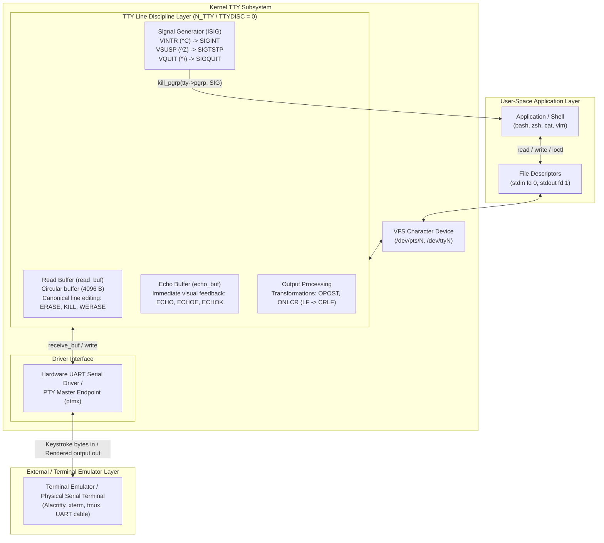

# TTY Line Discipline

> [!summary] Claim
> The terminal line discipline is the kernel stream-processing layer between low-level hardware or pseudo-terminal drivers and user-space file descriptors, responsible for in-kernel line editing, character transformations, visual echo generation, and translating asynchronous control characters into process-group signals before user applications observe them.

Part of [Terminals and Job Control](README.md) in [Shell and Unix Engineering](../README.md).

## TL;DR

The line discipline intercepts raw serial or pseudo-terminal byte streams inside the kernel, buffering input lines in a circular buffer (`N_TTY_BUF_SIZE = 4096` bytes in Linux `drivers/tty/n_tty.c`), executing canonical editing (`VERASE`, `VKILL`, `VWERASE`), managing echo output, and converting special control codes (`VINTR`, `VQUIT`, `VSUSP`) into process-group signals (`SIGINT`, `SIGQUIT`, `SIGTSTP`).
Always save the initial terminal configuration with `tcgetattr()` or `stty -g` before toggling non-canonical attributes or raw mode, and restore those settings across all exit handlers, signal traps, and child process launches to prevent leaving the user session in a corrupted state.
Disabling output post-processing (`-opost` or `-onlcr`) causes incoming newline bytes (`\n`) to advance downward without a carriage return (`\r`), generating the diagonal staircase visual defect while unconsumed `VEOF` characters on non-empty lines return partial buffers without a newline rather than a zero-byte EOF.
Across Unix kernels, the standard interactive line discipline is indexed as discipline 0 (`N_TTY` in Linux `include/uapi/linux/tty.h` and `TTYDISC` in BSD/macOS `<sys/ttycom.h>`), queried via `ioctl(fd, TIOCGETD, &ldisc)`, while shell builtins differ: interactive bash, zsh, ksh93, mksh, BusyBox ash, and yash (when `TERM` allows line editing) switch the line discipline into non-canonical mode to run custom user-space line editors, whereas minimal dash and posh remain in canonical mode and delegate line editing directly to the kernel (measured in the shell matrix by reading the termios flags at the prompt).
Never rely on kernel line discipline canonical editing for full-screen interactive applications, binary protocol serialization, or high-throughput serial pipelines; switch to raw non-canonical mode via `cfmakeraw()` or use user-space libraries like GNU Readline, curses, or direct pseudo-terminal multiplexers.
Password entry is the exception: it normally stays canonical with only `ECHO` cleared, which is what bash, zsh, and BusyBox `read -s` do (measured in the shell matrix).

## Mental model



Every keystroke typed into a terminal emulator or transmitted over a serial link arrives as raw bytes at the kernel driver layer, which feeds them into the TTY line discipline via `receive_buf` callbacks before any user-space process observes them.
The line discipline acts as a stateful transformation engine: when `ISIG` is active, it intercepts signal characters like `Ctrl+C` (`VINTR`) and directs the kernel to broadcast `SIGINT` to the foreground process group instead of queueing the byte; when `ECHO` is enabled, it copies arriving characters directly to an internal echo buffer and writes them back to the driver for immediate visual display.
In canonical mode (`ICANON`), the line discipline stores incoming text in an internal circular buffer (`read_buf`), evaluating editing control codes like Backspace (`VERASE`) and `Ctrl+U` (`VKILL`) entirely within the kernel until a line delimiter (`\n`, `VEOF`, or `VEOL`) arrives.
Only when a full line is completed does the line discipline wake sleeping `read()` system calls on the slave character device, while application output passed down via `write()` travels through the discipline's output processing pipeline (`OPOST` and `ONLCR`) to turn solitary newlines into carriage-return/newline pairs before hitting the display driver.

## How it works

### The Pluggable Architecture

The Unix terminal subsystem decouples hardware driver communication from user-space character device operations using pluggable line disciplines, an implementation mechanism POSIX does not specify: XBD Chapter 11 defines the terminal interface and never uses the term "line discipline".
A line discipline defines the semantics of the character stream passing through a terminal device file (`/dev/tty*` or `/dev/pts/*`).
In Linux, line disciplines are registered with the kernel via `tty_register_ldisc()` and implement the function pointers defined in `struct tty_ldisc_ops` (`include/linux/tty_ldisc.h`):
`open()`, `close()`, `flush_buffer()`, `read()`, `write()`, `ioctl()`, `compat_ioctl()`, `set_termios()`, `poll()`, `hangup()`, `receive_buf()`, `write_wakeup()`, `dcd_change()`, `receive_buf2()`, and `lookahead_buf()`.

The active line discipline on any terminal file descriptor is inspected and switched using `ioctl(2)`:
`ioctl(fd, TIOCGETD, &ldisc)` retrieves the integer index of the current line discipline (Linux `ioctl_tty(2)`; POSIX.1-2024 has no `ioctl()` page and does not define `TIOCGETD`).
`ioctl(fd, TIOCSETD, &ldisc)` dynamically swaps the active line discipline on the open terminal description.
Standard line discipline numbers defined in Linux (`include/uapi/linux/tty.h`) include:
- `N_TTY` (0): The default terminal line discipline handling cooked canonical editing, signals, and character conversions.
- `N_SLIP` (1): Serial Line Internet Protocol, framing raw IP packets across asynchronous lines.
- `N_MOUSE` (2): Serial mouse driver protocol.
- `N_PPP` (3): Point-to-Point Protocol daemon framing.
- `N_GSM0710` (21): GSM 07.10 cellular modem multiplexing.

In BSD and macOS Darwin systems, line disciplines are registered in the kernel `linesw[]` table (`bsd/kern/tty_conf.c` in xnu), where discipline 0 is `TTYDISC` (standard termios processing), discipline 3 is `TABLDISC` (tablet digitizer discipline), discipline 4 is `SLIPDISC`, and discipline 5 is `PPPDISC` (`<sys/ttycom.h>`).

### The Input Receive Pipeline

When a serial hardware UART receives bytes or an emulator writes characters into a pseudo-terminal master descriptor (`/dev/ptmx`), the driver queues them in flip buffers, and the `flush_to_ldisc()` work item forwards them through `tty_ldisc_receive_buf()` (both in Linux `drivers/tty/tty_buffer.c`).
Under `N_TTY`, execution passes to `n_tty_receive_buf_common()` in `drivers/tty/n_tty.c`.
The input engine evaluates characters against flags configured in `struct termios` `c_iflag` (POSIX.1-2024 XBD 11.2.2):
- `ISTRIP`: If set, strips the eighth (high) bit of every byte, reducing input to 7-bit ASCII.
- `INLCR`: If set, maps an incoming newline (`\n`, 0x0a) to a carriage return (`\r`, 0x0d).
- `IGNCR`: If set, discards incoming carriage return characters entirely.
- `ICRNL`: If set and `IGNCR` is unset, maps incoming carriage return (`\r`) to newline (`\n`).
- `IUCLC`: (Non-POSIX Linux extension) Maps uppercase input characters to lowercase.
- `IXON`: Enables start/stop output control (POSIX.1-2024 XBD 11.2.2); `IXOFF` is the separate input-control flag.
Arriving `VSTOP` characters (default `^S` / 0x13) suspend terminal transmission; arriving `VSTART` characters (default `^Q` / 0x11) resume transmission.

### Signal Generation and ISIG

Before any character enters the read buffer, `n_tty_receive_char_special()` checks whether local mode `ISIG` is active in `c_lflag` (POSIX.1-2024 XBD 11.2.5).
When `ISIG` is enabled, the kernel intercepts special control characters defined in `c_cc[]` (POSIX.1-2024 XBD 11.1.9):
- `VINTR` (default `^C`, ASCII 0x03): The line discipline invokes `isig(SIGINT, tty)`.
The kernel determines the foreground process group assigned to the terminal (`tty->pgrp`) and sends `SIGINT` to all processes in that group.
Unless `NOFLSH` is set in `c_lflag`, `isig()` itself clears the echo buffer, flushes the driver output with `tty_driver_flush_buffer()`, and clears the input buffer with `reset_buffer_flags()`.
- `VQUIT` (default `^\`, ASCII 0x1c): Generates `SIGQUIT` to the foreground process group, triggering an abnormal termination and core dump, and flushes queues unless `NOFLSH` is set.
- `VSUSP` (default `^Z`, ASCII 0x1a): Generates `SIGTSTP` to suspend foreground execution, returning control to the parent shell's job control monitor, and flushes unread input unless `NOFLSH` is set.
- `VSTATUS` (default `^T`, ASCII 0x14, BSD and macOS): Generates `SIGINFO` to the foreground process group to print execution status without terminating the process, and needs `ICANON` and `IEXTEN` (xnu `<sys/termios.h>`; POSIX.1-2024 does not mandate `SIGINFO`).
- `VDSUSP` (default `^Y`, ASCII 0x19, BSD and macOS): Delayed suspend.
The character is delivered into the read buffer and generates `SIGTSTP` only when a user-space process attempts to `read(2)` it.

Crucially, when `ISIG` generates a signal, the triggering character itself is consumed and discarded by the line discipline; it is never appended to the user-space input buffer.

### Canonical Mode Line Editing

When `ICANON` is set in `c_lflag`, input is processed in units of lines (POSIX.1-2024 XBD 11.1.6).
Characters are accumulated inside the line discipline's private `read_buf` circular buffer (`N_TTY_BUF_SIZE = 4096` bytes in `struct n_tty_data` in Linux `drivers/tty/n_tty.c`).
Input editing occurs entirely within kernel space through special characters:
- `VERASE` (default `^?` / 0x7f or `^H` / 0x08): Erases the last character placed into the current line buffer by decrementing the internal pointer `read_head`.
If `ECHOE` is set, the kernel writes backspace-space-backspace (`\b \b`) to the output queue to erase the glyph visually from the terminal screen.
- `VWERASE` (default `^W`, ASCII 0x17): Word erase.
Backtracks over trailing whitespace and then erases preceding non-whitespace characters up to the previous word boundary.
- `VKILL` (default `^U`, ASCII 0x15): Line kill.
Resets `read_head` to `canon_head`, discarding all characters entered on the current line.
If `ECHOK` is set, the kernel echoes a newline or erase sequence.
- `VLNEXT` (default `^V`, ASCII 0x16): Literal next quote.
Sets the internal `lnext` bit; the subsequent character is inserted into the buffer as a raw byte even if it matches a special editing or signal character.
- `VEOF` (default `^D`, ASCII 0x04): End-of-file delimiter (POSIX.1-2024 XBD 11.1.9).

When `VEOF` arrives in canonical mode:
Linux `n_tty_receive_char_canon()` replaces the `^D` byte with the marker `__DISABLED_CHAR`, stores that marker in `read_buf` as the line end, and advances `canon_head` through `n_tty_receive_handle_newline()`; `n_tty_read()` never returns the marker to user space.
If characters are pending in the line buffer (`read_head != canon_head`), the sleeping `read()` call wakes up and returns the partial line without a trailing newline.
If `VEOF` arrives when the line buffer is empty (`read_head == canon_head`), the line holds only the marker and `read()` returns 0 bytes, which user space recognizes as EOF.

```
Incoming Bytes:  ['a', 'b', 'c', 0x7f, 'd', '\n']
                     |    |    |    |    |    |
Line Discipline:   ['a', 'b', 'c']  |    |    |
                     |    |   <erased>   |    |
                     ['a', 'b'] ---------> ['a', 'b', 'd'] -> Delivered to read(2) as "abd\n"
```

### Output Processing

When a user-space process calls `write(2)` on a terminal file descriptor, bytes pass to `n_tty_write()` in `drivers/tty/n_tty.c` before reaching the driver (POSIX.1-2024 XBD 11.1.8).
Output transformations are controlled by `c_oflag` (POSIX.1-2024 XBD 11.2.3):
- `OPOST`: Master switch for output post-processing.
If unset, all output bytes are transmitted directly to the display without inspection.
- `ONLCR`: Maps outgoing newline (`\n`, 0x0a) to carriage return plus newline (`\r\n`, 0x0d 0x0a).
Terminal emulators and teletypes interpret newline as moving down one vertical line.
Without `ONLCR`, text marches diagonally down the screen in a "staircase" pattern.
- `OCRNL`: Maps carriage return (`\r`) to newline (`\n`).
- `ONOCR`: Discards carriage returns emitted at column 0.
- `ONLRET`: Newline character performs carriage return action.
- `TABDLY` set to `TAB3` (also spelled `XTABS` on Linux): Expands tab characters (`\t`) into spaces based on 8-column tab stops.

### Echo Management

The line discipline handles visual feedback via `c_lflag` echo controls:
- `ECHO`: Echoes every received character back to the terminal display via the internal `echo_buf`.
- `ECHOE`: Visual erase.
Generates `\b \b` to visually wipe erased characters.
- `ECHOK`: Visual kill.
Echoes a newline or erase sequence after `VKILL`.
- `ECHONL`: Echoes `\n` even when standard `ECHO` is disabled (used in password prompts).
- `ECHOCTL`: Echoes control characters in visual caret notation (for example, displaying `0x03` as `^C`).

## Numbers and limits

| Limit / Metric | POSIX.1-2024 Standard | Linux 7.x (as of 2026-11) | macOS Darwin (as of 2026-11) | Sourced / Lab Verified |
|---|---|---|---|---|
| `_POSIX_MAX_CANON` | 255 bytes | 255 bytes | 255 bytes | POSIX.1-2024 XBD limits.h; compiled in the shell matrix |
| `MAX_CANON` | `>= 255` | 255 bytes (`<linux/limits.h>` via glibc; undefined in musl `<limits.h>`; `fpathconf` returns 255 on both) | 1024 bytes (`<sys/syslimits.h>`) | Compiled and `fpathconf` measured in the shell matrix; not a lab test |
| `_POSIX_MAX_INPUT` | 255 bytes | 255 bytes | 255 bytes | POSIX.1-2024 XBD limits.h; compiled in the shell matrix |
| `MAX_INPUT` | `>= 255` | 255 bytes (`<linux/limits.h>` via glibc; undefined in musl `<limits.h>`; `fpathconf` returns 255 on both) | 1024 bytes (`<sys/syslimits.h>`) | Compiled and `fpathconf` measured in the shell matrix; not a lab test |
| `N_TTY_BUF_SIZE` | Unspecified | 4096 bytes (`drivers/tty/n_tty.c`) | 1024 bytes (`TTYHOG` in `<sys/tty.h>`) | Kernel source (`n_tty.c`; xnu `bsd/sys/tty.h`) |
| `NCCS` (control char array size) | Unspecified (XBD `<termios.h>` only names the array size) | 32 in user space (glibc and musl `<termios.h>`); 19 in the kernel ABI (`<asm-generic/termbits.h>`) | 20 (`<sys/termios.h>`) | Compiled in the shell matrix; kernel and xnu headers |
| Default Line Discipline Index | Unspecified | 0 (`N_TTY` in `tty.h`) | 0 (`TTYDISC` in `ttycom.h`) | Lab `TIOCGETD` test |
| Default Virtual TTY Baud Rate | Unspecified | 38400 baud (`B38400`) | 9600 baud (`TTYDEF_SPEED`) | `cfgetospeed` on a new pty and `stty -a`, measured in the shell matrix; not a lab test |
| Maximum Single Line Editing Length | `{MAX_CANON}`, at least `_POSIX_MAX_CANON` | 4096 bytes including the newline, though `fpathconf` reports 255 | 1024 bytes (the `MAX_INPUT` check in xnu `bsd/kern/tty.c`) | `termios(3)` and kernel source; 5000-byte line measured in the shell matrix |
| TTY Flip Buffer Queue (`tty_buffer`) | Unspecified | Chained chunks from `MIN_TTYB_SIZE` (256 bytes) to `TTY_BUFFER_PAGE` (about half a page), 640 KiB default limit (`drivers/tty/tty_buffer.c`) | No flip buffer: `ptcwrite()` calls `l_rint` directly (xnu `bsd/kern/tty_dev.c`) | Kernel source |
| `TIOCSTI` Unprivileged Posture | Unspecified | Allowed on the caller's controlling terminal, otherwise `EPERM`; with `dev.tty.legacy_tiocsti=0` (Linux 6.2+, Kconfig default is `y`) needs `CAP_SYS_ADMIN`, otherwise `EIO` | Allowed on the caller's controlling terminal, otherwise `EACCES` | `tty_io.c`, xnu `tty.c`; measured on Linux 7.2 and Darwin 27.2; not a lab test |

## Portability

The table below contrasts terminal line discipline handling across the standard shell and utility matrix.

| Shell / Utility | Interactive Mode Line Discipline | Builtin `read` Non-Canonical Support | `stty sane` Flag Restoration | Special Characters Supported |
|---|---|---|---|---|
| POSIX sh | Unspecified; depends on the shell behind `sh` | Canonical unless the script changes the terminal (`-r`, and `-d delim` since POSIX.1-2024) | `sane` resets modes to "reasonable, unspecified" values (POSIX `stty`) | The POSIX `c_cc` subscripts, defined by the kernel |
| macOS bash 3.2 | Non-canonical (Readline `rltty.c`), keeps `ISIG` and `OPOST` | `read -n` and `-d` clear `ICANON`; `read -s` clears `ECHO` | External `stty` | Darwin kernel set including `status`; Readline rebinds tty specials (`bind-tty-special-chars`) |
| current bash (5.2+) | Non-canonical (Readline `rltty.c`), keeps `ISIG` and `OPOST` | `read -n` and `-d` clear `ICANON`; `read -s` clears `ECHO` | External `stty` | Kernel set; Readline rebinds tty specials (`bind-tty-special-chars`) |
| zsh (native) | Non-canonical (ZLE line editor), keeps `ISIG` | `read -k` clears `ICANON`; `read -s` clears `ECHO` | External `stty` | Kernel set; ZLE handles editing keys itself |
| zsh (`--emulate sh`) | Non-canonical (ZLE line editor), keeps `ISIG` | `read -k` clears `ICANON`; `read -s` clears `ECHO` | External `stty` | Kernel set; ZLE handles editing keys itself |
| dash | Canonical mode (delegates to ldisc) | Canonical only (`-n`, `-s`, `-d` rejected) | External `stty` | Delegates to kernel ldisc |
| ksh93 | Non-canonical (internal editor), clears `ISIG` at the prompt | `read -n` and `-d` clear `ICANON`; `read -s` saves to history and still echoes | External `stty` | Kernel set; editor handles keys itself at the prompt |
| mksh | Non-canonical (internal editor), clears `ISIG` at the prompt | `read -n` clears `ICANON`; `read -s` still echoes; `-d` stays canonical | External `stty` | Kernel set; editor handles keys itself at the prompt |
| yash | Non-canonical with line editing (needs `TERM`), canonical without | Canonical only (`-n`, `-s`, `-d` rejected in 2.58.1) | External `stty` | Kernel set; editor handles keys itself at the prompt |
| posh | Canonical mode (delegates to ldisc) | Canonical only (`-n`, `-s`, `-d` rejected) | External `stty` | Delegates to kernel ldisc |
| BusyBox ash | Non-canonical (line editing built in), clears `ISIG` at the prompt | `read -n` clears `ICANON`; `read -s` clears `ECHO`; `-d` stays canonical | External `stty` or the BusyBox applet | Kernel set; editor handles keys itself at the prompt |
| GNU coreutils `stty` | N/A (utility) | N/A | Resets `icrnl`, `opost`, `onlcr`, `isig`, `icanon`, `echo`; leaves `ixon` as found (measured, 9.7; lab test on a pty) | Full Linux `c_cc` table |
| BSD / macOS `stty` | N/A (utility) | N/A | Resets `icrnl`, `ixon`, `opost`, `onlcr`, `isig`, `icanon`, `echo` (measured; `ixon` and `opost`/`onlcr` in the lab test); macOS rejects `erase2` although its man page lists it | Full BSD `c_cc` table including `status` and `dsusp` |
| BusyBox `stty` | N/A (utility) | N/A | Resets the same modes as GNU; leaves `ixon` as found (measured, 1.37.0; lab test on a pty) | Linux `c_cc` table, with `flush` naming `VDISCARD` |
| uutils `stty` (as of 2026-11) | N/A (utility) | N/A | `sane` combination present in source (main branch; not run in the matrix) | Linux `c_cc` table including `eol2`, `swtch`, `rprnt`, `werase`, `lnext`, `discard` (source) |

The interactive and `read` columns were measured in the shell matrix by driving each shell on a pseudo-terminal and reading the termios flags with `tcgetattr()` on the master; the lab tests `read -r` on a pty in every shell, `read -n` acceptance per shell family (`read -n is accepted or rejected per shell family on a pty`), and the `stty sane` and `stty raw` results (`stty sane resets ixon on macOS but leaves it as found on GNU and BusyBox stty`, `stty raw clears OPOST and leaves ONLCR set`).

Beyond shell builtins, terminal interaction differs across kernel PTY driver subsystems and C runtime libraries (as of 2026-11).
Under Linux, master pseudo-terminal writes are buffered into `tty_buffer` structures and processed asynchronously by the `flush_to_ldisc` workqueue, meaning non-canonical reads with `VMIN=1` can return partial byte counts before queued data finishes flushing.
Under macOS Darwin, pseudo-terminal writes transfer data synchronously into the slave queue during the `write(2)` call itself (`ptcwrite()` calls `l_rint` in xnu `bsd/kern/tty_dev.c`), and the other BSDs do the same: FreeBSD `ptsdev_write()` calls `ttydisc_rint_simple()` in `sys/kern/tty_pts.c`, and OpenBSD and NetBSD `ptcwrite()` call `l_rint` in `sys/kern/tty_pty.c` (read in each source tree on 2026-11-01).
Furthermore, glibc requires `_XOPEN_SOURCE >= 600` (or `_GNU_SOURCE`) to expose `posix_openpt()` in `<stdlib.h>`, and `_DEFAULT_SOURCE` alone is not enough (compiled on Debian 13), whereas musl and macOS Darwin declare all four functions by default; musl hides them under `-std=c11` without a feature macro, and `<fcntl.h>` supplies only the `O_RDWR` and `O_NOCTTY` flags.

## Worked example

The companion [lab](../labs/02-tty-line-discipline/) validates line discipline mechanisms using a dedicated C probe (`pty_ldisc_probe.c`) that opens a pseudo-terminal pair via `posix_openpt()`, configures line discipline modes via `tcsetattr()`, feeds keystrokes into the master endpoint, and reads cooked lines from the slave endpoint.

Here is the simplified excerpt from `labs/02-tty-line-discipline/pty_ldisc_probe.c`, where the real code dispatches `canonical_erase` as a mode inside `main()` rather than a named function:

```c
/* Simplified excerpt from labs/02-tty-line-discipline/pty_ldisc_probe.c */
static int open_pty_pair(int *master_fd, int *slave_fd) {
  int m = posix_openpt(O_RDWR | O_NOCTTY);
  if (m < 0) return -1;
  if (grantpt(m) < 0 || unlockpt(m) < 0) { close(m); return -1; }
  char *pts = ptsname(m);
  if (!pts) { close(m); return -1; }
  int s = open(pts, O_RDWR | O_NOCTTY);
  if (s < 0) { close(m); return -1; }
  *master_fd = m; *slave_fd = s;
  return 0;
}

/* Test canonical line editing: VERASE (0x7f) */
int test_canonical_erase(void) {
  int m, s;
  if (open_pty_pair(&m, &s) < 0) return 2;
  struct termios tio;
  if (tcgetattr(s, &tio) == 0) {
    tio.c_lflag &= ~(tcflag_t)ECHO;
    tcsetattr(s, TCSANOW, &tio);
  }
  const char in[] = {'a', 'b', 'c', 0x7f, 'd', '\n'};
  if (write(m, in, sizeof(in)) < 0) return 4;
  char buf[64];
  memset(buf, 0, sizeof(buf));
  int n = poll_read(s, buf, sizeof(buf) - 1, 2000);
  printf("read_len=%d read_str=%.*s", n, n, buf);
  close(s); close(m);
  return 0;
}
```

Running each probe mode in the order `ldisc.bats` exercises them prints this on macOS, Debian, and Alpine (bats itself hides the output of passing tests):

```
ldisc=0
read_len=4 read_str=abd
read_len=5 read_str=kept
read_len=12 read_str=first third
part1_len=8
part1_str=flush_me
part2_len=0
icrnl_len=5 last_byte=0x0a
onlcr_len=5 ends_crnl=1
echo_on_len=6 noecho_len=0 slave_read_len=6
canonical_poll=0 noncanon_poll=1 read_bytes=2 content=xy
CAUGHT_SIGNAL=2
SHELL_READ=<hello>
```

## Pitfalls

> [!warning] Terminal state corruption and the staircase effect
> **Trigger:** A program terminates abnormally or crashes while the terminal is in raw mode (`stty raw -echo` or curses applications like `less`, `vim`, or `fzf`).
> **Symptom:** Keystrokes produce no visual echo, program output advances down without returning to column 0 (the diagonal staircase effect because `OPOST` is cleared; `stty raw` leaves `ONLCR` set but inert on GNU, BusyBox, and macOS `stty`, as the `stty raw clears OPOST and leaves ONLCR set` lab test shows), pressing Enter sends a bare `\r` that no longer maps to `\n` because `ICRNL` is cleared, and pressing `Ctrl+C` fails to generate interrupts because `ISIG` is disabled.
> **Fix:** Reset the line discipline to standard attributes blindly by typing `Ctrl+J` followed by `stty sane` and `Ctrl+J`, or emit the full hardware terminal reset sequence via `printf '\033c'`.
> In production shell scripts, always wrap terminal manipulation in an exit trap, and make the signal traps call `exit`, because a shell that traps `INT` without exiting keeps running after `Ctrl+C`:
> ```sh
> saved_stty=$(stty -g)
> trap 'stty "${saved_stty}" 2>/dev/null || true' EXIT
> trap 'exit 130' INT
> trap 'exit 143' TERM
> trap 'exit 129' HUP
> stty raw -echo
> ```

> [!warning] Command injection and sandbox escape via TIOCSTI
> **Trigger:** An unprivileged child process or container shares a controlling terminal with a higher-privileged parent shell without session isolation.
> **Symptom:** The unprivileged child invokes `ioctl(fd, TIOCSTI, &char)` to inject characters directly into the line discipline's receive queue.
> When the child exits and releases the foreground, the parent shell reads the queued bytes as user input and executes arbitrary commands with the parent's elevated credentials (CVE-2016-2779 in `util-linux` `runuser`, CVE-2017-5226 in `bubblewrap`).
> **Fix:** Isolate subprocesses and containers in a new session via `setsid()` to sever the controlling terminal.
> In Linux 6.2 and newer, restrict terminal input simulation to `CAP_SYS_ADMIN` by setting `sysctl dev.tty.legacy_tiocsti=0` or compiling kernels with `CONFIG_LEGACY_TIOCSTI=n`; the upstream Kconfig default is `y`, and the matrix kernel (7.2) still allowed it.

> [!warning] Line discipline buffer overflow and paste-jacking truncation
> **Trigger:** Pasting large blocks of code, minified scripts, or multi-kilobyte strings exceeding the canonical line limit (4096 bytes on Linux, 1024 on macOS) into a program reading in canonical mode, such as interactive dash or `cat`.
> **Symptom:** On Linux, bytes after the 4095th are silently dropped until the newline, so a 5000-byte line reads back as 4096 bytes ending in `\n` (measured; `termios(3)`), and a truncated administrative command executes, causing partial execution failures or data corruption.
> On macOS, bytes past the limit are dropped with a bell (`IMAXBEL`), and the newline is dropped with them, so the line never completes until the user edits it (measured with a 5000-byte line).
> **Fix:** Enable bracketed paste mode in terminal emulators and user-space shells (`bind 'set enable-bracketed-paste on'` in bash), allowing the shell to ingest multi-line payloads as atomic escape-wrapped packets in non-canonical mode rather than relying on kernel line assembly.

> [!warning] Partial line return on intermediate EOF
> **Trigger:** A user or automation pipeline transmits `VEOF` (`0x04` / `^D`) when the line discipline canonical buffer contains pending text.
> **Symptom:** The line discipline releases the pending characters to user-space `read(2)` immediately without appending a newline (`\n`).
> Shell scripts using `read -r line` fail their exit status check because no newline delimiter was encountered, yet `$line` contains the partial text.
> If the script assumes a non-zero status indicates EOF and discards the buffer, the data is lost; if it calls `read` again, execution blocks waiting for additional input unless a second `^D` is sent on an empty line (ksh93 needed more: 93u+m returned only after a fourth `^D`, and macOS `/bin/ksh` had not returned after three, as measured).
> **Fix:** Always inspect the contents of `$line` even when `read` returns a non-zero exit code:
> ```sh
> while IFS= read -r line || [ -n "${line}" ]; do
>   printf 'Processed: %s\n' "${line}"
> done
> ```

> [!warning] Kernel CPU stalls in n_tty_receive_char_special
> **Trigger:** A local user with normal privileges drives `n_tty_receive_char_special()` (CVE-2021-20219).
> **Symptom:** NVD describes a local denial of service in `n_tty_receive_char_special()` in `drivers/tty/n_tty.c`: a normal user can delay its loop because `ldata->read_head` keeps changing and a sanity check is missing, which threatens system availability.
> **Fix:** Deploy kernel patches addressing CVE-2021-20219 from your distribution; the NVD description lists the affected kernel as 4.18 and gives no patch details.

> [!warning] Asynchronous PTY flip buffers and non-canonical read fragmentation
> **Trigger:** In non-canonical mode (`-icanon`) or immediately following a mode switch (`TCSANOW`), an application assumes that writing multiple bytes to a pseudo-terminal master or serial descriptor will be returned in a single `read(2)` call on the slave descriptor.
> **Symptom:** Under Linux, pseudo-terminal master writes append bytes to flip buffers (`struct tty_buffer`) and defer queueing into the line discipline's `read_buf` to a bottom-half kernel workqueue (`flush_to_ldisc` in `drivers/tty/tty_buffer.c`).
> If uncommitted characters already exist in `read_buf` (which become committed by `n_tty_set_termios`), `poll(2)` wakes immediately and `read(2)` returns only the previously committed bytes, satisfying `VMIN=1` before the workqueue transfers the new characters.
> Software expecting an atomic multi-character read observes fragmented inputs and hangs or fails assertions, whereas under macOS Darwin, PTY writes are synchronous, masking the stream fragmentation bug.
> **Fix:** Never assume stream packet boundaries or single-call read completeness across terminal descriptors.
> Always buffer incoming data and loop on `read(2)` under bounded `poll(2)` timeouts until the expected byte count or protocol delimiter is fully assembled.

## Security and robustness

The TTY line discipline represents a privileged kernel boundary that transforms untrusted bytes into asynchronous kernel signals and command inputs.
A process whose controlling terminal is that device, or one holding `CAP_SYS_ADMIN` on Linux, can leverage `TIOCSTI` to simulate user keystrokes, crossing user privilege boundaries; write access to the device file is neither required nor sufficient.
When designing security sandboxes, container runtimes, or privilege-dropping wrappers (such as `sudo` or `su`), the parent must never permit an untrusted child to inherit an open file descriptor pointing to the parent's controlling terminal unless wrapped in a dedicated pseudo-terminal proxy.
Calling `setsid(2)` creates a new session, detaches the process from its prior controlling terminal, and resets process group leadership, mitigating `TIOCSTI` injection vectors: without a controlling terminal the ioctl failed with `EPERM` on Linux and `EACCES` on macOS, as measured.

Furthermore, line disciplines operate purely on byte-level control codes (ASCII values 0 through 31 and 127).
They do not parse multi-byte escape sequences such as ANSI/VT100 escape codes (`\033[...`).
Escape sequences pass unmodified through the line discipline to the user-space terminal emulator, creating escape injection vulnerabilities (such as title-setting commands that disguise process activity or clipboard access sequences) that must be mitigated in user space rather than relying on kernel terminal filtering.

## The principal's view

Kernel-side line editing is a 1970s design: the Sixth Edition Unix `dmr/tty.c` already does erase and kill processing in `ttyinput()` (Unix V6 source, `usr/sys/dmr/tty.c`).
Doing line editing and echo in the kernel means a user program receives only completed lines.

In modern infrastructure, the kernel line discipline is largely an architectural legacy that high-performance systems actively bypass.
Terminal emulators like Alacritty, Ghostty, and WezTerm only hold the master side; it is the shell on the slave side that changes modes.
Modern shells using GNU Readline or Zsh Line Editor (ZLE) clear `ICANON` and `ECHO` at the prompt but keep `ISIG` and `OPOST` (measured in the shell matrix), so they are non-canonical rather than `cfmakeraw()` raw, while full-screen programs go further.
User-space software assumes full responsibility for Unicode grapheme clustering, syntax highlighting, multi-line editing, and bracketed pasting, rendering the kernel's 4096-byte canonical buffer an obstacle rather than a service.

A principal engineer applies this distinction decisively:
1. For production machine-to-machine streaming, telemetry collection, and inter-process communication, never allocate a terminal device or pass data through a line discipline.
Use anonymous pipes (`pipe(2)`), UNIX domain sockets (`socketpair(2)`), or shared memory.
These primitives eliminate the overhead of character translation (`\n` -> `\r\n`), avoid signal generation hazards (`0x03` killing the receiver), and are unconstrained by the 4096-byte line limit (a Linux pipe defaults to 64 KiB, `pipe(7)`).
2. For automation harnesses, CI runners, and container execution engines that require interactive behavior (such as `ssh`, `docker exec -it`, or `expect`), always allocate an explicit pseudo-terminal pair (`posix_openpt()`) rather than passing raw file descriptors.
Without a terminal device, `isatty()` and `ioctl(TIOCGWINSZ)` fail with `ENOTTY`, which is what terminal-dependent tools trip over.
3. Always manage line discipline state transitions defensively: capture terminal attributes before modification, bind restoration to signal-safe exit traps, and enforce session boundaries (`setsid()`) to isolate untrusted code.
4. Account for asynchronous driver scheduling: on Linux, master pseudo-terminal writes traverse decoupled `tty_buffer` queues before reaching the line discipline, requiring applications in non-canonical mode to assemble multi-byte sequences through bounded read loops rather than expecting atomic single-read delivery.

## Interview questions

> [!question] L5: What kernel mechanism converts pressing `Ctrl+C` into process termination, and which processes receive the signal?
>
> > [!success]- Answer
> > When a user presses `Ctrl+C`, the terminal emulator writes the ASCII byte 0x03 (`VINTR`) to the pseudo-terminal master (or a keyboard or serial driver delivers it), and it reaches the active TTY line discipline.
> > If the local mode flag `ISIG` is enabled in `c_lflag`, the line discipline intercepts 0x03 before it enters the input read buffer.
> > The kernel reads the terminal's active foreground process group (`tty->pgrp`) with `tty_get_pgrp()`, the kernel counterpart of the user-space `tcgetpgrp()`, and broadcasts `SIGINT` to every process in that foreground group.
> > The byte 0x03 is discarded and never returned by `read()`, and input and output buffers are flushed unless `NOFLSH` is set.
> > Background processes sharing the session do not receive the signal.
> >
> > Follow-up: What happens if a program disables `ISIG` in its termios configuration?

> [!question] L5: Explain the root cause of the "staircase effect" when terminal output cascades diagonally across the screen.
>
> > [!success]- Answer
> > The staircase effect occurs when output post-processing (`OPOST`) or newline mapping (`ONLCR`) is disabled in the line discipline's `c_oflag`.
> > In standard Unix line disciplines, `ONLCR` automatically translates an application's newline byte (`\n`, ASCII 0x0a) into carriage return plus line feed (`\r\n`, ASCII 0x0d 0x0a).
> > Hardware terminals and emulators treat line feed as moving the cursor down one row while retaining the current column position.
> > When `ONLCR` is cleared, successive lines begin at the exact horizontal column where the previous line ended, creating a diagonal staircase pattern.
> > Restoring `stty onlcr` or `stty sane` resolves the defect.
> >
> > Follow-up: Why does standard Unix C runtime `printf("\n")` emit only a single byte 0x0a if terminals require `\r\n`?

> [!question] L6: Predict the output and explain the system call behavior when a user types `abc`, presses `Ctrl+D`, types `def`, and presses Enter while `cat` is running in canonical mode.
>
> > [!success]- Answer
> > The terminal shows `abcabcdef`, a newline, then `def` and a newline, because echo and `cat` output interleave: `cat` emits `abc` followed by `def\n`, and the line discipline echoes the typed characters between them (measured; macOS also echoes `^D` and two backspaces, which `cat` overwrites).
> > In canonical mode, `cat` blocks inside `read(0, buf, sizeof(buf))`.
> > When `abc` is typed, the line discipline buffers the three characters in `read_buf`.
> > Pressing `Ctrl+D` (`VEOF`) signals an intermediate end-of-file condition on a non-empty buffer, causing the line discipline to flush pending bytes without appending a newline.
> > The first `read()` returns 3 with buffer `abc`.
> > `cat` writes `abc` to stdout, which the line discipline renders immediately.
> > `cat` then issues a second `read()` call, which blocks until the user types `def` and presses Enter.
> > The second `read()` returns 4 with buffer `def\n`, which `cat` writes to stdout.
> >
> > Follow-up: What would the first `read()` return if the user pressed `Ctrl+D` on an empty line before typing `abc`?

> [!question] L6: Debug this script: Why does this interactive password prompt break the user's terminal session when interrupted?
> ```sh
> #!/bin/sh
> stty -echo
> printf 'Enter secret: '
> read -r password
> stty echo
> printf '\nAuthenticated\n'
> ```
>
> > [!success]- Answer
> > If the user presses `Ctrl+C` while `read -r password` is blocked, the line discipline generates `SIGINT`, terminating the shell script immediately.
> > Because terminal restoration (`stty echo`) is placed sequentially after `read`, it never executes upon premature signal termination.
> > The terminal line discipline remains with `ECHO` disabled, leaving the user unable to see typed commands in their outer shell.
> > The robust fix saves original termios settings and installs a comprehensive signal trap:
> > ```sh
> > #!/bin/sh
> > old_stty=$(stty -g)
> > trap 'stty "${old_stty}" 2>/dev/null' EXIT
> > trap 'exit 130' INT
> > trap 'exit 143' TERM
> > trap 'exit 129' HUP
> > stty -echo
> > printf 'Enter secret: '
> > read -r password
> > printf '\n'
> > ```
> >
> > Follow-up: Why is `stty -g` preferred over hardcoding `stty echo` in the exit trap?

> [!question] L6: Why does pressing `Ctrl+D` on a non-empty input line cause a shell's `read line` command to continue blocking rather than terminating?
>
> > [!success]- Answer
> > The shell builtin `read` is defined by POSIX to read a complete line delimited by a newline character.
> > When `Ctrl+D` (`VEOF`) is pressed on a non-empty line, the line discipline flushes the partial buffer to `read(2)` without a trailing newline.
> > The shell's internal `read` implementation checks whether the received bytes contain a newline delimiter.
> > Finding no delimiter, the shell immediately issues a subsequent `read(2)` system call to obtain the remainder of the line.
> > This second `read(2)` blocks in the kernel line discipline until the user enters more text and a newline, or presses `Ctrl+D` a second time on the empty buffer to generate a zero-byte EOF; ksh93 is the measured exception and needed further `Ctrl+D` presses.
> >
> > Follow-up: What exit status does the shell `read` builtin return when terminated by two consecutive `Ctrl+D` presses on a partially filled line?

> [!question] L7+: Explain how the `TIOCSTI` ioctl permitted local container escapes (CVE-2017-5226) and how modern Linux kernels mitigated the vulnerability.
>
> > [!success]- Answer
> > `TIOCSTI` (Terminal Input Simulation) allows a process to push arbitrary characters into the input queue of its controlling terminal via `ioctl(fd, TIOCSTI, &byte)`.
> > In container runtimes and privilege boundaries where a child shared a terminal descriptor with the parent (e.g. `runuser` or early `bubblewrap`), an unprivileged process inside the container could push command strings (such as `rm -rf /\n` or shell escapes) into the terminal buffer.
> > When the child process exited, the host's parent shell resumed control, read the injected bytes from the line discipline queue, and executed them with host privileges.
> > Container runtimes mitigated this by invoking `setsid()` to shed the controlling terminal.
> > In Linux 6.2, kernel developers added `CONFIG_LEGACY_TIOCSTI` and the sysctl `dev.tty.legacy_tiocsti`, allowing administrators to restrict `TIOCSTI` to processes with `CAP_SYS_ADMIN`; it cannot be disabled for those processes, and others get `EIO` (`tty_io.c`).
> >
> > Follow-up: Can a process invoke `TIOCSTI` on a pseudo-terminal slave descriptor if it is not the session leader?

> [!question] L7+: Detail the internal locking and circular buffer mechanics of `drivers/tty/n_tty.c` during concurrent read and receive operations.
>
> > [!success]- Answer
> > The Linux N_TTY line discipline encapsulates state in `struct n_tty_data` attached to `tty->disc_data`.
> > It manages two primary circular buffers of size `N_TTY_BUF_SIZE` (4096 bytes): `read_buf` for incoming data and `echo_buf` for echoed output.
> > Incoming driver bytes first land in per-device `tty_buffer` structures (`drivers/tty/tty_buffer.c`) before the kernel's `flush_to_ldisc` workqueue delivers them to `n_tty_receive_buf_common()`.
> > Producers advance `read_head` as characters are parsed into `read_buf`, while consumers (`read(2)` system calls) consume bytes at `read_tail` under `n_tty_read()`.
> > In non-canonical mode, `commit_head` tracks the boundary of safely readable data, whereas in canonical mode, `canon_head` tracks the edited line boundary.
> > Toggling `ICANON` via `tcsetattr(TCSANOW)` invokes `n_tty_set_termios()`, which aligns `commit_head = read_head` so previously uncommitted input becomes immediately readable.
> > Synchronization relies on `atomic_read_lock` mutex to serialize user readers, `output_lock` for driver writes, and `termios_rwsem` to guard terminal configuration changes.
> > In canonical mode, `n_tty_read()` sleeps on `tty->read_wait` until `input_available_p()` sees `canon_head != read_tail`, meaning a completed line is waiting.
> >
> > Follow-up: Why can a non-canonical read(2) return fewer bytes than were written by the master PTY in a single write(2) system call?

> [!question] L7+: In high-frequency trading or ultra-low-latency telecommunications, why is the default `N_TTY` line discipline disabled on serial interconnects, and what specific latency penalties does it impose?
>
> > [!success]- Answer
> > The default `N_TTY` line discipline introduces significant latency overhead due to per-character inspection loops, memory copies, synchronization locks, and scheduling delays.
> > Every incoming byte triggers `n_tty_receive_buf_common()`, which tests characters against the `char_map` bitmap, updates circular buffer heads, and takes `termios_rwsem` for reading.
> > Furthermore, canonical processing defers user wakeup until line completion, adding unbounded buffering delay.
> > In ultra-low-latency architectures, developers switch serial ports to raw non-canonical mode (`cfmakeraw()`), configuring `VMIN=1` and `VTIME=0` to skip per-character line processing through the `n_tty_receive_buf_real_raw()` fast path where the driver allows it and wake pollers immediately on single-byte arrivals.
> > For specialized protocols, systems bypass `N_TTY` entirely by writing custom line disciplines (`struct tty_ldisc_ops`).
> >
> > Follow-up: How does the latency of `N_TTY` queuing compare with a custom line discipline on the same port?

## Related

Prerequisites: [[File-Descriptors-and-Open-File-Descriptions]], [[Processes-fork-exec-and-wait]]
Next: [[Canonical-and-Raw-Mode]]
See also: [[TTYs-PTYs-and-Line-Discipline]], [[termios-and-stty]], [[Pseudo-Terminals]], [[Job-Control-Signals]], [[fg-bg-jobs-and-the-Foreground-Process-Group]]

## Further reading

- [POSIX.1-2024 Base Definitions Chapter 11 (General Terminal Interface)](https://pubs.opengroup.org/onlinepubs/9799919799/basedefs/V1_chap11.html): The normative IEEE specification defining termios modes, canonical editing, special characters, and line control.
- [Linux Kernel n_tty.c Source Code](https://github.com/torvalds/linux/blob/master/drivers/tty/n_tty.c): The production Linux kernel implementation of the N_TTY line discipline, circular buffers, and signal handlers.
- [Linux Kernel tty_ldisc.c Source Code](https://github.com/torvalds/linux/blob/master/drivers/tty/tty_ldisc.c): The kernel core managing line discipline registration, reference counting, and dynamic discipline switching.
- [Linux Kernel tty_buffer.c Source Code](https://github.com/torvalds/linux/blob/master/drivers/tty/tty_buffer.c): Implements the asynchronous flip buffer workqueue mechanism decoupling driver writes from line discipline processing.
- [GNU Readline rltty.c Implementation](https://git.savannah.gnu.org/cgit/bash.git/tree/lib/readline/rltty.c): Demonstrates how production user-space line editors manipulate termios attributes to manage raw mode.
- [GNU Coreutils stty.c Source Code](https://github.com/coreutils/coreutils/blob/master/src/stty.c): The canonical user-space utility implementation for querying and setting terminal line discipline flags.
- [Linux ioctl_tty(2) Manual Page](https://man7.org/linux/man-pages/man2/ioctl_tty.2.html): Comprehensive reference for terminal ioctl operations including TIOCGETD, TIOCSETD, and TIOCSTI.
- [Linux feature_test_macros(7) Manual Page](https://man7.org/linux/man-pages/man7/feature_test_macros.7.html): Standards and requirements for feature test macros including _XOPEN_SOURCE and _DEFAULT_SOURCE under glibc.
- [The TTY Demystified by Linus Akesson](https://www.linusakesson.net/programming/tty/): The classic engineering deep dive into the history, multiplexing architecture, and mechanics of the Unix TTY subsystem.
- [NVD Record for CVE-2017-5226 (Bubblewrap TIOCSTI Escape)](https://nvd.nist.gov/vuln/detail/CVE-2017-5226): Primary vulnerability report detailing how unprivileged processes leveraged terminal injection to escape sandbox boundaries.
