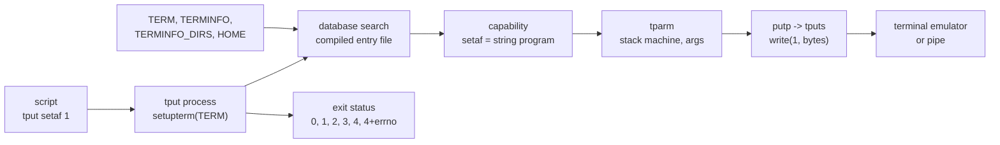

# terminfo and tput

> [!summary] Claim
> `tput` does not know any escape sequences: it looks a capability name up in a compiled terminfo entry chosen by `TERM`, expands its parameter program, and encodes the outcome in an exit status that a script must read before trusting the output.

Part of [Terminals and Job Control](README.md) in [Shell and Unix Engineering](../README.md).

## TL;DR

- Mechanism: `tput NAME [ARG...]` calls `setupterm` on the entry named by `TERM` (or `-T`), looks `NAME` up with `tigetflag`, `tigetnum` or `tigetstr`, runs the string through `tparm`, and writes the bytes with `putp`.
- Rule: test the exit status before using the output; booleans answer through the status, numbers print `-1` with status 0 when absent, strings exit 1 when absent.
- Trap: under `set -e`, `v=$(tput setaf 1)` aborts the whole script on a terminal without `setaf`, and `tput` run once per colour costs a `fork` and `exec` each; batch with `tput -S` or cache the strings.
- Portability: POSIX specifies only `tput [-T type] clear|init|reset`; everything else (exit codes 2 to 4, `-S`, `cols`, `setaf`, `COLUMNS`) is ncurses behavior that macOS and Linux distributions share by shipping ncurses (NetBSD has its own curses and documents different exit statuses, per ncurses tput(1)); BusyBox has no `tput` applet, so a minimal Alpine image has no `tput` at all and the shell reports status 127.
- When not to use it: output that is not a terminal (use no styling at all), or fixed ANSI sequences you control end to end (see [[Escape-Sequences-ECMA-48-and-xterm]]); `tput` is the right tool only when the terminal type is genuinely unknown.

## Mental model



The script starts `tput`, which reads `TERM` and walks the database search path (`TERMINFO`, then `$HOME/.terminfo`, then `TERMINFO_DIRS`, then compiled-in directories) until it finds a compiled entry file for that name.
The capability named on the command line is looked up in that entry; a string capability is a small program for `tparm`, which consumes the arguments and returns the final byte string.
`putp` hands that string to `tputs`, which writes it to standard output, so the script usually captures it with command substitution or lets it flow to the terminal.
Independently of the bytes, `tput` reports success or the reason for failure in its exit status, and that status is the only reliable signal that the terminal lacks a capability.

## How it works

**The database.**
A terminfo source file lists, per terminal, boolean capabilities (`am`), numbers (`cols#80`) and strings (`bold=\E[1m`); `tic` compiles it to a binary file and `infocmp` decompiles it back to source (terminfo(5), tic(1m) and infocmp(1m) via man7.org).
The compiled legacy file starts with a header of six little-endian 16-bit integers: magic number octal 0432 (bytes `1a 01`), the size of the names section, the boolean byte count, the number count, the string offset count and the string table size.
The extended-number format of ncurses 6.1 uses a different magic, octal 01036, and widens the number array from 16 to 32 bits (term(5)).
The lab decodes this header and checks that the file size equals `12 + names + bools + pad + nums * width + offsets * 2 + table`, where `pad` is one byte when `names + bools` is odd.

**The search path.**
ncurses checks the `TERMINFO` directory first, then `$HOME/.terminfo`, then the colon-separated directories in `TERMINFO_DIRS`, then its compiled-in locations (terminfo(5)).
Within a directory the file is named by the first character of the terminal name, as `terminfo/l/labterm`; on case-insensitive filesystems the first character is written as two hex digits instead (term(5)).
The lab shows the Apple variant: tic on the macOS host wrote `6c/labterm` (`0x6c` is `l`), while tic on the Debian 13 image wrote `l/labterm` (as of 2026-11, measured here).
`tic -o DIR` writes to `DIR`, overriding `TERMINFO`; without either it writes to the system database and, failing that, to `$HOME/.terminfo` if that directory exists (tic(1m)).

**The program.**
`tput` is `progs/tput.c` in ncurses.
`main` handles `-T` with `use_env(FALSE); use_tioctl(TRUE); term = optarg;`, exits with `ErrUsage` and the message "No value for $TERM and no -T specified" when there is no terminal name, and exits with `ErrTermType` when `setupterm` fails (ncurses master `progs/tput.c`, `main`).
The constants are `ErrUsage 2`, `ErrTermType 3`, `ErrCapName 4` and `ErrSystem(n)` = `4 + n` (ncurses master `progs/progs.priv.h`).
`tput_cmd` tries `tigetflag` first and returns `exit_code(BOOLEAN, status)`, which is `!value`, so a true boolean exits 0 and a false one exits 1; then `tigetnum`, which prints `%d\n` and always exits 0; then `tigetstr`, which prints through `putp` and exits 0, or exits 1 when the string is absent (ncurses master `progs/tput.c`, `exit_code` and `tput_cmd`).
An unknown name falls out of all three lookups and calls `quit(ErrCapName, "unknown terminfo capability '%s'", name)`.
The library contract behind this: `tigetflag` returns -1 for "not a boolean" and 0 for absent, `tigetnum` returns -2 for "not numeric" and -1 for absent, `tigetstr` returns `(char *)-1` for "not a string" and NULL for absent (curs_terminfo(3x)); that is why an absent number prints `-1` and still exits 0.
The exit-status table in tput(1) lists 1 as "Boolean or numeric capability absent", but `tput_cmd` returns `exit_code(NUMBER, 0)` for every number and the lab measures `lm` as `-1` with status 0; trust the code and the measurement over that table row.

**Parameter strings.**
`tparm` runs a stack machine over the string: `%p1` pushes parameter 1, `%i` adds 1 to the first two parameters, `%d` pops and prints a decimal, and `%? ... %t ... %e ... %;` is if-then-else (terminfo(5)).
So `cup=\E[%i%p1%d;%p2%dH` turns `tput cup 10 20` into `ESC [ 11 ; 21 H`: terminfo counts from 0, ANSI counts from 1.
Padding written as `$<5>` is not interpreted by `tparm`; `tputs` handles it, and values above 30000 are capped (curs_terminfo(3x); `delay_output` clamps to `MAX_DELAY_MSECS`, defined as 30000 in ncurses master `ncurses/curses.priv.h`).

**Environment and size.**
`COLUMNS` and `LINES` in the environment override the terminal size, and `-T` makes `tput` ignore them (tput(1)); the lab shows `COLUMNS=132 tput cols` printing 132 while `COLUMNS=132 tput -T labterm cols` prints 100.

**Batch mode.**
`tput -S` reads one capability per line from standard input in one process.
In `main` each failing command increments a result that starts at `ErrSystem(0)`, so an absent boolean among good names ends the run with a status above 4 and the later names still run; an unknown name calls `quit` at once (ncurses master `progs/tput.c`, `main` and `tput_cmd`).
`bold hs sgr0` through `tput -S` exits 5 and `bold nosuch sgr0` exits 4, on the macOS host and on Debian 13 alike (measured, 2026-11), and lab test 7 asserts both statuses exactly; tput(1) documents only 0, 1 and 4 for `-S`.

**POSIX.**
POSIX.1-2024 specifies `tput [-T type] operand...` with the operands `clear`, `init` and `reset`, where `-T` takes precedence over `TERM`; a missing `TERM` selects "an unspecified default terminal type"; exit status is 0 on success, 2 for usage, 3 for no information on the terminal type, 4 for an invalid operand, and "greater than 4" for an error (POSIX.1-2024 XCU `tput`).
It says an unsupported operand "shall not be considered an error condition" and that output to a non-terminal gives undefined results.
The shell side of the status story is POSIX.1-2024 XCU 2.9.1.3: a command with no command name but with a command substitution completes with the status of the last command substitution, which is what lets `set -e` see a failed `tput` (see [[errexit-Semantics-and-Exceptions]]).

**zsh.**
The `zsh/terminfo` module provides the builtin `echoti cap [arg]` and the associative array `terminfo` mapping capability names to values, so a zsh script can read capabilities without any child process (zsh manual, Zsh Modules).

## Numbers and limits

| Quantity | Value | Source |
| --- | --- | --- |
| `tput` exit statuses | 0, 1, 2 usage, 3 unknown terminal, 4 unknown capability, `4 + errno` system error | tput(1); `progs/progs.priv.h` |
| Status when no `tput` is installed | 127 for every capability, from the shell, not from `tput` | POSIX.1-2024 XCU 2.8.2; shell matrix, Alpine 3.22 image (as of 2026-11) |
| POSIX exit statuses | 0, 1 unspecified, 2, 3, 4, greater than 4 | POSIX.1-2024 XCU `tput` |
| Legacy magic | octal 0432 = 0x011a, file bytes `1a 01` | term(5); decoded by the lab |
| Extended-number magic | octal 01036 = 0x021e, 32-bit numbers | term(5) |
| Legacy entry size limit | 4096 bytes | term(5) |
| Extended entry size limit | 32768 bytes | term(5) |
| Terminal name field | at most 128 bytes | term(5) |
| Padding cap | values above 30000 ms are capped | curs_terminfo(3x) |
| Header of the lab entry | names 30, bools 2, nums 14, offsets 360, table 89, file 881 bytes | probe `header` on plain `tic` output, identical with ncurses 6.0.20150808 on macOS and 6.5.20250216 on Debian 13 (measured 2026-11); lab test 11 asserts these exact fields for the legacy format and that the sizes add up |
| 500 separate `tput bold` calls | 0.98 s total (5 runs, sd 0.07 s), about 2 ms each | `hyperfine` on the macOS host, 2026-11; fork and exec cost on this machine, not a general figure |
| 500 names through one `tput -S` | 8.2 ms total, including `sh` startup | same host, `hyperfine`, 20 runs |
| 500 `$terminfo[bold]` reads in zsh | 7.0 ms total, including `zsh` startup | same host, `hyperfine`, 20 runs |

The first measurement is dominated by process creation; an earlier single run on the same laptop under heavy load took 24.6 s, which shows how much that cost swings.
Treat only the ratio (about two orders of magnitude) as the point, and re-measure on your own machine before quoting it.

## Portability

`tput` and `tic` are external programs, so the shell hardly matters; the table separates what the lab proves from what is only cited.

| Environment | Behavior | Evidence |
| --- | --- | --- |
| POSIX sh | `tput` is an external utility; `command -v tput` prints an absolute path | lab test 12 |
| macOS bash 3.2 (`/bin/sh`, 3.2.57) | same bytes and statuses for all lab probes | lab run with `LAB_SHELL=/bin/sh`, 12 of 12 passed, macOS host |
| current bash (5.3.15) | same | lab run |
| zsh native | `zmodload zsh/terminfo` gives `${terminfo[cols]}` = 100 and `echoti cup 10 20` the same bytes as `tput` | lab test 12 |
| zsh `--emulate sh` | module works; write `${terminfo[cols]}` with braces, because `$terminfo[cols]` printed `no[cols]` | lab test 12 asserts `no[cols]`; zsh 5.9.2 on the macOS host, 2026-11 |
| dash | no `echoti`; `command -v echoti` fails | lab test 12 |
| ksh93 (macOS ksh93u+) | no `echoti` | lab test 12 |
| ksh93u+m 1.0.10, mksh R59 2025/04/26, posh 0.14.1, BusyBox ash 1.37, bash 5.2.37 | no terminfo builtin; `command -v echoti` fails; 12 of 12 on a Debian 13 image with ncurses-bin 6.5+20250216-2 | lab test 12, shell matrix 2026-11-03 |
| yash, mksh R59 2020/10/31 on Alpine 3.22 | no terminfo builtin; those images ship no `tput` or `tic` (next rows), so the lab asserts the 127 branch there; all 13 Alpine shells (BusyBox ash, bash 3.2.57, 4.4.23, 5.1.16, 5.2.37, 5.3.20, dash, mksh, yash, zsh, `zsh --emulate sh`) passed 12 of 12 | lab tests 1 to 12, shell matrix 2026-11-03, image without ncurses |
| Linux and macOS `tput` | ncurses: macOS here is ncurses 6.0.20150808, Debian 13 is ncurses 6.5.20250216; NetBSD instead has its own curses, whose documented exit statuses "correspond to neither ncurses nor X/Open Curses"; FreeBSD and OpenBSD not checked here | `tput -V`, measured 2026-11; ncurses tput(1) PORTABILITY |
| Alpine 3.22 without the `ncurses` package | no `tput`, `tic` or `infocmp`: `command -v tput` fails and `tput cols` exits 127 in every shell; the `ncurses` package supplies `tput`, `tic`, `infocmp`, `clear`, `reset` and `tset`, and `ncurses-terminfo-base` supplies `/etc/terminfo/v/vt100` and friends | shell matrix (the first lab failed with `tic: command not found`); pkgs.alpinelinux.org contents, as of 2026-11 |
| BusyBox 1.37 | documented applets include `clear` and `reset` but no `tput`, `tic` or `infocmp`; the lab asserts `busybox --list` lacks all three | BusyBox applet documentation, as of 2026-11; `busybox --list` in the Alpine 3.22 image (1.37.0) |
| uutils coreutils | no `tput` utility: none of `tput`, `tic`, `infocmp`, `clear`, `reset` or `tset` in the `Cargo.toml` feature lists | uutils `Cargo.toml` on main, as of 2026-11 |
| zsh `zsh/terminfo` without `tput` | reads the system database through libncurses, so `TERM=vt100` gives `${terminfo[cols]}` = 80 and the same `cup` bytes as `tput`, with no `tput` or `tic` on the machine | lab test 12 (branch for images without ncurses); passed under zsh and `zsh --emulate sh` in the Alpine 3.22 image, whose `libncursesw` and `ncurses-terminfo-base` (`/etc/terminfo/v/vt100`) are installed without the `ncurses` package (shell matrix 2026-11-03, measured) |
| Database layout | one-letter directory on Linux; two-digit hex directory (`6c`) on the macOS host | lab test 11 accepts either and requires exactly one |

Classification: a missing `tput` is POSIX-conforming shell behavior, not a `tput` property: "If the command is not found, the exit status shall be 127" (POSIX.1-2024 XCU 2.8.2).
The absence itself is a packaging fact: BusyBox implements neither `tput` nor `tic`, and Alpine ships them in a separate package; nothing about it is a bug, and it is not found in the BusyBox changelog as of 2026-11.

## Worked example

The lab is [lab](../labs/02-terminfo-and-tput/).
It compiles the hermetic terminal `labterm` from `lab.ti` into a scratch directory, so no system entry is needed.
When no `tput` is on `PATH` (a minimal Alpine image), `have_ncurses` in `terminfo.bats` is false and every test asserts the real failure instead: status 127 from the shell, an untouched scratch database, and a `busybox --list` without `tput`, `tic` or `infocmp`.

Simplified excerpt of `lab.ti`:

```
labterm|labalias|lab terminal,
	am, cols#100, lines#30, colors#256,
	bold=\E[1m, sgr0=\E[m,
	cup=\E[%i%p1%d;%p2%dH,
	setaf=\E[%?%p1%{8}%<%t3%p1%d%e%p1%{16}%<%t9%p1%{8}%-%d%e38;5;%p1%d%;m,
	labseq=\E[99m,
```

Simplified excerpt of `terminfo.bats` (feature detection and the first test's two branches):

```sh
have_ncurses() {
  command -v tput >/dev/null 2>&1
}

@test "tput exit status: boolean true 0, boolean false 1, absent number -1 with 0, absent string 1" {
  if ! have_ncurses; then
    absent_status am # rc=127 hex= for am, hs, cols, lm, bold and blink alike
    return 0
  fi
  run_lab "$PROBE" status am
  [ "$output" = "rc=0 hex=" ]
  ...
}
```

Simplified excerpt of `probe_terminfo.sh` (the `status` and `cache-*` modes):

```sh
status)
  out=$(
    tput "$@" 2>/dev/null
    printf 'rc=%s' "$?"
  )
  rc=${out##*rc=}
  body=${out%rc=*}
  h=$(printf "%s" "$body" | hex)
  printf "rc=%s hex=%s\n" "$rc" "$h"
  ;;
cache-unsafe)
  set -e
  val=$(tput "$@" 2>/dev/null)
  ...
```

Output captured on the macOS host (bash 5.3.15, ncurses 6.0.20150808, 2026-11), with `TERM=labterm` and `TERMINFO` pointing at the scratch database:

```
$ probe_terminfo.sh status am         rc=0 hex=
$ probe_terminfo.sh status hs         rc=1 hex=
$ probe_terminfo.sh status cols       rc=0 hex=3130300a
$ probe_terminfo.sh status lm         rc=0 hex=2d310a
$ probe_terminfo.sh status blink      rc=1 hex=
$ probe_terminfo.sh status cup 10 20  rc=0 hex=1b5b31313b323148
$ probe_terminfo.sh status setaf 196  rc=0 hex=1b5b33383b353b3139366d
$ probe_terminfo.sh cache-safe blink  reached cached=
$ probe_terminfo.sh cache-unsafe blink  (no output, exit status 1)
printf 'bold\nhs\nsgr0\n'     | tput -S    -> 1b5b316d1b5b6d, status 5
printf 'bold\nnosuch\nsgr0\n' | tput -S    -> 1b5b316d, status 4
```

Reading it: `am` is true (status 0, no bytes), `hs` is false (status 1), `cols` prints `100\n`, the absent number `lm` prints `-1\n` with status 0, and the absent string `blink` exits 1.
`cup 10 20` yields `ESC [ 11 ; 21 H`.
The unguarded capture dies at the assignment, so `reached` never prints.
The lab passed 12 of 12 tests under `sh` (bash 3.2 in POSIX mode), bash 5.3.15, dash, zsh, `zsh --emulate sh` and the macOS ksh93u+ on this host.
In the shell matrix of 2026-11-03 it passed 12 of 12 on the Debian 13 image under dash, bash 5.2.37, posh, ksh93u+m 1.0.10, mksh R59 2025/04/26, BusyBox ash, zsh and `zsh --emulate sh`.
The first version passed 0 of 12 in all 13 shells of the Alpine 3.22 image, because the image has no ncurses package and `setup` died on `tic: command not found`; that failure is the finding behind the `have_ncurses` branch.
The no-ncurses branch was exercised here by removing `tput` and `tic` from `PATH` under `sh`, dash, zsh, `zsh --emulate sh` and macOS ksh93u+, all 12 of 12, and in the shell matrix of 2026-11-03 it passed 12 of 12 in all 13 shells of the Alpine 3.22 image.

## Pitfalls

> [!warning] Unguarded capture under errexit
> Trigger: `set -e` and `bold=$(tput bold)` or `red=$(tput setaf 1)` on a terminal such as `dumb` that lacks the capability.
> Symptom: the script exits silently at the assignment, because the status of a command-only-substitution assignment is the substitution's (POSIX.1-2024 XCU 2.9.1.3); the lab's `cache-unsafe` exits 1 with no output.
> Fix: `red=$(tput setaf 1 2>/dev/null) || red=` and use `"$red"` unconditionally.

> [!warning] A missing tput is status 127, not 1
> Trigger: a minimal container (Alpine without the `ncurses` package, any BusyBox-only image) running a script that styles its output with `tput`.
> Symptom: the shell reports 127 for every capability, so a test such as `[ "$(tput colors 2>/dev/null)" -ge 8 ]` sees an empty string and errors, `tput -S` never runs, and under `set -e` the unguarded `red=$(tput setaf 1)` aborts with status 127 (lab tests 1 and 6, no-ncurses branch).
> Fix: `command -v tput >/dev/null 2>&1 || styling=off` once at startup, and keep the `|| red=` guard on every capture; install `ncurses` where styling matters.

> [!warning] Trusting the output without the status
> Trigger: `n=$(tput colors)` then `[ "$n" -ge 8 ]`.
> Symptom: a terminal without `colors` prints `-1` with status 0, so a script that only tests the status believes the capability exists, and a script that does arithmetic on a missing string capability gets an empty value.
> Fix: check the value for numbers (`-1` means absent) and the status for booleans and strings; the lab asserts all three shapes.

> [!warning] One process per escape sequence
> Trigger: calling `tput` inside a loop or a prompt function.
> Symptom: one `fork` and `exec` per call; 500 calls took 0.98 s on the measured host, against 8.2 ms for one `tput -S` (`hyperfine`, 2026-11).
> Fix: read the strings once at startup, or batch with `printf 'bold\nsgr0\n' | tput -S`; zsh users get `$terminfo` for free.

> [!warning] Forgetting that `tput -S` stops at an unknown name
> Trigger: a generated list of capabilities with one typo.
> Symptom: `tput` calls `quit` with status 4 and the later names never run; an absent but valid boolean does not stop the batch and yields a status above 4 instead (`progs/tput.c` `main`, measured 5 on the macOS host and on Debian 13; lab test 7 asserts the abort and the exact statuses 5 and 4).
> Fix: validate names first with `infocmp -1 "$TERM"`, and test the status of the batch.

> [!warning] Unknown capabilities need `tic -x`
> Trigger: a custom entry with a non-standard capability such as `labseq`.
> Symptom: plain `tic` reports "unknown capability" and drops it (warning text measured on the macOS host and Debian 13), and `tput labseq` exits 4 (lab test 10).
> Fix: compile with `tic -x` (tic(1m): treat unknown capabilities as user-defined).

> [!warning] Parsing the wrong database
> Trigger: a stale `TERMINFO` or `TERMINFO_DIRS` in the environment, or a terminal name that exists only in the first directory searched.
> Symptom: `TERMINFO` beats `TERMINFO_DIRS` and the first listed directory wins, so `tput cols` returned 100 or 90 depending only on order (lab test 8).
> Fix: print `infocmp -1 "$TERM" | head -1`, which names the file it read.

## Security and robustness

- The compiled entry is untrusted binary input to a C parser.
  CVE-2023-29491 (published 2023-04-14, CVSS 3.1 base 7.8) covers ncurses before 6.4 20230408 used by a setuid application: malformed data in a terminfo file found through `$HOME/.terminfo`, `TERMINFO` or `TERM` allows local memory corruption (NVD).
  Never let a privileged program honor `TERMINFO`, `TERMINFO_DIRS` or `HOME` from an unprivileged caller, and never accept a terminfo file from an untrusted source.
- `TERM` comes from whatever started the session and selects a file path, so treat it as data and never interpolate it into a path yourself.
- Capability strings go to a terminal that may interpret them; strings from a database you do not control belong to the same threat class as [[Terminal-Escape-Injection]].
- `tput` output is only meaningful on a terminal (POSIX: undefined if standard output is not a terminal device); guard styling with `[ -t 1 ]` or the project convention for `NO_COLOR`.
- A missing `TERM` is exit 2 in ncurses but "an unspecified default" in POSIX, so a script that must run in cron should set `-T` explicitly or skip styling.

## The principal's view

The decision is whether a program should ask the terminal database at all.
Most modern tools hard-code ANSI and xterm sequences, test `[ -t 1 ]`, honor `NO_COLOR`, and keep terminfo only for the long tail; that is simpler and has no per-call process cost, at the price of being wrong on a real VT52 or a broken `TERM`.
Remember that `tput` is a package, not a given: BusyBox has no applet for it, so a minimal container needs `ncurses` installed or a styling-off path chosen by `command -v tput`.
Use `tput` when correctness on unknown terminals is a stated requirement (installers, system scripts, curses-like tools), and then cache every string at startup, guard every capture, and test with `TERM=dumb` and with an unset `TERM`.
Move to a compiled language with a curses or terminfo binding when the program draws a full screen, and to the shell's own facility when it exists (zsh `$terminfo`).
The trade-off to name: portability to unknown terminals against start-up latency and a larger attack surface (a binary parser reading environment-selected files).

## Interview questions

> [!question] L5: What does `tput cols` print when `COLUMNS=132` is set and stdout is a pipe?
>
> > [!success]- Answer
> > It prints 132.
> > The environment variable overrides the size taken from the terminal or the database (tput(1)).
> > Adding `-T type` makes `tput` ignore `LINES` and `COLUMNS`.
> >
> > Follow-up: What would it print with `-T labterm`, and where does that number come from?

> [!question] L5: How does a script learn that a terminal has no `setaf`?
>
> > [!success]- Answer
> > `tput setaf 1` exits 1 and writes nothing, provided an ncurses `tput` is installed; where there is none (BusyBox, Alpine without `ncurses`) the shell itself reports 127.
> > A boolean capability uses status 1 for false, a numeric capability prints `-1` with status 0, and a string capability exits 1 when absent.
> >
> > Follow-up: Which status does an unknown capability name give, and which an unknown terminal?

> [!question] L5: Predict the output. With `TERM=labterm` from the lab, what do these print?
>
> ```sh
> tput lm; echo "rc=$?"
> tput hs; echo "rc=$?"
> tput cup 10 20 | od -An -tx1
> ```
>
> > [!success]- Answer
> > The first prints `-1` then `rc=0`, because `lm` is an absent numeric capability.
> > The second prints only `rc=1`, because `hs` is a false boolean.
> > The third prints `1b 5b 31 31 3b 32 31 48`, which is `ESC [ 11 ; 21 H`, because `%i` adds 1 to both parameters.
> >
> > Follow-up: Why is the row 11 rather than 10?

> [!question] L6: Debug this script. It exits silently on `TERM=dumb`.
>
> ```sh
> #!/bin/sh
> set -e
> red=$(tput setaf 1)
> echo "${red}error"
> ```
>
> > [!success]- Answer
> > `dumb` has no `setaf`, so `tput` exits 1 (on an image with no `tput` at all the shell would report 127, with the same silent abort).
> > A simple command that is only an assignment with a command substitution takes the substitution's status (POSIX.1-2024 XCU 2.9.1.3), and `set -e` exits.
> > Write `red=$(tput setaf 1 2>/dev/null) || red=`.
> >
> > Follow-up: Why does `echo "$(tput setaf 1)"` not abort, and is that better?

> [!question] L6: In what order does ncurses search for a terminal entry?
>
> > [!success]- Answer
> > `TERMINFO` first, then `$HOME/.terminfo`, then each directory of `TERMINFO_DIRS`, then the compiled-in directories (terminfo(5)).
> > The lab confirms `TERMINFO` beats `TERMINFO_DIRS` and that the first listed directory in `TERMINFO_DIRS` wins.
> >
> > Follow-up: Why is honoring these variables dangerous in a setuid program?

> [!question] L6: Why is `tput -S` faster than a loop, and what does it do on an unknown name?
>
> > [!success]- Answer
> > It reads many names in one process, so there is one `exec` instead of one per name.
> > On an unknown name it exits 4 immediately and runs no later name.
> > An absent boolean does not stop it, and the final status is above 4.
> >
> > Follow-up: How would you validate a list of names before sending it?

> [!question] L6: Why does `tput labseq` fail after compiling `lab.ti` with plain `tic`?
>
> > [!success]- Answer
> > `labseq` is not a standard capability name, and plain `tic` drops unknown capabilities with a warning.
> > `tic -x` keeps it as a user-defined capability.
> > Without it `tput` exits 4.
> >
> > Follow-up: What does the compiled file look like when extended capabilities are present, and how did the lab's size check change?

> [!question] L7+: Design the colour support of a command-line tool that must work over SSH, in CI, in tmux and on `TERM=dumb`.
>
> > [!success]- Answer
> > Decide from the stream first: not a terminal, or `NO_COLOR` set, means no styling.
> > Then decide the vocabulary: hard-coded ANSI for a known-capable `TERM`, terminfo for the long tail.
> > Read capabilities once at startup into variables, guard every lookup against missing capabilities, and never call `tput` per line.
> > Test with `dumb`, unset `TERM`, and a database without `colors`.
> >
> > Follow-up: What do you do about a user whose `TERM` names an entry the target host lacks (for example `xterm-kitty` over SSH)?

> [!question] L7+: A setuid helper calls `setupterm`. What is the threat model, and what do you change?
>
> > [!success]- Answer
> > The entry file is attacker-chosen binary data when `TERMINFO`, `TERMINFO_DIRS`, `HOME` or `TERM` come from the caller; CVE-2023-29491 is memory corruption from such a file in ncurses before 6.4 20230408.
> > Clear or pin those variables before the first library call, upgrade ncurses, and avoid terminfo in privileged code.
> > Output sanitization is a separate concern covered by [[Terminal-Escape-Injection]].
> >
> > Follow-up: Does dropping privileges before `setupterm` fully fix it?

## Related

Prerequisites: [[Escape-Sequences-ECMA-48-and-xterm]]

Next: [[Job-Control-Signals]]

See also: [[Terminal-Escape-Sequences-and-Unicode]], [[Terminal-Emulators-and-TERM]], [[termios-and-stty]], [[errexit-Semantics-and-Exceptions]], [[Terminal-Escape-Injection]]

## Further reading

- POSIX.1-2024 XCU `tput` (https://pubs.opengroup.org/onlinepubs/9799919799/utilities/tput.html): the minimal portable contract, three operands and the exit-status table.
- POSIX.1-2024 XCU 2.9.1.3 (https://pubs.opengroup.org/onlinepubs/9799919799/utilities/V3_chap02.html): why a failed command substitution in an assignment reaches `set -e`.
- ncurses tput(1) (https://man7.org/linux/man-pages/man1/tput.1.html): exit statuses, `-S`, `-T`, `COLUMNS` and `LINES`.
- ncurses terminfo(5) (https://man7.org/linux/man-pages/man5/terminfo.5.html): the capability language, the stack operators, padding and the search order.
- ncurses term(5) (https://man7.org/linux/man-pages/man5/term.5.html): the compiled file format, magic numbers and limits.
- ncurses curs_terminfo(3x) (https://man7.org/linux/man-pages/man3/curs_terminfo.3x.html): the return-value contract of `tigetflag`, `tigetnum`, `tigetstr` and `tparm`.
- ncurses `progs/tput.c` (https://raw.githubusercontent.com/ThomasDickey/ncurses-snapshots/master/progs/tput.c): the source of the exit-status logic quoted above.
- NVD CVE-2023-29491 (https://services.nvd.nist.gov/rest/json/cves/2.0?cveId=CVE-2023-29491): the setuid terminfo parsing vulnerability.
- zsh manual, Zsh Modules (https://zsh.sourceforge.io/Doc/Release/Zsh-Modules.html): the `zsh/terminfo` module, `echoti` and `$terminfo`.
