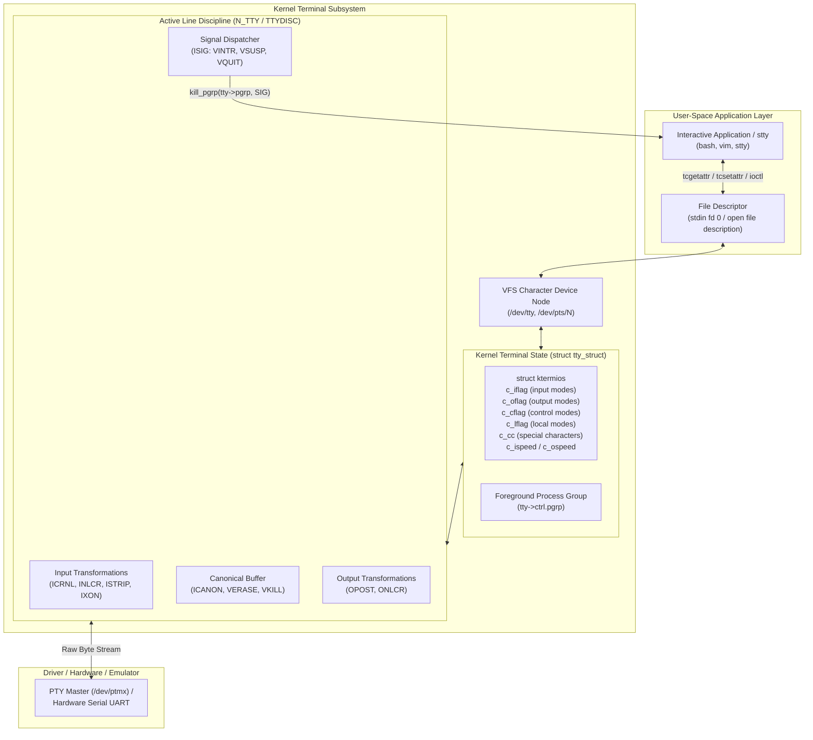

# termios and stty

> [!summary] Claim
> The POSIX termios API and the stty utility configure the kernel terminal device description that governs asynchronous serial communications and pseudo-terminals, controlling baud rates, character conversions, hardware and software flow control, canonical line editing, and process-group signal translation.

Part of [Terminals and Job Control](README.md) in [Shell and Unix Engineering](../README.md).

## TL;DR

Terminal configuration is device-level kernel state stored in `struct termios` and manipulated via `tcgetattr()`, `tcsetattr()`, and `ioctl(TCGETS)` or `ioctl(TCSETS)`, which `stty` reads and modifies through standard input.
Always capture original terminal settings with `saved=$(stty -g)` before changing attributes, and enforce restoration with `trap 'stty "${saved}" 2>/dev/null || true' EXIT` plus `trap 'exit 130' INT`, `trap 'exit 143' TERM` and `trap 'exit 129' HUP`, because a signal trap that does not call `exit` lets the script carry on after the signal.
Terminal attributes adhere to the underlying kernel terminal description rather than the process or file descriptor, meaning changes executed inside a subshell like `(stty -echo)` or in a pipeline stage permanently mutate the terminal for the parent shell and all sibling processes.
The output of `stty -g` is formatted as colon-separated hexadecimal values on Linux GNU coreutils, formatted as keyword assignment strings on macOS and BSD, and is specified by POSIX only as an unspecified form that another `stty` "on the same system" can apply (POSIX.1-2024 XCU stty, `-g`).
Never invoke `stty` or `tcsetattr()` in non-interactive batch jobs or background processes without an allocated terminal, where calls fail with `ENOTTY` or cause the kernel to deliver `SIGTTOU`, suspending the process group.

## Mental model



When an application invokes `tcgetattr()` or runs `stty -a`, the user-space process issues a device `ioctl` system call against an open file descriptor referencing a terminal device.
The kernel character device subsystem locates the underlying `struct tty_struct`, reading the current attributes from its internal `termios` structure.
When `tcsetattr()` or `stty` requests attribute changes, the kernel verifies whether the calling process is a member of the terminal foreground process group; background callers are suspended via `SIGTTOU`.
Once validated, the kernel copies the configuration into `tty->termios` and notifies the active line discipline through `ld->ops->set_termios()`.
The line discipline immediately adapts its byte-processing logic, determining whether incoming carriage returns map to newlines (`ICRNL`), whether output lines append carriage returns (`ONLCR`), whether typed glyphs echo to the display (`ECHO`), and whether control characters trigger process-group signals (`ISIG`).
Because this configuration resides entirely within the kernel device structure, every process holding a file descriptor pointing to that terminal description instantly observes and is governed by the updated attributes.

## How it works

### The struct termios Definition

The general terminal interface is standardized in POSIX.1-2024 Base Definitions Chapter 11 and `<termios.h>` (POSIX.1-2024 XBD 13).
Terminal behavior is governed by the `termios` structure, which groups attributes into four bitmasks, a special character array, and transmission speed fields:

```c
struct termios {
  tcflag_t c_iflag;      /* input modes */
  tcflag_t c_oflag;      /* output modes */
  tcflag_t c_cflag;      /* control modes */
  tcflag_t c_lflag;      /* local modes */
  cc_t     c_cc[NCCS];   /* control characters */
  speed_t  c_ispeed;     /* input baud rate */
  speed_t  c_ospeed;     /* output baud rate */
};
```

1. **Input Modes (`c_iflag`):**
   Controls the transformation and flow of incoming bytes before the line discipline buffers them (POSIX.1-2024 XBD 11.2.2).
   `BRKINT`: Maps a serial break condition to `SIGINT`.
   `IGNBRK`: Discards serial break conditions.
   `ICRNL`: Maps incoming carriage return (`\r`, 0x0d) to newline (`\n`, 0x0a).
   `INLCR`: Maps incoming newline to carriage return.
   `IGNCR`: Discards all carriage returns.
   `ISTRIP`: Masks off the eighth bit of each received byte, enforcing 7-bit ASCII.
   `IXON`: Enables software output flow control; receiving `VSTOP` (`Ctrl+S`) pauses output, receiving `VSTART` (`Ctrl+Q`) resumes it.
   `IXOFF`: Enables software input flow control, sending `VSTOP` to the remote sender when internal input buffers fill.

2. **Output Modes (`c_oflag`):**
   Governs how application bytes are modified before transmission to the display (POSIX.1-2024 XBD 11.2.3).
   `OPOST`: Master switch enabling output post-processing.
   `ONLCR`: Maps outgoing newline (`\n`) to carriage return plus newline (`\r\n`).
   `OCRNL`: Maps outgoing carriage return to newline.
   `ONOCR`: Suppresses carriage returns if the cursor is at column 0.
   `ONLRET`: Causes newline to perform the carriage return function.

3. **Control Modes (`c_cflag`):**
   Controls hardware line characteristics (POSIX.1-2024 XBD 11.2.4).
   `CSIZE`: Bitmask specifying character bit width (`CS5`, `CS6`, `CS7`, `CS8`).
   `CSTOPB`: Sets two stop bits instead of one.
   `CREAD`: Enables the receiver hardware; if cleared, no incoming characters are accepted.
   `PARENB`: Enables parity generation and detection.
   `PARODD`: Selects odd parity when `PARENB` is set; if cleared, parity is even.
   `HUPCL`: Lowers modem control lines (hangs up connection) when the last process closes the device.
   `CLOCAL`: Ignores modem status lines, configuring a direct local connection.

4. **Local Modes (`c_lflag`):**
   Governs user-interaction semantics, line editing, echoing, and signal dispatching (POSIX.1-2024 XBD 11.2.5).
   `ICANON`: Enables canonical line mode (input assembled line-by-line; erase and kill processing active).
   `ECHO`: Echoes typed input characters back to the terminal output.
   `ECHOE`: Visual erase; echoing backspace-space-backspace when `VERASE` is typed.
   `ECHOK`: Visual kill; echoing newline or erasing the current line when `VKILL` is typed.
   `ECHONL`: Echoes newline even if `ECHO` is disabled (used in password prompts).
   `ISIG`: Translates control characters into signals (`VINTR` -> `SIGINT`, `VQUIT` -> `SIGQUIT`, `VSUSP` -> `SIGTSTP`).
   `NOFLSH`: Disables flushing of input and output queues upon signal generation.
   `TOSTOP`: Generates `SIGTTOU` when a background process attempts to write to the terminal.
   `IEXTEN`: Enables extended implementation-defined input processing (`VWERASE`, `VLNEXT`, `VREPRINT`).

5. **Special Control Characters (`c_cc`):**
   An array indexed by symbolic constants defining character values for editing and signaling (POSIX.1-2024 XBD 11.1.9).
   Standard indices include `VINTR` (`^C`), `VQUIT` (`^\`), `VERASE` (`^?`), `VKILL` (`^U`), `VEOF` (`^D`), `VEOL`, `VEOL2`, `VSUSP` (`^Z`), `VSTART` (`^Q`), `VSTOP` (`^S`).
   In non-canonical mode (`-icanon`), the `c_cc` entries `VMIN` and `VTIME` control read blocking thresholds; POSIX allows them to share array slots with `VEOF` and `VEOL` (POSIX.1-2024 XBD `<termios.h>`: subscripts "shall be distinct, except that the VMIN and VTIME subscripts may have the same values as the VEOF and VEOL subscripts"), but neither Linux nor macOS does so: Linux has `VEOF=4`, `VEOL=11`, `VMIN=6`, `VTIME=5` and macOS has `VEOF=0`, `VEOL=1`, `VMIN=16`, `VTIME=17` (measured with a C probe on Debian 13, Alpine 3.22 and macOS 27, as of 2026-11).

### System Calls and Kernel Implementation

POSIX standardizes terminal control only through the `<termios.h>` functions (POSIX.1-2024 XSH `tcgetattr`, `tcsetattr`); `ioctl()` is not in the POSIX.1-2024 system interfaces at all (it left with STREAMS, and `functions/ioctl.html` is absent from the 2024 edition), so every terminal `ioctl` request is an implementation extension:

```c
int tcgetattr(int fildes, struct termios *termios_p);
int tcsetattr(int fildes, int optional_actions, const struct termios *termios_p);
```

Under Linux (in glibc `sysdeps/unix/sysv/linux/tcgetattr.c`, glibc 2.41 and earlier, as shipped in Debian 13), `tcgetattr()` executes:
```c
ioctl(fd, TCGETS, termios_p);
```
Since glibc 2.42 the same file issues `ioctl(fd, TCGETS2, &k_termios)` on a kernel `struct termios2` and copies the fields out (symbol version `GLIBC_2_42`), and `tcsetattr()` can use the `TCSETS2` family, so arbitrary baud rates survive the round trip (glibc master source, as of 2026-11).
Under macOS Darwin and the BSDs (the BSD libc implementation is FreeBSD `lib/libc/gen/termios.c`), `tcgetattr()` executes:
```c
ioctl(fd, TIOCGETA, termios_p);
```

The `tcsetattr()` function takes an `optional_actions` argument that controls timing and queue synchronization:
- `TCSANOW`: Applies changes immediately.
  Under Linux, this maps to `ioctl(fd, TCSETS, termios_p)` (in kernel `drivers/tty/tty_ioctl.c`, calling `set_termios(real_tty, p, TERMIOS_OLD)`).
  Under macOS and BSD, this maps to `ioctl(fd, TIOCSETA, termios_p)`.
- `TCSADRAIN`: Waits until all queued output has been transmitted before modifying attributes.
  Under Linux, this maps to `ioctl(fd, TCSETSW, termios_p)`, which calls `wait_event_interruptible(tty->write_wait, !tty_chars_in_buffer(tty))` before applying changes (`set_termios()` in `drivers/tty/tty_ioctl.c`).
  Under macOS and BSD, this maps to `ioctl(fd, TIOCSETAW, termios_p)`.
- `TCSAFLUSH`: Waits until all output has drained, and discards all pending unread input before applying changes.
  Under Linux, this maps to `ioctl(fd, TCSETSF, termios_p)`, invoking `ld->ops->flush_buffer(tty)` to purge the input circular buffer.
  Under macOS and BSD, this maps to `ioctl(fd, TIOCSETAF, termios_p)`.

### The Partial Success Trap

POSIX defines a specific behavioral contract for `tcsetattr()` (POSIX.1-2024 XSH tcsetattr):
If an implementation cannot support every requested attribute or baud rate, but can apply at least one requested change, `tcsetattr()` must apply the supported subset and return 0 (success).
It returns -1 and sets `errno = EINVAL` only if none of the requested attributes could be applied (POSIX.1-2024 XSH tcsetattr: "shall return successfully if it was able to perform any of the requested actions, even if some of the requested actions could not be performed").
The trap is easy to hit on a Linux pty: `pty_set_termios()` in `drivers/tty/pty.c` forces `CS8 | CREAD` and clears `PARENB`, so `stty raw -echo cs7 -ixon` on a pty reports `unable to perform all requested operations` (GNU) or `cannot perform all requested operations` (BusyBox) and exits 1, although every other setting was applied (measured on Debian 13 and Alpine 3.22, as of 2026-11).
Consequently, production software (such as GNU coreutils `src/stty.c`, `main()`) must execute `tcgetattr()` immediately after `tcsetattr()` and compare the resulting structure with the requested structure using `eq_mode()`:

```c
/* GNU coreutils src/stty.c (simplified excerpt) */
if (tcsetattr(STDIN_FILENO, tcsetattr_options, &mode))
  error(EXIT_FAILURE, errno, "%s", quotef(device_name));

if (tcgetattr(STDIN_FILENO, &new_mode))
  error(EXIT_FAILURE, errno, "%s", quotef(device_name));

if (!eq_mode(&mode, &new_mode)) {
  /* Handle partial failure: settings could not be completely applied */
}
```

### Background Execution and SIGTTOU

When a process attempts to change terminal modes via `tcsetattr()` or `stty`, the kernel performs a security and session check via `tty_check_change(tty)` (Linux `drivers/tty/tty_jobctrl.c`):

```c
/* Linux drivers/tty/tty_jobctrl.c __tty_check_change */
if (tty_pgrp && pgrp != tty_pgrp) {
  if (is_ignored(sig)) {
    if (sig == SIGTTIN)
      ret = -EIO;
  } else if (is_current_pgrp_orphaned()) {
    ret = -EIO;
  } else {
    kill_pgrp(pgrp, sig, 1);
    set_thread_flag(TIF_SIGPENDING);
    ret = -ERESTARTSYS;
  }
}
```

If the calling process group is in the background:
1. If the process is ignoring or blocking `SIGTTOU`, the kernel allows the modification to succeed immediately and sends no signal.
2. If the process group is orphaned (has no parent in another process group within the session), the system call fails with `errno = EIO`, preventing processes that can never be continued from hanging.
3. Otherwise, the kernel sends `SIGTTOU` to the background process group.
   With the default disposition the group stops until the user brings it to the foreground with `fg`, and the interrupted call is restarted.
   If the process catches `SIGTTOU` with a handler installed without `SA_RESTART`, the handler runs and `tcsetattr()` returns -1 with `errno = EINTR`, and the terminal is left unchanged.

This is the POSIX contract, not a Linux extension: POSIX.1-2024 XSH tcsetattr states that a blocking or ignoring caller completes normally with no signal, that any other background caller has `SIGTTOU` sent to its process group, and lists `EINTR` and `EIO` (orphaned group, signal neither blocked nor ignored) among the errors.
The lab confirms all three non-orphaned outcomes on macOS 27, Alpine 3.22 and Debian 13 (the orphaned case is from the kernel source only): a caught signal gives `tcsetattr=FAIL errno=EINTR changed=0`, and an ignored or a blocked signal gives `tcsetattr=OK changed=1` with the handler never run (measured in the shell matrix, as of 2026-11).

### A Pseudo-Terminal Slave After Its Master Closes

The kernel terminal state of a pseudo-terminal lives only as long as its master side is open: when the last master descriptor closes, both Linux and macOS hang up the slave, but they part ways on the termios calls.
On Linux `pty_close()` ends with `tty_vhangup()` on the slave, whose open files are then served by `hung_up_tty_ioctl()`, which returns `ENOTTY` for `TIOCSPGRP` and `EIO` for every other request (Linux `drivers/tty/pty.c` and `drivers/tty/tty_io.c`).
Consequently `tcgetattr()`, `tcsetattr()` and `TIOCSCTTY` on the slave all fail with `EIO` and `tcsetpgrp()` fails with `ENOTTY` (measured on Alpine 3.22 and Debian 13); the session never acquires a controlling terminal, so no `SIGTTOU` can be generated.
On macOS 27 the slave is hung up too (the session leader gets `SIGHUP`, reads return end-of-file and writes fail with `EIO`, as the [[Pseudo-Terminals]] lab measures), yet `tcgetattr()` and `tcsetattr()` on it both still succeed (measured in the shell matrix, as of 2026-11).
POSIX.1-2024 XBD 11.1.10 specifies only that after a hang-up a read returns end-of-file and a write fails with `EIO`; it says nothing about the termios calls, so both behaviors conform.
A test harness that closes its master descriptor right after `fork()` therefore passes on macOS and fails on Linux, because the child's `tcsetattr()` runs against a hung-up terminal; keep the master open until the child has been reaped.

### Line Control Functions

Beyond `tcgetattr()` and `tcsetattr()`, `<termios.h>` defines dedicated line control routines:
- `tcdrain(int fildes)`: Suspends execution until all output written to `fildes` has been physically transmitted (POSIX.1-2024 XSH tcdrain).
- `tcflush(int fildes, int queue_selector)`: Flushes unread input (`TCIFLUSH`), unwritten output (`TCOFLUSH`), or both (`TCIOFLUSH`) (POSIX.1-2024 XSH tcflush).
- `tcflow(int fildes, int action)`: Suspends output transmission (`TCOOFF`), restarts output (`TCOON`), transmits a STOP character (`TCIOFF`), or transmits a START character (`TCION`) (POSIX.1-2024 XSH tcflow).
- `tcsendbreak(int fildes, int duration)`: Transmits a continuous stream of zero-valued bits for a specific duration (POSIX.1-2024 XSH tcsendbreak).
- `tcgetsid(int fildes)`: Returns the process group ID of the session for which the terminal is the controlling terminal, which is the session leader's process ID (POSIX.1-2024 XSH tcgetsid).
- `tcgetwinsize(int fildes, struct winsize *winsize_p)` and `tcsetwinsize(int fildes, const struct winsize *winsize_p)`: Newly standardized in POSIX.1-2024 Issue 8, portably retrieving and setting row and column dimensions without ad hoc `ioctl(TIOCGWINSZ)` calls (POSIX.1-2024 XSH tcgetwinsize, tcsetwinsize).

### The stty Command Line Interface

The `stty` utility exposes the underlying `termios` API to shell scripts (POSIX.1-2024 XCU `stty`).
It operates on the terminal device attached to its standard input descriptor (`STDIN_FILENO`).
- `stty -a`: Displays all current terminal settings in human-readable form.
- `stty -g`: Writes settings to standard output in a compact, implementation-defined string that can be passed directly as arguments to another `stty` command on the same host system to restore terminal state.
- `stty sane`: Resets parameters to "some reasonable, unspecified, values" (POSIX.1-2024 XCU stty), so the set is the userland's.
  All three userlands in the matrix restore `cread`, `icanon`, `isig`, `iexten`, `echo`, `echoe`, `icrnl`, `opost` and `onlcr`; GNU and BusyBox also set `echok` but leave `ixon` alone, while macOS resets to its `TTYDEF_*` defaults, which include `ixon` but not `echok` (measured: after `stty -ixon; stty sane`, GNU and BusyBox still show `-ixon` and macOS shows `ixon`, as of 2026-11).
- Specifying devices: In portable POSIX scripts, standard input redirection `stty < /dev/ttyUSB0` must be used.
  GNU coreutils supports `stty -F /dev/ttyUSB0`, while BSD and macOS `stty` support `stty -f /dev/ttyUSB0`.

## Numbers and limits

| Limit / Metric | POSIX.1-2024 Standard | Linux 6.x (as of 2026-11) | macOS Darwin (as of 2026-11) | Sourced / Lab Verified |
|---|---|---|---|---|
| `sizeof(struct termios)` | Unspecified | 60 bytes (glibc 2.41 and musl, aarch64) | 72 bytes (arm64) | C probe in the shell matrix (as of 2026-11) |
| `NCCS` (control char count) | Unspecified; 11 named subscripts, `VMIN` and `VTIME` may alias `VEOF` and `VEOL` | 19 (kernel `asm-generic/termbits.h`) / 32 (glibc and musl) | 20 (`sys/termios.h`) | POSIX.1-2024 XBD `<termios.h>` / C probe |
| `sizeof(tcflag_t)` | Unsigned integer | 4 bytes (32-bit uint) | 8 bytes (64-bit ulong) | C probe in the shell matrix |
| `sizeof(speed_t)` | Unsigned integer | 4 bytes (32-bit uint) | 8 bytes (64-bit ulong) | C probe in the shell matrix |
| `_POSIX_VDISABLE` | Implementation-defined | `\0` (`<unistd.h>`) | `0xff` (`<sys/termios.h>`) | POSIX.1-2024 XBD / C probe |
| Default Virtual TTY Speed | Unspecified | 38400 baud (`B38400`, the pty driver's `init_termios` in `drivers/tty/pty.c`) | 9600 baud (`B9600`) | `stty -a` on a fresh pty in the shell matrix |
| `stty -g` Output Syntax | Unspecified string | Hex integers joined by colons | `gfmt1:` keyword assignment string | `stty -g` on a pty in the shell matrix |
| Maximum Baud Rate Constant | No maximum specified; `B38400` is the highest POSIX constant | 4000000 baud (`B4000000`) | 230400 baud (`B230400`; no `B460800`) | `#ifdef` C probe against `<termios.h>` |
| Window Size Struct (`winsize`) | At least `ws_row` and `ws_col`, both `unsigned short` | 8 bytes (adds `ws_xpixel`, `ws_ypixel`) | 8 bytes (adds `ws_xpixel`, `ws_ypixel`) | POSIX.1-2024 XBD `<termios.h>` / C probe |
| `tcsetattr` Partial Match Code | 0 (success) | 0 (success) | 0 (success) | POSIX.1-2024 XSH tcsetattr |
| Window size of a freshly opened pty | Unspecified | 0 rows, 0 columns | 0 rows, 0 columns | `stty -a` on an unsized pty in the shell matrix |
| `tcsetattr()` from a background group that catches `SIGTTOU` | `SIGTTOU` sent; `EINTR` is the listed error for an interrupted call | -1, `EINTR`, terminal unchanged | -1, `EINTR`, terminal unchanged | POSIX.1-2024 XSH tcsetattr / Lab verified |
| `tcsetattr()` from a background group that ignores or blocks `SIGTTOU` | Completes normally, no signal | 0, terminal changed | 0, terminal changed | POSIX.1-2024 XSH tcsetattr / Lab verified |
| `tcgetattr()` and `tcsetattr()` on a pty slave after the last master closed | Unspecified | -1, `EIO` | 0 (still works) | Linux `tty_io.c` `hung_up_tty_ioctl()` / Lab verified |

## Portability

No shell in the matrix has a builtin `stty`: every one runs the external utility of the host (`type stty` reports a path or a tracked alias in bash, zsh, dash, ksh93, mksh, yash and BusyBox ash, and `command -V stty` in posh reports an executable).
The shell therefore decides nothing about the `-g` format or the `sane` set; the userland does, and the matrix has three: GNU coreutils 9.7 (Debian 13), BusyBox 1.37.0 (Alpine 3.22, where `/bin/stty` is a symlink to `/bin/busybox`), and the BSD `stty` of macOS.
Debian's `busybox ash` still runs GNU `stty`, because the applet is only reached through `busybox stty`.

| Implementation | `stty -g` Output Format | Target Device Option | Non-Terminal `stty` Exit Status | Sane Mode Scope |
|---|---|---|---|---|
| POSIX sh | System-dependent string | Redirection `< DEV` only | Non-zero (POSIX: `>0` on error) | "Reasonable, unspecified" values (POSIX `sane`) |
| bash 3.2 to 5.3 | Host utility dependent | Redirection `< DEV` | Status 1 (host utility) | Delegates to host `stty` |
| zsh (native and `--emulate sh`) | Host utility dependent | Redirection `< DEV` | Status 1 (host utility) | Delegates to host `stty` |
| dash | Host utility dependent | Redirection `< DEV` | Status 1 (host utility) | Delegates to host `stty` |
| ksh93 | Host utility dependent | Redirection `< DEV` | Status 1 (host utility) | Delegates to host `stty` |
| mksh | Host utility dependent | Redirection `< DEV` | Status 1 (host utility) | Delegates to host `stty` |
| yash | Host utility dependent | Redirection `< DEV` | Status 1 (host utility) | Delegates to host `stty` |
| posh | Host utility dependent | Redirection `< DEV` | Status 1 (host utility) | Delegates to host `stty` |
| BusyBox ash | Host utility dependent (the BusyBox applet on Alpine, GNU on Debian) | Redirection `< DEV` | Status 1 (host utility) | Delegates to host `stty` |
| GNU coreutils `stty` | `iflag:oflag:cflag:lflag:cc...` in hex (`display_recoverable()` in `src/stty.c`) | `-F DEVICE` or stdin | Status 1, `'standard input': Inappropriate ioctl for device` | Full GNU reset table (leaves `ixon`) |
| BSD / macOS `stty` | `gfmt1:cflag=...:iflag=...` | `-f DEVICE` or stdin | Status 1, `stdin isn't a terminal` | Full BSD reset table (`TTYDEF_*`, sets `ixon`) |
| BusyBox `stty` | Same hex layout as GNU (byte-identical string on a fresh Linux pty) | `-F DEVICE` or stdin | Status 1, `standard input: Not a tty` | Lightweight sane reset (leaves `ixon`) |

The `stty` rows above are measured on the pty and non-tty paths by tests 7, 12 and 14 of the lab, which assert the exact exit status and diagnostic of whichever `stty` is installed (GNU on Debian, the BusyBox applet on Alpine, BSD on macOS) under every shell in the matrix.
The GNU and BusyBox `-g` layout is the 36-field string `500:5:bf:8a3b:...` (four flag words then 32 control characters), and macOS emits `gfmt1:cflag=4b00:iflag=2b02:lflag=5cb:oflag=3:...:ispeed=9600:ospeed=9600`.

Terminal behavior also differs by kernel and userland, independent of the shell (measured in the shell matrix, as of 2026-11):

| Situation | Linux (Alpine 3.22, Debian 13) | macOS 27 | Classification |
|---|---|---|---|
| `tcsetattr()` from a background group that catches `SIGTTOU` | `EINTR`, terminal unchanged | `EINTR`, terminal unchanged | POSIX conforming, same everywhere |
| `tcsetattr()` from a background group that ignores or blocks `SIGTTOU` | Succeeds, no signal | Succeeds, no signal | POSIX conforming, same everywhere |
| `tcgetattr()`, `tcsetattr()` and `TIOCSCTTY` on a pty slave after its master closed | `EIO` (`tcsetpgrp()` gives `ENOTTY`) | All succeed, slave stays usable | POSIX unspecified; both conform (XBD 11.1.10 covers only read EOF and write `EIO`) |
| `stty -a` on a pty whose window size is 0 by 0 | GNU: prints `rows 0; columns 0;`, silent, exit 0 | BSD: prints `0 rows; 0 columns;`, silent, exit 0 | POSIX conforming |
| Same, with BusyBox `stty` | Prints the settings without the rows and columns fields, plus a stray `stty: standard input` diagnostic (followed by stale `errno` text, if any) on stderr; exit status stays 0 | Not applicable | Implementation quirk, see the pitfall below |

Key portability considerations include:
1. Shell scripts must never exchange `stty -g` strings across machine boundaries or serialize them into configuration files; the string format differs fundamentally between Linux GNU systems and BSD/macOS hosts.
2. In pure POSIX shell scripts, targeting a specific serial or terminal device must be done with redirection (`stty -echo < /dev/ttyUSB0`), because `-F` is rejected by BSD/macOS utilities, and `-f` is rejected by GNU coreutils.
3. Interactive shells manipulate terminal attributes independently when job control is active: bash keeps one shell-wide copy, `static TTYSTRUCT shell_tty_info` in `jobs.c`, filled by `get_tty_state()` (`tcgetattr(tty, &shell_tty_info)`) and applied by `set_tty_state()` (`tcsetattr(tty, TCSADRAIN, &shell_tty_info)`).
   In `wait_for()` bash restores that copy only when the foreground job was killed by a signal or stopped (`WIFSIGNALED (s) || WIFSTOPPED (s)`); when the job exits normally bash calls `get_tty_state()` and adopts the job's settings, which is why a plain `stty -echo` at an interactive bash prompt persists (bash 5.3 `jobs.c`).

## Worked example

The companion [lab](../labs/02-termios-and-stty/) verifies terminal configuration mechanisms using a shell operations wrapper (`stty_ops.sh`) executed inside pseudo-terminals managed by a C harness (`pty_test_helper.c`).

Here is the complete source of `labs/02-termios-and-stty/stty_ops.sh`:

```sh
#!/bin/sh
# stty_ops.sh - Deterministic termios and stty operations wrapper
# Demonstrates safe saving, attribute querying, sandboxed execution, and restoration.

set -eu

usage() {
  printf 'Usage: %s <save|restore <state>|query-flags|with-noecho <cmd> [args...]|sane>\n' "$0" >&2
  exit 1
}

# flag_state TEXT NAME: print 1 if NAME is a whole word of the stty -a output TEXT, else 0.
flag_state() {
  printf '%s\n' "$1" | awk -v name="$2" '
    { gsub(/;/, " "); for (i = 1; i <= NF; i++) if ($i == name) found = 1 }
    END { print found ? 1 : 0 }'
}

[ "$#" -ge 1 ] || usage

action="$1"
shift

case "${action}" in
  save)
    stty -g
    ;;
  restore)
    [ "$#" -ge 1 ] || {
      printf 'Error: missing state operand\n' >&2
      exit 1
    }
    stty "$1"
    ;;
  query-flags)
    out=$(stty -a)
    echo_state=$(flag_state "${out}" echo)
    icanon_state=$(flag_state "${out}" icanon)
    onlcr_state=$(flag_state "${out}" onlcr)
    isig_state=$(flag_state "${out}" isig)
    printf 'echo=%s icanon=%s onlcr=%s isig=%s\n' "${echo_state}" "${icanon_state}" "${onlcr_state}" "${isig_state}"
    ;;
  with-noecho)
    [ "$#" -ge 1 ] || {
      printf 'Error: missing command\n' >&2
      exit 1
    }
    saved=$(stty -g)
    trap 'stty "${saved}" 2>/dev/null || true' EXIT
    trap 'exit 130' INT
    trap 'exit 143' TERM
    trap 'exit 129' HUP
    stty -echo
    "$@"
    ;;
  sane)
    stty sane
    ;;
  *)
    usage
    ;;
esac
```

The scripts the tests run (`sh -c` bodies and `stty_ops.sh` itself) execute under the shell being tested, through the `run_pty_lab` helper, so the suite exercises each shell in the matrix rather than only the system `sh`.
Excerpt of `labs/02-termios-and-stty/termios_and_stty.bats` (helper comment shortened) showing the helper and two of the three `SIGTTOU` tests; the third, for a blocked `SIGTTOU`, asserts the same line as the ignored case:

```bash
# run_pty_lab MODE SCRIPT [ARG...]: run SCRIPT with the shell under test (like `sh -c`) as the
# session leader of a fresh pty; MODE is pty-exec (24x80 window) or pty-exec-nosize (0x0 window).
run_pty_lab() {
  local mode="$1" script="$2"
  shift 2
  lab_shell_words
  run "${BATS_TEST_TMPDIR}/pty_test_helper" "${mode}" "${LAB_SHELL_WORDS[@]}" -c "${script}" sh "$@" "${LAB_SHELL_WORDS[@]}"
}

@test "background process group attempting tcsetattr receives SIGTTOU and the call fails with EINTR" {
  run "${BATS_TEST_TMPDIR}/pty_test_helper" verify-sigttou
  [ "$status" -eq 0 ]
  [ "$output" = "CAUGHT_SIGTTOU=1 tcsetattr=FAIL errno=EINTR changed=0" ]
}

@test "background process group ignoring SIGTTOU changes the terminal without any signal" {
  run "${BATS_TEST_TMPDIR}/pty_test_helper" verify-sigttou-ignored
  [ "$status" -eq 0 ]
  [ "$output" = "CAUGHT_SIGTTOU=0 tcsetattr=OK errno=none changed=1" ]
}
```

The C harness `pty_test_helper.c` keeps the pty master open until the whole process tree has exited (`close(m)` comes after `waitpid()` in `do_verify_sigttou()`), gives every interactive pty a 24 by 80 window with `TIOCSWINSZ`, and waits for pty input with `poll()` and a three-second bound instead of sleeping.
When executed across the Bats test suite in `labs/02-termios-and-stty/termios_and_stty.bats`, the lab asserts (14 tests, identical under every shell in the matrix on macOS, Alpine and Debian):

```
1..14
ok 1 tcgetattr and basic terminal attributes succeed via termios C API
ok 2 TCSAFLUSH flushes pending unread input before applying termios changes
ok 3 background process group attempting tcsetattr receives SIGTTOU and the call fails with EINTR
ok 4 background process group ignoring SIGTTOU changes the terminal without any signal
ok 5 background process group blocking SIGTTOU changes the terminal without any signal
ok 6 closing the last pty master makes termios calls on the slave fail on Linux but not on macOS
ok 7 stty on non-terminal descriptor exits 1 with the diagnostic of the installed stty
ok 8 stty -g saves and restores attributes idempotently on a PTY
ok 9 stty sane restores canonical mode echo and onlcr
ok 10 with-noecho executes command with echo off and restores state on exit
ok 11 subshell modification of termios alters parent terminal description
ok 12 stty reports an invalid operand with exit status 1 and the diagnostic of the installed stty
ok 13 stty -a on a pty with a 0x0 window size: BusyBox warns on stderr, others stay silent, all exit 0
ok 14 stty -g string layout and stty size on a 24x80 pty match the installed stty
```

## Pitfalls

> [!warning] Subshell terminal leakage and persistent attribute mutation
> **Trigger:** Modifying terminal modes inside a subshell or pipeline stage, such as `(stty -echo)` or `cmd | stty -echo`.
> **Symptom:** Disabling echo or canonical mode inside the subshell permanently leaves the parent shell without echo or canonical editing even after the subshell process exits.
> The engineer expects subshell isolation to contain the changes, but `termios` attributes belong to the kernel terminal device, not the calling process.
> **Fix:** Save terminal attributes prior to execution, and install an explicit exit trap to restore them:
> ```sh
> saved=$(stty -g)
> trap 'stty "${saved}" 2>/dev/null || true' EXIT
> trap 'exit 130' INT
> trap 'exit 143' TERM
> trap 'exit 129' HUP
> (stty -echo; ./prompt_secret)
> ```

> [!warning] Silent partial attribute application in tcsetattr
> **Trigger:** Passing a `termios` structure containing custom baud rates or hardware flow control settings unsupported by the underlying driver or pseudo-terminal.
> **Symptom:** `tcsetattr()` returns 0 indicating success, yet critical attributes (such as parity or baud rate) were silently ignored by the kernel driver, leading to corrupted serial framing or protocol desynchronization.
> **Fix:** Never assume a return code of 0 confirms complete application.
> Always invoke `tcgetattr()` immediately after `tcsetattr()`, comparing the applied structure against the requested structure, as implemented in GNU coreutils `src/stty.c`.

> [!warning] Process freeze via unhandled SIGTTOU in background execution
> **Trigger:** A background process, daemon script, or subshell invokes `stty` or `tcsetattr()` while running in a background process group without having disconnected its controlling terminal.
> **Symptom:** The process abruptly halts in state `T` (stopped by signal `SIGTTOU`), producing no error output; if the background process group is orphaned, the call fails immediately with `EIO` (Input/output error); if the process catches `SIGTTOU`, the call fails with `EINTR` and the terminal is unchanged.
> **Fix:** In background daemon processes, sever the controlling terminal using `setsid()` or redirect standard input away from `/dev/tty`.
> If terminal modifications by background processes are intentional, ignore `SIGTTOU` beforehand using `trap '' TTOU`.

> [!warning] Pseudo-terminal test harness that closes the master too early
> **Trigger:** A test or tool opens a pty pair, forks a child that becomes a session leader on the slave, and the parent closes the master (and slave) descriptors immediately instead of after the child has exited.
> **Symptom:** On Linux the last master close hangs up the slave: the child's `TIOCSCTTY` and `tcsetattr()` fail with `EIO`, `tcsetpgrp()` fails with `ENOTTY`, and no `SIGTTOU` is ever delivered, so a `SIGTTOU` assertion reports `CAUGHT_SIGTTOU=0`.
> macOS also hangs up the slave but still serves termios calls on it, so the same harness passes there; the lab showed exactly this split (macOS passed, Alpine and Debian failed) before the master was kept open.
> **Fix:** Keep the master open until `waitpid()` has reaped the child, and close it last.
> The hang-up is Linux `pty_close()` calling `tty_vhangup()` on the slave; POSIX leaves termios calls on a hung-up pty unspecified, so portable code cannot rely on either behavior.

> [!warning] BusyBox stty prints a stray diagnostic on a pty whose window size is zero
> **Trigger:** Running BusyBox `stty -a` (the default `stty` on Alpine) on a terminal whose `TIOCGWINSZ` reports 0 rows, as on a freshly opened pty that nobody sized, and then parsing the combined output of the command.
> **Symptom:** `stty` prints the settings without the rows and columns fields but also writes `stty: standard input: <message>` to standard error, where the message is the text of whatever `errno` held before (observed: `Not a tty` in the lab, and a bare `stty: standard input` when `errno` was still 0), and still exits 0.
> A script that captures `2>&1` or a test that reads the first output line sees the diagnostic as data.
> `get_terminal_width_height()` in BusyBox `libbb/xfuncs.c` treats a zero row count as an error (`err = ioctl(fd, TIOCGWINSZ, &win) != 0 || win.ws_row == 0`), and `display_window_size()` in `coreutils/stty.c` then calls `perror_on_device()` without the `ioctl` having set `errno`.
> Classification: a BusyBox bug (a diagnostic printed with a stale `errno` while the command still succeeds), not POSIX behavior; no fix found in the BusyBox changelog as of 2026-11 (the newest commit touching `coreutils/stty.c` in the GitHub mirror is the 2023-07-10 size-estimate update), and GNU and BSD `stty` print the zero size silently.
> **Fix:** Discard `stty` standard error when parsing (`stty -a 2>/dev/null`), and give any pty that models an interactive terminal a real window size (`TIOCSWINSZ` or `tcsetwinsize()`), as the lab does for its 24 by 80 ptys.

> [!warning] Corrupted terminal state after interrupted password input
> **Trigger:** An interactive shell script disables echo with `stty -echo` for password collection, and the user presses `Ctrl+C` before sequential restoration code runs.
> **Symptom:** The script terminates immediately due to `SIGINT`, leaving the terminal in non-echoing mode; subsequent keystrokes typed by the user into their outer shell are invisible.
> **Fix:** Before disabling echo, restore the terminal from an `EXIT` trap and make every terminating signal call `exit`, so the restore runs and the script does not resume after `Ctrl+C`:
> ```sh
> saved=$(stty -g)
> trap 'stty "${saved}" 2>/dev/null || true' EXIT
> trap 'exit 130' INT
> trap 'exit 143' TERM
> trap 'exit 129' HUP
> stty -echo
> read -r password
> ```

> [!warning] Cross-platform failure of serialized stty -g strings
> **Trigger:** Capturing the output of `stty -g` on a Linux host (e.g. inside an SSH session or container) and piping or applying it to a terminal on macOS Darwin or a BSD system.
> **Symptom:** The receiving `stty` rejects the argument and exits 1: macOS parses a GNU string as a speed (`stty: speed: Invalid argument`), GNU rejects a macOS string with `stty: invalid argument 'gfmt1:...'`, and BusyBox with `stty: invalid number 'gfmt1:...'` (measured on a pty in the shell matrix, as of 2026-11).
> POSIX explicitly defines the `stty -g` format as unspecified and promises only that another `stty` invocation "on the same system" can apply it.
> **Fix:** Never pass `stty -g` output across network connections or distinct operating systems; use standard symbolic commands like `stty sane` or explicitly configure required modes.

## Security and robustness

Terminal configuration intersects directly with process privilege boundaries and credential security.
When collecting credentials, disabling visual feedback with `stty -echo` is essential to prevent shoulder surfing and screen recording exposure.
However, clearing `ECHO` in `c_lflag` does not prevent bytes from entering kernel line discipline buffers or pseudo-terminal flip queues; it only prevents the discipline from echoing the received bytes back to the output display driver.

A major historical vulnerability involved unprivileged processes exploiting terminal descriptor inheritance:
In CVE-2016-2779 (affecting `util-linux` `runuser`, published 2017-02-07) and CVE-2017-5226 (affecting `bubblewrap`, published 2017-03-29), a less privileged process inside a dropped-privilege session or sandbox inherited an open file descriptor pointing to the controlling terminal of its more privileged parent session (NVD: each "can escape to the parent session" via `TIOCSTI`).
The unprivileged child executed `ioctl(fd, TIOCSTI, &byte)` to inject synthetic keystrokes (such as `sudo malicious_command\n`) into the terminal input queue.
When the child exited, the parent shell read the injected characters and executed them with the parent's privileges: root in the `runuser` case, the unsandboxed user in the `bubblewrap` case.
To secure terminal boundaries:
1. Always isolate untrusted subprocesses into an independent session via `setsid()`, severing access to the parent's controlling terminal; Linux `tiocsti()` returns `EPERM` when the target is not the caller's controlling terminal unless the caller has `CAP_SYS_ADMIN` (`drivers/tty/tty_io.c`).
2. In Linux 6.2 and newer (the `LEGACY_TIOCSTI` option is absent from the v6.1 `drivers/tty/Kconfig` and present in v6.2), administrators can restrict `TIOCSTI` to `CAP_SYS_ADMIN` system-wide by setting `sysctl dev.tty.legacy_tiocsti=0` or building kernels with `CONFIG_LEGACY_TIOCSTI=n`; an unprivileged caller then gets `EIO` (`tiocsti()` in `drivers/tty/tty_io.c`).
3. Protect against denial of service via software flow control: an attacker or malformed binary emitting byte 0x13 (`Ctrl+S`) triggers `IXON` processing in the terminal, suspending all terminal output until 0x11 (`Ctrl+Q`) is transmitted; disabling `IXON` via `stty -ixon` prevents this freeze.

## The principal's view

The `termios` API and `stty` utility represent the foundational Unix contract for communicating with character devices.
Engineers must recognize that terminal settings are shared kernel state.
Unlike environment variables, file descriptor flags (`FD_CLOEXEC`), or file description flags (`O_NONBLOCK`), which are scoped to processes or open file tables, `termios` attributes belong to the kernel terminal device itself.
Every process with an open handle to `/dev/tty` shares and can mutate this single state machine.

Staff and principal engineers apply four core rules when architecting terminal-facing systems:
1. **Machine-to-machine streaming must never traverse a terminal device.**
   Pipelines, logging daemons, and microservice communication must use anonymous pipes (`pipe(2)`), Unix domain sockets (`socketpair(2)`), or shared memory.
   Passing automated data streams through a terminal risks accidental character translation (`\n` converted to `\r\n` by `ONLCR`), unexpected truncation, signal aborts on byte 0x03 (`Ctrl+C`), and throughput penalties from kernel line discipline spinlocks.
2. **Defensive terminal state lifecycle.**
   Any application or script that enters raw or non-canonical mode must treat terminal restoration as a mission-critical invariant.
   Attributes must be queried once with `tcgetattr()` or `stty -g`, restored from an `EXIT` trap, with `INT`, `TERM` and `HUP` traps that call `exit` so the restore runs and the script stops, and cleanly restored under every error path.
3. **Container and sandbox isolation.**
   Never allow an untrusted process or container to share a controlling terminal with the host.
   Use dedicated pseudo-terminal pairs (`posix_openpt()`) and allocate new sessions (`setsid()`) to prevent `TIOCSTI` keystroke injection and process signaling escapes.
4. **Test terminal code on real ptys, on more than one kernel.**
   Terminal behavior that looks universal is often an artifact of one kernel's lifetime rules: a pty slave hung up by its master's close still answers `tcgetattr()` and `tcsetattr()` on macOS but fails them with `EIO` on Linux, and a fresh pty has a 0 by 0 window that BusyBox `stty` reports as an error.
   Keep the master open for the life of the test, size the window, bound every wait with `poll()` and a timeout, and run the suite on Linux and macOS before trusting a `SIGTTOU` or `tcsetattr()` assertion.

## Interview questions

> [!question] L5: Explain the difference between file descriptor flags, open file description flags, and termios attributes when a process alters terminal settings.
>
> > [!success]- Answer
> > File descriptor flags like `FD_CLOEXEC` are private to a single file descriptor entry in a specific process file table.
> > Open file description flags like `O_NONBLOCK` are shared across duplicated descriptors within the system open file table.
> > In contrast, `termios` attributes reside in the kernel terminal device structure (`struct tty_struct`) associated with the underlying hardware or pseudo-terminal.
> > Modifying `termios` via `stty` or `tcsetattr()` mutates the device state globally, affecting every process and subshell sharing that controlling terminal.
> >
> > Follow-up: Why does running `(stty -echo)` inside a subshell leave the parent shell without echo after the subshell exits?

> [!question] L5: What are the distinct functions of `TCSANOW`, `TCSADRAIN`, and `TCSAFLUSH` in `tcsetattr()`?
>
> > [!success]- Answer
> > `TCSANOW` applies requested attribute changes immediately to the terminal structure.
> > `TCSADRAIN` waits until all output currently queued in the kernel write buffer has been transmitted before changing attributes, preventing output corruption.
> > `TCSAFLUSH` waits until all queued output has drained, and discards all pending unread input before applying the new settings.
> > `TCSAFLUSH` is used when switching between canonical and raw modes to discard typeahead that could be misinterpreted under the new mode.
> >
> > Follow-up: Why should an application changing `c_oflag` parameters always select `TCSADRAIN` instead of `TCSANOW`?

> [!question] L6: Predict the output: What happens when this script runs, and what does the final command print?
> ```sh
> #!/bin/sh
> stty echo
> (
>   stty -echo
>   printf 'inside\n'
> )
> stty -a | grep -o '\-echo ' || echo "echo is enabled"
> ```
>
> > [!success]- Answer
> > The script prints `inside` followed by `-echo `.
> > When the subshell `(stty -echo)` executes, it modifies the kernel `struct termios` of the controlling terminal device.
> > Because terminal state is stored in the kernel `tty_struct` rather than in process memory, the modification survives subshell exit.
> > The parent shell's final `stty -a` inspection detects that `-echo` remains active on the terminal device.
> >
> > Follow-up: How would you structure the script so the parent terminal configuration is guaranteed to remain untouched?

> [!question] L6: Debug this script: Identify the failure mode when a user cancels this password prompt with `Ctrl+C`, and provide the production-grade fix.
> ```sh
> #!/bin/sh
> printf 'Enter passphrase: '
> stty -echo
> read -r passphrase
> stty echo
> printf '\nProcessing...\n'
> ```
>
> > [!success]- Answer
> > If the user presses `Ctrl+C` while `read -r passphrase` is waiting for input, the line discipline delivers `SIGINT` to the process.
> > The script terminates immediately, causing the execution flow to bypass `stty echo`.
> > The user's interactive terminal remains in non-echoing mode, hiding all subsequently typed commands in their outer shell.
> > The fix requires capturing original terminal settings and binding restoration to an exit and signal trap:
> > ```sh
> > #!/bin/sh
> > saved=$(stty -g)
> > trap 'stty "${saved}" 2>/dev/null || true' EXIT
> > trap 'exit 130' INT
> > trap 'exit 143' TERM
> > trap 'exit 129' HUP
> > printf 'Enter passphrase: '
> > stty -echo
> > read -r passphrase
> > printf '\nProcessing...\n'
> > ```
> >
> > Follow-up: Why is `saved=$(stty -g)` superior to hardcoding `stty echo` in the trap?

> [!question] L6: Explain the "partial success" rule of POSIX `tcsetattr()` and how robust C software detects partial configuration failures.
>
> > [!success]- Answer
> > POSIX specifies that `tcsetattr()` must return 0 (success) if it is able to perform any of the requested attribute changes, even if other requested attributes are unsupported by the driver.
> > It only returns -1 and sets `errno = EINVAL` if none of the requested changes could be honored.
> > A return value of 0 does not prove that all requested modes took effect.
> > Robust software must call `tcgetattr()` immediately following `tcsetattr()` and compare the resulting structure against the desired configuration.
> >
> > Follow-up: How does GNU coreutils `stty.c` implement this check internally?

> [!question] L7+: Why does a background process group receive `SIGTTOU` when executing `tcsetattr()`, and under what precise kernel conditions is `SIGTTOU` bypassed?
>
> > [!success]- Answer
> > The kernel terminal subsystem enforces process group isolation to prevent background jobs from corrupting terminal modes established by the foreground process.
> > When a process calls `tcsetattr()`, `tty_check_change()` in `drivers/tty/tty_jobctrl.c` checks whether the caller's process group matches `tty->ctrl.pgrp`; the check applies only when the terminal is the caller's controlling terminal (`__tty_check_change()` returns 0 at once if `current->signal->tty != tty`).
> > If the caller is in a background process group, the kernel broadcasts `SIGTTOU` to that group, suspending it.
> > The signal is bypassed if the calling process explicitly ignores or blocks `SIGTTOU`, in which case the attribute change succeeds and no signal is sent (POSIX.1-2024 XSH tcsetattr; the lab measured both cases on Linux and macOS).
> > If the process catches `SIGTTOU` without `SA_RESTART`, the handler runs and `tcsetattr()` fails with `errno = EINTR`, leaving the terminal unchanged; with the default disposition the group stops and the call restarts after `SIGCONT`.
> > If the background process group is orphaned, `SIGTTOU` cannot be delivered, and `tcsetattr()` fails immediately with `errno = EIO`.
> > None of this applies to a terminal that has been hung up: on Linux, once the last pty master closes, every termios call on the slave fails with `EIO`, while macOS hangs the slave up but still serves its termios calls.
> >
> > Follow-up: Does setting `stty -tostop` prevent `SIGTTOU` from being sent when a background process calls `tcsetattr()`?

> [!question] L7+: Explain how unprivileged processes used the `TIOCSTI` ioctl to escape containers (CVE-2017-5226) and how modern Linux kernels mitigate the vulnerability.
>
> > [!success]- Answer
> > `TIOCSTI` allows a process to simulate terminal input by injecting characters directly into the line discipline's receive queue.
> > When early container runtimes or privilege-dropping tools (`runuser`) ran without session detachment, the child process inherited a file descriptor pointing to the host controlling terminal.
> > An unprivileged child called `ioctl(fd, TIOCSTI, &byte)` to inject command strings into the terminal input queue.
> > Once the child exited and the parent shell resumed the foreground, the parent read and executed the injected commands with its own privileges (root for `runuser`, the unsandboxed user for `bubblewrap`).
> > Modern container engines invoke `setsid()` to sever controlling terminal access, and Linux 6.2 introduced `sysctl dev.tty.legacy_tiocsti=0` (and `CONFIG_LEGACY_TIOCSTI=n`), which makes `TIOCSTI` fail with `EIO` for any caller without `CAP_SYS_ADMIN`.
> >
> > Follow-up: Can a process invoke `TIOCSTI` on a pseudo-terminal master descriptor?

> [!question] L7+: How did POSIX.1-2024 standardize terminal window size querying, and why was `ioctl(TIOCGWINSZ)` historically non-portable?
>
> > [!success]- Answer
> > Historically, window size operations relied on the BSD `ioctl` requests `TIOCGWINSZ` and `TIOCSWINSZ` taking `struct winsize`.
> > Because `ioctl` is fundamentally implementation-defined and not part of the base POSIX standard, applications had to rely on non-portable headers like `<sys/ioctl.h>`.
> > POSIX.1-2024 standardized `tcgetwinsize()` and `tcsetwinsize()` directly within `<termios.h>`.
> > These functions use `struct winsize`, which POSIX requires to contain at least character rows (`ws_row`) and columns (`ws_col`), both `unsigned short`; Linux and macOS also carry the pixel dimensions `ws_xpixel` and `ws_ypixel` (POSIX.1-2024 XBD `<termios.h>`).
> > Calling `tcsetwinsize()` delivers `SIGWINCH` to the foreground process group when the size changes, and no signal when it is set to the value it already had (POSIX.1-2024 XSH tcsetwinsize).
> >
> > Follow-up: What default window dimensions does `tcgetwinsize()` return if invoked on a pseudo-terminal whose size was never explicitly set?

## Related

Prerequisites: [[Canonical-and-Raw-Mode]]

Next: [[Pseudo-Terminals]]

See also: [[TTYs-PTYs-and-Line-Discipline]], [[Drill-Command-Line-SSH-Multiplexing-and-Broken-PTY]]

## Further reading

- [POSIX.1-2024 Base Definitions Chapter 11 (General Terminal Interface)](https://pubs.opengroup.org/onlinepubs/9799919799/basedefs/V1_chap11.html): The normative IEEE specification defining termios modes, canonical editing, special characters, and line control.
- [POSIX.1-2024 stty Utility Specification](https://pubs.opengroup.org/onlinepubs/9799919799/utilities/stty.html): Normative specification for the stty command, defining operands, combination modes, and the -g save format.
- [POSIX.1-2024 tcgetattr and tcsetattr Specification](https://pubs.opengroup.org/onlinepubs/9799919799/functions/tcsetattr.html): Detailed description of termios system call mechanics, TCSANOW/TCSADRAIN/TCSAFLUSH actions, and partial success semantics.
- [POSIX.1-2024 tcgetwinsize and tcsetwinsize Specification](https://pubs.opengroup.org/onlinepubs/9799919799/functions/tcgetwinsize.html): Normative specification for standardized terminal window sizing functions and SIGWINCH delivery.
- [Linux Kernel tty_ioctl.c Source Code](https://raw.githubusercontent.com/torvalds/linux/master/drivers/tty/tty_ioctl.c): Production kernel implementation of TCGETS, TCSETS, TCSADRAIN write queue waiting, and termios locking.
- [Linux Kernel tty_jobctrl.c Source Code](https://raw.githubusercontent.com/torvalds/linux/master/drivers/tty/tty_jobctrl.c): Production kernel source for __tty_check_change, showing SIGTTOU generation for background process groups.
- [Linux Kernel pty.c Source Code](https://raw.githubusercontent.com/torvalds/linux/master/drivers/tty/pty.c): `pty_close()` showing the `tty_vhangup()` of the slave when the master closes.
- [Linux Kernel tty_io.c Source Code](https://raw.githubusercontent.com/torvalds/linux/master/drivers/tty/tty_io.c): `hung_up_tty_ioctl()`, which returns `EIO` (or `ENOTTY` for `TIOCSPGRP`) for every request on a hung-up terminal.
- [BusyBox stty.c Source Code](https://raw.githubusercontent.com/mirror/busybox/master/coreutils/stty.c): `display_window_size()` and `perror_on_device()`, the origin of the zero-window-size diagnostic.
- [GNU Coreutils stty.c Source Code](https://github.com/coreutils/coreutils/blob/master/src/stty.c): The production implementation of the stty command, demonstrating verification of tcsetattr partial success via eq_mode().
- [GNU Bash jobs.c Source Code](https://git.savannah.gnu.org/cgit/bash.git/tree/jobs.c): Source demonstrating how interactive shells manage job-specific termios state using get_tty_state() and set_tty_state().
- [The TTY Demystified by Linus Akesson](https://www.linusakesson.net/programming/tty/): Architectural overview of Unix terminal drivers, line disciplines, and termios control structures.
- [NVD Record for CVE-2017-5226 (Bubblewrap TIOCSTI Sandbox Escape)](https://nvd.nist.gov/vuln/detail/CVE-2017-5226): Primary security vulnerability report detailing terminal descriptor inheritance and keystroke injection attacks.
