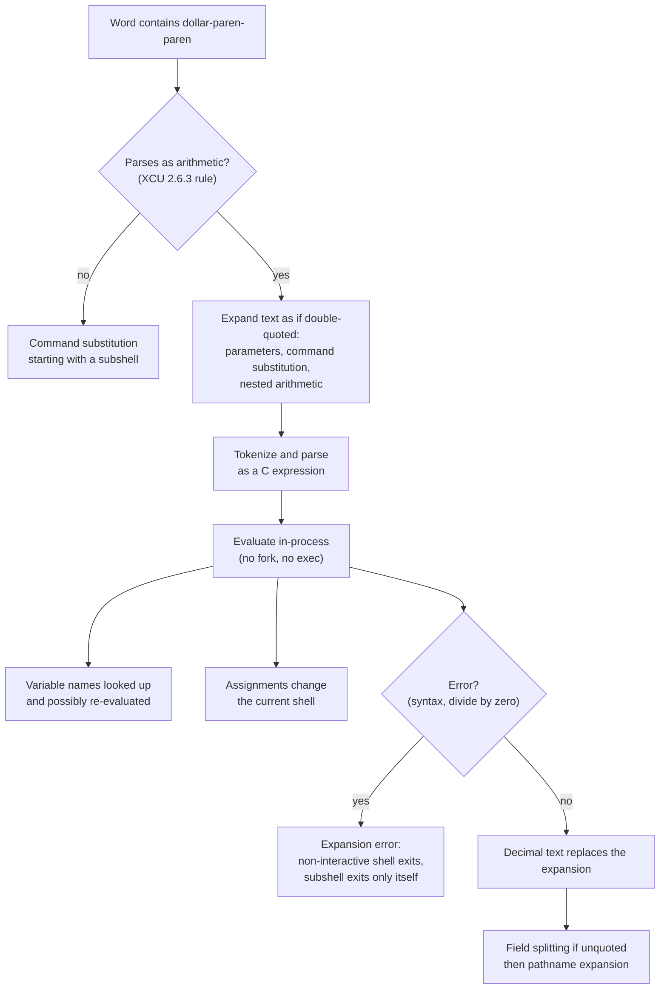

# Arithmetic Expansion

> [!summary] Claim
> `$((expression))` is evaluated by the shell itself, in the current shell environment and without a fork, as C-like signed integer arithmetic whose result replaces the expansion - and everything beyond that core (width, overflow, octal, recursion, operators, error handling) is a per-shell dialect.

Part of [The POSIX Shell Language](README.md) in [Shell and Unix Engineering](../README.md).

## TL;DR

- Mechanism: the shell expands the text inside `$((` and `))` as if double-quoted, parses it as a C expression over `signed long`, evaluates it in-process, and substitutes the decimal result (POSIX.1-2024 XCU 2.6.4).
- Rule: assignments inside the expression take effect in the current shell, a variable name is read without a dollar sign, and `x` and `$x` are guaranteed to agree only when `x` holds a valid integer constant with an optional leading sign (POSIX.1-2024 XCU 2.6.4).
- Trap: a value that is data to you is code to the evaluator - `010` is octal, `3-$x` with a negative `x` forms `--`, and in bash, mksh, posh and ksh93u+ a variable holding `a[$(cmd)]` runs `cmd` when named in an expression.
- Portability: only signed long, the C operators, and the `$((` versus `$(` disambiguation are specified; `**`, `++`, `,`, `base#n`, `((...))` as a command, 64-bit width, overflow results and recursive evaluation of variable values all vary (measured in the shell matrix).
- When not to use it: for untrusted input without validating it first, for anything needing floating point (use `awk` or `bc`) or more than 63 bits (use `bc`; `awk` numbers are doubles, exact only to 2^53), and for exit-status tests (`[ ]` over `$((...))` is the portable spelling).

## Mental model



A word starting `$((` is first tested for arithmetic parse, and only if that fails does the shell try a command substitution that begins with a subshell.
When arithmetic wins, the inner text goes through parameter expansion, command substitution and quote removal before any arithmetic parsing, so the evaluator sees plain text.
The evaluator then runs entirely inside the shell process: it reads variables, may write them through the assignment operators, and produces one decimal string.
An error in that step is an expansion error, which ends a non-interactive shell but only ends a subshell when it happens inside one.
The resulting string is subject to field splitting when unquoted, which is why the next note matters.

## How it works

The specification (POSIX.1-2024 XCU 2.6.4) says the expression is "treated as if it were in double-quotes, except that a double-quote inside the expression is not treated specially".
The shell expands all tokens for parameter expansion, command substitution and quote removal, then evaluates the result under the rules of (POSIX.1-2024 XCU 1.1.2.1): integers are equivalent to ISO C `signed long`, and the operators are those of ISO C section 6.5.
Only `signed long`, the decimal, octal and hexadecimal constants, and the C operators (without `sizeof`, prefix and postfix `++` and `--`, the comma operator, or any statement) are required.
All changes to variables "shall be in effect after the arithmetic expansion, as in the parameter expansion `${x=value}`" (POSIX.1-2024 XCU 2.6.4), because arithmetic expansion is not specified to run in a subshell (rationale C.2.6.4 in the Shell and Utilities rationale).
An invalid expression, or a variable whose contents the shell cannot recognize, is an expansion error and the shell must write a diagnostic.
For a non-interactive shell an expansion error is a "shall exit" case, and in a subshell it ends only the subshell (POSIX.1-2024 XCU 2.8.1).

The standard is deliberately silent about how a variable's string becomes a number.
The rationale says it "could be done as a text substitution, as a conversion like that performed by strtol(), or even recursive evaluation", so only variables holding a valid integer constant have defined behavior, and `x=010; echo $((x += 1))` "must be 9" while `x=1+1` is unspecified.
Four implementations show the spread of designs.
dash reads a named variable with `lookupvarint`, which returns `atomax(lookupvar(name) ?: nullstr, 0)` and so accepts only a number (dash src/var.c, `lookupvarint`); its constants are scanned by `strtoimax(buf, (char **)&arith_buf, 0)` in `yylex`, so the C library decides what a constant looks like (dash src/arith_yylex.c, `yylex`).
bash recurses: `expr_streval` finds the variable and evaluates its value again as an expression, with a depth cap of `MAX_EXPR_RECURSION_LEVEL` 1024 (bash-5.3 expr.c, `expr_streval` and the `#define`), and its header comment states "All arithmetic is done as intmax_t integers with no checking for overflow (though division by 0 is caught and flagged as an error)".
BusyBox keeps one evaluator in `shell/math.c` (`arith`, `evaluate_string`, `arith_apply`), code "ripped out of ash shell for code sharing" (its header comment), and `ash.c` wraps it in `ash_arith`; `arith_t` is `long long` when `FEATURE_SH_MATH_64` is enabled and `long` otherwise (BusyBox `shell/math.h`), and `ash.c` declares its own `typedef long arith_t` only for builds without shell math.
zsh evaluates through `matheval` and `mathevall` in `Src/math.c`, which can produce floating point as well as integers, and its operator table is its own unless `C_PRECEDENCES` is set (zsh manual, Arithmetic Evaluation).

The `$((` ambiguity is a parser decision.
POSIX says arithmetic has precedence: the shell "shall first determine whether it can parse the expansion as an arithmetic expansion and shall only parse the expansion as a command substitution if it determines that it cannot" (POSIX.1-2024 XCU 2.6.3).
bash extracts the text with `extract_command_subst`, and in `param_expand` (case `LPAREN`) it calls `chk_arithsub` and falls back to command substitution when the text is not arithmetic (bash-5.3 subst.c, `param_expand`).
dash decides in the lexer: in `readtoken1`, after `$(` a second `(` jumps to `parsearith` and any failure is `Missing '))'` (dash src/parser.c, `readtoken1`).
The portable spelling for a command substitution that starts with a subshell is `$( (cmd) )` with a space.

An arithmetic expansion runs no process.
The shell evaluates the tree in its own address space.
A loop of 5000 increments was measured by hand on one macOS arm64 host (as of October 2026): 9 to 17 ms in `/bin/dash` (what(1) project dash-16) and 16 to 23 ms in bash 5.3.15, against 8.9 to 10.7 s and 9.7 to 11.7 s when each increment forks `expr`.
The same loop on Debian dash 0.5.12-12 took 4 ms versus 0.97 to 1.04 s.
The lab does not assert these times.
The gap is `fork` plus `execve` per iteration.

## Numbers and limits

| Quantity | Value | Source |
| --- | --- | --- |
| Required integer type | signed long, at least 32 bits by ISO C | POSIX.1-2024 XCU 2.6.4, XCU 1.1.2.1 and rationale C.2.6.4 |
| Integer width in mksh | exactly 32 bits, silent wraparound; `lksh` uses `long` | mksh manual (Debian trixie page); lab test "integer width" |
| Integer width elsewhere in the matrix | 64 bits: `2147483647 + 1` is `2147483648` | lab test "integer width" |
| `9223372036854775807 + 1` | wraps to `-9223372036854775808` (bash, dash, zsh, BusyBox, posh), `0` (mksh), `9223372036854775808` (ksh93u+m, not a wrap), `9223372036854775807` (ksh93u+ 2012), error (yash) | lab test "signed overflow" |
| Digits that keep a sum of two operands inside 31 bits | 9 digits per operand (`999999999 + 999999999 = 1999999998`) | arithmetic; lab test "add of two nine-digit numbers" |
| Digits that keep a product of two operands inside 31 bits | 4 digits per operand (`9999 * 9999 = 99980001`); 5 digits do not (`99999 * 99999 = 9999800001`) | arithmetic |
| bash recursion depth for variable values | 1024 levels: a 1000-link chain works, a 1100-link chain fails | bash-5.3 expr.c `MAX_EXPR_RECURSION_LEVEL`; lab tests "1000-link chain" and "1100-link chain" |
| zsh recursion depth | 254 links evaluate to 5 and 255 links fail (zsh 5.9 and 5.9.2); 1000 links fail | lab tests for the 255-link and 1000-link chains (as of October 2026) |
| ksh93u+ 2012 recursion depth | 8 links evaluate to 5 and 9 links fail; 1000 links fail | lab tests for the 9-link and 1000-link chains, on ksh93u+ 2012-08-01 (as of October 2026) |
| BusyBox, posh, mksh recursion | no depth cap seen (1100 links work); loops are detected by name | lab tests "1100-link chain" and "refers to itself" |
| Cost of a 5000-increment loop, `$((i + 1))` versus `expr` | macOS `/bin/dash` 9 to 17 ms versus 8.9 to 10.7 s; bash 5.3.15 16 to 23 ms versus 9.7 to 11.7 s; Debian dash 0.5.12-12 4 ms versus 0.97 to 1.04 s | measured by hand (as of October 2026), not asserted by the lab |
| Operators POSIX does not require | `sizeof`, `++`, `--`, comma, `**`, `base#n` | POSIX.1-2024 XCU 2.6.4 and 1.1.2.1 |

## Portability

Every cell below is asserted by a test in the lab, or states what the cited manual or source says.

| Shell | Width | `**` | `base#n` | comma | empty `$(( ))` | `((cmd))` as command | unset name under `set -u` |
| --- | --- | --- | --- | --- | --- | --- | --- |
| POSIX sh | signed long | not required | not required | not required | unspecified | unspecified | expansion error for `$x` and for a bare name (XCU `set -u`, Austin Group defect 559) |
| bash 3.2 (macOS) and 5.x | 64 | yes | yes | yes | 0 | evaluates | error |
| zsh native | 64 | yes | yes | yes | 0 | evaluates | error |
| zsh `--emulate sh` | 64 | yes | yes | yes | 0 | evaluates | error |
| dash 0.5.12 | 64 | error | error | error | error | status 127 | treated as 0 |
| ksh93u+m 1.0.10 and ksh93u+ 2012 | 64 | yes | yes | yes | 0 | evaluates | error |
| mksh R59 | 32 | error | yes | yes | 0 | evaluates | treated as 0 |
| yash 2.58.1 | 64 | error | error | error | error | status 127 | error |
| posh 0.14.1 | 64 | error | yes | yes | error | status 127 | error |
| BusyBox ash 1.37.0 | 64 | yes | yes | yes | 0 | status 127 | treated as 0 |

| Behavior | Shells that differ |
| --- | --- |
| Result of an unquoted `$((...))` is field split | not split in zsh native, zsh `--emulate sh` and posh; split in the others |
| `x=010; $((x + 1))` | 9 in bash, dash, BusyBox, posh, yash and zsh `--emulate sh` (the rationale requires 9); 11 in zsh native, ksh93 and mksh |
| `x=08; $((x))` | error in bash, dash, BusyBox, posh, zsh `--emulate sh`; 8 in zsh native, ksh93, mksh; yash prints `08` |
| `$((1 << 2 + 1))` and `$((2 + 6 & 3))` | `8 0` in C order; `5 4` in native zsh, where shifts and bitwise AND outrank `+` and `*` |
| `$((3-$x))` with `x=-5` | 8 in bash, dash, BusyBox; error in zsh (both modes), posh, mksh, ksh93, yash |
| `x=3; $((++x))` | 4 in most shells; dash prints 3 and leaves `x` unchanged |
| Logical AND and OR skip the right operand's assignment | everywhere except BusyBox ash, which evaluates both sides; the dead arm of `?:` is skipped everywhere |
| `$((echo a); (echo b))` | command substitution fallback in bash, ksh93, zsh, mksh, posh, yash; syntax error in dash and BusyBox |
| `0b11` constant | 3 in zsh; error in bash, ksh93, mksh, BusyBox, posh, yash; in dash whatever the C library's `strtoimax` accepts (Debian's glibc 2.41 accepts, macOS and musl reject) |
| Positive number divided by a negative one | `-3` for `7 / -2`; ksh93u+ 2012 reports "divide by zero" |
| Variable holding `1+2` named as `$((v * 2))` | 6 in bash, BusyBox, posh, mksh, ksh93, zsh; error in dash and yash |
| Named variable value runs `$(cmd)` in a subscript | yes in bash (3.2 to 5.3), mksh R59, posh, ksh93u+ 2012; no in dash, BusyBox, zsh, yash, ksh93u+m |
| Division by zero | every shell tested stops a non-interactive script; in a subshell only the subshell ends |

GNU, BSD, BusyBox and uutils `expr` and `bc` behave per their own manuals and are not exercised by the lab; this note makes no claim about them beyond the cost comparison above.

## Worked example

The lab is [lab](../labs/03-arithmetic-expansion/).
It has two parts: `arith-expansion.bats` pins the specified behavior and each measured divergence under whatever shell `LAB_SHELL` names, and `arith-safe.sh` is the pattern a staff engineer uses to get the benefit without the traps.

The core of `arith-safe.sh` (simplified excerpt; the file adds usage handling and the `sum` mode):

```sh
MAXDIGITS=9

to_dec() {
  td_sign=
  td_digits=$1
  case $td_digits in
    -*) td_sign=-; td_digits=${td_digits#-} ;;
    +*) td_digits=${td_digits#+} ;;
  esac
  case $td_digits in
    '' | *[!0-9]*) return 1 ;;
  esac
  td_digits=${td_digits#"${td_digits%%[!0]*}"}
  [ -n "$td_digits" ] || td_digits=0
  [ "${#td_digits}" -le "$MAXDIGITS" ] || return 2
  [ "$td_digits" != 0 ] || td_sign=
  printf '%s%s\n' "$td_sign" "$td_digits"
}

add() {
  add_a=$(to_dec "$1") || return $?
  add_b=$(to_dec "$2") || return $?
  printf '%s\n' "$((add_a + add_b))"
}
```

Expected output (every line is asserted by the tests in the lab):

```text
$ sh arith-safe.sh dec 010
10
$ sh arith-safe.sh dec -007
-7
$ sh arith-safe.sh add 999999999 999999999
1999999998
$ sh arith-safe.sh add 3 -5
-2
$ sh arith-safe.sh sum 1 2 3 4
10
$ sh arith-safe.sh dec 1234567890      # status 2
$ sh arith-safe.sh dec 'a[0]'          # status 1
```

The contrast the lab also proves is the unvalidated spelling:

```sh
x=010; echo $((x + 1))
```

That prints `9` in bash, dash, BusyBox, posh, yash and `zsh --emulate sh`, and `11` in native zsh, ksh93 and mksh.
The validated script prints the same answer, `20`, for `add 010 010` in all of them, because the zeros are gone before any shell sees the number.

## Pitfalls

> [!warning] Leading zeros are octal
> Trigger: a number read from a date, a log line, or `printf %02d` output (`08`, `09`) reaches `$((x))`.
> Symptom: bash and dash abort with "value too great for base" or "Illegal number", while mksh, ksh93 and native zsh quietly treat it as decimal and `010` as ten instead of eight.
> Fix: strip zeros first (`${x#"${x%%[!0]*}"}`, as `to_dec` does) or force a base with `10#$x` only in shells that have it; the rationale requires `x=010; $((x += 1))` to be 9 (POSIX.1-2024 rationale C.2.6.4).

> [!warning] Textual substitution forms `--`
> Trigger: `$((3-$x))` or `$((a - $b))` where the variable is negative.
> Symptom: the text becomes `3--5`, which bash, dash and BusyBox read as `3 - (-5)` but zsh, posh, mksh, ksh93 and yash reject as a decrement of a constant, and the unspaced `$((-$x))` breaks the same way in zsh, posh, mksh, ksh93 and yash (measured by hand, not asserted by the lab); `$((- $x))` with a space is safe.
> Fix: name the variable (`$((3 - x))`) or parenthesize (`$((3-($x)))`); the specification only promises that `$((x))` and `$(($x))` agree for a lone constant.

> [!warning] Evaluation of a variable is evaluation of code
> Trigger: untrusted text lands in a variable that is later named inside `$(( ))`, for example `x='a[$(touch /tmp/pwned)]'; echo $((x))`.
> Symptom: bash (3.2 through 5.3), mksh R59, posh and ksh93u+ 2012 run the command substitution while resolving the subscript, as the lab proves with a file that appears; dash, BusyBox, zsh, yash and ksh93u+m do not.
> Fix: validate with a pattern that allows only an optional sign and digits before the value reaches the evaluator; the mksh manual itself says "Never use unchecked user input ... in arithmetic context!".

> [!warning] The increment that does nothing
> Trigger: `$((++x))` or `$((x++))` in a script that runs under dash (Debian and Ubuntu `/bin/sh`).
> Symptom: dash has no `++`, so `++x` parses as unary plus applied twice, yields the old value and leaves `x` unchanged, while `x++` is a syntax error; the loop that depends on it never advances.
> Fix: write `x=$((x + 1))`, the assignment form POSIX specifies; the specification's own example counts down the same way with `x=$(($x-1))` (POSIX.1-2024 XCU 2.6.4, Examples).

> [!warning] Double parentheses are not a POSIX command
> Trigger: `(( i < n )) && ...` or `((count++))` in a `#!/bin/sh` script.
> Symptom: dash, BusyBox, posh and yash parse it as nested subshells or a redirection and fail (the lab asserts status 127 for `((x = 3))`); bash, ksh93, zsh and mksh evaluate it, which hides the bug until the script moves to Debian or Alpine.
> Fix: use `[ "$((i < n))" -eq 1 ]` or `[ "$i" -lt "$n" ]`; POSIX allows an extension here but tells conforming applications to separate the two parentheses (POSIX.1-2024 XCU 2.9.4.1).

> [!warning] Short-circuit that does not short-circuit
> Trigger: `$((n > 0 && (total = total / n)))` guards a division, or an assignment hidden behind `||`, in a script run by BusyBox ash.
> Symptom: BusyBox ash 1.37.0 evaluates both operands of `&&` and `||` (its `arith_apply` combines two already-computed values and only `?:` disables evaluation), so the guarded division by zero fires; every other shell skips it.
> Fix: guard with an `if` or `[ ]` around the expansion rather than inside it.

> [!warning] Arithmetic result is field split
> Trigger: `IFS` contains a digit or `-`, and a result such as `-5` or `123` is expanded unquoted.
> Symptom: the result is cut into several fields in bash, dash, BusyBox, mksh, ksh93 and yash, but not in zsh or posh, so the same script gives different argument counts.
> Fix: quote the expansion, and keep `IFS` default or empty in scripts that do arithmetic (see [[Field-Splitting-and-IFS]]).

> [!warning] Width and overflow are not portable
> Trigger: hashing, timestamps in nanoseconds, or `2147483647 + 1` style counters computed in the shell.
> Symptom: mksh wraps at 32 bits, ksh93u+m returns 2^63 instead of wrapping, ksh93u+ 2012 saturates, yash raises an error, the rest wrap at 64 bits - and ISO C leaves overflow undefined, so POSIX gives none of this.
> Fix: bound the inputs for the operator in use (the lab's 9 digits protect sums only; a product of two operands needs at most 4 digits each), or do the work in `bc`, or in `awk` while results stay under 2^53.

## Security and robustness

The evaluator is an interpreter, so anything that reaches it is code, and the dangerous inputs are the ones that look like data.
In bash, mksh, posh and ksh93u+ a variable named in an expression is evaluated again, and an array subscript is itself an expression that undergoes command substitution; the lab writes a marker file to prove that `a[$(: >"$HIT")]` executes in those shells and not in dash, BusyBox, zsh, yash or ksh93u+m (bash-5.3 expr.c, `expr_streval`, which resolves array subscripts through `array_variable_part` when the token ends in `]`).
This is not limited to `$(( ))`: the bash manual lists the arithmetic `for` command, the `[[` conditional and `let` among the contexts that evaluate expressions the same way.
Measured by hand on ksh93u+ 2012-08-01 (as of October 2026), and not asserted by the lab, `[ "$x" -eq 0 ]` runs the payload when `x` holds `a[$(cmd)]`.
The defense is the allowlist in `arith-safe.sh`: an optional sign and digits only, no leading-zero ambiguity, at most 9 digits, and operand names rather than substituted text so a negative value cannot form `--`.

Division by zero and syntax errors are expansion errors: a non-interactive shell exits, so `set -e` is not needed for them, but a library function called inside a subshell or a command substitution only ends that subshell.
`set -u` makes `$(($undef + 1))` an error everywhere, and POSIX.1-2024 requires the same for a bare `undef` in `$((undef + 1))` (XCU `set -u`, worded by Austin Group defect 559), but only bash, ksh93, zsh, posh and yash honor that while dash, mksh and BusyBox silently use zero, so write the dollar form when you rely on `-u`.
A self-referencing variable (`a=a; echo $((a))`) terminates with an error in every shell tested except non-POSIX yash, which returns the text, so there is no hang.
Depth caps differ: 1024 levels in bash (a 1000-link chain works and a 1100-link chain fails), 255 links in zsh 5.9 and 5.9.2, and 9 links in ksh93u+ 2012-08-01.

## The principal's view

Use `$(( ))` for small, bounded, integer bookkeeping in shell: counters, retry budgets, offsets, and loop limits.
It is the one expansion that costs microseconds instead of a fork, and it is in POSIX, so it is the right tool in `/bin/sh` scripts.
The trade-off is that the dialect beyond the POSIX core is wide enough that "works in bash" is not evidence; the portable subset is plain `+ - * / %`, comparisons, `&&`, `||`, parentheses, and `x=$((x + 1))`, with named variables and parenthesized substitutions.

Treat every value that did not originate in your own literals as hostile until it has passed an allowlist, and keep the validation next to the arithmetic so the invariant is visible in review.
Cap widths so the result is the same in 32-bit mksh and 64-bit everything else.
Move to `awk` the moment you need floating point, 64-bit-safe hashing, or anything where overflow semantics matter, and to a real language when the arithmetic is the program.
Prefer `[ "$a" -lt "$b" ]` for comparisons in conditions, since it needs no extension and makes the status explicit.

## Interview questions

> [!question] L5: What does `echo $((x = 5)); echo $x` print, and why is `y=$(echo $((z = 7)))` different?
>
> > [!success]- Answer
> > The first prints `5` and then `5`.
> > Arithmetic expansion runs in the current shell environment, so an assignment inside it is "in effect after the arithmetic expansion", like `${x=value}`.
> > In the second case the expansion happens inside a command substitution, which is a subshell, so `z` is still unset afterwards.
> >
> > Follow-up: how would you set `z` and capture the output without a subshell?

> [!question] L5: Why is `$((x))` usually safer to write than `$(($x))`?
>
> > [!success]- Answer
> > `$x` is substituted as text before the evaluator parses, so its contents become operators and tokens.
> > `x` names the variable, so the evaluator reads one value and never re-parses the text around it.
> > POSIX promises that the two agree only when `x` holds a valid integer constant with an optional leading sign.
> >
> > Follow-up: what does `x=-5; echo $((3-$x))` do in zsh versus bash?

> [!question] L5: Predict the output: `x=010; echo $((x + 1))` in bash, dash, native zsh and mksh.
>
> > [!success]- Answer
> > bash and dash print `9`, because a leading zero means octal and POSIX requires that result.
> > Native zsh and mksh print `11`, and so does ksh93.
> > `zsh --emulate sh` prints `9`.
> >
> > Follow-up: what does `x=08` do in each, and how do you make the script immune?

> [!question] L6: Debug this script, which loops forever under Debian's `/bin/sh`: `i=0; while [ $i -lt 10 ]; do echo $i; echo $((++i)); done`
>
> > [!success]- Answer
> > dash has no `++`, so `++i` parses as unary plus twice and returns the current value without changing `i`.
> > bash, ksh93, zsh, mksh, posh and BusyBox increment.
> > Replace the body's update with `i=$((i + 1))`, which POSIX specifies.
> >
> > Follow-up: why does `x++` fail loudly in dash while `++x` fails silently?

> [!question] L6: What does a non-interactive shell do on `echo $((1/0))`, and what changes inside `( ... )`?
>
> > [!success]- Answer
> > It is an expansion error, so the shell writes a diagnostic and exits with a non-zero status; commands after it do not run.
> > Inside a subshell only the subshell exits and the parent continues with a non-zero `$?`.
> > Statuses differ (1 in bash, 127 when bash is in POSIX mode, 2 in dash, BusyBox ash and yash), so a portable test checks for non-zero.
> >
> > Follow-up: how does a function that divides by user input stay alive?

> [!question] L6: Why can `x='a[$(cmd)]'; echo $((x))` run `cmd`, and which shells do it?
>
> > [!success]- Answer
> > Some shells evaluate the value of a named variable again as an expression, and an array subscript is an expression that undergoes command substitution.
> > bash, mksh, posh and ksh93u+ 2012 do; dash, BusyBox, zsh, yash and ksh93u+m do not.
> > Validate the value before it reaches any arithmetic context, including `let` and `[[ ]]`.
> >
> > Follow-up: does `$(($x))` change the outcome?

> [!question] L6: How should a portable script write a counter loop and a numeric comparison?
>
> > [!success]- Answer
> > Use `x=$((x + 1))` and `[ "$x" -lt "$limit" ]`, both in POSIX.
> > Avoid `((...))`, `++`, `**`, comma, and `base#n`.
> > If the comparison must live inside the expansion, use `[ "$((a < b))" -eq 1 ]`.
> >
> > Follow-up: what happens to `((x = 3))` under dash and why?

> [!question] L7+: A script computing `$((a * b))` on user-supplied sizes wraps on a customer's machine but not in CI - what is going on and what is the design fix?
>
> > [!success]- Answer
> > POSIX requires only `signed long`, and overflow is undefined in ISO C, so each shell chooses: 64-bit wrap in bash and dash, 32-bit wrap in mksh, error in yash, saturation in ksh93u+ 2012.
> > The script is relying on implementation behavior.
> > Bound operand widths before multiplying: two operands of at most 4 digits stay inside 31 bits (`9999 * 9999 = 99980001`), 5 digits do not (`99999 * 99999 = 9999800001`), and the 9-digit bound that protects sums does not protect products.
> > Otherwise do the computation in `bc`, in `awk` while results stay under 2^53 (its numbers are doubles), or in the language that owns the data.
> >
> > Follow-up: how would you prove in a test that your bound holds on a 32-bit shell?

> [!question] L7+: Explain how a shell decides between `$((cmd) )` as arithmetic and as command substitution, and where shells disagree.
>
> > [!success]- Answer
> > POSIX gives arithmetic precedence: try to parse as arithmetic, and only if that fails parse a command substitution that starts with a subshell.
> > bash tries and falls back (`chk_arithsub` in `param_expand`), while dash commits at the lexer (`parsearith`) and reports `Missing '))'`.
> > The rationale warns that extensions such as array subscripts make heuristics unreliable, so portable code writes `$( (cmd) )` with a space.
> >
> > Follow-up: which unambiguous spelling of the same construct is safe in every shell?

> [!question] L7+: Why is `$((n > 0 && (t = t / n)))` unsafe as a divide guard, and where?
>
> > [!success]- Answer
> > ISO C and POSIX require `&&` to skip the right operand, and every shell tested does except BusyBox ash 1.37.0, which evaluates both sides and then divides by zero.
> > The dead arm of `?:` is skipped even there, so a ternary guard works.
> > The robust fix is to check the divisor in an `if` before the expansion.
> >
> > Follow-up: how would you find this class of bug across a fleet of images?

## Related

Prerequisites: [[Command-Substitution]]

Next: [[Field-Splitting-and-IFS]]

See also: [[Expansion-Order]], [[Parameter-Expansion]], [[Quote-Removal]], [[The-test-Builtin]], [[Compound-Commands]], [[POSIX-2024-Changes]]

## Further reading

- POSIX.1-2024 XCU 2.6.4 Arithmetic Expansion (https://pubs.opengroup.org/onlinepubs/9799919799/utilities/V3_chap02.html): the normative text, including the "x and $x agree" rule.
- POSIX.1-2024 XCU 1.1.2.1 Arithmetic Precision and Operations (https://pubs.opengroup.org/onlinepubs/9799919799/utilities/V3_chap01.html): the operator table and the signed long requirement.
- POSIX.1-2024 Rationale C.2.6.4 (https://pubs.opengroup.org/onlinepubs/9799919799/xrat/V4_xcu_chap01.html): why variable values are left unspecified and why `010` must be 9.
- bash-5.3 `expr.c` and `subst.c` in the release tarball (https://mirrors.kernel.org/gnu/bash/bash-5.3.tar.gz): the recursive evaluator and the `$((` disambiguation.
- dash `src/arith_yacc.c`, `src/arith_yylex.c`, `src/parser.c` (https://git.kernel.org/pub/scm/utils/dash/dash.git/): the smallest complete implementation and its libc coupling.
- BusyBox `shell/math.c` (https://raw.githubusercontent.com/mirror/busybox/master/shell/math.c): the shared evaluator, including where short-circuiting is and is not done.
- zsh manual, Arithmetic Evaluation (https://zsh.sourceforge.io/Doc/Release/Arithmetic-Evaluation.html): native versus `C_PRECEDENCES` operator order.
- mksh manual (https://manpages.debian.org/trixie/mksh/mksh.1.en.html): the 32-bit contract and the warning about unchecked input.
