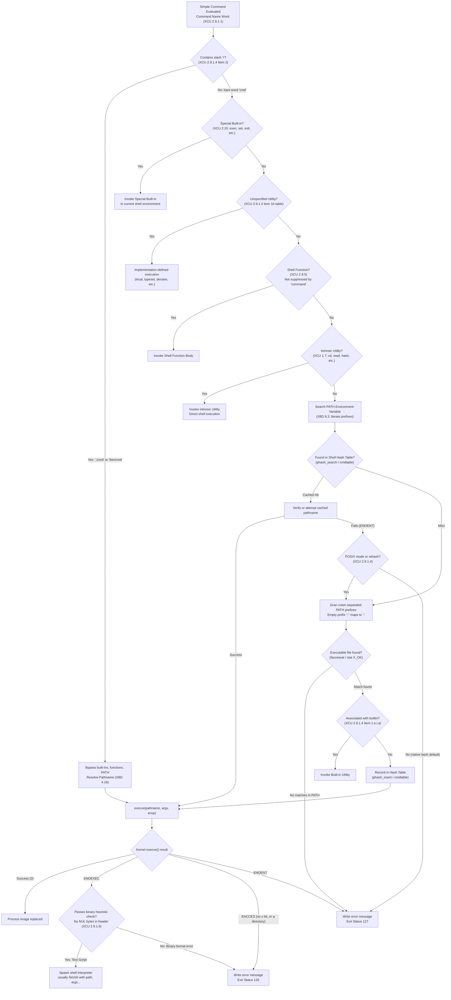

# Command Search and PATH

> [!summary] Claim
> Command search is the ordered resolution algorithm defined in POSIX.1-2024 XCU 2.9.1.4 that maps an evaluated command name to an executable unit by checking special built-in utilities, functions, intrinsic utilities, and colon-delimited PATH prefixes, terminating in direct execve invocation or ENOEXEC script interpretation.

Part of [The POSIX Shell Language](README.md) in [Shell and Unix Engineering](../README.md).

## TL;DR

- Mechanism: When executing a simple command without slashes, the shell resolves the command word through a four-tier hierarchy: special built-ins (`(POSIX.1-2024 XCU 2.15)`), shell functions (`(POSIX.1-2024 XCU 2.9.5)`), intrinsic utilities (`(POSIX.1-2024 XCU 1.7)`), and sequentially scanned `PATH` prefixes (`(POSIX.1-2024 XCU 2.9.1.4)`).
- Rule: If a command name contains any slash `/`, all built-ins, functions, and `PATH` searches are bypassed entirely, directly resolving the pathname against the filesystem (`(POSIX.1-2024 XCU 2.9.1.4 item 2)`).
- Trap: An empty field in `PATH` (`::`, leading `:`, or trailing `:`) resolves to the current working directory `.`, allowing untrusted files in the working directory to hijack standard system utilities (`(POSIX.1-2024 XBD 8.3)`; Go changed `LookPath` for this reason: <https://go.dev/blog/path-security>).
- Portability fact: Standard POSIX shells repeat the `PATH` search when an in-memory cached utility location fails (`(POSIX.1-2024 XCU 2.9.1.4)`), but GNU `bash` in default non-POSIX mode retains the stale hash entry and aborts with status 127 unless `checkhash` or `set -o posix` is enabled (proved by lab as of 2026-11).
- When not to use it: Never rely on bare command names or ambient `PATH` in security-sensitive contexts, setuid helpers, daemon scripts, or privileged automation; specify fully qualified absolute pathnames or sanitize `PATH` to a trusted, immutable literal.

## Mental model



A simple command evaluates its command name word after expansions and inspects it for slash characters.
If the command word contains at least one slash, the shell bypasses all built-ins, functions, and path searches, directly resolving the pathname against the filesystem through `execve(2)`.
If the command word lacks a slash, the shell proceeds down the strict hierarchy of `(POSIX.1-2024 XCU 2.9.1.4)`: it first tests for a special built-in utility (`(POSIX.1-2024 XCU 2.15)`), which cannot be overridden by functions; next it checks the extension utility names in the table of item 1b, where results are unspecified; next it checks the shell function table unless invocation occurred through the `command` utility; and next it checks intrinsic utilities (`(POSIX.1-2024 XCU 1.7)`).
If all prior tiers miss, the shell performs a `PATH` search across colon-delimited prefixes, treating empty prefixes as the current working directory `.`.
Candidate binaries found during `PATH` traversal are cached in an internal hash table; if a remembered binary fails during invocation, a conforming shell repeats the `PATH` search.
When `execve(2)` encounters a file without native binary formatting (`ENOEXEC`), shells with binary heuristics (`bash`, `zsh`, `ksh93`, Debian's patched `dash`, Debian's `mksh` R59 2025) inspect the file header and spawn a new shell interpreter for text scripts or return exit status 126 for files that fail the check, whereas BusyBox `ash` interprets the file itself and Debian `posh` hands it to `/bin/sh`, whose input readers delete NUL bytes, so an all-NUL file runs as an empty script returning exit status 0 (measured in the shell matrix as of 2026-11).

## How it works

### Specification: POSIX.1-2024 XCU 2.9.1.4, XCU 2.9.1.6, and XBD 8.3

Command search is codified in `(POSIX.1-2024 XCU 2.9.1.4)` as the canonical mechanism that connects a command name token to its execution target.
The search operates after word expansions (`(POSIX.1-2024 XCU 2.9.1.1)`) have stripped quotes and expanded parameters, command substitutions, and arithmetic expressions.
The resolution flow is partitioned into two mutually exclusive branches based on whether the command name contains any `<slash>` characters:
1. Command name without `<slash>`: The shell checks five successive tiers:
   - Item 1a: Special built-in utilities (`break`, `:`, `continue`, `.`, `eval`, `exec`, `exit`, `export`, `readonly`, `return`, `set`, `shift`, `times`, `trap`, `unset`) are invoked immediately within the current execution environment (`(POSIX.1-2024 XCU 2.15)`).
   - Item 1b: Unspecified utilities: A reserved set of 55 utility names (such as `local`, `typeset`, `declare`, `autoload`, and `pushd`) where implementation extensions produce unspecified results relative to user functions or `PATH` lookups.
   - Item 1c: Shell functions: If the name matches a defined shell function, the function body is executed per `(POSIX.1-2024 XCU 2.9.5)`, unless the invocation was wrapped with the `command` utility (`(POSIX.1-2024 XCU command)`).
   - Item 1d: Intrinsic utilities: Standard utilities that affect or read the shell execution environment (`alias`, `bg`, `cd`, `command`, `fc`, `fg`, `getopts`, `hash`, `jobs`, `kill`, `read`, `type`, `ulimit`, `umask`, `unalias`, `wait`) are invoked directly without consulting `PATH` (`(POSIX.1-2024 XCU 1.7)`).
   - Item 1e: `PATH` search: The shell iterates through the directory prefixes listed in the `PATH` environment variable (`(POSIX.1-2024 XBD 8.3)`).
2. Command name with `<slash>`: Per `(POSIX.1-2024 XCU 2.9.1.4 item 2)`, the shell bypasses all internal tables and executes a non-built-in utility directly per `(POSIX.1-2024 XCU 2.9.1.6)`.

Austin Group Defect 854 established the formal category of Intrinsic Utilities in POSIX.1-2024 (`(POSIX.1-2024 XCU 1.7)`).
Earlier revisions required every regular built-in, including `cd` and `read`, to be exec-able; POSIX.1-2024 requires intrinsic utilities to be found before the `PATH` search and, through Defect 1600, exempts them from that exec requirement except for `kill` (`(POSIX.1-2024 XRAT C.1.7)`; Defect 854 is recorded in XRAT C.2.9.1).
The published `command -v` text writes executable utilities, regular built-ins, command names containing a slash, and implementation functions found through `PATH` as absolute pathnames, and writes shell functions, special built-ins, regular built-ins not associated with a `PATH` search, and reserved words as just their names (`(POSIX.1-2024 XCU command)`).
Austin Group Defect 1984, filed 2026-06 against that text, is an interpretation, accepted as marked, saying the sentence is ambiguous and proposing that a command name containing a slash may print as absolute or relative; that wording is not yet in the published standard (as of 2026-11).
Austin Group Defect 2002, filed 2026-10-28 with status New (as of 2026-11), is an open request about `execlp()` and `execvp()` with commands starting with `-` or `+`; it changes nothing yet.

### The slash partition and immediate pathname resolution

The presence of a slash `/` acts as an absolute architectural boundary.
Command words containing slashes bypass `(POSIX.1-2024 XCU 2.9.1.4 item 1)`, so prefixing a command with `./` or `/bin/` neutralizes all shell functions and built-ins.
Aliases are a separate matter, because alias substitution happens before command search: the portable alias name set excludes the slash but implementations may extend it (`(POSIX.1-2024 XBD 3.10)`), so `bash`, `mksh`, and `ksh93` reject `alias a/b=...`, while `dash`, BusyBox `ash`, `zsh`, and `yash` accept it and run the alias for `a/b` (measured in the shell matrix as of 2026-11).
When a script executes `/bin/echo` or `./tool`, the shell never checks whether a function named `echo` or `tool` exists in memory.
Instead, the shell performs direct pathname resolution per `(POSIX.1-2024 XBD 4.16)`.
In GNU `bash`, this partition is implemented in `(bash-5.3 execute_cmd.c, execute_disk_command)` and `(bash-5.3 findcmd.c, search_for_command)`.
In `dash`, `(dash-0.5.12 src/exec.c, find_command)` immediately checks `if (strchr(name, '/') != NULL)`: if a slash is found, it skips the command table lookup and assigns `entry->cmdtype = CMDNORMAL` directly.
In `zsh`, `(zsh master Src/exec.c, findcmd)` first looks the whole word up in the hash table `cmdnamtab`, then checks `if ((s = strchr(arg0, '/')))`: if a slash is present, it returns the word when it names an executable and searches `PATH` for it only when the `PATH_DIRS` option is set.

### The four-tier lookup hierarchy for bare command names

When a command name is a bare word without slashes, the shell executes the four-tier lookup sequence:
1. Special Built-ins: Special built-ins occupy tier 1a.
   Because special built-ins take precedence over shell functions, defining a function with the name of a special built-in cannot hijack standard execution in a conforming shell.
   In `dash` (`(dash-0.5.12 src/parser.c, simplecmd)`), attempting to define `exit() { :; }` aborts immediately with `Syntax error: Bad function name`.
   In `ksh93` (message `e_badfun` in ksh93u+m `data/msg.c`; measured in the shell matrix), defining a function matching a special built-in triggers `exit: invalid function name`.
   In GNU `bash` 5.3 and 5.2 in POSIX mode (`bash --posix`), defining a function matching a special built-in produces ``bash: line 1: `exit': is a special builtin``, while `bash` 3.2 in POSIX mode (macOS `/bin/sh`) accepts the definition and still runs the special built-in.
Not every shell conforms: native `bash`, BusyBox `ash`, and `zsh` in both modes accept the definition and the function wins, so `exit` no longer exits; `mksh`, `posh`, and `yash` accept the definition and the special built-in wins (measured in the shell matrix as of 2026-11).
2. Unspecified Utilities: Tier 1b provides an implementation hook for extensions like `declare`, `typeset`, and `local`.
   Conforming applications must avoid defining functions matching names in the item 1b table if portability across divergent shells is required.
3. Shell Functions: Tier 1c executes user-defined functions.
   A shell function shadows intrinsic utilities (`cd`, `read`), regular built-ins (`echo`), and external executables in `PATH`.
   To bypass a function without removing it, POSIX provides the `command` utility (`(POSIX.1-2024 XCU command)`).
   The `command` utility suppresses tier 1c function lookup, forcing resolution to fall through to tier 1d or tier 1e.
   Furthermore, wrapping a special built-in with `command` (e.g. `command exit 1`) strips the utility of its special properties: execution failure does not cause a non-interactive shell to abort, and variable assignment prefixes do not persist in the shell environment.
4. Intrinsic Utilities: Tier 1d handles intrinsic utilities (`(POSIX.1-2024 XCU 1.7)`).
   These utilities are built directly into the shell binary and operate on the current execution environment (`cd`, `read`, `ulimit`, `umask`).
   Because they are intrinsic, they do not require search iterations across `PATH`.

### The PATH search algorithm and the empty prefix rule

If a bare command name misses tiers 1a through 1d, the shell executes tier 1e by parsing the `PATH` environment variable.
`PATH` is a string consisting of path prefixes separated by colon `<colon>` (`:`) characters (`(POSIX.1-2024 XBD 8.3)`).
The shell scans these prefixes sequentially from left to right:
- For each prefix, the shell constructs a candidate pathname: if the prefix is non-empty and does not end with a slash, the shell appends `/` followed by the command name.
- An empty prefix - manifested as a leading colon (`:/usr/bin`), adjacent colons (`/bin::/usr/bin`), or a trailing colon (`/usr/bin:`) - explicitly designates the current working directory `.`.
- In `(POSIX.1-2024 XBD 8.3)`, this empty prefix rule is marked as a legacy feature, and conforming applications are instructed to use an explicit dot `.` instead.
- If a prefix contains a percent sign `%`, POSIX specifies that the search behavior is implementation-defined.
- In `dash` (`(dash-0.5.12 src/exec.c, changepath)`), the string `%builtin` is recognized as a synthetic path prefix representing the position in `PATH` where regular built-in utilities should be resolved relative to external executables.
- If `PATH` is unset or null, `(POSIX.1-2024 XBD 8.3)` declares the search behavior implementation-defined, and the shells split three ways (measured in the shell matrix as of 2026-11).
  After `unset PATH`, `bash`, `dash`, and BusyBox `ash` search only the current directory (a file in the working directory runs, `ls` is not found); `mksh`, `posh`, and `ksh93` use a default path and skip the current directory; `zsh` and `yash` find nothing.
  With `PATH=`, every shell tested except `ksh93` runs a file from the current directory.
  A shell started with no `PATH` in its environment instead assigns a compiled-in default, and that default in Debian's `bash` 5.2 and the matrix's `bash` 3.2 build ends in `.`.

### Location caching, hash tables, and rehash triggers

To avoid issuing expensive `stat(2)` or `faccessat(2)` system calls across every directory in `PATH` for every command execution, modern shells maintain an in-memory hash table of resolved utility locations.
The implementation details reflect distinct data structures:
- In GNU `bash` (`(bash-5.3 hashcmd.c)`), locations are stored in a dynamically resizable bucket hash table `hashed_filenames`, created with `FILENAME_HASH_BUCKETS` (256) buckets and managed by `phash_insert` and `phash_search`.
- In `dash` (`(dash-0.5.12 src/exec.c)`), locations are stored in a static 31-bucket prime hash table `cmdtable` (`#define CMDTABLESIZE 31`) using separate chaining with `struct tblentry`.
- In `zsh` (`(zsh-5.9 Src/exec.c)`), commands are tracked in the `cmdnamtab` hash table and resolved via `hashcmd`.
- In BusyBox `ash` (`(busybox-1.37.0 shell/ash.c)`), the hash table also uses 31 prime buckets with `struct tblentry`.
- In `posh` (`(posh-0.14.1 exec.c, findcom)`), no internal command hash table is maintained; relying on POSIX's `may remember` permission, `findcom` calls `search()` on `PATH` for every command invocation, and `posh` 0.14.1 has no `hash` utility at all (`hash: not found`, status 127, measured in the shell matrix) although POSIX lists `hash` as intrinsic.

POSIX specifies two rules regarding hash tables:
1. Reassignment flush: Reassigning the `PATH` variable (`PATH="$PATH"`) or invoking `hash -r` forces the shell to purge all cached locations (`(POSIX.1-2024 XCU 2.9.1.4; XCU hash)`).
   In `dash`, variable assignments to `PATH` trigger `(dash-0.5.12 src/exec.c, changepath)`, which immediately calls `clearcmdentry()`.
2. Stale cache re-search: If a cached location fails during a subsequent invocation (e.g. because the external binary was uninstalled or moved), `(POSIX.1-2024 XCU 2.9.1.4)` mandates: "If the remembered location fails for a subsequent invocation, the shell shall repeat the search to find the new location for the utility, if any."
   Conforming shells (`dash`, `zsh`, `ksh93`, BusyBox `ash`) detect `ENOENT` from the cached path and immediately re-scan `PATH`.
   However, GNU `bash` in its default non-POSIX mode retains the stale cached path and fails with `No such file or directory` (status 127) without repeating the search, unless `shopt -s checkhash` is enabled or `bash` is operating in POSIX mode (`bash --posix` or `set -o posix`).

### The kernel execution boundary and ENOEXEC script fallback

When a resolved executable pathname is passed to the kernel, execution transitions across the system call interface via `execve(2)`.
In the Linux kernel (`(linux-6.12 fs/exec.c, do_execveat_common)`), the kernel inspects the file header using binary format handlers registered in `search_binary_handler()`:
- `fs/binfmt_elf.c` recognizes the ELF magic bytes (`\x7fELF`).
- `fs/binfmt_script.c` recognizes the shebang magic bytes (`#!`).
  It reads up to `BINPRM_BUF_SIZE` (256 bytes) to extract the interpreter pathname and an optional argument.

If an executable file has execution permissions (`st_mode & 0111`) but lacks a valid binary format header or shebang line, `search_binary_handler()` returns `-ENOEXEC`.
POSIX defines exact handling for this condition in `(POSIX.1-2024 XCU 2.9.1.6)`:
When `execve()` fails with `ENOEXEC`, the shell must execute a command equivalent to invoking a shell with the pathname as its first operand and any original arguments appended; the standard does not name the shell's pathname, and the implementations below use `/bin/sh` or themselves.
Before spawning the fallback interpreter, the shell may apply a heuristic check to verify that the file is actually a script.
The standard note in `(POSIX.1-2024 XCU 2.9.1.6)` specifies the common heuristic: scanning a fixed-length prefix of the file for a `NUL` (`\0`) byte prior to a `<newline>`.
If a `NUL` byte is discovered, shells implementing this check (`bash`, `zsh`, `ksh93`) conclude the file is not a shell script, suppress fallback interpretation, write an error message to standard error, and terminate with exit status 126.
In GNU `bash`, this heuristic is implemented in `(bash-5.3 execute_cmd.c, shell_execve)` using `READ_SAMPLE_BUF` with a 128-byte sample buffer (`HASH_BANG_BUFSIZ`) and `check_binary_file` in `general.c`, which also rejects an ELF magic number outright.
In `zsh`, `(zsh-5.9 Src/exec.c, zexecve)` validates that the sample buffer lacks NUL bytes before initiating shell execution.
However, BusyBox `ash` (`(busybox master shell/ash.c, tryexec and preadbuffer)`) implements no binary heuristic check; its input reader `preadbuffer` deletes NUL bytes, so an all-NUL file parses as an empty shell script that terminates with exit status 0, and any text after the NUL bytes still runs.
This outcome needs the file to be NUL bytes plus valid shell: a real ELF file for a foreign architecture fails under `ash` with a syntax error and status 2, and a short ELF-like file fails with status 127, so the shell reports failure with the wrong status rather than success (measured in the shell matrix as of 2026-11).
Upstream `dash` (`(dash-0.5.12 src/exec.c, tryexec)`), `yash`, and Debian `posh` (`(posh-0.14.1 exec.c)`, `EXECSHELL`) have no check of their own and re-execute `/bin/sh`, so they inherit its treatment of the file as a script operand: 0 for an all-NUL file on Alpine, where `/bin/sh` is BusyBox `ash`; 0 for `posh` on Debian, because `dash` given a script operand also deletes NUL bytes (`src/input.c`); and 126 for `dash` on macOS, where `/bin/sh` is `bash`.
Debian's `dash` returns 126 for a different reason: Debian patch `0007-Don-t-execute-binary-files-if-execve-returned-ENOEXE` adds `file_is_binary()`, which rejects control bytes in the file's first line, within its first 128 bytes, before any re-execution.
`mksh` has its own check too: `scriptexec` rejects a list of magic numbers, and Debian's R59 2025 build returns 126 for an all-NUL file (`not executable: magic 0000`), while Alpine's R59 2020 build returns status 1 for an ELF header and re-executes `/bin/sh` for an all-NUL file, which gives 0 there (measured in the shell matrix as of 2026-11).

### Exit status semantics: 126 versus 127

POSIX defines command exit statuses in `(POSIX.1-2024 XCU 2.8.2)`:
- Status 127: The command name could not be found.
  This status is returned when a bare command name is not present in any directory in `PATH`, when a directory in `PATH` cannot be searched due to missing directory permissions (`search_for_command` fails), or when a command name with a slash targets a non-existent file (`ENOENT`).
  Furthermore, pdksh descendants (`mksh` and `posh`) return 127 when a direct pathname contains an unsearchable directory component (`chmod 600 dir`), treating directory traversal failure during path resolution as a failure to locate the command.
- Status 126: The command was found, but could not be executed.
  This status is returned when an executable file lacks execute permissions (`EACCES`), when an invoked pathname targets a directory (`execve(2)` returns `EACCES`, measured on Linux and macOS), when the operating system refuses execution due to file format incompatibility, or when an `ENOEXEC` file fails the binary heuristic check.
  Standard POSIX shells (`bash`, `dash`, `zsh`, `ksh93`, `yash`, BusyBox `ash`) return 126 when executing a direct pathname whose parent directory lacks search permissions (`EACCES` from `execve(2)`).
- `command -v` missing command status: When a requested command name is not found, POSIX mandates an exit status greater than zero (`(POSIX.1-2024 XCU command)`).
  GNU `bash`, `zsh`, `ksh93`, `mksh`, `yash`, and `posh` exit with status 1.
  `dash` and BusyBox `ash` exit with status 127 (measured in the shell matrix as of 2026-11).
- Status > 128: The command process was terminated by an asynchronous signal.
  Standard shells (`bash`, `dash`, `mksh`, `posh`, BusyBox `ash`) return `128 + N`, where `N` is the signal number (`SIGTERM` 15 yields 143; `SIGKILL` 9 yields 137).
  By divergence, `ksh93` returns `256 + N`, and `yash` returns `384 + N`.

## Numbers and limits

The following parameters govern command search, path resolution, and process replacement across standard Unix environments:

| Parameter | Scope / Implementation | Value / Limit | Standard / Source | Behavior / Failure Mode |
|---|---|---|---|---|
| `PATH_MAX` | Linux kernel & glibc | 4096 bytes | Measured via `getconf PATH_MAX /`; POSIX `limits.h` sets only the minimum `{_POSIX_PATH_MAX}` | Pathnames exceeding 4096 bytes fail with `ENAMETOOLONG` |
| `PATH_MAX` | macOS Darwin | 1024 bytes | Darwin `sys/syslimits.h` | Pathname strings exceeding 1024 bytes fail with `ENAMETOOLONG` |
| `NAME_MAX` | Linux and macOS root filesystems | 255 bytes | Measured via `getconf NAME_MAX /`; POSIX `limits.h` sets only the minimum `{_POSIX_NAME_MAX}` | Filename component exceeding 255 bytes fails with `ENAMETOOLONG` |
| `ARG_MAX` | macOS Darwin | 1,048,576 bytes (1 MiB) | Measured via `sysctl kern.argmax` | `execve` fails with `E2BIG` when `argv` plus `envp` exceeds 1 MiB |
| `ARG_MAX` | Linux glibc, 8 MiB stack | 2,097,152 bytes (2 MiB) | Measured via `getconf ARG_MAX` on Debian | Total argument and environment space capped at 1/4 stack limit; musl's `getconf ARG_MAX` prints 131072 on Alpine with the same stack |
| `MAX_ARG_STRLEN` | Linux kernel | 131,072 bytes (128 KiB) at 4 KiB pages | Linux `include/uapi/linux/binfmts.h` (`PAGE_SIZE * 32`) | A single argument or environment string exceeding 32 pages fails with `E2BIG` |
| `BINPRM_BUF_SIZE` | Linux kernel | 256 bytes | Linux kernel 5.1+ (`binfmts.h`) | An interpreter path that does not fit in 256 bytes fails with `ENOEXEC` (measured); only a trailing argument can be truncated |
| `HASH_BANG_BUFSIZ` | GNU `bash` fallback | 128 bytes | GNU `(bash-5.3 execute_cmd.c)` | Shebang sampling buffer for user-space script fallback |
| `CMDTABLESIZE` | `dash` hash table | 31 buckets | `(dash-0.5.12 src/exec.c)` | Static prime bucket count for internal chained command hashing |
| `CMDTABLESIZE` | BusyBox `ash` hash table | 31 buckets | `(busybox-1.37.0 shell/ash.c)` | Static prime bucket count for internal chained command hashing |
| `FILENAME_HASH_BUCKETS` | GNU `bash` command hash table | 256 buckets | `(bash-5.3 hashcmd.h)` | Initial bucket count for dynamically resized hash table; the library default `DEFAULT_HASH_BUCKETS` (128, `hashlib.h`) does not apply to this table |
| Exit Status 127 | POSIX standard | 127 | `(POSIX.1-2024 XCU 2.8.2)` | Utility not found in `PATH` or non-existent pathname |
| Exit Status 126 | POSIX standard | 126 | `(POSIX.1-2024 XCU 2.8.2)` | Found command is non-executable (`EACCES`), directory, or invalid binary |
| `command -v` missing status | bash, zsh, ksh93, mksh, yash, posh | 1 | Measured in the shell matrix (as of 2026-11) | Exit status when utility or function name is not found |
| `command -v` missing status | dash, BusyBox ash | 127 | Measured in the shell matrix (as of 2026-11) | Exit status when utility or function name is not found |
| Direct path in unsearchable dir | bash, dash, zsh, ksh93, yash, BusyBox ash | 126 | Measured in the shell matrix (as of 2026-11) | Exit status when direct path has unsearchable parent dir (`EACCES`) |
| Direct path in unsearchable dir | mksh, posh | 127 | Measured in the shell matrix (as of 2026-11) | Exit status when direct path has unsearchable parent dir (`EACCES`) |
| ENOEXEC all-NUL file | bash, zsh, ksh93, Debian dash, Debian mksh | 126 | Measured in the shell matrix (as of 2026-11) | Binary heuristic check rejects the file |
| ENOEXEC all-NUL file | BusyBox ash, Debian posh, Alpine dash, Alpine mksh, Alpine yash | 0 | Measured in the shell matrix (as of 2026-11) | Script reader deletes NUL bytes and executes an empty script |
| ENOEXEC foreign-architecture ELF | BusyBox ash, Debian posh, Alpine dash, Alpine yash | 2 | Measured with a patched `e_machine` in the shell matrix (as of 2026-11) | The file is parsed as a script and fails with a syntax error |
| `_CS_PATH` | macOS Darwin | `/usr/bin:/bin:/usr/sbin:/sbin` | Measured via `getconf PATH` | System default path; a shell's `command -p` may use its own compiled-in default instead |
| `_CS_PATH` | Linux (glibc / musl) | `/bin:/usr/bin` | Measured via `getconf PATH` | System default path; a shell's `command -p` may use its own compiled-in default instead |

## Portability

The table below summarizes command search semantics, hash caching, and built-in precedence across the testing matrix.
The shell columns are asserted by the lab.
The special built-in row is the test `special built-in function definition: rejected, or accepted with the function or the built-in winning`, the `%builtin` row is `percent-builtin PATH element moves regular built-ins after earlier PATH entries only in dash`, native `zsh` `command <builtin>` is in `command utility suppresses shell function lookup`, and all three forms of the empty element are in `empty PATH element resolves to current working directory`.

| Feature / Behavior | POSIX sh | macOS bash 3.2 | Current bash 5.3 | zsh (native) | zsh (`--emulate sh`) | dash | ksh93 | mksh | yash | posh | BusyBox ash |
|---|---|---|---|---|---|---|---|---|---|---|---|
| Slash bypasses functions & built-ins | Yes | Yes | Yes | Yes | Yes | Yes | Yes | Yes | Yes | Yes | Yes |
| `command <builtin>` invokes built-in | Yes | Yes | Yes | No (PATH only) | Yes | Yes | Yes | Yes | Yes | Yes | Yes |
| Empty PATH element (`::`) maps to `.` | Yes | Yes | Yes | Yes | Yes | Yes | Yes | Yes | Yes | Yes | Yes |
| Cached path retained when shadowed earlier in PATH | Allowed | Yes | Yes | Yes | Yes | Yes | No (re-searches) | Yes | Yes | No (no hash table) | Yes |
| Missing cached binary triggers re-search | Yes | Only in POSIX mode or with `checkhash` | Only in POSIX mode or with `checkhash` | Yes | Yes | Yes | Yes | Yes | Yes | Yes | Yes |
| Special built-in function definition | Application shall not | Accepted, function wins (POSIX mode: accepted, built-in wins) | Accepted, function wins (POSIX mode: rejected) | Accepted, function wins | Accepted, function wins | Syntax error | Rejected | Accepted, built-in wins | Accepted, built-in wins | Accepted, built-in wins | Accepted, function wins |
| `command -p` restores valid PATH | Yes | Yes | Yes | Yes | Yes | Yes | Yes | Yes | Yes | Yes | Yes |
| `command -v` missing command status | > 0 | 1 | 1 | 1 | 1 | 127 | 1 | 1 | 1 | 1 | 127 |
| Direct path in unsearchable directory status | 126 or 127 | 126 | 126 | 126 | 126 | 126 | 126 | 127 | 126 | 127 | 126 |
| `%builtin` path prefix moves `echo` after earlier PATH entries | Implementation-defined | No | No | No | No | Yes | No | No | No | No | No (parsed, but `echo` is `BUILTIN_REGULAR`) |
| `ENOEXEC` fallback executes text script | Yes | Yes | Yes | Yes | Yes | Yes | Yes (Debian ksh93u+m 1.0.10 on arm64: crashes outside `(...)` and `$(...)`; see below) | Yes | Yes | Yes | Yes |
| Binary heuristic check returns 126 for an all-NUL file | Optional | Yes | Yes | Yes | Yes | Debian: yes (patch); upstream re-executes /bin/sh | Yes | Debian R59 2025: yes; Alpine R59 2020: re-executes /bin/sh | Re-executes /bin/sh | No (returns 0 via /bin/sh) | No (returns 0) |

Debian's ksh93u+m 1.0.10 on arm64 passes the `ENOEXEC` rows reliably only inside `(...)` or `$(...)`, the forms the probe uses.
As a plain foreground command in a fresh shell, the text script and the all-NUL file both crash the forked child that re-initializes the shell, and the status depends on the imported environment: with `PWD` set it prints `realloc(): invalid pointer` and reports 262 (256 + `SIGABRT`), with only `PATH` set the script runs and the status is 267 (256 + `SIGSEGV`), and with an empty environment it runs cleanly (lab test `plain foreground ENOEXEC file in a fresh shell runs, except Debian ksh93u+m 1.0.10 on arm64 crashes`).
A `gdb` backtrace with Debian's debug symbols places the abort in `sh_reinit`, `env_init`, `nv_open`, `nv_putval`, `sh_realloc`, while re-importing an environment variable (`sh/init.c`).
An `&` or `|` form crashed the same way under the pinned environment, and an earlier command substitution suppressed the crash under the container's ambient environment but not under the pinned one, so neither is a workaround (measured in the shell matrix as of 2026-11).
macOS ksh93u+ 2012 runs the text script and returns 126 for the all-NUL file (same test).

## Worked example

The executable test probe below, the lab's `path-probe.sh`, exercises search order, slash bypass, empty `PATH` prefixes, hash table caching, `ENOEXEC` script interpretation, and exit code distinctions.
The full test suite is available in the [lab](../labs/03-command-search-and-path/).

```sh
#!/bin/sh
# Probe POSIX XCU 2.9.1.4 and XBD 8.3 Command Search and PATH semantics.
set -u

# Ensure POSIX compliant behavior where relevant
# Create dedicated sandbox within TMPDIR
PROBE_TMP=$(mktemp -d)
trap 'rm -rf "${PROBE_TMP}"' EXIT INT TERM

# 1. Search order: shell function vs external utility via command
mkdir "${PROBE_TMP}/bin1"
printf '#!/bin/sh\nprintf "ext_ran"\n' >"${PROBE_TMP}/bin1/my_probe_cmd"
chmod +x "${PROBE_TMP}/bin1/my_probe_cmd"
PATH="${PROBE_TMP}/bin1:${PATH}"
export PATH

my_probe_cmd() {
  printf "func_ran"
}

res_func=$(my_probe_cmd)
res_cmd=$(command my_probe_cmd)
unset -f my_probe_cmd
printf '1_search_order:   func=%s command=%s\n' "${res_func}" "${res_cmd}"

# 2. Slash bypass: pathname containing slash bypasses function and PATH search
# shellcheck disable=SC2329 # intentionally defined to verify pathname slash bypasses function
my_probe_cmd() {
  printf "func_ran"
}
res_slash=$("${PROBE_TMP}/bin1/my_probe_cmd")
unset -f my_probe_cmd
printf '2_slash_bypass:   slash=%s\n' "${res_slash}"

# 3. Empty PATH element: leading colon represents current working directory
mkdir "${PROBE_TMP}/bin3"
printf '#!/bin/sh\nprintf "ran_cwd"\n' >"${PROBE_TMP}/bin3/probe_cwd"
chmod +x "${PROBE_TMP}/bin3/probe_cwd"
res_empty=$(cd "${PROBE_TMP}/bin3" && PATH=":/usr/bin:/bin" probe_cwd)
printf '3_empty_prefix:   empty_prefix=%s\n' "${res_empty}"

# 4. Hash table caching: remembered location vs earlier PATH insertion
mkdir "${PROBE_TMP}/d_a" "${PROBE_TMP}/d_b"
printf '#!/bin/sh\nprintf "version_b"\n' >"${PROBE_TMP}/d_b/cached_cmd"
chmod +x "${PROBE_TMP}/d_b/cached_cmd"
PATH="${PROBE_TMP}/d_a:${PROBE_TMP}/d_b:${PATH}"
export PATH

# Execute in CURRENT shell process to populate the hash table
cached_cmd >/dev/null

# Insert shadowing binary in d_a (earlier in PATH)
printf '#!/bin/sh\nprintf "version_a"\n' >"${PROBE_TMP}/d_a/cached_cmd"
chmod +x "${PROBE_TMP}/d_a/cached_cmd"

res_before=$(cached_cmd)
hash -r 2>/dev/null || rehash 2>/dev/null || true
res_after=$(cached_cmd)
printf '4_hash_cache:     before=%s after=%s\n' "${res_before}" "${res_after}"

# 5. ENOEXEC fallback and binary heuristic check
mkdir "${PROBE_TMP}/bin5"
printf 'printf "enoexec_ok"\n' >"${PROBE_TMP}/bin5/noshebang"
chmod +x "${PROBE_TMP}/bin5/noshebang"
res_noshebang=$("${PROBE_TMP}/bin5/noshebang")

printf '\0\0\0\0\0\0\0\0' >"${PROBE_TMP}/bin5/badbin"
chmod +x "${PROBE_TMP}/bin5/badbin"
st_badbin=0
# The subshell keeps this stable: a foreground form can crash Debian ksh93u+m 1.0.10.
("${PROBE_TMP}/bin5/badbin") 2>/dev/null || st_badbin=$?
printf '5_enoexec_fall:   script=%s badbin=%s\n' "${res_noshebang}" "${st_badbin}"

# 6. Exit status distinction: 127 (not found) vs 126 (found, not executable)
mkdir "${PROBE_TMP}/bin6"
st_notfound=0
"${PROBE_TMP}/bin6/nonexistent" 2>/dev/null || st_notfound=$?

touch "${PROBE_TMP}/bin6/noexec"
chmod 000 "${PROBE_TMP}/bin6/noexec"
st_noexec=0
"${PROBE_TMP}/bin6/noexec" 2>/dev/null || st_noexec=$?

mkdir "${PROBE_TMP}/bin6/adir"
st_dir=0
"${PROBE_TMP}/bin6/adir" 2>/dev/null || st_dir=$?
printf '6_exit_statuses:  notfound=%s noexec=%s dir=%s\n' "${st_notfound}" "${st_noexec}" "${st_dir}"

# 7. Standard utility recovery via command -p
st_poison=0
(PATH="/nonexistent" ls /dev/null 2>/dev/null) || st_poison=$?
st_recov=0
(PATH="/nonexistent" command -p ls /dev/null >/dev/null 2>&1) || st_recov=$?
printf '7_command_p:      poisoned=%s recovered=%s\n' "${st_poison}" "${st_recov}"
```

Running the probe script under the standard test shells yields the following output:

```
1_search_order:   func=func_ran command=ext_ran
2_slash_bypass:   slash=ext_ran
3_empty_prefix:   empty_prefix=ran_cwd
4_hash_cache:     before=version_b after=version_a
5_enoexec_fall:   script=enoexec_ok badbin=126
6_exit_statuses:  notfound=127 noexec=126 dir=126
7_command_p:      poisoned=127 recovered=0
```

Under `ksh93` and `posh`, line 4 prints `before=version_a after=version_a`.
In ksh93u+m 1.0.10, `sh_exec` calls `path_search(com0,NULL,1)` for each external command, and flag value 1 skips `path_gettrackedalias`, so `PATH` is walked again even though `hash` lists the old location (`sh/xec.c`, `sh/path.c`; `strace` shows the earlier directory probed on every invocation); macOS ksh93u+ 2012 gives the same result.
The development branch's `NEWS` entry of 2026-09-29 makes the shell try the remembered path first, so this cell may change in a later release.
`posh` omits command location hashing and re-scans `PATH` on every command invocation.
Under BusyBox `ash` and Debian `posh`, as well as `dash`, `mksh`, and `yash` on Alpine Linux where `/bin/sh` resolves to BusyBox `ash`, line 5 prints `script=enoexec_ok badbin=0` because the shell that finally reads the all-NUL file (`ash`, or `dash` under `posh`) deletes NUL bytes in script input and executes an empty shell script instead of returning exit status 126 (measured in the shell matrix as of 2026-11).

## Pitfalls

> [!warning] Ambient current working directory execution via empty PATH fields
> Trigger: An unquoted or carelessly composed `PATH` string containing adjacent colons (`PATH="$DIR::/usr/bin"`), a leading colon (`PATH=":$PATH"`), or a trailing colon (`PATH="$PATH:"`).
> Symptom: When an administrator or automation runner enters `/tmp`, `/var/tmp`, or a world-writable repository directory, the shell executes malicious local binaries (e.g. `./ls`, `./git`, `./sl`) dropped by an untrusted local user.
> Fix: Sanitize `PATH` using parameter expansion or an explicit validation loop to purge zero-length segments; never include empty fields or relative paths in `PATH`.
> Primary reference: POSIX.1-2024 XBD 8.3 marks zero-length prefixes as a legacy feature and tells strictly conforming applications to write an actual pathname such as `.`; Go's `os/exec` returns `exec.ErrDot` since Go 1.19 rather than run a program found through a current-directory `PATH` entry (<https://pkg.go.dev/os/exec>).

> [!warning] Stale hash cache poisoning after binary redeployment
> Trigger: A command is executed and cached by the shell, after which a newer version of the binary is installed in an earlier `PATH` directory without reassigning `PATH`.
> Symptom: The shell continues to invoke the old binary at the cached path, completely ignoring the higher-priority binary in the earlier `PATH` directory.
> Fix: Explicitly flush the shell hash table with `hash -r` (or `rehash` in C shell derivatives) following software deployments or directory migrations.
> Primary reference: GNU bash `(bash-5.3 hashcmd.c)` and POSIX.1-2024 XCU `hash`.

> [!warning] Shell function hijacking of system commands
> Trigger: Relying on bare utility names like `awk`, `sed`, `grep`, or `curl` in scripts that source external plugins, libraries, or untrusted configuration files.
> Symptom: A sourced file defines a function named `curl` or `rm`, intercepting execution during simple command processing (tier 1c) and gaining arbitrary code execution or exfiltrating credentials.
> Fix: Invoke system utilities using `command <util>` to suppress function lookup, or specify fully qualified paths (`/usr/bin/curl`).
> Primary reference: CVE-2014-6271 (Shellshock) is the neighboring failure: `bash` through 4.3 executed trailing strings after a function definition in an environment variable while importing it, so the attack needed no command lookup at all.

> [!warning] The `which` utility portability trap
> Trigger: Using `which cmd` in scripts to verify command existence or resolve an executable pathname.
> Symptom: Outside shells that build it in (`zsh` does), `which` is an external binary that does not share shell state: it cannot see shell functions, aliases, unexported `PATH` modifications, or built-ins.
> On Debian, `which` is a shell script from `debianutils`; on macOS, it is a compiled binary (both measured); on FreeBSD, it is the C program `usr.bin/which/which.c`.
> Failure status differs too: the Debian and macOS builds (measured with two missing names) and FreeBSD's source exit 1, while GNU `which` 2.21 returns the number of failed arguments (`which.1`), so two missing names give 2.
> Fix: Use the standard POSIX utility `command -v <cmd>` (`(POSIX.1-2024 XCU command)`).
> `command -v` executes inside the current shell environment, accurately reporting built-ins, functions, and resolved absolute pathnames with standard status codes.

> [!warning] Shebang line truncation and single-argument splitting
> Trigger: An executable script specifying a long interpreter path or multiple arguments on the shebang line (e.g. `#!/usr/bin/env -S PATH=... python3`).
> Symptom: On Linux systems prior to kernel 5.1, the shebang buffer was capped at 128 bytes (`BINPRM_BUF_SIZE`, raised to 256 by commit `6eb3c3d0a52d`); strings exceeding this length were truncated, causing `execve` to fail with `ENOENT` or corrupt argument passing.
> Current kernels refuse a truncated interpreter path with `ENOEXEC` (`fs/binfmt_script.c`; measured on Linux 7.2) but can still truncate a trailing argument.
> Furthermore, traditional Unix kernels treat all characters following the interpreter name as a single argument, fusing multiple flags into one token.
> Fix: Keep shebang lines strictly within 127 bytes, use `/usr/bin/env` without complex arguments, or wrap initialization logic inside the script body.
> Primary reference: Linux kernel `(fs/binfmt_script.c)` and `include/uapi/linux/binfmts.h`.

> [!warning] Bash 3.2 errexit status masking on missing executables
> Trigger: Running GNU `bash` 3.2 (the default `/bin/sh` on macOS) with `set -e` enabled and checking the exit status of a failed command invocation with `cmd || st=$?`.
> Symptom: For a command name containing a slash, `bash` 3.2 under `errexit` reports 1 in the `||` branch instead of the true exit status (127 for not found, 126 for unexecutable), breaking error classification logic; a bare missing name still gives 127, and `bash` 4.4 through 5.3 give 127 in both cases (measured in the shell matrix as of 2026-11).
> Fix: Temporarily disable `set +e` around commands whose exit statuses are being inspected, or avoid relying on `set -e` for execution probing.
> Primary reference: measured in the shell matrix on `bash` 3.2.57 on macOS and Alpine.

> [!warning] Script interpretation of corrupted or foreign binaries under BusyBox ash and Alpine /bin/sh
> Trigger: Executing a non-shebang file containing NUL bytes (such as a zero-filled file left by a crash, a foreign-architecture compiled binary, or a raw data file) under BusyBox `ash` or on an Alpine Linux system where `/bin/sh` is BusyBox.
> Symptom: Instead of failing with exit status 126 (`cannot execute binary file`), BusyBox `ash` intercepts `ENOEXEC`, falls back to script interpretation, and deletes all NUL bytes in its input reader (`preadbuffer`).
> An all-NUL file then exits 0, falsely indicating success, text following NUL bytes executes, and a real foreign-architecture ELF fails with a syntax error and status 2 rather than 126 (measured in the shell matrix as of 2026-11).
> Fix: Never assume exit status 126 will guard against executing non-text binaries in embedded or Alpine environments; validate file format with `file` or ELF header inspections prior to execution.
> Primary reference: BusyBox `(busybox-1.37.0 shell/ash.c)` and POSIX.1-2024 XCU 2.9.1.6.

> [!warning] Direct pathname exit status discrepancy on unsearchable parent directories
> Trigger: Invoking an executable through an explicit pathname (such as `/opt/app/bin/tool`) when an intermediate parent directory lacks search permissions (`chmod 600 /opt/app`).
> Symptom: Scripts checking for command existence vs execution permission fail unpredictably: standard shells (`bash`, `dash`, `zsh`, `ksh93`, `yash`, BusyBox `ash`) return exit status 126 (`EACCES`), while pdksh descendants (`mksh` and `posh`) return exit status 127.
> Fix: Test directory searchability with `test -x "$dir"` or handle both 126 and 127 when classifying execution failure.
> Primary reference: measured in the shell matrix; MirBSD `mksh` `(exec.c)` and Debian `posh` `(exec.c, findcom)` are the code paths involved.

> [!warning] command -v exit status divergence across shell families
> Trigger: Testing `command -v cmd >/dev/null` and inspecting `$?` for an exact failure code rather than testing non-zero.
> Symptom: Code testing `[ $? -eq 127 ]` passes on `dash` and BusyBox `ash` but fails on `bash`, `zsh`, `ksh93`, `mksh`, `yash`, and `posh` (which return 1).
> Fix: Test for general non-zero status (`! command -v cmd >/dev/null` or `[ $? -ne 0 ]`) as mandated by POSIX.1-2024 `command` (`> 0`).
> Primary reference: POSIX.1-2024 XCU `command` EXIT STATUS.

## Security and robustness

Privileged execution boundaries demand absolute control over command search.
When a process transitions between privilege tiers - such as via `sudo`, setuid binaries, cron jobs, or container entrypoints - the inherited environment cannot be trusted.
The following hardening principles must be enforced:

1. Mandatory `PATH` sanitization:
   Privileged tools must never trust the inherited `PATH`.
   The `sudo` utility addresses this attack surface through `secure_path` in `/etc/sudoers`, overriding the caller's `PATH` with the configured value (for example `/usr/local/sbin:/usr/local/bin:/usr/sbin:/usr/bin:/sbin:/bin`); the option is disabled by default upstream, so distributions must set it, and users in `exempt_group` are not affected (<https://www.sudo.ws/docs/man/sudoers.man/>).
   In shell scripts executing with elevated privileges, immediately reassign `PATH` to a trusted constant at the top of the file:
   ```sh
   export PATH='/usr/bin:/bin:/usr/sbin:/sbin'
   ```
2. Elimination of relative and empty path prefixes:
   An empty path element (`::`, leading `:`, trailing `:`) or relative path (`.`, `../bin`) introduces an execution race condition.
   If a script changes directories into an attacker-writable directory (`/tmp`, `/var/tmp`, `/dev/shm`), any command executed by bare name will evaluate the current working directory before every later prefix.
   CVE-2022-24765 is the same trust failure through a different mechanism, not `PATH`: Git honored the configuration of a `.git` directory planted by another user (such as `C:\.git`) while searching upward from the working directory.
3. Fully qualified pathnames for security-critical utilities:
   For operations involving cryptographic keys, privilege changes, file deletions, or system state alterations, do not rely on `PATH` resolution.
   Specify absolute pathnames (`/bin/rm`, `/usr/bin/id`, `/sbin/sysctl`).
4. Function definition protection:
   Because shell functions take precedence over intrinsic utilities and external binaries, an attacker capable of injecting environment variables can define malicious functions.
   In modern shells, function names imported from the environment are strictly filtered (e.g. GNU `bash` stores exported functions as `BASH_FUNC_name%%`, measured on 5.2 and 5.3).
   To make a command skip a hijacked shell function, invoke it via `command <utility>`, or by absolute pathname if `command` itself may have been redefined; `\cmd` suppresses only alias substitution and still runs a function named `cmd` (measured in the shell matrix as of 2026-11).
5. Safe default retrieval via `command -p`:
   If `PATH` is suspected of corruption, retrieve the system standard path using POSIX `command -p`:
   ```sh
   SAFE_PATH=$(command -p getconf PATH)
   PATH="${SAFE_PATH}"
   export PATH
   ```

## The principal's view

At staff-plus and principal level, reliance on bare command names in production infrastructure represents an implicit dependency on mutable external state.
Every bare command invocation in a shell script delegates binary resolution to ambient process state that can be poisoned across process boundaries, altered by container runtimes, or invalidated by dynamic volume mounts.

The engineering trade-offs of command search must be managed strategically:
- Filesystem overhead in distributed environments:
  In large-scale container clusters or systems utilizing network filesystems (NFS, Ceph, OverlayFS), scanning an 8-element `PATH` for an un-cached command issues up to 8 independent `faccessat(2)` or `stat(2)` lookups.
  Staff engineers mandate absolute paths (`/usr/bin/python3`) in hot loops to eliminate path lookup overhead entirely, though within one long-lived shell that caches locations, only the first invocation pays for the search.
- Determinism and software supply chain integrity:
  Production automation must be deterministic.
  If two environments have `/usr/local/bin` and `/usr/bin` ordered differently in `PATH`, the script can silently resolve incompatible versions of utilities like `tar`, `awk`, or `jq`.
  Hardcoding a canonical `PATH` at script entry guarantees that utility resolution is hermetic and reproducible across development workstations, CI runners, and production hosts.
- Alpine and BusyBox execution traps in container pipelines:
  Container build pipelines running on Alpine Linux present an insidious risk when executing foreign-architecture binaries or corrupted executables.
  If an ELF binary for another architecture is executed inside an Alpine container with no matching `binfmt_misc` emulator, `execve(2)` fails with `ENOEXEC`.
  Under `bash`, the shell fails visibly with exit status 126 (`cannot execute binary file`).
  Under BusyBox `ash`, which is `/bin/sh` on Alpine Linux, the binary is parsed as a script: it exits with status 2 and a confusing syntax error, so code that classifies on 126 misreads the failure (measured in the shell matrix as of 2026-11).
  The silent case is a zero-filled file, such as an artifact truncated by a crash: `ash` deletes the NUL bytes and exits 0, so a pipeline checking only exit status reports success while nothing ran.
  Staff engineers mandate strict pre-flight binary checks (`file` or explicit architecture assertions) before executing external binaries in minimal container images.
- Caching divergence across minimal shells:
  While standard shells maintain an internal hash table, minimal shells such as `posh` omit location caching entirely.
  In large monolithic codebases or continuous integration scripts executing tens of thousands of commands, running under `posh` repeats a sequential sweep across `PATH` on every command invocation, adding I/O compared to hash-caching shells.
  With `strace` on Debian, ten runs of a command in the last of 8 `PATH` elements made 70 failed lookups under `posh` and under ksh93u+m 1.0.10, against 7 under `dash`, `bash`, `mksh`, and `zsh`.
- When to migrate away from shell command search:
  When an automation task requires complex binary resolution, dynamic fallback across alternative toolchains, or fine-grained capability checks, shell command search becomes fragile.
  Languages like Go or Rust provide explicit execution primitives (`exec.LookPath`, `Command::new`) that eliminate implicit shell word expansion, and Go since 1.19 also refuses to execute a binary found through a current-directory `PATH` entry (`exec.ErrDot`, <https://pkg.go.dev/os/exec>).
  When process execution requirements demand cryptographic hash verification of binaries before execution, migrate out of the shell into a compiled, sandboxed orchestrator.

## Interview questions

> [!question] L5: Explain the difference between exit status 126 and exit status 127 in simple command execution.
>
> > [!success]- Answer
> > Exit status 127 indicates that the command was not found by the shell, either because the bare command name was absent from all directories listed in `PATH`, or because a specified pathname with slashes does not exist (`ENOENT`).
> > Exit status 126 indicates that the command was successfully located, but could not be executed by the kernel or shell.
> > Common causes of exit status 126 include insufficient execute permissions on the file (`EACCES`), attempting to execute a directory (`EACCES` from `execve(2)`), an unsupported binary executable architecture, or a non-shebang script failing the shell binary heuristic check due to embedded `NUL` bytes.
> > However, implementation divergences exist: BusyBox `ash` and Debian `posh` do not reject files containing NUL bytes on `ENOEXEC` fallback, so the file is read as a script with NUL bytes deleted, returning exit status 0 for an all-NUL file and 2 for a real foreign ELF (measured in the shell matrix as of 2026-11).
> >
> > Follow-up: What exit status does the shell produce if an executable binary is placed inside a directory that lacks search (`+x`) permissions?
> > In a `PATH` search, all conforming shells return 127 because the directory cannot be searched.
> > For a direct pathname containing slashes (`./unsearchable/prog`), standard shells (`bash`, `dash`, `zsh`, `ksh93`, `yash`, BusyBox `ash`) return 126 (`EACCES`), while pdksh descendants (`mksh` and `posh`) return 127.

> [!question] L5: What does an empty string or double colon `::` inside the `PATH` environment variable mean?
>
> > [!success]- Answer
> > Under POSIX.1-2024 XBD 8.3, a zero-length prefix in `PATH` indicates the current working directory `.`.
> > A zero-length prefix appears as adjacent colons (`::`), a leading colon (`:PATH`), or a trailing colon (`PATH:`).
> > This is a legacy feature that presents severe security risks, because any script executed while sitting in `/tmp` or an untrusted directory will search the current directory for utilities before or during system path lookups.
> >
> > Follow-up: How would you safely remove all empty prefixes from an inherited `PATH` variable in pure POSIX shell?

> [!question] L6: Predict the output: Given the script below, what does each command print and why?
> ```sh
> #!/bin/sh
> my_tool() { echo "func"; }
> mkdir -p /tmp/testbin && echo 'echo "ext"' > /tmp/testbin/my_tool && chmod +x /tmp/testbin/my_tool
> PATH="/tmp/testbin:$PATH"
> 
> my_tool
> command my_tool
> (cd /tmp/testbin && ./my_tool)
> /tmp/testbin/my_tool
> ```
>
> > [!success]- Answer
> > The first invocation `my_tool` prints `func`, because bare command names without slashes resolve to shell functions (tier 1c) ahead of `PATH` external utilities (tier 1e) per `(POSIX.1-2024 XCU 2.9.1.4)`.
> > The second invocation `command my_tool` prints `ext`, because the `command` utility suppresses tier 1c function lookup, forcing resolution to fall through to `PATH` search where `/tmp/testbin/my_tool` is executed.
> > The third invocation `./my_tool` prints `ext`, because the command name contains a slash `./`, which bypasses functions and built-ins entirely per `(POSIX.1-2024 XCU 2.9.1.4 item 2)`.
> > The fourth invocation `/tmp/testbin/my_tool` also prints `ext` for the identical reason: the absolute pathname contains slashes and bypasses the function table.
> >
> > Follow-up: What would happen if `my_tool` were renamed to `exit`?

> [!question] L6: Debug this script: A deployment script fails to see a newly installed binary in `/usr/local/bin`. Why, and how do you fix it?
> ```sh
> #!/bin/sh
> PATH="/usr/local/bin:/usr/bin"
> 
> # Check legacy tool version
> myapp --version
> 
> # Install updated tool into /usr/local/bin
> install_new_myapp_binary /usr/local/bin/myapp
> 
> # Verify new version
> myapp --version
> ```
>
> > [!success]- Answer
> > The initial invocation of `myapp` searched `PATH` and, assuming `/usr/local/bin/myapp` did not yet exist, located and cached `/usr/bin/myapp` in the shell internal hash table.
> > After the installer writes the new binary into `/usr/local/bin/myapp`, the subsequent invocation `myapp --version` hits the shell in-memory hash cache.
> > Because POSIX shells only re-scan `PATH` if the cached location fails or if `PATH` is reassigned, the shell continues executing `/usr/bin/myapp` instead of discovering the higher-priority binary in `/usr/local/bin`.
> > The bug is fixed by running `hash -r` immediately following the installation, or by executing `PATH="$PATH"` to force a cache purge.
> >
> > Follow-up: What do `ksh93` and `posh` do in this exact scenario compared to GNU `bash` and `dash`?
> > While `bash` and `dash` execute the stale cached binary at `/usr/bin/myapp`, `ksh93` was measured re-searching despite its `hash` entry, and `posh` omits a command hash table entirely, so both immediately execute the newly installed `/usr/local/bin/myapp`.

> [!question] L6: What is the exact sequence of events when a POSIX shell executes an executable file that does NOT begin with `#!`?
>
> > [!success]- Answer
> > The shell passes the resolved pathname to `execve(2)`.
> > The operating system kernel attempts to identify the binary executable format through its registered binary handlers (`search_binary_handler()`).
> > Because the file lacks an ELF header, a Mach-O header, or a `#!` shebang magic number, the kernel rejects the execution and returns `ENOEXEC` to user space.
> > Upon receiving `ENOEXEC`, the shell executes the fallback procedure defined in `(POSIX.1-2024 XCU 2.9.1.6)`.
> > In shells with binary heuristic checks (`bash`, `zsh`, `ksh93`, Debian's `dash`), the shell samples the initial bytes of the file looking for a `NUL` byte.
> > If a `NUL` byte is found prior to a newline, the shell recognizes the file as a corrupted or incompatible binary and aborts with exit status 126.
> > If no `NUL` byte is detected, the shell spawns an instance of the shell interpreter (equivalent to calling `execl("/bin/sh", "sh", path, args...)` on the implementations measured) to execute the text file as a shell script.
> > However, BusyBox `ash` does not implement the binary check: its input reader deletes NUL bytes, so an all-NUL file is an empty script exiting with status 0, and a real foreign ELF fails with a syntax error and status 2.
> > Furthermore, shells that re-exec `/bin/sh` without a check of their own (upstream `dash`, `yash`, `posh`, Alpine's `mksh` for an all-NUL file) inherit the host's `/bin/sh`: 0 on Alpine Linux where `/bin/sh` is BusyBox `ash`, 0 for `posh` on Debian where `/bin/sh` is `dash`, and 126 for `dash` on macOS where `/bin/sh` is `bash`.
> >
> > Follow-up: Why does POSIX permit `$0` inside the fallback shell to be set to the command name rather than the resolved pathname?

> [!question] L7: How does GNU `bash` diverge from POSIX.1-2024 when a cached executable file is deleted from disk?
>
> > [!success]- Answer
> > Under `(POSIX.1-2024 XCU 2.9.1.4 item 1.e.i)`, an implementation that remembers utility locations must repeat the `PATH` search if the remembered location fails for a subsequent invocation.
> > When a cached binary is deleted and a second binary with the same name exists in a subsequent `PATH` directory, a conforming shell must transparently re-search `PATH` and invoke the fallback binary.
> > In GNU `bash` in its default non-POSIX mode, hash table lookups do not verify file existence before execution, and an `ENOENT` failure from `execve` is treated as a terminal error, aborting with `bash: <cached_path>: No such file or directory` and status 127.
> > Bash only implements the standard POSIX repeating search if `set -o posix` is enabled or if the user explicitly turns on the `checkhash` shell option (`shopt -s checkhash`).
> >
> > Follow-up: How does `dash` manage hash invalidation when the current working directory changes via `cd`?

> [!question] L7: Why can `command cd` change directories in POSIX `sh`, while in native `zsh` it fails or behaves unexpectedly?
>
> > [!success]- Answer
> > Under `(POSIX.1-2024 XCU command)`, the `command` utility specifies that its sole effect on command lookup is to suppress tier 1c shell function resolution.
> > In standard POSIX shells (`dash`, `bash`, `ksh93`, `yash`, BusyBox `ash`), passing a built-in utility like `cd` to `command` invokes the intrinsic shell built-in, successfully changing the working directory of the current shell process.
> > In native `zsh`, the `command` prefix has non-POSIX semantics: it forces `zsh` to bypass all shell built-ins and functions, searching exclusively for external compiled utilities in `PATH`.
> > Because `cd` is inherently a shell built-in that cannot change parent shell state when run as an external binary, native `zsh` either fails to find an external `/bin/cd` or forks a child process that has no effect on the parent.
> > Under `zsh --emulate sh`, `zsh` restores POSIX compliance and allows `command cd` to invoke the built-in.
> >
> > Follow-up: How does a portable script invoke a built-in while guaranteeing it bypasses both functions and external binary search?

> [!question] L7: Architecturally, what happens when a system administrator creates a file named `sudo` in `/tmp` and executes `sudo systemctl restart nginx` while `PATH=".:/usr/bin:/bin"`? Walk through the kernel, libc, and shell execution boundaries.
>
> > [!success]- Answer
> > The shell evaluates the simple command and tokenizes `PATH` on colons into `.` followed by `/usr/bin` and `/bin`.
> > Because `.` is the first prefix in `PATH`, the shell checks `./sudo` in the current working directory `/tmp`.
> > The shell performs an access check via `faccessat(AT_FDCWD, "./sudo", X_OK, AT_EACCESS)` or `stat(2)`.
> > Finding the file executable, the shell inserts `./sudo` into its hash table and invokes `execve("./sudo", ["sudo", "systemctl", "restart", "nginx"], envp)`.
> > The Linux kernel receives the system call, verifies credentials, allocates a new `linux_binprm` struct, and calls `search_binary_handler()`.
> > The attacker-controlled `./sudo` binary is executed with the caller's credentials instead of `/usr/bin/sudo`.
> > If the caller was root, the attacker achieves immediate root compromise; if the caller was an unprivileged user with sudoers permissions, the malicious script can harvest the user's password or capture credentials.
> >
> > Follow-up: Why does `sudo` itself scrub `PATH` and how does `secure_path` in `/etc/sudoers` prevent this attack on downstream commands?

## Related

Prerequisites: [[Special-Built-ins-versus-Utilities]]

Next: [[Pipelines-and-And-Or-Lists]]

See also: [[Functions-and-Scope]], [[Simple-Commands-and-Assignment-Prefixes]], [[Subshells-and-the-Execution-Environment]], [[The-exec-Builtin]], [[The-eval-Builtin]], [[Aliases]], [[errexit-Semantics-and-Exceptions]], [[POSIX-2024-Changes]]

## Further reading

- IEEE Std 1003.1-2024 XCU 2.9.1.4 (Command Search and Execution): The normative standard defining the tiered resolution algorithm and path search rules.
- IEEE Std 1003.1-2024 XBD 8.3 (Environment Variables - PATH): The specification for colon-separated path prefix formatting and empty string legacy resolution.
- IEEE Std 1003.1-2024 XCU 2.9.1.6 (Non-built-in Utility Execution): The specification defining process replacement via `execl()` and fallback handling for `ENOEXEC`.
- Austin Group Defect 854: The formal resolution standardizing intrinsic utilities in Issue 8 / POSIX.1-2024.
- Austin Group Defect 1984: Interpretation (filed 2026-06) on the ambiguous `command -v` pathname sentence, with wording for a future revision.
- GNU bash source code (`findcmd.c` and `execute_cmd.c`): Primary implementation reference for path searching, hash caching, and script execution heuristics.
- dash source code (`src/exec.c`): Reference implementation demonstrating prime bucket command tables, `%builtin` handling, and immediate slash bypass.
- Linux kernel `fs/exec.c` and `fs/binfmt_script.c`: Kernel-level binary format handling, shebang line parsing, and `ENOEXEC` error generation.
- BusyBox source code (`shell/ash.c`): Implementation reference demonstrating `preadbuffer` deleting NUL bytes during script interpretation.
- posh source code (`exec.c`, `findcom`): Reference showing minimal shell design omitting command hashing and executing sequential PATH traversals.
- Go blog, "Command PATH security in Go" (<https://go.dev/blog/path-security>): Real-world account of the danger of current-directory `PATH` resolution; CVE-2022-30580 is a narrower Windows-named case (binaries `..com` and `..exe` in the working directory).