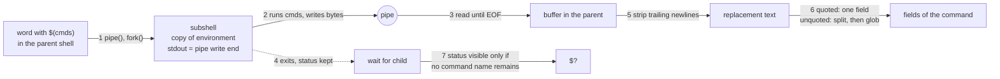

# Command Substitution

> [!summary] Claim
> `$(commands)` runs `commands` in a forked subshell with its standard output on a pipe, reads the pipe to end of file, strips every trailing newline, and splices the bytes into the surrounding word, so the value is a copy of text and not a handle on the process, and everything the shell does to it afterwards (splitting, globbing) depends on quoting alone.

Part of [The POSIX Shell Language](README.md) in [Shell and Unix Engineering](../README.md).

## TL;DR

- Mechanism: the shell makes a pipe, forks a subshell that runs the commands with stdout on the pipe, reads to end of file, waits for the child, and removes all trailing newline bytes (POSIX.1-2024 XCU 2.6.3); ksh93 is the exception, running the substitution as a virtual subshell in its own process with the output in a temporary file.
- Rule: always write `"$(cmd)"`; unquoted, the result is field split and then pathname expanded, and quoted or not it is never expanded a second time.
- Trap: `$?` after `local v=$(cmd)` or `export v=$(cmd)` is the status of the declaration, not of `cmd`, and `set -e` is not in force inside the substitution in bash (outside POSIX mode) and BusyBox ash.
- Portability: prefer `$(...)` over backquotes everywhere; `$(<file)` is an extension, a bare `$((` that starts a subshell breaks dash and BusyBox ash, and bash 3.2 and posh mis-scan some parenthesis cases (all measured in the shell matrix).
- When not to use it: for binary or huge data, or when you need the trailing newlines or the exit status of a pipeline stage, write to a file or a pipe and use `read` or a redirection instead.

## Mental model



The parent builds a pipe and forks (arrow 1).
The child is a duplicate of the parent's execution environment, so it can read every variable but any change it makes dies with it (arrow 2).
The parent does not return until it sees end of file on the pipe, which happens only when every holder of the write end has closed it (arrow 3), then it reaps the child and keeps the status (arrow 4).
The bytes are trimmed of trailing newlines (arrow 5) and become ordinary text in the word being expanded, where quoting decides whether field splitting and pathname expansion run (arrow 6).
The status survives only when the command has no command name, such as a plain assignment (arrow 7).

## How it works

### The specification

POSIX.1-2024 XCU 2.6.3 says the shell "shall expand the command substitution by executing commands in a subshell environment" and replaces it with the standard output, dropping trailing newline bytes.
Newlines elsewhere stay, "however, they might be treated as field delimiters and eliminated during field splitting".
A null byte in the output makes the behavior unspecified.
The results "shall not be processed for further tilde expansion, parameter expansion, command substitution, or arithmetic expansion".
The commands string is tokenized and parsed like a program, and it is unspecified whether it is parsed and run incrementally or parsed completely first, so an `alias` defined inside the string must not be relied on within it.
A string made only of redirections gives unspecified results.
The subshell environment (XCU 2.13) is "a duplicate of the shell environment", with non-ignored traps reset to default, and "changes made to the subshell environment shall not affect the shell environment".

For the backquote form, a backslash keeps its literal meaning except before `$`, a backquote, or a backslash, and nesting needs the inner backquotes escaped.
The `$(` form takes everything up to the matching `)`, so nesting needs nothing special.

XCU 2.9.1.3 gives the status rule: if a simple command has no command name but contains a command substitution, "the command shall complete with the exit status of the command substitution whose exit status was the last to be obtained"; otherwise a command with no name completes with 0.
When there is a command name, the status is the command's, so `echo $(false)` reports 0.
The informative text under `export` states the consequence: after `export X=$(false)`, `$?` is 0 and execution continues "even if set -e is in effect"; separate the assignment from the export to detect the failure.
Under `set -e`, XCU says that "or of any subshell environments in which command substitution was performed during word expansion, shall not cause the shell to exit", so `echo "$(false)"` does not exit but `x=$(false)` does, because the assignment command itself fails.

### The ambiguity with arithmetic expansion

XCU 2.6.3 closes with the rule for `$((`: arithmetic expansion has precedence, and a conforming application must write `$( (commands) )` with a space when it means a command substitution that starts with a subshell.
The same section requires a shell that determines the text cannot be an arithmetic expansion to parse it as a command substitution instead.
Dash and BusyBox ash do not fall back to a subshell when the arithmetic parse fails (measured in the shell matrix, below), which is why the space is not optional in portable code.
The fallback never applies to text whose `))` closes the expansion: `x=$((cd /tmp; pwd))` is an arithmetic expansion, and an arithmetic error, in every shell in the matrix (ad hoc measurement, 2026-10-26).
See [[Arithmetic-Expansion]].

### The implementations

All the shells examined do the same three things, with different plumbing.

- dash: `expbackq` calls `evalbackcmd`, which calls `sh_pipe`, `makejob` and `forkshell`; the child does `dup2(pip[1], 1)` and `evaltreenr(n, EV_EXIT)`; the parent reads in 128-byte chunks until `read` returns 0, closes the pipe, calls `waitforjob`, then drops every trailing `'\n'` with a loop over the output buffer (dash `src/expand.c`, `expbackq`; `src/eval.c`, `evalbackcmd`; master as fetched 2026-10-26).
- bash 5.3: `command_substitute` creates the pipe and calls `make_child` with `FORK_COMSUB`; in the child, when `inherit_errexit == 0` it clears `errexit` ("When inherit_errexit option is not enabled, command substitution does not inherit the -e flag. It is enabled when Posix mode is enabled"); the parent calls `read_comsub`, which reads through a `COMSUB_PIPEBUF` (4096-byte) buffer, skips every NUL byte with the warning "command substitution: ignored null byte in input", and trims trailing newlines, and then `wait_for` reaps the child (bash-5.3 `subst.c`, `command_substitute`, `read_comsub`).
- BusyBox ash: the same shape, `evalbackcmd` with `pipe` and `forkshell` and `expbackq` with `waitforjob` and an "Eat all trailing newlines" loop (BusyBox `shell/ash.c`, master mirror as fetched 2026-10-26).
- zsh: `getoutput` parses the string, makes a pipe with `mpipe`, forks with `zfork`, runs the program with `execode` in the child after `entersubsh`, and reads with `readoutput` (zsh `Src/exec.c`, `getoutput`, master as fetched 2026-10-26, and the same calls at the `zsh-5.9` tag).

Two fast paths avoid the fork.
Bash, zsh and the Korn shells recognize `$(<file)` and read the file directly; bash does it in `command_substitute` through `can_optimize_cat_file`, and zsh in `getoutput` through `simple_redir_name(prog, REDIR_READ)`, and the bash manual calls `$(< file)` the "equivalent but faster" form of `$(cat file)`.
ksh93 can also run a substitution without a new process: in the lab, a `/bin/sh` started inside the substitution and followed by `true` (so that no shell can exec it in place of the subshell) reports the main shell as its parent in ksh93 only, while variables stay isolated.
The mechanism is the virtual subshell: `comsubst` calls `sh_subshell`, which runs the command tree in the shell's own process with standard output in a temporary file ("output will be placed in temp file (or buffer)"), and `sh_subfork` forks a real subshell only when the commands need one (ksh93u+m 1.0.10 `src/cmd/ksh93/sh/macro.c` and `subshell.c`).

### Process and descriptor consequences

The parent returns only at end of file, and end of file needs every copy of the write end closed.
A background job started inside the substitution inherits the pipe as its stdout and stderr, so `$(cmd &)` waits for the job, and the fix is to redirect the job's output (`cmd >/dev/null 2>&1 &`).
Yash and ksh93u+m were measured waiting for the job even when its output was redirected away, for two different reasons.
Yash applies the job's redirections in the job's own yash process after saving the original descriptors, and it execs the command in place only when nothing was saved (`finally_exit && savefd == NULL` in `exec_simple_command_with_words`, yash 2.58.1 `exec.c`), so that process forks the command and keeps a saved copy of the pipe's write end open until the command exits (a process listing in the matrix shows it at descriptor 100).
In ksh93u+m the output goes to a temporary file, not a pipe, but `sh_exec` records every process forked inside a subshell in `sh.spid`, clears it only when a later foreground child is waited for, and `sh_subshell` ends a command substitution with `job_wait(sh.spid)` (ksh93u+m 1.0.10 `xec.c` and `subshell.c`), so a background job that is the last process the substitution started is waited for whatever its redirections.

The value lives in the shell's memory, so it has no size limit of its own, but any use as an argument to an external command goes through `execve`, where the kernel limits argument size.
Builtins, assignments, and here-documents are not subject to that limit.
See [[Program-Startup-argv-envp-and-ARG_MAX]].

## Numbers and limits

| Quantity | Value | Source |
|---|---|---|
| Trailing newlines stripped | all of them: 11 bytes of output become 8 | lab (`every trailing newline is removed`), all shells |
| Result size held by the shell | 4,194,304 bytes (4 MiB) held and counted exactly | lab (`cs-probe.sh big`), all shells |
| Same 4 MiB passed as one argument to `/bin/echo` | fails in every shell, on macOS and Linux | lab (`external=fail`) |
| Substitution nesting | depth 40 asserted in every shell | lab (`nests to depth 40`) |
| Nesting beyond the lab (ad hoc, 2026-10-26, not in the lab) | depth 200 worked in bash 3.2 and 5.2, dash, zsh, posh, BusyBox ash, yash, Alpine mksh, ksh93u+ 2012 and ksh93u+m; depth 500 worked except ksh93 (eval error); Debian mksh (R59 2025) worked at 50 and failed at 60 with "too many open files (N -> 128)", where N varied between runs | ad hoc measurement in the shell matrix; the ksh93u+m and Debian mksh limits re-measured 2026-10-26 |
| bash read buffer | 4096 bytes (`COMSUB_PIPEBUF`) | bash-5.3 `subst.c` |
| dash read buffer | 128 bytes (`char buf[128]` in `expbackq`) | dash `src/expand.c` |
| Delay when a held pipe outlives the command | the job's whole remaining runtime (1 s in the lab) | lab (`late=yes`) |

## Portability

Every cell below is asserted by the lab (the test name is in the column header) except the first row, which restates the specification.
"Early" means the substitution returned while a background job whose output was redirected away was still running.

| Shell | `case x in x)` unbalanced paren | `)` in heredoc body | `)` in comment | `$((a);b)` | `set -e` inside | `$(<file)` | NUL byte | Early return | Unquoted result globbed |
|---|---|---|---|---|---|---|---|---|---|
| POSIX sh (spec) | must parse | must parse | must parse | subshell if not arithmetic | duplicate of options, so on | unspecified | unspecified | not stated | yes |
| macOS bash 3.2 (`/bin/bash`) | syntax error | syntax error | ok | subshell | off | reads file | dropped | yes | yes |
| macOS `/bin/sh` (bash 3.2, POSIX mode) | syntax error | syntax error | ok | subshell | on | reads file | dropped | yes | yes |
| bash 4.4 to 5.3 | ok | ok | ok | subshell | off unless `inherit_errexit` or POSIX mode | reads file | dropped | yes | yes |
| zsh native | ok | ok | ok | subshell | on | reads file | kept | yes | no (needs `GLOB_SUBST`) |
| `zsh --emulate sh` | ok | ok | ok | subshell | on | reads file | kept | yes | yes |
| dash 0.5.12 | ok | ok | ok | syntax error | on | empty | dropped | yes | yes |
| ksh93u+m 1.0.10 | ok | ok | ok | subshell | on | reads file | value ends at NUL | no, waits | yes |
| ksh93u+ 2012 (macOS `/bin/ksh`) | ok | ok | ok | subshell | on | reads file | value ends at NUL | yes | yes |
| mksh R59 | ok | ok | ok | subshell | on | reads file | dropped | yes | yes |
| yash 2.58.1 | ok | ok | ok | subshell | on | empty | value ends at NUL | no, waits | yes |
| posh 0.14.1 | syntax error | syntax error | syntax error | subshell | on | empty | dropped | yes | yes |
| BusyBox ash 1.37.0 | ok | ok | ok | syntax error | off | empty | dropped | yes | yes |

Further measured facts: a substitution holding only a redirection (`$(>/dev/null)`) is an empty result with status 0 everywhere except mksh, which reports an error (the message is `funny $()-command`); in ksh93 the substitution can run in the parent's process; `local` and `typeset` with an assignment mask the substitution status in every shell that has them, and ksh93 has `typeset` but no `local`.
Utility behavior (GNU, BSD, BusyBox, uutils) is not involved: the lab uses only `head`, `tr`, `wc`, `ls`, `cat` and `printf`, and no assertion branches on their implementation.

## Worked example

The lab is [lab](../labs/03-command-substitution/); it has 28 tests and one probe script, `cs-probe.sh`.
This is a simplified excerpt of the probe's two process experiments.

```sh
# hold: the job inherits the substitution's pipe, so the assignment waits for it
x=$(/bin/sh -c '/bin/sleep 1; echo done >"$1/late"' sh "$dir" &
  echo hi)
[ -e "$dir/late" ] && late=yes || late=no      # yes

# release: the job's output goes elsewhere, so the assignment returns at once;
# the job writes its marker only after DIR/go appears, or after a timeout of at least 3 s
job='i=0; while [ ! -e "$1/go" ] && [ "$i" -lt 30 ]; do /bin/sleep 0.1; i=$((i + 1)); done
  echo done >"$1/late"'
x=$(/bin/sh -c "$job" sh "$dir" >/dev/null 2>&1 &
  echo hi)
[ -e "$dir/late" ] && late=yes || late=no      # no (yes in yash and ksh93u+m)
: >"$dir/go"                                   # release the job
```

Output of `cs-probe.sh holder DIR hold`, `holder DIR release` and `big 4194304` under dash, captured from the lab:

```text
x=hi late=yes
x=hi late=no
chars=4194304 heredoc_bytes=4194304
external=fail
```

TAP from `bats` under dash, captured from the lab (28 tests), abbreviated:

```text
ok 1 every trailing newline is removed, interior newlines and other whitespace are kept
ok 9 an assignment or a bare substitution reports the substitution status, a command argument hides it
ok 10 export and readonly with an assignment mask the substitution status, a separate assignment does not
ok 13 whether set -e is in force inside the substitution depends on the shell
ok 25 the substitution waits for end of file, so a background job that holds the pipe delays it
ok 27 a 4 MiB result is held in full by the shell but cannot be passed to an external command
```

## Pitfalls

> [!warning] Trailing newlines are destroyed
> Trigger: `x=$(printf 'a\n\n')` or `IFS=$(printf ' \t\n')`.
> Symptom: `${#x}` is 1, and the `IFS` loses its newline (measured in the shell matrix).
> Fix: append a sentinel inside and strip it outside, `x=$(cmd; echo .); x=${x%.}`, or use `unset IFS` to restore the default.

> [!warning] The masked status of a declaration
> Trigger: `local out=$(cmd)` or `export out=$(cmd)` or `readonly out=$(cmd)`.
> Symptom: `$?` is 0 and `set -e` does not fire, even when `cmd` failed; POSIX documents this under `export`, and the lab shows 0 in every shell.
> Fix: declare first, assign second: `local out; out=$(cmd) || return`.

> [!warning] A background job pins the substitution
> Trigger: `pid=$(daemon &)` or a wrapper that leaves a child running with inherited stdout.
> Symptom: the assignment blocks until the child exits, in the lab for the child's whole one-second runtime.
> Fix: redirect the child's stdout and stderr (`daemon >/dev/null 2>&1 &`) or start it outside the substitution; the redirect is not enough in yash (the job's own process keeps a saved copy of the pipe) or ksh93u+m (it waits for the last process the substitution forked), so do not rely on `$(...)` to start jobs there.

> [!warning] `for f in $(ls)`
> Trigger: an unquoted substitution in a `for` list, the pattern this script family has produced for decades.
> Symptom: a file named `a b` becomes two words, a name with `*` is globbed, and a leading `-` is an option; the lab counts 3 words against 2 files.
> Fix: use a glob (`for f in ./*`) or `find ... -exec`; if you must read a command's output, loop with `while IFS= read -r line` (see [[The-read-Builtin]]).

> [!warning] `$((` that means a subshell
> Trigger: `n=$((cd dir && ls) | wc -l)`, which a human reads as a substitution that starts with a subshell.
> Symptom: dash and BusyBox ash stop with "Missing '))'" while bash, zsh, ksh93, mksh, yash and posh accept it, so a script tested on a Mac fails on Debian or Alpine (ad hoc measurement in the shell matrix, 2026-10-26; the lab proves the same split with `$((echo a); echo b)`); `x=$((cd dir; pwd))`, whose `))` closes the expansion, is an arithmetic error in every shell.
> Fix: write `$( (cd dir && ls) | wc -l)` with a space, as POSIX requires of applications; where the inner parentheses are redundant, as in `$(cd dir; pwd)`, drop them.

> [!warning] Parenthesis scanning in old shells
> Trigger: `$(case x in x) ... esac)` without a leading `(`, a here-document whose body contains `)`, or a comment that contains `)`.
> Symptom: bash 3.2 (macOS `/bin/bash` and `/bin/sh`) gives a syntax error on the first two, posh on all three; both are POSIX-valid because the string is parsed as a program.
> Fix: write `(x)` in case patterns inside substitutions, move bodies out of the substitution, and avoid unbalanced `)` in comments for scripts that must run on bash 3.2.

> [!warning] Backquote backslash rules
> Trigger: porting a command from `` `...` `` to `$(...)` or the reverse, with `\\` or nested quotes inside.
> Symptom: backquotes halve backslash pairs first (`"a\\\\b"` yields `a\b`), `$(...)` does not (`a\\b`); nesting backquotes needs `\`` and gets unreadable.
> Fix: use `$(...)`, which the lab shows is the same in every shell and nests with no escaping.

> [!warning] `set -e` and the subshell
> Trigger: `set -e; x=$(false; echo after)` in bash or BusyBox ash.
> Symptom: `x` is `after` because bash clears `errexit` in the substitution unless `inherit_errexit` or POSIX mode is on (bash-5.3 `subst.c`, `command_substitute`), and BusyBox ash behaves the same; dash, zsh, ksh93, mksh, yash and posh stop at `false`.
> Fix: `shopt -s inherit_errexit` in bash 4.4 and later, or test the commands explicitly; see [[errexit-Semantics-and-Exceptions]].

## Security and robustness

- A substitution is code execution: any text that reaches the commands string, directly or through `eval`, is executed (see [[Command-Injection]] and [[The-eval-Builtin]]); never splice untrusted data into it, pass it as a positional parameter instead.
- The output is data that is re-split and re-globbed when unquoted; an attacker-controlled name containing `*`, spaces or a leading `-` changes the command's argument list, so quote and use `--`.
- A NUL byte in the output is unspecified: bash 4.4 and later drop it with the warning "command substitution: ignored null byte in input" (bash 3.2 drops it silently, measured in the shell matrix), ksh93 and yash truncate there, zsh keeps it, so binary data must never pass through `$(...)`.
- The trailing-newline strip makes the value lossy; for exact bytes write to a file or use the sentinel idiom.
- Bound the result: the shell buffers all of it, so a runaway command costs unbounded memory in the parent; limit with `head -c` inside the substitution.
- A held pipe turns a stuck helper into a stuck script; start jobs with their output redirected and set timeouts around anything that could block.
- Command substitution runs in a subshell, so `exit` inside it leaves only the substitution (lab: `after 3 [before]`); do not rely on it to abort the script, and check the status explicitly.

## The principal's view

Use `$(...)` for short, bounded text results that you will quote at once, and treat every other use as a smell: a result you need to split should come from `read` or a loop over a glob, a result that may be large or binary belongs in a file or a pipe, and a result you need together with its exit status deserves a declaration split into two statements.
The trade-off is a fork per substitution, which is cheap for a script that runs once and visible in a loop run thousands of times; the cheap alternatives are parameter expansion, builtins that print into a variable, and `$(<file)` where the shells in your fleet support it.
Prefer a language with real data types, such as Python or a compiled tool, when the substitution is parsing structured output, when error handling must distinguish stages, or when portability to dash and BusyBox must coexist with quoting rules that nobody can review.
A script that must run on both macOS bash 3.2 and Alpine should be written to the lowest common denominator in the portability table, and the lab should run on both.

## Interview questions

> [!question] L5: What does `x=$(printf 'a\n\n'); echo "${#x}"` print, and why?
>
> > [!success]- Answer
> > It prints 1.
> > POSIX XCU 2.6.3 removes every trailing newline byte from the output, not just one.
> > Only newlines at the end go; an interior newline stays.
> >
> > Follow-up: How would you preserve them?
> > Append a sentinel inside, `x=$(cmd; echo .)`, and strip it outside with `${x%.}`.

> [!question] L5: Why is `echo $(false); echo $?` printing 0?
>
> > [!success]- Answer
> > The command has a command name, `echo`, so its own status is the command's status and the substitution's status is discarded.
> > Only a command with no command name, such as `x=$(false)`, completes with the substitution's status.
> >
> > Follow-up: What status does `x=$(exit 5) y=$(exit 6)` give?
> > 6, the substitution whose status was obtained last.

> [!question] L5: Predict the output of `f() { local v=$(exit 3); echo "$?"; }; f` in bash and dash.
>
> > [!success]- Answer
> > Both print 0.
> > `local` is a command with a name, and it succeeds in declaring `v`, so the substitution's status is lost.
> > The lab asserts 0 in every shell that has `local`, and in ksh93 for `typeset`.
> >
> > Follow-up: What is the fix?
> > `local v; v=$(exit 3)`, which gives 3.

> [!question] L6: Debug this: `for f in $(ls *.txt); do cp $f /backup; done` loses files named `my notes.txt`.
>
> > [!success]- Answer
> > The unquoted substitution is field split on space, so `my notes.txt` becomes `my` and `notes.txt`.
> > The unquoted `$f` splits again.
> > The lab shows 3 words for two files, one named `a b`.
> > Use `for f in ./*.txt; do cp -- "$f" /backup; done`, which needs neither `ls` nor a substitution.
> >
> > Follow-up: What if the file list comes from another program?
> > Use `find ... -exec` so no list is ever parsed, or loop with `while IFS= read -r line`, which still breaks on names that contain a newline.

> [!question] L6: Why does `pid=$(sleep 100 & echo $!)` hang for 100 seconds, and what changes it?
>
> > [!success]- Answer
> > The background `sleep` inherits the pipe as its stdout, and the parent reads until end of file, which needs every writer closed.
> > The lab's job holds the pipe for its one second and the assignment returns only after it is done.
> > Redirecting the job's stdout and stderr fixes it in bash, zsh, dash, BusyBox, mksh, posh and ksh93u+ 2012; yash and ksh93u+m were measured waiting anyway, yash because the job's own process keeps a saved copy of the pipe and ksh93u+m because it waits for the last process the substitution forked.
> >
> > Follow-up: What does that say about using `$(...)` to start daemons?
> > Do not; use `nohup` or `setsid` with explicit redirections outside any substitution (see [[Daemonization]]).

> [!question] L6: Why does `n=$((cd /tmp && ls) | wc -l)` work on a Mac and fail on Debian?
>
> > [!success]- Answer
> > The text begins with `$((`, which POSIX resolves in favor of arithmetic expansion.
> > Bash, like zsh, ksh93, mksh, yash and posh, determines that the text cannot be arithmetic and parses a command substitution that starts with a subshell, as XCU 2.6.3 requires; dash and BusyBox ash report "Missing '))'" (ad hoc measurement in the shell matrix; the lab proves the same split with `$((echo a); echo b)`).
> > Write `$( (cd /tmp && ls) | wc -l)`.
> > By contrast, `x=$((cd /tmp; pwd))`, whose `))` closes the expansion, is an arithmetic error in every shell, on the Mac too.
> >
> > Follow-up: Does the portable form change what the code does?
> > No; the extra parentheses only add another subshell.

> [!question] L7+: A deploy script uses `set -e` and `out=$(build.sh)`, but a failure inside a pipeline within `build.sh` is ignored. What are the layers?
>
> > [!success]- Answer
> > The outer `set -e` sees only the status of the assignment, which is the status of the substitution's last command.
> > Inside, bash outside POSIX mode clears `errexit` in the substitution, BusyBox ash does too, so `build.sh` as a function body could keep going after a failure.
> > A pipeline's status is its last stage unless `pipefail` is set, which POSIX.1-2024 added; see [[Pipelines-and-And-Or-Lists]].
> > Make `build.sh` a separate script that sets its own options, or enable `inherit_errexit` and `pipefail` in it and test its status explicitly.
> >
> > Follow-up: Which shells keep `-e` in the substitution without help?
> > dash, zsh, ksh93, mksh, yash and posh, per the lab; bash in POSIX mode too.

> [!question] L7+: Why does the shell need the pipe and a fork at all, and where does `$(<file)` skip them?
>
> > [!success]- Answer
> > The substitution may contain any command, including ones that write directly to descriptor 1, so the only general capture is to point descriptor 1 at a pipe (in ksh93, a temporary file) and read it, and a subshell is needed so the commands cannot change the parent's state.
> > `$(<file)` has no commands to run: bash recognizes it in `command_substitute` (`can_optimize_cat_file`) and zsh in `getoutput` (`simple_redir_name`) and read the file directly.
> > dash, BusyBox ash, yash and posh treat `<file` as a command with no name, so the result is empty (lab).
> >
> > Follow-up: What does ksh93 do differently?
> > It runs the substitution as a virtual subshell in the parent's process, with the output in a temporary file, and forks only when the commands need it (`sh_subshell` and `sh_subfork` in ksh93u+m 1.0.10 `subshell.c`); the lab observes the shared process.

> [!question] L7+: Design the safest way to capture a command's exact output, including trailing newlines and an exit status, from POSIX sh.
>
> > [!success]- Answer
> > Use a sentinel for the bytes, `out=$(cmd; echo "x$?")`, then split the status from the last line.
> > In a fixed form: `out=$(cmd; printf 'x%d' "$?")`, `rc=${out##*x}`, `out=${out%x*}`.
> > NUL bytes still cannot pass, so for binary output write to a temporary file with `mktemp` and a `trap` for cleanup.
> >
> > Follow-up: Why not rely on `$?` after `out=$(cmd)` alone?
> > It is correct for a bare assignment but is lost with `local` or `export`, which is the common refactor that breaks it.

## Related

Prerequisites: [[Special-Parameters]]

Next: [[Arithmetic-Expansion]]

See also: [[Expansion-Order]], [[Field-Splitting-and-IFS]], [[Pathname-Expansion]], [[Quoting-Backslash-Single-and-Double]], [[Subshells-and-the-Execution-Environment]], [[errexit-Semantics-and-Exceptions]], [[Here-Documents]], [[Special-Built-ins-versus-Utilities]], [[The-eval-Builtin]], [[The-read-Builtin]], [[Pipelines-and-And-Or-Lists]], [[Command-Injection]], [[Processes-fork-exec-and-wait]], [[Pipes-and-FIFOs]], [[Program-Startup-argv-envp-and-ARG_MAX]], [[Daemonization]], [[POSIX-2024-Changes]]

## Further reading

- POSIX.1-2024 XCU chapter 2, https://pubs.opengroup.org/onlinepubs/9799919799/utilities/V3_chap02.html: sections 2.6.3, 2.9.1.3, 2.13 and the `export` and `set -e` text are the specification of everything above.
- bash 5.3 `subst.c`, in https://ftpmirror.gnu.org/bash/bash-5.3.tar.gz: `command_substitute` and `read_comsub` show the pipe, the fork, the `inherit_errexit` rule and the NUL handling.
- bash 5.3 `doc/bash.1` in the same tarball: the Command Substitution section and the `inherit_errexit` entry state the documented behavior.
- dash `src/expand.c` and `src/eval.c`, https://git.kernel.org/pub/scm/utils/dash/dash.git/: the smallest complete implementation (`expbackq`, `evalbackcmd`).
- zsh `Src/exec.c`, https://raw.githubusercontent.com/zsh-users/zsh/master/Src/exec.c: `getoutput` shows the `$(<file)` fast path.
- BusyBox `shell/ash.c`: the same mechanism in the shell used on Alpine and in many containers.
- ksh93u+m 1.0.10 `src/cmd/ksh93/sh/subshell.c` and `xec.c`, https://github.com/ksh93/ksh: `sh_subshell`, `sh_subfork` and the `job_wait(sh.spid)` at the end of a command substitution explain the shared process and the wait for a background job.
- yash 2.58.1 `exec.c`, https://github.com/magicant/yash: `exec_simple_command_with_words` shows why a redirected background command keeps the pipe open.
