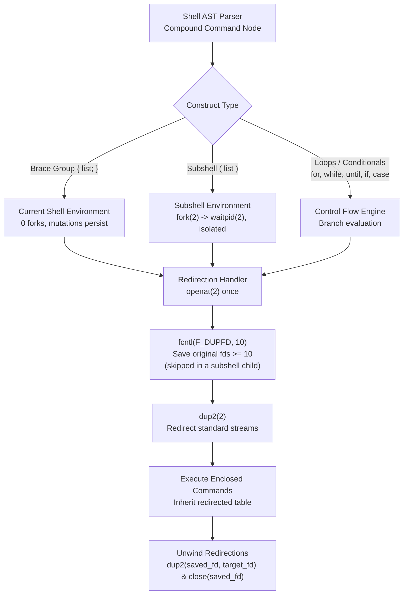

# Compound Commands

> [!summary] Claim
> A compound command groups command lists into a single syntactical unit that controls execution flow and evaluates attached file descriptor redirections once across the entire construct, either in the current execution environment or an isolated subshell.

Part of [The POSIX Shell Language](README.md) in [Shell and Unix Engineering](../README.md).

## TL;DR

- Mechanism: The shell AST parser groups command lists into a composite node, evaluates attached redirections once before execution, and unwinds saved file descriptors upon completion.
- Rule: Brace groups `{ ...; }` execute in the current environment and require delimiter whitespace, whereas parentheses `( ... )` execute in an isolated subshell environment and require no delimiter spaces.
- Trap: Piping into a compound loop executes the loop inside a subshell in most POSIX shells (ksh93 and native zsh are the exceptions), silently discarding all internal variable mutations upon loop completion.
- Portability fact: POSIX.1-2024 standardized the `;&` case fall-through operator from KornShell, which is supported in modern Bash, ksh93, and zsh, but rejected as a syntax error in dash and macOS Bash 3.2.
- When not to use it: Avoid nested compound structures when control logic requires complex data structures or multi-level exception propagation; use an external script in Go, Rust, or Python instead.

## Mental model



The shell parser constructs a compound command AST node that wraps one or more command lists with a control flow structure.
Before executing any enclosed command, the engine processes all redirections placed on the compound command terminator, opening files once and saving the active descriptors to high indices using `fcntl(fd, F_DUPFD, 10)` followed by `F_SETFD` with `FD_CLOEXEC` (BusyBox ash uses `F_DUPFD_CLOEXEC`).
A subshell is the exception: the child applies the redirection after `fork(2)` and neither saves nor restores anything, because the descriptor table dies with it (traced with `strace` in the shell matrix, as of 2026-11).
The command body executes either directly in the current shell process or inside a child subshell created by `fork(2)`.
Enclosed commands inherit the redirected file descriptors without reopening target files.
When a current-shell compound command completes, breaks, or returns, an unwind-protect frame restores the saved file descriptors and closes temporary copies.

## How it works

The POSIX shell grammar lists seven compound command productions: brace groups, subshells, `for` loops, `case` conditionals, `if` conditionals, `while` loops, and `until` loops `(POSIX.1-2024 XCU 2.9.4, XCU 2.10.2)`.
Every compound command begins with a reserved word or control operator and terminates with a corresponding reserved word or operator.
Any compound command can be followed by an optional redirection list on the same line as the terminator `(POSIX.1-2024 XCU 2.9.4)`.

```
compound_command : brace_group
                 | subshell
                 | for_clause
                 | case_clause
                 | if_clause
                 | while_clause
                 | until_clause
                 ;
```

### 1. Grouping Commands: Brace Groups vs Subshells

POSIX specifies two mechanisms for grouping commands together `(POSIX.1-2024 XCU 2.9.4.1)`:

1. `{ compound-list; }`: Executes in the current process environment.
The symbols `{` and `}` are reserved words, not operators `(POSIX.1-2024 XCU 2.4)`.
Because reserved words are recognized only when unquoted and occurring as the first word of a command, `{` must be delimited from the following command token by whitespace or a newline.
Similarly, `}` must be delimited from the preceding command by a semicolon, newline, or control operator `&`.
Variable assignments, working directory changes via `cd`, and shell option modifications remain in effect in the caller environment after the brace group terminates.
In GNU Bash, brace groups are dispatched in `execute_cmd.c` as `cm_group`, calling `execute_command_internal(command->value.Group->command)` directly without invoking `fork(2)` `(bash-5.3 execute_cmd.c, execute_command_internal)`.
In dash, brace groups are dispatched as simple recursive evaluations of the wrapped tree `(dash-0.5.12 src/eval.c, evaltree)`.

2. `( compound-list )`: Executes in a dedicated subshell environment `(POSIX.1-2024 XCU 2.13)`.
The symbols `(` and `)` are control operators, not reserved words `(POSIX.1-2024 XBD 3.85, XCU 2.3)`.
Because control operators delimit themselves lexically, no whitespace is required around them; `(printf hi)` is syntactically valid in all conforming shells.
In Bash, `execute_command_internal` recognizes `cm_subshell` and invokes `make_child()` to execute `fork(2)`; the child calls `execute_in_subshell()` and the parent waits for it `(bash-5.3 execute_cmd.c, execute_command_internal, execute_in_subshell)`.
In dash, `NSUBSHELL` invokes `forkshell()` and `waitforjob()` `(dash-0.5.12 src/eval.c, evalsubshell)`.
All environment mutations, including variable definitions, signal traps, and file descriptor modifications, are discarded when the subshell process exits.

POSIX.1-2024 notes that if a construct begins with `((`, shells implementing arithmetic evaluation extensions may treat it as an arithmetic command rather than a nested subshell `(POSIX.1-2024 XCU 2.9.4.1)`.
Applications requiring nested subshells must separate the parentheses with whitespace: `( (cmd) )`.

### 2. Single-Open Redirection Mechanics

When redirections follow a compound command terminator, the shell applies the redirections once to the entire compound construct before evaluating any enclosed commands `(POSIX.1-2024 XCU 2.9.4)`.

The kernel interaction proceeds through a deterministic sequence of system calls:
1. `openat(2)`: The shell opens or creates the redirection target once.
2. `fcntl(fd, F_DUPFD, 10)` then `fcntl(saved_fd, F_SETFD, FD_CLOEXEC)`: The shell saves the existing standard stream descriptor to a private table entry at or above descriptor index 10 `(bash-5.3 redir.c, add_undo_redirect)` and `(dash-0.5.12 src/redir.c, savefd)`; BusyBox 1.37.0 ash issues `F_DUPFD_CLOEXEC` instead (traced in the shell matrix).
3. `dup2(new_fd, target_fd)`: The target file descriptor (such as stdout fd 1) is replaced with the newly opened file.
4. `close(new_fd)`: The temporary descriptor returned by `openat(2)` is closed.
5. The shell establishes an unwind-protect handler (`begin_unwind_frame("loop_redirections")` in Bash; `pushredir()` in dash).
6. The inner commands execute, inheriting the modified descriptor table across all iterations.
7. Upon loop exit, or when left through `break`, `continue`, or `return`, the unwind handler executes `dup2(saved_fd, target_fd)` to restore the original file descriptor and `close(saved_fd)`.

This architecture prevents repeated file opening.
Redirecting a loop of 10,000 iterations via `{ for ...; } > file` invokes `openat(2)` exactly once, whereas redirecting inside the loop body repeats the whole open, save, `dup2(2)`, `close(2)`, and restore sequence 10,000 times.

### 3. Loop Constructs: for, while, and until

The `for` loop expands the word list following `in` once up-front before the first iteration begins `(POSIX.1-2024 XCU 2.9.4.2)`.
Field splitting and pathname expansion occur during this up-front expansion `(bash-5.3 execute_cmd.c, execute_for_command)`.
If `in word...` is omitted, the loop defaults to iterating over the positional parameters `"$@"`.
If the word list expands to zero items, the loop body does not execute, and the `for` command returns exit status 0 `(POSIX.1-2024 XCU 2.9.4.2)`.
The iteration variable is not lexically scoped; it retains its final iteration value in the execution environment after loop termination.

The `while` loop continuously executes `compound-list-1` (the condition) and, while its exit status is zero, executes `compound-list-2` (the body) `(POSIX.1-2024 XCU 2.9.4.5)`.
The `until` loop reverses this test, executing the body while the condition yields a non-zero status `(POSIX.1-2024 XCU 2.9.4.6)`.
During condition evaluation, the `set -e` (`errexit`) flag is suppressed: a failing command inside the condition does not abort the shell `(bash-5.3 execute_cmd.c, execute_while_or_until)`.

### 4. Conditionals: if and case

The `if` construct executes its condition list and evaluates exit status `(POSIX.1-2024 XCU 2.9.4.4)`.
If status is zero, the `then` compound list executes; otherwise, subsequent `elif` lists are tested in order.
If no condition succeeds and no `else` block exists, the `if` command exits with status 0.

The `case` construct matches an expanded word against pattern clauses delimited by `)` and terminated by `;;` or `;&` `(POSIX.1-2024 XCU 2.9.4.3)`.
The target word undergoes tilde expansion, parameter expansion, command substitution, arithmetic expansion, and quote removal, but does not undergo field splitting or pathname expansion.
Patterns are expanded lazily in clause order.
The order of expansion and comparison of multiple patterns on one clause, as in `a | b`, is unspecified `(POSIX.1-2024 XCU 2.9.4.3)`.
Once a pattern matches, pattern evaluation terminates immediately: subsequent pattern words are never expanded.
If no pattern matches, `case` exits with status 0.

### 5. Exit Status Architecture and POSIX.1-2024 Clarifications

The POSIX.1-2024 rationale (C.2.9.4) records that Austin Group Defect 1309 clarified the exit status of `for`, `case`, `if`, `while`, and `until`; the defect itself began with the value of `$?` at the start of each compound list:
- If a `for` loop expands to zero items, exit status is 0 `(POSIX.1-2024 XCU 2.9.4.2)`.
- If an `if` command finds no true condition and lacks an `else` clause, exit status is 0 `(POSIX.1-2024 XCU 2.9.4.4)`.
- If a `while` or `until` loop executes its body zero times, exit status is 0 `(POSIX.1-2024 XCU 2.9.4.5, XCU 2.9.4.6)`.
- If a `while` loop body executes, its final exit status is the exit status of the last command executed in the body, completely discarding the non-zero status of the condition that caused the loop to exit `(POSIX.1-2024 XCU 2.9.4.5)`.
- Austin Group Defect 449 added the `;&` operator to the POSIX specification `(POSIX.1-2024 XCU 2.9.4.3)`.
When a clause terminates with `;&`, execution falls through into the body of the subsequent clause without evaluating or comparing the subsequent clause pattern.
- Austin Group Defect 1454 clarified that a `case` command with no patterns (`case word in esac`) is valid syntax that exits with status 0.

## Numbers and limits

| Parameter | Value | Source / Methodology |
|:---|:---|:---|
| Subshell fork latency | ~1 ms / iteration (dash 1.05 ms, Bash 5.3 0.95 ms; fastest dash run 0.75 ms) | Hand measurement on Apple M3 Pro, `sh -c` with 2000 iterations, median of 15 runs, not part of the lab `(as of 2026-11)` |
| Brace group AST execution latency | ~3.7 us (dash) or ~6.8 us (Bash 5.3) / iteration with loop overhead; under 1 us above an empty loop | Hand measurement on Apple M3 Pro, `sh -c` with 2000 iterations, median of 15 runs, not part of the lab `(as of 2026-11)` |
| Subshell-to-brace speedup ratio | ~140x (Bash 5.3) to ~290x (dash) | Ratio of the two medians above `(as of 2026-11)` |
| Syscalls for loop-internal append | 8 (dash) or 10 (Bash 5.3) / iteration, excluding `write`: `openat`, `fcntl`, `dup2`, `close` | `strace` in Alpine on aarch64, where `dup2` appears as `dup3` `(as of 2026-11)` |
| Syscalls for compound command redirection | 8 (dash) or 10 (Bash 5.3) total regardless of iteration count, excluding `write` | Same `strace` run; includes the restoring `dup2` and `close` `(as of 2026-11)` |
| Time for 2000 file appends (loop-internal) | 62 ms (dash), 117 ms (Bash 5.3) | Hand measurement on Apple M3 Pro, `sh -c` with 2000 iterations, median of 15 runs, not part of the lab `(as of 2026-11)` |
| Time for 2000 file appends (block redirection) | 13 ms (dash), 23 ms (Bash 5.3) | Hand measurement on Apple M3 Pro, `sh -c` with 2000 iterations, median of 15 runs, not part of the lab `(as of 2026-11)` |
| Shell internal redirection fd floor | File descriptor 10 | `(bash-5.3 redir.c, SHELL_FD_BASE)` and `(dash-0.5.12 src/redir.c, savefd)` |
| Guaranteed application file descriptors | Fds 0 through 9 | POSIX.1-2024 specification `(POSIX.1-2024 XCU 2.7)` |
| Pipe buffer size (Linux default) | 65,536 bytes (64 KiB) | 16 pages per pipe(7), measured in shell matrix; `/proc/sys/fs/pipe-max-size` is the separate unprivileged ceiling, 1,048,576 bytes `(as of 2026-11)` |
| Pipe buffer size (macOS default) | 16,384 bytes (16 KiB), grows to 64 KiB | Measured in shell matrix `(as of 2026-11)` |

## Portability

The matrix below compares compound command behaviors across POSIX.1-2024, modern shells, and legacy platforms.
Every shell cell is asserted per shell by the lab test suite, and the POSIX.1-2024 column comes from the cited specification `(as of 2026-11)`.

| Feature / Behavior | POSIX.1-2024 sh | macOS Bash 3.2 | Current Bash 5.3 | dash 0.5.12 | ksh93u+ | zsh (native) | zsh (`--emulate sh`) | BusyBox ash / mksh / posh |
|:---|:---|:---|:---|:---|:---|:---|:---|:---|
| Case fall-through `;&` `(Defect 449)` | Standardized | Syntax error | Supported `(1.0)` | Syntax error | Supported `(1.0)` | Supported `(1.0)` | Supported `(1.0)` | mksh supports; ash & posh reject |
| Pipeline stage subshell isolation | Subshell; current shell allowed as an extension `(XCU 2.13)` | Subshell (loses vars) | Subshell (loses vars) | Subshell (loses vars) | Current shell (keeps vars) | Current shell (keeps vars) | Subshell (loses vars) | ash, mksh, posh run subshell |
| Brace token without space `{cmd;}` | Rejected | Syntax error | Syntax error | Syntax error | Syntax error | Accepted extension | Syntax error | Rejected across all engines |
| Redirection failure under `set -e` `(XCU 2.15 set)` | ERREXIT triggered | Ignored for `{ }` and loops (continues) | ERREXIT triggered | ERREXIT triggered | Ignored (continues) | ERREXIT triggered | ERREXIT triggered | mksh and posh trigger; ash ignores for `{ }` and loops |
| Assignment prefix `VAR=1 { cmd; }` | Syntax error | Syntax error | Syntax error | Syntax error | Syntax error | Syntax error | Syntax error | Syntax error across all engines |
| Empty loop exit status `(Defect 1309)` | Status 0 | Status 0 | Status 0 | Status 0 | Status 0 | Status 0 | Status 0 | Status 0 across all engines |
| Case with zero patterns `in esac` | Status 0 `(Defect 1454)` | Status 0 | Status 0 | Status 0 | Status 0 (93u+ 2012 requires a newline; 93u+m does not) | Status 0 | Status 0 | Status 0 across all engines |
| Numeric loop var `for 123 in` | Rejected | Run-time error, status 1, script continues (aborts in POSIX mode) | Run-time error, status 1, script continues (aborts in POSIX mode) | Syntax error | Run-time error, script exits 1 | Accepted extension | Accepted extension | Syntax error across all engines |
| Non-standard `for ((;;))` syntax | Not in POSIX | Supported | Supported | Syntax error | Supported | Supported | Supported | ash, mksh, and posh reject |
| Non-standard `[[ ... ]]` syntax | Not in POSIX | Supported | Supported | `[[: not found` (on Alpine, BusyBox installs a `/usr/bin/[[` applet that dash runs instead) | Supported | Supported | Supported | ash and mksh support; posh `[[: not found` |

The lab tests behind the rows, in table order:

- Case fall-through: `case fallthrough with ;& behaves according to shell capability`.
- Pipeline stage isolation: `redirected while loop preserves variables while pipeline stage subshell diverges`.
- Brace token: `parentheses do not require delimiter whitespace while braces require delimiters in POSIX shells`.
- Redirection failure: `redirection failure on a brace group or loop under set -e aborts or continues per shell`, which also shows that Bash 4.4 continues as Bash 3.2 does and that Bash 5.1 and later abort.
- Assignment prefix: `assignment prefix preceding compound command is rejected as syntax error`.
- Empty loop status: `compound command exit status rules conform to POSIX Defect 1309`.
- Zero patterns: `case with zero patterns has status 0 even after a failure`.
- Numeric loop variable: `numeric for variable is a parse error, a run-time error, or an extension per shell`.
- Arithmetic `for`: `arithmetic for loop runs or is a parse error per shell`.
- Double bracket: `double bracket test is built in or not found per shell`.

A syntax error test proves more than a non-zero status: the code runs `printf` first on the same line, and the test requires the measured status and diagnostic with neither that line nor the next one having run, which a run-time failure such as an unknown command cannot satisfy.

## Worked example

The test script below is drawn from the accompanying [lab](../labs/03-compound-commands/).
It instruments redirection scoping, subshell variable isolation, lazy pattern evaluation, and file descriptor inheritance.

```sh
#!/bin/sh
# probe.sh: instrument compound command mechanics in the lab matrix.
# Exercises grouping, environment isolation, redirection scope, exit status,
# lazy case evaluation, fall-through (;&), pipeline subshell divergence, and fd inheritance.

set -eu

usage() {
  printf 'usage: probe.sh <mode> [scratch_dir]\n' >&2
  exit 1
}

probe_redir_scope() {
  scratch="${1:-.}"
  out="$scratch/out.txt"
  {
    printf 'line1\n'
    printf 'line2\n'
  } >"$out"
  printf 'after\n'
  cat "$out"
}

probe_env_isolation() {
  scratch="${1:-.}"
  var="initial"
  orig_pwd=$(pwd)
  # shellcheck disable=SC2030 # intentional test of subshell variable isolation
  (
    var="subshell"
    cd "$scratch"
    printf 'sub: var=%s\n' "$var"
  )
  cur_pwd=$(pwd)
  in_orig=0
  if [ "$cur_pwd" = "$orig_pwd" ]; then
    in_orig=1
  fi
  # shellcheck disable=SC2031 # intentional assertion that subshell change did not leak
  printf 'caller_after_sub: var=%s in_orig=%d\n' "$var" "$in_orig"
  {
    var="current"
  }
  printf 'caller_after_brace: var=%s\n' "$var"
}

probe_case_lazy() {
  scratch="${1:-.}"
  marker="$scratch/marker.txt"
  rm -f "$marker"
  val="target"
  case "$val" in
    target)
      printf 'matched_clause1\n'
      ;;
    "$(
      touch "$marker"
      printf 'target\n'
    )")
      printf 'matched_clause2\n'
      ;;
    *)
      printf 'unmatched\n'
      ;;
  esac
  if [ -f "$marker" ]; then
    printf 'marker: created\n'
  else
    printf 'marker: absent\n'
  fi
}

probe_case_fallthrough() {
  # Feature-detect ;& using eval inside a subshell to avoid fatal parse errors on dash/bash 3.2
  if (eval 'case a in a) : ;& b) : ;; esac') 2>/dev/null; then
    eval '
      x=0; y=1
      case 1 in
        $((y=0))) ;;
        $((x=1))) ;&
        $((x=2))) printf "fallthrough: %d.%d\n" "$x" "$y" ;;
        *) ;;
      esac
    '
  else
    printf 'fallthrough: unsupported\n'
  fi
}

probe_loop_status() {
  set +e
  false
  # shellcheck disable=SC2034 # loop variable unused by design in empty iteration test
  for x in; do printf 'unreached\n'; done
  st_for=$?

  false
  while false; do printf 'unreached\n'; done
  st_while_empty=$?

  false
  until true; do printf 'unreached\n'; done
  st_until_empty=$?

  false
  if false; then printf 'unreached\n'; fi
  st_if_empty=$?

  val="nomatch"
  false
  case "$val" in
    match) printf 'unreached\n' ;;
    *) ;;
  esac
  st_case_empty=$?

  i=0
  while [ "$i" -lt 1 ]; do
    i=$((i + 1))
    (exit 42)
  done
  st_while_body=$?
  set -e

  printf 'for_empty: %d\n' "$st_for"
  printf 'while_empty: %d\n' "$st_while_empty"
  printf 'until_empty: %d\n' "$st_until_empty"
  printf 'if_empty: %d\n' "$st_if_empty"
  printf 'case_empty: %d\n' "$st_case_empty"
  printf 'while_body: %d\n' "$st_while_body"
}

probe_pipeline_scope() {
  scratch="${1:-.}"
  input="$scratch/input.txt"
  printf 'one\ntwo\nthree\n' >"$input"

  # Redirected compound command: executes in current shell across all POSIX shells
  c1=0
  while IFS= read -r line; do
    if [ -n "$line" ]; then
      c1=$((c1 + 1))
    fi
  done <"$input"

  # Pipelined compound command: subshell in most shells, current shell in ksh93/zsh
  c2=0
  # shellcheck disable=SC2002 # intentional pipeline test to inspect subshell isolation
  cat "$input" | while IFS= read -r line; do
    if [ -n "$line" ]; then
      # shellcheck disable=SC2030 # intentional test of pipeline subshell variable isolation
      c2=$((c2 + 1))
    fi
  done

  printf 'redir_count: %d\n' "$c1"
  # shellcheck disable=SC2031 # intentional assertion that pipeline subshell modification was lost
  printf 'pipe_count: %d\n' "$c2"
}

probe_fd_inheritance() {
  scratch="${1:-.}"
  out="$scratch/bg_out.txt"
  fifo="$scratch/sync_fifo"
  rm -f "$out" "$fifo"
  mkfifo "$fifo"

  {
    {
      # Wait on synchronization byte from parent before writing to inherited stdout
      cat <"$fifo" >/dev/null
      printf 'from_bg\n'
    } &
    bg_pid=$!
    printf 'from_main\n'
  } >"$out"

  # The compound command completed and main stdout was restored, but bg_pid retains fd
  printf 'go\n' >"$fifo"
  wait "$bg_pid"

  cat "$out"
  rm -f "$fifo" "$out"
}

[ "$#" -ge 1 ] || usage
mode="$1"
shift

case "$mode" in
  redir_scope)
    probe_redir_scope "${1:-.}"
    ;;
  env_isolation)
    probe_env_isolation "${1:-.}"
    ;;
  case_lazy)
    probe_case_lazy "${1:-.}"
    ;;
  case_fallthrough)
    probe_case_fallthrough
    ;;
  loop_status)
    probe_loop_status
    ;;
  pipeline_scope)
    probe_pipeline_scope "${1:-.}"
    ;;
  fd_inheritance)
    probe_fd_inheritance "${1:-.}"
    ;;
  *)
    usage
    ;;
esac
```

Running the probe modes under dash or Bash in the shell matrix yields the output below; ksh93 and native zsh print `pipe_count: 3` instead, and the lab asserts both:

```
$ ./probe.sh redir_scope /tmp/scratch
after
line1
line2

$ ./probe.sh env_isolation /tmp/scratch
sub: var=subshell
caller_after_sub: var=initial in_orig=1
caller_after_brace: var=current

$ ./probe.sh case_lazy /tmp/scratch
matched_clause1
marker: absent

$ ./probe.sh loop_status
for_empty: 0
while_empty: 0
until_empty: 0
if_empty: 0
case_empty: 0
while_body: 42

$ ./probe.sh pipeline_scope /tmp/scratch
redir_count: 3
pipe_count: 0

$ ./probe.sh fd_inheritance /tmp/scratch
from_main
from_bg
```

## Pitfalls

> [!warning] Subshell State Evaporation in Pipelines
> - Trigger: Streaming data into a while loop via a pipeline: `cat records.txt | while read -r line; do total=$((total + 1)); done`.
> - Symptom: The variable `total` keeps its pre-pipeline value after the pipeline finishes (unset here, so it expands empty), except in ksh93 and native zsh.
> - Fix: Attach the redirection directly to the compound command: `while read -r line; do total=$((total + 1)); done < records.txt`.
> - Historical Context: Bash FAQ entry E4 documents the same behavior for `read` at the end of a pipeline.

> [!warning] Hanging Pipelines via Background File Descriptor Inheritance
> - Trigger: Launching an asynchronous process inside a redirected or piped compound block: `{ daemon & echo ready; } | logger`.
> - Symptom: The `logger` utility receives no EOF after `echo ready` exits and hangs until `daemon` exits.
> - Fix: Redirect standard streams away from the pipeline before backgrounding: `daemon </dev/null >/dev/null 2>&1 &`.
> - Reproduction: `{ sleep 3 & echo ready; } | cat` prints `ready` and returns only after 3 seconds in dash and Bash (measured in the shell matrix, as of 2026-11).

> [!warning] Literal Asterisk Processing in Unmatched for Loops
> - Trigger: Iterating over unquoted glob patterns: `for f in *.log; do rm "$f"; done` in a directory containing no `.log` files.
> - Symptom: If no files match, POSIX shells leave `*.log` unexpanded, attempting to operate on a nonexistent file named literal `*.log`.
> - Fix: Guard the iteration body with an existence check: `[ -e "$f" ] || [ -L "$f" ] || continue`.

> [!warning] Silent Masking of Producer Failures via Zero-Iteration Loops
> - Trigger: Relying on the exit status of a compound loop to detect batch job success: `for item in $(generate_list); do process "$item"; done`.
> - Symptom: When `generate_list` fails and produces empty output, the loop executes zero iterations and returns exit status 0 `(POSIX.1-2024 XCU 2.9.4.2)`, masking the upstream failure.
> - Fix: Capture generator output into a variable, verify the generator exit code explicitly, and test for non-empty content before entering the loop.

> [!warning] Syntactical Rejection of Leading Assignment Prefixes
> - Trigger: Attempting to assign temporary variables before a brace group: `VAR=1 { echo "$VAR"; }`.
> - Symptom: The shell aborts with a syntax error near unexpected token `}` (near `{` in zsh).
> - Fix: Place variable assignments inside the brace group `{ VAR=1; echo "$VAR"; }` or use an explicit subshell with exported parameters `(export VAR=1; echo "$VAR")`.

## Security and robustness

Dynamic generation of compound commands passed to `eval` introduces arbitrary command injection risks.
Because compound commands alter control flow and descriptor tables, an injected token like `); rm -rf /; (` breaks out of a subshell boundary into the host shell environment.
Always parameterize arguments and pass them through standard positional parameters rather than concatenating unquoted variables into `eval` strings.

Signal traps behave differently inside compound command types.
Inside a subshell `( ... )`, signal handlers are reset to default actions, but signals ignored by the parent remain ignored `(POSIX.1-2024 XCU 2.13)`.
An `EXIT` trap defined inside a subshell fires only when that subshell terminates, without affecting the parent shell's `EXIT` trap.
In contrast, an `EXIT` trap defined inside a brace group `{ ...; }` overwrites the caller's trap handler globally.

When `set -e` (`errexit`) is active, compound commands introduce critical exception boundaries.
A simple command failure occurring inside the condition list of an `if`, `while`, or `until` compound command does not trigger `errexit` `(POSIX.1-2024 XCU 2.15, set)`.
However, if a function containing compound commands is called as part of an `if` condition, the suppression of `errexit` propagates down through the entire function body, disabling error checking across all nested commands `(POSIX.1-2024 XCU 2.15, set)`.
For comprehensive analysis of these error-handling hazards, consult [[errexit-Semantics-and-Exceptions]].

Compound commands must also be secured against file descriptor exhaustion.
Every nested compound command that specifies input or output redirection consumes an internal file descriptor slot allocated via `fcntl(F_DUPFD)`.
In environments with restrictive `ulimit -n` configurations, deeply nested redirected loops can exhaust available process file descriptors, leading to redirection failures.
On Bash 3.2 and 4.4, ksh93, and BusyBox ash, a redirection failure on a brace group or loop does not abort non-interactive execution under `set -e` (asserted per shell by the lab test `redirection failure on a brace group or loop under set -e aborts or continues per shell`, as of 2026-11): the body is skipped, the status is 1, and the next command runs with the original descriptors, so later data-modifying commands proceed even though the output target never opened.

## The principal's view

A distinguished engineer selects compound command constructs based on execution boundaries, process creation overhead, and state lifetime.
Brace groups `{ ...; }` should be the standard choice for batching commands, establishing atomic I/O redirection boundaries, and grouping operations under a common lock or pipe.
Because brace groups execute in the current shell process with no system calls of their own when unredirected, they provide deterministic performance in high-frequency script paths.

Subshells `( ... )` must be reserved strictly for isolating destructive or irreversible execution state.
Valid use cases include temporarily modifying the working directory via `cd`, mutating `umask`, modifying global shell options via `set`, or running isolated background jobs.
Never use subshells purely for visual grouping; spawning redundant processes introduces unnecessary CPU scheduling latency and copy-on-write page table overhead.

When shell scripts require nested loops beyond two levels, complex associative array transformations, or structured exception propagation, stop writing shell code.
Shell compound commands provide minimal error-recovery mechanisms when pipelines or nested branches fail halfway through execution.
Migrate the workload to a language with real data structures, robust file descriptor abstractions, and deterministic error unwinding, such as Go or Python.

## Interview questions

> [!question] L5: What is the fundamental difference in execution environment and performance between `{ cmd; }` and `( cmd )`?
>
> > [!success]- Answer
> > A brace group `{ cmd; }` executes commands directly within the current shell process environment without spawning a child process.
> > Any variable modifications, working directory changes, or shell option updates persist in the caller after the brace group exits.
> > A subshell `( cmd )` invokes `fork(2)` to create a child shell process with an isolated execution environment.
> > All side effects occurring inside the subshell are discarded upon child process termination.
> > In performance-sensitive loops, brace groups avoid the process creation and context-switch latency of `fork(2)`, executing hundreds of times faster than subshells.
> >
> > Follow-up: Why does `{ cmd; }` require delimiter whitespace and a terminating semicolon while `( cmd )` does not?

> [!question] L5: What is the exit status of `for x in; do echo $x; done` and why does it matter in automation scripts?
>
> > [!success]- Answer
> > The exit status is 0.
> > POSIX.1-2024 Section 2.9.4.2 explicitly mandates that if a `for` loop expands to zero items, the body is not executed and the exit status is zero.
> > This behavior matters because scripts that pipe or expand dynamic generators into `for x in $items` cannot rely on `$?` to detect whether items were actually produced.
> > If the item generator fails and yields empty output, the loop silently succeeds with status 0, masking upstream pipeline failures unless checked beforehand.
> >
> > Follow-up: What is the exit status of `while false; do (exit 42); done`?

> [!question] L6: Predict the exact output of this POSIX.1-2024 script and explain the underlying mechanism:
> ```sh
> x=0; y=1
> case 1 in
>   $((y=0))) echo "first" ;;
>   $((x=1))) ;&
>   $((x=2))) echo "$x.$y" ;;
> esac
> ```
>
> > [!success]- Answer
> > The output is `1.0`.
> > In the first clause, the pattern `$((y=0))` is expanded via arithmetic expansion, which assigns 0 to `y` and yields pattern `0`.
> > The word `1` does not match `0`, so the shell advances to the second clause.
> > In the second clause, the pattern `$((x=1))` evaluates, setting `x` to 1 and yielding pattern `1`.
> > The word `1` matches pattern `1`, triggering execution of the clause body.
> > Because the clause terminates with the POSIX.1-2024 fall-through operator `;&`, execution continues directly into the subsequent clause body without expanding or testing `$((x=2))`.
> > The echo command prints `1.0` because `x` remains 1 and `y` remains 0.
> >
> > Follow-up: Which common production shells will fail to execute this script and why?

> [!question] L6: Debug this script: A continuous integration deployment script hangs indefinitely at the end of execution.
> Identify the bug and provide the fix:
> ```sh
> #!/bin/sh
> set -eu
> {
>   ./build_app
>   ./background_worker &
>   echo "Build complete"
> } | tee deployment.log
> ```
>
> > [!success]- Answer
> > The background job `./background_worker &` is spawned inside the compound block without redirected standard streams.
> > Because `fork(2)` duplicates the parent file descriptor table, the worker inherits descriptor 1 connected to the write end of the pipeline feeding `tee`.
> > Although `./build_app` and `echo` terminate, the write end of the pipeline remains open inside `background_worker`.
> > The reader process `tee` blocks waiting for EOF until the worker exits, hanging the CI runner for as long as the worker lives.
> > The fix is to disconnect the background worker from the pipeline: `./background_worker </dev/null >/dev/null 2>&1 &`.
> >
> > Follow-up: How can you verify inherited open descriptors on a running Linux or macOS process?

> [!question] L6: How do POSIX shells implement redirections applied to compound commands down to the system call level?
>
> > [!success]- Answer
> > The shell evaluates the redirection list once before executing any command enclosed within the compound construct.
> > It opens the target file using `openat(2)` and duplicates the target stream descriptor to a private internal slot using `fcntl(fd, F_DUPFD, 10)` and marks it close-on-exec (BusyBox ash uses `F_DUPFD_CLOEXEC`); a subshell skips this save because it never restores.
> > The shell invokes `dup2(2)` to point the standard stream descriptor (such as fd 1) to the newly opened file and closes the initial file handle.
> > An unwind-protect frame is registered on the shell execution stack.
> > All enclosed commands inherit the modified file descriptor table without issuing additional `openat(2)` calls.
> > When the compound command completes, breaks, or returns early, the unwind handler invokes `dup2(2)` to restore the original descriptor and closes the saved descriptor.
> >
> > Follow-up: What happens to saved descriptors if an enclosed function issues a `return` or calls `exit`?

> [!question] L7: Explain how `set -e` (`errexit`) interacts with compound commands when a compound command is used as a condition versus inside the body.
>
> > [!success]- Answer
> > When a compound command executes as the condition list of an `if`, `while`, or `until` construct, `errexit` is disabled for all enclosed commands.
> > If a command fails inside a function called as a condition, `errexit` does not trigger, and execution continues past the failure point.
> > Conversely, when a compound command executes within a `then`, `else`, or loop body, `errexit` remains fully active.
> > A command failure inside a loop body immediately triggers shell termination unless protected by an `||` list or inverted with `!`.
> > A major portability hazard exists on Bash 3.2 and 4.4, ksh93, and BusyBox ash, where a redirection failure on a brace group or loop fails to trigger `errexit`: the body is skipped and the script proceeds with its original streams.
> >
> > Follow-up: How does POSIX define the exit status of a while loop whose body failed on iteration N and terminated on iteration N+1?

> [!question] L7: Why does `printf "a\nb\n" | while read -r line; do count=$((count + 1)); done; echo "$count"` print an empty line in Bash and Dash, but `2` in ksh93 and native zsh?
>
> > [!success]- Answer
> > POSIX specifies in Section 2.13 that each command of a multi-command pipeline is in a subshell environment, but allows any or all of them to run in the current environment as an extension.
> > Bash, Dash, BusyBox ash, mksh, posh, and Yash implement the pipeline by executing all stages, including the final stage, in forked subshell processes.
> > In these shells, mutations to `count` occur inside the child process and are lost upon child termination, leaving the parent variable unset, which `echo` prints as an empty line.
> > KornShell (ksh93) and native zsh optimize pipeline execution by running the final pipeline stage in the parent shell process.
> > In ksh93 and native zsh, `count` is modified directly in the parent environment, preserving the value 2.
> > In portable scripts, streaming data must be delivered via compound command redirection (`while ...; done < file`) rather than a pipeline.
> >
> > Follow-up: How does the Bash `lastpipe` shell option alter this behavior, and under what runtime condition is `lastpipe` ignored?

> [!question] L7+: How would you architect an atomic, crash-resilient rollback harness in POSIX sh using compound commands and descriptor duplication?
>
> > [!success]- Answer
> > Wrap the deployment steps inside a redirected brace group guarded by an explicit trap handler and dedicated control descriptors.
> > Save the original standard streams to descriptors 8 and 9 using `exec 8>&1 9>&2`.
> > Group the mutating deployment actions inside `{ step1; step2; step3; } >deployment.log 2>&1`.
> > Trap signals and `EXIT` using `trap 'handle_failure $?' EXIT INT TERM`.
> > Inside the trap handler, restore output streams using `exec 1>&8 2>&9 8>&- 9>&-` so error diagnostics reach the true terminal.
> > If an intermediate step fails, inspect a journal file created within the brace group to determine the exact failure stage and execute reciprocal compensating actions.
> > Clear the trap handler with `trap - EXIT` only after the entire compound command and commit verification step succeed.
> >
> > Follow-up: Why must you avoid subshells when implementing transaction rollback handlers in shell?

## Related

Prerequisites: [[Pipelines-and-And-Or-Lists]]

Next: [[Functions-and-Scope]]

See also: [[Subshells-and-the-Execution-Environment]], [[Redirection-Order-and-Semantics]], [[errexit-Semantics-and-Exceptions]], [[Shell-Grammar]], [[Token-Recognition]], [[POSIX-2024-Changes]]

## Further reading

- [POSIX.1-2024 Shell Command Language (Section 2.9.4)](https://pubs.opengroup.org/onlinepubs/9799919799/utilities/V3_chap02.html): The normative IEEE/Open Group specification defining the syntax, execution environment, and exit status rules for all shell compound commands.
- [POSIX.1-2024 Shell Rationale (Volume C, Section C.2.9.4)](https://pubs.opengroup.org/onlinepubs/9799919799/xrat/V4_xcu_chap01.html): Records that Austin Group defects 449, 1309, and 1454 were applied, and explains the delimiter around `}` and the white space rule for leading `((`.
- [Kernighan, B. W., and Pike, R. (1984), The Unix Programming Environment](https://archive.org/details/unixprogramminge0000kern): The classic Unix text on shell programming, control flow, and pipelines.
- [GNU Bash 5.3 Source Code (execute_cmd.c and redir.c)](https://ftp.gnu.org/gnu/bash/bash-5.3.tar.gz): Primary implementation source detailing AST dispatch, `cm_group` execution, subshell process creation, and loop redirection unwind frames.
- [dash Source Code (src/eval.c and src/redir.c)](https://git.kernel.org/pub/scm/utils/dash/dash.git/tree/src/eval.c): Clean, lightweight reference implementation illustrating AST node tree evaluation, redirection stacks, and descriptor restoration.
