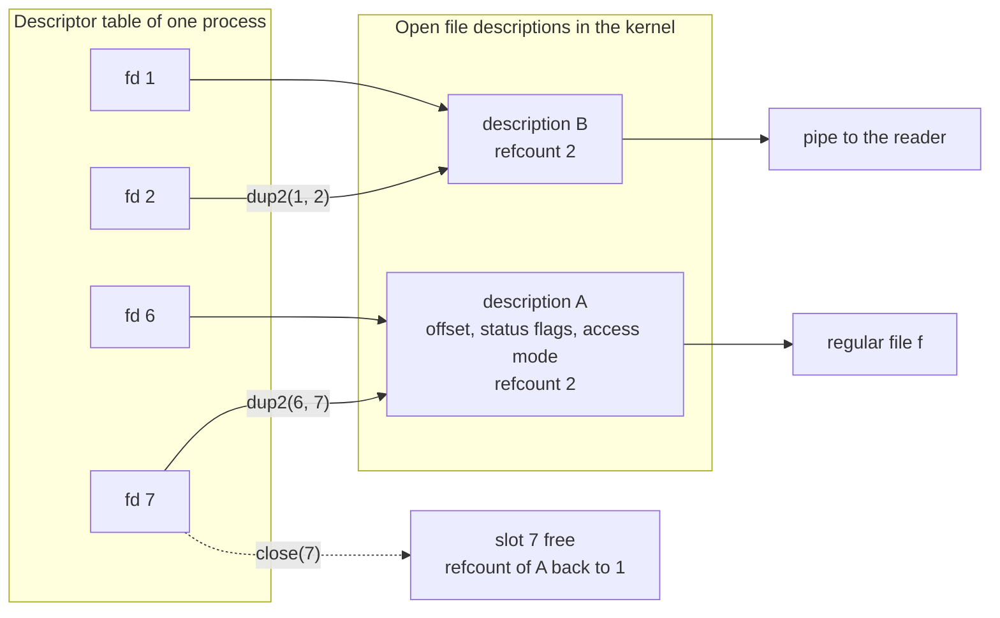

# Descriptor Duplication and Closing

> [!summary] Claim
> `n>&m` makes descriptor `n` name the same open file description as `m` at the moment the redirection is evaluated, and `n>&-` removes `n` from the table, so every fd idiom in a shell is a left-to-right program over the descriptor table whose only side effects are `dup2` and `close`.

Part of [The POSIX Shell Language](README.md) in [Shell and Unix Engineering](../README.md).

## TL;DR

- Mechanism: `n>&m` and `n<&m` are `dup2(m, n)` (the new slot shares offset and status flags with the old one and has `FD_CLOEXEC` clear); `n>&-` and `n<&-` are `close(n)`.
- Rule: redirections run strictly left to right and `n>&m` copies what `m` names right now, so `>f 2>&1` and `2>&1 >f` differ; closing a descriptor that is not open is not an error (POSIX.1-2024 XCU 2.7.5 and 2.7.6).
- Trap: a descriptor you forgot to close rides into every child, so a background process that inherits the write end of a `$(...)` pipe keeps the substitution waiting for its whole lifetime, and `exec 10>f` is the command word `10` plus a redirection in dash, mksh, ksh93, zsh and posh.
- Portability: POSIX guarantees only descriptors 0 to 9 and leaves it unspecified whether `exec`-opened descriptors above 2 reach children; ksh93 and mksh mark them close-on-exec, every other measured shell passes them on.
- When not to use it: when you need a descriptor above 9, a guaranteed-private or atomically close-on-exec descriptor, or a lifetime that is not a scope, stop writing shell and use a language with `O_CLOEXEC` and `posix_spawn` file actions.

## Mental model



The table maps small integers to open file descriptions, and a description carries the offset, the status flags, and the access mode.
The redirection `7>&6` adds an arrow from slot 7 to the description that slot 6 points at right now, which is why the two slots then share one offset and write into the file one after the other.
The redirection `2>&1` does the same for the pipe, which is why stdout and stderr interleave in order instead of racing.
The dashed arrow is `7>&-`: the slot is freed, the description lives on while another slot still points at it, and a pipe reader sees end of file only when the last arrow into the write end is gone.

## How it works

**Two tables, not one.**
A descriptor is an index into a per-process table; each slot holds a pointer to a kernel open file description (Linux dup(2): `dup` and `dup2` "refer to the same open file description", which means the two descriptors "share file offset and file status flags").
The close-on-exec flag lives in the slot, not in the description, so it is not shared, and the duplicate's flag is off (Linux dup(2); POSIX.1-2024 dup: "the `FD_CLOEXEC` and `FD_CLOFORK` flags associated with fildes2 shall be cleared").
In the Linux kernel `do_dup2` takes a reference on the source `struct file` with `get_file`, stores the same pointer in the target slot, sets the slot's close-on-exec bit only if the caller asked for it, and closes whatever was in the target slot first (Linux `fs/file.c`, `do_dup2`, master as of 2026-10).
`dup2(fd, fd)` is a checked no-op, and the close-then-reuse is atomic, which is why a shell never implements `n>&m` as `close(n)` followed by `dup(m)`: a signal handler or another thread could claim `n` in between (Linux dup(2)).

**What the standard says.**
POSIX.1-2024 XCU 2.7 defines the form `[n]redir-op word`, where `n` is a decimal number written with no blank before the operator, and a quoted `n` is not a descriptor number (`echo \2>a` writes the character 2 into `a`).
All implementations must support descriptors 0 to 9 for the application; the largest number is otherwise implementation-defined, and the `{location}` form is implementation-defined (POSIX.1-2024 XCU 2.7).
Redirections of one command are evaluated "from beginning to end" (POSIX.1-2024 XCU 2.7), and the rationale spells out the consequence: `ls > foo 2>&1` sends both streams to `foo`, but `ls 2>&1 > foo` duplicates stderr as the old stdout before stdout moves to `foo` (POSIX.1-2024 XCU rationale C.2.7).

`[n]<&word` and `[n]>&word` have the same rules (POSIX.1-2024 XCU 2.7.5 and 2.7.6).
If `word` expands to one or more digits, `n` (default 0 for `<&`, 1 for `>&`) becomes a copy of that descriptor, and a digit string that is not an open descriptor is a redirection error.
If `word` expands to `-`, `n` is closed, and "attempts to close a file descriptor that is not open shall not constitute an error".
Any other `word` is unspecified.
The source descriptor being open for the wrong direction "may" be a redirection error; the rationale explains that the access mode belongs to the open file description, so the operator you pick does not change it (POSIX.1-2024 XCU rationale C.2.7.5).
The word is expanded like any redirection word, so `>&$fd` and `>&$v` with `v=-` are legal (POSIX.1-2024 XCU 2.7).

**Where a redirection lands.**
A redirection on an external command is applied in the child between `fork` and `execve`.
A redirection on a built-in, compound command, or function must be applied in the shell's own table and undone afterwards, so the shell first saves the descriptor it is about to overwrite.
dash does this in `redirect`: for each redirection `openredirect` returns the source descriptor (for `NTOFD` and `NFROMFD` it is simply the duplicated number), `savefd` moves the old occupant to a descriptor of 10 or higher with `fcntl(from, F_DUPFD_CLOEXEC, 10)`, `dupredirect` performs `dup2` through `sh_dup2`, and `>&-` becomes a plain `close` (dash `src/redir.c`, `redirect`, `savefd`, `dupredirect`, `sh_dup2`).
The saved copy is what `popredir` restores afterwards, and its loop runs over descriptors 0 to 9 only (`for (i = 0 ; i < 10 ; i++)`), which is why 0 to 9 is the range a script can rely on and descriptors from 10 up are the shell's scratch space.

A simple command with no command name performs its redirections "in a subshell environment", so they do not persist; "to affect the current execution environment, see the exec special built-in" (POSIX.1-2024 XCU 2.9.1.3).
`exec` with only redirections makes them permanent in the current shell, and it is the only way to open or close a descriptor for the rest of a script (POSIX.1-2024 XCU 2.15, exec: `exec 3< readfile`, `exec 5<&0`, `exec 3<&-`).
"Open files controlled by exec" are part of the shell execution environment, and the separate environment of a non-built-in utility lists the same open files (POSIX.1-2024 XCU 2.13).
Whether descriptors above 2 opened by `exec` stay open when the shell invokes another utility is explicitly "unspecified" (POSIX.1-2024 XCU 2.15, exec), and the standard's own advice is that scripts "can always close them explicitly".

**Redirection errors.**
A redirection error on a special built-in makes a non-interactive shell exit; on a compound command, a function call, or an ordinary utility it does not (POSIX.1-2024 XCU 2.8.1).
So `: >&9` with 9 not open ends a conforming script, while `{ : ; } >&9` only fails the group.

**Implementations differ exactly where the standard is silent.**
ksh93u+m opens `exec` redirections with a flag documented in `sh_redirect` as "redirections persist, but file descriptors > 2 are closed when executing an external command", and it turns that off under `set -o posix` (ksh93u+m `src/cmd/ksh93/sh/io.c`, `sh_redirect`, dev branch as of 2026-10).
mksh does the same in `c_exec`: "for ksh, keep file descriptors private (except stdin/out/err)" by setting `FD_CLOEXEC` on every descriptor above 2, except "for POSIX or legacy/kludge sh" (mksh `funcs.c`, `c_exec`).
mksh also marks a redirection of `n>&n` (dup from equal to dup to) with `IODUPSELF` and clears close-on-exec for that one command, which is why `cmd 9>&9` hands descriptor 9 to one child and nothing else (mksh `exec.c`, `iosetup` and the `TEXEC` case in `execute`).
mksh accepts only a single digit as a descriptor name in a dup (`check_fd` rejects a name longer than one character with "illegal file descriptor name"), which matches the single-digit lexing measured in the shell matrix (mksh `main.c`, `check_fd`).
The `{var}` form ("the shell assigns the file descriptor used to `$var` or uses `$var` as the file descriptor to move or close") first appears in the bash-4.1-alpha section of the bash change log (bash CHANGES).
Native zsh implements MULTIOS: opening one descriptor for writing more than once makes it "a pipe to a process that copies its input to all the specified outputs", and "a pipe is an implicit redirection", so `date >foo | cat` writes to `foo` and to `cat`; it is on by default and off under `emulate sh` (zsh manual, Redirection, 7.2 Multios; the off-under-sh half is measured in the shell matrix).

**The idioms, step by step.**
The table shows the state of descriptors 1, 2 and 3 after each redirection of `cmd 3>&1 1>&2 2>&3 3>&-`, with `O` the original stdout and `E` the original stderr.

| Step | Redirection | fd 1 | fd 2 | fd 3 |
|---|---|---|---|---|
| start | - | O | E | closed |
| 1 | `3>&1` | O | E | O |
| 2 | `1>&2` | E | E | O |
| 3 | `2>&3` | E | O | O |
| 4 | `3>&-` | E | O | closed |

Step 4 matters: without it the child holds a third path to the original stdout and, if that is a pipe, keeps the reader waiting after the child's stdout is closed.
The stderr-filter idiom `{ cmd 2>&1 1>&3 3>&- | filter >&2; } 3>&1` uses the same table: inside the group, fd 3 is the saved stdout, the command's stderr goes into the pipe (`2>&1` runs while 1 is still the pipe), its stdout goes to fd 3, and fd 3 is closed for it.

## Numbers and limits

| Quantity | Value | Source |
|---|---|---|
| Descriptors every shell must support in redirections | 0 to 9 | POSIX.1-2024 XCU 2.7 |
| `dup` result | the lowest-numbered unused descriptor | Linux dup(2) |
| Kernel cost of a duplicate | one extra reference on one `struct file`, one table slot | Linux `fs/file.c`, `do_dup2` (master as of 2026-10) |
| Shell scratch descriptors in dash | 10 and up (`F_DUPFD_CLOEXEC`, 10) | dash `src/redir.c`, `savefd` |
| Shell families that read `exec 10>f` as a descriptor | 3 of 9 (bash, yash, BusyBox ash); dash, mksh, ksh93, zsh, zsh in `sh` mode and posh read `10` as a word | lab, test "a descriptor number above 9" (2026-10) |
| Descriptor chosen by `{fd}>f` | 10 in bash 4.4 to 5.3, 11 in zsh 5.9, and in ksh93 10 at the top level of a script but 12 inside the lab's subshell (cause not investigated) | measured by hand in the shell matrix (2026-10); the lab asserts only >= 10 |
| Shell families that pass `exec`-opened descriptors above 2 to children | 7 of 9 (all except ksh93 and mksh, which pass them on under `set -o posix`) | lab, test "descriptors above 2 opened by exec" (2026-10) |
| Delay a leaked pipe end adds to `$(...)` | the background job's lifetime: 3 s for `sleep 3` in every measured shell except ksh93u+m 1.0.10, and under 3 s with `>/dev/null` in all of them | lab, test "a background child holding a duplicate" (2026-10) |
| Descriptors open in a child of a bats test | 0, 1, 2, 3, 4 (bats holds 3 and 4) | measured with the lab's `fdprobe` (2026-10) |
| Lab assertions passing | 26 of 26 in each of 30 shell configurations | lab run, 2026-10 |

## Portability

Every cell is asserted by the lab or measured in the shell matrix on the same date (2026-10).
Versions: bash 3.2.57 (macOS), bash 3.2 to 5.3 (images), zsh 5.9, dash 0.5.12, ksh93u+m 1.0.10 and macOS ksh93u+ 2012-08-01, mksh R59 (2020/10/31 on Alpine, 2025/04/26 on Debian), yash 2.58.1, posh 0.14.1, BusyBox 1.37.0 ash.

| Shell | Redirection error on a special built-in (`: >&9`) | `exec 8>f` then external child | `exec 10>f` | `{fd}>f` | `>&word`, word not a number | `>&$v` with `v=-` | built-in `echo` with stdout closed |
|---|---|---|---|---|---|---|---|
| POSIX sh | shall exit | unspecified | at least 0 to 9 required | implementation-defined | unspecified | closes | not specified |
| macOS bash 3.2 (`/bin/bash`) | continues, status 1 | child sees 8 | descriptor 10 | no | writes both streams to the file | closes | status 1, and `x` is still written to stdout |
| macOS `/bin/sh` (bash 3.2 in POSIX mode) | exits | child sees 8 | descriptor 10 | no | writes both streams to the file | closes | status 1, and `x` is still written to stdout |
| bash 4.4 to 5.3 | continues, status 1 (exits in POSIX mode) | child sees 8 | descriptor 10 | yes (fd 10) | writes both streams to the file | closes | status 1 |
| zsh 5.9 native | continues, status 1 | child sees 8 | the word `10` | yes (fd 11) | writes both streams to the file | closes | status 0, silently |
| zsh 5.9 `--emulate sh` | exits | child sees 8 | the word `10` | no | writes both streams to the file | closes | status 0, silently |
| dash 0.5.12 | exits | child sees 8 | the word `10` | no | aborts the script (bad fd number) | closes | status 1 ("I/O error") |
| ksh93u+m 1.0.10, ksh93u+ 2012 | exits | child does not see 8; sees it with `8>&8` or `set -o posix` (u+m) | the word `10` | yes (fd 10 at top level, 12 in the lab's subshell) | error, command fails | closes | status 1 |
| mksh R59 | exits | child does not see 8; sees it with `8>&8` or `set -o posix` | the word `10` | no | error, command fails | closes | status 1 |
| yash 2.58.1 | continues, status 2 | child sees 8 | descriptor 10 | no | error, command fails | closes | status 1 |
| posh 0.14.1 | exits | child sees 8 | the word `10` | no | error, command fails | closes | status 1 |
| BusyBox ash 1.37.0 | exits | child sees 8 | descriptor 10 | no | writes both streams to the file | does not close: "redir error", shell exits | status 1 |

| Utility | `cmd >&-` or `cmd <&-` (descriptor closed in the child) |
|---|---|
| GNU coreutils 9.7 `echo`, `cat` (Debian) | write or read fails with "Bad file descriptor", status 1 |
| BusyBox 1.37.0 `echo`, `cat` (Alpine) | same, status 1 |
| macOS (BSD) `echo`, `cat` | same, status 1 |
| uutils | not measured |

No shell reopens a closed 0, 1 or 2 on `/dev/null` for the child (lab, test "a close is not turned into a reopen"), although POSIX.1-2024 XCU 2.9.1.5 allows it.

## Worked example

The lab is [lab](../labs/03-descriptor-duplication-and-closing/): `fdprobe.c` lists the descriptors an external process really inherited, `fd-idioms.sh` runs the classic idioms and reports what each stream received, and `test.bats` asserts 26 behaviors per shell.

Simplified excerpt of `fd-idioms.sh` (the noisy command and the stderr filter; the real file adds the report and the mode dispatch):

```sh
noisy() {
  echo out
  echo err >&2
  return 3
}

prefix_stderr() {
  pfx=$1
  shift
  exec 3>&1
  st=$(
    {
      {
        "$@" 2>&1 1>&3 3>&- 4>&-
        echo "$?" >&4
      } | sed "s/^/$pfx/" >&2
    } 4>&1
  )
  exec 3>&-
  return "$st"
}
```

Captured output of `fd-idioms.sh MODE DIR` under bash 5.3 (macOS host, 2026-10); the first column is the mode argument, added here, and the script prints only the rest (ending with a space); the other shells print the same five lines, which the lab asserts:

```text
direct      stdout=[out,] stderr=[err,] status=3 merged=[] 
swap        stdout=[err,] stderr=[out,] status=3 merged=[] 
prefix      stdout=[out,] stderr=[E: err,] status=3 merged=[] 
merge-first stdout=[] stderr=[] status=3 merged=[out,err,] 
merge-last  stdout=[err,] stderr=[] status=3 merged=[out,] 
```

The `prefix` line is the useful one: stdout is untouched, stderr is tagged, and the exit status 3 of the command survives the pipeline because it travels on descriptor 4 instead of through `$?`.
The last two lines are the order rule: `merge-first` is `noisy >merged 2>&1` and `merge-last` is `noisy 2>&1 >merged`.

Captured output of the descriptor probe (bash 5.3, stdin from `/dev/null`, a plain terminal-free shell; `fdprobe` prints the open descriptors in 0..63):

```text
$ bash -c 'exec 8>f; exec 9>&8; fdprobe; fdprobe 8>&-; fdprobe <&-'
0 1 2 8 9
0 1 2 9
1 2 8 9
```

The same first line under ksh93u+m or mksh is `0 1 2`, because both mark `exec`-opened descriptors above 2 close-on-exec.
The third line shows that nothing reopened descriptor 0 for the child.

Verbatim excerpt of the test that proves the ksh behavior and its escape hatch (from `test.bats`; `has_fd` and `lacks_fd` are helpers defined at the top of that file):

```bash
@test "n>&n hands one close-on-exec descriptor to one command in ksh93 and mksh and changes nothing elsewhere" {
  run_lab_c 'exec 8>f; exec 9>&8; "$FDPROBE" 9>&9'
  [ "$status" -eq 0 ]
  has_fd 9
  case $(lab_shell_family) in
    bash | zsh | zsh-sh | yash | busybox | posh | dash) has_fd 8 ;;
    mksh | ksh93) lacks_fd 8 ;;
    *) false ;;
  esac
}
```

Run it with `cd labs/03-descriptor-duplication-and-closing && LAB_SHELL=dash bats test.bats`; the expected TAP summary is `1..26` followed by 26 `ok` lines, and the matrix run (2026-10) printed 26 `ok` lines in each of the 30 configurations (8 on the macOS host: `/bin/sh`, `/bin/bash`, bash 5.3, `bash --posix`, dash, `/bin/ksh`, zsh native and `--emulate sh`; 9 on Debian; 13 on Alpine including bash 3.2, 4.4, 5.1, 5.2 and 5.3).

## Pitfalls

> [!warning] Redirection order
> Trigger: `cmd 2>&1 >out` written by someone who reads it as "both streams to out".
> Symptom: stderr still goes to the old stdout (a terminal or a pipe) because `2>&1` ran while stdout was not yet `out`.
> Fix: write `cmd >out 2>&1`; if you want stderr into a pipe while stdout goes to a file, `2>&1 >out` is exactly right.
> The POSIX rationale uses this very pair as its example (POSIX.1-2024 XCU rationale C.2.7); lab test "n>&m copies what m refers to now".
> See [[Redirection-Order-and-Semantics]] for the full ordering rules.

> [!warning] A leaked descriptor keeps pipes and files alive
> Trigger: `pid=$(server & echo $!)` or any daemon started inside `$(...)`, a CI step, or a pipeline whose reader waits for end of file.
> Symptom: the command substitution or the pipeline hangs until the daemon exits, because the daemon inherited the write end of the pipe; the lab shows a 3 s `sleep` delaying `$(...)` by 3 s, and under `>/dev/null` by under 3 s.
> Fix: start long-lived children with every inherited descriptor they do not need closed or replaced: `server >/dev/null 2>&1 </dev/null &`, plus `n>&-` for any extra descriptor you opened with `exec`.
> The security face of the same bug is CVE-2024-21626, in which a leaked internal descriptor in runc 1.1.11 and earlier let a container process obtain a working directory in the host filesystem (NVD, published 2024-01-31).
> ksh93u+m 1.0.10 returned early in the lab's test, so do not rely on the wait either way.

> [!warning] Descriptor numbers above 9 are not descriptors in most shells
> Trigger: `exec 10>log` or `echo x >&10` in a script run by dash, mksh, ksh93, zsh or posh.
> Symptom: the shell reads `10` as a command word and the `>log` as an ordinary redirection, so you see "exec: 10: not found", `log` is created empty, and a non-interactive shell exits because a failed `exec` ends it (measured in the shell matrix).
> Fix: stay within 0 to 9, which POSIX requires every implementation to support (POSIX.1-2024 XCU 2.7); in bash 4.1 and later, ksh93 and zsh you may use `exec {fd}>log` and keep `fd` in a variable (bash CHANGES, bash-4.1-alpha).
> The shell's own scratch descriptors live at 10 and up in dash (`savefd`), which is another reason not to count on that range.

> [!warning] `>&word` is a bash habit, not POSIX
> Trigger: `cmd >&out`, intended as "stdout and stderr to the file out".
> Symptom: bash, zsh and BusyBox ash write both streams to `out`; dash aborts the script with a bad-fd error, and mksh, ksh93, yash and posh fail the command, so the same script is a file write in one shell and a crash in another.
> Fix: write `cmd >out 2>&1`; POSIX leaves a non-numeric word after `>&` unspecified (POSIX.1-2024 XCU 2.7.6), and zsh documents `>& word` as shorthand for redirecting both streams (zsh manual, Redirection).

> [!warning] ksh93 and mksh keep your descriptors private
> Trigger: `exec 3>log` followed by a helper script or program that writes to descriptor 3, tested only under bash or dash.
> Symptom: under ksh93 and mksh the helper fails with "Bad file descriptor", because the shell set `FD_CLOEXEC` on descriptor 3 (ksh93u+m `sh_redirect`, flag 2; mksh `c_exec`).
> Fix: hand the descriptor to exactly one command with `helper 3>&3`, which is a no-op elsewhere and clears close-on-exec in both ksh variants (lab test "n>&n hands one close-on-exec descriptor"), or run the script under `set -o posix` where that is supported.

> [!warning] zsh copies `>&3 | cmd` to both places
> Trigger: `echo x >&3 | cat` in a script that runs under native zsh, where descriptor 3 is a duplicate of the terminal.
> Symptom: `x` appears twice, because MULTIOS turns the pipe plus the explicit redirect into a tee (zsh manual, Multios); `emulate sh` and every other shell print it once.
> Fix: group the command (`{ echo x >&3; } | cat`) or `unsetopt MULTIOS`; do not run POSIX scripts under native zsh.

> [!warning] Closing standard descriptors instead of redirecting them
> Trigger: `cmd >&-` or `exec <&-` to "silence" a stream.
> Symptom: the child's first `open` returns the lowest free number, so its new file becomes its stdout or stdin (Linux open(2): "the lowest-numbered file descriptor not currently open"), and its writes to the closed stream fail with `EBADF`; the lab confirms that no shell reopens the closed descriptor for the child.
> A built-in `echo` into a closed stdout fails with status 1 in most shells but succeeds with status 0 in zsh, and macOS bash 3.2 still writes the data.
> Fix: redirect to `/dev/null` instead; the rationale says applications "should not just close them but should reopen them on, for example, /dev/null" (POSIX.1-2024 XCU rationale C.2.7).

> [!warning] A failed redirection kills the script in some shells and not in others
> Trigger: `exec 3<missing.txt`, `: >&9`, or any redirection with an unusable source on a special built-in.
> Symptom: dash, BusyBox ash, mksh, ksh93, posh, zsh in `sh` mode and bash in POSIX mode exit at that line; bash in its default mode, native zsh and yash print an error and run the next line with a bad descriptor (POSIX.1-2024 XCU 2.8.1; lab test "a redirection error on a special built-in").
> Fix: test first (`[ -r missing.txt ]`), or probe a descriptor with a compound command, `if { :; } 2>/dev/null >&9; then`, which never ends the shell.
> A redirection error on a compound command or a function call must not exit in any shell, and the lab checks that all of them keep going.

## Security and robustness

- **Close what the child does not need.** Every descriptor above 2 that a shell script opened with `exec` is an inheritance channel to everything it spawns, in all measured shells except ksh93 and mksh.
  CVE-2024-21626 is the container-grade version: an unintended leaked descriptor became a host working directory (NVD).
- **Never close 0, 1 or 2 for a child.** Redirect them to `/dev/null`; a program started with a standard descriptor closed may write secrets into whatever its next `open` returns (Linux dup(2) semantics, POSIX.1-2024 XCU rationale C.2.7).
- **`dup2` is atomic and `close` plus `dup` is not.** The shell's own `n>&m` is one `dup2` call, so there is no window, but any multi-threaded helper you write in C or Python must use `dup2` or `dup3` rather than `close` followed by `dup` (Linux dup(2) documents the `EBUSY` race window on Linux).
- **Do not expect `n>&-` to surface write-back errors.** POSIX.1-2024 close and Linux close(2) say `close` can fail with `EIO` and advise `fsync` first.
  UNVERIFIED: whether any shell reports a failing `close(2)` from `n>&-`; the lab only proves that closing an unopened descriptor returns 0.
  If durability matters, use a tool that checks `fsync` and `close`.
- **Fail loudly on a bad descriptor.** In `set -e` scripts a redirection error on a special built-in exits only in some shells, so assert descriptors explicitly rather than rely on the abort.
- **Do not let untrusted input choose a descriptor number or a redirect target.** `eval "cmd >&$fd"` is command injection plus descriptor confusion; validate with a `case` on digits first.

## The principal's view

The decision is how much plumbing to keep in shell.
Up to three descriptors (0, 1, 2) and the occasional `2>&1`, `>/dev/null`, or `3>&-` is shell's home turf, cheap to read and portable.
The stderr-filter, the swap, and the status-on-descriptor-4 idioms are legitimate but each is a miniature program over the table, so wrap each in a named function with a test, as the lab does, and never inline them in a long script.
Treat descriptors 3 to 9 as scoped: prefer `{ commands; } 3>file`, which is closed for you and restored on exit, to a bare `exec 3>file` that lives until the script ends and leaks to every child.
Always add `n>&-` or a `/dev/null` redirect to anything that outlives the script (daemons, `nohup` jobs, `&` inside `$(...)`).

The trade-off is portability versus convenience.
`{fd}`, `>&word`, multi-digit descriptors, and relying on inherited `exec` descriptors work in bash and fail or differ elsewhere, so a script with a `#!/bin/sh` line stays within `n>&m`, `n>&-`, `n>file` and single-digit numbers, and a bash script says so in its shebang.
The downside of staying portable is that you cannot allocate a fresh descriptor, cannot make one close-on-exec, and cannot tell whether a descriptor is open without the `{ :; } >&n` probe.

Use a different tool when the descriptor graph is the program: more than a handful of descriptors, long-lived descriptors with distinct lifetimes, descriptors passed to many children selectively, or anything where an `EINTR` or `EIO` from `close` must be handled.
In Python use `subprocess` with `pass_fds` and `close_fds`; in C use `O_CLOEXEC`, `dup3`, and `posix_spawn_file_actions_adddup2`.
Related decisions: [[Pipelines-and-And-Or-Lists]] for how the pipe descriptors are created, and [[Subshells-and-the-Execution-Environment]] for what a subshell inherits.

## Interview questions

> [!question] L5: What is the difference between `cmd >f 2>&1` and `cmd 2>&1 >f`?
>
> > [!success]- Answer
> > Redirections are processed from left to right, and `2>&1` copies what descriptor 1 refers to at that moment.
> > In `>f 2>&1` stdout is `f` first, so stderr becomes `f` too: both streams go to the file.
> > In `2>&1 >f` stderr is copied from the original stdout (a terminal or pipe) before stdout moves to `f`, so only stdout reaches the file.
> >
> > Follow-up: How would you send only stderr to a pipe while stdout goes to a file?

> [!question] L5: What does `exec 3>&-` do, and is it an error if descriptor 3 is not open?
>
> > [!success]- Answer
> > It closes descriptor 3 in the current shell for the rest of its life, because `exec` with only redirections makes them permanent.
> > Closing a descriptor that is not open is explicitly not an error (POSIX.1-2024 XCU 2.7.6), and the lab confirms status 0 in every measured shell.
> > `exec 3<&-` closes it just as well, because the direction of the operator does not matter for a close.
> >
> > Follow-up: Why is closing 0, 1 or 2 usually the wrong way to silence a command?

> [!question] L5: Predict the output.
>
> ```sh
> exec 6>f
> exec 7>f
> echo aaaa >&6
> echo b >&7
> cat f
> ```
>
> > [!success]- Answer
> > The output is two lines: `b` and `aa`.
> > Descriptors 6 and 7 come from two separate `open` calls, so they have independent offsets.
> > The write of `b` and a newline lands at offset 0 and overwrites the first two bytes of `aaaa` and its newline.
> > With `exec 7>&6` instead of `exec 7>f` the offset would be shared and the output would be `aaaa` then `b`.
> >
> > Follow-up: Which kernel object do two duplicated descriptors share that two separate opens do not?

> [!question] L6: Why does this script hang until the server exits in most shells, and how do you fix it?
>
> ```sh
> #!/bin/sh
> pid=$(/usr/local/bin/serve --port 8080 & echo $!)
> echo "started $pid"
> ```
>
> > [!success]- Answer
> > The command substitution reads its pipe until end of file, which arrives only when every holder of the write end has closed it.
> > The background `serve` inherited stdout, which is that write end, so it holds the pipe open for its whole life.
> > Fix: `pid=$(/usr/local/bin/serve --port 8080 >/dev/null 2>&1 </dev/null & echo $!)`, so the server holds no descriptor of the pipe.
> > The lab shows the same with `sleep 3`: `dt >= 3` without the redirect, under 3 with it.
> >
> > Follow-up: Why did ksh93u+m 1.0.10 return early in the lab, and why should you not rely on that?

> [!question] L6: Why does `cmd 3>&1 1>&2 2>&3 3>&-` end with `3>&-`?
>
> > [!success]- Answer
> > After `2>&3` the swap is complete, and descriptor 3 still holds a copy of the original stdout.
> > Without the close the command, and everything it spawns, inherits that third path.
> > If the original stdout is a pipe, a long-lived child that holds descriptor 3 keeps the reader waiting even after the command's own stdout is closed.
> > Closing it also keeps the command from writing to a descriptor number it did not expect to exist.
> >
> > Follow-up: What breaks in the stderr-filter idiom if `sed` is also holding the descriptor that carries the exit status?

> [!question] L6: How does a shell run `echo hi >&7` for a built-in without disturbing its own descriptor 1?
>
> > [!success]- Answer
> > The shell cannot `fork` for a built-in, so it must edit its own table and undo the edit.
> > dash moves the old descriptor to a number of 10 or higher with `fcntl(F_DUPFD_CLOEXEC, 10)`, `dup2`s the source onto the target, runs the built-in, and moves the saved descriptor back (dash `redir.c`, `savefd`, `dupredirect`).
> > If the source descriptor is not open the `dup2` fails and the command fails with a redirection error.
> > For an external command the shell does the same in the forked child just before `execve`, and nothing needs undoing.
> >
> > Follow-up: What does this imply about descriptors 10 and up in a script?

> [!question] L6: Debug this script, which works in bash and fails in ksh93 and mksh.
>
> ```sh
> exec 3>run.log
> ./helper.sh        # helper.sh does: echo started >&3
> ```
>
> > [!success]- Answer
> > ksh93 and mksh set close-on-exec on descriptors above 2 opened with `exec`, so `helper.sh` has no descriptor 3 and its redirect fails with "Bad file descriptor".
> > POSIX leaves this unspecified (POSIX.1-2024 XCU 2.15, exec), so both behaviors are conforming.
> > Fix: `./helper.sh 3>&3`, which is a no-op elsewhere and clears close-on-exec for that one command in both ksh families, or pass the log path as an argument instead of a descriptor.
> >
> > Follow-up: What does `set -o posix` change in mksh and in ksh93u+m about this?

> [!question] L7+: Design a wrapper that tags every stderr line of an arbitrary command, leaves stdout byte-identical, and exits with the command's status.
>
> > [!success]- Answer
> > Save the real stdout on descriptor 3 and run the command with `2>&1 1>&3 3>&-`: stderr goes into the pipe (the redirect runs while 1 is still the pipe), stdout goes to the saved descriptor, and the command does not see 3.
> > The pipe feeds `sed "s/^/PREFIX/" >&2`.
> > The pipeline status would be sed's, so the command writes its own `$?` to descriptor 4, which the outer shell has pointed at a command substitution, and the wrapper returns that value.
> > The command must also be started with 4 closed (`4>&-`), or a long-lived child would hold the substitution open.
> > The lab's `prefix` mode is this wrapper and is tested in every shell.
> >
> > Follow-up: Where does this design deadlock if the command writes more than a pipe buffer to stderr and stdout is the same pipe the substitution reads?

> [!question] L7+: A shell wrapper opens a key file with `exec 8<key` and then runs untrusted plugins, so what is the issue and what do you change?
>
> > [!success]- Answer
> > Every plugin inherits descriptor 8 in bash, dash, zsh, yash, posh and BusyBox ash, so it can read the key, and `exec`-opened descriptors above 2 reach children in all of them (the lab measures this).
> > The same class of leak is CVE-2024-21626 (runc), where an unintended inherited descriptor became a host path.
> > Mitigation: read the key into a variable with `read` and close the descriptor at once with `exec 8<&-`, or open it only for the one command that needs it (`consumer 8<key`) and close it for the others with `8>&-`.
> > Better: a small program in a language with `O_CLOEXEC`, so inheritance is off by default and not by luck of the shell.
> >
> > Follow-up: Why is relying on ksh93's close-on-exec default not an acceptable fix?

> [!question] L7+: Why does the standard make a redirection error exit the shell for `exec` or `:` but not for `{ :; } >&9`, and what does that mean for defensive scripts?
>
> > [!success]- Answer
> > Special built-ins are the language's own control and state operations, and POSIX makes their errors fatal in a non-interactive shell; compound commands, functions, and ordinary utilities are not allowed to exit the shell on a redirection error (POSIX.1-2024 XCU 2.8.1).
> > bash in its default mode, native zsh and yash do not follow the special-built-in rule, so a script must not depend on either behavior.
> > A defensive script probes first: `if { :; } 2>/dev/null >&9; then ... fi` is portable, because the group keeps every shell alive and the status tells you whether the descriptor is open.
> > It does not tell you the access mode, because no shell checks it at duplication time (lab test "no shell checks the access mode").
> >
> > Follow-up: Which redirection operator would you use to verify that a descriptor is writable, and why can it not be done with a dup alone?

## Related

Prerequisites: [[Here-Documents]]

Next: [[Simple-Commands-and-Assignment-Prefixes]]

See also: [[Redirection-Order-and-Semantics]], [[The-exec-Builtin]], [[Special-Built-ins-versus-Utilities]], [[Subshells-and-the-Execution-Environment]], [[Pipelines-and-And-Or-Lists]], [[Command-Substitution]], [[Token-Recognition]], [[POSIX-2024-Changes]]

## Further reading

- POSIX.1-2024 XCU 2.7, Redirection, including 2.7.5 and 2.7.6: the normative text for `n<&word`, `n>&word`, and closing, and the 0 to 9 guarantee.
- POSIX.1-2024 XCU 2.8.1, Consequences of Shell Errors: the table that says when a redirection error ends the shell.
- POSIX.1-2024 XCU 2.15, exec: the permanent form and the unspecified status of inherited descriptors above 2.
- POSIX.1-2024 XCU Rationale, C.2.7 and C.2.7.5: why order matters, why not to close standard descriptors, and why the access mode is a property of the description.
- POSIX.1-2024 System Interfaces, dup and close: the exact `dup2` and close-on-exec semantics and the `EINTR` rules for `close`.
- Linux man-pages dup(2) and close(2): the open file description model, the `dup2` race note, and the Linux `close` caveats.
- Linux `fs/file.c`, `do_dup2`: the kernel side of `n>&m`, one reference on one `struct file` per duplicate.
- dash `src/redir.c`: the smallest readable implementation of save, `dup2`, restore for built-ins.
- ksh93u+m `src/cmd/ksh93/sh/io.c` (`sh_redirect`) and mksh `funcs.c` (`c_exec`): why ksh makes `exec` descriptors private and how to opt out per command.
- zsh manual, Redirection (7.2 Multios): the one behavior that makes native zsh unsafe for POSIX redirection scripts.
- bash CHANGES: the release where the `{var}` redirection form was added.
- NVD CVE-2024-21626 (runc): a real descriptor leak, to calibrate how serious an inherited descriptor can be.
