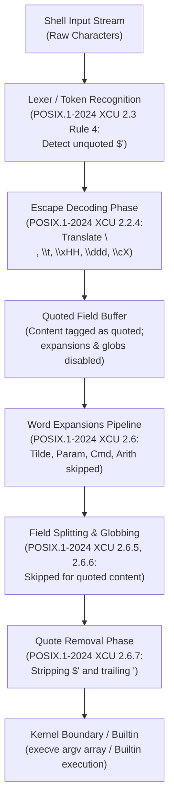

# Dollar-Single-Quotes

> [!summary] Claim
> Dollar-single-quotes (`$'...'`) provide lexical ANSI-C string expansion and quoting in the POSIX shell, decoding designated backslash escape sequences into literal bytes prior to word expansion while preserving literal contents and treating the resulting bytes as quoted text.

Part of [The POSIX Shell Language](README.md) in [Shell and Unix Engineering](../README.md).

## TL;DR

- Mechanism: The shell lexer detects `$'...'` during token recognition, translates ANSI-C escape sequences into literal bytes immediately before word expansions, and removes the quote delimiters during quote removal.
- Rule: Characters produced by `$'...'` are treated as quoted characters, suppressing parameter expansion, command substitution, arithmetic expansion, field splitting, and pathname expansion on the evaluated content.
- Trap: Double-quoting `$'...'` (such as `"$'\n'"`) suppresses escape processing, while `$'\c\\'` triggers an unclosed-quote parse error in `mksh`, and assigning `IFS=$'\n'` under `dash` <= 0.5.12 silently sets `IFS` to literal `$`, `\`, and `n`.
- Portability: Standardized in POSIX.1-2024 `(POSIX.1-2024 XCU 2.2.4)` via Austin Group Defect 249 `(POSIX.1-2024 XRAT C.2.2.4)`; natively supported in `bash`, `zsh`, `ksh93`, `mksh`, `yash`, and `busybox` ash (with `CONFIG_ASH_BASH_COMPAT`, which defines `BASH_DOLLAR_SQUOTE` in `shell/ash.c`), added upstream to `dash` in June 2024 (commit 776424a8f915, first released in `dash` 0.5.13, tagged 2025-09), but unsupported in Debian 12 and 13 `dash` 0.5.12 and `posh` 0.14.1 (as of 2026-10, Debian ships `dash` 0.5.13 only in experimental).
- When not to use it: Avoid `$'...'` in scripts running under `#!/bin/sh` that must target legacy Linux distributions, embedded init scripts, or Debian package maintainer scripts where `dash` or `posh` acts as `/bin/sh`.

## Mental model



The shell processing pipeline ingests raw character streams and identifies the unquoted `$'` sequence during initial token recognition under Rule 4 of POSIX.1-2024 section 2.3.
Upon identifying the sequence, the lexer scans to the matching unescaped single quote and executes designated backslash-escape translations prior to any word expansions.
Crucially, the resulting characters are flagged internally with quoting markers, which completely shields them from parameter expansion, command substitution, arithmetic expansion, field splitting, and pathname expansion during the standard expansion phases defined in POSIX.1-2024 section 2.6.
Finally, quote removal strips the leading `$'` delimiter and the terminating single-quote character, delivering clean, un-delimited byte sequences into the argument vector of built-in commands or across the `execve(2)` system call boundary to external executables.

## How it works

The formal specification of dollar-single-quotes is codified in `(POSIX.1-2024 XCU 2.2.4)`.
During token recognition `(POSIX.1-2024 XCU 2.3)`, Rule 4 specifies that if the current character is the first character of an unquoted `<dollar-sign>` single-quote sequence, it affects quoting for all subsequent characters up to the matching unescaped terminating single quote.
Unlike standard single-quoted strings defined in `(POSIX.1-2024 XCU 2.2.2)`, where backslashes have no special meaning and a single quote cannot be enclosed, dollar-single-quotes process backslash-escape sequences before the word undergoes word expansion.

POSIX.1-2024 section 2.2.4 mandates the recognition of the following escape sequences:
- `\"` yields a double-quote character.
- `\'` yields a single-quote character and does not terminate the dollar-single-quote construct.
- `\\` yields a backslash character.
- `\a` yields an alert character (ASCII BEL, `0x07`).
- `\b` yields a backspace character (ASCII BS, `0x08`).
- `\e` yields an escape character (ASCII ESC, `0x1B`).
- `\f` yields a form-feed character (ASCII FF, `0x0C`).
- `\n` yields a newline character (ASCII LF, `0x0A`).
- `\r` yields a carriage-return character (ASCII CR, `0x0D`).
- `\t` yields a horizontal tab character (ASCII HT, `0x09`).
- `\v` yields a vertical-tab character (ASCII VT, `0x0B`).
- `\c`X yields the control character corresponding to character `X` from the `stty` control table; `\c\\` specifically yields the File Separator (`<FS>`, `0x1C`) control character, and `\c?` yields Delete (`<DEL>`, `0x7F`).
- `\x`XX yields the byte whose value is the hexadecimal value XX (one or more hexadecimal digits); if more than two hex digits follow, the results are explicitly unspecified.
- `\`ddd yields the byte value represented by one, two, or three octal digits; if the value does not fit in a byte (above `0377`), the results are unspecified.
- Any other backslash sequence, including backslash-newline, has unspecified behavior.

In GNU Bash, dollar-single-quote processing is implemented in the lexer and expansion engines.
When parsing tokens in `(bash-5.3 parse.y, read_token_word)`, encountering `$` immediately followed by `'` invokes `ansiexpand()`.
The function `ansiexpand()` calls `(bash-5.3 lib/sh/strtrans.c, ansicstr)`, which decodes the escape sequences and allocates a transformed string buffer.
In function definitions, Bash performs this translation at parse time, which is why inspecting a function with `type f` displays the literal decoded bytes inside standard single quotes rather than the original `$'...'` token.
During general word evaluation, `(bash-5.3 subst.c, expand_word_internal)` treats the resulting characters as quoted string segments, preventing field splitting and globbing.

In Zsh, ANSI-C quoting is handled in `Src/lex.c` and `(zsh-5.9 Src/utils.c, getkeystring)` using the `GETKEYS_DOLLARS_QUOTE` flag.
Zsh internally represents strings with metafication, allowing embedded null bytes (`\0`) to exist natively within shell variables and builtin commands.
In dash, upstream commit `776424a8f915` ("parser: Add dollar single quote", authored 2024-06-10 by Herbert Xu) introduced `$'...'` parsing in `src/parser.c`, which decodes escapes by calling `conv_escape()`, now shared with the `printf` builtin in `src/bltin/printf.c`; the commit message says it includes `\u` and `\U`.
That code first shipped in `dash` 0.5.13; earlier releases such as `dash 0.5.12` treat `$` as a literal character and `'...'` as standard single quotes.

At the kernel boundary, command arguments are passed to the `execve(2)` system call as a `NULL`-terminated array of pointers (`char *const argv[]`), where each array element is a contiguous sequence of non-null bytes terminated by a `0x00` byte.
If a dollar-single-quote construct produces a null byte (e.g. `$'a\0b'`), POSIX.1-2024 leaves it unspecified whether the null byte is included in the result or whether that byte and everything after it up to the closing single quote is discarded `(POSIX.1-2024 XCU 2.2.4)`.
Bash, `ksh93`, `mksh`, and `yash` discard the null byte and all remaining characters up to the closing single quote during shell expansion (yielding `a` for `$'a\0b'`; `a$'b\0cde'f` gives `abf`, measured in the shell matrix).
BusyBox ash discards only the null byte while preserving all subsequent characters (yielding `ab` for `$'a\0b'`), which is neither of the two outcomes the standard allows.
Zsh retains the null byte within its internal memory; however, when invoking an external binary via `execve(2)`, the operating system kernel truncates the argument at the first null byte, causing arguments to be silently truncated.

## Numbers and limits

The following table documents the quantitative specifications, implementation limits, and boundary behaviors of dollar-single-quotes measured across the lab matrix and sourced from primary standards (as of 2026-10).

| Metric / Boundary Case | POSIX.1-2024 Specification | GNU bash 5.3 | macOS /bin/bash 3.2.57 | Zsh 5.9 | ksh93u+ / ksh93u+m | MirBSD mksh R59 | BusyBox ash 1.37 | Sourced / Lab Measured |
| :--- | :--- | :--- | :--- | :--- | :--- | :--- | :--- | :--- |
| Hex escape digit limit (`\x`) | Unspecified if > 2 digits `(POSIX.1-2024 XCU 2.2.4)` | Consumes <= 2 hex digits (`\x4142` -> `A42`) | Consumes <= 2 hex digits (`\x4142` -> `A42`) | Consumes <= 2 hex digits (`\x4142` -> `A42`) | Consumes arbitrary hex digits (`\x4142` -> `U+4142`) | Consumes arbitrary hex digits (`\x4142` -> `U+4142`) | Consumes <= 2 hex digits (`\x4142` -> `A42`) | `(POSIX.1-2024 XRAT C.2.2.4)` / Lab measured |
| Max octal digits (`\ddd`) | 1 to 3 octal digits; unspecified if the value does not fit in a byte `(POSIX.1-2024 XCU 2.2.4)` | 3 digits; modulo 256 (`\401` -> `01`, `\777` -> `ff`); `\400` is NUL and discards to the closing quote | 3 digits; modulo 256 (`\401` -> `01`, `\777` -> `ff`); `\400` is NUL and discards to the closing quote | 3 digits; modulo 256 (`\401` -> `01`); `\400` keeps a NUL byte | 3 digits; modulo 256 (`\401` -> `01`, `\777` -> `ff`); `\400` is NUL and discards to the closing quote | 3 digits; `\401` -> `01`; `\400` is NUL and discards; `\777` -> `c3 bf` under `C.UTF-8` | 3 digits; `\400` and `\401` -> `20` (space), `\777` -> `3f` (`?`) | `(POSIX.1-2024 XCU 2.2.4)` / measured in the shell matrix (2026-10), not asserted by the lab |
| Control escape `\ca` | Yields `<SOH>` (`0x01`) `(POSIX.1-2024 XCU 2.2.4)` | Yields `0x01` | Yields `0x01` | Unsupported; yields literal `ca` (`0x63 0x61`) | Yields `0x01` | Yields `0x01` | Unsupported; yields literal `\ca` (`5c 63 61`) | `(POSIX.1-2024 XCU 2.2.4)` / Lab measured |
| Control escape `\c?` | Yields `<DEL>` (`0x7F`) `(POSIX.1-2024 XCU 2.2.4)` | Yields `0x7F` | Yields `0x1F` (`0x3F & 0x1F`) | Unsupported; yields literal `c?` (`0x63 0x3F`) | Yields `0x7F` | Yields `0x7F` | Unsupported; yields literal `\c?` (`5c 63 3f`) | `(POSIX.1-2024 XCU 2.2.4)` / Lab measured |
| Control escape `\c\\` | Yields `<FS>` (`0x1C`) `(POSIX.1-2024 XCU 2.2.4)` | Yields `0x1C` (1 byte) | Yields `1c 5c` (2 bytes) | Unsupported; yields literal `c\` (`0x63 0x5C`) | Yields `0x1C` (1 byte) | Parse error; `\c\` consumes 1 byte, `\'` escapes quote | Unsupported; yields literal `\c\` (`5c 63 5c`) | `(POSIX.1-2024 XRAT C.2.2.4)`; mksh `unbksl()` in `misc.c` reads one character after `\c` / measured in the shell matrix, not asserted by the lab |
| Unicode escape `\uXXXX` | Not specified / Omitted `(POSIX.1-2024 XRAT C.2.2.4)` | 4 hex digits; decodes UTF-8 in UTF-8 locale | Unsupported; yields literal `\uXXXX` | 4 hex digits; decodes UTF-8 in UTF-8 locale | 4 hex digits; decodes UTF-8 | 4 hex digits; decodes UTF-8 | Unsupported; yields literal `\uXXXX` | `(POSIX.1-2024 XRAT C.2.2.4)` / Lab measured |
| Unicode escape `\UXXXXXXXX` | Not specified / Omitted `(POSIX.1-2024 XRAT C.2.2.4)` | 8 hex digits; decodes UTF-8 in UTF-8 locale | Unsupported; yields literal `\UXXXXXXXX` | 8 hex digits; decodes UTF-8 in UTF-8 locale | 8 hex digits; decodes UTF-8 | 8 hex digits; decodes UTF-8 | Unsupported; yields literal `\UXXXXXXXX` | `(POSIX.1-2024 XRAT C.2.2.4)`; digit counts from bash `ansicstr()` and mksh `unbksl()` / `\U000003b1` measured in the shell matrix under `C.UTF-8`, not asserted by the lab |
| Embedded null byte `a$'b\0c'd` (Builtin) | Unspecified: include or discard up to `'` | Discards `\0c`; outputs `abd` (3 B) | Discards `\0c`; outputs `abd` (3 B) | Retains NUL; outputs `ab\0cd` (5 B) | Discards `\0c`; outputs `abd` (3 B) | Discards `\0c`; outputs `abd` (3 B) | Drops NUL only; outputs `abcd` (4 B) | `(POSIX.1-2024 XCU 2.2.4)` / Lab measured |
| Embedded null byte `a$'b\0c'd` (execve) | System call boundary terminates at NUL | Passes `abd` (3 bytes) | Passes `abd` (3 bytes) | Truncated by kernel; passes `ab` (2 bytes) | Passes `abd` (3 bytes) | Passes `abd` (3 bytes) | Passes `abcd` (4 bytes) | Lab measured via C probe |
| Double-quoted `${v:-$'default\nval'}` | Not expanded inside double quotes | Expands in native mode; literal in POSIX mode | Expands in native and POSIX mode | Literal `<$'default\nval'>` | Literal `<$'default\nval'>` | Expands `<default\nval>` | Literal `<$'default\nval'>` | `(POSIX.1-2024 XCU 2.2.3)`, which keeps `$` from introducing dollar-single-quotes inside double quotes, including inside `${...}` / Lab measured |
| Line continuation `$'a\<newline>b'` | Unspecified `(POSIX.1-2024 XCU 2.2.4)`; three behaviors observed `(POSIX.1-2024 XRAT C.2.2.4)` | Preserves `\` and `<newline>` | Preserves `\` and `<newline>` | Strips `\`; preserves `<newline>` | Strips `\`; preserves `<newline>` | Strips `\`; preserves `<newline>` | Preserves `\` and `<newline>` | `(POSIX.1-2024 XRAT C.2.2.4)` / measured in the shell matrix (2026-10), not asserted by the lab |

Debian `dash` 0.5.12 and `posh` 0.14.1 do not support `$'...'` and treat the construct as a literal `$` followed by standard single quotes (yielding `$\x4142` for hex escapes and `$\ca` for control escapes).
Yash 2.58.1 does not support `\u` or `\U` and converts unrecognized escape sequences into `?` followed by the sequence (emitting `?u03b1` for `$'\u03b1'`).
The same rule turns `$'\E'` into `?E` and backslash-newline into `?` plus the newline in yash, and an octal escape above `\377` becomes a single `?` (measured in the shell matrix; yash does decode `\e`).

## Portability

The matrix below reflects empirical testing across real shell binaries in the lab test suite.
POSIX.1-2024 officially adopted `$'...'`, but legacy shells, embedded targets, and Debian system scripts exhibit fundamental divergences.

| Shell / Target Environment | `$'...'` Supported | Escape Sequences (`\n`, `\t`, `\e`) | Escaped Quote (`\'`) | Hex Limit (`\xHH`) | Control Escapes (`\cX`) | Unicode Escapes (`\u`) | Field Splitting on Result |
| :--- | :--- | :--- | :--- | :--- | :--- | :--- | :--- |
| POSIX.1-2024 `sh` | Yes `(POSIX.1-2024 XCU 2.2.4)` | Yes | Yes (does not terminate quote) | Unspecified beyond 2 hex digits | `\ca` -> 0x01, `\c?` -> 0x7F, `\c\\` -> 0x1C | Omitted / Not required | No (treated as quoted field) |
| macOS `/bin/bash` 3.2.57 | Yes | Yes | Yes | Max 2 hex digits | `\ca` -> 0x01, `\c?` -> 0x1F, `\c\\` -> `1c 5c` | No (outputs literal `\uXXXX`) | No |
| GNU bash 5.3.15 | Yes | Yes | Yes | Max 2 hex digits | `\ca` -> 0x01, `\c?` -> 0x7F, `\c\\` -> 0x1C | Yes (UTF-8 encoding in UTF-8 locale) | No |
| Zsh 5.9.2 (native) | Yes | Yes | Yes | Max 2 hex digits | No (`\ca` -> literal `ca`; zsh accepts Emacs-style `\C-a` -> 0x01 instead) | Yes (UTF-8 encoding in UTF-8 locale) | No |
| Zsh 5.9.2 (`--emulate sh`) | Yes | Yes | Yes | Max 2 hex digits | No (`\ca` -> literal `ca`; `\C-a` -> 0x01) | Yes (UTF-8 encoding in UTF-8 locale) | No |
| Debian `dash` 0.5.12 | No | No (emits literal text) | Syntax error (unterminated quote) | No | No | No | N/A (literal `$` and `'...'`) |
| Debian `posh` 0.14.1 | No | No (emits literal text) | Syntax error (no closing quote) | No | No | No | N/A (literal `$` and `'...'`) |
| AT&T `ksh93` (93u+ / 93u+m) | Yes | Yes | Yes | Arbitrary hex digits consumed | `\ca` -> 0x01, `\c?` -> 0x7F, `\c\\` -> 0x1C | Yes (UTF-8 encoding) | No |
| MirBSD `mksh` R59 | Yes | Yes | Yes | Arbitrary hex digits consumed | `\ca` -> 0x01, `\c?` -> 0x7F; `\c\\` syntax error | Yes (UTF-8 encoding) | No |
| Yash 2.58.1 | Yes | Yes | Yes | Max 2 hex digits | `\ca` -> 0x01, `\c?` -> 0x7F, `\c\\` -> 0x1C | No (outputs `?uXXXX`) | No |
| BusyBox ash 1.37.0 (Alpine / Debian) | Yes (with bash compat) | Partial (`\n`, `\t` decode; `\e` stays literal) | Yes | Max 2 hex digits | No (`\ca` -> literal `\ca`) | No (outputs literal `\uXXXX`) | No |

The lab asserts `\t` and `\n`, `\'`, the hex limit, `\ca` and `\c?`, `\u`, and field splitting for every row; the `\e` column and the `\c\\` results were measured by hand in the shell matrix (2026-10), and the `\c\\` cells are not asserted by the lab because mksh cannot parse that construct.
Zsh's Emacs-style `\C-` form comes from the `GETKEY_EMACS` bit of `GETKEYS_DOLLARS_QUOTE` in `Src/zsh.h` (measured with zsh 5.9.2 on the host).
The `dash` row describes the 0.5.12 release only; `dash` 0.5.13 and later contain the upstream implementation, which no shell in the matrix runs.

## Worked example

The script below is the lab's probe, `dollar-probe.sh`, reproduced verbatim from the [lab](../labs/03-dollar-single-quotes/).
The lab's bats suite runs it under each shell across multiple probe modes, invoking a compiled C inspection helper `byte-dump` to verify exact byte streams and argument boundaries.

```sh
#!/bin/sh
# dollar-probe.sh: probe ANSI-C quoting ($'...') semantics across shell families.
# Used by the Dollar-Single-Quotes lab to verify POSIX.1-2024 compliance and divergences.
# shellcheck disable=SC3003 # Testing POSIX.1-2024 dollar-single-quotes feature across shells

set -eu

mode="${1:-help}"
shift || true

case "$mode" in
  basic-escapes)
    # Tests basic escape sequence decoding (\t, \n)
    printf 'data=<%s>\n' $'hello\tworld\n'
    ;;

  single-quote)
    # Tests escaped single quote inside dollar-single-quote.
    # Eval with heredoc is used so shells lacking $'...' report the syntax divergence at runtime.
    read -r cmd <<'EOF'
printf "<%s>\n" $'it\'s'
EOF
    eval "$cmd"
    ;;

  no-expansion)
    # Proves expansions ($var, $(cmd), $((expr)), *) are disabled inside $'...'
    # shellcheck disable=SC2016 # Characters are intended to be literal within $'...'
    printf '<%s>\n' $'x=$x cmd=$(echo fail) arith=$((1+1)) glob=*'
    ;;

  field-splitting)
    # Proves $'...' evaluated content is treated as a single quoted field
    # shellcheck disable=SC2016 # Wildcard * is intended to be literal within $'*'
    set -- $'one two\tthree\nfour' $'*'
    printf '%d args: <%s> <%s>\n' "$#" "$1" "$2"
    ;;

  double-quoted)
    # Proves $'...' inside double quotes remains literal
    printf '<%s>\n' "$'literal\nnewline'"
    ;;

  hex-limit)
    dump="$1"
    # Tests whether \x consumes more than two hex digits
    "$dump" $'\x4142'
    ;;

  control-chars)
    dump="$1"
    # Tests \ca, \c? control character decoding
    printf '%s' $'\ca\c?' | "$dump" -s
    ;;

  null-byte-builtin)
    dump="$1"
    # Tests shell builtin handling of embedded null byte
    printf '%s' a$'b\0c'd | "$dump" -s
    ;;

  null-byte-exec)
    dump="$1"
    # Tests kernel execve(2) argument truncation on embedded null byte
    "$dump" a$'b\0c'd
    ;;

  ifs-newline)
    # Tests setting IFS to newline via $'...'
    IFS=$'\n'
    str="line1 line2
line3"
    # shellcheck disable=SC2086,SC2248 # Explicitly testing field splitting of unquoted parameter
    set -- $str
    printf 'count=%d: <%s>' "$#" "$1"
    if [ "$#" -gt 1 ]; then
      printf ' <%s>' "$2"
    fi
    printf '\n'
    ;;

  *)
    printf 'Usage: %s <mode> [args...]\n' "$0" >&2
    exit 1
    ;;
esac
```

With `byte-dump.c` compiled and the probe run explicitly under modern GNU bash (`bash-5.3`), it produces the following captured outputs.
Running `./dollar-probe.sh` directly would use its `#!/bin/sh` line instead, and macOS `/bin/sh` (bash 3.2) prints `01 1f` for `control-chars`.

```text
$ bash ./dollar-probe.sh basic-escapes
data=<hello	world
>
$ bash ./dollar-probe.sh single-quote
<it's>
$ bash ./dollar-probe.sh no-expansion
<x=$x cmd=$(echo fail) arith=$((1+1)) glob=*>
$ bash ./dollar-probe.sh field-splitting
2 args: <one two	three
four> <*>
$ bash ./dollar-probe.sh double-quoted
<$'literal\nnewline'>
$ bash ./dollar-probe.sh hex-limit ./byte-dump
argc=2
argv[1]: len=3 hex= 41 34 32
$ bash ./dollar-probe.sh control-chars ./byte-dump
stdin: count=2 hex= 01 7f
$ bash ./dollar-probe.sh null-byte-builtin ./byte-dump
stdin: count=3 hex= 61 62 64
$ bash ./dollar-probe.sh null-byte-exec ./byte-dump
argc=2
argv[1]: len=3 hex= 61 62 64
$ bash ./dollar-probe.sh ifs-newline
count=2: <line1 line2> <line3>
```

When evaluated under Debian `dash` 0.5.12, the outputs demonstrate the absence of ANSI-C quoting:

```text
$ dash ./dollar-probe.sh basic-escapes
data=<$hello\tworld\n>
$ dash ./dollar-probe.sh single-quote
./dollar-probe.sh: 1: eval: Syntax error: Unterminated quoted string
$ dash ./dollar-probe.sh double-quoted
<$'literal\nnewline'>
$ dash ./dollar-probe.sh ifs-newline
count=4: <li> <e1 li>
```

## Pitfalls

> [!warning] The double-quoted wrapping trap
> Trigger: Wrapping `$'...'` inside double quotes, such as `message="$'hello\nworld'"`.
> Symptom: The shell treats `$` followed by `'` as literal characters rather than an ANSI-C quoting construct, producing the literal five-character string `$'hello\nworld'`.
> Fix: Assign the ANSI-C quoted string to an intermediate parameter first (`newline=$'\n'`) and double-quote the parameter expansion (`"prefix${newline}suffix"`), or use a literal newline inside standard double quotes.

> [!warning] The dash/posh silent IFS corruption trap
> Trigger: Writing `IFS=$'\n'` in scripts with a `#!/bin/sh` shebang running on Debian or Ubuntu systems where `/bin/sh` resolves to `dash` <= 0.5.12.
> Symptom: `dash` does not recognize `$'...'` and assigns `IFS` to the literal three-character string `$`, `\`, and `n`.
> Subsequent word expansions split strings whenever the character `n` appears, silently mangling file paths and data streams.
> Fix: In portable `sh` scripts, assign a literal newline (`IFS='` followed by a physical newline and closing quote) or use the portable sentinel substitution pattern `IFS="$(printf '\n\a')"; IFS="${IFS%?}"`.

> [!warning] The macOS bash 3.2 Unicode escape regression
> Trigger: Using `\uXXXX` or `\UXXXXXXXX` inside `$'...'` on macOS systems using default `/bin/bash` (version 3.2.57).
> Symptom: Bash 3.2 predates the introduction of `\u` support (added in Bash 4.2, per the bash `NEWS` file).
> The escape sequence is not decoded and prints as the literal characters `\uXXXX`.
> Fix: In Bash 3.2, encode multi-byte characters using raw octal escapes (`$'\316\261'`) or hexadecimal byte escapes (`$'\xce\xb1'`), or use standard `printf` utility conversions.

> [!warning] The execve null-byte truncation vulnerability (CWE-626)
> Trigger: Passing strings containing embedded null bytes (`$'\0'`) through shell variables to external executables in `zsh`.
> Symptom: Internal Zsh builtins process the entire string preserving the null byte, but passing the variable as an argument to an external utility across the `execve(2)` boundary causes the kernel to truncate the argument at the null byte.
> Security checks validating file extensions (such as verifying that a path ends in `.log`) pass in the shell, but the external command receives the truncated path.
> Fix: Validate and reject any input containing raw byte 0 or escaped null representations before string concatenation or process invocation.

> [!warning] The eval injection vulnerability via unclosed quotes
> Trigger: Passing untrusted dynamic input into an `eval` command attempting to simulate ANSI-C expansion, such as `eval "str=$'$user_input'"`.
> Symptom: If the user input contains an unescaped single quote (`'`), the single quote terminates the `$'...'` construct, and all subsequent tokens are executed as arbitrary shell commands with the privileges of the running script.
> Fix: Never use `eval` to perform escape decoding on dynamic data.
> Use parameter expansion, standard `read -r`, or write an explicit decoding loop in a memory-safe language.

> [!warning] The hexadecimal escape overrun divergence
> Trigger: Placing a hexadecimal literal character immediately after a hex escape sequence, such as writing `$'\xabdef'`.
> Symptom: In GNU Bash, Zsh, Yash, and BusyBox ash, the lexer consumes at most two hexadecimal digits (`\xab`), yielding byte `0xAB` followed by ASCII characters `def`.
> In `ksh93` and MirBSD `mksh`, the lexer consumes all valid hexadecimal characters (for example evaluating `\x4142` as `U+4142`, emitting UTF-8 bytes `e4 85 82`).
> Fix: Follow the POSIX.1-2024 rationale, which notes that a hex escape followed by a literal hex character can always be written as `$'\xXX'X` `(POSIX.1-2024 XRAT C.2.2.4)`: close the dollar-single-quote right after the escape, writing `$'\xab'def` (or `$'\xab''def'` with a following single-quoted literal).

> [!warning] The mksh control-backslash unclosed quote syntax trap
> Trigger: Using `$'\c\\'` inside a script executed by MirBSD `mksh` (versions through R59).
> Symptom: `mksh` parses `\c\` by consuming only the immediate backslash as the control key, leaving the second backslash to escape the following single quote (`\'`).
> The shell never detects the terminating quote, causing the entire script to abort at parse time with `no closing quote` before executing any commands.
> Fix: In `mksh`, use `$'\c\'` for `<FS>` (`0x1C`), or use octal `$'\034'` or hex `$'\x1c'` for cross-shell portable file separator bytes.

> [!warning] The BusyBox ash escape and control sequence omissions
> Trigger: Relying on `$'\e'`, `$'\E'`, or `$'\cX'` in scripts running under BusyBox `ash` (even with `CONFIG_ASH_BASH_COMPAT` enabled).
> Symptom: BusyBox ash 1.37.0 decodes standard escapes (`\n`, `\t`, `\r`, octal, hex) but does not implement `\e`, `\E`, or `\c`.
> The backslash is preserved literally, emitting literal `\e` (`0x5C 0x65`) or `\ca` instead of escape or control characters, corrupting terminal sequences.
> Furthermore, BusyBox ash drops embedded null bytes (`\0`) while retaining subsequent characters (turning `a$'b\0c'd` into `abcd`).
> Fix: Use octal escapes (`$'\033'` for ESC, `$'\001'` for SOH) or standard `printf '\033'` in scripts targeting BusyBox ash.

> [!warning] The Unicode escape locale dependency and yash divergence
> Trigger: Using `\uXXXX` or `\UXXXXXXXX` in environments running in the POSIX/C locale (`LC_ALL=C`), or executing under `yash`.
> Symptom: In Debian GNU Bash under `LC_ALL=C`, `\uXXXX` is not converted and outputs literal `\uXXXX` (e.g. `\u03B1`).
> In Zsh under `LC_ALL=C`, the shell errors out with `zsh: character not in range` and prints nothing.
> In `yash`, Unicode escapes are unsupported, and unknown backslash sequences are converted to `?` followed by the sequence (emitting `?u03b1`).
> Fix: Mandate a UTF-8 locale (`export LC_ALL=C.UTF-8`) before invoking shells that decode Unicode escapes, or pass pre-encoded UTF-8 octal bytes (`$'\316\261'`) for locale-independent portability.

> [!warning] The double-quoted parameter expansion default divergence
> Trigger: Nesting `$'...'` inside double-quoted default parameter expansion, such as `"${var:-$'default\nval'}"`.
> Symptom: Standard shells (`dash`, `busybox`, `yash`, `zsh`, `ksh93`) and POSIX-mode Bash (`bash --posix` >= 4.4) treat `$'...'` as literal text `<$'default\nval'>`.
> In contrast, native GNU Bash and MirBSD `mksh` expand the escape sequences inside the double-quoted expansion, yielding a multi-line string.
> In `posh` 0.14.1, backslashes before ordinary characters are dropped, emitting `<$'defaultnval'>`.
> Fix: Assign ANSI-C default values to a variable outside the parameter expansion (`default_val=$'default\nval'`) and reference `"${var:-$default_val}"`.

## Security and robustness

Dollar-single-quotes present distinct security characteristics that systems engineers must account for during code reviews and security audits.
Because `$'...'` is a quoting mechanism rather than a word expansion, its contents are evaluated once during token recognition and never undergo parameter expansion or command substitution.
Writing `rm -rf $'$DIR/*'` is completely safe against glob expansion and variable evaluation, as the literal string `$DIR/*` is passed to `rm`.

However, severe vulnerabilities arise when dollar-single-quotes interact with `eval` or dynamic code evaluation.
When developers construct dynamic shell commands by string interpolation, such as `eval "output=$'$raw_data'"`, any apostrophe in `raw_data` breaks out of the dollar-single-quote context.
Attackers can supply payloads such as `test'; reboot; '` to achieve immediate arbitrary command execution.
Under no circumstances should user-controlled data be interpolated into an `eval` string under the mistaken assumption that `$'...'` provides sanitization.

A second security hazard involves embedded null bytes and path validation (CWE-626).
In `(POSIX.1-2024 XCU 2.2.4)`, the standard explicitly permits shells either to keep the null byte in the result or to discard it together with everything after it up to the terminating single quote.
GNU Bash, `ksh93`, `mksh`, and `yash` discard `\0` and all remaining characters up to the terminating single quote.
BusyBox ash drops only the null byte while preserving subsequent characters (`a$'b\0c'd` yields `abcd`), an outcome the standard does not list.
Zsh preserves the null byte within its internal memory representations.
When a Zsh script validates an argument using a pattern match like `case "$filepath" in *.log) cat "$filepath" ;; esac`, a string constructed as `filepath=$'secret.txt\0.log'` will successfully match the `*.log` pattern (checked with zsh 5.9.2).
When `cat` is executed, the `execve(2)` system call receives a C string pointer in `argv[1]`, which ends at the null byte, so only `secret.txt` reaches the new process.
The executed process opens `secret.txt`, subverting file access control policies.

Historically, implementation bugs in ANSI-C quoting have resulted in memory corruption.
In GNU Bash before 4.3 (in practice 4.2, the release that added `\u`), CVE-2012-6711 documented a heap-based buffer overflow in `(bash-4.2 lib/sh/strtrans.c, ansicstr)`, which NVD describes as reached through the `echo` builtin (CWE-119).
When decoding wide characters (`\u` or `\U`) that were unsupported in the current locale specified by `LC_CTYPE`, the internal converter `u32cconv()` returned the `-1` error result of `wctomb()` directly instead of a byte count, per the Red Hat analysis.
Because `ansicstr()` adds that return value to its output pointer (`r += temp`, still the code shape in bash 5.3), the pointer moved backwards outside the allocated heap buffer, leading to memory corruption during string translation.
Robust production environments must ensure shell binaries are at Bash 4.3 or later (Red Hat lists 4.3 as the fixed version) and validate locale configurations.

## The principal's view

Staff and Principal engineers evaluate language features by their systemic maintainability, operational blast radius, and portability guarantees across heterogeneous fleets.
For decades, ANSI-C quoting was classified as a non-portable "bashism", forcing portable shell scripts to resort to cumbersome workarounds such as `nl="$(printf '\n\a')"; nl="${nl%?}"` or multi-line literal variable assignments.
With the publication of POSIX.1-2024 (Issue 8), dollar-single-quotes became an official standard feature of the POSIX Shell Command Language.

However, a specification change does not instantly upgrade operating systems across production infrastructure.
As of 2026-10, enterprise server fleets, Debian containers, and embedded appliances still run older shell releases, notably Debian 12 and 13 environments where `/bin/sh` is `dash 0.5.12`.
In these environments, encountering `$'...'` in a script bearing a `#!/bin/sh` shebang results in either catastrophic syntax errors or silent data corruption.
Furthermore, even among shells that implement `$'...'`, subtle implementation divergences persist across production fleets: `ksh93` and `mksh` consume arbitrary hex digits rather than capping at two, `mksh` fails to parse `$'\c\\'` at tokenization time, BusyBox ash omits `\e` and `\c`, and `\u` behaves inconsistently depending on whether a UTF-8 locale is loaded.

The architectural recommendation for distinguished engineering organizations is clear:
1. In scripts declaring `#!/usr/bin/env bash` or `#!/bin/bash` with guaranteed modern runtime environments, mandate `$'...'` for special characters, delimiters, and ANSI escape sequences.
   It eliminates subshell forks (`$(printf ...)`), avoids newline stripping by command substitution, and improves parsing readability.
2. In scripts declaring `#!/bin/sh` intended for cross-platform portability or distribution packaging, strictly prohibit `$'...'` until enterprise base images guarantee a POSIX.1-2024 compliant shell.
   Enforce this prohibition in continuous integration pipelines using ShellCheck rule SC3003.
3. When string processing requirements involve binary protocols, complex escape parsing, or arbitrary character encodings, do not attempt to solve the problem in shell script.
   Escalate the implementation to Go, Rust, or Python, where byte slices, string encodings, and system call boundaries are strictly typed and memory-safe.

## Interview questions

> [!question] L5: Predict the output of the following command in GNU Bash and explain the mechanism: `printf '<%s> <%s>\n' "$'\n'" $'\n'`
>
> > [!success]- Answer
> > The command outputs `<$'\n'> <`, then a newline byte, then `>` and the format's final newline, so the second pair of angle brackets spans two lines (checked with bash 5.3).
> > In the first argument, enclosing `$'...'` within double quotes suppresses ANSI-C quoting, causing the shell to treat the string as literal characters `$ ' \ n '`.
> > In the second argument, unquoted `$'...'` is processed by the lexer, decoding `\n` into a single newline byte (`0x0A`) which is treated as a quoted argument and printed verbatim between angle brackets.
> >
> > Follow-up: Why does the second argument not undergo field splitting when it contains a newline?

> [!question] L5: Why does the command `echo 'it\'s'` fail with a syntax error in POSIX shells, whereas `echo $'it\'s'` succeeds in modern shells?
>
> > [!success]- Answer
> > In standard single quotes (`'...'`), the backslash character has no special meaning and cannot escape any character, so the second single quote immediately terminates the quoted string, leaving the following characters unquoted and unbalanced.
> > In dollar-single-quotes (`$'...'`), the lexer recognizes `\'` as an explicit escape sequence that yields a literal single quote without terminating the quotation construct.
> >
> > Follow-up: How can you represent a single quote inside standard single quotes without using `$'...'`?

> [!question] L6: Debug a deployment script running under `#!/bin/sh` on Debian where `while IFS=$'\n' read -r line; do process "$line"; done < input.txt` works on macOS but corrupts lines on Debian.
>
> > [!success]- Answer
> > On Debian, `/bin/sh` is `dash` 0.5.12, which does not support POSIX.1-2024 dollar-single-quotes.
> > `dash` evaluates `IFS=$'\n'` as literal `$`, `\`, and `n`, setting `IFS` to those three characters instead of a newline byte.
> > As a result, `read -r` splits input lines on every occurrence of the letter `n`, corrupting data.
> > The fix is to assign a physical newline inside standard quotes (`IFS='<newline>'`) or change the shebang to `#!/bin/bash`.
> >
> > Follow-up: Why does command substitution like `IFS="$(printf '\n')"` fail to set `IFS` to a newline?

> [!question] L6: Explain how POSIX.1-2024 expansion order prevents the contents of a dollar-single-quoted string from expanding variables or wildcards.
>
> > [!success]- Answer
> > In POSIX.1-2024 section 2.2.4, escape sequences inside `$'...'` are processed immediately prior to word expansions.
> > The resulting characters are tagged as quoted characters by the lexer during token recognition.
> > In section 2.6, parameter expansion, command substitution, arithmetic expansion, field splitting, and pathname expansion only operate on unquoted characters or designated expansion operators.
> > Because all characters inside `$'...'` are marked as quoted, expansions and globbing are completely bypassed, and quote removal in section 2.6.7 merely removes the `$'` and `'` delimiters.
> >
> > Follow-up: If a variable is assigned `val=$'a b'`, does `$val` undergo field splitting when unquoted?

> [!question] L6: In Zsh, why does inspecting `cmd=$'echo\0malicious'` report 14 bytes inside the shell, while passing `"$cmd"` to an external C utility executes only `echo` across the kernel boundary?
>
> > [!success]- Answer
> > Zsh uses metafied string representations in its internal memory, allowing embedded null bytes (`0x00`) to be preserved inside shell variables and builtin commands.
> > When calling an external executable, Zsh must invoke the `execve(2)` system call, passing pointers in `argv`.
> > The Unix kernel defines `argv` strings as null-terminated C strings, meaning the kernel stops reading `argv[0]` at the first null byte.
> > Consequently, the external process receives only `echo` as its command argument, while all characters following the null byte are truncated.
> >
> > Follow-up: How does GNU Bash handle embedded null bytes differently inside `$'...'`?

> [!question] L7: Where in the GNU Bash codebase are dollar-single-quotes evaluated, and why does `type my_func` display a function's `$'...'` strings differently from how they were written in the source file?
>
> > [!success]- Answer
> > In GNU Bash, `$'...'` strings are recognized in the Bison lexer `parse.y` by `read_token_word()`, which calls `ansiexpand()` in `lib/sh/strtrans.c` (which in turn calls `ansicstr()`).
> > The escape sequences are decoded into literal bytes immediately at parse time, and `read_token_word()` then re-quotes the decoded bytes with `sh_single_quote()`, so the stored word is an ordinary single-quoted string (bash 5.3 `parse.y`).
> > When `type my_func` reconstructs the function body, Bash prints that stored word, so the standard single-quote syntax (`'...'`) appears, not `$'...'`.
> > Therefore, original tokens like `$'hello\nworld'` appear as multi-line strings enclosed in standard single quotes in the decompiled output (checked with bash 3.2 and 5.3).
> >
> > Follow-up: What vulnerability occurred in `ansicstr()` in CVE-2012-6711?

> [!question] L7: For an automated deployment tool using `eval "sanitized=$'$user_input'"`, detail the command injection vulnerability, exploitation payload, and safe architecture.
>
> > [!success]- Answer
> > The proposed pattern constitutes a remote code execution vulnerability via eval injection (CWE-95), a form of OS command injection (CWE-78).
> > The `eval` utility concatenates its arguments and passes them through a complete second shell parsing and tokenization phase.
> > If `user_input` contains an unescaped single quote, the quote terminates the `$'...'` block, allowing arbitrary subsequent commands to execute (e.g. `x'; id; '`).
> > The appropriate architecture is to never pass untrusted data through `eval`, but instead pass arguments via positional parameters (`"$@"`) or environment variables, or parse input using a dedicated parser in a compiled language.
> >
> > Follow-up: Does using `printf %q "$user_input"` eliminate the injection risk before passing to `eval`?

> [!question] L7+: Why did the Austin Group standardize `\e` and `\c` in POSIX.1-2024 dollar-single-quotes, but deliberately omit `\E`, `\u`, and `\U`?
>
> > [!success]- Answer
> > According to POSIX.1-2024 rationale section C.2.2.4, `\e` was included, over one objection that `<ESC>` is not in the portable character set, because all historical shells that supported `$'...'` provided it and many users expect it.
> > `\E` was omitted because backslash escapes that start with an uppercase letter (except `\U`) are reserved by the ISO C standard for implementation use.
> > `\u` and `\U` were omitted because existing shell implementations differed in behavior, with some shells always converting to UTF-8 even when the current locale's character set does not use UTF-8.
> > `\c` is not in ISO C, but shells that already had it disagreed (byte values 1 to 26 versus codeset-independent characters, and `\c\` versus `\c\\` for `<FS>`); the standard requires codeset independence matching the `stty` table and `\c\\`, and the implementors of the most common shells agreed to convert.
> >
> > Follow-up: What is the POSIX-specified behavior if more than two hexadecimal digits follow `\x`?

> [!question] L6: Predict the output of `printf '%s\n' $'\x4142'` across GNU Bash, ksh93, and MirBSD mksh, and explain why they diverge.
>
> > [!success]- Answer
> > In GNU Bash, the command prints `A42` (the hex escape `\x41` is capped at two digits and yields ASCII `A`, followed by literal characters `4` and `2`).
> > In `ksh93` and MirBSD `mksh`, the command decodes the contiguous hexadecimal sequence as code point `U+4142` and emits the three-byte UTF-8 character sequence `0xE4 0x85 0x82`.
> > In POSIX.1-2024 section 2.2.4, the behavior when more than two hexadecimal digits follow `\x` is explicitly left unspecified, allowing both behaviors to conform.
> >
> > Follow-up: How does POSIX recommend portably writing a hex escape followed by a literal hex digit?

## Related

Prerequisites: [[Quoting-Backslash-Single-and-Double]]

Next: [[Expansion-Order]]

See also: [[Shell-Parsing-Tokenization-and-Expansion-Order]], [[Token-Recognition]], [[Field-Splitting-and-IFS]], [[Pathname-Expansion]], [[Quote-Removal]], [[POSIX-2024-Changes]], [[printf-versus-echo]]

## Further reading

- [POSIX.1-2024 Shell Command Language Section 2.2.4](https://pubs.opengroup.org/onlinepubs/9799919799/utilities/V3_chap02.html) - The official IEEE Std 1003.1-2024 specification defining dollar-single-quote syntax and escape sequences.
- [POSIX.1-2024 Shell and Utilities Rationale Section C.2.2.4](https://pubs.opengroup.org/onlinepubs/9799919799/xrat/V4_xcu_chap01.html) - Austin Group rationale detailing Defect 249, historical shell divergences, and escape sequence design decisions.
- [GNU Bash Source Code: parse.y and subst.c](https://git.savannah.gnu.org/cgit/bash.git) - Canonical C implementation of token recognition, `ansiexpand()`, and word expansion in the GNU shell.
- [GNU Bash Source Code: lib/sh/strtrans.c](https://git.savannah.gnu.org/cgit/bash.git/tree/lib/sh/strtrans.c) - Core implementation of ANSI-C string translation routines `ansicstr()` and `ansic_quote()`.
- [Dash Source Code: Commit 776424a8f915](https://git.kernel.org/pub/scm/utils/dash/dash.git/commit/?id=776424a8f9158bfe9f53aa55f931af9f73437caf) - Upstream commit adding dollar-single-quote support to the Debian Almquist shell parser by Herbert Xu.
- [Zsh Source Code: Src/utils.c](https://sourceforge.net/p/zsh/code/ci/master/tree/Src/utils.c) - Implementation of `getkeystring()` and ANSI-C string parsing in the Z shell.
- [BusyBox Source Code: shell/ash.c](https://git.busybox.net/busybox/tree/shell/ash.c) - Almquist shell lexer and CONFIG_ASH_BASH_COMPAT dollar-single-quote implementation.
- [MirBSD mksh Source Code and Manual](https://www.mirbsd.org/mksh.htm) - Specification, manual, and source release notes for the MirBSD Korn Shell.
- [NVD CVE-2012-6711 Vulnerability Detail](https://nvd.nist.gov/vuln/detail/CVE-2012-6711) - Heap buffer overflow vulnerability in GNU Bash `ansicstr()` wide character decoding under unsupported locales.
