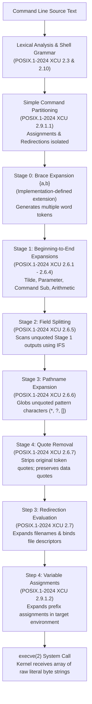

# Expansion Order

> [!summary] Claim
> The POSIX shell processes words through a strict four-stage, single-pass pipeline - Stage 1 beginning-to-end substitutions, Stage 2 field splitting, Stage 3 pathname expansion, and Stage 4 quote removal - enforcing lexical boundary isolation before arguments reach `execve(2)`.

Part of [The POSIX Shell Language](README.md) in [Shell and Unix Engineering](../README.md).

## TL;DR

- Mechanism: The shell expands command-line words through an ordered, non-recursive pipeline consisting of Stage 1 (tilde, parameter, command, arithmetic), Stage 2 (`IFS` field splitting), Stage 3 (pathname globbing), and Stage 4 (quote removal).
- Rule: Each word token undergoes expansions in strict forward order without backtracking or rescanning expansion results for Stage 1 substitution syntax.
- Trap: Characters generated by unquoted parameter expansions undergo field splitting and pathname globbing, but never undergo tilde expansion, quote removal, or secondary command substitution.
- Portability fact: Shells diverge on declaration utilities: bash, ksh93, and mksh detect them lexically at parse time, dash and BusyBox ash detect them dynamically after expansion, while posh lacks declaration assignment context entirely and field-splits static export arguments.
- When not to use it: Do not rely on dynamic expansion order or unquoted concatenation to assemble structured command arguments; pass explicit array elements or dedicated parameters directly into `execve(2)`.

## Mental model



During parsing, the shell partitions simple commands into command words, redirection operators, and variable assignments under `(POSIX.1-2024 XCU 2.9.1.1)`.
In shells supporting brace expansion, Stage 0 expands unquoted curly brace groups into discrete words before standard word expansion begins.
Each command word then enters Stage 1, where tilde expansion, parameter expansion, command substitution, and arithmetic evaluation proceed from beginning to end in a single pass.
Stage 2 scans the unquoted string fragments produced by Stage 1 and divides them into fields at `IFS` delimiter bytes.
Stage 3 scans the resulting fields for unquoted pattern metacharacters (`*`, `?`, `[`), querying the filesystem via `opendir(3)` and `readdir(3)` to replace patterns with sorted file paths.
Stage 4 strips quote characters (`\`, `'`, `"`, `$'...'`) that were present in the original tokens, retaining literal quotes produced by variable values or filesystem directory entries.
Following argument expansion, the shell evaluates redirection target words, binds file descriptors via `dup2(2)`, evaluates prefix variable assignments, and invokes `execve(2)`.

## How it works

### 1. Simple Command Processing Order

The execution of a simple command is governed by `(POSIX.1-2024 XCU 2.9.1.1)`.
When the shell evaluates a simple command, it does not expand all tokens simultaneously.
Instead, it executes four structured phases:

1. Words recognized as variable assignments or redirections during grammar reduction are set aside for subsequent processing.
2. The first non-assignment, non-redirection word is expanded.
If expansion produces fields, the first field becomes the command name.
If no fields result (for example, `${unset_var}` expanding to an empty field that is removed), the shell continues expanding subsequent words until a non-empty command name is established or all words are exhausted.
If the resulting command name is recognized as a declaration utility (such as `export` or `readonly`), subsequent words structured as `name=value` are expanded using variable assignment context (tilde expansion after `=` and `:`, parameter expansion, command substitution, arithmetic expansion, and quote removal, but omitting field splitting and pathname expansion).
Implementations divide sharply on when and how declaration status is recognized under `(POSIX.1-2024 XCU 2.9.1.1)`.
GNU Bash, AT&T ksh93, mksh, and yash determine declaration utility status lexically during grammar parsing, so dynamic command invocations such as `cmd=export; "$cmd" x=$v` perform standard Stage 2 field splitting.
In contrast, Dash and BusyBox ash evaluate the command word first and dynamically activate assignment context if the expanded name matches an assignment builtin (`BUILTIN_ASSIGN` in Dash, read by `evalcommand()` in `(dash-0.5.12 src/eval.c, evalcommand)`).
POSIX.1-2024 permits both designs: an implementation "may use only lexical analysis", and it is unspecified whether assignment context applies when the name becomes a declaration utility only after word expansions `(POSIX.1-2024 XCU 2.9.1.1)`.
A notable divergence occurs in posh 0.14.1, which lacks declaration utility assignment context entirely: static `export x=$v` arguments undergo standard field splitting and pathname expansion unless double-quoted (measured in the shell matrix, as of 2026-10).
Furthermore, POSIX.1-2024 requires `command` itself to be treated as a declaration utility when its first argument is one (the `command` utility page, Austin Group Defects 351 and 1393), so `command export x=$v` must keep assignment context.
Dash, BusyBox ash, ksh93, mksh, and yash conform, while GNU Bash, zsh in POSIX mode, and posh field-split the argument (measured in the shell matrix, as of 2026-10); Dash conforms because its command lookup loop in `evalcommand()` steps through `command` before reading `BUILTIN_ASSIGN`.
For standard commands, all remaining words undergo standard word expansion to generate the argument vector `argv[]`.
3. Redirections are evaluated in textual order from left to right.
The filename or file descriptor operand following each redirection operator is expanded (without field splitting), and file descriptors are redirected via `open(2)`, `dup2(2)`, or `close(2)`.
4. Prefix variable assignments are expanded and exported to the environment of the command about to be executed under `(POSIX.1-2024 XCU 2.9.1.2)`.
POSIX.1-2024 XCU 2.9.1.1 allows steps 3 and 4 to run in reverse order when no command name results or when the command name is a special built-in utility.

Crucially, command words and arguments are expanded in Step 2 before redirection targets are expanded in Step 3.
If an argument expansion modifies shell state through arithmetic side effects, that state mutation is visible to subsequent argument expansions and to the redirection operand expansions that follow.

### 2. The Four-Stage Word Expansion Pipeline

According to `(POSIX.1-2024 XCU 2.6)`, the shell applies expansions to each word in the following strict order:

```
[Original Word Token]
         |
         v
+-------------------------------------------------------+
| Stage 0: Brace Expansion (Implementation Extension)   |
|   {a,b} -> a b                                        |
+-------------------------------------------------------+
         |
         v
+-------------------------------------------------------+
| Stage 1: Beginning-to-End Expansions                  |
|   1. Tilde Expansion       (~user -> /home/user)      |
|   2. Parameter Expansion   (${var:-default})          |
|   3. Command Substitution  ($(command))               |
|   4. Arithmetic Expansion  ($((expr)))                |
+-------------------------------------------------------+
         |
         v
+-------------------------------------------------------+
| Stage 2: Field Splitting                              |
|   Scans unquoted Stage 1 outputs using IFS delimiters |
+-------------------------------------------------------+
         |
         v
+-------------------------------------------------------+
| Stage 3: Pathname Expansion                           |
|   Globs unquoted *, ?, [...] against directory trees  |
+-------------------------------------------------------+
         |
         v
+-------------------------------------------------------+
| Stage 4: Quote Removal                                |
|   Strips syntactical quotes from original source text |
+-------------------------------------------------------+
         |
         v
[Fields passed to execve(2) / Builtin]
```

#### Stage 0: Brace Expansion (Non-POSIX Extension)

POSIX.1-2024 XCU 2.6 explicitly standardizes the placement of brace expansion for implementations that provide it, without naming it:
In a context where field splitting will be performed, a word that contains an unquoted `{` not immediately preceded by an unquoted `$`, followed by one or more unquoted commas `,` or a `..` sequence, followed by an unquoted `}`, "may be subject to an additional implementation-defined form of expansion".
This expansion, if supported, executes before all other word expansions and can generate multiple fields from a single word; the other expansions then apply to each resulting field.
In bash, because Stage 0 runs before Stage 1, variable parameters inside brace range boundaries (such as `{1..$n}`) are not yet evaluated when the brace parser executes.
ksh93 and native zsh do expand the parameter first and generate the range, while every other shell in the matrix keeps `{1..3}` as one literal field (measured in the shell matrix).

#### Stage 1: Beginning-to-End Substitutions

POSIX.1-2024 XCU 2.6 specifies that tilde expansion `(POSIX.1-2024 XCU 2.6.1)`, parameter expansion `(POSIX.1-2024 XCU 2.6.2)`, command substitution `(POSIX.1-2024 XCU 2.6.3)`, and arithmetic expansion `(POSIX.1-2024 XCU 2.6.4)` are performed from beginning to end in a single pass.
The shell scans the word token from left to right.
When it encounters an unquoted `~` at the start of a word or after an assignment `=`, it performs tilde expansion.
When it encounters an unquoted `$`, `${`, `$(`, `` ` ``, or `$((`, it determines the boundary of the construct and evaluates it immediately.
Crucially, the text produced by an expansion is never rescanned for Stage 1 substitution syntax.
If variable `v` contains the string `$(rm -rf /)`, expanding `$v` substitutes the literal bytes `$(rm -rf /)`.
The shell does not execute the command substitution because Stage 1 scanning has already moved past that token position.

#### Stage 2: Field Splitting

After Stage 1 completes, the shell examines the expanded fields under `(POSIX.1-2024 XCU 2.6.5)`.
Field splitting is performed exclusively on portions of fields generated by unquoted parameter expansions, command substitutions, and arithmetic evaluations.
Literal characters in the original token and characters protected by double quotes are shielded from field splitting.
Furthermore, the replacement text of tilde expansion is treated as if quoted `(POSIX.1-2024 XCU 2.6.1)`, preventing it from being split even if a username or home directory contains whitespace.
The shell scans unquoted expansion bytes against the delimiters defined in `IFS` (defaulting to `<space>`, `<tab>`, and `<newline>`).
Non-whitespace `IFS` characters delimit fields unconditionally, whereas sequences of whitespace `IFS` characters delimit fields and are discarded at field boundaries.

#### Stage 3: Pathname Expansion

Under `(POSIX.1-2024 XCU 2.6.6)`, each field resulting from field splitting is scanned for unquoted pattern metacharacters: `*`, `?`, and `[`.
If `set -f` is active, pathname expansion is bypassed entirely.
Pattern matching uses the directory scanning facilities `opendir(3)` and `readdir(3)` to find matching filenames in the filesystem.
Matches are sorted according to the current locale's collation sequence `LC_COLLATE`.
Crucially, filenames returned by pathname expansion never undergo field splitting.
Even if a matched file is named `file with spaces.txt`, it remains a single discrete argument.
Because Stage 2 precedes Stage 3, whitespace inside directory entry names cannot fracture the field.

#### Stage 4: Quote Removal

Under `(POSIX.1-2024 XCU 2.6.7)`, quote removal always executes last.
The shell scans the fields and strips quote characters (`\`, `'`, `"`, and `$'...'`) that were present in the original word token.
Characters protected by these quotes are retained as bare literal bytes.
Crucially, quote removal does not remove quote characters that were produced by expansions in Stage 1 or by pathname expansion in Stage 3.
If variable `val` contains `'foo bar'`, expanding `$val` yields fields containing literal single quote bytes (`0x27`).
Quote removal leaves those bytes intact because they were not present in the original token parsed by the lexical analyzer.

### 3. Implementation Mechanics in C

#### GNU Bash (`subst.c`)

In GNU Bash, word expansion is driven by `expand_word_list_internal()` in `(bash-5.3 subst.c, expand_word_list_internal)`.
The pipeline executes sequentially:

1. `brace_expand_word_list()` evaluates curly brace expansions if `WEXP_BRACEEXP` is enabled.
2. `shell_expand_word_list()` processes Stage 1 expansions and field splitting.
Inside `shell_expand_word_list()`, each word is passed to `expand_word_internal()`, which scans the string character by character.
It calls `bash_tilde_expand()` for leading tildes and `param_expand()` for every `$` construct; `param_expand()` in turn handles `${...}`, calls `command_substitute()` for `$(...)`, and for `$((...))` calls `expand_arith_string()` and then `evalexp()` `(bash-5.3 subst.c, param_expand)`.
Bash preserves quoting boundaries during Stage 1 by inserting in-band control markers: `CTLESC` (`0x01`) escapes literal metacharacters, and `CTLNUL` (`0x7f`) represents quoted null strings (both defined in `(bash-5.3 syntax.h)`).
3. Still inside `shell_expand_word_list()`, `word_list_split()` performs Stage 2 field splitting via `list_string()`.
Inside `string_extract_verbatim()`, characters prefixed by `CTLESC` are skipped without checking the separator list, while unescaped bytes are compared against the separators taken from `IFS`.
4. `glob_expand_word_list()` performs Stage 3 pathname expansion on unquoted pattern characters using `shell_glob_filename()`, and calls `dequote_string()` on each word it does not replace with matches.
5. When pathname expansion is disabled, `dequote_list()` executes Stage 4 quote removal instead by calling `dequote_string()`, which strips `CTLESC` escape markers and unquoted syntactical quote characters `(bash-5.3 subst.c, expand_word_list_internal)`.

#### Dash (`src/expand.c` and `src/eval.c`)

In Dash, simple command execution begins in `evalcommand()` in `(dash-0.5.12 src/eval.c, evalcommand)`.
Dash evaluates arguments before redirections:

1. `evalcommand()` calls `fill_arglist()`, which expands the command word using `expandarg()`.
2. Dash inspects the expanded command name via `find_command()`.
If the command is a builtin, it sets `pseudovarflag` to that builtin's `BUILTIN_ASSIGN` flag bit, stepping through `command` first when the name is `command`.
3. Subsequent arguments are expanded in a loop using `expandarg()`:
If `pseudovarflag` is set and the argument text satisfies `isassignment()`, Dash passes `EXP_VARTILDE` to suppress field splitting and globbing.
Otherwise, Dash passes `EXP_FULL | EXP_TILDE`.
4. Inside `expandarg()` in `(dash-0.5.12 src/expand.c, expandarg)`, `argstr()` performs Stage 1 substitutions using internal control markers:
`CTLESC` (`0x81`), `CTLVAR` (`0x82`), `CTLENDVAR` (`0x83`), `CTLBACKQ` (`0x84`), `CTLARI` (`0x86`), `CTLENDARI` (`0x87`), and `CTLQUOTEMARK` (`0x88`), defined as negative `char` values in `(dash-0.5.12 src/parser.h)`.
5. `ifsbreakup()` performs Stage 2 field splitting only inside the regions that `argstr()` recorded with `recordregion()` for unquoted expansions.
6. `expandmeta()` performs Stage 3 pathname expansion via `glob64()` or manual directory iteration.
7. `rmescapes()` executes Stage 4 quote removal, stripping `CTLESC` and quote markers.
8. `evalcommand()` calls `expredir()` to expand redirection targets, pushes the redirections via `pushredir()`, and finally evaluates prefix variable assignments.

#### Syscall Boundary: `execve(2)`

When word expansion completes, the shell constructs a null-terminated array of pointers (`char *argv[]`) where each pointer addresses a null-terminated byte buffer in user space.
The shell invokes the `execve(2)` system call:

```c
int execve(const char *pathname, char *const argv[], char *const envp[]);
```

The Linux and Darwin kernels receive the exact byte buffers populated by quote removal.
The kernel performs zero token parsing, zero word splitting, zero pathname globbing, and zero quote interpretation.
Every lexical and syntactic distinction established during expansion is completely finalized before kernel execution begins.

## Numbers and limits

| Parameter / Metric | Value | Constraint / Standard | Source / Proof (as of 2026-10) |
| :--- | :--- | :--- | :--- |
| Word expansion standard stages | `4` stages | POSIX standard sequence | `POSIX.1-2024 XCU 2.6` |
| Pre-expansion stages | `1` stage | Brace expansion extension (implementation-defined) | `POSIX.1-2024 XCU 2.6`, second listed case that creates multiple fields |
| macOS Darwin `ARG_MAX` | `1,048,576` bytes | Maximum `argv` + `envp` | `getconf ARG_MAX` (macOS 27.2, Darwin 27.2.0 host) |
| Linux glibc `ARG_MAX` | `2,097,152` bytes | Maximum `argv` + `envp`; a quarter of the 8 MiB stack limit | `getconf ARG_MAX` (Debian 13 container, Linux 7.2 kernel, `ulimit -s` 8192) and `execve(2)` |
| Linux pipe buffer capacity | `65,536` bytes (64 KiB) | Command substitution pipe buffer | `fcntl(fd, F_GETPIPE_SZ)`, measured in shell matrix |
| macOS pipe buffer capacity | `16,384` bytes -> `65,536` bytes | Dynamic growth pipe buffer | Measured in shell matrix (macOS host) |
| Linux `PIPE_BUF` atomic write | `4,096` bytes | Atomic write guarantee | `getconf PIPE_BUF /` (Debian 13 container); POSIX.1-2024 XBD `<limits.h>` and XSH `write()` |
| macOS `PIPE_BUF` atomic write | `512` bytes | Atomic write guarantee | `getconf PIPE_BUF /`, measured in shell matrix; POSIX.1-2024 XBD `<limits.h>` and XSH `write()` |
| Bash in-band quote markers | `2` bytes | `CTLESC = 0x01`, `CTLNUL = 0x7f` | `(bash-5.3 syntax.h)` |
| Dash in-band control markers | `7` bytes | `0x81` to `0x88`, `0x85` unused (`CTLESC` to `CTLQUOTEMARK`) | `(dash-0.5.12 src/parser.h, CTL_FIRST to CTL_LAST)` |
| Exit status bitmask | `8` bits (`0` to `255`) | Process exit code range | `POSIX.1-2024 XCU 2.8.2` |
| Signal exit status offset | `128 + N` | bash, dash, mksh, posh, busybox | Measured in shell matrix |
| Ksh93 signal exit status offset | `256 + N` | AT&T ksh93 | Measured in shell matrix |
| Yash signal exit status offset | `384 + N` | Yash shell | Measured in shell matrix |
| POSIX declaration utilities | `2` utilities, plus `command` | `export`, `readonly`; `command` when its first argument is one | `POSIX.1-2024 XCU 2.9.1.1`, `export`, `readonly`, and `command` pages / Defects 351 and 1393 |

## Portability

| Behavior / Construct | POSIX.1-2024 sh | macOS bash 3.2 | current bash (5.3) | zsh (native) | zsh (`--emulate sh`) | dash (0.5.12) | ksh93 (93u+m) | mksh (R59) | yash (2.58) | posh (0.14) | BusyBox ash (1.37) |
| :--- | :--- | :--- | :--- | :--- | :--- | :--- | :--- | :--- | :--- | :--- | :--- |
| Brace expansion vs parameter (`{1..$n}`) | Implementation-defined (2.6) | `{1..3}` | `{1..3}` | `1 2 3` | `{1..3}` | `{1..3}` (literal) | `1 2 3` | `{1..3}` | `{1..3}` | `{1..3}` (literal) | `{1..3}` |
| Unquoted parameter field splitting | Yes (`IFS`) | Yes | Yes | No (`SH_WORD_SPLIT` off) | Yes | Yes | Yes | Yes | Yes | Yes | Yes |
| Unquoted parameter globbing | Yes | Yes | Yes | No (`GLOB_SUBST` off) | Yes | Yes | Yes | Yes | Yes | Yes | Yes |
| Stage 1 left-to-right evaluation | Yes | `2 7 7` | `2 7 7` | `2 7 7` | `2 7 7` | `2 7 7` | `2 7 7` | `2 7 7` | `2 7 7` | `2 7 7` | `2 7 7` |
| Filename spaces split after glob | No | No | No | No | No | No | No | No | No | No | No |
| Original token quotes stripped | Yes | Yes | Yes | Yes | Yes | Yes | Yes | Yes | Yes | Yes | Yes |
| Expanded variable quotes stripped | No | No | No | No | No | No | No | No | No | No | No |
| Command words expanded before redirections | Yes (2.9.1.1) | `x=111` | `x=111` | `x=111` | `x=111` | `x=111` | `x=111` | `x=111` | `x=111` | `x=111` | `x=111` |
| Static declaration utility (`export x=$v`) | No splitting | No splitting | No splitting | No splitting | No splitting | No splitting | No splitting | No splitting | No splitting | Splitting (`a`) | No splitting |
| Non-declaration utility (`func x=$v`) | Splitting | Splitting | Splitting | No splitting | Splitting | Splitting | Splitting | Splitting | Splitting | Splitting | Splitting |
| Dynamic declaration utility (`$cmd x=$v`) | Unspecified | Splitting (lexical) | Splitting (lexical) | No splitting | Splitting (lexical) | No splitting (dynamic) | Splitting (lexical) | Splitting (lexical) | Splitting (lexical) | Splitting (no declaration context) | No splitting (dynamic) |
| Declaration with command prefix (`command export x=$v`) | No splitting (required, `command` page) | Splitting (`a`) | Splitting (`a`) | Command not found | Splitting (`a`) | No splitting (`a b`) | No splitting (`a b`) | No splitting (`a b`) | No splitting (`a b`) | Splitting (`a`) | No splitting (`a b`) |
| Arithmetic recursive variable eval (`$((x))` where `x="1+2"`) | Unspecified | Evaluates (`3`) | Evaluates (`3`) | Evaluates (`3`) | Evaluates (`3`) | Error (`Illegal number`) | Evaluates (`3`) | Evaluates (`3`) | No recursion (`1+2`); `$((x + 0))` rejects (`not a valid number`) | Evaluates (`3`) | Evaluates (`3`) |

## Worked example

The test script below from [lab](../labs/03-expansion-order/) demonstrates every stage boundary and evaluation order rule in a single executable run.
It verifies brace expansion ordering, left-to-right arithmetic evaluation, lack of substitution rescanning, field splitting isolation, pathname expansion preservation, quote removal boundaries, redirection evaluation sequence, and declaration utility context.

```sh
#!/bin/sh
# expansion-order-probe.sh: deterministic probe demonstrating POSIX word expansion order.
# Exercises:
#   Stage 0: Brace expansion vs Parameter expansion ({1..$n})
#   Stage 1: Beginning-to-end left-to-right evaluation with arithmetic side effects
#   Stage 1: Non-recursive evaluation (expanded tildes and command substitutions are not rescanned)
#   Stage 1 vs Stage 2: Parameter expansion vs Field splitting (unquoted splitting vs quoted protection)
#   Stage 2 vs Stage 3: Field splitting vs Pathname expansion (spaces in filenames vs space-delimited patterns)
#   Stage 3 vs Stage 4: Pathname expansion vs Quote removal (filesystem quotes preserved vs token quotes stripped)
#   Simple command processing (POSIX.1-2024 XCU 2.9.1.1): Command words expanded before redirection operands
#   Declaration utilities: Static assignment context vs non-declaration command vs dynamic command name
set -eu

fmt_args() {
  printf 'argc=%d' "$#"
  for arg in "$@"; do
    printf ' <%s>' "${arg}"
  done
  printf '\n'
}

# 1. Stage 0 (Brace expansion) vs Stage 1 (Parameter expansion)
n=3
# shellcheck disable=SC2086,SC2248,SC3009 # intentional unquoted expansion testing brace vs parameter order
set -- {1..${n}}
printf '1_brace_param: '
fmt_args "$@"

# 2. Stage 1 left-to-right evaluation across words
x=1
set -- "$((x += 1))" "$((x += 5))" "${x}"
printf '2_left_to_right: '
fmt_args "$@"

# 3. Stage 1 non-recursive evaluation (no re-expansion of produced syntax)
t='~'
# shellcheck disable=SC2016 # single quotes intentionally contain unexpanded syntax
c='$(echo bad)'
# shellcheck disable=SC2086,SC2248 # intentional unquoted expansion verifying lack of rescanning
set -- ${t} ${c}
printf '3_non_recursive: '
fmt_args "$@"

# 4. Stage 1 (Parameter expansion) vs Stage 2 (Field splitting)
IFS=' :'
val='a : b:c'
# shellcheck disable=SC2086,SC2248 # testing unquoted splitting vs double-quoted protection
set -- ${val} "${val}"
printf '4_param_split: '
fmt_args "$@"

# Set up scratch directory within test tmpdir or current working directory
tmpdir=$(mktemp -d "${BATS_TEST_TMPDIR:-${PWD}}/exp_probe.XXXXXX")
trap 'rm -rf "${tmpdir}"' EXIT

touch "${tmpdir}/file with spaces.txt"
touch "${tmpdir}/alpha.txt" "${tmpdir}/beta.md"

# 5. Stage 2 (Field splitting) vs Stage 3 (Pathname expansion)
(
  cd "${tmpdir}"
  set -- *.txt
  printf '5a_glob_spaces: '
  fmt_args "$@"

  pattern='*.txt *.md'
  # shellcheck disable=SC2086,SC2248 # intentional unquoted expansion testing splitting before globbing
  set -- ${pattern}
  printf '5b_split_glob: '
  fmt_args "$@"
)

# 6. Stage 3 (Pathname expansion) vs Stage 4 (Quote removal)
touch "${tmpdir}/foo'bar.txt"
touch "${tmpdir}/fooxyzbar.txt"

(
  cd "${tmpdir}"
  # shellcheck disable=SC2086,SC2248 # pathname expansion preserves literal quotes from directory entries
  set -- *\'*
  printf '6a_glob_quotes: '
  fmt_args "$@"

  set -- 'foo'*'bar.txt'
  printf '6b_token_quotes: '
  fmt_args "$@"
)

# shellcheck disable=SC2089 # literal quotes in variable intentionally test lack of quote removal
val_quotes="'foo bar'"
# shellcheck disable=SC2086,SC2090,SC2248 # intentional unquoted expansion verifying quotes are not removed
set -- ${val_quotes}
printf '6c_var_quotes: '
fmt_args "$@"

# 7. Simple command arguments before redirections (POSIX.1-2024 XCU 2.9.1.1)
x=0
# shellcheck disable=SC2257 # arithmetic side effect in redirection intentionally tests evaluation order
printf '%s %s\n' "arg1:$((x += 1))" "arg2:$((x += 100))" >"${tmpdir}/redir_$((x += 10))"
redir_file=""
for f in "${tmpdir}"/redir_*; do
  redir_file="${f##*/}"
  break
done
printf '7_redir_order: x=%d file=<%s>\n' "${x}" "${redir_file}"

# 8. Declaration utility assignment context (POSIX.1-2024 XCU 2.9.1.1 / Defect 351)
test_func() {
  fmt_args "$@"
}
v="a b"
# shellcheck disable=SC2086 # export is a declaration utility in POSIX.1-2024
export x_decl=${v}
printf '8a_decl_export: <%s>\n' "${x_decl}"

printf '8b_normal_cmd: '
# shellcheck disable=SC2086,SC2248 # non-declaration utility arguments undergo field splitting
test_func x_norm=${v}

# 9. Dynamic declaration utility (lexical vs dynamic command name detection)
cmd='export'
y_dyn=''
# shellcheck disable=SC2086,SC2248 # dynamic command name tests lexical vs dynamic declaration detection
"${cmd}" y_dyn=${v}
printf '9_dynamic_decl: <%s>\n' "${y_dyn}"
```

When executed under GNU Bash 5.3, the script produces the following captured output, which bash 3.2 through 5.2, mksh, yash, and `zsh --emulate sh` reproduce line for line in the shell matrix:

```text
1_brace_param: argc=1 <{1..3}>
2_left_to_right: argc=3 <2> <7> <7>
3_non_recursive: argc=3 <~> <$(echo> <bad)>
4_param_split: argc=4 <a> <b> <c> <a : b:c>
5a_glob_spaces: argc=2 <alpha.txt> <file with spaces.txt>
5b_split_glob: argc=3 <alpha.txt> <file with spaces.txt> <beta.md>
6a_glob_quotes: argc=1 <foo'bar.txt>
6b_token_quotes: argc=2 <foo'bar.txt> <fooxyzbar.txt>
6c_var_quotes: argc=2 <'foo> <bar'>
7_redir_order: x=111 file=<redir_111>
8a_decl_export: <a b>
8b_normal_cmd: argc=2 <x_norm=a> <b>
9_dynamic_decl: <a>
```

Under posh 0.14.1, line 11 instead reports `8a_decl_export: <a>` because posh does not implement declaration utility assignment context and splits unquoted arguments to `export` (as of 2026-10).
Under Dash and BusyBox ash, line 13 reports `9_dynamic_decl: <a b>` because those shells identify declaration utilities dynamically after command expansion rather than lexically at parse time.
Under ksh93 (both 93u+ 2012 and 93u+m 1.0.10), line 1 instead reports `1_brace_param: argc=3 <1> <2> <3>` because ksh93 expands the parameter before generating the range (measured in the shell matrix).
Under native Zsh, line 1 reports `1_brace_param: argc=3 <1> <2> <3>`, line 4 reports `4_param_split: argc=2 <a : b:c> <a : b:c>`, and line 12 reports `8b_normal_cmd: argc=1 <x_norm=a b>` because native Zsh evaluates variables in brace ranges and disables unquoted word splitting by default.
For the same reason, native Zsh also changes line 3 (`argc=2 <~> <$(echo bad)>`), line 6 (`5b_split_glob: argc=1 <*.txt *.md>`), line 9 (`6c_var_quotes: argc=1 <'foo bar'>`), and line 13 (`9_dynamic_decl: <a b>`) in the shell matrix.

## Pitfalls

> [!warning] Unquoted Parameter Undergoing Pathname Expansion (CWE-78 / CWE-88)
> - Trigger: Expanding an unquoted variable containing wildcard metacharacters (`*`, `?`, `[`), such as `rm $file` or `cp $source $dest`.
> - Symptom: If an attacker creates a file named `-rf` or `*`, Stage 3 pathname expansion replaces `$file` with filenames that match option flags, causing `rm` or `cp` to alter argument parsing and delete arbitrary directories.
> - Fix: Always wrap parameter expansions in double quotes: `rm -- "${file}"`.
> Double quoting suppresses Stage 2 field splitting and Stage 3 pathname expansion while permitting Stage 1 substitution.
> - Primary source: Common Weakness Enumeration CWE-78 (OS Command Injection) and CWE-88 (Improper Argument Handling).

> [!warning] Brace Expansion Preceding Parameter Expansion
> - Trigger: Writing `{1..$n}` expecting dynamic sequence generation in bash or POSIX scripts.
> - Symptom: The command receives a single literal argument `{1..5}` instead of five discrete numbers.
> - Fix: Do not use brace expansion for dynamic boundaries.
> Use an explicit arithmetic loop `i=1; while [ "$i" -le "$n" ]; do ...; i=$((i + 1)); done` or `seq 1 "$n"`.
> - Primary source: `POSIX.1-2024 XCU 2.6 item 2` and `(bash-5.3 subst.c, expand_word_list_internal)`.

> [!warning] Tilde Expansion Not Rescanning Parameter Output
> - Trigger: Storing paths containing a leading tilde in a variable, such as `path='~/bin'`, followed by `cd $path` or `ls "$path"`.
> - Symptom: The shell emits `cd: ~/bin: No such file or directory` because a literal directory named `~` is sought.
> - Fix: Assign `$HOME` explicitly: `path="$HOME/bin"`.
> Tilde expansion runs only on initial unquoted tokens in Stage 1 and is never applied to parameter expansion results.
> - Primary source: `POSIX.1-2024 XCU 2.6.1` and `(dash-0.5.12 src/expand.c, argstr)`.

> [!warning] Embedded Quotes in Variables Are Preserved Literally
> - Trigger: Storing command flags containing quotes in a single string variable, such as `FLAGS='-a -b "file with spaces"'`, followed by `cmd $FLAGS`.
> - Symptom: Stage 2 field splitting splits the value into five arguments (`-a`, `-b`, `"file`, `with`, and `spaces"`), and Stage 4 quote removal leaves the literal double-quote bytes attached, passing `"file` and `spaces"` with their quote characters to the target executable.
> - Fix: Use standard shell positional parameters `set -- -a -b "file with spaces"` or Bash/Ksh/Zsh arrays `FLAGS=(-a -b "file with spaces")`, expanding strictly with `"$@"` or `"${FLAGS[@]}"`.
> - Primary source: `POSIX.1-2024 XCU 2.6.7` and `(bash-5.3 subst.c, dequote_list)`.

> [!warning] Arithmetic Variable Expansion Double-Evaluation (array subscript injection)
> - Trigger: Using unquoted parameter references inside arithmetic expressions, such as `$(( $user_input ))` or `arr[$user_input]`.
> - Symptom: Bash evaluates the value of a variable named inside an arithmetic expression as a further expression, and expands an array subscript found there.
> If `user_input` contains `x[$(id >&2)]0`, the arithmetic evaluator expands the subscript and invokes `command_substitute()` before it reports the syntax error at the trailing `0`, leading to arbitrary code execution.
> With `x='a[$(echo PWNED >&2)]'`, `$((x))` ran the command in bash 3.2 and 5.3, mksh, and posh, and in ksh93u+ 2012; ksh93u+m, dash, yash, BusyBox ash, and zsh did not run it (measured in the shell matrix, as of 2026-10).
> - Fix: Validate that user inputs consist strictly of digits (`case "$input" in (*[!0-9]*) exit 1 ;; esac`) before arithmetic evaluation, or use `expr(1)` in hardened environments.
> - Primary source: `(bash-5.3 expr.c, expr_streval)`, `(bash-5.3 arrayfunc.c, array_expand_index)`, the ARITHMETIC EVALUATION section of `bash(1)` (the value of a variable is evaluated as an arithmetic expression when it is referenced), and measured behavior in the shell matrix.

> [!warning] Dynamic Command Names Disabling Declaration Context (Austin Group Defect 351)
> - Trigger: Invoking declaration utilities via variables, such as `cmd=export; $cmd var=$val` where `val="a b"`.
> - Symptom: In Bash, Ksh93, and Mksh, declaration utility status is determined lexically at parse time.
> Because `$cmd` is not recognized as `export` during parsing, `var=$val` undergoes field splitting, assigning `var=a` and marking a separate variable named `b` for export (unset unless it already had a value).
> - Fix: Write declaration builtins literally (`export var="${val}"`), or quote variable values explicitly even when using declaration commands.
> - Primary source: Austin Group Defect 351 (`https://austingroupbugs.net/view.php?id=351`) and `POSIX.1-2024 XCU 2.9.1.1`.

> [!warning] Posh Field Splitting on Unquoted Declaration Arguments
> - Trigger: Writing unquoted variable assignments in declaration builtins, such as `export var=$val` or `readonly var=$val`, in scripts verified or executed under `posh`.
> - Symptom: Under POSIX.1-2024 and standard shells (Bash, Dash, Ksh93, Mksh, Yash, BusyBox ash), declaration utilities suppress Stage 2 field splitting on `name=value` arguments.
> In posh 0.14.1, declaration utility assignment context is not implemented (as of 2026-10).
> The unquoted expansion `$val` undergoes Stage 2 field splitting on `IFS` whitespace: `var` receives only the first word, and subsequent words are treated as names of additional variables to export or mark readonly.
> - Fix: Explicitly double-quote all assignment values in declaration commands: `export var="${val}"`, or separate the assignment from the export: `var=$val; export var`.
> - Primary source: `POSIX.1-2024 XCU 2.9.1.1`, Austin Group Defect 351, and measured behavior in `posh 0.14.1` (Debian package `posh`).

## Security and robustness

The shell expansion pipeline is the primary vector for command injection, argument injection, and privilege escalation vulnerabilities in Unix systems.
Security boundaries depend on adhering to four defensive invariants:

1. Double-quote all variable expansions:
Every parameter expansion in normal command context must be enclosed in double quotes: `"$var"`.
Double quoting informs the lexical engine that characters emitted by Stage 1 must be protected: Bash prefixes them with `CTLESC`, while Dash escapes pattern characters with `CTLESC` and records no field-splitting region for a quoted expansion.
This causes Stage 2 (`word_list_split` in Bash, `ifsbreakup` in Dash) and Stage 3 (`glob_expand_word_list` in Bash, `expandmeta` in Dash) to skip the enclosed bytes, ensuring that user-controlled values cannot inject additional fields or glob arbitrary filesystem paths.

2. Eliminate `eval` and dynamic code generation:
The `eval` builtin restarts the entire shell parsing and expansion pipeline from the beginning.
Passing unquoted user input to `eval` forces the shell to execute a second pass of lexical analysis, token recognition, and Stage 1 substitution, transforming passive data strings into executable commands.
If complex argument passing is required, use arrays in shells that support them, or use positional parameters (`set --`) in strict POSIX `sh`.

3. Use option-argument delimiters:
Even when variables are correctly double-quoted, an expansion can result in a string starting with a hyphen `-`.
If passed as an argument to a utility, the utility parses the string as an option flag rather than an operand.
Always terminate option parsing before passing variable arguments: `rm -- "${file}"`, `cat -- "${file}"`, or prefix relative paths with `./`: `cat ./"${file}"`.

4. Sanitize inputs before arithmetic evaluation:
Because GNU Bash, mksh, posh, and ksh93u+ 2012 evaluate variables recursively in arithmetic expressions `$(( ... ))` and expand array subscripts found in their values (measured in the shell matrix), never place untrusted variables inside arithmetic expansion constructs without strict integer validation.
An unvetted variable containing an array subscript expression can trigger command substitution during Stage 1 evaluation.

## The principal's view

The linear, four-stage design of POSIX word expansion reflects a fundamental architectural compromise made in the early days of the Bourne shell.
The pipeline was engineered to balance dynamic text transformation with bounded computational complexity.
By enforcing a strict, non-recursive, single-pass pipeline (Stage 1 substitutions -> Stage 2 field splitting -> Stage 3 pathname globbing -> Stage 4 quote removal), POSIX ensures that no expansion result is fed back into the Stage 1 scanner, preventing infinite substitution loops (a command substitution can still run arbitrary code, and pathname expansion costs as much as the directory scan, so the total cost is not bounded by input length).

However, this linear design creates an impedance mismatch with modern software engineering practices.
In a high-level programming language, data types and memory boundaries are preserved across function calls.
In the shell, every boundary is represented in-band using character strings and delimiter bytes.
A variable assignment does not store an abstract token array; it stores raw bytes.
When that variable is expanded, the shell cannot know whether whitespace or wildcard characters were intended as syntax or data unless defensive quoting is applied at every single call site.

Subtle standard exceptions, such as suppression of field splitting in declaration utilities (`export x=$v`), demonstrate the hazards of reliance on syntactic context.
Because shells diverge between lexical parsing (Bash, ksh93, mksh), dynamic command lookup (Dash, BusyBox ash), and total absence of assignment context (posh), relying on bare `export x=$v` invites silent corruption when scripts run across diverse container or policy-checking environments.
Principals enforce unconditional double quoting (`export x="${v}"`) or separated two-statement declarations (`x=$v; export x`) across all shared codebases.

At distinguished engineering scale, the architectural rule is simple:
Treat the shell language as an orchestration harness for executing external binaries, never as a data transformation engine.
When a script requires dynamic argument list construction, nested dictionary structures, binary data parsing, or validation of untrusted user inputs, graduate immediately from shell script to a typed programming language such as Go, Python, or Rust.
In those languages, arguments are constructed as distinct, memory-isolated string arrays passed directly to `execve(2)` without passing through a four-stage textual expansion pipeline.

## Interview questions

> [!question] L5: In POSIX shell, what is the output of `v="c d"; set -- 'a b' $v; echo "$#"` under default `IFS`, and why?
>
> > [!success]- Answer
> > The output is `3`.
> > The token `'a b'` is quoted during token recognition and produces a single field that skips field splitting in Stage 2.
> > The unquoted parameter expansion `$v` undergoes Stage 1 parameter expansion to produce `c d`.
> > In Stage 2, field splitting scans the unquoted string `c d` against default `IFS` whitespace and splits it into two discrete fields `c` and `d`.
> > The resulting positional parameter list contains three elements: `a b`, `c`, and `d`.
> >
> > Follow-up: What would `$#` be if `$v` were enclosed in double quotes as `"$v"`?

> [!question] L5: Explain why `dir="~/src"; cd $dir` fails with `No such file or directory`, even though `cd ~/src` succeeds.
>
> > [!success]- Answer
> > Tilde expansion occurs in Stage 1 only when an unquoted tilde begins a word token during the initial lexical pass.
> > In `cd $dir`, the word token begins with the dollar sign `$`, so no tilde prefix is recognized at token recognition time.
> > During Stage 1, `$dir` is expanded to the string `~/src`.
> > Because the shell does not rescan the output of parameter expansions for Stage 1 syntax, the tilde is treated as a literal character.
> > The `cd` utility searches for a literal directory named `~` in the current working directory and fails.
> >
> > Follow-up: How should the assignment be written so that `cd "$dir"` navigates to the user home directory portably?

> [!question] L6: Predict the exact output of `n=3; set -- {1..$n}; echo "$#:$*"` in GNU Bash versus native Zsh.
>
> > [!success]- Answer
> > In GNU Bash, the output is `1:{1..3}`.
> > Brace expansion executes in Stage 0 before Stage 1 parameter expansion evaluates `$n`.
> > Because `$n` is not an integer constant when Stage 0 executes, Bash treats `{1..$n}` as literal text, and Stage 1 then expands `$n` to produce the single field `{1..3}`.
> > In native Zsh, the output is `3:1 2 3`.
> > Native Zsh evaluates variable expressions inside brace range expressions prior to sequence generation, expanding the range into three arguments.
> > Under `zsh --emulate sh`, Zsh disables native brace range variable evaluation and matches Bash by printing `1:{1..3}`.
> >
> > Follow-up: Why does POSIX.1-2024 specify brace expansion as occurring before standard word expansions rather than after?

> [!question] L6: A developer writes `flags="-v -o 'my output.txt'"; compiler $flags`, but why does the compiler fail with an error about `'my`?
>
> > [!success]- Answer
> > In Stage 1, `$flags` expands to `-v -o 'my output.txt'`.
> > In Stage 2, field splitting divides the unquoted expansion on whitespace, producing four fields: `-v`, `-o`, `'my`, and `output.txt'`.
> > In Stage 4, quote removal only removes quotes that were present in the original token parsed by the shell grammar.
> > Because the single quotes originated from the value of `$flags` and not from the original command line, quote removal leaves the single quotes intact.
> > The compiler receives the third argument as literal `'my` and fails because the filename does not exist.
> > The fix is to use an array in Bash (`flags=(-v -o "my output.txt"); compiler "${flags[@]}"`) or positional parameters in POSIX sh (`set -- -v -o "my output.txt"; compiler "$@"`).
> >
> > Follow-up: Can `eval compiler "$flags"` fix this problem, and what security risks does `eval` introduce?

> [!question] L6: In `echo "arg1:$((x += 1))" >"out_$((x += 10))" "arg2:$((x += 100))"`, what order does POSIX.1-2024 require expansions to occur?
>
> > [!success]- Answer
> > POSIX.1-2024 XCU 2.9.1.1 requires simple command processing to evaluate command words and arguments in Step 2 before evaluating redirections in Step 3.
> > The shell first expands `echo`, then `arg1:$((x += 1))` (setting `x=1`), and then `arg2:$((x += 100))` (setting `x=101`).
> > Once argument word expansion completes, the shell proceeds to Step 3 and expands the redirection target `out_$((x += 10))` (setting `x=111`).
> > The output file created on disk is named `out_111`.
> > Even though the redirection syntax is placed between the arguments in source text, argument expansion strictly precedes redirection expansion.
> >
> > Follow-up: What would happen if a command substitution in Step 2 exited with a non-zero status under `set -e`?

> [!question] L7+: How do GNU Bash and Dash prevent double-quoted text from undergoing field splitting and globbing during Stage 1 expansions in their C source implementations?
>
> > [!success]- Answer
> > GNU Bash uses in-band byte escaping in `subst.c`.
> > During `expand_word_internal()`, literal or double-quoted characters that could collide with `IFS` or glob metacharacters are prefixed with `CTLESC` (`0x01`), and quoted null strings are represented by `CTLNUL` (`0x7f`).
> > When `word_list_split()` invokes `string_extract_verbatim()`, the scanner detects `CTLESC` and advances past the escaped character without comparing it against `ifs_cmap`.
> > Pathname expansion in `glob_expand_word_list()` similarly treats `CTLESC`-prefixed pattern characters as literal text before `dequote_list()` strips the escape markers.
> > Dash uses in-band control markers defined in `src/parser.h` and processed in `src/expand.c`.
> > The parser (`readtoken1()` in `src/parser.c`) brackets single-quoted and double-quoted text with `CTLQUOTEMARK` (`0x88`) bytes, and during `argstr()` Dash prefixes quoted bytes that would otherwise be special with `CTLESC` (`0x81`).
> > Field splitting is controlled separately: `argstr()` calls `recordregion()` only for the output of unquoted expansions, and `ifsbreakup()` tests delimiters only inside those recorded regions, so quoted output is never split; `rmescapes()` later removes the control markers.
> >
> > Follow-up: What vulnerability occurs if user input introduces raw `0x01` or `0x81` bytes into a shell that does not properly sanitize in-band escape markers?

> [!question] L7+: What is the architectural difference between lexical and dynamic declaration utility handling in POSIX.1-2024, and how does it manifest in `cmd=export; $cmd x=$v`?
>
> > [!success]- Answer
> > POSIX.1-2024 XCU 2.9.1.1 standardizes declaration utilities (incorporating Austin Group Defect 351), specifying that arguments matching `name=value` following a declaration utility skip field splitting and pathname expansion.
> > However, the standard permits implementations to determine declaration utility status using lexical analysis alone, leaving behavior unspecified if the utility name is produced by expansion.
> > In GNU Bash, Ksh93, and Mksh, declaration utility identification occurs during lexical parsing.
> > Because `$cmd` is a generic variable expansion token at parse time, the parser does not tag subsequent words for assignment context.
> > When `$cmd` expands to `export`, the argument `x=$v` has already been marked for normal word expansion and undergoes field splitting, assigning `x=a` and exporting `b`.
> > In Dash, `evalcommand()` expands the command name first and then calls `find_command()` on the expanded string.
> > Finding that `export` has `BUILTIN_ASSIGN` set, Dash dynamically switches subsequent argument expansions to `EXP_VARTILDE`, preventing field splitting and assigning `x="a b"`.
> > In contrast, posh 0.14.1 does not implement declaration utility assignment context at all: even static `export x=$v` undergoes field splitting and assigns `x=a` while exporting `b` (as of 2026-10).
> > Furthermore, POSIX.1-2024 requires `command` to act as a declaration utility when its first argument is one, so `command export x=$v` must keep assignment context; Dash, BusyBox ash, ksh93, mksh, and yash conform, while Bash, zsh in POSIX mode, and posh field-split the argument (measured in the shell matrix, as of 2026-10).
> >
> > Follow-up: Why did POSIX choose to leave dynamic declaration utility detection unspecified rather than mandating Dash's behavior?

> [!question] L7+: Explain the vulnerability mechanism behind arithmetic command injection through array subscripts in GNU Bash.
>
> > [!success]- Answer
> > In GNU Bash, arithmetic evaluation in `expr.c` treats variable identifiers inside `$(( ... ))` as recursive expressions rather than simple integer values.
> > When Bash encounters an identifier like `var`, `expr_streval()` fetches the string content of `var` and evaluates it again as an arithmetic expression with `subexpr()`.
> > If an attacker controls the variable contents and provides `arr[$(malicious_command)]0`, the nested evaluation reaches the array reference, and `array_expand_index()` in `arrayfunc.c` expands the subscript with `expand_arith_string()`.
> > That expansion runs the full Stage 1 machinery in `subst.c`, so `command_substitute()` forks a child via `make_child()` and executes the command string via `parse_and_execute()`.
> > Because this occurs during Stage 1 word expansion before the parent command executes, arbitrary code execution is achieved, even though Bash then rejects the trailing `0` as a syntax error.
> > Any script that places an unvetted value inside `$(( ... ))`, `let`, or another arithmetic context is exposed; mksh, posh, and ksh93u+ 2012 behave the same way, while ksh93u+m, dash, yash, BusyBox ash, and zsh did not run the command (measured in the shell matrix, as of 2026-10).
> >
> > Follow-up: Why does Dash not suffer from this vulnerability when evaluating `$(( var ))`?

## Related

Prerequisites: [[Dollar-Single-Quotes]]

Next: [[Tilde-Expansion]]

See also: [[Shell-Parsing-Tokenization-and-Expansion-Order]]

## Further reading

- [POSIX.1-2024 Shell Command Language (XCU Chapter 2)](https://pubs.opengroup.org/onlinepubs/9799919799/utilities/V3_chap02.html) - Authoritative specification of word expansions (Section 2.6) and simple command execution (Section 2.9.1).
- [GNU Bash Source: subst.c](https://git.savannah.gnu.org/cgit/bash.git/tree/subst.c?h=bash-5.3) - Canonical C implementation of `expand_word_list_internal()`, in-band quoting markers, and the expansion pipeline.
- [Dash Source: src/expand.c](https://git.kernel.org/pub/scm/utils/dash/dash.git/tree/src/expand.c) - Minimal, POSIX-focused C implementation of `expandarg()`, `ifsbreakup()`, and `rmescapes()`.
- [Dash Source: src/eval.c](https://git.kernel.org/pub/scm/utils/dash/dash.git/tree/src/eval.c) - Implementation of `evalcommand()` illustrating dynamic declaration utility detection and redirection ordering.
- [Austin Group Defect 351](https://austingroupbugs.net/view.php?id=351) - POSIX defect report standardizing declaration utility assignment context for `export` and `readonly`.
- [POSIX.1-2024 command utility](https://pubs.opengroup.org/onlinepubs/9799919799/utilities/command.html) - Requires `command` to act as a declaration utility when its first argument is one (Austin Group Defects 351 and 1393).
- [Dash Source: src/parser.h (v0.5.12)](https://git.kernel.org/pub/scm/utils/dash/dash.git/tree/src/parser.h?h=v0.5.12) - Definitions of the `CTLESC` to `CTLQUOTEMARK` in-band control bytes.
- [Posh Source Repository: salsa.debian.org/clint/posh](https://salsa.debian.org/clint/posh) - Source repository for Debian's Policy-compliant Ordinary Shell.
