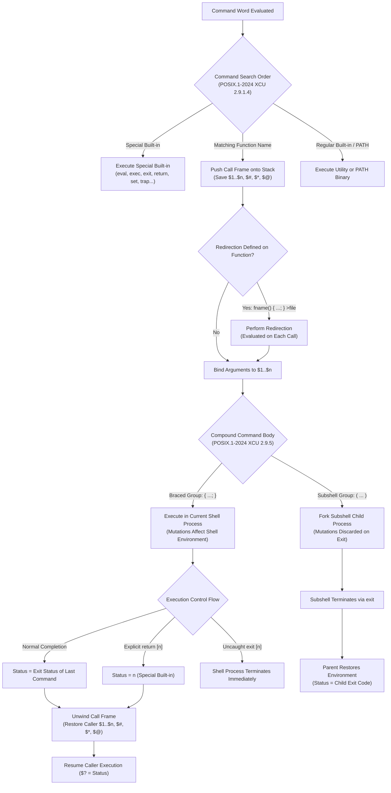

# Functions and Scope

> [!summary] Claim
> Shell functions execute compound commands directly within the current shell execution environment without process creation, providing isolated positional parameter stacks while sharing variable, file descriptor, and trap state unless explicitly isolated through subshell boundaries or non-standard dynamic scoping extensions.

Part of [The POSIX Shell Language](README.md) in [Shell and Unix Engineering](../README.md).

## TL;DR

- Mechanism: A function call pushes caller positional parameters onto an internal memory stack, binds function arguments to `$1` through `$n`, executes its compound command in the current process, and unwinds the stack on return.
- Rule: Treat all shell variables inside functions as global by default, prefixing internal variables with a unique function namespace (`_fname_var`) because POSIX.1-2024 does not standardize local variable scoping.
- Trap: Declaring and assigning a local variable in a single statement (`local v=$(cmd)`) masks the exit status of `cmd` with `0`, silently bypassing `set -e` error detection.
- Portability fact: The `local` keyword is an unstandardized extension using dynamic scoping in bash, dash, yash, mksh, posh, and BusyBox ash, but is completely missing from ksh93, while ksh93 `typeset` inside `function f` implements static lexical scoping (as of 2026-11).
- When not to use it: Avoid shell functions for complex data abstraction, object lifetimes, re-entrant concurrency, or heavy recursion where stack overflow cannot be trapped or recovered.

## Mental model



Command evaluation resolves simple command names against special built-ins before consulting user-defined functions.
When a function matches, the shell allocates an internal execution context frame and saves the caller's positional parameters `$1` through `$n`, `$#`, `$*`, and `$@` onto an internal memory stack.
Any redirections attached to the function definition command are dynamically evaluated and applied to open file descriptions on each separate invocation.
Arguments supplied to the call are bound to new positional parameters while special parameter `$0` remains unchanged in POSIX conformance.
The function body compound command then executes: braced groups run in the current shell execution environment where variable mutations, traps, and working directory changes persist globally, whereas parenthesized subshell bodies execute within an isolated child environment.
Execution terminates when the body completes, when `return` unwinds the current call frame, or when `exit` terminates the entire shell process.
Finally, the shell restores the caller's saved positional parameter stack and exposes the function's exit status in `$?`.

## How it works

Shell functions represent named compound commands stored in shell heap memory and executed without invoking `fork(2)` or `execve(2)`.
They are defined normatively by `(POSIX.1-2024 XCU 2.9.5)` and executed according to the command search precedence established in `(POSIX.1-2024 XCU 2.9.1.4)`.

### Function Definition and Grammar

The POSIX function definition syntax is strictly specified in `(POSIX.1-2024 XCU 2.9.5)`:

```sh
fname ( ) compound-command [io-redirect ...]
```

The function name `fname` must be a valid shell `Name` as defined in `(POSIX.1-2024 XBD 3.216)`.
A valid name consists solely of alphanumeric characters and underscores from the portable character set and cannot begin with a decimal digit.
Strict POSIX shells such as dash, ksh93, posh, yash, and bash in POSIX mode prior to 5.3 reject function names containing hyphens (`task-exec()`) with syntax errors, whereas native bash, BusyBox ash, mksh, zsh, and bash 5.3 accept hyphens as a language extension (as of 2026-11).
The bash 5.3 `CHANGES` file records the change: "Posix mode no longer requires function names to be valid shell identifiers."
`(POSIX.1-2024 XCU 2.9.5)` explicitly lets an implementation allow other characters as an extension, so a shell that accepts the hyphen still conforms; the script is what is non-portable.
POSIX requires the application not to name a function after any special built-in utility listed in `(POSIX.1-2024 XCU 2.15)`.
Functions cannot portably override `break`, `:`, `continue`, `.`, `eval`, `exec`, `exit`, `export`, `readonly`, `return`, `set`, `shift`, `times`, `trap`, or `unset`.
`(POSIX.1-2024 XCU 2.9.5)` places that requirement on the application and does not say what a shell must do when a script breaks it.
dash and ksh93 reject special built-in function names at parse time (`Bad function name`, `invalid function name`).
Modern bash in POSIX mode rejects defining functions named after special built-ins with exit status 2 (measured in the shell matrix on bash 4.4 through 5.3; 4.0 to 4.3 are not in the matrix).
Legacy bash 3.2 in POSIX mode, mksh, posh, and yash permit the function definition, but command search gives special built-ins priority over functions, so the built-in executes rather than the function.
Native bash, BusyBox ash, and zsh permit user functions to override special built-in utilities directly (as of 2026-11).
The parentheses `( )` are two separate grammar tokens that designate a function definition command, so they cannot contain parameters, but the standard's own format writes a blank between them.
In the shell matrix every shell accepts `f ( ) { ...; }` except zsh, native and emulating sh, which reports a parse error; `f() { ...; }` is the form that works everywhere (as of 2026-11).
The function body `compound-command` is defined by `(POSIX.1-2024 XCU 2.9.4)`.
While braced grouping `{ compound-list; }` is the common convention, POSIX permits any compound command as the body:
- Grouping command: `fname() { compound-list; }`
- Subshell command: `fname() ( compound-list )`
- Case conditional: `fname() case "$1" in pattern) list;; esac`
- If conditional: `fname() if condition; then list; fi`
- Loop construct: `fname() while condition; do list; done`

Any redirection operators (`io-redirect`) specified on the function definition line are saved as part of the function AST node.
POSIX mandates that these redirections are not opened when the function is parsed or defined.
Instead, they are evaluated and performed each time the function is invoked, resolving dynamic variable expansions in redirection filenames upon each call.

### Command Search and Lookup Precedence

When a simple command contains no `<slash>` characters, `(POSIX.1-2024 XCU 2.9.1.4)` mandates this lookup sequence:

1. Special Built-in Utilities: The shell checks if the name matches a special built-in.
If matched, the special built-in executes immediately in the current environment.
2. Reserved Names: If the name is on the standard's list of names with unspecified results, which includes `local`, `typeset`, and `declare`, the standard says nothing about the outcome.
3. Shell Functions: If neither matches, the shell searches its internal function symbol table.
If a matching function exists, it is executed.
4. Intrinsic Utilities: If no function matches, the shell invokes an intrinsic utility without a `PATH` search: `alias`, `bg`, `cd`, `command`, `fc`, `fg`, `getopts`, `hash`, `jobs`, `kill`, `read`, `type`, `ulimit`, `umask`, `unalias`, and `wait` `(POSIX.1-2024 XCU 1.7)`.
5. PATH Search: The shell iterates through the colon-separated directory list in `PATH`; a built-in such as `echo`, `pwd`, `test`, or `true` runs only when it is associated with the directory the search found, and otherwise the shell executes the external file.

Because shell functions precede intrinsic utilities and the `PATH` search, a function can override regular built-in utilities and external system executables.
An application can define `echo() { ...; }` or `mkdir() { ...; }` to intercept calls.
To bypass a function intercept and invoke the underlying built-in or external utility, POSIX provides the `command` utility `(POSIX.1-2024 utilities/command.html)`.
Executing `command fname args...` suppresses function lookup and delegates directly to regular built-ins or `PATH` utilities.

### Positional Parameter Management and Call Frames

Functions execute inside the caller process, but receive their own isolated positional parameter stack `(POSIX.1-2024 XCU 2.5.1)`.
When a function is called with operands:
- The shell allocates a new argument frame on its internal execution stack.
- The caller's positional parameters `$1` through `$n`, `$#`, `$*`, and `$@` are saved.
- The function operands are assigned sequentially to `$1`, `$2`, and higher.
- Parameter `$#` is updated to reflect the number of arguments passed to the function.
- Special parameter `$0` is not a positional parameter and is explicitly preserved by `(POSIX.1-2024 XCU 2.9.5)` to reflect the name of the invoking script or shell.
- Special parameters `$$` (shell PID), `$!` (background job PID), and `$?` (prior exit status) are inherited directly.

Modifications to positional parameters inside a function (such as `shift` or `set -- args`) operate exclusively on the function's private call frame.
When the function returns, the shell pops the argument frame and restores the caller's original positional parameters.

### Variable Scope: The POSIX Void and Non-Standard Extensions

POSIX.1-2024 does not standardize local variable scoping `(POSIX.1-2024 XRAT C.2.9.5)`.
Under strict POSIX conformance, all variables share a single global symbol table in the shell execution environment `(POSIX.1-2024 XCU 2.13)`.
Any assignment inside a function mutates global state and persists after function return:

```sh
# Pure POSIX sh: mutates global state
counter=0
increment() {
  counter=$((counter + 1))
}
increment
# counter is now 1 in the caller environment
```

The standard's rationale asks implementations to reserve the identifiers `local` and `typeset` `(POSIX.1-2024 XRAT C.2.9.5)`, and Austin Group Bug #767, which proposed a `local` built-in, was closed as rejected on 2022-08-08, citing "clear disagreement about the scope of local variables", because production shells employ fundamentally incompatible scoping paradigms:

1. Dynamic Scoping (`local`): Implemented by bash, dash, BusyBox ash, mksh, posh, and yash, except that yash refuses `local` under `-o posixly-correct` (as of 2026-11).
When a function declares `local var=val`, the shell pushes the outer variable value onto an internal shadow stack.
Callee functions invoked down the call chain can read and mutate this local variable.
When the declaring function returns, the variable stack unwinds, restoring the prior value.
2. Lexical / Static Scoping (`typeset`): Implemented by ksh93 when using the `function fname { ... }` definition syntax.
Variables declared with `typeset var=val` inside `function fname` are lexically scoped to `fname`.
Functions called by `fname` cannot see or modify `fname`'s local variable.
They resolve `var` in their own lexical definition scope.
If ksh93 defines a function using standard `fname() { ...; }` syntax, `typeset` degenerates into global scope.
3. Missing Local Built-in (`ksh93`): Standard KornShell (`ksh93`) has no `local` built-in command.
Invoking `local` in `ksh93` fails with command not found (exit status 127).
Conversely, BusyBox ash accepts the `function fname { ... }` syntax as a bash compatibility extension, but lacks the `typeset` built-in, so `typeset x=value` fails with `not found`, performs no assignment at all, and the function carries on.

For portable POSIX shell scripts, engineers must avoid `local` and enforce pseudo-scoping via naming prefixes:

```sh
# Portable POSIX namestacking convention
process_file() {
  _pf_input="$1"
  _pf_tmp=""
  # internal operations use _pf_ prefix
  unset -v _pf_input _pf_tmp
}
```

### Execution Environment and Subshell Isolation

Because braced functions run in the current shell execution environment, all environmental modifications persist in the parent process:
- Variable assignments and unsets modify the shell symbol table.
- Working directory changes via `cd` alter the process current working directory (`getcwd(2)`).
- File creation mask changes via `umask` alter the process umask (`umask(2)`).
- File descriptor manipulations via `exec 3>file` alter the process file descriptor table.

To achieve complete isolation without relying on non-standard `local` built-ins, an engineer can declare the function body as a subshell compound command:

```sh
# POSIX subshell function: zero global side effects
sandbox_work() (
  cd "/tmp/scratch" || exit 1
  umask 077
  scratch_var="isolated"
  printf "Inside subshell: %s in %s\n" "${scratch_var}" "${PWD}"
)
```

When `sandbox_work` is called, the shell invokes `fork(2)` (or clones an internal subshell execution context).
ksh93 takes the second path: `${.sh.pid}` inside `f() ( cd /tmp; ... )` equals `$$` in ksh93u+m 1.0.10, so no process is created (measured in the shell matrix, as of 2026-11).
All mutations to variables, working directory, and umask occur within the child process and vanish when the subshell terminates.
The trade-off is performance: subshells in forking shells incur process creation overhead, and subshells in every shell cannot return modified variable state to the caller except through serialized stdout pipelines or files.

### Redirection Semantics on Function Definitions

POSIX allows redirections to be affixed directly to the function definition command:

```sh
log_trace() {
  printf "TRACE [%s]: %s\n" "$(date +%s)" "$*"
} >&2
```

In this syntax, `>&2` is associated with the function AST node.
The redirection is performed on every invocation of `log_trace`, routing all stdout generated inside the function body to standard error.
If the redirection specifies a file with parameter expansions (`fname() { ...; } >"$dynamic_log"`), the pathname word is expanded dynamically during each function call rather than once during definition.
If the redirection fails (for example, target directory does not exist or permission denied), the function body does not execute, and the function call immediately returns a non-zero exit status: 2 in dash and 1 in the other shells tested, with the script continuing (measured in the shell matrix, as of 2026-11).

### Return and Exit Semantics

Function control flow is governed by the `return` special built-in utility `(POSIX.1-2024 utilities/return.html)`:

```sh
return [n]
```

Executing `return` causes the shell to cease executing the current function and return control to the caller.
Special parameter `$?` is set to `n`, which must be an unsigned decimal integer.
If `n` is omitted, `$?` is set to the exit status of the command executed immediately prior to `return`.
If `n` exceeds 255, POSIX declares the behavior unspecified:
- GNU bash, BusyBox ash, and mksh truncate `n` to an 8-bit unsigned integer via bitwise mask (`n & 0xFF`), so `return 257` yields `$? = 1`.
- Dash, posh, ksh93, yash, and zsh retain the full integer in memory `$?` (yielding `257`), though subsequent process termination via `exit` will truncate it to 8 bits when reporting to the parent process via `waitpid(2)` (as of 2026-11).

If `return` is executed at the top level of a script outside any function or dot script:
- Dash, posh, ksh93, mksh, BusyBox ash, yash, and zsh treat `return` as an immediate termination of the script with status `n`.
- GNU bash in native mode prints an error diagnostic to standard error (`return: can only \`return\' from a function or sourced script`) and continues execution of subsequent script commands, with `$?` set to 2 (1 in bash 3.2 and 4.4), measured in the shell matrix.
- GNU bash in POSIX mode (bash 5.1 and later) treats an invalid `return` as a fatal special built-in error, aborting the non-interactive shell immediately with exit status 2, whereas legacy bash 3.2 and 4.4 in POSIX mode warn and continue (measured in the shell matrix on 3.2, 4.4, 5.1, 5.2, and 5.3; 5.0 is not in the matrix, as of 2026-11).

Executing `exit [n]` inside a function terminates the entire shell process immediately, rather than returning from the function.

### Traps, Options, and Conditional Contexts

Signal dispositions set via `trap` operate globally across functions `(POSIX.1-2024 XCU 2.15)`.
A `trap 'handler' INT` executed inside a function remains active in the caller after the function returns, except inside a ksh93 `function fname` body, where the trap is gone after the return.
The `EXIT` pseudo-signal trap inside a function does not execute upon function return; it executes only when the entire shell process terminates.
Native zsh is the exception: an `EXIT` trap set inside a function fires when that function returns, while `zsh --emulate sh` follows the rule above (both measured in the shell matrix, as of 2026-11).
In GNU bash, function return traps can be intercepted using `trap 'handler' RETURN`.
Ksh93 provides localized return traps when using `function fname { trap 'handler' EXIT; }`.

Shell options altered via `set` inside a function persist in the caller.
To localize shell options:
- Dash, BusyBox ash, and GNU bash 4.4+ support `local -` to capture and restore the option string `$-` upon function exit.
- Zsh provides `setopt localoptions`.
- Ksh93 and mksh automatically localize options within `function fname` syntax, but not within `fname()`.

A critical failure mode involves `set -e` (`errexit`) `(POSIX.1-2024 XCU 2.15, set)`:
If a function is invoked as the condition operand of an `if`, `while`, or `until` statement, or on the non-final stage of an AND-OR list (`&&` or `||`), `set -e` is suppressed for every command executed inside that function and any nested functions it calls.
Unchecked command failures inside the function will not trigger shell termination.

### Implementation Architecture

The internals of function execution reflect differences in shell architecture:

#### GNU Bash (`execute_cmd.c`, `variables.c`, `builtins/return.def`)

In GNU bash, function definitions are parsed into a `FUNCTION_DEF` command node.
When invoked, `execute_builtin_or_function()` delegates to `execute_function()` in `(bash-5.3 execute_cmd.c, execute_function)`:
1. `execute_function` calls `push_context(var->name, subshell, temporary_env)` in `(bash-5.3 variables.c, push_context)`.
2. `push_context` calls `push_dollar_vars()` in `(bash-5.3 variables.c, push_dollar_vars)` to push the current positional parameter list onto `dollar_arg_stack`.
3. `push_context` increments `variable_context` and creates a new local variable hash table via `push_var_context()`.
4. `execute_function` registers `pop_context` as an unwind-protect cleanup handler via `add_unwind_protect()`.
5. The function body is executed.
6. The `return` built-in in `(bash-5.3 builtins/return.def, return_builtin)` sets `return_catch_value` and longjmps out of the execution loop.
7. Unwind protection invokes `pop_context()` in `(bash-5.3 variables.c, pop_context)`, which calls `pop_dollar_vars()` to restore arguments and frees the local variable scope.

#### Dash (`src/eval.c`, `src/var.c`)

In dash, simple commands are evaluated by `evalcommand()` in `(dash eval.c, evalcommand)`.
When the command type is `CMDFUNCTION`, execution transfers to `evalfun()` in `(dash eval.c, evalfun)`:
1. `evalfun` saves the global positional parameter structure `shellparam` into a stack-allocated `volatile struct shparam saveparam` by assigning `saveparam = shellparam;`.
2. `shellparam` is re-initialized with the function argument array.
3. `loopnest` is saved and zeroed, and a `setjmp` handler is installed so that an exception unwinds through the same exit path.
4. The AST body node is evaluated via `evaltree(func->n.ndefun.body, flags & EV_TESTED)`.
5. If `local` was invoked inside the function, `(dash var.c, mklocal)` allocated a `struct localvar` node prepended to the list at `localvar_stack->lv`.
6. Upon function completion or exception unwind, `shellparam` is restored from `saveparam` and `evalfun` returns.
7. `evalcommand` then calls `unwindlocalvars(localvar_stop)`, which uses `(dash var.c, poplocalvars)` to walk the list and restore shadowed variables.

#### Zsh (`Src/exec.c`, `Src/params.c`)

In Zsh, function execution is handled by `execshfunc()` in `(zsh-5.9 Src/exec.c, execshfunc)`:
1. `execshfunc` delegates to `doshfunc()` in `(zsh-5.9 Src/exec.c, doshfunc)`.
2. `doshfunc` saves the positional parameter array `pparams` in its local variable `pptab`.
3. Its callee `runshfunc` opens a new variable scope via `startparamscope()` in `(zsh-5.9 Src/params.c, startparamscope)`.
4. If option `FUNCTION_ARGZERO` is enabled (default in native zsh), `$0` is overridden with the function name.
Under `zsh --emulate sh`, `FUNCTION_ARGZERO` is disabled, leaving `$0` untouched.
5. Upon return, `endparamscope()` in `runshfunc` tears down local variables and restores attributes, and `doshfunc` then frees the function's array and restores `pparams` from `pptab`.

## Numbers and limits

| Limit / Metric | Value | Behavior / Consequence | Source |
|---|---|---|---|
| Function call overhead | ~0.3 to ~1.5 microseconds | Memory execution; two to three orders of magnitude cheaper than a fork | Measured in shell matrix, 2026-11-01: 300,000 calls minus an empty loop, three noisy runs (macOS arm64, dash and bash 3.2); order of magnitude only |
| Process fork overhead | Subshell ~900 to ~1700 microseconds and `/usr/bin/true` ~2700 to ~4400 microseconds on macOS arm64; subshell ~150 to ~450 microseconds and `/bin/true` ~140 to ~220 microseconds in a Linux aarch64 container | Invoking external binary or subshell via fork/exec | Measured in shell matrix, 2026-11-01: 1,000 or 2,000 iterations, three noisy runs (dash and bash 3.2 on macOS, dash on Debian) |
| POSIX positional parameter limit | Arbitrary decimal integer | No limit stated in spec; bounded only by shell heap memory | `(POSIX.1-2024 XCU 2.5.1)` |
| Bash recursion depth (`FUNCNEST`) | Unset (unlimited by default) | With a limit set, unwinds to the top level with status 1; a script file continues at its next top-level command | `(bash-5.3 execute_cmd.c, execute_function)`; added in bash 4.2 (`CHANGES`) |
| Zsh recursion depth (`FUNCNEST`) | 500 (default in zsh 5.9, set at configure time) | Traps runaway recursion; a script stops with status 1 | `(zsh-5.9 Src/exec.c, doshfunc)`; zsh manual, measured in shell matrix |
| C stack exhaustion recursion limit | ~3,850 to ~9,500 calls | Crashes with SIGSEGV (status 139) when unconstrained | Measured in shell matrix (8 MiB stack, one-line function, depth logged every 50 calls): mksh 3,850, BusyBox ash 5,450, bash 5.2 6,350, posh 6,950, yash 8,300, Alpine dash 9,150, bash 3.2 9,500 |
| Built-in recursion caps | 1,000 calls (Debian dash), 1,024 calls (ksh93) | Script-visible error, no crash: Debian's dash stops with `Maximum function recursion depth (1000) reached` (status 2), ksh93 with `recursion too deep` (status 1) | Measured in shell matrix; Debian dash 0.5.12-12 `src/eval.c` (`MAX_RECURSION`, absent from upstream 0.5.12); ksh93u+m 1.0.10 `src/cmd/ksh93/sh/xec.c` (`MAXDEPTH`) |
| Bash/Ash/Mksh return code masking | 8-bit unsigned (`n & 0xFF`) | `return 257` yields `$? = 1` | Measured in shell matrix (bash `builtins/common.c` `get_exitstat`, BusyBox `shell/ash.c` `uint8_t exitstatus`, mksh `funcs.c` `c_exitreturn`) |
| Dash/Posh/Zsh return code memory width | Full signed/unsigned int | `return 257` yields `$? = 257` in shell memory | Measured in shell matrix (dash `eval.c`, zsh `builtin.c`) |
| Shellshock-hardened exported function encoding | `BASH_FUNC_<name>%%` | Namespace prefix and suffix that keep ordinary variables out of the function import path (bash43-027) | `(bash-5.3 variables.c, initialize_shell_variables)` |

## Portability

The table below contrasts function execution, scoping mechanisms, and behavioral edge cases across conforming POSIX implementations, major shell families, and historical platforms (as of 2026-11).

| Feature / Behavior | POSIX.1-2024 sh | macOS bash 3.2 | Current bash (5.3) | zsh (native) | zsh (`--emulate sh`) | dash (0.5.12) | ksh93 (93u+m) | mksh (R59) | yash (2.58) | posh (0.14) | BusyBox ash (1.37) |
|---|---|---|---|---|---|---|---|---|---|---|---|
| `fname() { ...; }` syntax | Required | Supported | Supported | Supported | Supported | Supported | Supported | Supported | Supported | Supported | Supported |
| `function fname` keyword | Not in spec | Supported | Supported | Supported | Supported | Rejected (syntax error) | Supported | Supported | Supported (rejected under `-o posixly-correct`) | Rejected (syntax error) | Supported |
| Local variable scoping | Unspecified | `local` (dynamic) | `local` (dynamic) | `local` / `typeset` | `local` / `typeset` | `local` (dynamic) | `typeset` (lexical in `function`) | `local` / `typeset` | `local` / `typeset` (neither under `-o posixly-correct`) | `local` (dynamic) | `local` (dynamic) |
| Option locality (`local -`) | Global (XRAT C.2.9.5) | Rejected / leaks | Supported (`local -`) | `setopt localoptions` | `setopt localoptions` | Supported (`local -`) | Automatic in `function` | Automatic in `function`; leaks in `()` | Leaks to caller | `local -` rejected; leaks to caller | Supported (`local -`) |
| `$0` reflects function name | Must stay unchanged (script name) | Script name (`FUNCNAME`) | Script name (`FUNCNAME`) | Function name | Script name | Script name | Function name in `function` | Function name in `function`; script name in `()` | Script name | Script name | Script name |
| Override special built-in | Application must not (XCU 2.9.5) | Allowed in native; builtin in sh | Allowed in native; rejected in sh | Allowed (function overrides) | Allowed (function overrides) | Rejected (syntax error) | Rejected (invalid name) | Allowed; builtin wins call | Allowed; builtin wins call | Allowed; builtin wins call | Allowed (function overrides) |
| Hyphen in name (`foo-bar()`) | Not a `Name`; extension allowed | Supported in native; rejected in sh | Supported | Supported | Supported | Rejected (syntax error) | Rejected (invalid name) | Supported | Rejected (syntax error) | Rejected (invalid name) | Supported |
| Assignment prefix (`V=1 f`) | Unspecified persistence | Restored in native; leaks in sh | Restored on return | Restored on return | Leaks into caller | Restored on return | Leaks into caller | Restored on return | Restored on return | Restored on return | Restored on return |
| Top-level `return 42` | Unspecified | Error (continues; `$?` is 1) | Native: continues (`$?` is 2); sh: fatal (exit 2) | Exits script (42) | Exits script (42) | Exits script (42) | Exits script (42) | Exits script (42) | Exits script (42) | Exits script (42) | Exits script (42) |
| `return 257` in `$?` | Unspecified | Masked to `1` | Masked to `1` | Retains `257` | Retains `257` | Retains `257` | Retains `257` | Masked to `1` | Retains `257` | Retains `257` | Masked to `1` |
| Recursion limit (`FUNCNEST`) | Unspecified | Not supported | Supported (aborts 1) | Supported (default 500) | Supported (default 500) | Not supported (Debian build caps at 1000) | Not supported (built-in cap at 1024) | Not supported | Not supported | Not supported | Not supported |
| `export -f` function export | Not in spec (omitted, XRAT C.2.9.5) | Supported | Supported | Not supported | Not supported | Not supported | Not supported (`typeset -xf` accepted; child shell does not inherit) | Not supported | Not supported | Not supported | Not supported |

The POSIX column restates the standard; every other cell is asserted per shell by a test in the 20-test [lab](../labs/03-functions-and-scope/), which also runs each bash in POSIX mode with `--posix` and yash under `-o posixly-correct`:

- `function fname` keyword: `ksh93 function syntax provides static lexical scoping with typeset`.
- Local variable scoping: `local is visible and writable down the call chain and restored on return, except in ksh93`, and `typeset in the fname() form is dynamic everywhere and global in ksh93`.
- Option locality: `set inside a function leaks unless the shell localizes options`.
- `$0`: `$0 keeps the script name in fname() except in native zsh, and names the function in ksh keyword functions`.
- Override special built-in: `defining function with special built-in name exit is rejected by conforming shells`.
- Hyphen in name: `function name containing hyphen is rejected by strict POSIX shells`.
- Assignment prefix: `prefix variable assignment before function call leaks in ksh93 but is restored in other shells`.
- Top-level `return`: `return outside function terminates script in dash, zsh, and ksh but causes error in bash`.
- `return 257`: `return status greater than 255 is truncated to 8 bits in bash but preserved in dash and zsh memory`.
- Recursion limit: `FUNCNEST bounds runaway recursion in bash and zsh and is ignored by every other shell`, and `built-in recursion caps stop zsh at 500, ksh93 at 1024, and Debian dash at 1000`.
- `export -f`: `export -f reaches a child shell only in bash`.

## Worked example

The following script, taken directly from the suite [lab](../labs/03-functions-and-scope/), demonstrates POSIX parameter preservation, recursion depth limiting, and subshell compound command isolation.

```sh
#!/bin/sh
# task_runner.sh - Deterministic POSIX task runner demonstrating function scope,
# parameter stack isolation, subshell environments, and recursion boundaries.

set -eu

# Global configuration state
RUNNER_MAX_DEPTH=5
RUNNER_CALL_COUNT=0
RUNNER_ENV_STATE="pristine"

# Redirection bound directly to function definition (evaluated each invocation)
log_diag() {
  printf "DIAG: %s\n" "$*"
} >&2

# Subshell compound command as function body: isolates variable mutations and cwd
# shellcheck disable=SC2030 # intentional subshell isolation demonstration
run_sandboxed() (
  _rs_var="mutated_inside_subshell"
  RUNNER_ENV_STATE="${_rs_var}"
  cd "$1"
  printf "SANDBOX_CWD=%s\n" "${PWD}"
  printf "SANDBOX_STATE=%s\n" "${RUNNER_ENV_STATE}"
)

# Recursive worker demonstrating function call frame and depth bounding
walk_depth() {
  _wd_target="$1"
  _wd_current="$2"

  RUNNER_CALL_COUNT=$((RUNNER_CALL_COUNT + 1))
  if [ "${_wd_current}" -ge "${RUNNER_MAX_DEPTH}" ]; then
    log_diag "Maximum recursion depth reached: ${_wd_current}"
    return 2
  fi

  if [ "${_wd_current}" -eq "${_wd_target}" ]; then
    printf "RECURSION_TARGET_REACHED=%d\n" "${_wd_current}"
    return 0
  fi

  walk_depth "${_wd_target}" "$((_wd_current + 1))"
}

# Worker demonstrating positional parameter replacement and shift isolation
process_batch() {
  _pb_count=0
  # Shifting inside a function consumes function arguments, not caller arguments
  while [ "$#" -gt 0 ]; do
    _pb_item="$1"
    _pb_count=$((_pb_count + 1))
    printf "BATCH_ITEM_%d=%s\n" "${_pb_count}" "${_pb_item}"
    shift
  done
  return 0
}

main() {
  if [ "$#" -lt 1 ]; then
    printf "Usage: %s <run|sandbox|depth> [args...]\n" "$0" >&2
    exit 1
  fi

  _action="$1"
  shift

  case "${_action}" in
    run)
      # Positional parameters before and after function call
      _orig_params="$*"
      process_batch "$@"
      _caller_match="false"
      if [ "$*" = "${_orig_params}" ]; then
        _caller_match="true"
      fi
      printf "CALLER_PARAMS_PRESERVED=%s\n" "$*"
      printf "CALLER_MATCH=%s\n" "${_caller_match}"
      ;;
    sandbox)
      _target_dir="${1:-/tmp}"
      _orig_dir="${PWD}"
      run_sandboxed "${_target_dir}"
      _dir_match="false"
      if [ "${PWD}" = "${_orig_dir}" ]; then
        _dir_match="true"
      fi
      printf "PARENT_CWD=%s\n" "${PWD}"
      # shellcheck disable=SC2031 # verifying subshell mutation did not leak to parent
      printf "PARENT_STATE=%s\n" "${RUNNER_ENV_STATE}"
      printf "CWD_PRESERVED=%s\n" "${_dir_match}"
      ;;
    depth)
      _target_depth="${1:-3}"
      walk_depth "${_target_depth}" 0
      printf "TOTAL_CALLS=%d\n" "${RUNNER_CALL_COUNT}"
      ;;
    *)
      printf "Unknown command: %s\n" "${_action}" >&2
      exit 1
      ;;
  esac
}

main "$@"
```

Executing `task_runner.sh` with the `run` action demonstrates that shifting parameters inside a function leaves caller arguments intact:

```text
$ ./labs/03-functions-and-scope/task_runner.sh run alpha beta gamma
BATCH_ITEM_1=alpha
BATCH_ITEM_2=beta
BATCH_ITEM_3=gamma
CALLER_PARAMS_PRESERVED=alpha beta gamma
CALLER_MATCH=true
```

Executing the sandbox action proves that directory and variable modifications remain confined to the subshell compound command:

```text
$ ./labs/03-functions-and-scope/task_runner.sh sandbox /tmp
SANDBOX_CWD=/tmp
SANDBOX_STATE=mutated_inside_subshell
PARENT_CWD=<your working directory>
PARENT_STATE=pristine
CWD_PRESERVED=true
```

## Pitfalls

> [!warning] Exit status masking by inline local assignment (ShellCheck SC2155)
> - Trigger: Combining `local` declaration with a command substitution in a single statement: `local output=$(failing_command)`.
> - Symptom: The declaration command `local` evaluates with exit status `0`, overwriting the non-zero failure exit code of `failing_command`.
> Scripts operating under `set -e` (`errexit`) fail to detect the command failure, corrupting downstream state.
> - Fix: Declare the variable local first, and perform assignment as a separate statement: `local output; output=$(failing_command)`.

> [!warning] Remote code execution via exported environment functions (Shellshock CVE-2014-6271, CVE-2014-7169)
> - Trigger: Using bash function export features across privilege or network boundaries, or receiving environment variables starting with `() {` in unpatched bash versions.
> - Symptom: Bash parser executed trailing shell commands appended after the closing brace of function definitions upon process startup, allowing remote attackers to execute arbitrary commands through CGI scripts, OpenSSH `ForceCommand`, and DHCP clients.
> - Fix: Update bash to >= 4.3 patch 27 (patch 25 fixes CVE-2014-6271, patch 26 fixes CVE-2014-7169, and patch 27 changes the encoding), or to the matching vendor backport; avoid exporting functions via `export -f`; modern bash strictly isolates exported functions into the `BASH_FUNC_<name>%%` environment variable namespace.

> [!warning] Dynamic scope variable pollution across nested function calls
> - Trigger: A caller function defines `local i=0` and invokes a helper function that reads or writes `i` without declaring its own `local i`.
> - Symptom: In dynamically scoped shells (bash, dash, BusyBox ash, mksh, posh), the helper function modifies the caller's loop index, triggering infinite loops or nondeterministic data truncation.
> - Fix: In shells supporting `local`, declare all loop counters and temporary variables local to every leaf function; in portable POSIX scripts, enforce strict per-function prefixes (`_caller_i`, `_helper_i`).

> [!warning] errexit suppression in function call conditional contexts
> - Trigger: Calling a multi-step shell function inside an `if`, `while`, `until` condition or the left side of `&&` / `||` (`if deploy_service; then ...`).
> - Symptom: POSIX mandates that `set -e` (`errexit`) is completely suppressed inside the entire execution tree of `deploy_service`.
> Critical intermediate command failures inside the function do not terminate execution.
> - Fix: Avoid invoking complex functions directly inside conditionals; execute the function as an independent command, capture its exit code, and branch on the captured code: `deploy_service; status=$?; if [ "${status}" -eq 0 ]; then ...`.

> [!warning] Assignment prefix leakage into caller environment in ksh93 and legacy bash
> - Trigger: Passing a temporary variable assignment prefix to a function call: `CONFIG_DIR=/tmp/test run_task`.
> - Symptom: Under ksh93, Zsh in sh emulation mode (`zsh --emulate sh`), and legacy GNU bash (3.2 and 4.4) operating in POSIX mode (`/bin/sh`), `CONFIG_DIR` permanently retains `/tmp/test` in the caller shell environment after `run_task` returns, whereas modern bash, dash, and BusyBox ash restore the prior value.
> - Fix: Wrap the invocation in an explicit subshell `( CONFIG_DIR=/tmp/test run_task )`, or explicitly save and restore the variable around the call.

> [!warning] Special built-in overriding and lookup divergence
> - Trigger: Defining a shell function with the name of a POSIX special built-in utility (`exit`, `eval`, `trap`, `return`).
> - Symptom: Strict POSIX shells (dash, ksh93, and bash 4.4+ in POSIX mode) reject the function definition with a fatal syntax error.
> In mksh, posh, yash, and legacy bash 3.2 in POSIX mode, the definition succeeds but `exit` executes the built-in utility rather than the function.
> In native bash, BusyBox ash, and zsh, the function overrides the built-in, silently altering script control flow.
> - Fix: Never name a function after any of the 15 POSIX special built-in utilities; use explicit domain prefixes (`app_exit()`, `app_eval()`).

> [!warning] Non-portable hyphenated function identifiers
> - Trigger: Defining functions with hyphenated names, such as `task-exec()` or `clean-all()`.
> - Symptom: Conforming POSIX shells (dash, ksh93, posh, yash, and bash <= 5.2 in POSIX mode) fail with syntax errors (`Bad function name`, `invalid function name`, or `not a valid identifier`), whereas native bash, BusyBox ash, mksh, and zsh permit hyphens as an extension.
> - Fix: Adhere strictly to POSIX `Name` syntax: only uppercase and lowercase ASCII letters, decimal digits, and underscores (`task_exec()`).

> [!warning] Global EXIT trap hijacking inside functions
> - Trigger: Registering a cleanup handler via `trap 'cleanup' EXIT` inside a utility function.
> - Symptom: In standard POSIX shells, `trap 'handler' EXIT` inside a function overrides the script-wide exit handler and does not fire when the function returns; it fires only when the entire shell process terminates.
> Native zsh and a ksh93 `function fname` body are the opposite: the trap fires at function return (measured in the shell matrix, as of 2026-11).
> - Fix: Use GNU bash `trap 'cleanup' RETURN` for function returns, or invoke cleanup explicitly before every `return` statement in POSIX sh.

## Security and robustness

Shell functions introduce distinct attack surfaces and operational risks:

1. Namespace Hijacking and Search Injection: Because functions take precedence over regular built-in utilities and `PATH` executables `(POSIX.1-2024 XCU 2.9.1.4)`, an attacker capable of injecting a function definition into the environment can intercept system utilities like `test`, `echo`, or `mkdir`.
Scripts that rely on standard utilities in sensitive automation must invoke them via `command utility` or use absolute pathnames (`/bin/mkdir`).
2. Environment Variable Parsing Integrity: Environment variables passed across network or container boundaries must never be trusted to contain function definitions.
Applications invoking shell scripts from setuid binaries, CGI wrappers, or sudo boundaries must sanitize the environment, clearing all `BASH_FUNC_*` variables.
3. Uncontrolled Recursion and Denial of Service: Unbounded recursive functions exhaust shell memory and C call stack space, triggering an uncatchable `SIGSEGV` crash in most shells (Debian's dash and ksh93 stop with an error near 1,000 calls instead, measured in the shell matrix).
In GNU bash and Zsh, production scripts must configure `FUNCNEST=100` to establish a rigid call depth ceiling.
In pure POSIX scripts, recursive functions must carry an explicit numeric depth counter operand and reject execution when the counter exceeds an upper limit.
4. Information Leaks via Global Variable Scope: Because POSIX lacks true private variable scopes, credentials, private keys, and temporary tokens stored in variables inside functions remain accessible to all subsequent functions and trapped handlers in the shell process.
Sensitive variables must be explicitly wiped using `unset -v var` before returning.

## The principal's view

To a principal engineer, shell functions are an execution boundary tool, not a modular programming paradigm.
They exist to organize procedural shell automation, bind error handling to compound commands, and eliminate process fork latency for high-frequency operations.

The fundamental trade-off of shell functions is memory speed versus environment safety:
- In-process execution runs in ~1.5 microseconds or less per call, bypassing kernel `fork`, COW page table copying, and descriptor re-initialization.
- In exchange, functions execute in a shared execution environment where variable mutations, option alterations, and trap handlers risk global pollution.

When designing infrastructure automation:
- Enforce strict POSIX compliance (`fname() compound-command`) in scripts that run across heterogeneous container baselines (Alpine BusyBox ash, Debian dash, and RHEL bash as `/bin/sh`).
- Avoid `local` in portability-critical `/bin/sh` scripts, using explicit naming conventions (`_func_var`) to prevent dynamic scope clobbering.
- Where true environment isolation is non-negotiable (e.g. changing directories, modifying umask, or untrusted execution), wrap the function body in subshell parentheses `fname() ( ... )` and accept the process creation overhead.
- When an application requires structured data types, lexical closures, thread safety, or formal object lifetimes, migrate out of shell immediately to Go, Rust, or Python.

## Interview questions

> [!question] L5: How does positional parameter scoping differ between an external script invocation and a shell function call?
>
> > [!success]- Answer
> > An external script executes in a new operating system process via `fork` and `execve`, initializing its own fresh positional parameters and special parameter `$0`.
> > A shell function executes inside the current shell process, replacing positional parameters `$1` through `$n` on an internal memory stack while strictly preserving the caller's parameter `$0`.
> > Positional parameter shifts inside a function consume only the function's internal call frame arguments.
> > When the function returns, the caller's original positional parameters are completely restored.
> >
> > Follow-up: Why does POSIX explicitly preserve `$0` across function invocations instead of setting it to the function name?

> [!question] L5: Predict the output: What does the following script print, and what is its final exit status?
> ```sh
> #!/bin/sh
> set -e
> test_status() {
>   local res=$(exit 42)
>   printf "status=%d\n" "$?"
> }
> test_status
> printf "script_done\n"
> ```
>
> > [!success]- Answer
> > In shells supporting `local` (such as bash, dash, posh, mksh, yash, zsh, and BusyBox ash), the script prints `status=0` followed by `script_done` and exits with status 0.
> > The declaration utility `local` evaluates as a command after the command substitution terminates.
> > Even though `(exit 42)` exits with status 42, `local` successfully registers the variable and sets `$?` to 0.
> > Because `$?` is 0, `set -e` (`errexit`) does not trigger, and the failure is silently swallowed.
> > In ksh93, which lacks `local`, the call fails with `local: not found` (exit status 127).
> >
> > Follow-up: How must the function be rewritten to ensure `set -e` detects the command failure?

> [!question] L6: Debug this script: Why does the following deployment script fail to stop when database migrations error out?
> ```sh
> #!/bin/sh
> set -e
> run_deploy() {
>   migrate_database
>   restart_service
> }
> if run_deploy; then
>   echo "Deployment succeeded"
> fi
> ```
>
> > [!success]- Answer
> > The function `run_deploy` is invoked as the condition expression of an `if` statement.
> > According to `(POSIX.1-2024 XCU 2.15, set)`, the `set -e` option is completely suppressed for all commands executed within the condition operand of an `if`, `while`, or `until` block.
> > This suppression applies transitively to all commands executed inside `run_deploy` and any nested functions it calls.
> > If `migrate_database` fails, the shell ignores the failure and proceeds directly to execute `restart_service`.
> > To fix this, invoke `run_deploy` as a standalone command outside the `if` condition and inspect its exit code explicitly.
> >
> > Follow-up: Does wrapping `run_deploy` in a pipeline or command substitution restore `set -e` semantics?

> [!question] L6: How do dynamic scoping in GNU bash and lexical scoping in ksh93 differ when a helper function resolves an outer variable?
>
> > [!success]- Answer
> > GNU bash uses dynamic scoping for variables declared with `local`.
> > When function `A` declares `local x` and invokes function `B`, function `B` resolves `x` by searching up the active runtime call stack, observing `A`'s local value.
> > In contrast, ksh93 uses static lexical scoping when functions are declared using the `function B { ... }` syntax.
> > When function `B` executes in ksh93, it resolves `x` in its static definition environment, completely ignoring `A`'s local variable on the call stack.
> > If ksh93 defines a function using standard `B() { ...; }` syntax, it reverts to dynamic/global variable lookup.
> >
> > Follow-up: Why was Austin Group Bug #767, which proposed standardizing `local` in POSIX, rejected in 2022?

> [!question] L6: Why does POSIX.1-2024 mark prefix variable assignments before a function call (`VAR=val fname`) as having unspecified persistence?
>
> > [!success]- Answer
> > Historical shell implementations diverged fundamentally on whether prefix assignments attach to the utility environment or the shell environment.
> > In KornShell (ksh93), Zsh in sh emulation mode (`zsh --emulate sh`), and legacy GNU bash (3.2 and 4.4) operating in POSIX mode, prefix assignments preceding a function call modify the shell execution environment permanently, leaking into the caller.
> > In modern GNU bash (5.1+), native bash, dash, mksh, posh, yash, and BusyBox ash, the shell treats prefix assignments as temporary, restoring the previous variable value when the function returns.
> > `(POSIX.1-2024 XCU 2.9.1.2)` leaves persistence unspecified, and the bash 5.1 `CHANGES` file records that bash dropped persistence in POSIX mode because the standard "no longer requires those assignments to persist".
> > Austin Group Defect 654, accepted in 2013 and applied by POSIX.1-2008 Technical Corrigendum 2 (XRAT C.2.9.1), is the origin of that wording: its reporter surveyed bash, `bash --posix`, mksh, dash, ksh93, NetBSD ash, pdksh, and the Bourne shell, found them disagreeing, and asked for persistence to be unspecified "given the lack of consistency among implementations".
> > The committee's interpretation response says "no conformance distinction can be made between alternative implementations" and records its rationale as "None".
> > Production scripts must never rely on prefix assignments to functions being either restored or retained.
> >
> > Follow-up: How does Zsh behave under `zsh --emulate sh` regarding prefix assignments?

> [!question] L7: Explain how GNU bash implements call frame unwind protection in C to handle `return`, `exit`, signals, and syntax errors without corrupting positional parameters.
>
> > [!success]- Answer
> > In `(bash-5.3 execute_cmd.c, execute_function)`, bash establishes an unwind-protect boundary using `begin_unwind_frame("function_calling")`.
> > It pushes positional parameters onto `dollar_arg_stack` via `push_context()` and registers `pop_context` with `add_unwind_protect()`.
> > When `return_builtin()` executes, it sets `return_catch_value` and executes a longjmp to the function execution handler.
> > If a fatal error, trapped signal, or explicit return occurs, bash executes `run_unwind_frame("function_calling")`.
> > This invokes registered callbacks in reverse order, restoring positional parameters, popping variable contexts, and resetting recursion counters without leaking memory.
> >
> > Follow-up: How does dash achieve equivalent parameter restoration without GNU bash's unwind-protect architecture?

> [!question] L7: Analyze the vulnerability mechanism of Shellshock (CVE-2014-6271) and detail the protocol redesign that mitigated it.
>
> > [!success]- Answer
> > GNU bash historically allowed functions to be exported to child processes by serializing them into environment variables starting with `() {`.
> > During shell initialization in `initialize_shell_variables()`, bash scanned `environ` and passed any variable beginning with `() {` directly to the command parser.
> > Because the parser did not stop at the closing brace of the function definition, trailing commands appended after the function body executed immediately during shell startup.
> > Attackers exploited this via HTTP headers in CGI scripts, OpenSSH environment options, and DHCP options.
> > The fix redesigned the mechanism to require function environment variables to use the exclusive prefix `BASH_FUNC_` and suffix `%%` (bash43-027), while restricting parser execution strictly to function bodies through `SEVAL_FUNCDEF` and `SEVAL_ONECMD` (bash43-025).
> >
> > Follow-up: Why does dash not suffer from Shellshock-style vulnerabilities?

> [!question] L7: Compare a braced compound command function `f() { ...; }` with a subshell function `f() ( ... )` across system calls, kernel structures, and variable mutation semantics.
>
> > [!success]- Answer
> > A braced function `f() { ...; }` executes in the current process, making no process creation system calls and modifying the current task's user-space memory, file descriptor table, and umask.
> > A subshell function `f() ( ... )` in a forking shell invokes `fork(2)` or `clone(2)` (ksh93 uses a virtual subshell with no new process), duplicating the process address space with copy-on-write page tables and creating an independent file table reference.
> > Variable assignments in a braced function mutate the parent process heap, while assignments in a subshell function mutate private COW pages that are reclaimed upon child termination.
> > Braced functions execute in ~1.5 microseconds or less, whereas subshell functions incur ~150 to ~1700 microseconds of kernel scheduling and memory allocation latency, depending on platform.
> > Open file descriptors modified inside a subshell function via redirection do not alter the parent process descriptor table.
> >
> > Follow-up: If a subshell function modifies an open file description using `read(2)` or `write(2)`, does the file offset advance in the parent shell?

## Related

Prerequisites: [[Compound-Commands]]

Next: [[errexit-Semantics-and-Exceptions]]

See also: [[Reading-the-POSIX-Standard]], [[Token-Recognition]], [[Shell-Grammar]], [[Special-Built-ins-versus-Utilities]], [[Command-Search-and-PATH]], [[Subshells-and-the-Execution-Environment]], [[Traps-and-EXIT]], [[Simple-Commands-and-Assignment-Prefixes]], [[Redirection-Order-and-Semantics]], [[The-set-Builtin-and-Shell-Options]]

## Further reading

- [POSIX.1-2024 Shell Command Language (XCU 2.9.5 Function Definition Command)](https://pubs.opengroup.org/onlinepubs/9799919799/utilities/V3_chap02.html): The normative specification defining function grammar, execution environment, and positional parameter replacement rules.
- [POSIX.1-2024 Special Built-in Utilities: return](https://pubs.opengroup.org/onlinepubs/9799919799/utilities/return.html): The formal specification for function return semantics and exit status propagation.
- [Austin Group Defect Tracker Bug #767: Add built-in local](https://austingroupbugs.net/view.php?id=767): The multi-year standards debate, closed as rejected on 2022-08-08, on why local variable scoping has not reached consensus across POSIX implementations.
- [GNU Bash Source Code (execute_cmd.c and variables.c)](https://git.savannah.gnu.org/cgit/bash.git): Primary implementation showing how GNU bash manages execution contexts, unwind protection, and the positional parameter stack.
- [Dash Source Code (src/eval.c and src/var.c)](https://git.kernel.org/pub/scm/utils/dash/dash.git): The Almquist shell implementation detailing `evalfun`, stack-allocated `shparam` backups, and the `localvar_stack` list.
- [NIST National Vulnerability Database CVE-2014-6271](https://nvd.nist.gov/vuln/detail/CVE-2014-6271): The authoritative vulnerability record for the Shellshock bash exported function parser execution flaw.
