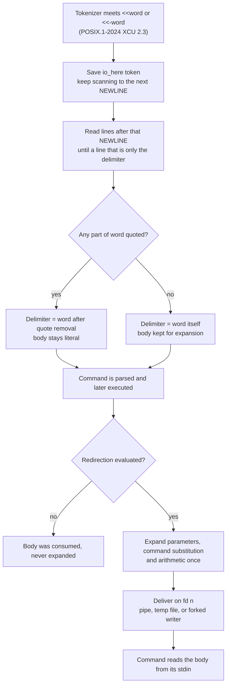

# Here Documents

> [!summary] Claim
> A here-document is the run of lines after the next newline, up to a line holding only the delimiter, which the shell expands once when the redirection is evaluated (unless the delimiter word is quoted) and hands to the command on a descriptor whose type - pipe, temporary file, or forked writer - the standard leaves to the implementation.

Part of [The POSIX Shell Language](README.md) in [Shell and Unix Engineering](../README.md).

## TL;DR

- Mechanism: on `<<word` the tokenizer saves the operator, reads the following lines up to a line that is exactly the delimiter, and when the redirection is evaluated expands the body and feeds it to the command's descriptor 0 (or `n` in `n<<word`).
- Rule: any quoting in `word` makes the body literal and the delimiter the unquoted text; otherwise `$`, `` ` `` and `\` are live, `"` and `'` are not, and `<<-` strips leading tabs (never spaces) from body lines and the delimiter line (POSIX.1-2024 XCU 2.7.4).
- Trap: a command inside a loop that reads standard input from the here-document eats the rest of it, and an unquoted body is code, not data, when it holds untrusted text.
- Portability: the delimiter, expansion and tab rules agreed in every shell measured in the matrix; shells differ on an unterminated body, on `<<<`, on `)` in a body inside `$(...)`, on the descriptor type, and on reading ahead when the script itself arrives on standard input.
- When not to use it: for large or binary payloads, for templates filled from untrusted values, or when a file or `printf '%s\n'` states the intent more plainly.

## Mental model



Reading the arrows: the tokenizer does not stop at the end of the line that carries `<<word`; it finishes that line, remembers the operator, and only then reads the body lines, which is why several operators on one line take their bodies in order (the top three boxes).
Quoting in `word` is decided at parse time and fixes both the delimiter text and whether the body will ever be expanded (the first diamond).
Expansion is not a parse-time act: it happens when the redirection is evaluated, so a redirection that never runs leaves its body unexpanded, and a redirection attached to a function or a loop is evaluated when that function is called or that loop is entered (the second diamond).
Last, the shell must put the text somewhere a command can read it, and the standard does not say where: the lab measured a pipe in some shells and a temporary file in others, and the dash and BusyBox ash sources show a third design, a pipe fed by a forked child for a large body.

## How it works

**The specification.**
`[n]<<word` and `[n]<<-word` redirect the lines the shell reads next to the command's input; the body "shall be treated as a single word that begins after the next NEWLINE token and continues until there is a line containing only the delimiter and a newline, with no blank characters in between" (POSIX.1-2024 XCU 2.7.4).
If any part of `word` is quoted, the delimiter is `word` after quote removal and "the here-document lines shall not be expanded"; otherwise the delimiter is the word itself, backslash-newline is removed while searching for the delimiter, and every line is expanded for parameters, command substitution and arithmetic "when the redirection operator is evaluated but after the trailing delimiter for the here-document has been located" (POSIX.1-2024 XCU 2.7.4).
Backslash behaves as inside double quotes, but the double quote itself is not special in the body, except inside `$()`, backquotes and `${}` (POSIX.1-2024 XCU 2.7.4).
The rationale adds that tilde expansion is not performed in a here-document because the data is treated as if enclosed in double quotes (POSIX.1-2024 XCU rationale C.2.7 Redirection).
For `<<-`, "all leading tab characters" are stripped after backslash-newline removal and from the delimiter line, and "stripping of leading tab characters shall occur as the here-document is read from the shell input", so tabs produced by an expansion survive (POSIX.1-2024 XCU 2.7.4).
Two operators on one line take their bodies in order of appearance, and the second body starts on the line after the first delimiter (POSIX.1-2024 XCU 2.3).
Whether the descriptor is a regular file or another type is unspecified, so portable code must not seek on it (POSIX.1-2024 XCU 2.7.4).
End of input before the delimiter is a redirection error that a shell "should, but need not" report; the rationale records that historical shells silently closed the document and that some implementations now report a syntax error (POSIX.1-2024 XCU 2.7.4 and rationale C.2.7.4).

**The lexical half.**
Token recognition has two modes, ordinary tokens and here-document bodies; non-newline tokens found while looking for the next newline are saved and processed after the body is parsed (POSIX.1-2024 XCU 2.3).
Inside `$(...)` and backquotes an `io_here` is parsed by the same rules, and if the closing `)` comes before the newline that starts the body the behavior is unspecified (POSIX.1-2024 XCU 2.3).
That is why the portability table has a row about `)` inside a body nested in `$(...)`: a shell that scans for the matching parenthesis without understanding the body mis-parses it.

**The evaluation half.**
Expansion is a runtime step.
bash-5.3 `heredoc_expand` returns the body untouched when the word carries `W_QUOTED`, and otherwise runs `expand_string_to_string (..., Q_HERE_DOCUMENT)` (bash-5.3 redir.c, `heredoc_expand`).
dash expands with `expandarg (redir->nhere.doc, NULL, EXP_QUOTED)` only for the node type `NXHERE`, the unquoted form (dash git master src/redir.c, `openhere`).
yash expands with `expand_single (contents, TT_NONE, Q_INDQ, ES_NONE)` before delivery (yash master redir.c, `open_heredocument`).
The lab shows the consequences: a body on `false && cat <<EOF` is read and discarded without running its `$(touch skipped)`, a body on a function definition is re-expanded at every call, and a body on a `while` loop is expanded once for all iterations.

**Delivery to a descriptor.**
Every implementation whose source was read here (bash, dash, BusyBox ash, yash, zsh) holds the whole expanded body in memory first, then picks a conduit; the differences are the part to know.
- bash 5.1 and later: if the expanded body fits the pipe capacity measured at build time and `F_GETPIPE_SZ` agrees, bash writes it into a fresh `pipe(2)` and returns the read end; otherwise it creates a temporary file with `sh_mktmpfd`, writes the body, reopens it read-only, and `unlink`s it so it has no name (bash-5.3 redir.c, `here_document_to_fd`).
  An empty body is delivered as `/dev/null`, and `shell_compatibility_level <= 50` forces the temporary file (bash-5.3 redir.c, `here_document_to_fd`).
  bash's CHANGES file lists the pipe path among the bash-5.1-alpha changes ("Here documents and here strings now use pipes for the expanded document if it's smaller than the pipe buffer size, reverting to temporary files if it's larger") and the compatibility rule among the bash-5.2-rc1 changes ("Here-documents and here-strings use tempfiles if the shell compatibility level is 50 or lower") (bash-5.3 CHANGES).
- bash before 5.1 (the matrix ran 3.2 and 4.4; bash 5.0 was not run, and its place in this group comes from the CHANGES file, not from a measurement), zsh, ksh93 and mksh and posh: a temporary file in every case the lab measured.
  zsh's source shows why: it turns a here-document into a here-string and calls `gettempfile`, writes, reopens read-only and `unlink`s (zsh Src/parse.c, `setheredoc`, which tags the redirection as coming from a here-document; zsh Src/exec.c, `getherestr`).
- dash and BusyBox ash: a pipe.
  Both write short bodies straight into the pipe; a body longer than `PIPE_BUF` is written by a forked child, so the parent never blocks, and the child resets `SIGPIPE` to default so it dies if the command stops reading (BusyBox ash.c, `openhere`; dash git master src/redir.c, `openhere`).
  Since dash 0.5.13 (release tarball dated 2025-09-21) `openhere` asks `sh_pipe` for a `memfd_create` descriptor when the body exceeds `PIPE_BUF`, writes the body into it and rewinds it, falling back to the forked writer only when that call fails or the build lacks it; the 0.5.12 tarball has no `memfd_create` at all (dash 0.5.12 and 0.5.13 src/redir.c, `sh_pipe`; dash git master src/redir.c).
  dash 0.5.12 on Debian and Alpine and the Apple dash-16 on the host each delivered a 300000-byte body through a pipe on every repeated run (as of 2026-10).
- yash: a pipe when the body is at most `PIPE_BUF`, otherwise an unlinked temporary file (yash master redir.c, `open_herestring`).

**Why the conduit matters.**
A pipe has a capacity, so a shell that wrote a large body into it synchronously and then waited for the command would deadlock when the command never reads; that is the reason for the forked writer in dash and BusyBox and for the file path in bash, and the lab's never-read 400000-byte case proves none of the shells blocks.
A temporary file needs a writable temporary directory: zsh with an unusable `TMPPREFIX` fails even for a one-line body, while every other shell measured succeeded with `TMPDIR` pointing at a missing directory (lab, `zsh needs a writable temporary directory`).
dash, BusyBox ash, yash and bash 5.1+ do not touch the disk for short bodies at all (their sources, cited above).

**Where the shell reads from.**
When the shell's own script comes from standard input, POSIX says the shell "shall not read ahead in such a manner that any characters intended to be read by the invoked command are consumed by the shell" (POSIX.1-2024 XCU sh, STDIN).
dash and BusyBox ash read ahead; every other shell measured did not (lab, `a command in a script piped to sh`).

## Numbers and limits

| Quantity | Value | Source |
|---|---|---|
| Length of a body | No limit stated; "input lines can be of unlimited length" | POSIX.1-2024 XCU 2.3 |
| Largest body delivered intact in the lab | 300000 bytes (7500 lines of 40 bytes), every shell, quoted and unquoted | lab `heredoc-kind.sh` |
| Body never read by the command, no hang | 400000 bytes | lab `a large here-document does not block` |
| Linux pipe capacity | 16 pages, 65536 bytes with 4096-byte pages, since Linux 2.6.11; adjustable with `F_GETPIPE_SZ` and `F_SETPIPE_SZ` since Linux 2.6.35 (as of 2026-10) | pipe(7) |
| `PIPE_BUF`, the atomic-write bound that dash, BusyBox ash and yash use as their switch point | 4096 on Linux with glibc and musl, 512 on macOS | measured in the shell matrix |
| bash 5.3 switch point | build-time pipe capacity, and no larger than what `F_GETPIPE_SZ` reports | bash-5.3 redir.c, `here_document_to_fd` |
| Descriptor type at 400 bytes | pipe: bash 5.1+, dash, BusyBox ash, yash; file: bash 3.2 and 4.4, zsh, ksh93, mksh, posh | lab `heredoc-kind.sh` |
| Descriptor type at 300000 bytes | pipe: dash (0.5.12 and Apple dash-16), BusyBox 1.37; file: bash, zsh, ksh93, mksh, posh, yash | lab `heredoc-kind.sh` |
| Leading tab characters stripped by `<<-` | all of them, only tabs | POSIX.1-2024 XCU 2.7.4, lab |
| Bash compatibility level that forces a temporary file | 50 or lower | bash-5.3 redir.c |

## Portability

All rows below were run in the lab matrix on 2026-10-28: the macOS host (`/bin/sh` and `/bin/bash` are bash 3.2.57, `bash` is 5.3, `/bin/ksh` is ksh93u+ 2012, zsh 5.9, dash), Debian 13 (dash 0.5.12, bash 5.2, zsh, ksh93u+m 1.0.10, mksh, posh 0.14.1, BusyBox ash) and Alpine 3.22 (BusyBox ash 1.37.0, dash 0.5.12, zsh 5.9, mksh R59, yash 2.58.1, bash 3.2, 4.4, 5.1, 5.2, 5.3).
Every cell is asserted by a test in the lab; every shell passed all 31 tests.
The unquoted and quoted delimiter rules, the backslash rules, the `<<-` tab rules, the delimiter-must-be-alone rule, the ordering of two operators, the function and loop timing, and the loop-in-current-shell rule were identical in all of them, so they have no column.

| Shell | Unterminated body at end of input | `<<<` here-string | `)` in a body inside `$(...)` | Descriptor at 400 B / 300000 B | Reads ahead of a script on stdin |
|---|---|---|---|---|---|
| POSIX sh (specification) | "should, but need not" report an error | not defined in chapter 2 | unspecified if `)` precedes the body's newline | unspecified | must not |
| bash 3.2 (macOS `/bin/sh` and `/bin/bash`, Alpine) | accepted, no warning | works | parse error | file / file | no |
| bash 4.4 | accepted, warns on stderr | works | works | file / file | no |
| bash 5.1 to 5.3 | accepted, warns on stderr | works | works | pipe / file | no |
| zsh native | accepted, silent | works | works | file / file | no |
| zsh `--emulate sh` | same as native | same | same | same | no |
| dash (0.5.12 on Debian and Alpine, Apple dash-16 on the host) | accepted, silent | syntax error | works | pipe / pipe | yes |
| ksh93 (2012 and u+m) | accepted, silent | works | works | file / file | no |
| mksh | error, status 1, earlier commands ran | works | works | file / file | no |
| yash 2.58.1 | error, status 2, earlier commands ran | works | works | pipe / file | no |
| posh 0.14.1 | error, status 1, earlier commands ran | syntax error | parse error | file / file | no |
| BusyBox ash 1.37.0 | accepted, silent | syntax error | works | pipe / pipe | yes |

Utilities: the lab uses `cat`, `cksum`, `awk`, `tr` and `wc` only as consumers or generators, and a here-document is shell syntax that no utility changes, so GNU, BSD and macOS, BusyBox and uutils variants need no column.
An expansion error in a body (`${u?boom}`) fails the command in every shell, but only yash also exits the shell (status 2); the others print the error and run the next command, although POSIX lists an expansion error as "shall exit" for a non-interactive shell (POSIX.1-2024 XCU 2.8.1), so the table reflects how those shells classify a failing redirection.

## Worked example

The lab is [lab](../labs/03-here-documents/).
`read-loop.sh` is the loop-and-stdin trap; this is the whole file, byte for byte.

```sh
#!/bin/sh
# read-loop: a while-read loop fed by a here-document, with and without a command inside the
# loop that also reads standard input. /bin/cat is external, so it really is a second reader.
# Usage: read-loop.sh eat|guarded
# Prints one "got LINE" per iteration and a final "n=COUNT" taken after the loop, which shows
# that a loop fed by a here-document runs in the current shell.
mode=${1:?usage: read-loop.sh eat|guarded}
n=0
case $mode in
  eat)
    while read -r line; do
      /bin/cat >/dev/null
      n=$((n + 1))
      echo "got $line"
    done <<EOF
a
b
c
EOF
    ;;
  guarded)
    while read -r line; do
      /bin/cat >/dev/null </dev/null
      n=$((n + 1))
      echo "got $line"
    done <<EOF
a
b
c
EOF
    ;;
  *)
    echo "read-loop.sh: unknown mode: $mode" >&2
    exit 2
    ;;
esac
echo "n=$n"
```

Output, identical in all 30 shell configurations of the matrix:

```text
$ read-loop.sh eat
got a
n=1
$ read-loop.sh guarded
got a
got b
got c
n=3
```

In `eat`, `read` takes the line `a`, the external `cat` drains the remaining `b` and `c` from the shared descriptor, and the loop ends after one pass; the variable is still set afterward because a loop with a redirection is not a subshell.
In `guarded`, `</dev/null` on the inner command leaves the here-document to `read`.

`heredoc-kind.sh` measures the conduit and the integrity of the bytes.
It generates a script that holds an N-line body, runs it with `.`, and inside the redirected command tests `/dev/stdin` with `-p` and `-f` and counts the bytes and CRC with `cksum`; the same body is also piped straight into `cksum` for the expected value.
Simplified excerpt of the generator:

```sh
printf '{ if [ -p /dev/stdin ]; then k=pipe; elif [ -f /dev/stdin ]; then k=file; else k=other; fi; printf "%%s " "$k"; cksum; } <<%s\n' "$delim"
body
printf 'EOF\n'
```

Captured output (macOS host, 2026-10-27):

```text
$ bash heredoc-kind.sh 10      # bash 5.3
kind=pipe delivered=611083314 400 expected=611083314 400
$ bash heredoc-kind.sh 7500
kind=file delivered=1910768783 300000 expected=1910768783 300000
$ dash heredoc-kind.sh 7500
kind=pipe delivered=1910768783 300000 expected=1910768783 300000
$ zsh heredoc-kind.sh 10
kind=file delivered=611083314 400 expected=611083314 400
```

Run the whole suite under any shell in the matrix:

```sh
LAB_SHELL=dash bats labs/03-here-documents/here-documents.bats
```

## Pitfalls

> [!warning] A reader inside the loop eats the here-document
> Trigger: `while read host; do ssh "$host" cmd; done <<EOF` or any command inside the loop that reads standard input (`ssh`, `cat`, `mysql`, `apt`).
> Symptom: only the first iteration runs; the command swallows the remaining lines of the body, and no error is printed.
> Fix: give the inner command its own input (`</dev/null`, or `ssh -n`), or read the body from another descriptor with `read -u` where available or `while read -r line <&3; ...; done 3<<EOF`.
> The lab's `eat` mode shows `got a` and `n=1`; `guarded` shows all three lines (lab `a command in the loop that reads standard input`).

> [!warning] `sh <<EOF` is not the same program in dash and BusyBox ash
> Trigger: `printf 'cat\nhello\nworld\n' | sh`, or `sh <<'EOF'` followed by a script whose commands read stdin, with `sh` being dash or BusyBox ash.
> Symptom: in conforming shells `cat` prints `hello` and `world`; in dash and BusyBox ash the shell has already read the whole input, so `cat` sees nothing and the shell then tries to run `hello` and `world` as commands (`hello: not found`).
> Fix: pass the script as a file or with `-c`, or avoid stdin consumers inside it.
> POSIX requires the conforming behavior (POSIX.1-2024 XCU sh, STDIN); the lab asserts the split by family.

> [!warning] Space indentation under `<<-`
> Trigger: indenting the body or the delimiter with spaces under `<<-EOF` because the editor expands tabs.
> Symptom: the leading spaces survive in the body, and the delimiter line ` EOF` is not recognized, so the body runs to the end of the file; bash 4.4 and later warn that the document was delimited by end-of-file, mksh, posh and yash stop with a syntax error, and bash 3.2, dash, zsh, ksh93 and BusyBox ash accept it silently and swallow the rest of the script into the body.
> Fix: indent `<<-` bodies and delimiters with real tabs only (`.editorconfig` with `indent_style = tab` for those files), or avoid `<<-`.
> The lab proves the delimiter-alone rule with a leading and a trailing space, and the end-of-input divergence per family.

> [!warning] An unquoted delimiter makes the body code
> Trigger: `cat > file <<EOF` for a config, SQL or shell fragment that contains `$`, `` ` `` or `\`.
> Symptom: variables and substitutions run at write time and the file holds their values, or the command substitution runs with the script's authority.
> Fix: quote the delimiter (`<<'EOF'`) when the body is data, and use `printf '%s\n'` with arguments when only a few values vary; any quoting of the word counts (`<<\EOF`, `<<"EOF"`, `<<E"O"F`), and the lab proves all four spellings.

> [!warning] A close parenthesis in a body nested in `$(...)`
> Trigger: `x=$(cat <<EOF` with a body line such as `a ) b`, run by bash 3.2 (macOS `/bin/sh` and `/bin/bash`) or posh.
> Symptom: a parse error, or the rest of the script is read as part of the substitution, because the shell closes the substitution at the first `)` it sees.
> Fix: keep the here-document out of the substitution (write it to a file or a variable first), or avoid bare parentheses in such bodies on those shells.
> POSIX leaves the case where the `)` precedes the body's newline unspecified (POSIX.1-2024 XCU 2.3); the lab asserts the split by family and version.

> [!warning] Expansion time is the evaluation of the redirection
> Trigger: expecting a body to be expanded where it is written.
> Symptom: `f() { cat; } <<EOF` with `fn:$x` prints the current `x` at each call, not the value at definition; `false && cmd <<EOF` never expands its body, so a `$(touch ...)` in it never runs; a `while` loop with the document expands it once, so a counter in it does not advance per iteration.
> Fix: put the redirection inside the function body when you want a snapshot per call, and compute per-iteration text inside the loop.
> The lab asserts all three.

> [!warning] Tabs from an expansion survive `<<-`
> Trigger: relying on `<<-` to remove tabs that a variable or command substitution inserts.
> Symptom: the tab remains because stripping happens while the shell reads the lines, before expansion (POSIX.1-2024 XCU 2.7.4).
> Fix: strip the value before it is interpolated.

## Security and robustness

**Injection.**
An unquoted body is a double-quoted string that the shell evaluates, so interpolating untrusted text lets that text run `$(...)` or backquotes.
CVE-2026-44115 describes an exec allowlist analysis in OpenClaw before 2026.4.22 that let "shell expansion hiding in unquoted heredoc bodies" bypass validation, so unapproved commands ran at runtime (CVE-2026-44115, NVD record).
CVE-2026-34152 describes Coolify before 4.0.0-beta.471 sending single-quote-escaped commands over an SSH heredoc transport that preserved newlines, which let an authenticated user inject further shell statements on the remote server (CVE-2026-34152, NVD record).
The defensive rule is a quoted delimiter plus data passed out of band: environment variables, arguments, or a file, never string interpolation into script text.
A delimiter that could occur in the data is itself an injection channel, so generated delimiters need a random component.

**Temporary files.**
CVE-2000-1134 records that tcsh, csh, sh and bash of that era followed symlinks when creating the file behind `<<`, so local users could overwrite other users' files (CVE-2000-1134, NVD record).
Current bash creates the file with `sh_mktmpfd` using random names in the temporary directory, forces mode `0600`, marks it close-on-exec, reopens it, and `unlink`s it, and its source carries an optional paranoid check that both descriptors are the same regular file (bash-5.3 redir.c, `here_document_to_fd`).
Pipe delivery avoids the filesystem altogether for short bodies in bash 5.1 and later, dash, BusyBox ash and yash.

**Robustness.**
- Disk and directory: a shell that uses temporary files fails the redirection when it cannot create one; with `TMPDIR` and `TMPPREFIX` pointing at a missing directory, zsh prints `can't create temp file for here document` and does not run the command, while bash 3.2 and 4.4, ksh93, mksh and posh still succeeded (lab).
- Blocking: no shell tested blocks when the command ignores a body that is much larger than any pipe (lab, 400000 bytes).
- Truncation: every shell delivered every byte of 40 to 300000 bytes, so a here-document is safe for big text and unsafe only for performance, because the shell holds the expanded body in memory (lab for the byte counts; the bash, dash, BusyBox ash, yash and zsh sources for the memory).
- Reading ahead: shells that read ahead on a stdin script (dash, BusyBox ash) change what a stdin consumer sees (lab).
- Portability debt: `<<<` is not in POSIX.1-2024 chapter 2 and is a syntax error in dash, posh and BusyBox ash, so `#!/bin/sh` scripts must use `printf '%s\n' "$x" |` or a here-document instead.

## The principal's view

Use a here-document for fixed multi-line text with a quoted delimiter: usage messages, SQL, config fragments, and input for tools like `ed`, `ftp` or `sqlite3` where the text is the program.
Use an unquoted delimiter only when you mean the shell to be the template engine, and then treat every interpolated value as already trusted.
The trade-off is readability and a single-process, no-temp-file story for short bodies against three costs: the body is code when unquoted, the conduit varies by shell, and `<<-` depends on tabs that editors rewrite.
For untrusted values, pass them as arguments or environment variables and keep the script text constant; for large or binary data, stream from a file or a pipe instead of expanding it into shell memory; for structured output (JSON, YAML, XML) use a real serializer in a language that has one.
At the scale of a service fleet, a here-document is almost never what should carry a command's input across a trust boundary, and the CVEs above are the evidence: a reviewer should treat every unquoted `<<EOF` that contains `$` as a code-execution site.
If a script must also run under macOS `/bin/sh` or dash, test it there, because the table's differences (a `)` inside `$(...)`, read-ahead, `<<<`) fail only on those shells.

## Interview questions

> [!question] L5: What is the difference between `cat <<EOF` and `cat <<'EOF'`?
>
> > [!success]- Answer
> > With an unquoted delimiter the shell expands parameters, command substitutions and arithmetic in the body, and treats backslash as in double quotes.
> > With any quoting in the delimiter word, the body is literal and the delimiter is the word after quote removal.
> > `<<\EOF`, `<<"EOF"` and `<<E"O"F` all count as quoted, and the lab proves each.
> >
> > Follow-up: Is the tilde expanded in either form?

> [!question] L5: What does `<<-` strip, and what does it not strip?
>
> > [!success]- Answer
> > It strips all leading tab characters from body lines and from the delimiter line, and nothing else.
> > It does not strip spaces, so a space-indented delimiter is not recognized.
> > It strips as the lines are read, so a tab that an expansion inserts is kept.
> >
> > Follow-up: Why does the delimiter match after tabs are stripped but not after spaces?

> [!question] L5: Predict the output of this script.
>
> ```sh
> x=1
> f() { cat; } <<EOF
> fn:$x
> EOF
> f; x=2; f
> false && cat <<EOF
> $(echo ran >&2)
> EOF
> echo done
> ```
>
> > [!success]- Answer
> > It prints `fn:1`, `fn:2`, and `done`, and nothing on standard error.
> > The redirection on the function definition is evaluated at each call, so the body is expanded each time with the current `x`.
> > The redirection on the `false &&` line is never evaluated, so its body is read and discarded, and the command substitution never runs.
> >
> > Follow-up: What changes if the first line were `f() { cat <<EOF` with the here-document inside the braces?

> [!question] L6: Debug this script, which processes only the first host.
>
> ```sh
> while read -r host; do
>   ssh "$host" uptime
> done <<EOF
> web1
> web2
> web3
> EOF
> ```
>
> > [!success]- Answer
> > `ssh` reads standard input, which is the here-document, so it consumes `web2` and `web3` after `read` took `web1`.
> > The lab reproduces it with an external `cat` standing in for `ssh`: `got a` and `n=1`, against three iterations with `</dev/null`.
> > Fix it with `ssh -n "$host" uptime` or `ssh "$host" uptime </dev/null`, or read the list on a separate descriptor.
> >
> > Follow-up: Why does the variable set inside this loop still hold its value after `done`, while a `cmd | while read` loop may lose it?

> [!question] L6: Where does the shell put the body so a command can read it?
>
> > [!success]- Answer
> > POSIX leaves the type of the descriptor unspecified, so the shell chooses.
> > bash 5.1 and later use a pipe when the body fits the pipe capacity and an unlinked temporary file otherwise; bash before 5.1, zsh, ksh93, mksh and posh use a temporary file; dash and BusyBox ash use a pipe, with a forked writer for bodies above `PIPE_BUF` (dash 0.5.13 and later try a `memfd_create` descriptor there first); yash uses a pipe up to `PIPE_BUF` and a temporary file above.
> > The consequence is that a portable program must not seek on the descriptor, and that a shell without a writable temporary directory can fail even for a small body.
> >
> > Follow-up: Why would a shell that wrote a 1 MiB body into a pipe synchronously hang?

> [!question] L6: When two operators share a line, which body belongs to which?
>
> > [!success]- Answer
> > `cat <<A; cat <<B` reads the body for `A` first, from the line after the command line to the line `A`, and the body for `B` starts on the next line.
> > The same ordering applies to `{ cat <&4; cat <&3; } 3<<A 4<<B`: the bodies are read in operator order, and which command consumes which descriptor is independent of that order.
> > POSIX states this in XCU 2.3 and 2.7.4, and the lab asserts it in every shell.
> >
> > Follow-up: What happens if a saved token on the line contains a newline?

> [!question] L7+: Is a deployment tool that wraps user-supplied commands in `ssh host bash <<EOF ... EOF` after escaping single quotes safe?
>
> > [!success]- Answer
> > No: escaping quotes is the wrong layer when the transport is a here-document that preserves newlines and is, for an unquoted delimiter, expanded by the shell.
> > CVE-2026-34152 records this class of bug: newlines in a "single-quote escaped" command let an authenticated user append statements that run on the remote server.
> > The robust design quotes the delimiter, picks a delimiter that cannot occur in the data, and passes the user input as arguments or a file rather than interpolated script text.
> >
> > Follow-up: How do you choose a delimiter that cannot appear in the data?

> [!question] L7+: Why can the same pipeline behave differently under `sh` on Debian and on Alpine?
>
> > [!success]- Answer
> > Debian's `sh` is dash and Alpine's is BusyBox ash, and both read ahead on a script supplied on standard input, but they differ in other places (for example whether `$'...'` is supported), so a script that depends on a stdin consumer must be tested in each.
> > For here-documents specifically, both pass short bodies through a pipe and use a forked writer above `PIPE_BUF` (Debian 13 ships dash 0.5.12, before the `memfd_create` path of 0.5.13), so they agree on delivery but both break the POSIX no-read-ahead rule that bash, zsh, ksh93, mksh, posh and yash follow.
> > The conclusion is to write `#!/bin/sh` scripts that do not rely on a stdin consumer and to run the lab matrix before claiming portability.
> >
> > Follow-up: How would you detect read-ahead without a controlling terminal?

> [!question] L7+: What breaks when `<<<` appears in a `#!/bin/sh` script?
>
> > [!success]- Answer
> > `<<<` is not defined in POSIX.1-2024 chapter 2; it is a syntax error in dash, posh and BusyBox ash and works in bash, zsh, ksh93, mksh and yash.
> > A script tested on macOS (bash 3.2 as `sh`) or on a laptop with bash as `/bin/sh` will pass and then fail on Debian or Alpine containers.
> > Use `printf '%s\n' "$x" | cmd` or a here-document, noting that the pipeline form puts `cmd` in a subshell in some shells.
> >
> > Follow-up: What does the here-string append that `printf '%s' "$x" |` does not?

## Related

Prerequisites: [[Redirection-Order-and-Semantics]]

Next: [[Descriptor-Duplication-and-Closing]]

See also: [[Pipelines-Subshells-Redirection-and-Process-Substitution]], [[Token-Recognition]], [[Quoting-Backslash-Single-and-Double]], [[Command-Substitution]]

## Further reading

- POSIX.1-2024 XCU 2.7.4 Here-Document, 2.3 Token Recognition and 2.8.1 Consequences of Shell Errors - https://pubs.opengroup.org/onlinepubs/9799919799/utilities/V3_chap02.html - the normative text for delimiter, quoting, tab stripping, ordering and error consequences.
- POSIX.1-2024 `sh`, STDIN - https://pubs.opengroup.org/onlinepubs/9799919799/utilities/sh.html - the no-read-ahead requirement that dash and BusyBox ash do not meet.
- POSIX.1-2024 rationale, C.2.7 and C.2.7.4 - https://pubs.opengroup.org/onlinepubs/9799919799/xrat/V4_xcu_chap01.html - why tilde is not expanded in a body (C.2.7), and why an unterminated document is a mistake (C.2.7.4).
- bash-5.3 `redir.c` (`here_document_to_fd`, `heredoc_expand`) - https://ftpmirror.gnu.org/bash/bash-5.3.tar.gz - the pipe-or-temporary-file decision and the temporary-file hygiene.
- dash `src/redir.c` (`openhere`, `sh_pipe`) - https://git.kernel.org/pub/scm/utils/dash/dash.git/tree/src/redir.c - the forked-writer design, and the `memfd_create` path added in 0.5.13 (release tarballs at http://gondor.apana.org.au/~herbert/dash/files/).
- BusyBox `shell/ash.c` (`openhere`) - https://raw.githubusercontent.com/mirror/busybox/master/shell/ash.c - the same design in the Alpine shell.
- yash `redir.c` (`open_herestring`) and zsh `Src/exec.c` (`getherestr`) - https://raw.githubusercontent.com/magicant/yash/master/redir.c and https://raw.githubusercontent.com/zsh-users/zsh/master/Src/exec.c - the other two conduit choices.
- pipe(7) - https://man7.org/linux/man-pages/man7/pipe.7.html - pipe capacity and `PIPE_BUF` on Linux.
- CVE-2026-44115, CVE-2026-34152 and CVE-2000-1134 - https://nvd.nist.gov/vuln/detail/CVE-2026-44115 and the other two records - modern injection and old temporary-file incidents.
