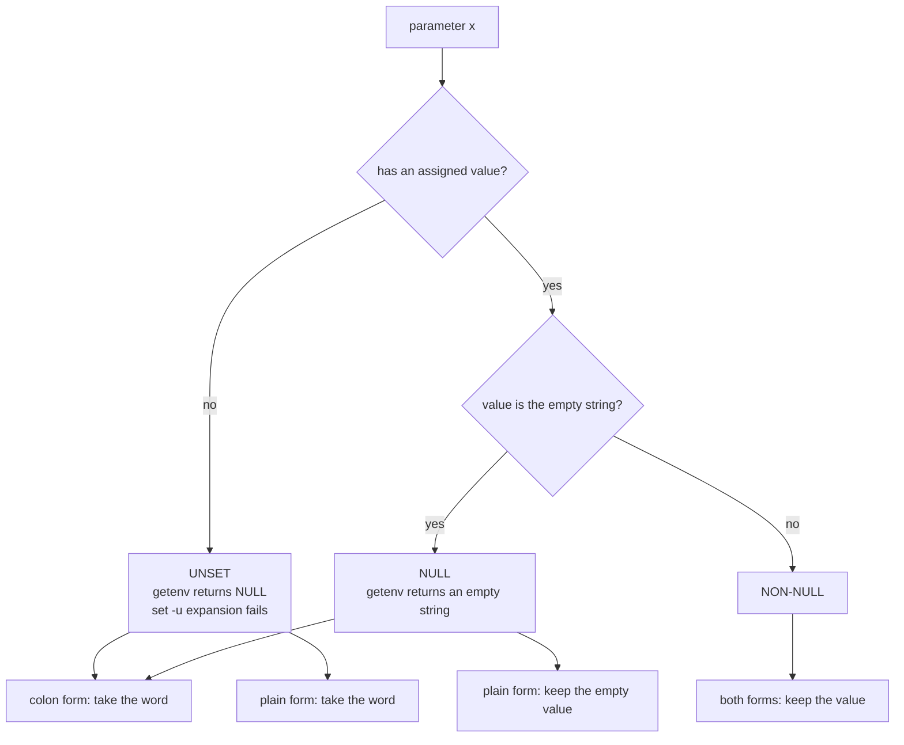

# Null versus Unset

> [!summary] Claim
> A shell parameter has three states, unset, null (set to the empty string) and non-null, and the colon in `${x:-w}`, `${x:=w}`, `${x:?w}` and `${x:+w}` decides whether null is treated like unset or like a value.

## TL;DR

- Mechanism: the shell keeps "has a value" and "the value is empty" as two separate facts, and each of the eight operators tests one or both of them (POSIX.1-2024 XCU 2.6.2).
- Rule: with the colon, null and unset behave alike; without the colon, only unset triggers the operator, and `${x+w}` is the one test that answers "is it set" whatever the value.
- Trap: `[ -z "$x" ]` and `${x:-w}` cannot tell the states apart, so `rm -rf "$dir/"*` with `dir` empty or unset becomes `rm -rf /*`, and `set -u` guards only the unset half.
- Portability: the eight-operator table is identical in every shell measured in the shell matrix; the differences are at the edges (exit status of `${x:?}`, `set -u` in arithmetic, `export x` in native zsh, assignment to `$1`).
- When not to use it: when absence and emptiness must mean different things in a data format, use a real type or an explicit flag, because an environment variable can only say "absent" or "a string".

## Mental model



A parameter first passes the "is it set" gate, which only a never-assigned name or an `unset` leaves closed.
A set parameter then passes a second gate, "is the value empty", and this second gate is the only thing the colon adds.
The colon forms treat both the unset box and the null box as "missing" and take the word, while the plain forms treat only the unset box as missing and let a null value pass through unchanged.
The non-null box is never touched except by `${x:+w}` and `${x+w}`, which swap the value for the word.

## How it works

Specification.
A parameter is set if it has an assigned value, and null is a valid value (POSIX.1-2024 XCU 2.5).
Once a variable is set, only the `unset` special built-in makes it unset (POSIX.1-2024 XCU 2.5), and `VARIABLE=` is not an unset (POSIX.1-2024 XCU 2.15, unset).
The four modifiers in XCU 2.6.2 each come in a colon and a plain form: use of the colon "shall result in a test for a parameter that is unset or null", and its omission "shall result in a test for a parameter that is only unset".
The specification's own table gives, for the three states in turn:

| Form | non-null | null | unset |
|---|---|---|---|
| `${x:-w}` | value | w | w |
| `${x-w}` | value | empty | w |
| `${x:=w}` | value | assign w | assign w |
| `${x=w}` | value | empty | assign w |
| `${x:?w}` | value | error, exit | error, exit |
| `${x?w}` | value | empty | error, exit |
| `${x:+w}` | w | empty | empty |
| `${x+w}` | w | w | empty |

The word is expanded only "in each case that a value of word is needed", so `${x:-$(slow)}` runs `slow` only when x is missing.
`${x:=w}` assigns only to variables, not to positional or special parameters.
`${x:?w}` writes the word, or a default message, to standard error and the shell "exits with a non-zero exit status"; an interactive shell need not exit.

`set -u` adds a third reading of unset.
When the shell tries to expand "in a parameter expansion or an arithmetic expansion, an unset parameter other than the '@' and '*' special parameters", it writes a message and the expansion fails (POSIX.1-2024 XCU 2.15, set, option `-u`).
The specification also says `${#x}` and the four pattern-removal forms fail for an unset parameter under `-u`.
The default and alternative forms are not errors, because they are the way to ask the question safely.

Implementation, dash.
The parser records the colon as the flag `VSNUL` on the expansion (dash-0.5.12 parser.c, the `case ':'` that sets `subtype = VSNUL`).
`evalvar` calls `varvalue`, which returns -1 when `lookupvar` finds no variable and otherwise the length of the value; then `if (varflags & VSNUL) varlen--;` turns a length of 0 into -1, so a null value is folded into the unset case (dash-0.5.12 expand.c, `evalvar`, `varvalue`).
After that the code derives one flag, `discard = varlen < 0 ? EXP_DISCARD : 0`, and the switch on the operator consults only that flag, which is why the colon costs one decrement and why one code path serves both forms.
The `-u` check is a separate test, `if ((discard & ~flag) && uflag) varunset(...)`, reached only by plain, length and pattern-removal expansions (dash-0.5.12 expand.c, `evalvar`).

Implementation, bash.
`parameter_brace_expand` sets `check_nullness` when it sees the colon, then computes `var_is_set = temp != 0` and `var_is_null = check_nullness && (var_is_set == 0 || *temp == 0)`; the branch shared by `-`, `=`, `?` and `+` tests `var_is_set && var_is_null == 0` to choose between the value and the word (inverted for `+`), and `:?` reports through `parameter_brace_expand_error`, which prints "parameter null or not set" when `check_null` is nonzero and "parameter not set" otherwise (bash-5.3 subst.c, `parameter_brace_expand`, `parameter_brace_expand_error`).
The `-u` error comes from a different branch guarded by `unbound_vars_is_error` (bash-5.3 subst.c, `parameter_brace_expand`).

The process boundary.
The environment is an array of `name=value` strings passed to `execve(2)` as `envp`, terminated by a null pointer (execve(2)); a name with an empty value is the string `name=`, and an unset name is no string at all.
`getenv` returns a null pointer when the name "cannot be found" and a pointer to an empty string for `name=` (POSIX.1-2024 getenv), and a shell initializes its variables from the environment, marking them exported at once (POSIX.1-2024 XCU 2.5.3).
So the null/unset distinction survives `exec`, which is why a C program can ask `getenv("X") == NULL` and a shell child can ask `${X+set}`, and why the lab compiles a four-line `getenv` helper to prove it.
POSIX `env` has `name=value` operands and `-i` but no way to remove one variable; `env -u` is an extension (POSIX.1-2024 env).

## Numbers and limits

| Quantity | Value | Source |
|---|---|---|
| Operators | 8 (4 modifiers x colon or plain) | POSIX.1-2024 XCU 2.6.2 |
| States tested per operator | 3 (unset, null, non-null), 24 cells in all | lab `table` mode |
| Shell runs where all 24 cells agree with POSIX | 30 of 30 (8 on the macOS host, 13 in Alpine 3.22, 9 in Debian 13) | lab, measured 2026-10-26 |
| `${x:?}` exit status of the failed shell | 2 in dash, BusyBox ash and yash; 1 in bash, zsh, mksh, posh and ksh93 for a script file; bash alone gives 127 under `bash -c` | lab `error` mode and `sh -c` test, measured 2026-10-26; bash-5.3 shell.c `run_one_command` |
| Environment plus arguments limit | `ARG_MAX` is 1048576 on macOS and 2097152 on Debian 13 with an 8192 KiB stack | `getconf ARG_MAX`, measured 2026-10-26 |
| Error from `execve` when too large | `E2BIG`, and each string counts its terminating null byte | execve(2) |
| Bytes in a value | any except the null byte | POSIX.1-2024 XBD 8.1 |

An empty value costs one byte in the environment (the terminating null) plus the name and `=`, so a null variable is not free against `ARG_MAX`.

## Portability

All rows agree on the eight-operator table, on `${x+w}` telling null from unset, on the `${x:?}` failure naming the variable, on `unset` of an unset name returning 0, and on a child process seeing an exported null variable as an empty string.
The columns below are the measured differences (lab, 2026-10-26; "fails" means the shell prints a diagnostic and the command does not run).

| Shell | `export x` alone leaves x | `${x:?}` exit status | `set -u`: `$((u))` | `set -u`: `${u%x}` | `set -u`: `$1` | `${1:=w}` |
|---|---|---|---|---|---|---|
| POSIX sh (specification) | unset with the export attribute (`export -p` prints it as `export x`) | non-zero | fails | fails | fails | not allowed (variables only) |
| macOS bash 3.2 (also `/bin/sh`) | unset | 1 (127 under `-c`) | passes | passes | fails | fails |
| bash 4.4 to 5.3 | unset | 1 (127 under `-c`) | fails | fails | fails | fails |
| zsh native | null | 1 | fails | fails | fails | assigns |
| zsh `--emulate sh` | unset | 1 | fails | fails | fails | assigns |
| dash 0.5.12 | unset | 2 | passes | fails | fails | fails |
| ksh93u+m 1.0.10 | unset | 1 | fails | fails | fails | fails |
| ksh93u+ 2012 (macOS `/bin/ksh`) | unset | 1 | fails | fails | passes | fails |
| mksh R59 | unset | 1 | passes | fails | fails | fails |
| yash 2.58.1 | unset | 2 | fails | fails | fails | fails |
| posh 0.14.1 | unset | 1 | fails | fails | fails | fails |
| BusyBox ash 1.37.0 | unset | 2 | passes | fails | fails | fails |

Further measured facts.
Native zsh does not field split `$x`, so `unset IFS; set -- $v` gives one word there and two in every other row; `zsh --emulate sh` splits.
posh 0.14.1 also aborts on an empty `"$@"` and `"$*"` under `set -u`, although the specification exempts them, so pass `${1+"$@"}` in scripts that use `-u`.
GNU, BSD and macOS, BusyBox and uutils `env`: POSIX only defines `-i` and `name=value`, so a script that must remove a variable should `unset` it in the shell that then runs the command; `env -u` is an extension that this lab does not exercise, although GNU coreutils 9.7 `env` (Debian 13), BusyBox 1.37.0 `env` and macOS `/usr/bin/env` all accepted `env -u NAME` when run by hand on 2026-10-26, and uutils `env` defines `-u` and `--unset` in its `env.rs`.

## Worked example

The lab is [lab](../labs/03-null-versus-unset/): `probe.sh` prints the facts and `null-versus-unset.bats` asserts them under the shell in `LAB_SHELL`, with a four-line C program `getenv.c` for the process boundary.
This is a simplified excerpt of the `table` mode (the real mode also covers `:?` and `?` in a command substitution so the error does not end the probe):

```sh
for st in unset null set; do
  for op in ':-' '-' ':=' '=' ':+' '+'; do
    put "$st"                        # unset x, x=, or x=v
    eval 'r=${x'"$op"'W}'            # r receives the expansion
    printf '%s ${x%sW} -> result=<%s> x=' "$st" "$op" "$r"
    show                             # <unset>, <> or <value>
    printf '\n'
  done
done
```

Expected output (the first six lines; the bats test asserts all 24 and they are identical in all 30 shell runs of the matrix):

```text
unset ${x:-W} -> result=<W> x=<unset>
unset ${x-W} -> result=<W> x=<unset>
unset ${x:=W} -> result=<W> x=<W>
unset ${x=W} -> result=<W> x=<W>
unset ${x:+W} -> result=<> x=<unset>
unset ${x+W} -> result=<> x=<unset>
```

Note that the null block shows the whole point:

```text
null ${x:-W} -> result=<W> x=<>
null ${x-W} -> result=<> x=<>
null ${x+W} -> result=<W> x=<>
```

The `environ` mode crosses the exec boundary with the `getenv` helper:

```text
unset-var child: NULL
unexported-null child: NULL
exported-null child: ""
exported-null-in-env: 1
after-unset child: NULL
prefix-assignment child: ""
```

and the `error` mode shows the exit status that differs: `probe.sh error colon-unset` prints `x: missing` and exits 1 under bash and 2 under dash, and never prints `reached`.
The same failure in a `-c` string exits 127 under bash, because `run_one_command` in bash-5.3 shell.c maps the `FORCE_EOF` jump that the expansion error takes to 127; the lab asserts this in its `sh -c` test.
Running `bats` with `LAB_SHELL` set to each shell, 14 tests passed in all 30 shell runs: 13 in the Alpine 3.22 image, 9 in the Debian 13 image, and 8 on the macOS host (`sh` and `bash`, both bash 5.3 from Nix there, `/bin/sh`, `/bin/bash`, `dash`, `/bin/ksh`, `zsh`, `zsh --emulate sh`).

## Pitfalls

> [!warning] The empty-path delete
> Trigger: `rm -rf "$STEAMROOT/"*` where `STEAMROOT` is assigned from `$(cd "${0%/*}" && echo $PWD)` and the `cd` fails.
> Symptom: the variable is null, the glob becomes `/*`, and everything the user owns is deleted; the report is the Steam for Linux issue titled "Moved ~/.local/share/steam. Ran steam. It deleted everything on system owned by user." (ValveSoftware/steam-for-linux issue 3671, opened 2015-01-14).
> Commenters in that thread traced it to the `steam.sh` line `rm -rf "$STEAMROOT/"*` and the empty `STEAMROOT` as the likely cause; Valve asked for reliable reproduction steps, so the failing `cd` is the thread's diagnosis, not a confirmed root cause.
> Fix: `rm -rf "${STEAMROOT:?}/"*` fails the command for null and unset alike, and `set -e` or a checked `cd` stops the script earlier.

> [!warning] Testing with a plain default
> Trigger: `: "${DEBUG:-0}"` used to mean "initialize if unset" while a caller deliberately passes `DEBUG=` to mean "off".
> Symptom: the colon overwrites a deliberate empty value, and the plain form `${DEBUG-0}` keeps it; the two are not interchangeable.
> Fix: write down which of the three states the variable can legitimately be in, then pick the form that matches (`-` keeps the caller's empty string, `:-` replaces it).

> [!warning] Assuming set -u catches an empty variable
> Trigger: `set -u` plus `rm -rf "$dir/"*` with `dir=`.
> Symptom: no error, because null is a set value; the lab shows `${x}` passing for a null x while `${u}` fails.
> Fix: `${dir:?}` for the check that matters, and `set -u` only as a typo detector.

> [!warning] Reading an exported-but-unset variable
> Trigger: `export X` with no value and later `[ "${X+set}" = set ]`.
> Symptom: false in most shells and true in native zsh, which creates the variable as null (lab `declared` mode).
> Fix: export with a value (`X=; export X`) when you mean null, and set before you test.

> [!warning] Assigning to a positional parameter
> Trigger: `: "${1:=default}"`.
> Symptom: bash prints "$1: cannot assign in this way", dash and BusyBox ash print "bad variable name", ksh93, mksh and posh say "bad substitution", yash says it "cannot assign to parameter", and native zsh and `zsh --emulate sh` quietly assign (measured in the shell matrix, 2026-10-26).
> Fix: copy to a variable first, `arg=${1-default}`, or use `set -- "${1:-default}"`.

> [!warning] Assuming the exit status of the failed expansion
> Trigger: a wrapper that checks `$? -eq 1` after `${x:?}` fails.
> Symptom: dash, BusyBox ash and yash exit 2, and bash exits 127 when the code runs as a `bash -c` string (lab, 2026-10-26).
> Fix: test for non-zero only; POSIX requires only a non-zero status.

## Security and robustness

- Treat every `rm`, `mv`, `chmod -R` and `chown -R` whose path comes from a variable as a command that needs `${var:?}`, because an empty value turns a relative path into the root or the current directory.
- An unset `PATH`-like or `IFS` variable changes behavior, not just value: unset `IFS` means space, tab and newline, while null `IFS` disables splitting and makes `"$*"` join with nothing (lab `ifs` mode, spec XCU 2.5.2 and 2.6.5).
- Environment variables are the interface between processes, so a child cannot tell a deliberate null from a parent that forgot to unset; document which of `X=` and an absent `X` your program accepts, and reject the other loudly.
- `${x:?msg}` is an error exit, not an exception: in an interactive shell it need not exit, so a script that you source into one will not stop, and a subshell or command substitution ends only itself (lab `subshell` case).
- Do not log a variable's value to distinguish the states; log `${x+set}` instead, since the value may be a secret.

## The principal's view

The decision is which state encodes "the caller said nothing" and whether the other states are errors.
For configuration read from the environment, the robust contract is: absent means default, null means the same as absent (use the colon, one rule for humans), and anything else is a value, with `:?` guarding every variable that has no safe default.
The downside of collapsing null into unset is that a caller can no longer say "explicitly nothing", which matters for flags like `NO_PROXY=` or `LD_PRELOAD=`; when that distinction is part of an interface, use the plain forms and document it.
Reach for a different tool when the data has structure: past a handful of settings, pass a file or arguments, because the environment is global, string-typed, unscoped, and counted against `ARG_MAX`.
In a larger program, model the three states as an explicit type (optional of string), where the language makes the missing case a compile error instead of a convention.

## Interview questions

> [!question] L5: What is the difference between `${x-d}` and `${x:-d}`?
>
> > [!success]- Answer
> > The plain form substitutes `d` only when x is unset.
> > The colon form substitutes `d` when x is unset or null.
> > For `x=`, `${x-d}` is empty and `${x:-d}` is `d`.
> >
> > Follow-up: Which one does `${x:=d}` correspond to when it must also create the variable?

> [!question] L5: How do you test that a variable is set, including when it is empty?
>
> > [!success]- Answer
> > `[ "${x+set}" = set ]` is true for null and non-null and false for unset.
> > `[ -z "$x" ]` cannot do it because it is true for both null and unset.
> > POSIX `test` has no `-v`; bash and some others add `-v` as an extension.
> >
> > Follow-up: Why does the idiom need the quotes around the whole expansion?

> [!question] L5: Predict the output.
>
> ```sh
> unset a; b=; c=v
> echo "[${a-1}][${b-2}][${c-3}][${a:-4}][${b:-5}][${a+6}][${b+7}][${b:+8}]"
> ```
>
> > [!success]- Answer
> > The output is `[1][][v][4][5][][7][]`.
> > `a` is unset, so `-` and `:-` both give the word, and both `+` forms give empty.
> > `b` is null, so `-` keeps empty, `:-` gives 5, `+` gives 7 and `:+` gives empty.
> >
> > Follow-up: What changes if the script runs with `set -u`?

> [!question] L6: Why does `set -u` not protect `rm -rf "$dir/"*` when `dir=` is empty?
>
> > [!success]- Answer
> > `set -u` fails only the expansion of an unset parameter, and a null variable is set.
> > `${dir:?}` tests both halves.
> > Use `-u` as a typo detector and `:?` as the guard on values that must not be empty.
> >
> > Follow-up: Which expansions does `-u` exempt, and does every shell honor that?

> [!question] L6: Debug this script, which must empty the output directory but once deleted far more.
>
> ```sh
> #!/bin/sh
> OUT_DIR=$(cat out_dir.txt)
> rm -rf "$OUT_DIR/"*
> ```
>
> > [!success]- Answer
> > When `out_dir.txt` is missing or empty, `OUT_DIR` is null and the argument becomes `/*`.
> > `set -u` does not help because a null variable is set.
> > Write `rm -rf "${OUT_DIR:?}/"*`, and run the script with `set -e`, since an assignment takes the status of its command substitution.
> >
> > Follow-up: Why does the variant `rm -rf "$OUT_DIR"/*` fail the same way?

> [!question] L6: What does a child process see for `X=` that is exported, and for `X` that is merely assigned?
>
> > [!success]- Answer
> > An exported `X=` arrives as the string `X=`, so `getenv("X")` returns a pointer to an empty string.
> > A variable that is assigned but not exported is not in the child's `envp` at all, so `getenv` returns NULL.
> > `X= cmd` exports an empty `X` to `cmd` for that one command.
> >
> > Follow-up: What does `export X` do to an unset X in bash and in native zsh?

> [!question] L7+: How do dash and bash implement the colon, and why does it cost almost nothing?
>
> > [!success]- Answer
> > dash's parser sets the `VSNUL` flag on the colon; `evalvar` computes the value length (minus one for unset) and, when `VSNUL` is set, decrements it so a zero length becomes the same -1 as unset.
> > bash sets `check_nullness` and computes `var_is_null = check_nullness && (var_is_set == 0 || *temp == 0)`.
> > Both reduce the colon to one extra comparison on a value that was already fetched.
> >
> > Follow-up: Why must the word not be expanded when it is not needed, and where does each implementation enforce it?

> [!question] L7+: A wrapper script relied on `${x:?}` returning exit status 1 and broke on Debian but not on macOS. Why, and what is the portable contract?
>
> > [!success]- Answer
> > dash, BusyBox ash and yash exit with status 2 from a failed `${x:?}` expansion, while bash, zsh, mksh, posh and ksh93 exit 1 from a script file (shell matrix).
> > bash also changes its own answer by context: the same failure in a `bash -c` string exits 127 (bash-5.3 shell.c, `run_one_command`).
> > POSIX requires only that a non-interactive shell exit with a non-zero status.
> > The portable contract is to test `status -ne 0`, or to catch the failure in a subshell and map it yourself.
> >
> > Follow-up: What happens to the status if the expansion is inside `$( )` or `( )`?

> [!question] L7+: Design an environment-based configuration contract for a service with a boolean flag that can be absent, empty or `1`.
>
> > [!success]- Answer
> > Decide the meaning of each state first: absent means the compiled default, empty means the same as absent (so operators can blank a value in a unit file), and `1` means on.
> > Parse with the colon form so there is one rule, reject unknown values loudly, and log the interpreted result, not the raw string.
> > If "explicitly off" must differ from "unspecified", add a second value such as `0`, rather than depending on null versus unset, because wrappers, containers and systemd units rewrite empty values.
> >
> > Follow-up: What breaks if the service is launched through `env -i` or a shell that drops empty variables?

## Related

Prerequisites: [[Parameter-Expansion]]

Next: [[Special-Parameters]]

See also: [[Field-Splitting-and-IFS]], [[The-set-Builtin-and-Shell-Options]], [[Simple-Commands-and-Assignment-Prefixes]], [[errexit-Semantics-and-Exceptions]], [[Special-Built-ins-versus-Utilities]]

## Further reading

- POSIX.1-2024 XCU 2.5 and 2.6.2, https://pubs.opengroup.org/onlinepubs/9799919799/utilities/V3_chap02.html: the definition of set, unset and null, and the table every cell of the lab is checked against.
- POSIX.1-2024 XCU 2.15 `set`, `unset`, `export`, https://pubs.opengroup.org/onlinepubs/9799919799/utilities/V3_chap02.html: what `-u` fails on and what `unset` and `export` promise.
- POSIX.1-2024 XBD 8, https://pubs.opengroup.org/onlinepubs/9799919799/basedefs/V1_chap08.html: the environment as an array of strings, which is where null and unset leave the shell.
- POSIX.1-2024 `getenv`, https://pubs.opengroup.org/onlinepubs/9799919799/functions/getenv.html: the null pointer versus empty string contract a C program sees.
- dash 0.5.12 `src/expand.c` and `src/parser.c`: the shortest real implementation of the colon (`VSNUL`).
- bash 5.3 `subst.c`, `parameter_brace_expand`: the production implementation, including the `-u` branch.
- execve(2), https://man7.org/linux/man-pages/man2/execve.2.html: `envp` and the `E2BIG` limit.
- Steam for Linux issue 3671, https://github.com/ValveSoftware/steam-for-linux/issues/3671: the original report of an empty variable in `rm -rf`.
